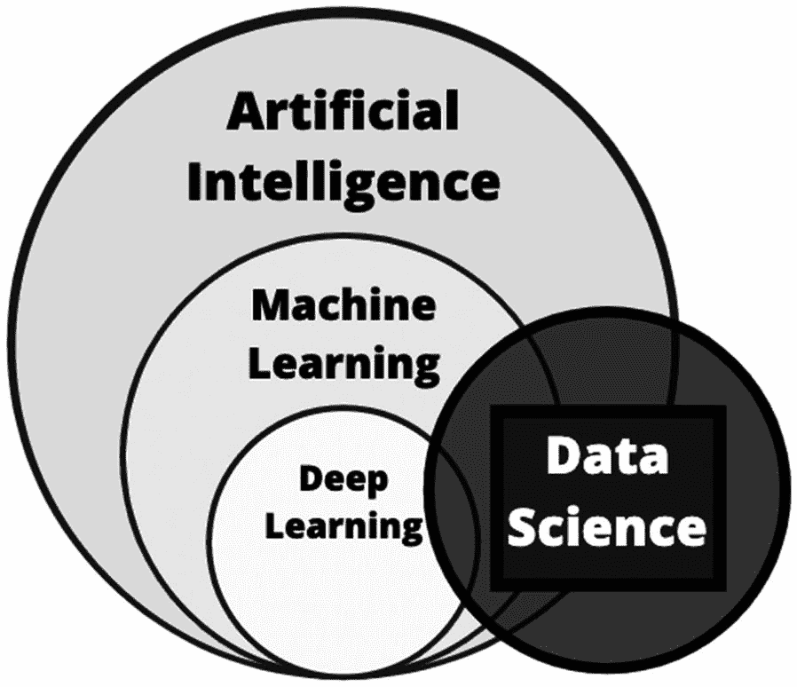
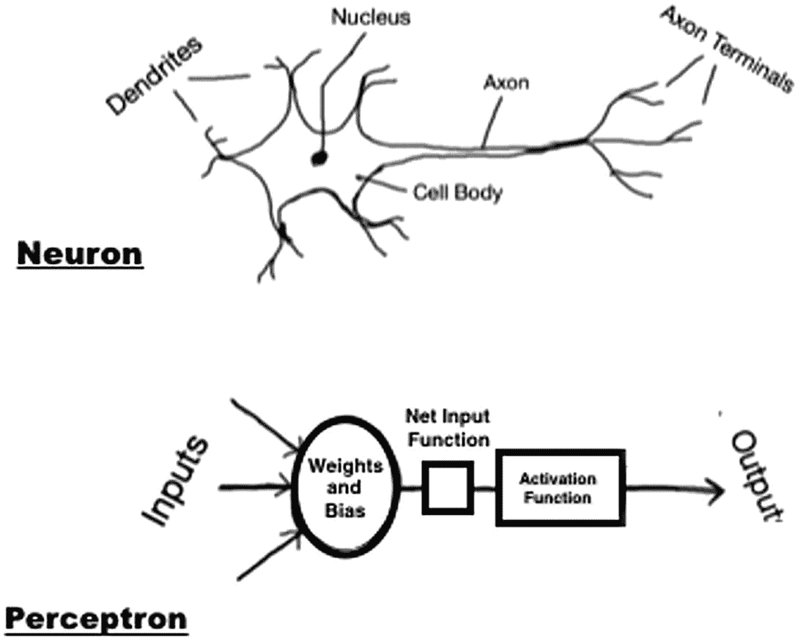
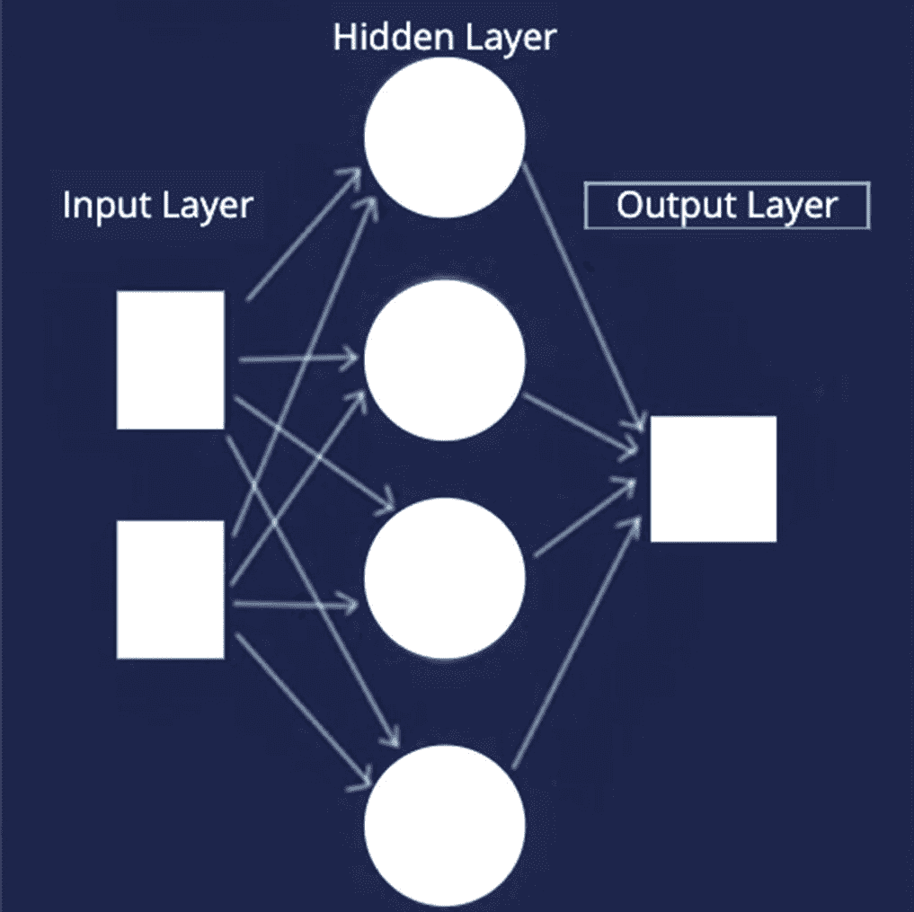

# 3. 深度学习简介

用于人工智能的机器学习到目前为止听起来相当有趣，不是吗？当我第一次听说它时，我觉得这像是科幻电影里的东西。过去只能在*银幕*生活中体验的事物，现在也能在*现实*生活中体验到了，这真是太神奇了！

哦，是的，这个双关语绝对是故意的。

一旦机器学习在技术领域腾飞，便势不可挡。每一天，每一分钟，人们都开始有新的发现，并开发出比以往模型性能更优的新模型。然而，这些机器学习模型仍然不够好。它们确实能工作，别误会我的意思。它们也相当有效。但它们就是不够高效。

直到人们成功开发出一种机器学习技术，它能够帮助机器自行解决问题，从而以极高的精度解决极其复杂的问题。事实上，这项技术变得非常流行，现在它作为人工智能下的一个独立领域而广为人知（尽管它并未与机器学习分离）。它很快被命名为“深度学习”。

在本章中，我们将了解这种机器学习方法是如何产生的，以及为什么需要它。我们还将深入探讨深度学习所涉及的过程；即神经网络的工作原理。这将使我们理解像 TensorFlow 这样的库在编程语言中为何重要，尤其是在深度学习的背景下。

## 深度学习的起源

*深度学习是机器学习的一个分支，它使用人工神经网络来帮助机器思考并响应特定问题*。

这里需要记住的重要一点是，尽管很容易将深度学习视为人工智能下的一个独立领域，但它绝对不是。它仍然是人工智能的一部分，并且是机器学习的一个子集（图 3-1）。



图 3-1 深度学习是人工智能领域中机器学习的一个子集

因此，我们可以说深度学习是机器学习的子集，而机器学习又是人工智能的子集。数据科学在这里就像一个公分母，因为它是这三个领域都不可或缺的一部分。深度学习的起源归功于沃尔特·皮茨和沃伦·麦卡洛克。

沃尔特·皮茨是一位计算神经科学领域的逻辑学家，而沃伦·麦卡洛克则是一位神经生理学家和控制论专家。

1943 年，他们创建了一个受人类大脑中神经网络启发的计算机模型。他们开发了一种称为阈值逻辑的东西，这是一种数学和算法的结合，将总输入与某个阈值进行比较。这使他们能够像大脑中发生的那样，重现思考过程。这是一项突破，引领了更多深度学习的创新。

现在，让我们来了解其中一个非常重要的方面——神经网络。

## 神经网络

神经网络，或称人工神经网络，其灵感来源于生物神经网络并以其为模型。这些网络就像人脑一样，无需显式编程就能学会执行特定任务。

神经网络由一系列相互连接形成网络的神经元组成，因此得名神经网络。神经元，或人工神经元，是神经网络的基本单元。它是一个数学函数，模拟了人脑中的神经元，如图 3-2 所示。表 3-1 提供了生物神经元和人工神经元的比较。

表 3-1 生物神经元与人工神经元的比较

| 生物神经元 | 人工神经元 |
| --- | --- |
| 它以电信号的形式接收信息。 | 它以数值的形式接收信息。 |
| 从字面上讲，人脑大约由 860 亿个生物神经元组成。 | 一个神经网络最多可以包含大约 1000 个人工神经元。 |
| 一般结构包括细胞体、树突和轴突。 | 一般结构包括权重和偏置、净输入函数以及激活函数。 |



图 3-2 一个生物神经元和一个人工神经元

注意，*感知机*就是一个人工神经元。在深度学习中，术语*感知机*和*神经元*可以互换使用。

## 人工神经元（感知机）的工作原理

感知机遵循特定的步骤流程来实现其期望的输出。让我们一步步了解感知机的工作原理。

### 第 1 步：接收输入

感知机以向其提供的数字信号形式接收来自用户的输入。这些输入是用于训练模型的“特征”。它们用`x(n)`表示，其中`n`是特征的编号。然后，这些输入通过一个称为前向传播的过程被馈送到神经网络的第一层。

### 第二步：设置权重和偏置

*   **权重：** 权重是在训练模型时计算和设置的。它们用`w(n)`表示，其中`n`是权重的编号。例如，第一个权重是`w1`，第二个权重是`w2`，以此类推。
*   **偏置：** 偏置用于以更高的速度和精度训练模型。我们通常用`w0`来表示它。

### 第三步：计算净输入函数

净输入函数的方程如下：

```
I = Sum(x(n).w(n) + w0)
```

因此，每个输入特征都乘以其对应的权重，然后取所有这些乘积的总和。接着，将偏置加到这个结果上。

*   **感知机学习规则：** 根据此规则，算法会自动确定权重的最优值。然后，输入特征会乘以这些权重，以决定感知机是否应该转发信号。感知机会接收多个信号，如果这些信号的总和超过特定阈值，它就会返回一个输出信号，否则不会。

### 第四步：通过激活函数传递数值

激活函数有助于为感知机提供非线性特性。有三种可用的激活函数类型：`ReLU`、`Sigmoid`和`Softmax`。

#### `ReLU`

修正线性单元用于消除输出中的负值。

如果输出为正，则保持原值。

如果输出为负，则显示为零。

**优点：**

1.  具有可扩展性。
2.  计算效率高。
3.  适用于处理复杂数据集的神经网络。

**缺点：**

1.  输出值不受限制，这意味着如果通过它传递大数值，可能会引发问题。
2.  当学习率较大时，神经元可能变得不活跃并“死亡”。
3.  数据处理不对称，结果可能不一致。

#### `Sigmoid`

这是一种特殊的数学函数，其输出结果为概率值 1 或 0。

**优点：**

1.  可微分且单调。
2.  可用于二分类。
3.  在只需要找出概率时非常有用。

**缺点：**

1.  无法给出精确值。
2.  存在梯度消失问题，这导致`Sigmoid`函数无法用于多层网络。
3.  模型在训练过程中可能陷入局部最小值。

#### `Softmax`

它通常用于神经网络的最后一层。它通常用于将输出转换为总和为 1 的值。因此，这些值将介于 0 和 1 之间。

**优点：**

1.  可用于多分类。
2.  范围仅在 0 到 1 之间，从而简化了我们的工作。

**缺点：**

1.  不支持空类。
2.  不适用于线性可分的数据。

#### 独热编码

独热编码是一种在生成输出时可以使用的调整方法。它用于将最高值四舍五入为 1，同时将其他值设为 0。这使得更容易确定哪个是所需的类别，因为从一堆 0 中找出一个 1，比从一组随机数字中找出最大值要容易得多。

例如，假设我们有一组输入，如 0.11、0.71、0.03、0.15。这里，由于只有四个值，识别最高值显然并不太难。

现在想象一下，如果列表中有大约 1000 个值。那会很难，不是吗？

但是，借助独热编码，我们可以轻松地从零中识别出那个一。这就是为什么它是神经网络中常用的一种技术。

专业提示：最常见的做法是在所有隐藏层中使用`ReLU`激活函数，然后使用`Softmax`激活函数（用于多分类）或`Sigmoid`激活函数（用于二分类）。

### 第五步：生成输出

最终的输出随后从最后一个隐藏层传递到输出层，然后呈现给用户。

现在我们已经了解了感知机的工作原理，接下来让我们更深入地探讨神经网络是如何执行深度学习任务的。

## 深入探究神经网络

深度学习是机器学习更进一步的发展。它允许机器开始自主思考，以便做出决策并执行特定任务。神经网络用于开发和训练深度学习模型。例如，考虑一个非常简单的神经网络，它由一个输入层、一个输出层和一个神经元层（称为隐藏层）组成（如图 3-3 所示）。这三个部分的基本功能如下：



图 3-3 基本神经网络

1.  **输入层**，顾名思义，由将进一步传输到神经网络中的输入信号组成。
2.  **隐藏层**是所有重要计算发生的地方。它接收馈入的输入，对其执行计算，然后将此输入发送到下一层，即输出层。隐藏层内可以有任意数量的神经元。根据我们的需求和安排，也可以有多个隐藏层。
3.  **输出层**，顾名思义，包含输出信号。这些信号不过是隐藏层执行的所有计算的最终结果。

### 处理流程

神经网络的处理流程包含四个主要步骤，使其能够为给定的任何问题找到最优解。

*   **步骤 1：** 数值输入信号被传递到神经网络的隐藏层。
*   **步骤 2：** 使用训练期间生成的权重和偏置计算净输入函数。
*   **步骤 3：** 将激活函数应用于净输入函数。
*   **步骤 4：** 然后将结果作为神经网络的输出生成。

因此，深度学习作为机器学习的一部分，在人工智能领域是一种极其有用的技术。

### 补充概念

在接下来的部分中，我们将回顾一些在神经网络方面需要了解的关键概念。

#### 梯度下降

梯度下降是一种用于优化的深度学习算法。它确定函数参数的值，以确保成本函数的值最小化。

它通过迭代地沿着最陡下降的路径（取决于梯度的负方向）移动来最小化函数。

计算误差函数相对于神经网络权重的梯度。之后，将输出与标签进行比较以计算误差。

### 前向传播

感知机接收输入或“特征”，对其进行处理，然后预测输出。然后将此输出与标签进行比较以测量误差。这被称为前向传播。

数据被馈送到神经网络的一层，通过激活函数，然后馈送到下一层。数据必须向前移动以确保获得输出。

因此，对于神经网络中的任何隐藏层，在第一层之后，输入不过是前一层生成的输出。

### 反向传播

误差反向传播是一种用于训练监督学习模型的深度学习算法。它针对单个输入输出对，计算网络生成的权重所对应的[损失函数](https://en.wikipedia.org/wiki/Loss_function)的[梯度](https://en.wikipedia.org/wiki/Gradient)。通过修改权重值来最小化损失。这是一种高效的计算方法，因此使得使用[梯度方法](https://en.wikipedia.org/wiki/Gradient_method)训练多层网络成为可能。

该算法通过[链式法则](https://en.wikipedia.org/wiki/Chain_rule)，逐层计算损失函数相对于每个权重的梯度。它从最后一层开始反向迭代。这样做是为了避免过程中的冗余计算。

### 过拟合

过拟合是一个统计学概念。当分析被认为对提供的数据过于精确时，就会发生这种情况，从而导致模型训练不当。当我们训练模型时，可能会获得非常高的准确率。然而，在测试模型时，我们可能会发现准确率存在巨大差异。这就是过拟合的结果。

当我们训练模型次数过多，或使用的数据过少时，就可能发生过拟合。模型最终会变得非常熟悉训练数据，从而在其上达到非常高的准确率。然而，当需要对新的数据进行预测时，它仍然会出错，因为它还没有以正确的方式进行训练。

## 神经网络类型

神经网络有多种类型，它们都基于各自的结构、组成和数据流。接下来，我们来讨论深度学习开发者常用且最重要的几种类型。

### 单层神经网络：感知机

感知机是最古老的单层神经网络。正如你之前所见，它接收用户的输入，乘以相应的权重，再加上偏置得到净输入函数，然后将结果通过激活函数得到最终输出。每个感知机只产生一个输出。

这种神经网络因其极其有限的复杂性而效率不高。因此，研究人员提出了包含多层感知机的模型。

### 多层神经网络

这种神经网络主要用于自然语言处理、语音识别、图像识别等。它由两层或更多层感知机组成，如下所示：

*   **输入层：** 这是所有输入系统并传输到神经网络其余部分的可用数值数据。
*   **隐藏层：** 这是所有神经元所在的位置。每一层可以有任意数量的神经元。它们被称为“隐藏”层，是因为它们在执行必要计算时，始终隐藏在神经网络内部。
*   **输出层：** 这是隐藏层中所有计算的最终结果。

### 卷积神经网络

卷积神经网络遵循与多层神经网络相同的原理，唯一的区别在于它们包含“卷积层”，这些层使用了滤波器。

滤波器是一个大小为 AxB 的网格，它在图像上移动，并与图像多次相乘，以产生一个新值。每个值代表图像中的一条线或一个边缘。

一旦滤波器在图像上使用过，就可以提取其重要特征。这是借助池化层完成的。这些层汇集或收集每幅图像的主要特征。一种常用的技术称为最大池化，它取每幅图像中的最大值，并将其存储在一个单独的网格中。这样就将主要特征压缩到一幅图像中，然后将其传递给常规的多层神经网络进行进一步处理。

这些神经网络主要用于图像分类。它们也可以用于搜索引擎和推荐系统。

### 循环神经网络

循环神经网络（RNN）用于处理时序数据；即需要利用过去经验来预测未来结果的数据。状态矩阵通过存储上一次的输出来记住数据先前的状态，然后利用这些数据来计算新的输出。

长短期记忆网络（LSTM）将状态矩阵保存在两种状态中：长期状态和短期状态。RNN 从第一层之后的层开始。在这里，每个节点在计算过程中充当一个记忆单元，这使得它能够在反向传播过程中将先前的值与新值进行比较。这些神经网络可用于股票市场预测、自然语言处理和价格确定。

### 序列到序列模型

序列到序列模型主要用于输入数据和输出数据长度不相等的情况。

它使用了两个循环神经网络，以及一个编码器和一个解码器。编码器处理输入数据，而解码器处理输出数据。

这些模型通常用于聊天机器人和机器翻译。

### 模块化神经网络

模块化神经网络包含多个不同的网络，每个网络独立工作以完成整个任务的一部分。这些网络彼此之间没有连接，因此在此过程中不会相互交互。

这有助于通过分配每个网络完成的工作来减少执行计算所需的时间。每个子任务只需要完成工作所需的总时间、功率和资源的一部分。

任务时间

请查看其他类型的神经网络。它们之间有何不同？机器学习开发者应如何在这些模型中进行选择？

## 总结

深度学习是一个庞大的主题，不可能在一章中详细涵盖所有内容。然而，至少学习其基础知识就足够了，而这正是我们所做的。

我们学习了什么是深度学习神经网络及其工作原理。此外，我们还讨论了一些与神经网络功能相关的重要概念。最后，我们了解了多种类型的神经网络，这让我们更清楚地理解了如何针对不同目的开发和运用它们。尽管深度学习是机器学习的一部分，但这两个术语经常被当作完全不同的实体来使用。这可能会让人相当困惑，尤其是对初学者而言。因此，在下一章中，我们将了解如何对它们进行比较。