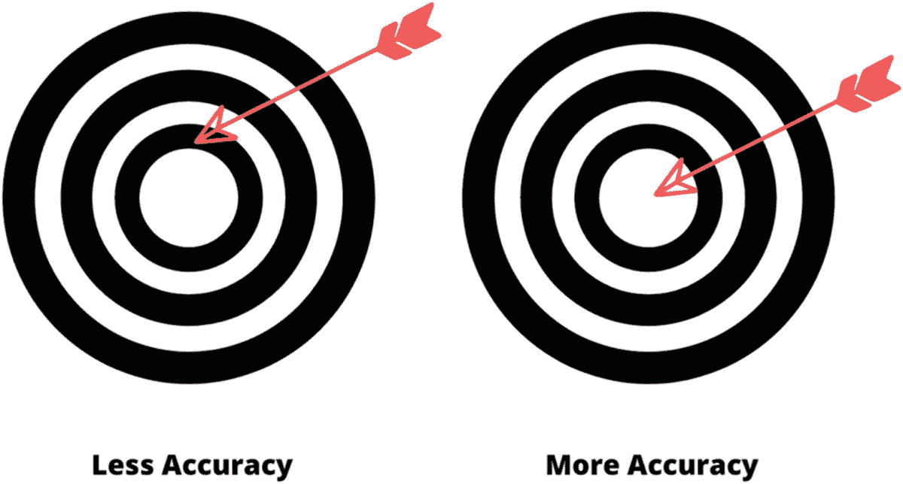
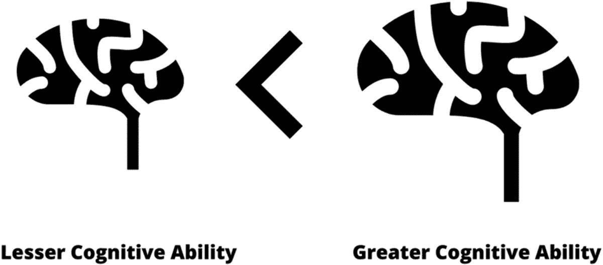
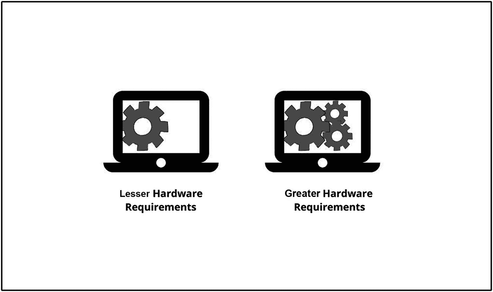
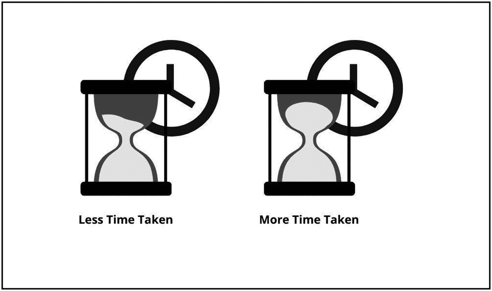

# 4. 机器学习 vs. 深度学习

在前几章中，我们了解到人工智能涉及会思考的机器这一现象。机器学习是帮助机器思考，使其能够自主执行动作的技术。我们还了解到深度学习是机器学习的一种，它使用神经网络来帮助机器学习。这些神经网络是模仿人脑构建的。

话虽如此，你现在可能会想：既然机器学习和深度学习并非独立，而是后者是前者的子集，我们为什么还要比较它们呢？

嗯，正如你所见，传统机器学习有几种方法。深度学习是其中一种在工作方式上更为先进的方法，因此其过程和结果可能会有所不同。在这简短的一章中，我们将讨论传统机器学习和深度学习之间的差异，这将帮助我们理解何时根据需求使用每种方法。

## 比较机器学习与深度学习时使用的因素

首先，我们需要了解，我们将基于六个特征来比较机器学习和深度学习。当然，这些并非唯一的因素，还有其他一些因素可以将两者区分开来。然而，为了清晰理解两者之间的差异，我们将考虑这六个方面。让我们简要地逐一了解它们。

*   **所需数据量：** 这指的是学习过程所需的数据量。在某些情况下，我们可能拥有从各种来源收集的海量数据，并希望将其用于分析。在其他情况下，我们可能拥有的数据量稍少，需要利用这些数据进行分析。

*   **准确性：** 每个机器学习和深度学习问题的主要目标都是获得最高的准确性，同时确保模型没有达到过拟合状态。也就是说，我们的结果可能会因所使用的方法、算法、技术和数据而异。一种方法可能给我们带来更高的准确性，而另一种方法则可能不然。

*   **计算能力：** 被训练的机器需要大量的计算能力才能有效地执行任务。早期，当机器学习刚刚被发明时，机器速度较慢且容量较小。这导致了低效的结果。然而，如今机器已经改进。因此，利用强大的计算能力来执行计算是可能的。

*   **认知能力：** 这指的是机器理解自身不准确性并自行解决问题的能力。如果机器不具备这种能力，它将无法修正其参数和/或结构，程序员将不得不介入并为机器完成这项工作。

*   **硬件要求：** 这指的是算法执行各自操作所需的硬件设备类型。这主要取决于程序的先进程度以及预期的结果。

*   **所需时间：** 这指的是首先训练模型，然后验证模型所需的时间。这可能因所使用的不同参数和算法而异。通过修改它们，我们可以增加或减少训练和测试模型所需的时间。

现在我们已经了解了将用于比较模型的各种因素以及每个因素的具体含义，我们可以继续探讨机器学习和深度学习之间的差异。

## 区分常规机器学习与深度学习

在开始之前，我们必须记住，这些不一定是区分机器学习和深度学习的唯一因素，特别是考虑到整个过程是一个高度先进的技术领域，这意味着其中涉及许多复杂之处。然而，我们将保持比较简单但信息丰富，以便轻松理解这两个过程之间的差异。因此，考虑到前面提到的六个因素，我们现在来看看机器学习和深度学习是如何相互区别的。

### 所需数据量

通常，机器学习需要大量数据才能使机器成功地进行自我训练。然而，在传统的机器学习中，我们不需要有太多的数据。我们只需要足够的数据使机器能够处理、学习和行动。另一方面，深度学习需要更大量的数据。这是为了确保机器有足够的信息在没有外部帮助的情况下自行进行推理。见图 4-1。

*图 4-1 数据需求比较*

### 准确性

正如你可能已经理解的，准确性是衡量机器在提出解决方案时正确或精确程度的指标。尽管两种方法都能给出相当精确的结果，但如图 4-2 所示，常规机器学习的准确性相对较低，因为它用于学习和推理的数据量较小。深度学习则准确得多，因为它用于学习和推理的数据量很大。

*图 4-2 准确性比较*

### 计算能力

机器学习和深度学习都需要大量的计算能力，以便使用提供给它们的数据来训练模型。然而，常规机器学习程序所需的计算量相对较少，这主要是因为它在计算中使用的数据较少。深度学习需要更多的能力来分析其数据并训练其模型。见图 4-3。

*图 4-3 计算能力比较*

### 认知能力

机器学习和深度学习之间最重要的区别之一是它们的认知能力不同。机器学习模型的认知能力较低，因为如果它们做出了不准确的预测，就需要外部帮助（在这种情况下是程序员）来进行必要的更改，然后重新训练模型。然而，深度学习模型具有更高的认知能力，因为它们可以自行找出不准确之处并进行必要的更改，无需程序员介入。见图 4-4。

*图 4-4 认知能力比较*

### 硬件要求

大多数传统的机器学习算法可以在低端系统上平稳运行。它们不过分依赖复杂的机器来执行其流程。另一方面，深度学习算法严重依赖于所使用的硬件，因为它们需要 `GPU` 来优化其流程。因此，它们的操作需要高端机器。见图 4-5。

*图 4-5 硬件要求比较*

### 所需时间

尽管并非在所有情况下都如此，但一个普遍已知的事实是，机器学习模型训练所需的时间较少，而深度学习模型则需要更长的时间。这主要是因为深度学习模型包含更多的参数，这意味着机器在从数据中学习方面有更多的工作要做。然而，机器学习模型没有太多参数，因此算法更容易计算。

在模型验证方面，深度学习往往更快，而机器学习则较慢。同样，这因情况而异。见图 4-6。

*图 4-6 所需时间比较*

## 总结

我们已经了解了深度学习与机器学习的六点不同之处。现在很容易理解为什么许多人认为这两个领域在人工智能领域都极其重要。根据可用的输入类型和技术条件，人们可以选择想要采用的机器学习方法类型。

接下来，我们可以继续探讨设置系统以帮助其学习的过程。这就是编程部分发挥作用的地方。机器学习要求程序员使用数据科学技术，随后应用一些特定的机器学习算法，使机器能够自主思考。所有这些都可以在单个程序中完成。

我们可以使用多种编程语言来执行机器学习任务，例如 `Python`、`Java`、`C++`、`Julia` 和 `R`。然而，由于 `Python` 迄今为止已成为最流行的机器学习编程语言之一，我们将在接下来的几章中，结合机器学习和深度学习的背景来学习它。