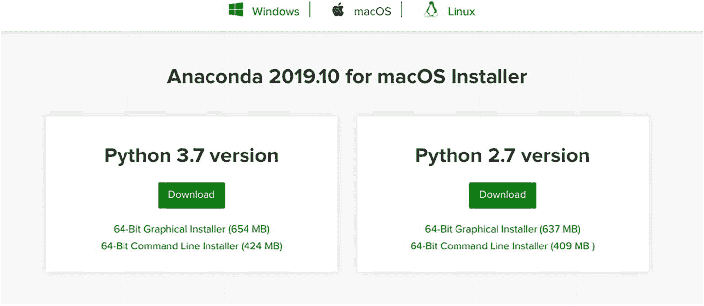
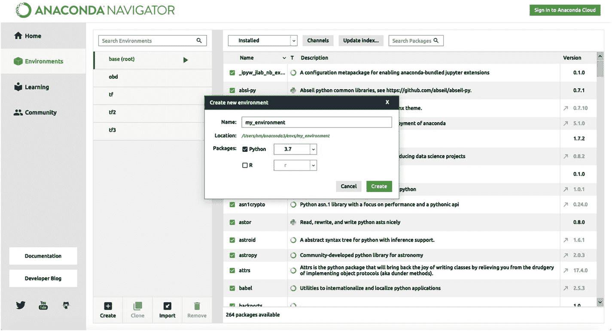
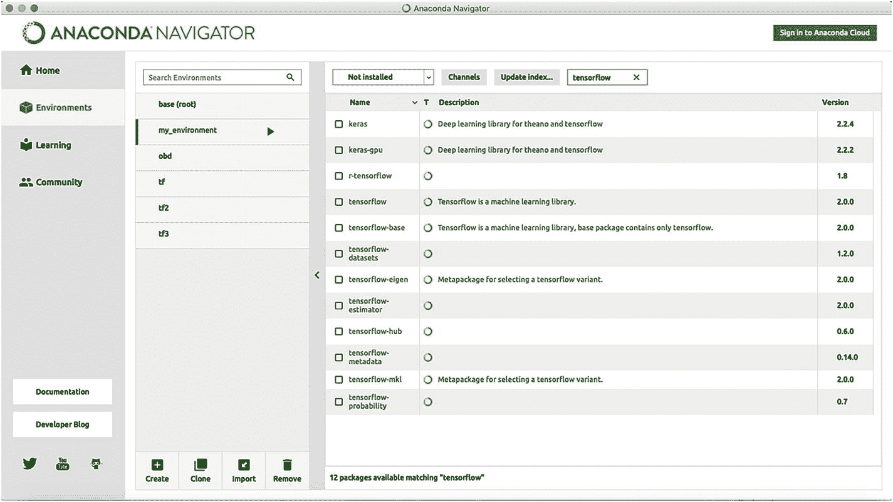
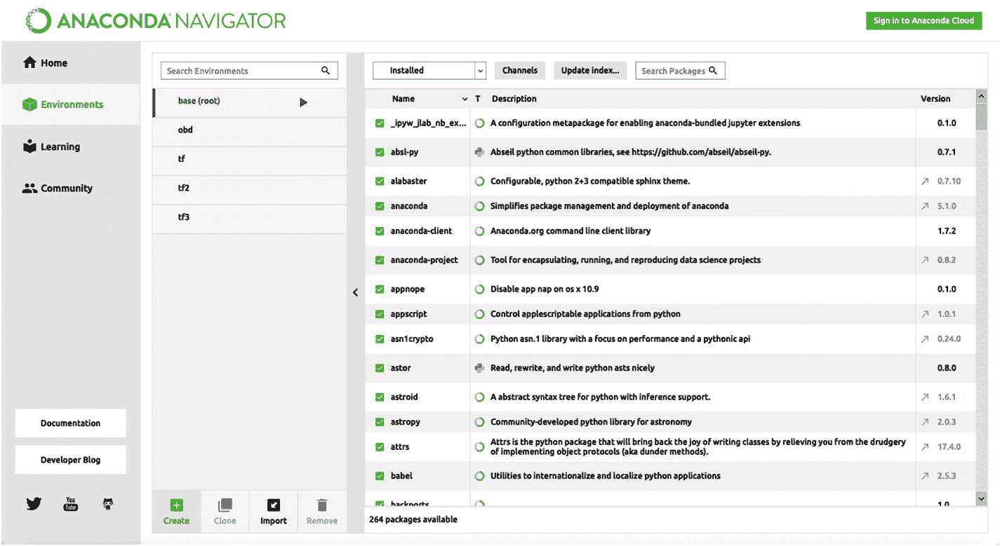
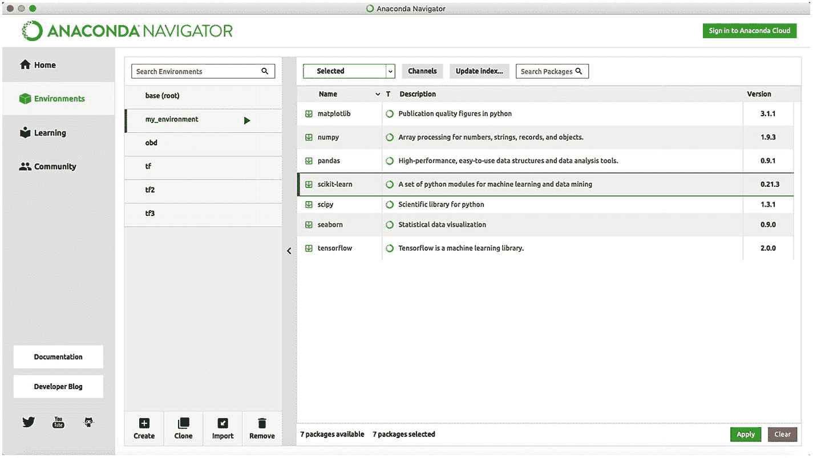
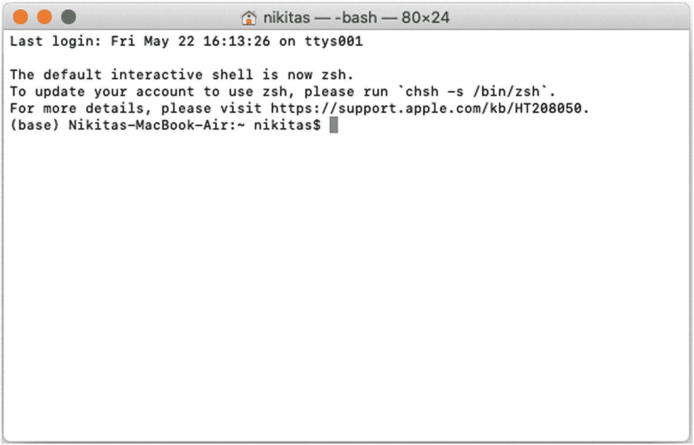
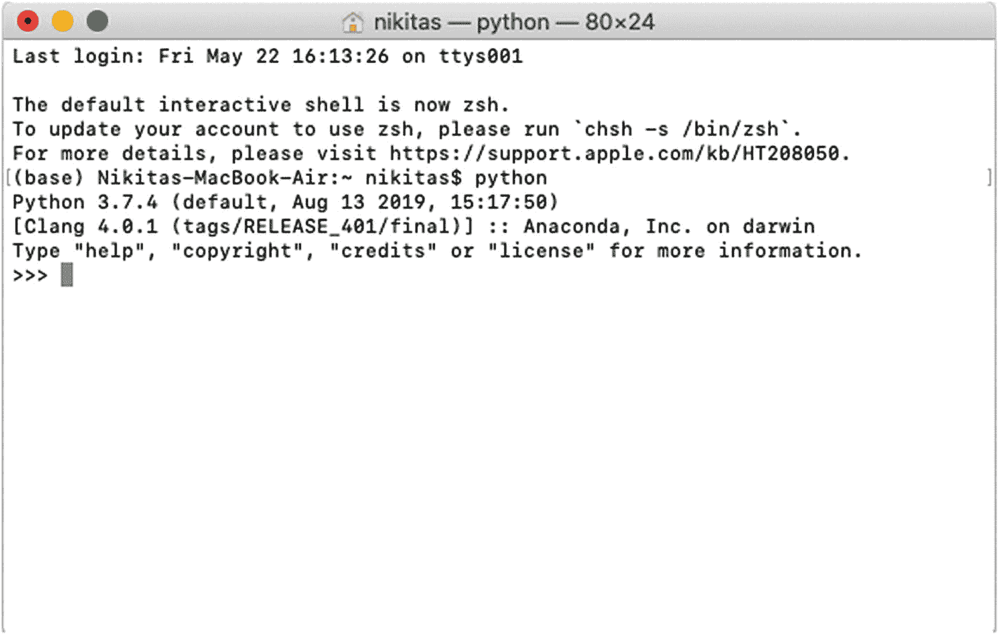
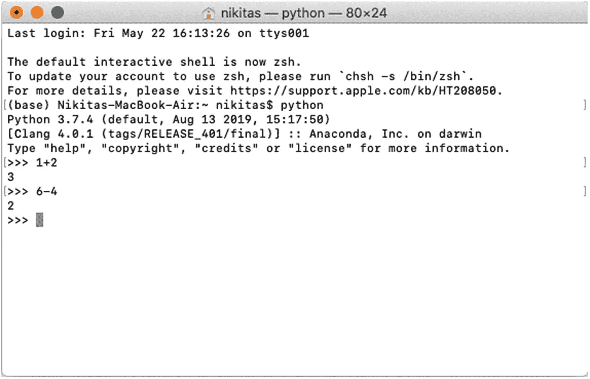
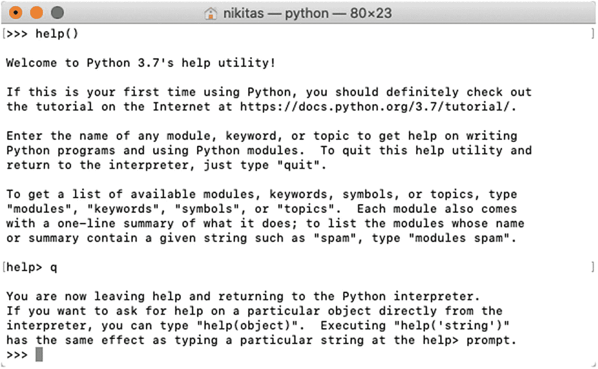
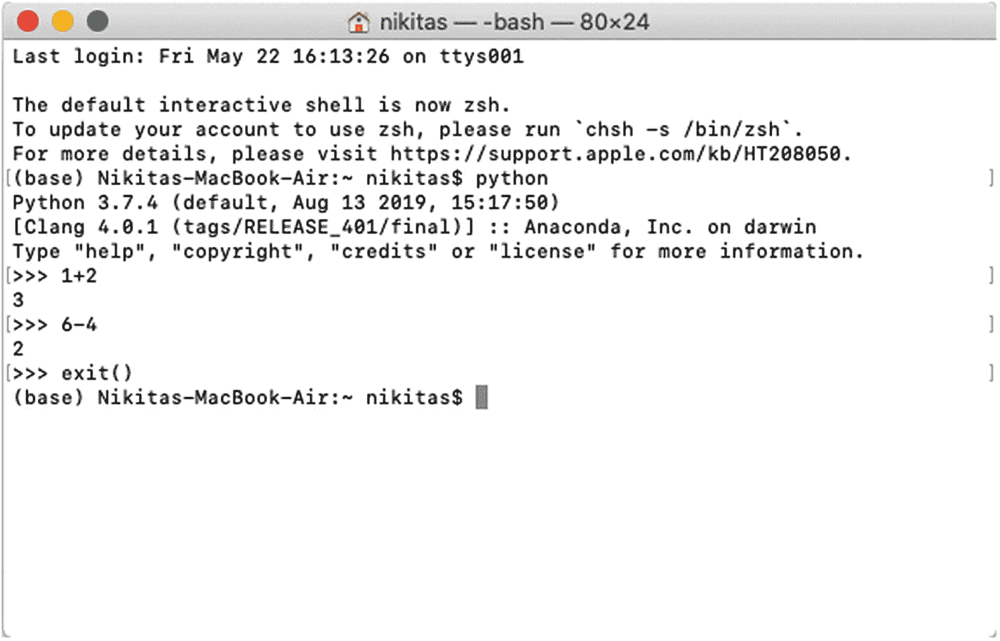

# 5. 使用 Python 进行机器学习

在前面的章节中，我们了解了什么是人工智能，以及如何使用机器学习和深度学习技术来训练机器变得智能。在接下来的几章中，我们将学习如何训练机器来获取数据、处理数据、分析数据并从中得出推论。

机器需要被编程才能执行特定操作。迄今为止，世界上大约有 700 种主要和次要的编程语言。这些语言随着时代的需求而不断发展。许多语言只是旧语言的新版本或改进版本。随着计算机及计算机相关业务的发展，对编程语言的需求也随之增加。

随着人工智能的发展，编程语言在机器训练中的实用性成为其受欢迎程度的附加标准。截至 2019 年，排名前三的语言是 `Java`、`Python` 和 `C/C++`。除 `C` 语言外，其他语言都是面向对象的。

> **注意**
> 面向对象编程（`OOP`）是一种编程类型，其中数据以字段或属性的形式存储在对象中，而代码则以方法或过程的形式存储。
> `OOP` 是一种常见的编程方法，因为它具有可扩展性、可重用性和高效性。

在本书中，我们将学习如何借助 `Python` 对机器进行编程。目前，在机器学习领域，`Python` 是使用最广泛的语言之一。我们将从熟悉这种编程语言开始。

## Python 简介

`Python` 最初由荷兰数学家吉多·范罗苏姆于 1990 年在荷兰国家数学与计算机科学研究中心开发并发布。一个非常有趣的事实是，`Python` 这个名字出人意料地并非取自那种臭名昭著的爬行动物，而是取自吉多非常喜欢的同样臭名昭著的喜剧团体——蒙提·派森。

根据 `Python` 官方网站的说法：“`Python` 是一种解释型、面向对象、高级编程语言，具有动态语义。”

简单来说，
*   它是一种解释型语言，这意味着指令可以自由、直接地执行，无需任何预先编译；
*   它使用包含数据和代码的对象；
*   它遵循一种易于人类理解的语言风格；
*   它允许信息随时间更新。

`Python` 的流行度首次达到顶峰是在 2003 年左右，从那时起，它一直保持着高度赞誉的编程语言地位。其流行度主要归功于它的特性，这些特性将在下一节中列出。

### Python 的主要特性

`Python` 的开发主要是为了提高代码可读性，并减少编程机器所需的代码量。除此之外，它还具有各种独特的特性和功能，使我们的整体编程体验顺畅而简单。

这些特性包括：
*   **开源许可：** 这意味着它可以在 OSI 批准的许可下免费下载、修改和重新分发。
*   **可读性：** 它具有非常易于阅读的语法。
*   **跨平台运行：** 它可以在任何操作系统上运行，包括 `Linux`、`Windows`、`Mac OS` 等。
*   **丰富的标准库：** 它包含许多可用于各种应用程序的有用库。
*   **易于集成：** 它可以轻松地与 `C`、`C++`、`Java` 等其他语言集成。
*   **支持面向对象和面向过程编程：** 它主要遵循 `OOP`，但也为 `POP` 留出了空间，这是 `Python` 最独特的特性之一。
*   **支持 GUI 编程：** 它拥有多个库，允许用户快速轻松地开发图形用户界面。
*   **庞大的社区：** 它拥有一个庞大的编码者社区，使得改进、获取帮助、解决问题和开发新想法变得更加容易。

> **趣味知识**
> 支持 `Python` 语言的用户社区，更具体地说，那些借助 `Python` 进行编码的专家，被称为 Pythonistas。

### Python 的竞争对手

如前所述，还有许多其他编程语言用于不同领域和不同目的。在人工智能的机器学习领域，除 `Python` 外，人们常用的一些编程语言包括：
*   **R：** 它主要用于可视化表示，因为只需几行代码就能非常轻松地创建图表。因此，它允许进行探索性数据分析。
*   **Java：** 它是计算机编程界最古老的语言之一。它在速度、可靠性和安全性方面表现出色。
*   **Scala：** 它的运行时速度极快，可用于开发复杂的代码片段。对于初学者来说，掌握它难度适中。
*   **Julia：** 它是高级、可扩展、动态且快速的。它还提供了一些可用于机器学习的强大原生工具。
*   **C++：** 它具有高速、充足的库和工具集，并且在应用统计技术时效率最高。

### Python 作为机器学习的首选语言

机器学习可能成为一个相当复杂的过程，尤其是在数据量庞大、模型复杂且目标具有挑战性时。也就是说，它需要一种能够简化其过程并减少开发人员繁琐工作的语言。

与其他编程语言相比，`Python` 因以下原因而脱颖而出：
*   它可以在不同平台上无缝运行。因此，开发人员无需担心只能使用单一平台。他们可以轻松地分发和使用 `Python` 代码。许多其他语言不提供此功能，或者其跨平台能力有限，因此只能在单一平台上使用。
*   它包含大量机器学习专用的库、工具和框架，开发人员可以使用它们来使编程更快、更容易。其他语言没有如此广泛的选择。
*   它的代码简单、可读且简洁。因此，开发人员更容易将注意力集中在手头的机器学习问题上，而不必像大多数其他语言那样过多担心编写正确的代码和遵循正确的语法。
*   它拥有一个庞大的、经常使用该语言的开发者社区。这使得我们在编程过程中遇到任何问题时更容易提问。它还允许 `Python` 开发者聚在一起讨论技巧和想法。其他编程语言的社区要么较小，要么根本没有社区。

### Python 的机器学习库

首先，我们来理解什么是库。

*编程世界中的库是方法和函数的集合，它允许用户执行各种任务，而无需为此编写必要的代码。*

我们使用库是为了在编程时节省时间。`Python` 拥有大量开源的机器学习库，包括但不限于以下几种：
*   **Pandas：** `Pandas` 库为用户提供了处理大型数据集的能力。它提供了用于读写数据、清洗和修改数据等功能的工具。
*   **Numpy：** `Numpy`（即 Numerical Python）库为用户提供了强大的数组计算能力。它解决了数学计算速度慢的问题，并允许用户借助多维数组执行大规模计算。
*   **Scipy：** `Scipy` 库用于科学和技术计算。它基于 `Numpy` 的多维数组进行工作。
*   **Scikit-Learn：** `Scikit-Learn` 库包含各种专门为满足用户机器学习需求而设计的功能和方法。它利用了 `Numpy` 库，尤其是在数组操作方面。
*   **TensorFlow：** `TensorFlow` 库是一个日益流行的库，它为用户提供了一套庞大且灵活易用的机器学习工具。你将在本书的后续部分了解更多关于 `TensorFlow` 的内容。

借助这些库，我们可以快速轻松地开发机器学习程序。

### Python 的其他应用

由于 `Python` 作为一种编程语言具有多样化的功能，它的用途并不仅限于人工智能。它还用于各种其他应用。其中一些应用包括：
*   网页开发
*   数据分析
*   教育目的
*   软件测试
*   计算机图形学
*   游戏开发
*   科学与数值计算
*   桌面图形用户界面

## 安装 Python

如前所述，`Python` 是免费下载的。根据你的操作系统和个人偏好，有几种方法可以将 `Python` 下载并安装到你的系统上。

一种方法是从 `Python` 官方网站安装，该网站提供了一个安装程序，用户可以下载并在其计算机上运行。

另一种方法是借助像 `Homebrew` 这样的包管理器来安装，这会使安装过程更加便捷。

在本书中，我们将学习一种非常简单的方法——借助一个名为 `Anaconda` 的应用程序。

*`Anaconda` 是 `Python` 和 `R` 编程语言的一个开源发行版。我们可以免费下载并在系统上使用它。*

它的创建主要是通过简化包安装过程，使我们的机器学习流程更加容易。它拥有易于使用的界面，并且预装了 `Python`。它还能让安装 `Jupyter Notebook` 应用程序的任务变得更加简单，我们将在下一章中看到这一点。

现在让我们学习如何将 `Anaconda` 安装到我们的系统上。

### 使用 Anaconda 安装 Python

在开始之前，我们必须查看 `Anaconda` 文档中给出的系统要求，以确保我们的系统能够毫无问题地支持 `Anaconda`。要下载 `Anaconda`，我们需要遵循以下步骤：


*图 5-1*

选择要下载和安装的正确版本

1.  访问 `Anaconda` 网站（[`https://www.anaconda.com/distribution/`](https://www.anaconda.com/distribution/)），找到适用于你操作系统的下载选项，如图 5-1 所示。


*图 5-2*

创建一个新的 `Python` 环境

# 安装 Python 和 Anaconda

1.  由于 Anaconda 预装了 Python，当你下载 Anaconda 应用程序时，它允许你选择要安装的 Python 版本。选择可用的最新 Python 版本，然后点击下载按钮。这里，我为我的 Mac OS 选择了 Python 3.7。

2.  Anaconda 下载完成后，在计算机上找到该文件，然后双击它开始安装。

3.  安装完成后，你将能够在应用程序列表中看到 `anaconda-navigator` 图标。点击它。

4.  你将看到一个显示一些有用的编程相关应用程序的屏幕。你还会看到，默认情况下，已经创建了一个包含 Python 及其库的 `base`（根）环境。

5.  除了 `base` 环境之外，创建一个新的工作环境总是好的。为此，点击创建按钮。在出现的对话框中，你可以为新环境命名，选择你的 Python 版本，然后点击创建按钮，如图 5-2 所示。


*图 5-4 未安装的包列表*


*图 5-3 已安装的包列表*

6.  环境创建完成后，你需要将其选为工作环境。完成此操作后，你可以通过点击“环境”，然后从顶部的下拉菜单中相应选择“已安装”或“未安装”选项，来查看已安装和未安装的包列表，如图 5-3 和图 5-4 所示。你甚至可以通过输入包名称来搜索特定的包。


*图 5-5 已选择要安装的包列表*

7.  现在，你可以开始安装一些机器学习所需的必要库，包括 `Pandas`、`NumPy`、`SciPy`、`Scikit-learn`、`TensorFlow`、`Matplotlib` 和 `Seaborn`。搜索这些库，通过点击它们左侧的复选框进行选择，然后点击应用按钮，如图 5-5 所示。

大功告成！你的 Python 环境现已下载、安装完毕，可以开始使用了！

# Python 解释器

Python 的一个关键特性在于它是一种解释型语言，而其他编程语言如 `Java`、`C` 和 `C++` 都是编译型语言。

让我们来理解一下两者的区别。

编译型语言会获取整个程序，并将其从机器码翻译成源代码，以获得所需的输出。因此，这类语言运行时速度更快，但无法跨平台。

解释型语言则通过逐行读取代码并直接执行来获得所需输出。因此，这类语言运行时速度稍慢，但可以跨平台。

目前正在开发一些新技术来解决运行时速度慢的问题，例如“即时”编译器，它在程序执行期间进行编译，而不是在执行之前。

现在，当我们说 Python 是一种解释型语言时，并不意味着它完全不编译。Python 程序确实会经历编译过程，只是这个过程不会明确地展示给程序员。代码会被编译成字节码，这是原始代码的一种低级形式。然后，这个字节码由 `Python` 虚拟机执行。

通过这种方式，Python 可以直接运行代码，不受特定平台的限制，并且在执行速度方面也不会太慢。

Python 可以使用多种类型的解释器来运行程序。让我们简要了解一下其中最常见的几种：

1.  **`CPython`**：这是 Python 的默认实现。它是最常用的实现，因为它与 Python 包以及用 C 编写的扩展模块兼容性最好。它是 Python 的参考实现，这意味着所有不同版本的 Python 都是用 C 语言实现的。

2.  **`Jython`**（原名 JPython）：这是一种用 Java 和 Python 编写的 Python 实现。它将 Python 代码翻译成 Java 字节码，然后在 Java 虚拟机上执行。这使得 Python 代码能够在 Java 平台上运行。它还允许用户像使用 Python 模块一样使用 Java 类。

3.  **`IronPython`**：这是一种为微软的 `.NET` 框架开发的 Python 实现。它既使用 Python 库，也使用 `.NET` 框架库。它还提供了一个交互式控制台和动态编译支持，以提高性能。

4.  **`PyPy`**：这个 Python 实现是用 RPython 编写的，RPython 是 Python 编程语言的一个子集。它使用即时编译器，因此运行时速度很快。它的目标是在增强性能的同时，最大限度地保持与 `CPython` 的兼容性。

5.  **`Stackless Python`**：与 `CPython` 一样，这个实现也是用 Python 和 C 编写的。它之所以得名，是因为它不依赖 C 调用来管理其栈。它在函数调用之间使用 C 栈，然后将其清除。它利用微线程，并支持任务序列化、微进程、通信通道等功能。

6.  **`MicroPython`**：这是一个小巧、开源的 Python 实现，用 C 语言编写，兼容 Python 3。它允许我们编写简单的 Python 代码，而不是复杂的低级语言代码，并且可以在微控制器硬件上运行。它包含 Python 标准库中的一系列模块，以及一些 `MicroPython` 特有的额外库，可用于对电路板进行编程。

现在我们已经了解了什么是解释器，接下来需要知道如何与它们交互。最通用的方法之一是使用所谓的 Python shell。

# Python Shell

在计算领域，shell 充当用户和解释器之间的媒介。借助 shell，程序员可以输入一些代码并接收必要的输出。Shell 等待用户输入命令或一行代码，然后执行这段代码并显示获得的结果。

它之所以被称为 shell，是因为它是操作系统的最外层。它可以根据特定操作的需求，为用户提供命令行界面（CLI）或图形用户界面（GUI）。

Python shell，或称 Python 交互式 shell，也叫做 Python `REPL` shell，它接收 Python 命令并执行，显示所需的结果。术语 *REPL* 是此过程中事件系统流程的首字母缩写，如下所示：

*   **读取：** 它从用户那里读取或接收输入。
*   **求值：** 它对输入进行求值。
*   **打印：** 它将输出打印或显示给用户。
*   **循环：** 它循环或重复此过程。

这个 shell 界面旨在简单、易用，非常适合初学者掌握计算机编程。

## 打开 Python Shell

这个任务比听起来要容易得多。基本上是一个两步过程，可以瞬间完成。


*图 5-6 Mac OS 终端*

1.  首先，你需要打开操作系统的命令行界面。例如，在 Mac OS 和 Linux 上是终端，而在 Windows 上是命令提示符。参见图 5-6。
2.  接下来，在此界面中，输入以下内容：

    ```
    python
    ```

    按下回车键。这应该会给出如图 5-7 所示的输出。


*图 5-7 Python shell*

我们现在进入了 Python `REPL` shell！这是我们可以用来进行 Python 编程的最简单的界面之一。这个 Python shell 现在可以接受 Python 命令作为输入，并执行它以显示必要的输出。图 5-8 展示了一些简单的例子，其中我执行了一些个位数的算术运算（加法和减法）。


*图 5-8 Python shell 中的算术运算*

我们可以使用 `help()` 命令来探索 Python 中的不同功能。要退出帮助窗口并返回 Python shell，请按 `q` 键，然后按回车键。参见图 5-9。


*图 5-9 Python 中的帮助窗口*

## 退出 Python Shell

完成 Python 编程后，我们需要通过关闭 shell 来退出 Python 编程环境。我们可以通过输入以下命令来实现：

```
exit()
```

这会退出 Python 交互式 shell，并返回到操作系统的主命令行界面。我们在命令末尾使用括号的原因是我们正在调用 `exit` 函数以退出 shell。参见图 5-10。



图 5-10

退出 Python shell

此步骤的键盘快捷键在 Mac OS 和 Linux 上是 `ctrl+D`，在 Windows 上是 `ctrl+Z+Enter`。

## 总结

在本章中，我们介绍了 Python 作为一门编程语言的基础知识。我们了解了它的起源、特性、在机器学习领域的重要性以及它的竞争对手。我们简要浏览了它的一些机器学习库，以及其他非机器学习的应用，只是为了更好地了解它能做什么。然后我们学习了如何将其安装到我们的系统中并进行配置。我们还了解了一些用于编程的常见 Python 解释器，并初步接触了 Python REPL shell。

然而，我们必须认识到，为了有效地将 Python 用于机器学习编程，Python shell 的作用并不大，因为它主要用于执行简短命令和简单编码。

因此，我们需要建立一个高效的工作环境，以便在其中输入和执行 Python 代码。一些常用的应用程序包括 Jupyter Notebook、PyCharm、Spyder 和 IDLE。在本书中，我们将使用 Jupyter Notebook 进行所有编程工作。

Jupyter Notebook 因其简洁性、易用性和可访问性而越来越受欢迎。它使大规模编程和代码分发变得更加轻松快捷。它的安装也非常简单，尤其是在 Anaconda 的帮助下。

话虽如此，让我们来看看 Jupyter Notebook 是什么，以及它如何改善我们的编码体验，尤其是在数据科学和机器学习的 Python 编程方面。

## 快速链接

-   了解更多关于 Python 的信息：[`https://www.python.org/about/`](https://www.python.org/about/)
-   Python 与其他编程语言的对比：[`https://www.python.org/doc/essays/comparisons/`](https://www.python.org/doc/essays/comparisons/)
-   Python 文档：[`https://www.python.org/doc/`](https://www.python.org/doc/)
-   Python 活动：[`https://www.python.org/events/python-events`](https://www.python.org/events/python-events)
-   了解更多关于 Anaconda 的信息：[`anaconda.com/why-anaconda/`](http://anaconda.com/why-anaconda/)