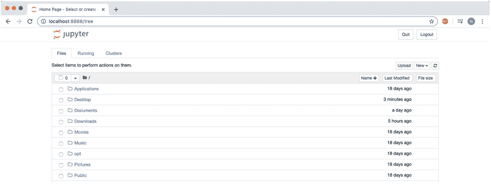
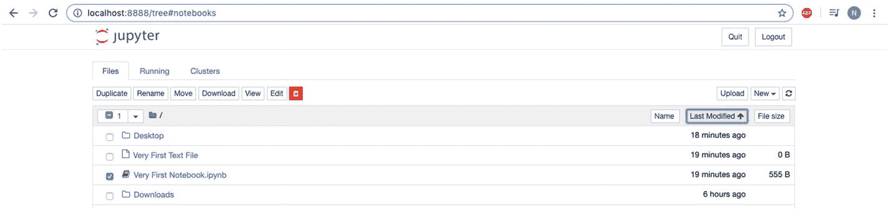
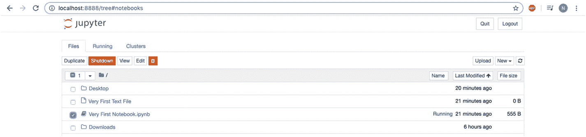
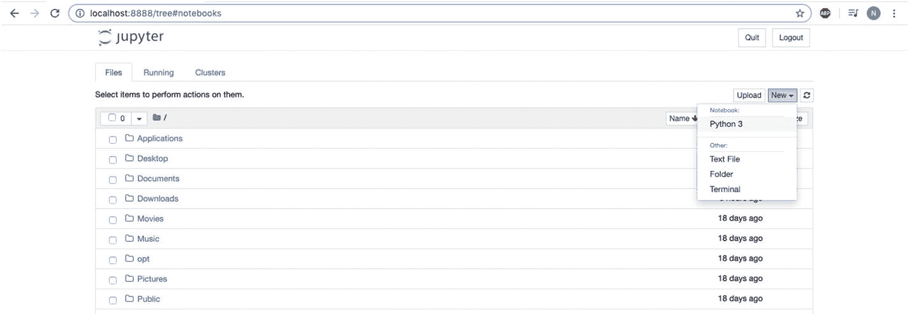
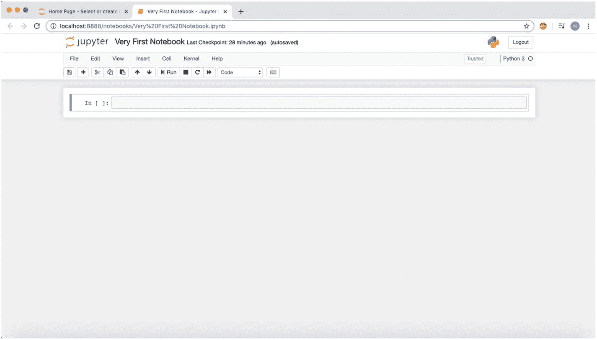
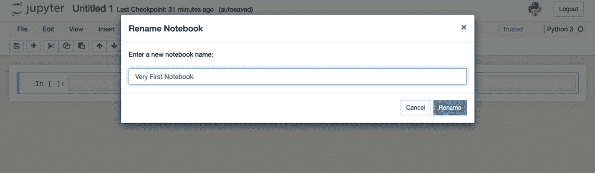
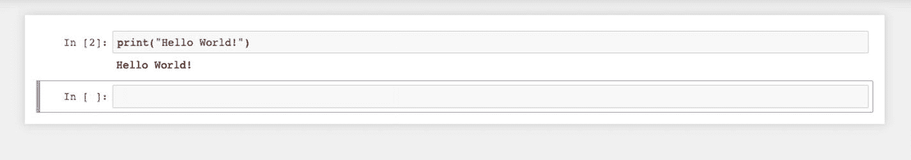
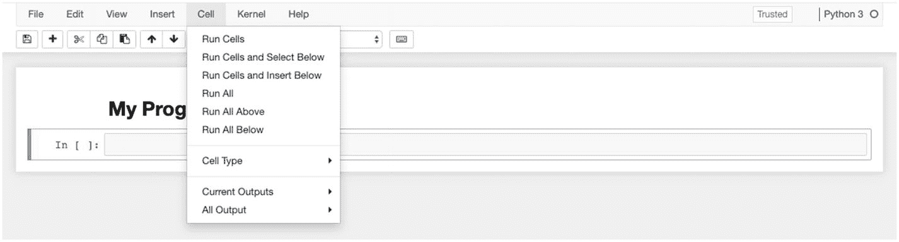
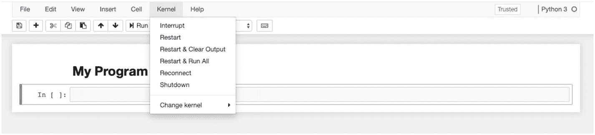

# 6. Jupyter Notebook 简介

在上一章中，我们学习了 Python。我们还了解了如何在 Python 的 REPL shell 中编写代码。然而，在处理大规模的机器学习编程时，这个 Python shell 并不是最推荐的工具。这就是为什么我们开发了像 Jupyter Notebook 这样的应用程序来满足此类编程需求。

Jupyter Notebook 是 Project Jupyter 的产物，这是一个由 Fernando Pérez 创立的非营利组织。其创建目标是开发开源软件并提供服务，使多种语言能够相互交互以实现高效计算。

Jupyter Notebook 是一个基于 Web 的开源应用程序，允许用户轻松地创建、编辑、运行和共享代码。该应用程序的名称来源于它主要支持的语言：Julia、Python 和 R。

为了充分理解 Jupyter Notebook，让我们首先看看在编程语境下，“笔记本”是什么。

## 理解笔记本界面

计算笔记本或笔记本界面，或者简称为笔记本，用于文学编程，我们在其中为程序添加全面的解释。它是一个虚拟笔记本；也就是说，它拥有一个笔记本风格的图形用户界面，提供了文字处理软件的功能，以及一个内核和一个 shell。

### 笔记本简史

笔记本界面最早于 1988 年左右引入，当时 Wolfram Mathematica 1.0 在 Macintosh 上发布。该系统允许用户通过其前端 GUI 创建和编辑笔记本界面。

随后，Maple 发布了适用于 Macintosh 的 4.3 版本。它提供了一个笔记本风格的 GUI，这成为了一个备受赞誉的编程界面。

随着笔记本需求的增长，人们很快开始为其他编程语言（如 Python、MATLAB、SQL 等）适配笔记本风格的内核和后端。因此，计算笔记本在程序员中变得非常流行。

### 笔记本的特性

笔记本的通用特性如下：

1.  它允许我们添加代码单元格，这使得调试和编程更加容易。

2.  它可以用来显示数据的可视化表示。

3.  它允许我们在每个单元格之间添加文本，这使得程序员更容易解释每行代码的功能。

4.  笔记本中的项目可以轻松地重新排列，以便于叙述和更好的可读性。

5.  它可以作为现场演示的工具。

6.  它可以用来创建关于收集的数据和分析结果的交互式报告。

### 常用的笔记本

一些常用的开源笔记本包括：

1.  Jupyter Notebook

2.  IPython

3.  Apache Spark Notebook

4.  Apache Zeppelin

5.  JupyterLab

6.  R Markdown

## Jupyter Notebook 概述

如前所述，Jupyter Notebook 是由 Project Jupyter 开发的一个基于 Web 的应用程序。其目标是使用户能够，正如官方网站所述，“创建和共享包含实时代码、方程、可视化和叙述性文本的文档。”

Jupyter Notebook 于 2014 年作为原始 IPython 的一个衍生项目开发，IPython 是一个用于执行交互式编码的命令 shell。随着 Jupyter Notebook 的发布，IPython 在一定程度上发现自己与之竞争。它仍然作为 Jupyter 的内核和 Python 的 shell 存在，但其他一切都归入 Jupyter Notebook 之下。

趣味事实

Jupyter Notebook 最初被称为 IPython Notebook，因为它源于 IPython。

Project Jupyter 的官方网站指出，Jupyter Notebook 可以支持超过四十种编程语言。每个项目都存储为一个笔记本，由多个代码、图表、文本和方程单元格组成，可以轻松修改。这些笔记本也可以方便地分发给其他人。

### Jupyter Notebook 的特性

除了计算笔记本的通用特性外，Jupyter Notebook 还具有以下关键特性：

1.  每个 Jupyter Notebook 都是一个 `JSON` 文档。`JSON` 是一种独立于语言的数据格式，源自 `JavaScript`。它使用人类可读的文本来传输包含数组或属性-值对的数据。

2.  每个 Jupyter Notebook 通常以 `.ipynb` 扩展名保存。

3.  Jupyter Notebook 的风格与早于它多年出现的其他界面相似，包括 Maple 和 Mathematica（来自 1980 年代）以及 SageMath（来自 2000 年代）。

4.  Jupyter Notebook 在修改后的 BSD 许可下发布，该许可为用户在软件的使用和分发方面提供了最低限度的限制。

5.  Jupyter Notebook 可以轻松地通过电子邮件、Dropbox、GitHub 和 Jupyter Notebook Viewer 与他人共享。

6.  目前，Jupyter Notebook 完全免费使用，并且旨在始终保持免费，供任何人随时使用。

### Jupyter Notebook 的优势

Jupyter Notebook 自发布以来，已被证明是一款强大的编程工具，尤其适合高级程序员。它拥有流畅且易于使用的界面，非常适合编程新手。它还允许用户直接在系统中创建新文件和文件夹，以便轻松存储代码。

让我们更深入地了解 Jupyter Notebook 作为编程应用程序的突出之处。它具有以下特点：

*   它提升了整体的编程体验。

*   它是一个交互式应用程序。

*   它是开源的；即，可以免费下载、安装和使用。

*   它允许用户在笔记本中的代码行之间，以 `Markdown` 格式添加注释、说明和标题，这在与他人共享代码时特别有用。

*   编辑代码非常方便，因为每行代码都可以添加到单独的单元格中，并且这个单元格可以被删除、修改、替换等。

*   与他人共享和分发代码非常容易。

*   每个笔记本都可以转换为不同的文件格式，如 `HTML`、`Markdown`、`PDF` 等。

Jupyter Notebook 目前需求量很大，但它进入编程世界的时间相当晚。在其诞生之前，已经有其他应用程序，如文本编辑器和集成开发环境（IDE），供程序员使用，并且这些工具至今仍在使用。

## 文本编辑器与 IDE

早期，程序员会将所有代码输入到像 Windows 记事本这样的文本编辑器中。这些文本编辑器允许他们输入代码，然后安装额外的插件来增加功能。之后，他们必须将所有代码转移到命令提示符下才能运行。

后来，IDE 被创建出来，为程序员提供了一个包含开发代码所需所有功能的环境。他们无需在单独的应用程序中编写和运行代码，也无需每次都安装新插件。他们可以在一个工作区内轻松地创建、编辑、调试和运行代码。

让我们先看看经典的文本编辑器，了解它们是如何用于编程的。

### 初识文本编辑器

多年来，程序员使用了各种工具和环境来编写代码，包括最基本的文本编辑器。

文本编辑器是一种计算机程序，顾名思义，用于编辑纯文本。

它们通常随操作系统默认提供。它们允许用户编辑文档和源代码等文件。文本编辑器的一些例子包括 Mac OS 上的 `TextEdit` 应用程序、Linux 上的 `Vim`，以及广为人知的 Windows 上的记事本。

文本编辑器非常适合刚进入该领域、仍在熟悉编码的开发者。它们也随时可在系统上使用。这就是为什么大多数人更喜欢从文本编辑器开始。

然而，随着高级程序复杂性的增加，特别是人工智能和机器学习的引入，程序员感到需要创建能够简化流程的工作空间。因此，他们提出了称为 IDE 的东西。

### 初识 IDE

IDE，即集成开发环境，通过提供必要的工具和服务，使我们能够编写、编辑、测试和调试代码。

例如，借助 IDE，我们可以非常轻松地管理资源、调试错误和补全代码。大多数 IDE 仅限于单一编程语言，但有些允许用户使用多种语言。

### IDE 的特点

大多数 IDE 都具备以下特点：

1.  **文本编辑器：** 允许用户编写和编辑代码，并根据所使用的语言提供语法高亮。

2.  **代码自动补全：** 识别程序员可能的下一个输入，并相应地插入该组件。这减少了出错的机会，也显著减少了编程所花费的时间。

3.  **调试工具：** 查找代码中的任何错误并进行修正，从而节省时间，使程序员的工作更轻松。

4.  **编译器：** 用于将代码翻译成机器能够理解和处理的格式。

### IDE 的优势

使用 IDE 进行编程被认为具有以下优势：

1.  它是一个单一环境，程序员可以在其中访问所有必需的工具和实用程序。

2.  它可以自动补全代码并自行调试错误，减少了程序员付出的精力和时间。

3.  它还能自行管理语法，在处理缩进时尤其有用。

4.  如果需要，可以轻松地回退代码，而不会造成大的不便。

5.  项目协作变得更加容易。

### 一些流行的 IDE

三种最常用的 IDE 如下：

*   `IDLE`：`IDLE`，即集成开发与学习环境，会随 Python 自动安装。它轻量且简单，易于学习。它提供的工具与文本编辑器中的类似。它支持跨平台使用和多窗口文本编辑。对于 IDE 新手来说，这是一个不错的起点。

# Python 开发环境与 Jupyter Notebook

## Spyder 与 PyCharm

*   **Spyder：** Spyder，即科学 Python 开发环境，是一个开源的 IDE。它非常适合 IDE 的初学者。它具有文本编辑器的功能，但带有图形用户界面（GUI），使人们能够轻松地从简单的编程应用程序过渡到这个更高级的应用程序。它甚至允许安装额外的插件以获得更多好处。它在视觉上也与 RStudio 相似，允许人们轻松地从 R 语言切换到 Python。

*   **Pycharm：** Pycharm 是一个专业的 Python IDE。它由 JetBrains 公司开发。它提供代码编辑器、错误高亮和调试器，并且都带有 GUI。它还可以通过允许用户更改其颜色、主题等进行个性化设置。它集成了 `Numpy` 和 `Matplotlib`，使得处理图形和数组查看器变得容易。

**注意：** 尽管 IDE 一直被用来描述允许程序员编写和编辑代码、调试错误等工作环境，但 IDE 的主要定义正因 Jupyter Notebook 等其他工具的引入而慢慢改变，这些工具也允许用户轻松地开发代码。

## IDE 与文本编辑器对比

文本编辑器一直非常易于使用。即使是编程世界的新手也能轻松地使用它们进行编码，而无需担心学习使用新的应用程序。在理解编程界面方面，它们需要的精力更少。

另一方面，IDE 需要程序员先熟悉一下，才能自如地充分利用其功能。然而，它们拥有额外的功能和工具，可以简化编程体验。

结论：这完全取决于我们的需求和偏好。如果我们不想花时间学习如何使用一个应用程序，而宁愿为我们的代码使用一个简单的界面，我们可以使用文本编辑器。如果我们愿意投入一点时间学习如何使用一个应用程序，而这将有助于我们后续满足其他编程需求，那么我们可以使用 IDE。

现在我们已经了解了文本编辑器和 IDE 是什么，我们可以看到笔记本界面，特别是 Jupyter Notebook，与同类应用程序相比，对程序员来说更具优势。

## Jupyter Notebook 与其他编程应用程序

为什么我们要选择 Jupyter Notebook 而不是其他编程应用程序呢？让我们来看看 Jupyter Notebook 与其他此类应用程序之间的以下区别：

*   **工具：** Jupyter Notebook 为用户提供了使编程体验更快速、更便捷的工具和实用程序。与其他 IDE 相比，Jupyter Notebook 拥有更多可用的服务。

*   **图形用户界面：** Jupyter Notebook 的 GUI 与众不同，因为它旨在看起来像一个笔记本，而不是通用的 IDE。这使得它在视觉上更舒适，并且非常易于理解。

*   **可用性：** 由于其功能易于访问，Jupyter Notebook 比其他 IDE 更容易使用。

*   **学习曲线：** 与其他 IDE 相比，掌握 Jupyter Notebook 可能需要一点时间，仅仅因为它与我们习惯的工具有很大不同。然而，一旦我们学会了它，使用起来就会变得极其方便。

*   **基于 Web：** Jupyter Notebook 在浏览器中运行，而其他 IDE 则在本地系统上运行。

*   **可视化：** 尽管有些 IDE 为用户提供了出色的可视化平台，但其他 IDE 却没有。不过，Jupyter Notebook 提供了这一功能，从而使程序员更容易使用图表和其他此类可视化技术。

通过这种方式，Jupyter Notebook 在编程世界中超越了其竞争对手。

Jupyter Notebook 听起来很棒，不是吗？嗯，确实如此！一旦我们掌握了它的窍门，我们就能彻底享受用它编程的乐趣。现在，让我们学习如何在自己的机器上设置 Jupyter Notebook 环境。

## 安装 Jupyter Notebook

如前一章所述，使用 Anaconda 的一个优点是，安装 Jupyter Notebook 变成了一项非常容易的任务。无需为了下载它而在各种应用程序中导航。我们只需要执行以下操作：

1.  打开 `Anaconda Navigator`。

2.  选择工作环境，如图 6-1 所示。

3.  点击安装 Jupyter Notebook 的选项。

    

    图 6-1：安装 Jupyter Notebook

瞧！Jupyter Notebook 现在就可以使用了。在接下来的几节中，我们将探索其界面，以便熟悉该应用程序的布局和工作方式。

**注意：** 安装时，我们必须确保安装的是 Jupyter Notebook 而不是 JupyterLab。两者是有区别的！

## 启动 Jupyter Notebook

我们需要做的第一件事是选择我们的工作环境。在这里，我选择了 `myenv`。

接下来，我们需要打开 Jupyter Notebook 窗口。我们可以通过打开 Anaconda 应用程序，然后点击 Jupyter Notebook 图标下的“启动”来完成此操作。

由于 Jupyter Notebook 是一个基于 Web 的应用程序，它会在我们的浏览器中打开。打开的第一个窗口是一个仪表板，它让我们可以概览到目前为止的工作，包括文件、文件夹和笔记本。它看起来像图 6-2。



图 6-2：Jupyter Notebook 仪表板

URL 栏包含一个代表笔记本服务器的链接，并指示它正在从我们的本地机器运行。该链接看起来像这样 - `http://localhost:8888/tree`。

仪表板的其余部分不言自明，但我们还是快速过一遍。以下是 Jupyter Notebook 界面一些基本但最重要的功能的分解说明，如图 6-3 所示：

1.  注销按钮允许我们退出 Jupyter Notebook 会话。

2.  上传按钮允许我们上传一个现成的 Jupyter Notebook 以供使用。

3.  新建按钮允许我们创建一个新的 Python 笔记本、文件、文件夹或终端。

4.  文件选项卡向我们显示所有文件和文件夹的有序列表。

5.  运行选项卡向我们显示任何已打开并正在运行的终端或笔记本。

6.  名称按钮允许我们切换文件和文件夹列表的显示方式；即按字母升序或降序排列。

7.  我们甚至可以选择“上次修改”选项，根据项目上次修改的时间来显示它们。

8.  旁边带有“0”的小复选框选项允许我们选择所有已打开并正在运行的文件夹、笔记本、文件和项目。我们甚至可以一次选择所有项目。

9.  在我们的项目列表中，旁边带有文件夹图标的项目代表我们计算机上的文件夹，如图 6-4 所示。


图 6-4：文件夹列表

10. 一旦我们创建了 Jupyter 笔记本和文本文件，它们就会开始出现在仪表板上。旁边带有页面图标的项目代表具有 `.txt` 扩展名的文档，而旁边带有笔记本图标的项目代表 Jupyter 笔记本，它们具有 `.ipynb` 扩展名，如图 6-5 所示。


图 6-5：一个笔记本和一个文件


图 6-3：Jupyter Notebook 仪表板的一些重要功能

现在我们已经了解了 Jupyter Notebook 界面的一般功能，让我们看看当我们通过点击项目旁边的复选框从列表中选择一个项目时会发生什么。当我们选择一个项目时，我们将看到许多可用的选项，如图 6-6 所示：



图 6-6：每个项目可用的控件

1.  我们可以重命名该项目。

2.  我们可以复制该项目以制作另一个副本。

3.  我们可以将项目移动到其他位置。

4.  我们可以下载该项目。

5.  我们可以查看该项目，它将在浏览器窗口的新选项卡中打开。

6.  我们可以编辑该项目。

7.  我们可以通过点击红色的垃圾桶符号来删除该项目。

8.  我们可以关闭一个已打开并正在运行的笔记本，如图 6-7 所示。



图 6-7

# 关闭笔记本的选项

9. 我们甚至可以同时选择多个项目，并对它们执行任何可用的操作。

现在，让我们创建一个全新的 Jupyter 笔记本，并探索其中的所有功能。

## Jupyter Notebook 内部

要创建一个新的 Jupyter Notebook，我们只需在仪表板上点击“新建”，然后选择我们想要的内核。这里，我们选择“Python 3”内核，如图 6-8 所示。



图 6-8 使用 Python 3 内核打开一个新的 Jupyter Notebook

我们将获得一个带有笔记本用户界面的新标签页，如图 6-9 所示。



图 6-9 一个新的笔记本

笔记本的用户界面也相当直观。不过，和之前一样，我们将快速浏览一下它的所有主要功能。

1. 顶部显示的是笔记本的标题。它最初显示为“无标题”，当我们点击它时，可以根据自己的偏好更改名称，如图 6-10 所示。

    

    图 6-10 重命名笔记本

2. 在笔记本标题旁边，我们会看到“最后检查点”及其时间。这表示笔记本上次自动保存的时间。

3. 下方是菜单栏，包含一系列下拉菜单，如图 6-11 所示。

    

    图 6-11 菜单栏

4. 接着是工具栏，包含我们使用 Jupyter Notebook 时所需的工具，如图 6-12 所示。我们可以将鼠标悬停在每个工具图标上，了解其功能。

    

    图 6-12 工具栏

5. 最后，是我们输入所有内容并查看输出的区域，如图 6-13 所示。

    

    图 6-13 这里是各种单元格出现的地方，允许我们输入内容

你可能已经注意到，菜单栏包含“单元格”菜单和“内核”菜单。这两个术语在 Jupyter Notebook 环境中非常重要。

### 单元格

单元格不过是我们输入所有内容的框，可以是代码、普通文本或标题。

当我们第一次打开 Jupyter 笔记本时，会看到第一个单元格是“代码”单元格。这个单元格允许我们输入命令、函数、变量、常量以及程序中所有其他输入。当我们执行这个单元格时，输出（如果有的话）会显示在它下方。

让我们尝试在“代码”单元格中输入以下内容：

```python
print("Hello World!")
```

现在，我们可以通过点击工具栏上的“运行”按钮来执行该单元格。我们也可以直接使用键盘快捷键 `Shift+Return`。我们会发现代码行被执行，输出结果会打印在单元格正下方，如图 6-14 所示。



图 6-14 执行一个代码单元格

第二种类型的单元格是“Markdown”单元格。Markdown 是一种用于格式化纯文本的语法。因此，这个单元格用于输入不属于代码的任何文本。这可以是代码之间需要的解释或注释，既是为了让我们在编程时更容易理解，也是为了让其他人阅读时更全面。一旦我们输入所有必要的文本并执行该单元格，它就会变成一个在程序中可见的普通文本框。

让我们在“Markdown”单元格中尝试这段文本：

```
Hello World!
```

我们的 Markdown 单元格将显示如图 6-15 所示的输出。


图 6-15 输入普通文本

第三种类型的单元格是“标题”单元格。这个单元格用于在整个程序中添加标题。这可以使整个程序看起来更有条理，特别是当同一个笔记本中运行多个程序时。

让我们在“标题”单元格中尝试输入：

```
My Program
```

标题将如图 6-16 所示显示。


图 6-16 输入一个标题

我们也可以直接打开一个普通的 Markdown 单元格，输入以下内容：`# My Program`。`#` 符号用于将句子转换为标题。使用该符号的次数表示标题的级别。例如，使用一个井号可以获得一级标题。我们可以通过从工具栏的选项列表中选择来更改要使用的单元格类型。

### 内核

内核运行 Jupyter 笔记本中包含的代码。

内核不限于单个单元格，而是针对整个笔记本。当我们在选定的单元格中执行代码时，代码在内核中运行，并将任何输出发送回单元格进行显示。

有超过一百种语言的内核，包括 Python、C、R 和 Java。当我们从 Jupyter Notebook 仪表板创建新笔记本时，我们基本上是通过选择想要使用的 Python 版本来选择内核。在这种情况下，当我们选择“Python 3”时，我们是在告诉系统打开一个 Python 3 内核。

现在我们对单元格和内核有了一些了解，让我们回到菜单栏，探索“单元格”和“内核”下拉菜单允许我们做什么。

### 单元格下拉菜单

图 6-17 显示了“单元格”下拉菜单中可用的不同选项。

1. **运行单元格：** 执行所选单元格中的代码，并给出输出（如果有的话）。
2. **运行单元格并选择下方：** 执行所选单元格，然后选择它们下方的单元格。
3. **运行单元格并在下方插入：** 执行所选单元格，然后在它们下方插入一个额外的单元格。
4. **全部运行：** 执行笔记本中的所有单元格。
5. **运行上方所有：** 运行所选单元格上方的所有单元格。
6. **运行下方所有：** 运行所选单元格下方的所有单元格。
7. **单元格类型：** 允许我们选择所需的单元格类型。
8. **当前输出：** 允许我们切换、切换滚动或清除所选输出。
9. **所有输出：** 允许我们切换、切换滚动或清除笔记本中的所有输出。



图 6-17 单元格下拉菜单

### 内核下拉菜单

图 6-18 展示了“内核”下拉菜单中可用的不同选项。

1. **中断：** 此选项可在代码执行过程中中断正在运行的进程。
2. **重启：** 此选项会重启整个内核，但保留之前获得的输出。
3. **重启并清除输出：** 此选项会重启整个内核，并清除之前获得的输出。
4. **重启并全部运行：** 此选项会重启整个内核，并再次执行所有单元格。
5. **重新连接：** 此选项允许内核重新连接。
6. **关闭：** 此选项会关闭当前活动的内核。
7. **更改内核：** 此选项允许我们将内核更改为我们想要的任何版本或语言。



图 6-18 内核下拉菜单

就是这样！以上是对 Jupyter Notebook 一些最基本但重要功能的概述。

现在你已经熟悉了 Jupyter Notebook 的工作环境，让我们继续，借助 Jupyter Notebook 来练习一些 Python 编程吧。

## 附加信息

Jupyter 项目是一个非常有趣的倡议，尤其适合那些需要一个可靠且便捷的工作空间来处理项目的数据科学家和机器学习爱好者。让我们来看看 Project Jupyter 下的另外两个非常有用的功能，它们在我们机器学习之旅中可能会对某些人有所帮助。

### JupyterHub

JupyterHub 允许多个用户共享资源来进行编程。每个用户都有自己的工作空间，他们可以在其中编写代码，而无需担心安装和维护问题。

它可以在用户的系统上运行，也可以在云端运行。它可定制、灵活、可移植且可扩展，是程序员的绝佳界面。它还有自己的社区，供用户讨论和贡献。

### Jupyter nbviewer

Jupyter nbviewer 是 `nbviewer` 的一个免费且公开可用的实例，`nbviewer` 是一个基于 Web 的应用程序，允许我们将笔记本作为静态 HTML 网页查看。它还为我们提供了一个链接，我们可以用它与他人共享笔记本。

除了查看单个笔记本，我们还可以查看笔记本集合。这些笔记本甚至可以转换为其他格式。

### Voila

`Voila` 用于将 Jupyter 笔记本转换为一个独立的 Web 应用程序，可以与他人共享。它包含一个可定制的交互式仪表板，允许用户在安全的环境中查看笔记本。

它可以在任何 Jupyter 内核中工作，与所使用的编程语言类型无关。对于希望查看笔记本结果但无需看到代码单元格或执行代码的非技术用户来说，这是一个很好的选择。

### Google Colaboratory

谷歌的 Colaboratory（或 `Colab`）是一个免费的在线 Jupyter 环境。它在云端运行，并将其笔记本存储到用户的 Google Drive 中。

截至 2019 年 10 月，`Colab` 主要支持 `Python 2` 和 `Python 3` 内核。

不过，`Colab` 也有可能支持 `R`、`Swift` 和 `Julia`。

### 键盘快捷键

首先，你需要知道使用 Jupyter Notebook 有两种模式，如下所示：

*   **命令模式**，允许我们使用方向键在笔记本中导航。

*   **编辑模式**，允许我们编辑选定的单元格。

表 6-1 列出了在使用 Jupyter Notebook 时可以使用的一些最有用的键盘快捷键。

表 6-1

Jupyter Notebook 的键盘快捷键

| Mac | Windows 和 Linux | 操作 |
| --- | --- | --- |
| `Cmd` + `Shift` + `P` | `Ctrl` + `Shift` + `P` | `访问键盘快捷键` |
| `Shift` + `Enter` | `Shift` + `Enter` | `执行代码` |
| `Esc` | `Esc` | `在编辑模式下进入命令模式` |
| `Enter` | `Enter` | `在命令模式下进入编辑模式` |
| `A` | `A` | `在命令模式下，在选定单元格上方插入一个新单元格` |
| `B` | `B` | `在命令模式下，在选定单元格下方插入一个新单元格` |
| `D` + `D` (按 D 两次) | `D` + `D` (按 D 两次) | `在命令模式下删除选定的单元格` |
| `Shift` + `Tab` | `Shift` + `Tab` | `显示输入到单元格中的项目的可用文档` |
| `Ctrl` + `Shift` + `-` | `Ctrl` + `Shift` + `-` | `在编辑模式下，将选定的单元格在光标所在位置拆分为两个` |
| `F` | `F` | `在命令模式下查找并替换代码` |
| `Shift` + `J` / `Shift` + `Down` | `Shift` + `J` / `Shift` + `Down` | `选择所选单元格及其下方的单元格` |
| `Shift` + `K` / `Shift` + `Up` | `Shift` + `K` / `Shift` + `Up` | `选择所选单元格及其上方的单元格` |
| `Shift` + `M` | `Shift` + `M` | `合并多个单元格` |

## 总结

在本章中，我们了解了与 IDE 和文本编辑器相比，笔记本界面的重要性。然后，我们探索了 Jupyter Notebook 应用程序、其功能及其用户界面。

Jupyter Notebook 的妙处在于，它看起来相当复杂和技术性，但实际上，一旦你掌握了窍门，使用起来并不太难。总的来说，它是一个适用于你所有编程目的的绝佳工具。不仅如此，它还可以用来以一种赏心悦目的方式展示你的结果和呈现你的输出。

在接下来的几章中，我们将借助 Jupyter Notebook 开始一些实际的编程。我们将亲身体验如何有效地使用笔记本界面来输入、运行和调试我们的代码。最后，一旦我们对 Jupyter Notebook 有了一定的熟悉度，我们将继续使用该界面来开发我们的机器学习模型。

## 快速链接

*   了解更多关于 Project Jupyter 的信息：[`https://jupyter.org/about`](https://jupyter.org/about)
*   Jupyter 文档：[`https://jupyter.org/documentation`](https://jupyter.org/documentation)
*   尝试 Jupyter：[`https://jupyter.org/try`](https://jupyter.org/try)
*   JupyterHub：[`https://jupyter.org/hub`](https://jupyter.org/hub)
*   Jupyter Notebook 查看器：[`https://nbviewer.jupyter.org/`](https://nbviewer.jupyter.org/)
*   Google Colab：[`https://colab.research.google.com/notebooks/intro.ipynb`](https://colab.research.google.com/notebooks/intro.ipynb)