# 7. 在 Jupyter Notebook 中进行 Python 编程

在之前的章节中，我们学习了关于 Python 编程语言的所有知识。我们研究了它的优势，将其与其他一些语言进行了比较，并了解了它的特性如何使其成为机器学习中一种可靠的语言。

在上一章中，我们熟悉了 Jupyter Notebook，并了解了为什么它可以被视为构建和执行训练机器程序的合适环境。我们还了解了 Jupyter Notebook 应用程序的布局。

在本章中，我们将获得将 Python 与 Jupyter Notebook 界面结合使用的实践经验，以有效地创建、检查和运行我们的机器学习模型。然而，在开始硬核编码之前，我们将从一些小规模程序开始，只是为了复习我们通用的编程知识并理解 Python 的编码语法。

## 打开新笔记本

首先，我们需要打开一个带有 Python 3 内核的新 Jupyter 笔记本，如图 7-1 所示。

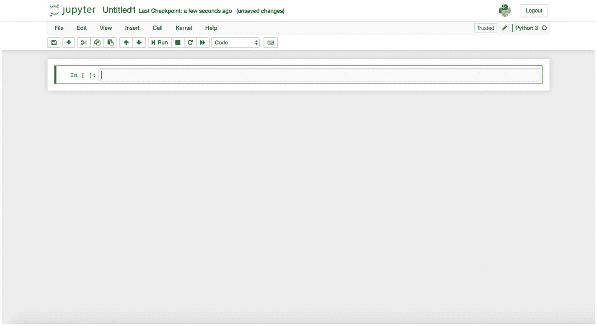

图 7-1 一个新的 Jupyter 笔记本

## 命名笔记本

我们可以给笔记本起个名字，比如“我的第一个 Jupyter 笔记本”或“使用 Jupyter Notebook 进行 Python 编程”（图 7-2）


图 7-2 命名一个新笔记本

## 添加标题单元格

现在，让我们为第一个程序添加一个标题。我们将其命名为“Hello World”。你还记得如何将一个单元格转换为“标题”单元格吗？

没错。我们从工具栏中选择该选项。之后，点击该单元格并输入标题，如图 7-3 所示。


图 7-3 在“标题”单元格中输入程序标题

井号（`#`）表示这是一级标题。

让我们执行该单元格。我们可以通过点击工具栏中的“运行”图标来执行。更快捷的方式是使用键盘快捷键 `Shift + Enter`。

现在单元格已执行，我们将看到标题出现，如图 7-4 所示。

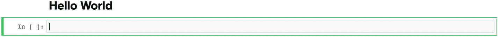

图 7-4 执行“标题”单元格以将标题添加到笔记本

## 打印代码单元格的输出

下一个单元格会自动显示为“代码”单元格。让我们输入以下代码，重复上一章使用的相同代码：

```python
print("Hello World")
```

现在当我们执行该单元格时，将得到如下输出：

```
Hello World
```

## 在“代码”单元格中获取用户输入

让我们看看从用户那里获取输入时会发生什么。输入以下代码：

```python
a = input("Enter your name: ")
```

现在当我们执行该单元格时，将得到如图 7-5 所示的输出。

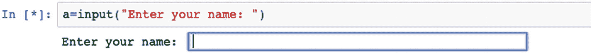

图 7-5 等待接受用户输入

如你所见，我们输入的文本会显示出来，后面跟着一个文本框，我们可以在其中输入内容。这个文本框可以接受从键盘输入的任何字符。单元格左侧的星号（`*`）表示程序仍在执行该单元格。在这种情况下，它在等待用户的命令才能继续。一旦用户按下 Enter 键，程序将继续执行。

我们完成输入并按下 Enter 键后，输出将显示出来，如图 7-6 所示。

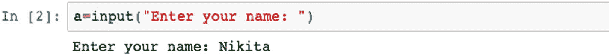

图 7-6 显示已接受的输入

## 调用变量

当我们接受用户的输入时，我们将其存储在变量`a`下。在下一个单元格中，我们将通过输入以下内容来调用此变量并显示其输出：

```python
a
```

现在当我们执行该单元格时，将显示`a`的值，如图 7-7 所示。

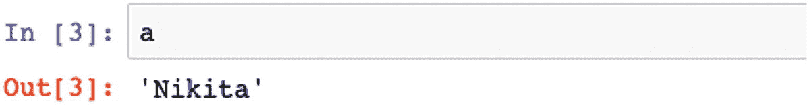

图 7-7 显示变量的值

## 算术运算

让我们看看当我们需要显示一些输出，同时也要获取一些输入时会发生什么。我们可以借助一些简单的算术运算来探索这一点。让我们尝试以下代码：

```python
b=2
c=int(input("Enter a number: "))
sum=b+c
print(sum)
```

首先，我们会得到一个用于输入的文本框，如图 7-8 所示。

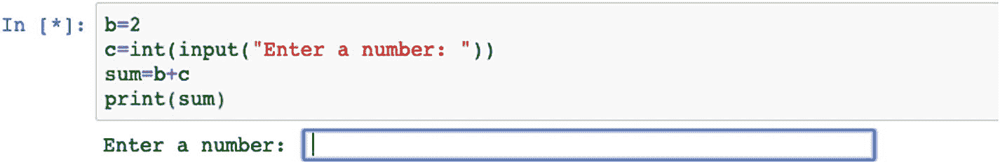

图 7-8 接受用户输入的数字

一旦我们提供了所需的值，代码就会执行必要的计算并显示输出，如图 7-9 所示。

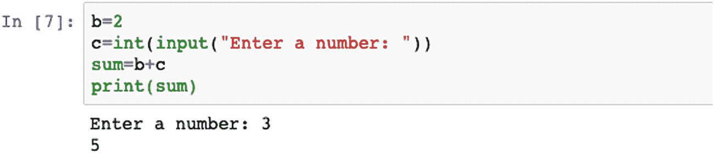

图 7-9 显示输入以及计算结果

我们需要在`input()`命令之前加上`int()`，以告知程序我们期望从用户那里得到一个整数，然后该整数必须用于给定的算术计算。如果跳过此步骤，将会出现错误，因为 Python 总是将输入值作为字符串（包括数字和符号）处理，这会导致数字无法直接用于计算。

## 创建函数

现在，让我们创建一个函数，看看它是如何工作的。输入以下代码：

```python
def prod(a):
    b=int(input("Enter a value: "))
    c=5
    p=a*b*c
    return(p)
```

当我们执行此单元格时，发现没有输出。然而，在幕后有些事情正在发生。在下一个单元格中，输入以下内容：

```python
prod(6)
```

请记住，我们可以在括号内放入任何我们想要的数字。当我们执行此单元格时，将出现一个要求输入值的文本框。我们可以输入一个我们选择的值。当我们按下 Enter 键时，将得到如图 7-10 所示的输出。

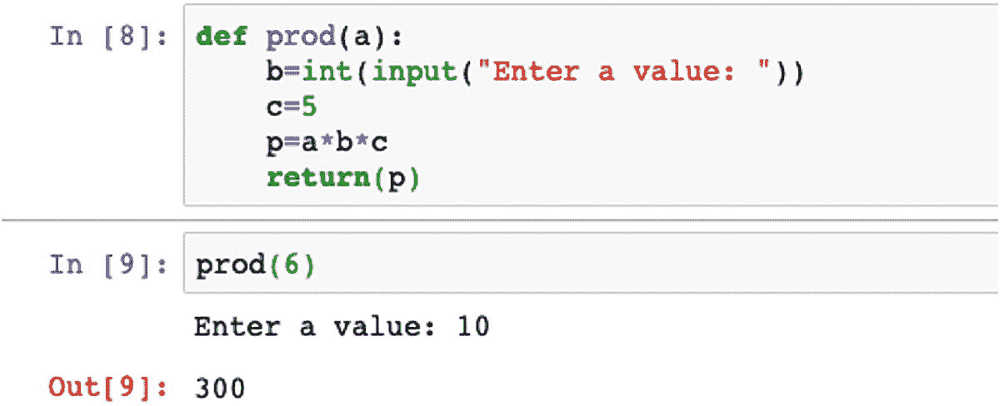

图 7-10 在函数内执行计算，然后调用函数以显示结果

## 创建列表

列表是一个有序的项目集合。我们可以通过在一对方括号内输入所有必需的值来创建一个列表，如下所示：

```python
list = [2, 4, 6, 8, 10]
list
```

当我们执行此操作时，将得到如图 7-11 所示的输出。

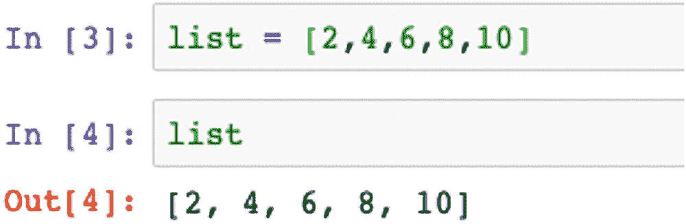

图 7-11 创建列表

## 创建字典

字典是一个无序的项目集合。我们可以通过在一对花括号内输入我们的值来创建一个字典，如下所示：

```python
age = {"Henry":30, "Chiara":19, "Benedict":23, "Dominic":15, "Gertrude":24}
age
```

当我们执行此单元格时，将得到如图 7-12 所示的输出。

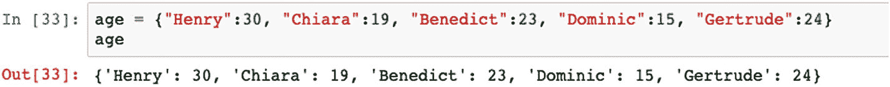

图 7-12 创建字典

## 创建循环

在编程中，循环是一组持续重复直到满足某个条件的指令或步骤。

### While 循环

尝试输入以下代码：

```python
count=0
while count<=5:
    count=count+1
    print("Love your neighbour as yourself")
```

当我们执行此单元格时，将得到如图 7-13 所示的输出。

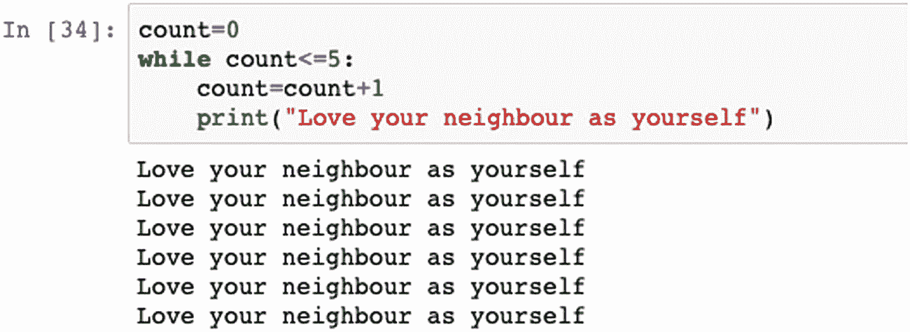

图 7-13 运行 while 循环

### For 循环

在代码单元格中输入以下代码：

# 嵌套循环

嵌套循环由在单个代码块中使用的两个或多个循环组成。

在“代码”单元格中输入以下代码：

```
string=("Rejoice")
for i in string:
print(i)
```

当我们执行此单元格时，将得到如图 7-14 所示的输出。

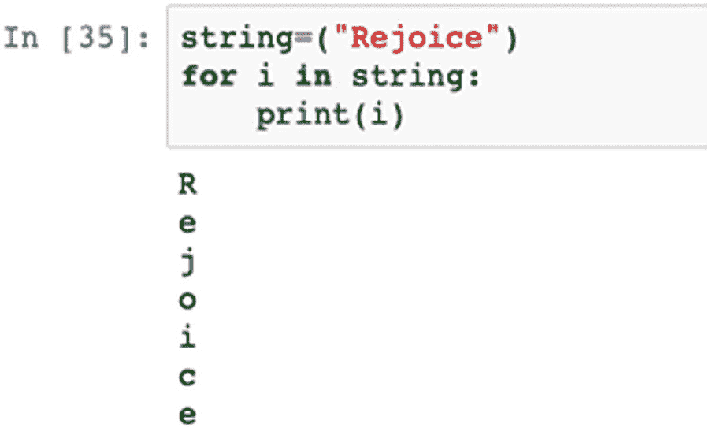

图 7-14 运行 for 循环

嵌套循环由在单个代码块中使用的两个或多个循环组成。

在“代码”单元格中输入以下代码：

```
i=0
s=("Have a beautiful day")
while i<=3:
i=i+1
for a in s:
print(a)
```

当我们执行此代码时，将得到如图 7-15 所示的输出。

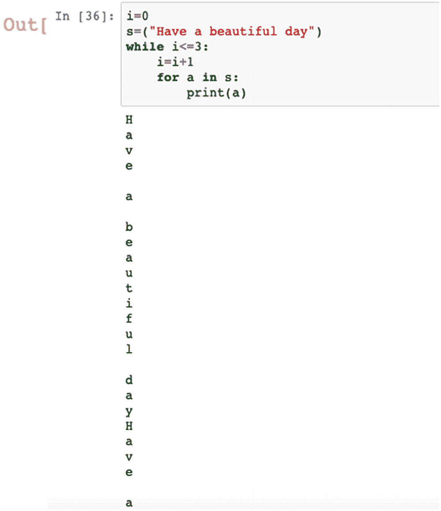

图 7-15 运行嵌套循环

当然，出于所有实际目的，我没有显示完整的输出。但很容易理解输出会是什么样子，因为同一个句子会连续打印四次。

# 添加条件语句

在编程中，条件语句用于根据指定的条件是真还是假来执行特定的步骤。

## If 语句

输入以下代码：

```
x=3*2
if x%2 == 0:
print("It is even")
```

运行这段代码时，我们将得到如图 7-16 所示的输出。

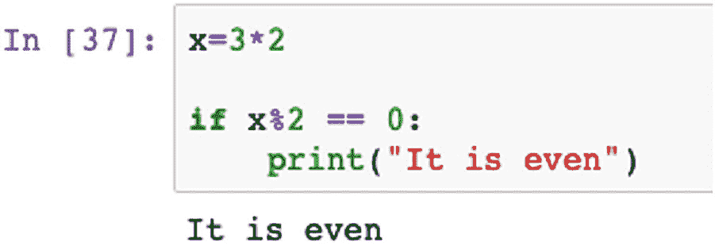

图 7-16 执行 `if` 条件

`%` 符号用于求除法后的余数。因此，如果除以 2 的余数为 0，则表示该数字是偶数。

尝试将 `x` 的值改为一个不能被 2 整除的数字，看看会发生什么。

## If-Else 语句

我们可以使用与之前相同的代码，但稍作添加，加入 `else` 条件，如下所示：

```
x=3*3
if x%2== 0:
print("It is even")
else:
print("It is odd")
```

运行这段代码时，我们将得到如图 7-17 所示的输出。

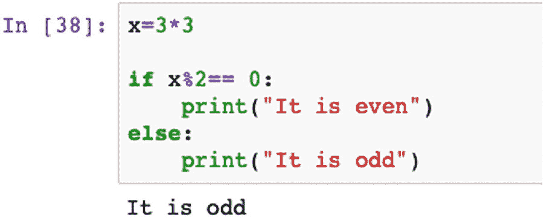

图 7-17 执行 `if-else` 条件

在这个例子中，我们添加了一个额外的条件，告诉程序如果第一个条件不满足时该做什么。

## Elif 语句

这次我们将使用一个略有不同的代码，如下所示：

```
x=7
if x%2==0:
print("It divisible by 2")
elif x%3==0:
print("It is divisible by 3")
else:
print("It is neither divisible by 2 nor 3")
```

运行这段程序时，我们将得到如图 7-18 所示的输出。

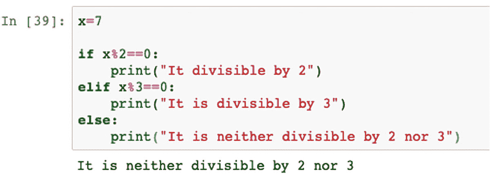

图 7-18 执行 `elif` 条件

因此，`elif` 允许我们为代码提供多个条件。我们可以根据条件的数量，在代码中多次使用 `elif`。

# 在程序中添加注释

有时，我们可能想在程序的行与行之间添加一些额外的注释，无论是为了自己参考，还是为了确保能访问代码的人理解其内容。这与添加普通的“Markdown”单元格不同。之所以不同，是因为我们是在“代码”单元格内添加注释。为此，我们需要在代码行前添加一个井号（`#`）符号。示例如下：

```
# This is a comment line in between my code.
```

这一行在“代码”单元格中会以绿色斜体显示，如图 7-19 所示。

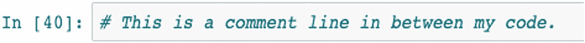

图 7-19 在代码中添加注释行

# 删除单元格

有时，我们可能会有一些不必要的单元格。我们可以通过点击剪刀图标轻松删除它们。

我们也可以通过选择菜单栏“编辑”下拉菜单中的“删除单元格”选项来执行此操作，如图 7-20 所示。

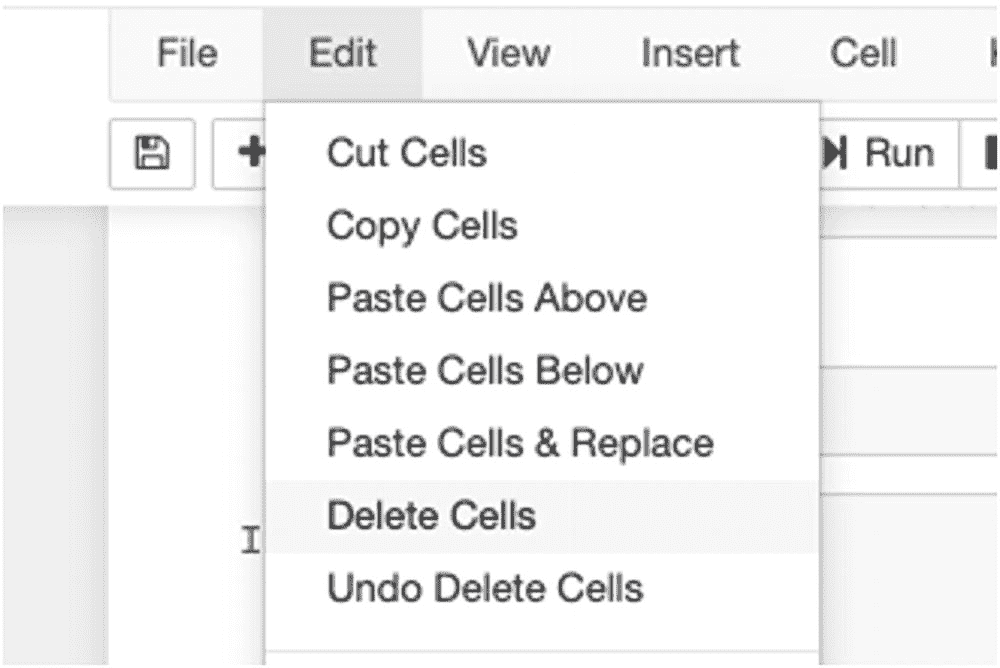

图 7-20 使用下拉菜单选项删除单元格

# 添加新单元格

我们甚至可以在另一个单元格下方添加一个新单元格，方法是选中该单元格，然后点击“在下方插入单元格”图标或加号。

另一种方法是通过选择菜单栏“插入”下拉菜单中的“在下方插入单元格”选项。如果我们想在所选单元格上方添加一个单元格，可以点击“在下方插入单元格”图标，然后点击“上移单元格”图标，或者直接从“插入”下拉菜单中选择“在上方插入单元格”选项，如图 7-21 所示。

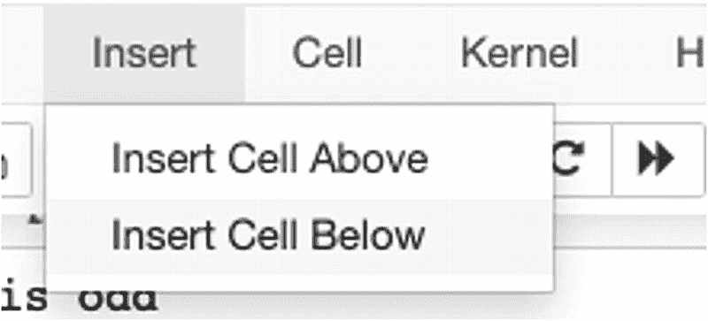

图 7-21 使用下拉菜单选项添加新单元格

# 复制单元格

我们还可以借助工具栏中的“复制所选单元格”和“粘贴所选单元格”选项，复制一个单元格的内容并粘贴到另一个单元格中。

我们也可以通过从菜单栏中选择所需选项来执行此操作，如图 7-22 所示。

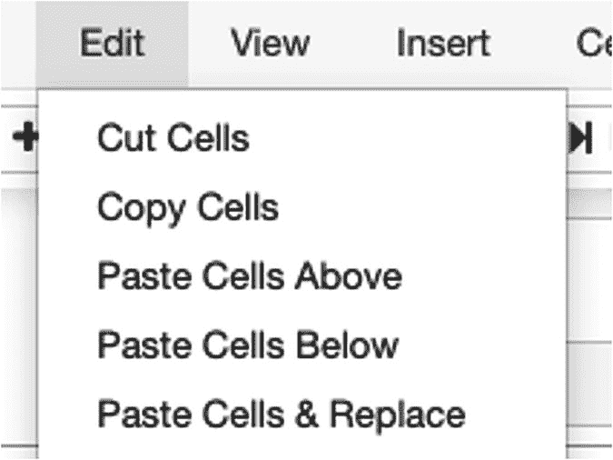

图 7-22 使用下拉菜单选项复制单元格

# 移动单元格

我们甚至可能希望根据自己的偏好来调整单元格的顺序。我们可以使用工具栏中的向上和向下箭头图标，相应地向上或向下移动单元格。

我们也可以通过转到菜单栏，点击“编辑”，然后选择“上移单元格”或“下移单元格”来执行此操作，如图 7-23 所示。

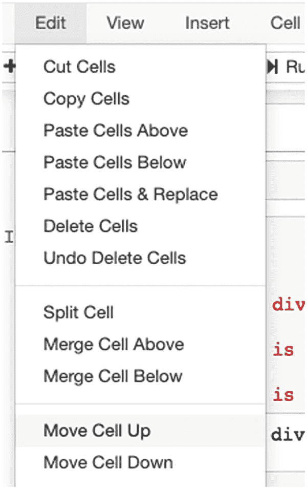

图 7-23 使用下拉菜单选项移动单元格

# 合并单元格

现在让我们回到之前的一些代码片段，我们定义了一个变量 `a` 作为用户的输入，然后在下一个“代码”单元格中打印出这个变量的值。

与其在两个单独的单元格中执行此操作，不如将它们放在一个单元格中。好处是，我们甚至不需要重新输入或删除任何内容。我们只需要转到菜单栏，选择“编辑”，然后点击“向下合并单元格”，如图 7-24 所示。

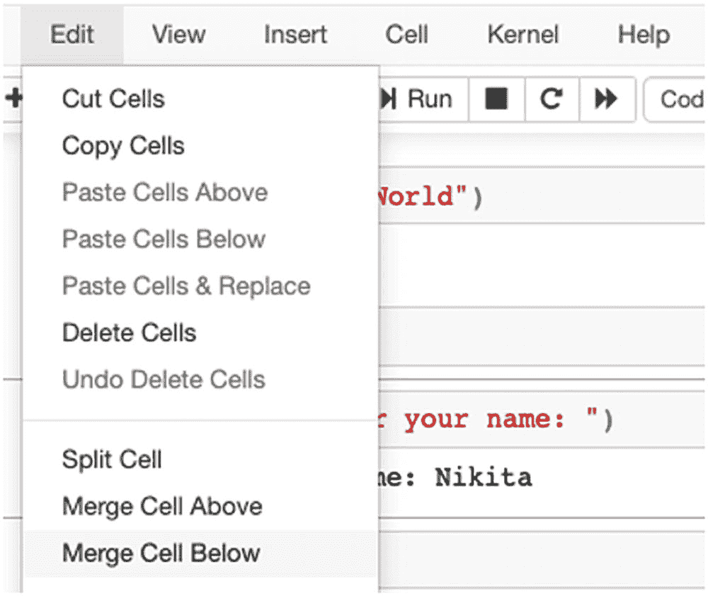

图 7-24 使用下拉菜单选项合并单元格

让我们在我们之前的一段代码上试试这个。考虑这样一段代码：我们从用户那里获取输入，将其存储为输入 `a`，然后显示 `a` 的值。这原本是在两个独立的代码单元格中完成的。然而，当我们合并单元格时，它会将代码合并到一个单元格中，如图 7-25 所示。

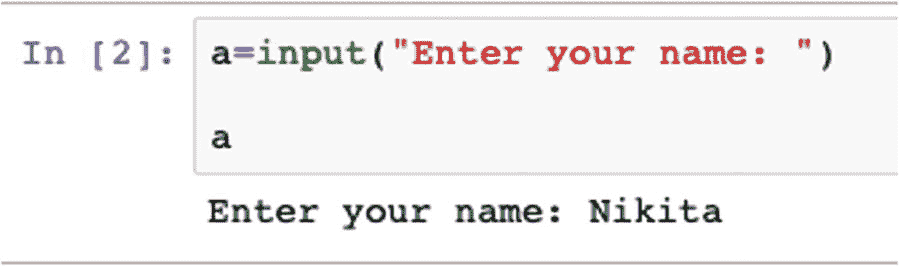

图 7-25 两个单元格合并为一个单元格

# 拆分单元格

我们甚至可以使用菜单栏“编辑”下拉菜单中的“拆分单元格”选项将一个单元格拆分为两部分，如图 7-26 所示。

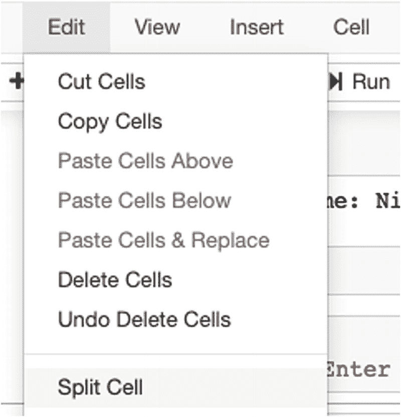

图 7-26 使用下拉菜单选项拆分单元格

首先，点击我们想要拆分代码的起始行。然后点击“拆分单元格”选项。代码将被拆分，如图 7-27 所示。

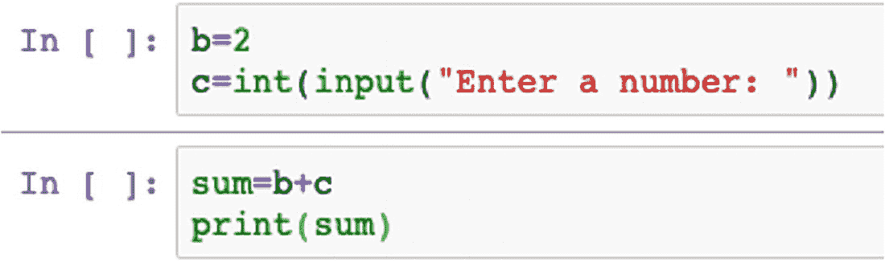

图 7-27 使用下拉菜单选项拆分单元格

# 运行所有单元格

无需逐个执行每个单元格，我们可以一次性运行所有单元格。为此，我们只需点击菜单栏“单元格”下拉菜单中的“全部运行”选项，如图 7-28 所示。这将执行整个笔记本。

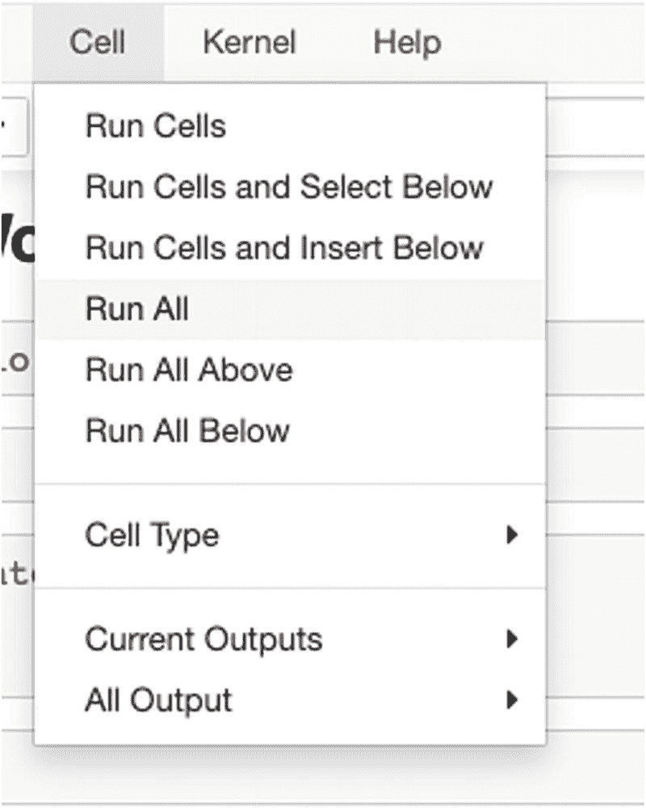
图 7-28 使用下拉菜单选项运行笔记本中的所有单元格

## 清除当前输出
要清除所选单元格的输出，请点击菜单栏中的`Cell`选项。然后，将光标悬停在下拉菜单中的`Current Outputs`上，并在子菜单中点击`Clear`，如图 7-29 所示。
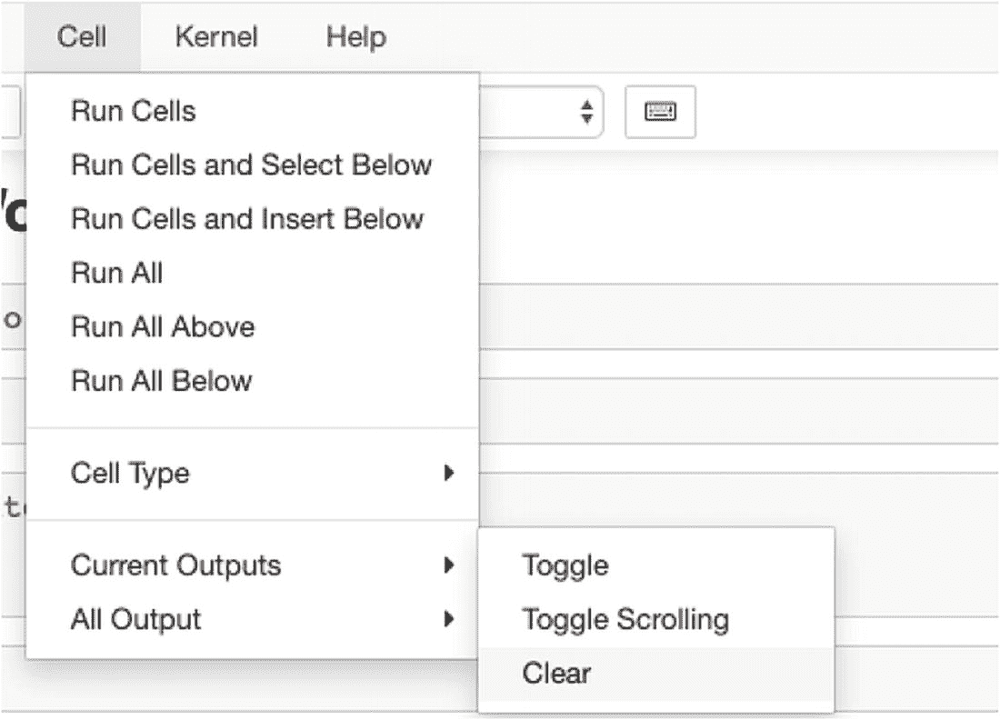
图 7-29 使用下拉菜单选项清除当前输出

## 清除所有输出
要清除笔记本中的所有输出，请点击菜单栏中的`Cell`选项。然后，与之前类似，将光标悬停在下拉菜单中的`All Output`选项上，并在子菜单中点击`Clear`，如图 7-30 所示。
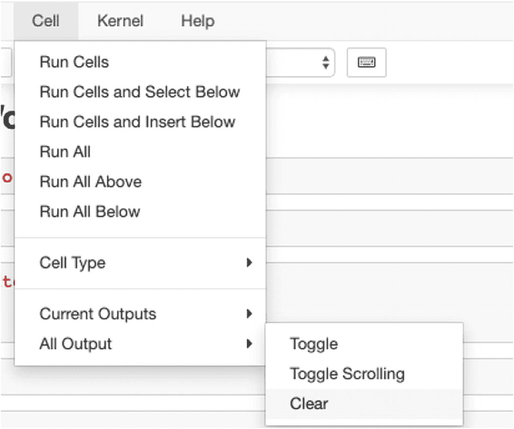
图 7-30 使用下拉菜单选项清除所有输出

## 重启内核
有时，我们的程序需要重启内核才能获得期望的输出。这类似于在网页浏览器中刷新页面。当我们重启内核时，会丢失所有存储在变量中的数据。要执行此操作，首先点击菜单栏中的`Kernel`，然后点击`Restart`，如图 7-31 所示。
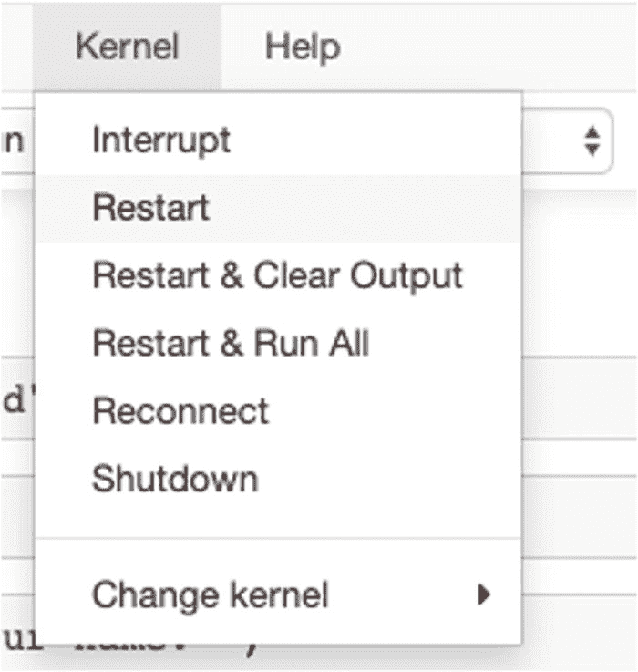
图 7-31 使用下拉菜单选项重启内核

这里我们发现内核重启了，但之前每个单元格执行的输出仍然显示。如果我们不希望保留这些输出，就需要重启内核并同时清除输出。我们可以一步完成此操作，而不是分两步进行。

## 重启内核并清除输出
要同时重启内核并清除输出，请点击菜单栏中的`Kernel`，然后点击`Restart & Clear Output`，如图 7-32 所示。
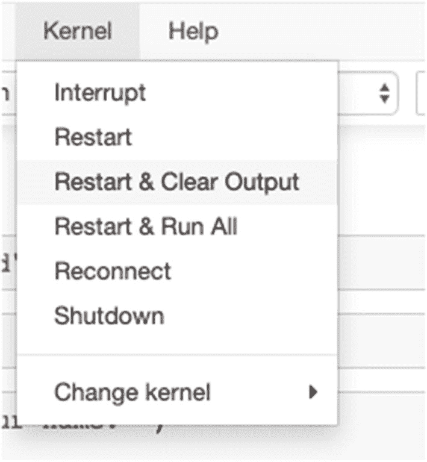
图 7-32 使用下拉菜单选项重启内核并清除输出

## 中断内核
我发现这个功能非常有用，尤其是在机器学习中。有时，当我们的机器学习程序正在运行时，我们可能突然决定要停止进程并重新开始。这可能是由于我们突然在代码中发现错误、决定更改某些变量等原因。在这种情况下，我们只需通过点击菜单栏中的`Kernel`选项，然后在下拉菜单中点击`Interrupt`来中断内核，如图 7-33 所示。
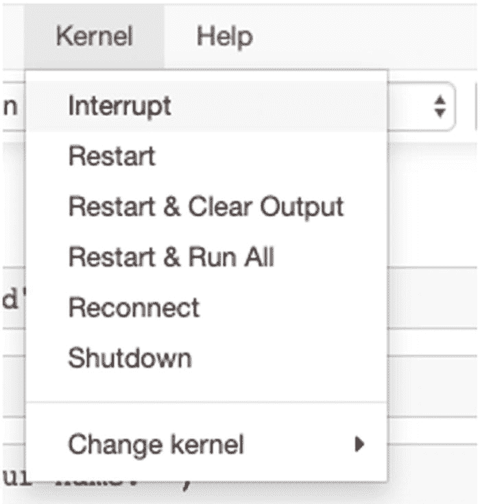
图 7-33 使用下拉菜单中的选项中断内核

## 帮助菜单
如果我们需要关于常规 Jupyter Notebook 用户界面、可用的键盘快捷键以及一些经常与 Python 一起使用的机器学习库的额外帮助，我们可以从菜单栏访问`Help`菜单。此时会打开一个下拉菜单，如图 7-34 所示。
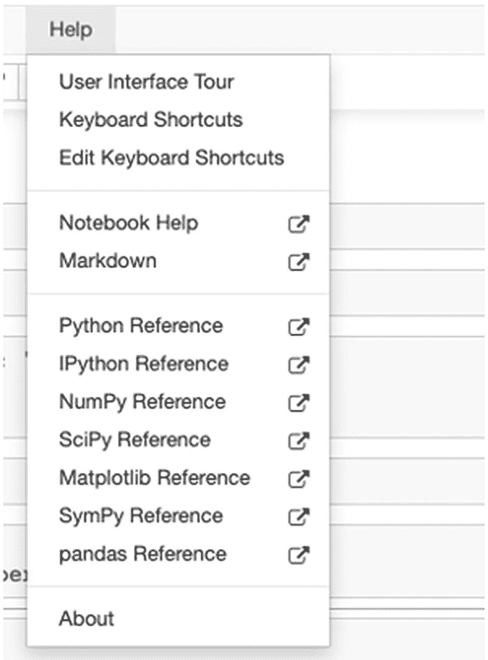
图 7-34 访问帮助菜单

从这个菜单中，我们可以选择需要帮助的选项。如您所见，帮助选项包括与 Jupyter Notebook 应用程序相关的主题，以及与 Python 库相关的主题。

## 总结
好了，就是这样！现在我们对 Jupyter Notebook 的用户界面熟悉多了。我们还快速了解了一些与编程相关的重要概念，并学习了如何使用 Python 编写基本函数，例如列表和循环。掌握了这些知识后，我们终于可以开始进入 Python 的机器学习库了。我们已经了解到 Python 拥有大量可以调用到程序中的库。接下来，我们将重点关注一个越来越受欢迎的库。多年来，它因其独特的功能而获得了众多开发者的认可，这些功能使得机器学习过程变得更加轻松。这个库就是 `TensorFlow`，在接下来的章节中，我们将使用它来编写我们的深度学习模型。