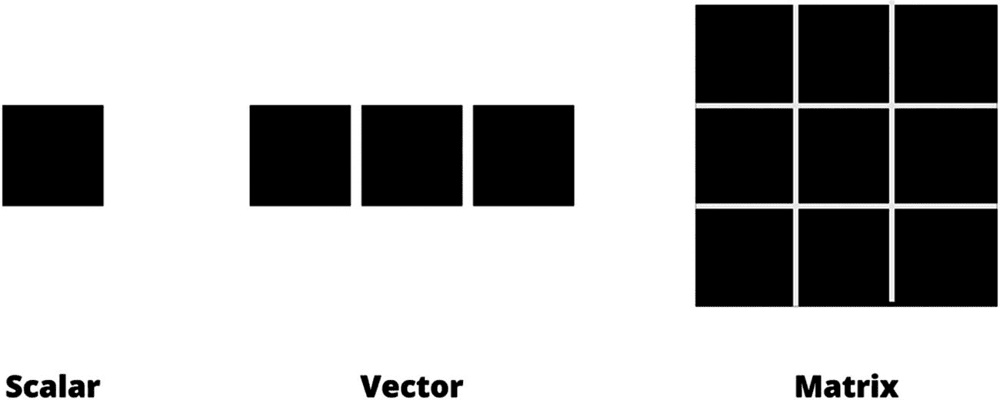
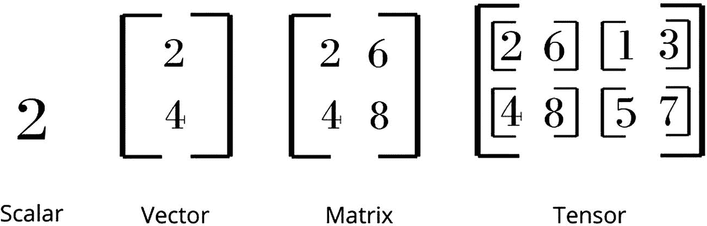
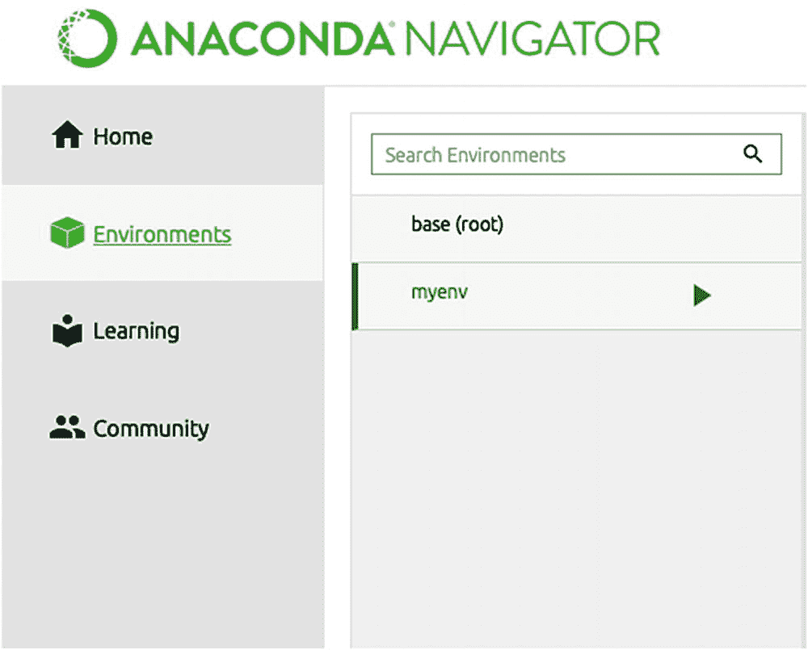
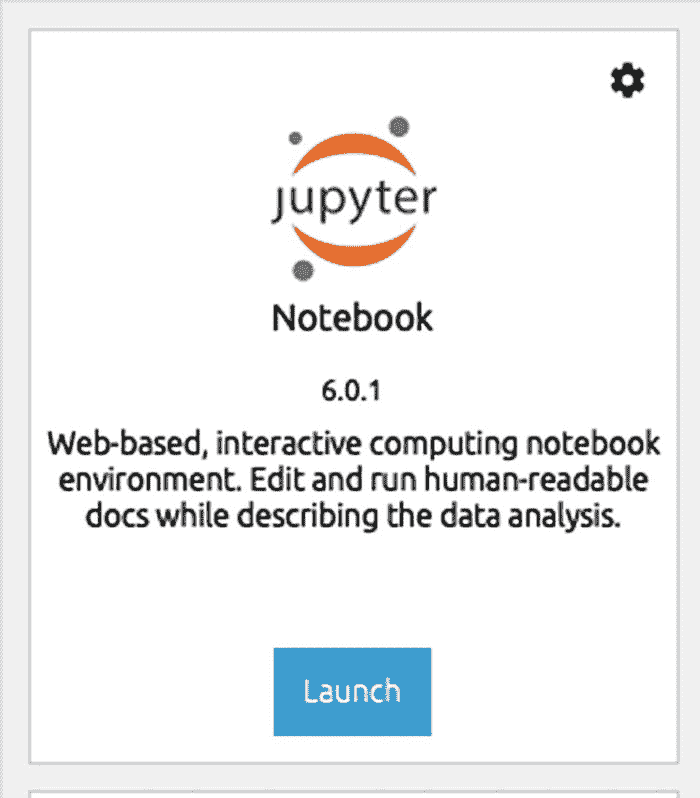
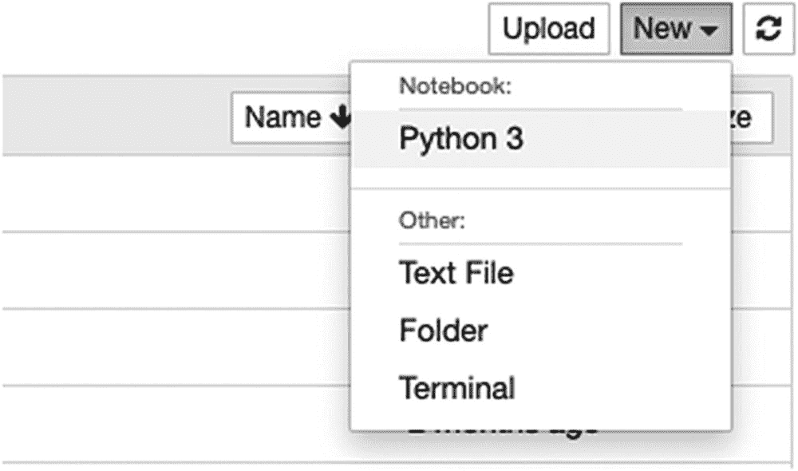
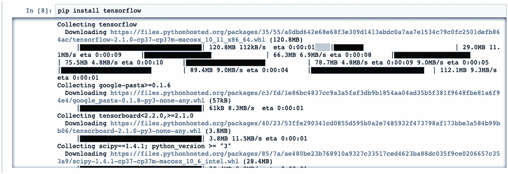
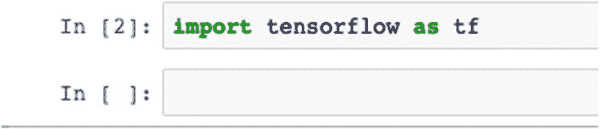
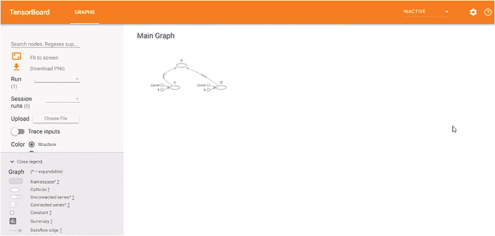

# 8. TensorFlow 机器学习库

回顾前面章节所述，Python 拥有大量可以在程序中实现的机器学习库。这些库服务于各种目的——数学、科学、图形等。根据我们正在开发的程序的性质和需求，我们可以将这些库调用到我们的程序中。

我们知道机器学习涉及数据科学技术（如数据清洗、处理和可视化）、数学技术和统计技术。考虑到这一点，一些最常用的 Python 机器学习库包括 `Matplotlib`、`Seaborn`、`Pandas`、`Scikit-learn`、`Numpy`、`Scipy` 等。

这些库已经过反复测试和验证，并且易于使用。因此，它们多年来广受欢迎，在各种机器学习程序中有着众多应用。

随着对深度学习的热情日益高涨，人们需要创建能够帮助构建多层神经网络的库。因此，`Theano`、`Pytorch`、`Caffe`、`Keras` 和 `TensorFlow` 等库相继发布。这些库使程序员能够以更少的时间和精力、更高的效率开发大型多层神经网络。

在本章中，我们将探索 `TensorFlow` 库，以全面了解它是什么、为什么被开发，以及它如何在人工智能领域证明其价值。然后，我们将了解如何在我们的系统上安装它。

## TensorFlow 概览

`TensorFlow` 由谷歌大脑团队开发，是对早期闭源深度神经网络机器学习系统 `DistBelief` 的升级。根据其官方网站的描述：

> *“TensorFlow 是一个端到端的开源机器学习平台。它拥有一个全面而灵活的生态系统，包含工具、库和社区资源，让研究人员能够推动机器学习领域的前沿发展，并让开发者能够轻松构建和部署由机器学习驱动的应用程序。”*

换句话说，`TensorFlow` 是一个利用机器学习和深度学习技术进行大规模计算的开源库。它涉及使用“张量”（tensors），这有助于简化我们的计算。我们将在下一节中深入探讨这一点。

**趣闻**

实际上，`TensorFlow` 最初并非面向公众开放。它仅用于谷歌大脑团队自己的研究。然而，它最终于 2015 年 11 月 9 日向公众发布。

`TensorFlow` 在 `Apache 2.0` 许可证下发布。这意味着人们可以不受版税限制地使用、修改和分发该软件及其修改版本。其再分发仅需提供一份署名声明。这就是 `Apache 2.0` 许可证被称为著佐权（copyleft）许可证的原因。它对软件再分发的条件要求最低，并允许为了公共利益而访问、修改和分发软件。

`TensorFlow` 包含两个主要组件，如下所示：

1.  *张量*（Tensors），用于存储数据

2.  *流*（Flow），指计算图

让我们看看这两者如何协同工作来创建大规模的深度学习模型。

### 张量

张量可以定义为多维数组。

我们可能还记得在学校学过的维度概念。维度大致定义为描述特定点所需的最小坐标数。简单来说，它是衡量一个物体占据空间大小的度量。例如，一条线只有一个维度（长度），而一个正方形有两个维度（长度和宽度）。在数学中，我们可以有一个数字或一组按不同维度排列的数字。

在数学和物理学中，我们学过标量、向量和矩阵，它们是描述某些数值排列的三种结构。

单个数字称为*标量*。多个数字按一维列表（数组）排列称为*向量*。多个数字按二维方式排列称为*矩阵*。从视觉上看，我们可以用图 8-1 来表示这三个概念。



图 8-1

标量、向量和矩阵

从技术上讲，标量、向量和矩阵都是张量。

*   标量是零维张量。

*   向量是一维张量。

*   矩阵是二维张量。

然而，一个普遍接受的做法是，当我们在三个或更多维度上排列多个数字时，我们将这种排列称为*张量*。

我们可以将张量想象成魔方的形状，如图 8-2 所示。


图 8-2

一个张量

从图中可以看出，张量具有巨大的数据存储能力，因为它们有 *n* 个维度。这里的 *n* 代表实际维度的数量，其中 *n* >= 3。

为了更好地理解标量、向量、矩阵和张量之间的关系，我们可以用图 8-3 来描绘它们。



图 8-3

标量、向量、矩阵和张量的符号表示

如您所见，这四种数据结构在符号表示上也非常相似，区别仅在于它们的容量。

尽管张量通常保存数字，但它们也可以保存文本和字符串。张量能够以紧凑的形式包含大量数据。这使得处理我们程序的计算变得更加容易，即使我们需要使用海量数据来训练我们的模型。

### 流

程序的输入以张量的形式接收，然后借助计算图以分布式模式执行。这些图用于设置整个程序的*流*。

计算图是一个流程图，描述了需要对输入张量执行的操作和函数。张量从一端进入，经过一系列操作，然后从另一端作为代码的输出出来。

这就是 `TensorFlow` 名称的由来——输入张量遵循一个系统化的流，从而产生所需的输出。

现在我们已经了解了 `TensorFlow` 是什么，让我们来看看它对机器学习开发者有何用处。

## TensorFlow 的重要性

`TensorFlow` 最初主要用于数学目的。由于其强大的计算能力，它很快被应用于机器学习。它使得构建神经网络的任务变得不那么繁琐。

正如前面的定义所述，`TensorFlow` 在可操作性上极其灵活，并且适用于跨多种平台（如 `Mac OS`、`Windows`、`Linux` 和 `Android`）的机器学习算法。它使用 `Python`、`C` 和 `CUDA`（统一计算设备架构）三种语言编写，虽然与 `Python` 配合最佳，但也支持 `Java` 和 `C++` 等其他语言。

它还不断进行改进，以跟上程序员不断变化的需求。其庞大的社区是一个主要优势，这使得使用 `TensorFlow` 的人们能够协同工作、互相帮助，并有效地使用该库。

## TensorFlow 的应用

尽管相对较新，`TensorFlow` 已经在人工智能的多个领域发挥了作用，并且仍在继续。它的一些应用包括：

*   **图像识别**：从照片或视频中识别物体或特征

*   **图像分类**：识别物体并将其相互分离

*   **文本摘要**：将内容压缩成几个可理解的词语

*   **情感分析**：识别陈述是正面、负面还是中性

*   **语音识别**：识别口语并将其转换为文本

*   **其他深度学习项目**

借助 `TensorFlow`，使用神经网络进行深度学习变得轻而易举。因此，该库的大部分应用都集中在人工智能的这个领域。

## TensorFlow 的竞争对手

尽管 `TensorFlow` 在结构和用法上相当独特，但在机器学习领域确实有一些竞争对手。这些是人们用来执行与 `TensorFlow` 相同功能的替代框架。其中一些库包括：

*   `Theano`

*   `OpenCV`

*   `PyTorch`

*   `Apache Spark`

*   `Keras`

所有这些库，尽管在功能和能力上有所不同，但在机器学习中都有类似的用途。`Keras` 库可以在 `TensorFlow` 之上使用，以开发更有效的深度学习模型。我们将在本书后面有机会使用 `Keras` 和 `TensorFlow`。

现在，让我们来看看使用 `TensorFlow` 的一些优点和缺点。

## TensorFlow 的优点和缺点

既然我们已经对这个机器学习库相当熟悉了，那么让我们来看看在程序中实现它时的一些优点和缺点。

### 优势

考虑到 `TensorFlow` 拥有的竞争对手数量，人们可能会好奇它究竟有何特别之处，以及为何许多人将其视为首选的深度学习库。它之所以能从其他库中脱颖而出，是有原因的。现在，我们将了解它的一些重要特性，以便理解为何在代码中使用它对我们有利。

1.  它是开源的。这意味着根据其发布的 `Apache 2.0` 许可证，用户可以免费访问、下载、使用和分发。用户无需为在其项目中实现此库付费。

2.  它不断被修改。这为其源代码的改进留出了空间，并确保了其性能的稳定性。

3.  它可以在多个平台上使用，使开发者易于访问。

4.  它遵循抽象的方式，这意味着开发者只需要关注程序的整体运行。`TensorFlow` 自行处理其他所有事情。

5.  它通过为程序员提供名为 `TensorBoard` 的工具，使数据可视化变得更加容易。这是一个基于 Web 的交互式仪表板，允许我们查看和观察我们的图表。

6.  它拥有多种编程语言的多个 `API`，使开发者能够轻松创建和执行程序及图表。其中一个例子是 `Keras API`，如前所述，我们将在本书后面用到它。

7.  它拥有一个由热情开发者组成的大型社区，这使得 `TensorFlow` 用户能够相互联系、学习、分享和帮助。

现在，我知道，这一切听起来都很棒。这几乎让 TensorFlow 听起来像是人类最伟大的发明之一，不是吗？然而，令人惊讶的是，虽然 TensorFlow 获得了全球粉丝的追捧，但它也开始获得相当数量的“反对者”——这些开发者因该库的一些缺点而对其感到轻微或极度失望。

### 劣势

没有什么是完美的，无论这个库看起来多么无懈可击，它在某些方面要么失败，要么对开发者来说不够用。让我们来看看多年来用户发现的 TensorFlow 的一些缺点。

1. 它遵循“惰性”执行。这意味着开发者必须首先初始化变量，然后为程序运行单独的会话。这对于那些即使是最小的程序部分也必须不断打开和运行会话的开发者来说，是繁琐的。

2. TensorFlow 框架的结构使得即使是非常简约的代码也需要大量额外的代码行。

3. 错误信息并不总是准确的，有时是错误的或不正确的，这使得调试成为一项艰巨的任务。

4. 它比必要的稍微复杂一些，这使得初学者学习起来感到困惑，特别是如果他们通常对计算机编程还很陌生的话。

大多数程序员设法克服了这些挑战，以实现他们的机器学习目标，这就是 TensorFlow 保留了庞大用户群的原因。然而，TensorFlow 团队很快意识到，该库还有很大的改进空间，以便让程序员使用起来更加方便。

因此，他们推出了一个更新、更好的版本——TensorFlow 2.0。它最初作为测试版发布，供用户安装、使用并提供反馈。后来，在 2019 年，TensorFlow 2.0 正式发布供人们使用。

话虽如此，让我们先稍微熟悉一下 TensorFlow 1.0，然后我们将深入探讨其升级版本。我们将从学习如何将 TensorFlow 1.0 库安装到我们的系统开始。

## 安装 TensorFlow

安装 TensorFlow 最简单的方法之一是使用“pip install”方法。由于它快速简单，通常被推荐使用。

在介绍这种方法之前，让我们先看看什么是“pip”。

### 了解“pip”

在 Python 中，“pip”只是一个标准的包管理器。它用于从 Python 包的默认源——Python 包索引（PyPI）安装和管理 Python 中的包和软件。

它于 2008 年首次发布，名称为 pyinstall，作为 `easy_install` 的替代品。后来，它被缩写为 `pip`，据称是“Pip Installs Packages”的首字母缩写。

### “pip install”方法

使用 `pip` 安装包的一般命令如下：

```
pip install
```

就是这样！只需一行。一旦使用 `pip` 安装了包，它就会保留在工作环境中，直到我们卸载它。这意味着我们不必每次在程序中使用该包时都重新安装它。

### 其他有用的 pip 命令

除了安装包之外，`pip` 下还有几个命令，我们可以调用并执行它们以方便地管理我们的包。其中一些包括：

1. `pip list`：这为我们提供了所有已安装包的列表。

2. `pip show <包名>`：这为我们提供了有关指定包的信息。

3. `pip list --outdated`：这显示了我们系统上所有过时包的列表。

4. `pip search <包名>`：这会搜索指定的包。

5. `pip uninstall <包名>`：这会从环境中卸载一个包。

### 使用“pip install”安装 TensorFlow

这种方法的好处在于我们几乎不需要做什么。我们只需输入一行代码，其余的一切都会自动完成。

要将 TensorFlow 安装到我们的环境中，请遵循以下步骤：



图 8-4

进入正确的环境

1. 打开 Anaconda 后，请确保你处于正确的环境中，而不是 `base`（根）环境。例如，这里我选择在 `myenv` 环境中工作，如图 8-4 所示。



图 8-5

启动 Jupyter Notebook

1. 通过在工作环境中启动 Jupyter Notebook 应用程序来打开它，如图 8-5 所示。



图 8-6

打开一个 Python 3 Jupyter Notebook

1. 在仪表盘中，点击“New”，然后选择打开一个新的 Python 3 Notebook 的选项，如图 8-6 所示。

1. 在出现的代码单元格中，输入以下代码行，以指示计算机开始使用 `pip` 安装 TensorFlow：

    ```
    pip install tensorflow
    ```

    安装将开始。你会看到代码单元格下方出现一个框，显示大量内容，这些内容代表了我们单行代码背后正在发生的一切。代码单元格的左角会出现一个星号，表示代码仍在运行。一旦过程完成，星号就会消失，如图 8-7 所示。

    

    图 8-7

    安装 TensorFlow

2. 安装完成后，我们可以检查并确认 TensorFlow 是否已正确安装。为此，首先重启内核。然后，输入以下内容：

    ```
    import tensorflow as tf
    ```

    这段简短的代码用于将 TensorFlow 库调用到 Jupyter Notebook 中。`tf` 被指定为该库的一个别名（我们将在下一章使用 TensorFlow 进行编码练习时看到更多相关内容）。

    执行该单元格时不应出现任何错误，如图 8-8 所示。



图 8-8

TensorFlow 已安装在系统上

如果你的 notebook 在运行该命令时没有显示任何错误提示，那么恭喜你！你已成功在你的 Python 环境中安装了 TensorFlow。

TensorFlow 还有一个功能，可以为用户提供轻松可视化数据所需的所有必要工具。这被称为 TensorBoard。

## TensorBoard

根据 TensorFlow 官方网站的说法，TensorBoard 是“TensorFlow 的可视化工具包”。

它是一个界面，可用于借助可视化技术更清晰地理解我们的数据和深度学习模型。

它的一些应用包括以下内容：

1. 可视化参数和指标

2. 可视化计算图

3. 查看图表和图形

4. 显示图片、文本或音频等媒体项目

当你运行 TensorBoard 时，它看起来会像图 8-9 所示。



图 8-9

TensorBoard 示例

图 8-9 展示了一个非常简单的图的 TensorBoard 面板。屏幕顶部的仪表盘选项卡因模型的组件而异。这里，我们只有一个仪表盘；即 `Graph` 仪表盘。现在，看一下图 8-10。


图 8-10

TensorBoard 的各种选项卡

这个导航栏显示了另外三个选项卡：`Scalars`、`Distributions` 和 `Histograms`。每个选项卡都指向相应的仪表盘视图，可用于研究和改进深度学习模型。

### 探索 TensorBoard 仪表盘

有几种不同类型的仪表盘，我们可以访问并根据各自的目的使用它们。让我们来看一看。

* `Scalars`：这向我们展示了训练过程中每个 epoch 内损失和准确率等指标发生的变化。它还允许我们跟踪不同的标量值。能够比较这些指标使我们能够找出模型中存在的任何问题，以便改进它。

* `Graphs`：这向我们展示了模型的计算图。通过检查模型的图形表示，我们可以轻松检查其准确性和可靠性。这使得调试代码或更改其结构变得更加容易，从而提高模型的质量。

* `Distributions`：这向我们展示了输入在模型训练过程中的分布情况。它帮助我们直观地检查权重和偏置值随时间的变化。这些参数在训练模型时极其重要，因此能够清晰理解它们是必要的。

* `Histograms`：

### TensorBoard 功能概览

*   与 Distributions 仪表盘类似，这帮助我们直观地检查权重和偏置的值，但它是从三维角度出发，借助直方图来实现的。这些直方图表示与训练时间线相对应的变化数据，使我们能够决定是否需要对模型进行任何更改。

*   `Projector：`
    这用于可视化高维词嵌入。嵌入包括以数字形式表示单词，使得相似的单词具有相似的编码。

*   `Text：`
    这用于可视化文本数据。这些字符串可以是超链接、表格等形式。

*   `Image：`
    这用于可视化图像数据。这些图像保存为 `.png` 文件。

*   `Audio：`
    这用于可视化音频数据。它可以以可播放的音频小部件形式嵌入音频。

因此，借助 TensorBoard，我们可以轻松地检查、修改和验证我们模型的工作情况。

TensorBoard 还增加了一项主要服务于协作项目的新服务，允许人们免费分享他们的机器学习项目。这项服务称为 `TensorBoard.dev`。

#### `TensorBoard.dev`

`TensorBoard.dev` 允许用户在线托管、跟踪并与他人分享他们的项目。它是免费的，随时可用，非常适合来自世界各地的不同人员需要在线协作的场景。

其优势包括以下几点：

1.  它使用户能够大规模地分享他们的程序。
2.  它允许用户在遇到无法自行解决的错误或故障时寻求帮助。
3.  它让人们能够与他人分享见解和研究成果。
4.  它具有交互性，有助于他人更好地理解模型。
5.  无需任何安装步骤。只需要一个可分享的链接。
6.  提供免费存储空间，目前每个用户的数据点限制为 1000 万个。

因此，`TensorBoard.dev` 使得向他人寻求帮助或为其他人的机器学习项目做出贡献变得不那么繁琐。

> **注意**：所有上传到 `TensorBoard.dev` 的数据对任何人都公开可见。因此，我们需要`在在线分享信息时保持谨慎`。例如，在发布程序之前，必须避免或隐藏个人信息、用户特定的身份验证代码等。

## 总结

在本章中，我们学习了 TensorFlow，它是 Python 中使用的顶级机器学习库之一。我们了解了它是什么、它是如何开发的、为什么它对程序员很重要，以及它是如何工作的。我们认识了它在机器学习领域的竞争对手、使其脱颖而出的特殊功能，以及它目前的缺点。

然后，我们介绍了 `pip`，并学习了如何借助这个包管理工具安装 TensorFlow，然后验证安装是否成功且无错误。

最后，我们简要概述了 TensorBoard 及其功能，这些功能在可视化我们的模型时会派上用场。我们还了解了 `TensorBoard.dev` 工具，它允许我们轻松且免费地分享我们的机器学习项目。

既然我们已经对将要使用的内容有了一些了解，我们就可以开始探索 TensorFlow 库的各种功能，看看如何在 Python 和 Jupyter Notebook 中使用它来进行机器学习实验。

## 附加信息

有关 TensorFlow 的更多信息，请查看以下内容。

### TensorFlow 开发者峰会

TensorFlow 开发者峰会是一个大型活动，来自全球各地的开发者齐聚一堂，相互讨论、学习和分享。

开发者们会花时间参与互动演示、技术讲座、与 TensorFlow 团队的对话以及与 TensorFlow 社区的讨论。

该峰会每年在官方网站指定的地点举行。无法参加现场峰会的人可以通过在线直播观看。

注册是免费的。参会者需自行承担任何费用（例如差旅和住宿）。

感兴趣的人可以在 TensorFlow 官方网站上找到更多详细信息。

### TensorFlow 博客

TensorFlow 团队维护着一个博客，为用户提供有用的更新、重要的变更、新增功能等。它还包含各种类型的程序教程，机器学习爱好者可以自行尝试，甚至可以作为开发新内容的基础参考。

发布的文章主要涵盖以下主题：

*   `TensorFlow Core：` 涉及使用 Keras API 进行 Python 编码。对初学者和专家都很有用。
*   `TensorFlow.js：` 涉及使用 JavaScript 进行编码。
*   `TensorFlow Lite：` 涉及在物联网设备和手机上使用机器学习模型。
*   `TFX（TensorFlow Extended）：` 涉及将模型从研究阶段转移到生产阶段。
*   `Swift：` 涉及 Swift（一个下一代深度学习平台）的开发进展和教程。
*   `社区：` 涉及 TensorFlow 社区在全球范围内进行的项目和实验。

除了他们的博客，他们还有一份月度通讯，将所有重要的公告直接发送到我们的收件箱。

### TensorFlow 开发者证书

TensorFlow 开发者证书是一项极佳的简历加分项。它表明一个人在使用 TensorFlow 进行人工智能机器学习方面的熟练程度。

当一个人通过评估后，他们将获得官方证书以及徽章，可以添加到他们的专业社交网络资料中。他们也会被添加到 TensorFlow 的证书网络中。这提高了在 TensorFlow 社区中的可见度。

这是提升我们对库的了解、发展机器学习技能、并将自己确立为该领域专家的好方法。考虑到 TensorFlow 是谷歌的产品，获得此证书无疑能让数据科学家的简历脱颖而出。

有关注册、费用、准备等更多详细信息，请访问主网站。

### 快速链接

*   了解更多关于 TensorFlow 库的信息：[`https://www.TensorFlow.org/learn`](https://www.tensorflow.org/learn)
*   查看 TensorFlow 指南：[`https://www.TensorFlow.org/guide/`](https://www.tensorflow.org/guide/)
*   探索 TensorFlow 社区开发的模型和数据集：[`https://www.TensorFlow.org/resources/models-datasets`](https://www.tensorflow.org/resources/models-datasets)
*   查看 TensorFlow 支持的工具：[`https://www.TensorFlow.org/resources/tools`](https://www.tensorflow.org/resources/tools)
*   了解更多关于 TensorFlow 中使用的库和扩展：[`https://www.TensorFlow.org/resources/libraries-extensions`](https://www.tensorflow.org/resources/libraries-extensions)
*   TensorBoard：[`https://www.TensorFlow.org/tensorboard/get_started`](https://www.tensorflow.org/tensorboard/get_started)
*   TensorFlow 开发者峰会：[`https://www.TensorFlow.org/dev-summit`](https://www.tensorflow.org/dev-summit)
*   TensorFlow 开发者证书：[`https://www.tensorflow.org/certificate`](https://www.tensorflow.org/certificate)