# 9. 使用 TensorFlow 编程

到目前为止，我们已经了解了 Python 如何借助其众多专为机器学习而创建的库来实现这一有利可图的目标。我们还知道 Jupyter Notebook 是一个可靠的开发环境，可用于构建和运行大型程序。

在本章中，我们将了解如何借助 TensorFlow 库进行编程。本章将介绍最初的 TensorFlow 版本（TensorFlow 1.0），目的是让我们熟悉该库在 2.0 重大演进之前的工作方式。

现在，不必担心需要亲自尝试这些程序。如果你是 TensorFlow 的初学者，可以从较新的版本开始编码，稍后你将学习如何操作。本章的主要目的是让你了解原始 TensorFlow 在编程便捷性方面与其升级版本有何不同。

我们将通过四个处理一些重要编程概念的程序来实现这一目标。它们划分如下：

*   **程序 1：Hello World**

*   这是编程界普遍采用的入门级程序。它将教会我们如何编程让机器打印一条语句。

*   **程序 2：常量、变量和占位符**

*   这将帮助我们理解常量、变量和占位符的重要性。它进一步分为两个子部分：

*   部分 A：常量和变量

*   部分 B：占位符

*   **程序 3：计算图中的操作**

*   这将让我们更好地理解计算图在 TensorFlow 程序中是如何工作的。

*   **程序 4：从用户处获取占位符的输入**

*   这将向我们展示如何从用户处获取输入，将其存储在占位符中，然后使用输入的值来显示所需的某些结果。

那么，事不宜迟，让我们直接开始吧！

## 导入 TensorFlow 库

我们需要做的第一件事是将 TensorFlow 库导入到 Jupyter Notebook 中。命令如下：

```
import tensorflow as tf
```

`tf` 有点像给这个库起的昵称。这是因为，随着我们深入程序，我们需要在调用其各种实用程序时不断引用该库，而每次都输入全名会相当繁琐。我们也可以将 `tf` 替换为任何其他名称，比如 `joe` 或 `jane`，但 `tf` 是普遍接受的名称，因此建议使用它。这也使得其他阅读代码的人更容易理解正在引用的是哪个库。

一旦我们将此命令输入到“代码”单元格并执行，TensorFlow 就会被导入到 Jupyter Notebook 中。我们现在就可以开始用它编程了。

## 程序 1：Hello World

我们都知道我们能学到的最基本的程序是“Hello World”程序。我们之前用常规的 Python 做过这个。现在让我们使用 Python 中的 TensorFlow 来做这件事。

使用常规 Python 和使用 Python 的 TensorFlow 之间的区别在于代码结构不同，正如你将看到的。在常规 Python 中，程序如下：

```
h = print("Hello World")
h
```

然而，在 TensorFlow 中，由于库的内部结构，它会变得稍微复杂一些。程序看起来是这样的：

```
h = tf.constant("Hello World")
sess = tf.Session()
sess.run(h)
```

在这种情况下，我们首先创建一个 TensorFlow 常量 `h`，并为其赋值 `Hello World`。如前所述，常量的概念将在下一个程序中涉及。

接下来，我们需要创建一个会话，它可以执行整个图或图的一部分。相应地，它会分配资源并容纳值和结果。

我们使用 `sess` 作为命令 `tf.Session` 的更简短、更易用的版本，因为在较大的程序中，我们需要不断运行和关闭多个会话，每次都写完整命令会很麻烦。

现在，当我们执行程序时，输出将如下所示：

```
Hello World
```

如果我们不创建会话并尝试调用变量 `h` 来打印输出，我们仍然会得到一个输出，但并非我们所期望的方式。它不会给我们 `h` 的值，而是会显示 `h` 是一个张量，并给出这个张量的简要摘要。仅此而已。输出将显示如下：

```
现在，正如你所看到的，我们在程序中使用了 `tf.constant()`
函数，它将 `h` 定义为一个常量（而不是变量或占位符）。为了更好地理解常量、变量和占位符之间的区别，我们将看看另一个程序。

程序 2：常量、变量和占位符
我们很多人都经常听到*常量*、*变量*和*占位符*这些术语，尤其是在编程领域。这是因为它们在大量程序的开发中扮演着重要角色。

在我们开始使用它们进行编码之前，我们需要确切地知道它们是什么。它们通常可以定义如下：

*   **常量：** 这些是*从不改变*的值。
*   **变量：** 这些是在整个程序中*可以改变*的值。
*   **占位符：** 这些是在程序的*后期阶段被赋值*的空变量。

表 9-1 列出了它们之间的一些不同之处。

表 9-1
常量、变量和占位符之间的区别

常量 | 变量 | 占位符

| --- | --- | --- | --- | --- | --- | --- |

它们有初始值。 | 它们有初始值。 | 它们没有初始值。 |

这些值从不改变。 | 这些值可以改变。 | 这些值可以改变。 |

不需要指定值的类型。 | 不需要指定值的类型。 | 需要指定值的类型。 |

示例：`a=tf.constant(4)` | 示例：`b=tf.Variable(5)` | 示例：`c=tf.placeholder(tf.float32)` |

注意

当我们说是否需要指定值的“类型”时，我们的意思是，我们不需要告诉程序常量或变量是字符串、浮点数、整数等，而对于占位符，我们需要指定这一点。

现在我们已经了解了什么是常量、变量和占位符，让我们继续使用它们来创建一个程序。


第一部分：常量与变量
在这一部分中，我们只会将变量和常量整合到代码中。在第二部分，我们将学习如何在程序中使用占位符。这是因为后者比前两者需要更多的解释。

为了理解变量和常量在程序中的工作原理，我们将进行一些简单的算术运算（正如我们已经看到的），因为这是演示这两个特性的简单方法。这也将让我们有机会探索 TensorFlow 中允许的一些算术运算。

首先，按如下方式定义常量 `a`：

```
a = tf.constant(5)
```

接下来，定义变量 `b`：

```
b = tf.Variable(6)
```

这里需要注意非常重要的一点：`tf.constant()` 函数全部是小写字母拼写，而 `tf.Variable()` 函数中的 `V` 是大写的。这是一个微小的细节，如果不正确遵循，可能会导致程序出错。

现在我们已经定义了常量和变量，让我们对它们进行一些计算！我们将从求这两个值的和开始。为此，我们将使用以下命令：

```
sum = tf.add(a,b)
```

这等同于输入以下内容：

```
sum = a + b
```

当我们执行这两者时，会得到相同的输出。

现在，假设我们想改变变量 `b` 的值。我们可以这样做：

```
new = tf.assign(b,4)
```

`tf.assign()` 函数允许我们为变量赋予一个新值。如果我们尝试对常量使用此函数，将会报错。在这里，括号内，我们首先输入要改变的变量，然后输入要改变成的值。我们将整个更新操作保存在变量 `new` 下。

将其保存在变量 `new` 下的原因是，它不能自行执行。我们需要在会话中运行这行代码，然后它才会被执行。因此，我们将其存储在一个变量下，然后在会话中调用它。

需要特别注意的一点是，当我们使用变量时，*我们需要在开始在会话中使用它们之前对它们进行初始化*。起初这看起来像是一个不必要的步骤，但当我们尝试在不初始化变量的情况下使用它们时，程序会报错。我们按如下方式初始化变量：

```
init_op = tf.global_variables_initializer()
```

这个 `init_op` 是一个节点或操作，需要被执行才能初始化变量。当然，我们可以给它起任何名字，但为了可读性，我们将使用它的一个常规名称。

现在我们已经声明了这一点，我们需要在会话中运行它。让我们像上一节那样创建我们的会话：

```
sess = tf.Session()
```

现在让我们在会话中运行我们的 `init_op`，像这样：

```
sess.run(init_op)
```

太好了！我们的变量已经初始化了。现在我们可以继续程序的其余部分了。让我们先找出 `a` 和 `b` 相加的结果：

```
print(sess.run(sum))
```

我们在 `sess.run(sum)` 前面加上 `print`，这样程序会直接打印出相加的结果。这将求两个数的和并打印结果这两个命令缩减为一行代码。

我们会得到 `a` 和 `b` 的和，像这样：

```

```

现在，让我们给 `b` 赋予新值，看看输出如何变化：

```
sess.run(new)
print(sess.run(sum))
```

你看到输出的不同了吗？程序已经根据给它的指令改变了 `b` 的值，并打印出了 `a` 和 `b` 的新和。给 `b` 赋予新值是可能的，因为它是一个变量，但对 `a` 这样做是不可能的，因为它是一个常量。

当我们有大量数据需要在代码中接收、声明、存储和稍后调用时，常量和变量非常有用。当我们进入硬核机器学习时，我们将看到它们如何在程序中用于有效地开发和训练模型。

如前所述，占位符需要更多解释来说明它们是如何被实现到代码中的。我们将在下一部分看到这一点。

第二部分：占位符
占位符的主要思想是帮助那些需要用海量数据训练庞大模型的程序员。原因是，所有这些数据无法一次性访问（除非程序员愿意冒电脑崩溃的风险）。因此，借助占位符，这些数据可以一点一点地被访问，直到全部处理完毕。

与常量和变量不同，占位符不需要给定初始值。我们只需要指定我们想要在其中存储的值的*类型*。

让我们尝试初始化我们的第一个占位符：

```
p = tf.placeholder(tf.float32)
```

这里，我们指定占位符将持有一个 `float` 类型的值。这为程序做好了准备，以便在运行时它会在占位符中接受一个浮点数。

现在，让我们输入我们的方程。这次，我们将进行基本的乘法运算。我们将按如下方式输入代码：

```
prod = p*2
```

现在，如果我们尝试通过在会话中运行它来执行此操作，我们将不会得到任何输出，因为 `p` 中没有值。我们需要先给 `p` 赋一些值。这里，与变量不同，我们不能直接使用 `tf.assign()` 来给占位符赋值。我们需要遵循一种不同的方法。这涉及到使用一个字典，我们将用它来向占位符 `p` 馈送一个值。

我们将首先给 `p` 赋一个单一的值，像这样：

```
sess.run(prod, feed_dict={p:4.0})
```

当我们执行这行代码时，我们会得到如下输出：

```

```

通过运行这段代码，会发生两件事：

1.  首先，我们提供的值（在本例中是 `4.0`）被赋给了占位符 `p`。
2.  其次，执行操作 `prod`，它使用这个占位符 `p` 及其新赋的值来产生结果。

让我们尝试向占位符馈送更多值。

```
sess.run(prod, feed_dict={p:[6,7,8,9]})
```

这会为每个赋值的值给出一个输出。

我们甚至可以首先创建一个字典，然后将其馈送到占位符中。我们将借助一个多维数组来演示这一点。首先，让我们用一些值定义我们的字典 `d`，像这样：

```
d = {p:[[0,2,4,6,8], [1,3,5,7,9], [11,15,17,19,25]]}
```

现在，我们可以将这些值馈送到占位符 `p` 中，像这样：

```
sess.run(prod,feed_dict=d)
```

当我们执行这行代码时，我们将得到字典中每个元素乘以 2 后的乘积。

现在，看看下一个程序：

```
g = tf.placeholder(tf.float32)
h = tf.placeholder(tf.float32)
sum = g+h
prod = sum*5
sess = tf.Session()
sess.run(prod, feed_dict={g:[2], h:[3]})
```

很有趣，对吧？以下是这个程序中发生的事情：

1.  我们声明了两个占位符，`g` 和 `h`。
2.  然后我们声明了一个变量 `sum`，它将 `g` 和 `h` 的值相加。
3.  之后，我们声明了一个变量 `prod`，它取 `sum` 的值并将其乘以 5。
4.  最后，我们在一个会话中运行了 `prod`，并向 `g` 和 `h` 馈送了值，因为 `sum`（在 `prod` 下声明的唯一变量）需要 `g` 和 `h` 的值才能获得自身的值。


关于占位符（placeholder）的介绍就到这里了！通过这种方式，我们可以使用占位符将图的某个区域分配给某个值，该值将在后续程序中输入。当程序员在程序开始时不知道数据的某些特征时，这种方法尤其有用。例如，程序员可能不知道她/他将要使用的数据量。

这很有趣，不是吗？你也可以尝试使用变量、常量和占位符。试着用它们编写一些小代码片段，看看你能得到什么结果。

在下一个程序中，我们将了解 TensorFlow 中计算图的架构。

**程序 3：计算图中的操作**

到目前为止，我们已经了解到 TensorFlow 是借助计算图来工作的。这个图包含了我们声明的所有变量、执行的所有操作等等。它基本上在程序的幕后工作。在 TensorFlow 中，图的每个节点都被称为一个操作，即使它只是一个初始化变量的命令。

我们将从获取“默认图”开始，如下所示：

```
graph = tf.get_default_graph()
```

现在，让我们尝试从这个图中检索操作：

```
graph.get_operations()
```

我们会得到如下输出：

```
[ ]
```

这是因为我们还没有执行任何操作，所以图没有任何内容可以显示。

现在，我们将开始向这个图添加一些节点。让我们使用一些我们已经学过的简单命令，如下所示：

*   创建一个常量 `a`
*   创建另一个常量 `b`
*   求 `a` 和 `b` 的和，记为 `c`
*   求 `c` 与一个常量的乘积，记为 `d`

我们可以按如下方式操作：

```
a = tf.constant(300, name = "a")
b = tf.constant(65, name = "b")
c = tf.add(a, b, name = "c")
d = tf.multiply(c, 10, name = "d")
```

在每一行中，`name` 仅用于可视化，以帮助我们理解计算图的概念。我们也可以给每个节点起任何其他名字，但我们分配了这些名字以避免混淆并促进更好的理解。

现在，让我们通过输入以下两行代码来查看我们的图是什么样子，以便从中获取操作：

```
operations = graph.get_operations()
operations
```

执行此操作将得到如图 9-1 所示的结果。

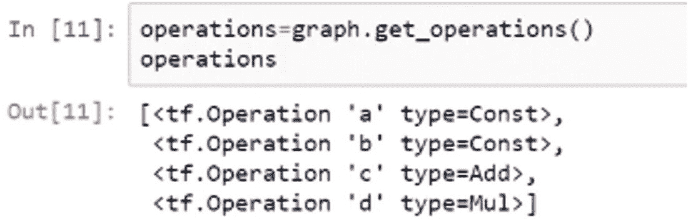

**图 9-1**
计算图中的操作

这向我们展示了图中存在的节点数量。我们输入了四个不同的节点，它们在这里连同它们的名字（`a`、`b`、`c` 和 `d`）和类型（分别是常量、常量、加法、乘法）一起显示。让我们再添加一个节点 `e`：

```
e = tf.multiply(a, 8, name = "e")
operations = graph.get_operations()
operations
```

如果我们执行 `operations`，我们会发现节点数量增加了一个，这个额外的节点连同它的名字 `e` 和类型 `Mul` 一起显示，如图 9-2 所示。

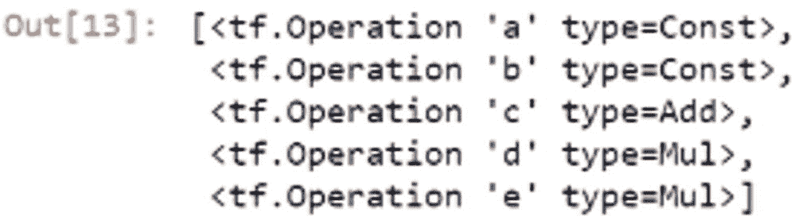

**图 9-2**
计算图中添加的操作

我们现在可以在一个会话中运行这些节点中的任何一个或全部，如下所示。如你所见，我们执行了节点 `a` 和节点 `e`：

```
sess = tf.Session()
with tf.Session() as sess:
result = sess.run(a, e)
print result
```

在这里，我们在一个 `with` 块内运行了会话。这是一种经常使用的方法，尤其是在需要多个会话时。与其单独声明 `sess` 变量，然后多次输入 `sess.run()` 命令，我们不如在一个循环内完成整个过程。

因此，我们可以看到计算图是如何工作的。当然，我们不一定需要开发这种程序，尤其是在机器学习中。然而，为了掌握 TensorFlow 中图的概念，仔细学习这部分内容是有好处的。

**程序 4：从用户处获取占位符的输入**

当涉及到创建模型来分析数据时，了解这类程序尤其有用。这是因为，作为开发人员，我们在创建程序时，实际上并不知道用户将提交什么样的数据。但是，我们需要确保我们的程序能够接收用户的输入，对其执行必要的计算，然后产生所需的输出。

在这个程序中，我们首先创建两个占位符 `a` 和 `b`。然后我们声明 `c` 等于某个值，该值以需要 `a` 和 `b` 的方程形式给出。之后，我们规定 `A` 是将要赋值给 `a` 的输入的变量名，`B` 是将要赋值给 `b` 的输入的变量名。最后，我们创建一个字典 `d`，其中 `a` 从 `A` 获取其值，`b` 从 `B` 获取其值。然后我们运行会话来找到 `c` 的值。

一旦我们实际输入并执行代码，这一切都会变得清晰得多。话不多说，让我们开始编写程序：

```
a = tf.placeholder(tf.float32)
b = tf.placeholder(tf.float32)
c = (a*2) + b + 10
A = input("Enter a value for a: ")
B = input("Enter a value for b: ")
d = {a:A, b:B}
with tf.Session() as sess:
result = sess.run(c, feed_dict = d)
print result
```

现在，当我们执行整个程序时，我们将有机会为 `A` 和 `B` 提交一个值。这些值被输入到程序中并进行计算，然后显示方程的结果。

**任务时间**

持续执行此程序以更改 `a` 和 `b` 的值，并观察 `c` 的值如何相应变化。也尝试更改 `c` 的方程，看看会发生什么。

**关闭会话**

当我刚开始使用 TensorFlow 库时，我会练习运行不同类型的代码，只是为了让自己更熟悉它。这意味着我一天内会打开多个会话来执行各种命令。然而，直到后来，我才了解到关闭会话的重要性。

我们在 TensorFlow 中关闭会话主要是为了释放资源并减少对计算能力的不必要使用。我们使用以下命令来执行此操作：

```
sess.close()
```

这告诉系统我们的会话结束了，因此它不再需要计算任何东西。但是，如果我们在 `with` 块内运行会话，则无需担心添加这额外的一行代码，因为一旦到达块的末尾，会话会自动关闭。

至此，我们已经介绍了使用 TensorFlow 1.0 进行编程的一些基础知识！

**总结**

在我们编程时，也许注意到代码的某些部分看起来有点……嗯，不必要，对吧？例如，我们需要不断地打开（然后关闭）会话。或者，我们需要在使用变量之前初始化它们。好吧，我们不能责怪 TensorFlow 的开发者——他们最初在创建这个库方面做得相当不错。但很快连他们也意识到，这个库可以进一步改进，以使程序员使用 TensorFlow 编码的任务更加简单。

那么，他们做了什么？
他们推出了 TensorFlow 2.0。
这个新版本包含了一些更新和更改，这些更新和更改考虑了原始版本的所有问题和不便之处。让我们更深入地了解一下这个版本的库，看看 TensorFlow 2.0 如何使机器学习更快、更容易。


10. 介绍 TensorFlow 2.0

TensorFlow 2.0 的发布对机器学习领域来说是一大福音。
它是在 2019 年 TensorFlow 开发者峰会上宣布的。当时，
它仍处于 alpha 版本。尽管并非正式
发布，但它已经引起了程序员们的广泛关注，他们很快意识到这无疑是
相比之前版本的一次重大改进。
开发这个新版本是为了给程序员提供一个
强大、易于实现且方便
在任何平台上使用的机器学习
库。它旨在通过让编程比以往更简单来挑战其父版本。对于机器学习爱好者来说，上手也相对
不那么困难，尤其是
如果他们刚接触 TensorFlow 库的话。
TensorFlow 的最新版本特别考虑到了
先前版本面临的挑战。一些烦人的功能被移除，
一些有用的功能被添加。当然，TensorFlow 2.0 并非
终极版本——它仍有很大的改进空间。但
到目前为止，它似乎已经获得了全球程序员
的广泛认可。

TensorFlow 2.0 的特性
由于 TensorFlow 2.0 是作为原始版本的改进版而开发的，
并非一个独立的库，因此它的许多特性
与 TensorFlow 1.0 相似。两者主要区别在于
程序员注意到的一些可避免的属性方面。话虽如此，
以下是 TensorFlow 2.0 的一些关键特性。

即时执行

根据官方网站的说法，

*TensorFlow 的即时执行是一种命令式编程
环境，它会立即评估操作，而无需构建图：
操作返回具体值，而不是构建一个计算图供稍后运行。*

换句话说，迭代立即发生，我们无需为每个命令创建
计算图或运行单独的会话。
它具有自然且稳定的流程，无需受图
控制。它很直观，因为它确保代码遵循
正确的布局和结构。它还允许我们使用常规的 Python
调试工具来识别和纠正代码中可能存在的任何错误。
这与 TensorFlow 最初的“惰性”执行不同，在那种模式下，
程序员必须构建一个图并在会话中运行他们的代码行。

Keras 的引入
TensorFlow 将 Keras API 实现为一个强大的
工具，可用于模型构建。它支持即时执行
以及 TensorFlow 的其他几项功能。它用途广泛、
可靠且高效。正是因为这个原因，它被添加到了 TensorFlow 2.0 中。
Keras 曾经是一个独立的包，用户需要
单独下载并在他们的模型中使用。慢慢地，
TensorFlow 将其作为 `tf.keras` 添加到了其框架中。这个 `tf.keras` 子包
与主 Keras 包不同，以确保兼容性和
稳定性。后来，随着 TensorFlow 2.0 的发布，
TensorFlow 团队表示 Keras 将成为该版本的
主要高级 API。

API 清理
TensorFlow 拥有大量适用于多种不同编程语言的 API（应用程序
编程接口），可以在代码中使用。这些 API 是一组工具、
实用程序和系统化程序，当在程序中调用时会执行特定操作。
其中一些 API 被认为已弃用——它们对程序员来说似乎
不太有用。其他 API 似乎具有相似的功能和特性。因此，在开发 TensorFlow
2.0 时，团队决定对这一部分进行一些清理。
许多 API 因此要么被移除、替换，要么被归并到
一个子包下。

移除全局变量
在 TensorFlow 的先前版本中，变量需要在会话中使用之前
进行初始化。这是通过
`tf.global_variables_initializer()`
函数完成的，该函数会设置一个操作来并行初始化代码中声明的所有变量。

你可能还记得在上一章中做过这个，我们输入了
这样一行代码：

```
init_ops = tf.global_variables_initializer
```

之后，我们打开了一个新会话，`运行了 init_ops`，然后
继续运行其余的变量。
在 TensorFlow 2.0 中，所有用于跟踪变量的命名空间和机制
都已被移除。变量在运行之前
不再需要初始化。它们可以在需要时直接使用。

更好的部署能力
TensorFlow 一直为用户提供跨多个平台和语言工作的能力，
以便轻松开发和训练模型。TensorFlow 2.0 为此带来了更好的兼容性和稳定性。

一个经过充分训练和保存的模型可以直接集成到
我们正在开发的应用程序中，或者借助一些重要的库进行部署，
包括以下内容：

*   **TensorFlow Serving**，它使我们能够
    通过 HTTP/REST 或 gRPC/Protocol Buffers 实现模型。

*   **TensorFlow Lite**，它使我们能够
    为移动设备（如 Android 或 iOS）和嵌入式系统（如
    Raspberry Pi）实现模型。

*   **TensorFlow.js**，它使我们能够
    为 JavaScript 环境实现模型。

*   **此外**，TensorFlow 还支持
    其他编程语言，如 C、Java、Julia 等。

强大的实验工具
研究人员可以借助 TensorFlow 2.0 轻松进行实验，
它允许他们在不牺牲速度和效率的情况下实现自己的想法。
我们已经了解到 Keras 已被添加为 TensorFlow 的核心高级
API。添加 Keras 和类似的 API 是为了使模型构建、改进和训练的过程
更快、更好。实际上，低级 API 和高级 API 协同工作以实现
更高的效率。
控制梯度操作也更容易。还添加了一些扩展
来增强该库的研究能力。

提高生产力
TensorFlow 最初之所以声名鹊起，是因为它有效地帮助了机器学习开发者
并提高了他们的生产力。它的特性和功能极大地
造福了程序员。它节省了他们的时间，减少了他们的精力，
同时帮助他们取得更多成就。
TensorFlow 2.0 在此基础上进行了升级，进一步提高了生产力。它提供了直观的调试、即时
计算、可扩展性和简洁性。它相对也更容易
学习，尤其是对于初学者来说。
TensorFlow 2.0 无疑是对其前身的一次强大、实质性且稳健的
升级。然而，考虑到经验丰富的人工智能爱好者
已经使用 TensorFlow 1.0 很长时间了，过渡到
新版本确实带来了许多挑战。
一些人一直在争论 TensorFlow 2.0 究竟是福还是
祸。虽然他们同意升级有其好处，但他们也
承认人们适应它并不那么容易，
特别是如果他们已经构建了可用的机器学习模型。
此外，适应新的语法可能会成为一个轻微的障碍，
人们可能会觉得这没有必要。

让我们看看表 10-1，其中列出了
一些被认为是 TensorFlow 2.0 优缺点的论点。

表 10-1
TensorFlow 2.0 优缺点

优点 |
 缺点 |

| --- | --- | --- | --- | --- |


与 TensorFlow 1.0 相比，学习起来要容易得多，这得益于其流畅的流程和简化的结构。因此，对于完全不了解 TensorFlow 库的新手来说，他们很快就能学会。  
而那些已经掌握 TensorFlow 1.0 的人，则必须摒弃旧知识，才能理解并高效使用 TensorFlow 2.0。  

它与常规的 Python 编程语言非常相似。这意味着 Python 开发者无需担心为了用 TensorFlow 编程而学习太多额外的命令。  
任何包含会话（session）的 TensorFlow 1.0 代码都无法在 TensorFlow 2.0 中顺利运行，只能在旧版本中执行。  

由于许多 API 已被整合，大部分使用高级 API（如 Keras）的代码无需修改仍可继续使用。  
如果代码需要在 2.0 中运行，则必须手动重写，或使用库提供的升级工具进行转换。  

尽管存在这些争议，但我们知道需要为变革留出空间，尤其是当变革是为了变得更好时。缺点虽然存在，但对程序员来说并非显著不利。它们只是一些可以轻松解决的小麻烦。  

**代码对比**  
到目前为止，我们只了解了 TensorFlow 2.0 的各种特性。一旦我们开始实际用它编程，其功能就会更有意义。如前所述，这两个版本在编写代码方面有所不同。在本节中，我们将对比两个版本，看看代码有何不同。  

我们主要讨论五个存在显著差异的方面：  

1.  `tf.print()` 函数  
2.  惰性执行 vs. 即时执行  
3.  移除 `tf.global_variables_initializer()`  
4.  无占位符  
5.  `@tf.function` 装饰器  

针对每个方面，我们还会看一些小例子。这样，我们就能清楚地了解每个版本的编程风格有何不同。  

**tf.print() 函数**  
TensorFlow 2.0 引入了一个与常规 Python 中 `print` 命令非常相似的命令。在 TensorFlow 2.0 中，我们可以用一行代码使用 `tf.print()` 函数来显示我们选择的任何语句或字符。  

其用法如下：  

```
tf.print(  )
```

**TensorFlow 1.0**  

在 TensorFlow 1.0 中，打印内容并不这么简单。它需要一些额外的步骤，如下所示：  

```
import tensorflow as tf
h = tf.constant("这是一个 TensorFlow 1.0 程序")
sess = tf.Session()
print(sess.run(h))
sess.close()
```

看到了吗？我们必须声明 `h`，说明它等于给定的常量（即我们要打印的句子），打开一个会话，在该会话中运行 `h`，打印它，然后关闭会话。  
那么 TensorFlow 2.0 呢？  

**TensorFlow 2.0**  

```
import tensorflow as tf
h = tf.constant("这是一个 TensorFlow 2.0 程序")
tf.print(h)
```

事实上，我们还可以更进一步，让它更简单：  

```
import tensorflow as tf
tf.print("这是一个 TensorFlow 2.0 程序")
```

看到了吗？多么快捷！  
因此，在 TensorFlow 1.0 中，程序要求我们将字符串声明为常量，创建会话，然后在会话中执行它才能打印出字符串。而在 TensorFlow 2.0 中，我们只需为字符串定义一个变量，然后输入命令 `tf.print()`，它就会显示输出。我们甚至可以直接打印出想要的内容，而无需为其分配变量名。  
这就是 TensorFlow 2.0 的即时执行与 TensorFlow 1.0 的惰性执行的不同之处。接下来我们将更详细地观察这一点。  

**惰性执行 vs. 即时执行**  
TensorFlow 1.0 采用惰性执行。它不会立即执行代码。相反，它会等待图中的特定节点在会话中被执行，然后才会运行。  
下面是一个例子，其中有一段代码用于打印“Hello There”，计算 90 和 7 的和，并显示一个声明为 300 的变量的值。  

**TensorFlow 1.0**  

```
import tensorflow as tf
a = tf.constant("Hello There")
b = 9+70
c = tf.Variable(300)
init_op = tf.global_variables_initializer()
sess = tf.Session()
print(sess.run(init_op))
print(sess.run(a))
print(sess.run(b))
print(sess.run(c))
```

**TensorFlow 2.0**  
在 TensorFlow 2.0 中，惰性执行被即时执行取代。这意味着代码现在可以直接执行。无需先构建计算图，然后在会话中运行每个节点。每一行代码都会立即执行。  

我们可以在这里看到，我们编写了与之前相同的代码，但使用的是 TensorFlow 2.0：  

```
import tensorflow as tf
a = tf.constant("Hello There")
b = 9+70
c = tf.Variable(300)
tf.print(a)
tf.print(b)
tf.print(c)
```

如你所见，第一组代码采用惰性执行方式，使用了分布式图，而第二组代码则没有。它采用了即时执行方式。第二段代码也比第一段更短，因为它没有那么多步骤。  

**移除 tf.global_variables_initializer()**  
仔细看看我们刚才看到的程序。我提到我们跳过了一些步骤，对吧？其中一个步骤就是添加 `tf.global_variables_initializer()` 函数，我们根本没有使用它。  
原因在于，如前所述，在 TensorFlow 2.0 中我们不需要初始化变量。定义变量后，我们可以直接在程序中使用它们。  
为了更清楚地了解，我们来看一段在 TensorFlow 1.0 中声明变量并显示它的代码。  

**TensorFlow 1.0**  

```
import tensorflow as tf
v = tf.Variable(8)
init_op = tf.global_variables_initializer()
sess = tf.Session()
sess.run(init_op)
print(sess.run(v))
```

很简单，对吧？现在，我们来看看用 TensorFlow 2.0 编写的相同代码。  

**TensorFlow 2.0**  

```
import tensorflow as tf
v = tf.Variable(8)
tf.print(v)
```

输出结果相同，但过程简短得多。事实上，代码行数减少了一半。而且，这里我们不必初始化变量 `v`，可以直接给它赋值。  
说到变量，还记得在之前的一章中，我们学习了另一个叫做占位符的概念吗？嗯，TensorFlow 团队决定在升级版中不再保留占位符，因此他们将其去掉了。我们将在下一节中进一步了解这一点。  

**无占位符**  
我们已经知道，占位符不过是一个可以在程序后期阶段赋值的变量。这意味着，与变量不同，占位符不需要初始值。在 TensorFlow 1.0 中，占位符的使用是该版本惰性执行风格的结果，我们可能还记得前一章中的程序。然而，随着 TensorFlow 2.0 的即时执行，占位符不再需要。这是因为操作被创建后会立即被评估。  
为了快速回顾占位符在 TensorFlow 1.0 中的使用方式，我们将看一个小例子。让我们考虑一个程序，其中我们声明一个常量 `a`，一个占位符 `b`，以及一个由 `a` 和 `b` 组成的方程 `c`。然后我们使用 `feed_dict` 命令将数字 3 赋值给占位符 `b`。最后，将 `a` 和 `b` 的值输入 `c` 以获得方程的结果。  

**TensorFlow 1.0**  

```
import tensorflow as tf
a = tf.constant(5)
b = tf.placeholder(tf.float32)
c = a*b
sess = tf.Session()
sess.run(print(c, feed_dict = {b : 3})
sess.close()
```


现在，当我们使用 TensorFlow 2.0 时，无需再创建任何占位符。我们可以直接定义常量 `a`、变量 `b` 和等式 `c`，然后打印 `c` 的值。
当我们把 `c` 定义为 `a` 和 `b` 的乘积时，代码会自动计算 `a` 和 `b` 的值，并将其存储在 `c` 中。接着，当我们打印 `c` 时，它会显示计算结果。因此，程序的执行速度会快得多，如下所示。

TensorFlow 2.0

```
import tensorflow as tf
a = tf.constant(6)
b = tf.Variable(2)
c = a*b
tf.print(c)
```

看看程序变得多简单了？它几乎和普通的 Python 程序一样。我们无需担心先设置占位符，再向其中输入数据，最后执行代码。一切都能快速即时地完成。

@tf.function 装饰器
我们知道，由于 TensorFlow 2.0 采用即时执行模式，因此无需先创建计算图，再通过会话来运行程序。这是否意味着我们无法再以分布式方式运行程序了？
完全不是。我们仍然可以对程序进行分布式执行。我们只需将那段代码写成函数形式，然后在代码前加上 `@tf.function` 装饰器作为前缀。TensorFlow 就会理解该代码旨在以分布式方式执行，并会照此运行。
让我们通过一个示例来看一下。这里，我们首先为 `x`、`y` 和 `z` 初始化值。然后创建一个函数 `result`，在其中计算 `a`（即这三个值的和），并将 `a` 的值作为函数的输出返回。之后，我们声明 `b`，它调用函数 `result`，将给定的 `x`、`y` 和 `z` 值作为输入提供给它，并将此计算的结果赋给 `b` 进行显示。最后，我们再次声明 `b`，但这次调用函数 `result` 时，我们为 `x`、`y` 和 `z` 提供新值，让函数计算结果，然后将其输入到 `b` 中进行显示。
如果你对此感到困惑，不必担心。代码比听起来要简单得多，你接下来就会看到。

TensorFlow 2.0

```
import tensorflow as tf
x = 7
y = 8
z = 9
@tf.function
def result(x,y,z):
a = x+y-z
return a
b = result(x,y,x)
tf.print(b)
b = result(1,7,3)
tf.print(b)
```

你可能已经注意到，这里的函数使用了 `tf.function` 进行装饰，这使得它可以像计算图一样执行。

注意

我们在此没有展示任何 TensorFlow 1.0 代码，因为其中不需要这个装饰器。它仅在 2.0 版本中需要。

因此，从我们刚才看到的内容来看，很容易理解 TensorFlow 相比过去有了相当大的升级。虽然需要一点时间来适应，但一旦开发者成功地从 TensorFlow 1.0 过渡到 TensorFlow 2.0，他们将能够更快、更高效地实现机器学习需求。
现在，对于那些在机器学习领域深耕已久的人来说，他们很可能在过去几年中一直使用 TensorFlow 1.0，这意味着他们可能已经借助这个库辛苦地开发了多个代码。因此，迁移到 TensorFlow 2.0 可能听起来并不那么吸引人，因为他们必须弄清楚如何在新版本中重新创建所有代码。
别担心！TensorFlow 团队已经考虑到了这一点，并开发了一个相当可行的解决方案。他们提供了一份完整的迁移指南，帮助程序员从 1.0 平滑过渡到 2.0。
他们还推出了 `tf_upgrade_v2` 升级脚本，该脚本有助于自动进行必要的更改。这减少了程序员将代码转换到 TensorFlow 2.0 所需的时间和精力。
在下一节中，我们将看看这个升级工具，了解它是如何工作的，以及如何在我们的代码中使用它。

从 TensorFlow 1.0 升级到 2.0
开发 TensorFlow 的 Google Brain 团队知道，许多机器学习程序员已经使用 TensorFlow 1.0 开发了多个程序。用 TensorFlow 2.0 重写这些程序将非常痛苦，尤其是因为升级版本与其父版本截然不同。在这个过程中也容易出现大量错误。
这就是他们提出一种方法来帮助开发者从 TensorFlow 1.0 迁移到 TensorFlow 2.0 的原因。该方法使用了 `tf_upgrade_v2` 函数。

注意

如果你是 TensorFlow 的初学者，可能没有任何代码需要升级，在这种情况下，你可以跳过本节，直接进入下一章，在那里你将学习如何使用 TensorFlow 2.0 进行编程。

tf_upgrade_v2 升级脚本
创建此实用程序是为了帮助开发者更轻松、更无缝、更方便地从 TensorFlow 1.0 过渡到 TensorFlow 2.0，而不是手动将代码从一个版本转换到另一个版本。它会自动安装在 TensorFlow 1.13 及更高版本中，使开发者能够轻松开始他们的过渡。

升级脚本具有以下优点：

1.  只需一行代码。

2.  更省时。

3.  替我们完成了大部分工作。

4.  将升级后的代码保存在单独的文件中，而不是覆盖原始文件。

5.  在升级过程结束时生成一份报告，告知用户已完成的操作以及需要完成的操作。

因此，虽然手动更改代码并非完全禁止，但升级脚本似乎是达到最终目标的一条更短、更简单的路径，如图 10-1 所示。

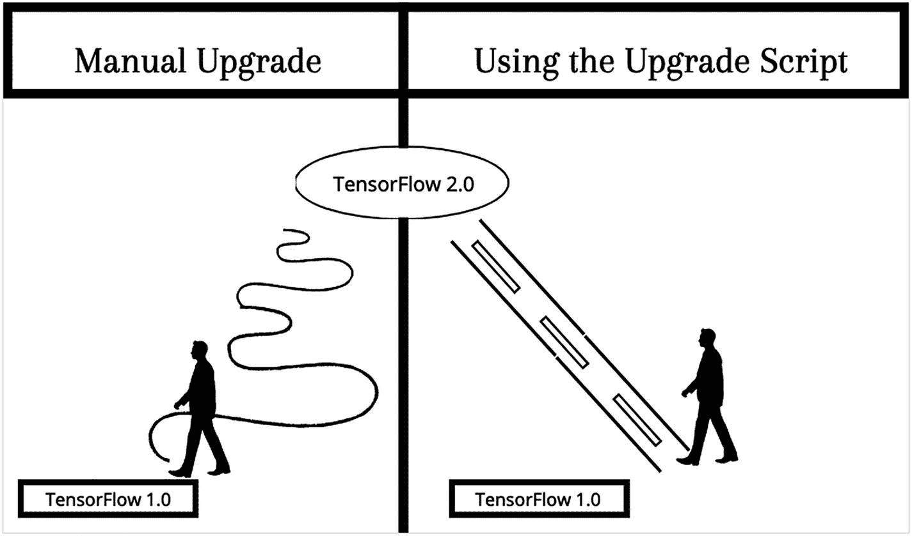

图 10-1
手动升级与升级脚本对比

现在，让我们看看如何使用这个实用程序来过渡我们的代码。

使用升级脚本
虽然这个名字听起来像是非常高级、只有专业人士才能尝试的东西，但实际上并非如此。事实上，一旦我们看看这个脚本是什么，我们就能松一口气，因为它非常简单易用。

该脚本的结构基本上是这样的：

```
tf_upgrade_v2 —infile  —outfile 
```


没错！就是这样。
双连字符后跟 `infile` 用于调用包含旧版 TensorFlow 代码的文件。在本例中，它将是包含该代码的 Jupyter Notebook 的名称。
双连字符后跟 `outfile` 用于重命名 TensorFlow 将代码升级到新版本时创建的文件。
现在，在开始输入之前，我们需要将 TensorFlow 导入到 Jupyter notebook 中。之后，我们可以输入这段代码并相应地添加我们的文件名。

当我们执行该单元格时，更新需要一些时间，之后它会显示输出。它还会创建两个新文件：

1.  一份关于其操作内容的**报告**，我们可以检查该报告以查看更新中是否有任何重大错误。它会提及已添加的任何关键字和已重命名的参数。它还建议了更适合手动检查的地方。所有这些都存储在 `report.txt` 文件中。

2.  包含 TensorFlow 2.0 更新的**新文件**，我们在代码行中为其提供了名称。可以测试这个新模型，以确保它仍然能产生所需的结果。

现在我们对这个脚本的工作原理有了一些了解，让我们通过一个小程序来尝试一下。为此，我们将使用非常基础的“Hello World”程序。我相信，到现在为止，我们都还记得这段代码，它看起来像这样：

```
import tensorflow as tf
h = tf.constant("Hello World")
sess = tf.Session()
sess.run(h)
sess.close()
```

假设这段代码在一个 Jupyter notebook 中，并且这个 notebook 以“Hello World 1.0”的名称保存。要进行升级，首先打开一个新的 Jupyter notebook。在 notebook 中，导入 TensorFlow 2.0，然后输入升级脚本。代码将如下所示：

```
import tensorflow as tf
tf_upgrade_v2 —infile "Hello World 1.0.ipynb"  —outfile "Hello World 2.0.ipynb"
```

当我们执行这个单元格时，我们会找到名为“Hello World 2.0”的新 Jupyter notebook。我们还会找到一个名为 `report.txt` 的文本文档形式的详细升级报告。

点击新创建的 Jupyter notebook。我们会看到一些更改已经完成。然而，由于这不是一个非常大的程序，所以不需要太多修改。唯一重要的变化是对 `tf.Session()` 这一行所做的修改。它变成了以下内容：

```
sess = tf.compat.v1.Session()
```

当我们打开报告时，它会显示它所做的更改。例如，在这种情况下，它会显示以下内容：

```
INFO: Renamed 'tf.Session' to 'tf.compat.v1.Session'
```

注意

`tf.compat.v1` 模块用于允许程序获取 TensorFlow 1.0 相关的功能，包括会话和占位符。

当然，当我们对更高级的程序使用升级脚本时，脚本会进行更多的修改，这些修改在生成的新 notebook 以及它创建的报告中都可见。我们还需要自己做一些额外的更改，因为程序无法做到这一点。总的来说，升级脚本能够完成大约 80% 的工作；剩下的需要由我们完成。

使用升级脚本时，有一些重要的点需要我们牢记，如下所示：

1.  不要以任何方式手动将代码从 TensorFlow 1.0 更改为 TensorFlow 2.0。这可能会导致升级过程中出错。

2.  升级脚本不会重新排列参数。但是，可以向参数被重新排序的函数中添加关键字参数。

3.  该脚本遵循将 TensorFlow 库导入为 `tf` 的常规做法，因此会相应地工作。

4.  兼容性模块（`tf.compat.v1`）将某些 TensorFlow 1.0 引用替换为 2.0 的引用。无论如何，建议移除兼容性模块并替换为新的 API。

总结
TensorFlow 2.0 看起来相当酷，不是吗？正如我们在本章中所读到的，它有一些有趣的新特性，使其比其父版本更强大、更有能力。它确实有缺点，但这些缺点很容易解决，使程序员能够轻松适应它。
我们甚至基于代码相关的差异将其与 TensorFlow 1.0 进行了比较，并且我们看到了编码变得多么容易。最后，我们学习了如何借助升级脚本将旧的 TensorFlow 代码迁移到新版本，这使得过程既顺畅又快速。
TensorFlow 2.0 的构建主要是为了使我们的深度学习实验、研究、模型构建等更加高效。在下一章中，我们将看到如何使用 Python 实现这个库来创建一些令人兴奋的（且功能齐全的）深度学习模型。

快速链接

*   在此处阅读更多关于 TensorFlow 2.0 的信息：[`https://www.tensorflow.org/guide/effective_tf2`](https://www.tensorflow.org/guide/effective_tf2)

*   在此处查看迁移指南：[`https://www.tensorflow.org/guide/migrate`](https://www.tensorflow.org/guide/migrate)

*   在此处了解更多关于升级脚本的信息：[`https://www.tensorflow.org/guide/upgrade`](https://www.tensorflow.org/guide/upgrade)

附加信息

通过禁用 TensorFlow 2.0 运行 TensorFlow 1.0

尽管 TensorFlow 2.0 目前是该库的默认版本，但仍然可以访问 TensorFlow 1.0 的功能。我们所要做的就是通过调用以下函数来禁用 TensorFlow 2.0：

```
tf.compat.v1.disable_v2_behavior()
```

这需要在编程之前完成；即，在创建图、添加张量等之前。

不规则张量

TensorFlow 引入了“不规则”张量来解决非均匀形状数据数组的问题。例如，让我们考虑一组单词中字母数量的列表，这样每个单词的长度与其他单词差异很大，如下所示：

```
animals = tf.ragged.constant( [ ['c', 'a', 't'],
['h', 'i', 'p', 'p', 'o', 'p', 'o', 't', 'a', 'm', 'u', 's'],
['b', 'u', 'f', 'f', 'a', 'l', 'o'] ] )
```

然后会像这样显示：

```
这里，第一个单词有三个字母，第二个单词有十二个字母，第三个单词有七个字母。

我们甚至可以像在常规张量中切片数据一样切片不规则张量。如下所示：

```
print( animals [ 2 ] )
```

这行代码的结果如下：

```
tf.Tensor(['b', 'u', 'f', 'f', 'a', 'l', 'o'], shape=(7,), dtype=string)
```

不规则张量可以执行各种 TensorFlow 操作，包括字符串操作、数学运算、数组操作等。它们也受到许多 TensorFlow API 的支持，如 Keras、tf.function 等。
非均匀形状的数据是许多程序员在执行机器学习时面临的常见挑战。不规则张量通过使此类数据的存储和处理更加容易，在这种情况下为我们提供帮助。

TensorFlow Addons
TensorFlow Addons 是一个特殊兴趣小组，旨在允许用户贡献具有核心库中不包含功能的新扩展。它拥有由专门团队维护的子包和子模块。

其中一些子包包括以下内容：

*   `tfa.text`

*   `tfa.image`

*   `tfa.optimizers`

*   `tfa.metrics`

*   `tfa.callbacks`

*   `tfa.rnn`

11. 使用 TensorFlow 2.0 进行机器学习编程


到目前为止，我们已经了解了人工智能，在其之下有机器学习及其子集深度学习。我们还学习了常用于机器学习编码的 Python 编程语言。我们甚至熟悉了 Jupyter Notebook 界面，可以在其中编写、编辑和调试程序。接着，我们看到了如何将 Python 与 Jupyter Notebook 结合，作为一种编写代码的有效方式。之后，我们介绍了 TensorFlow 库，它是 Python 中的一个重要包，在理解了该库的用途后，我们继续学习了它的最新升级版本——TensorFlow 2.0——它拥有额外的特性和能力，使得构建机器学习模型更加容易。

现在，我们终于来到了本书最重要的主题：学习如何借助 TensorFlow 库构建和运行机器学习模型。如前所述，创建 TensorFlow 的主要原因是为了帮助开发者，不仅处理基本的机器学习编程，还能应对更高级的机器学习流程。换句话说，TensorFlow 主要是为采用神经网络的深度学习而创建的。

在本章中，我们将进一步了解机器学习模型是如何构建的，并且还将亲自尝试七个程序。每个程序都是一个需要神经网络的图像分类问题，所有程序均使用 Keras API 构建，我们稍后会详细介绍。

这七个程序如下：

1.  使用预训练模型进行图像分类
2.  在 TensorFlow 中使用 Keras 进行手写识别（单层，多分类）
3.  在 TensorFlow 中使用 Keras 进行服装分类（多层，多分类）
4.  使用卷积神经网络进行服装分类（多层，多分类）
5.  使用卷积神经网络进行手写识别（多层，多分类）
6.  使用卷积网络对 CIFAR-10 进行图像分类（多层，多分类）
7.  使用卷积神经网络进行猫狗分类（多层，二分类）

我们将逐步讲解每个程序，以全面了解开发过程中涉及的所有流程和组件，特别是以下内容：

*   结构
*   数据集
*   API
*   激活函数
*   优化器
*   程序

通过充分理解这七个程序，我们将能够为其他类似问题创建自己的模型。

在开始编程之前，我们需要做两件事来做好准备：

1.  理解机器学习模型的结构。
2.  熟悉 Keras，我们将在 TensorFlow 中使用它来构建和训练深度学习模型。

在第 2 章中，我们看到了解决机器学习问题时需要遵循的步骤。在这里，我们将深入了解机器学习模型的一般结构，以便更清晰地了解它是如何构建的。

机器学习模型的结构
如前所述，机器学习需要我们自己完成部分工作。其余部分则由计算机在后台完成。换句话说，这一切都发生在代码的后端。老实说，这为我们程序员省去了很多麻烦。然而，在创建模型时，我们仍然需要执行大量任务，以确保获得我们期望的输出。

机器学习开发者的任务主要是构建模型，然后运行它。根据我们具体要完成的任务，模型包含多个组件，但总体架构保持不变。

由于我们将使用神经网络来执行机器学习流程，因此我们将研究使用神经网络的深度学习模型的结构。模型的整体结构思路如图 11-1 所示。

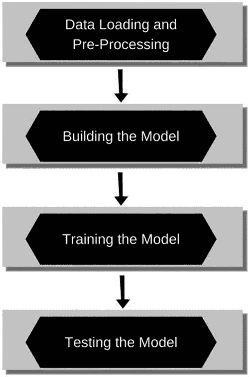

图 11-1
机器学习模型流程图

如图所示，开发一个可用的机器学习模型涉及四个主要步骤，如下所示：

1.  **数据加载与预处理：** 这部分接收数据，对其进行处理，然后为训练和测试做好准备。
2.  **构建模型：** 这是开发者指定模型各个组件的部分。
3.  **训练模型：** 这部分接收训练数据，并开始对其执行计算以获得最优结果。
4.  **测试模型：** 这部分验证或检查模型的准确性。

前两个步骤需要程序员投入时间、精力和技能，因为它们涉及数据处理和创建可工作的模型。对于后两个步骤，程序员只需启动模型运行，然后就可以放松休息，让机器完成所有繁重的工作。

让我们更详细地了解一下这个结构，以便更好地理解它的作用、工作原理以及需要做什么。

数据加载与预处理
在第 2 章中，我们了解了收集数据的不同方法。我们还了解到，这些数据在使用前需要经过一些预处理，才能用于任何类型的分析，以确保获得最佳结果。这意味着我们可能需要添加、删除或更改一些值。

请记住，*这并不意味着我们完全改变了数据*，那样可能导致错误的输出。我们只是让数据更易于系统读取和处理。

以下是一些示例：

1.  假设我们有一个包含 500 名已婚女性及其各自子女数量的数据列表。在这个列表中，几乎每个人都有至少一个孩子。只有五个人没有孩子。现在的问题是，我们需要根据这些女性拥有的孩子数量来预测她们每天的睡眠小时数。显然，这五位女性的详细信息对于这项研究来说是不需要的，因为她们没有孩子。因此，我们必须从列表中删除她们的数据。
2.  有时，除了数值之外，我们的数据还可能包含诸如 *None* 或 *No* 之类的术语，根据具体问题，这些基本上可以表示零。因此，我们需要将这些值更改为 0，或者将它们从数据集中删除。
3.  在某些情况下，我们可能希望将数值四舍五入到最接近的整数。这可以对整个数据集进行，也可以仅对其中一部分进行。

数据可以手动修改。在处理结构化数据时，电子表格或可视化软件等应用程序会派上用场。然而，当数据集很大时，处理起来会变得相当繁琐和单调。因此，大多数开发者使用一个名为 Pandas 的 Python 库，它为用户提供了多种处理数据的工具和实用程序。借助 Pandas，用户可以从本地系统将 `.csv` 文件（csv：逗号分隔值）导入到 Jupyter notebook 中。

在本书中，我们将使用已集成在 TensorFlow 库中的图像数据集。借助 TensorFlow 函数可以轻松调用它们，我们稍后会看到。

我们用于训练机器学习模型的数据分为两类：标签和特征。


*   **标签：** 这些是数据中需要被预测的组成部分；即因变量或输出。它们基于提供给系统的特征来确定。

*   **特征：** 这些是数据中用于预测的组成部分；即自变量或输入。它们决定了输出的标签。在选择特征时，确保它们相互独立且互不相同非常重要。

在训练深度学习模型时，我们可以根据输入特征和标签的方式，选择以下任一方法：

*   **监督学习：** 我们将特征和标签一起输入模型。

*   **无监督学习：** 我们仅将特征输入模型。

*   **半监督学习：** 我们将部分已标记特征和部分未标记特征输入模型。

注意

标签的质量与特征的质量成正比。换句话说，更好的特征会带来更准确的标签。

完成数据修改后，我们需要将其分成两部分：训练数据和测试数据。

*   **训练数据：** 训练数据是在模型训练过程中输入给模型使用的数据。这部分数据通常占比较大，因为模型在训练时需要更多数据才能获得更准确的结果。

*   **测试数据：** 测试数据是在模型完成训练并确定最优参数后输入给模型的数据。这部分数据通常占比较小，因为它仅用于帮助模型判断其预测的准确程度。

完成数据预处理后，下一步就是构建模型。

构建模型

我们需要设计机器学习模型的架构。在本例中，我们将使用神经网络。因此，我们需要通过定义以下内容来搭建神经网络：

*   隐藏层的数量

*   每层神经元的数量

*   权重和偏置

*   激活函数

在第 3 章中，我们学习了神经网络的工作原理，并研究了它们的不同类型。例如，卷积神经网络（CNN）最适合用于图像分类和识别，而循环神经网络（RNN）则非常适合机器翻译和语音识别。我们可以根据数据、资源和期望结果仔细考虑后，选择我们偏好的神经网络，并据此构建所需的模型。

训练模型
模型构建完成后，就可以开始训练了。这时，程序员退居幕后，让机器接手，开始进行高强度的工作。我们在这里需要做的只是将训练数据输入模型，然后启动训练过程。
在训练过程中，模型开始尝试不同的值并替换参数（即权重和偏置），以得出最合适的方程，从而实现高精度和低误差。它遵循试错法，不断改变参数的值，直到获得满意的结果。

我们在第 3 章中已经看到：

*   权重和偏置的值会被不断调整，以使输出更合适，并给出更强的预测能力。这被称为训练模型。

*   从输入数据预测输出。这被称为前向传播。

*   修改权重和偏置以减少损失。这被称为反向传播。

虽然看起来一切到此应该结束了，但这样做并不总是一个好主意。
为什么？
嗯，因为结果总有可能不是最优的。例如，可能会发生过拟合，导致不准确。这就是为什么训练之后，模型还必须进行测试。

测试模型
当我们有了训练好的模型后，需要将测试数据输入其中。然后，我们让模型运行这些数据，以查看其预测的准确程度。通过这种方式，我们验证模型。
根据这个准确度，我们可以决定是想要更改模型的某些方面然后重新训练，还是保持原样。当然，还有其他几个因素也会影响这个决定，包括时间、计算能力等。例如，程序员可能没有足够的资源来重新设计和训练模型。或者可能没有足够的时间。因此，在重新训练模型之前，程序员必须考虑所有这些因素。
机器会不断重复训练和测试模型的循环，直到产生可接受的结果。

机器学习模型的结构在更具体的因素上可能会有很大差异，这取决于我们正在解决的问题类型。因此，如前所述，我们需要正确定义我们的问题以及我们希望实现的解决方案，然后仔细规划我们的模型以最小化误差。

既然我们已经了解了机器学习模型的一般设计，接下来需要熟悉 Keras API，它与 TensorFlow 库集成，我们将使用它来开发代码。

Keras
在我们学习作为 TensorFlow API 的 Keras 之前，先来看看作为一个独立且流行的机器学习库的 Keras。
Keras 是一个开源深度学习库。它用 Python 编写，可以在 TensorFlow 之上运行，也可以在 Theano、R、PlaidML 和 Microsoft Cognitive Toolkit 上运行。它是在 ONEIROS（开放式神经电子智能机器人操作系统）项目内开发的。
它最初于 2015 年 3 月 27 日以 MIT 许可证发布。
根据官方网站，Keras 主要专注于“面向人类的深度学习”。
换句话说，开发者是其优先考虑的对象，而不是机器。它的创建是为了减轻用户的编程负担。它使用户更容易编写和调试代码，并且还提供了充足的指南和文档。
Keras 最初只是一个独立的库，可以在程序中调用和部署。事实上，它的原始后端是 Theano。然而，当 Google 推出 TensorFlow 后，程序员们开始将两者结合使用，以至于发展到没有 TensorFlow 就没有 Keras，反之亦然。看到这种强大组合日益流行，Keras 很快将 TensorFlow 作为其默认后端，这对他们来说是一个明智之举。
2017 年，TensorFlow 在其包中添加了 `tf.keras` 子模块，这与需要使用 `pip` 函数安装的 Keras 库是分开的。这是在其包内支持 Keras 的第一步。最终，随着 2019 年 TensorFlow 2.0 的发布，Keras 成为了机器学习的官方高级 API。这给这两个库都带来了额外的推动力，因为它们现在可以一起用于开发和训练强大的神经网络。

Keras 的特性

Keras 包含几个使深度学习变得更加容易的特性和工具。其中一些包括：

1.  它可以在 CPU 和 GPU 上流畅运行。

2.  模型可以轻松导出到服务器、浏览器、嵌入式设备等。

3.  它灵活且一致，使用户的研究和部署不那么困难。

4.  它支持多种类型的神经网络，如 CNN 和 RNN。

5.  它有丰富的文档供进一步学习，并且有一个社区供用户相互支持。


因此，Keras 为用户提供了可靠的**支持**和强大的**资源**，这些资源可以集成到程序中，用于设计、训练、测试和部署深度学习模型。

我们现在了解了机器学习模型的结构。我们还学习了 Keras，它是 TensorFlow 下的一个重要 API，极大地改善了我们的编码体验。有了它，我们就可以继续前进，开始使用 TensorFlow 构建我们的第一个深度学习模型！

我们将开发深度学习程序，根据某些相似性将数据分成若干组。换句话说，我们将解决分类问题。

我们已经听说过这类问题。在分类问题下，主要有两种类型：**二分类**和**多分类**。

### 二分类

这是一种非常简单的分类问题。在这里，要预测的变量只能取两个可能值中的一个。换句话说，数据需要被分成两组。

让我们看一个非常简单的例子。假设我们有一组九个随机数：2, 5, 700, 75654, 8273, 9, 23, 563 和 0。

我们可以将这些数字分成两组：

*   *奇数* (5, 8273, 9, 23, 563)
*   *偶数* (2, 700, 75654, 0)

如你所见，根据数字的类型，我们这里有两个组或“类别”。给定的数字中有五个是奇数，四个是偶数。

让我们再看一个例子。假设我们有这样一组词：“doe”，“ram”，“stag”，“ewe”，“rooster”，“chicken”。

这可以分成以下几类：

*   雄性 (“ram”, “stag”, “rooster”)
*   雌性 (“doe”, “ewe”, “chicken”)

同样，这里我们根据性别（雄性和雌性）分为两个类别，每个类别有三个变量。数据集中的每个变量都相应地进行了划分。

二分类的其他更高级的应用包括癌症检测（存在癌症/无癌症）、垃圾邮件检测（垃圾邮件/非垃圾邮件）等。

### 多分类

这也被称为多项分类。在这里，要预测的变量可以取多个可能值中的一个。换句话说，数据需要被分成两个以上的组。

例如，假设我们有这样一组词：“rose”，“cucumber”，“tulip”，“lily”，“apple”，“carrot”，“potato”，“orange”，“sunflower”。

我们可以将它们分成以下几组：

*   *花卉* (“rose”, “tulip”, “lily”, “sunflower”)
*   *水果* (“cucumber”, “apple”, “orange”)
*   *蔬菜* (“carrot”, “potato”)

如你所见，根据类型，数据被分成了三组：四个变量是花卉，三个是水果，两个是蔬菜。

让我们考虑另一个例子。看看这组十一个随机数：9, 55, 8, 22, 27, 16, 205, 93, 4, 49, 81。

猜猜我们如何划分它们？

是的，没错！我们可以将它们分成以下几组：

*   2 的倍数 (8, 22, 16, 4)
*   3 的倍数 (9, 27, 93, 81)
*   5 的倍数 (55, 205)
*   7 的倍数 (49)

这里我们根据最大公因数（2、3、5 或 7）分成了四组：2 的倍数包含四个变量，3 的倍数包含四个变量，5 的倍数包含两个变量，7 的倍数包含一个变量。

多分类的其他更高级的应用包括眼睛颜色识别（蓝色、绿色、浅棕色、深棕色、灰色）、猫品种识别（波斯猫、曼赤肯猫、孟加拉猫、暹罗猫、斯芬克斯猫）等。

正如我们所见，在所有这些分类示例中，变量都是根据它们共享的特征进行分组的。通过这种方式，数据可以根据特定特征或属性的相似性进行分类或分组。

现在，我们将进入本章开头提到的七个程序。这将有助于说明我们到目前为止讨论的所有内容，并让你在 Jupyter Notebook 中借助 Python 和 TensorFlow 对整个机器学习概念有一个更清晰的认识。


使用 TensorFlow 2.0 进行编程
我们将要学习的程序涉及图像分类问题。在深入探讨之前，让我们先快速了解一下如何处理这类问题以解决它们。

图像分类：概述
图像分类是深度学习中最热门的领域之一，因为它在实际应用中非常广泛。它是根据数据集中图像的相似特征，将其分组的过程。

例如，假设我们有金鱼、蚱蜢、麻雀、兔子、企鹅、猫、秃鹫和鲨鱼的图像，如图 11-2 所示。

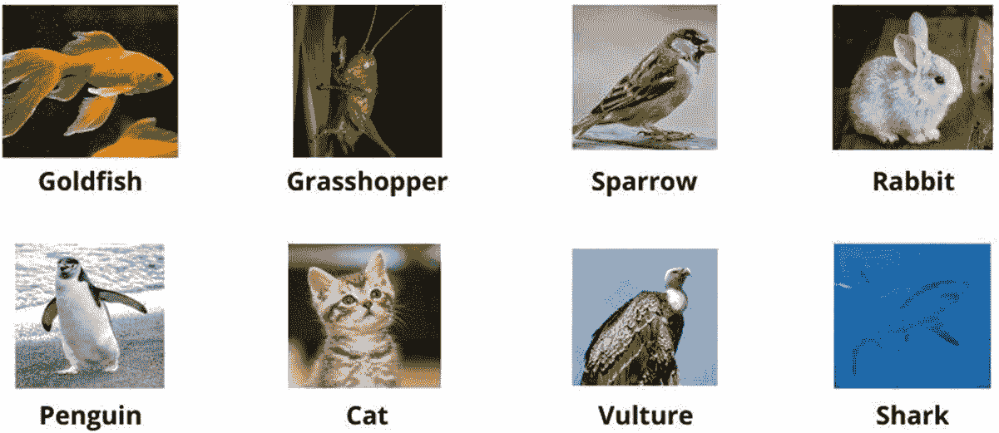

图 11-2
八种不同生物的图像

我们可以根据它们所属的类别将它们分成不同的组，如图 11-3 所示。

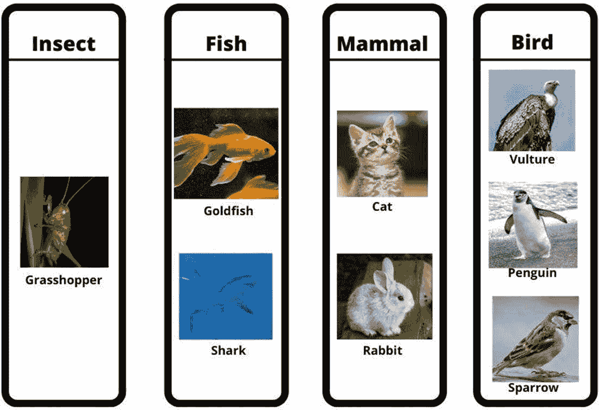

图 11-3
对图像进行分类

因此，我们有以下四个类别：

*   昆虫（蚱蜢）
*   鱼类（金鱼、鲨鱼）
*   哺乳动物（猫、兔子）
*   鸟类（秃鹫、企鹅、麻雀）

在学校学过这些科目后，我们已经知道这些生物中哪些属于哪个类别。我们可以利用我们的自然智能轻松地分配图像。但是，一台人工智能计算机如何解决这个问题呢？
我们必须训练它理解某些生物之间的关联方式，而其他生物则没有关联。
可以通过向模型输入带有标签的不同种类生物图片来训练它。标签会告知机器该图像是动物、鸟类、鱼类还是昆虫。然后，机器将开始观察同一类别下的所有图像，以收集关于它们之间任何共同特征的信息。

例如：

*   昆虫有六条腿和触角。
*   鱼类有流线型的身体和鳍。
*   哺乳动物有四条腿和毛茸茸的身体。
*   鸟类有翅膀和两条腿。

一旦它收集了观察结果并做出了经过验证准确的预测，就可以用于进一步的问题解决。
现在，如果我们给它图 11-2 中的八张图像，它将通过研究每张图片、找到最接近的可能标签匹配并将其放入该类别中，毫不费力地解决问题并根据类型对图像进行分类。这就是使用机器学习模型进行图像分类的方法。
在我们将要学习的程序中，我们将专注于指导计算机借助神经网络来训练和测试类似的图像分类模型。
让我们开始我们的第一个深度学习程序。

程序 1：使用预训练模型进行图像分类
在开始构建模型并训练它们之前，我们需要了解我们的主要目标是什么。很多时候，我们更专注于创建在验证期间能给我们带来高准确率的模型，但完全忘记了进行最终推理以查看模型是否真的训练得很好。
推理是使用训练好的机器学习模型进行预测的过程。
在推理过程中，我们从整个数据集中随机抽取一个元素，并将其传递给模型，以查看它是否能正确预测该元素的类别。这个预测的结果有助于我们推断或演绎模型是否准确。
为了更清楚地说明这一点，让我们编写一个有趣的图像分类小程序，其中我们将使用一个预训练模型并进行推理以验证其预测。

注意

不必过于担心理解这个程序的每一步。只要你对正在发生的事情有一个基本概念，那就足够了。

工作原理
由于这是一个已经训练好的模型，我们无需担心那部分。我们只需要从文件中加载图像，对其进行预处理，将其输入模型，并获取其结果。

结构
这个程序的结构简短而精炼：

1.  将预训练模型加载到 Jupyter notebook 中。
2.  将图像加载到 notebook 中。
3.  为模型准备图像。
4.  预测所有输出类别的概率。
5.  将概率转换为标签。
6.  识别最高概率。
7.  显示结果。

API
此程序将使用新添加的高级 Keras API。

程序
**第 1 步：打开一个新的 Jupyter notebook。**
首先启动 Anaconda 应用程序。进入所需的虚拟环境，然后在该环境中启动 Jupyter Notebook。从 Jupyter Notebook 仪表板中，为 Python 3 编程打开一个新的 notebook。我们可以给这个 notebook 起一个名字，比如“预训练模型的推理”。
**第 2 步：将 TensorFlow 和 Keras 工具导入 notebook。**

使用以下代码将 TensorFlow、Keras API 以及所有额外的函数导入 Jupyter notebook：

```
import tensorflow as tf
import tensorflow.keras
from tensorflow.keras.preprocessing.image import load_img, img_to_array
from tensorflow.keras.preprocessing import image
from tensorflow.keras.applications.vgg16 import VGG16, preprocess_input, decode_predictions
from tensorflow.keras.applications.resnet50 import ResNet50, preprocess_input
```

**第 3 步：将模型加载到 notebook 中。**

我们需要将预训练模型加载到 notebook 中。在这个程序中，我们将尝试使用 VGG16 和 ResNet50。首先，让我们在程序中调用 VGG16。我们可以像这样将其添加到代码中：

```
model = VGG16()
```

这会将预训练模型加载到 Jupyter notebook 中。
**第 4 步：将图像加载到 notebook 中。**
我们现在需要将一张图像加载到 notebook 中。使用这个预训练模型的好处是，我们可以上传任何我们想要的图片，然后测试它是否能正确工作。

我们将使用的图像是一只小猫的图片。我们可以像这样将其加载到 notebook 中：

```
image = load_img('Kitten1.jpg', target_size=(224, 224))
image
```

图像将如图 11-4 所示显示。

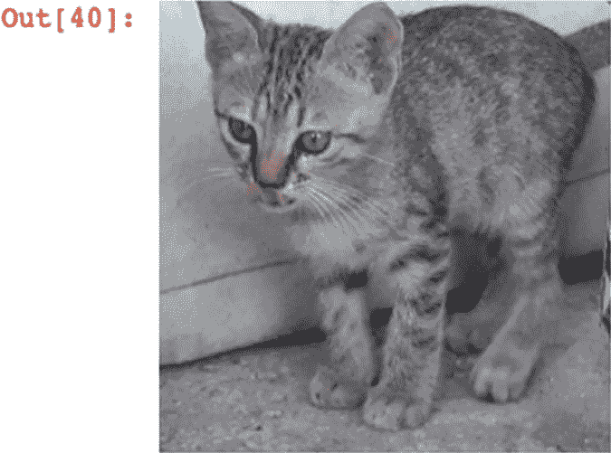

图 11-4
加载图像文件

注意

请记住，当你在计算机上保存图像时，最好将其保存在与你正在使用的 Jupyter notebook 相同的文件夹中。例如，如果你的 notebook 保存在 Desktop/My Programs 下，你也可以将图像移动到 Desktop/My Programs。这样，稍后在代码中访问它时会更方便，无需输入完整的文件路径。

**第 5 步：为模型准备图像。**

我们首先需要将图像的像素转换为 Numpy 数组，如下所示：

```
image = img_to_array(image)
```

然后，我们需要重塑数组，如下所示：

```
image = image.reshape((1, image.shape[0], image.shape[1], image.shape[2]))
```

最后，我们将对输入进行预处理，如下所示：

```
image = preprocess_input(image)
```

**第 6 步：进行预测。**

我们现在可以预测图像属于每个类别的概率。之后，我们将这些概率转换为类别标签，然后检索看起来最有可能的结果。相关代码如下所示：

```
result = model.predict(image)
label = decode_predictions(result)
label = label[0][0]
```

**第 7 步：显示分类结果。**

可以使用以下代码显示模型的预测结果及其百分比概率：

```
print('%s (%.2f%%)' % (label[1], label[2]*100))
```

输出将如下所示：

*   Egyptian_cat (87.00%)


我们可以看到，VGG16 模型不仅预测出图像是猫，还预测了其品种，即埃及猫。同时，它给出了答案正确的概率为 87%。

不错吧？
让我们再试一次，这次使用 ResNet50 模型。

只需将步骤 3 中的代码改为：

```
model = ResNet50()
```

现在重复剩余步骤，保持相同的图像文件，运行预测。看看结果如何？

*   Egyptian_cat (71.94%)

ResNet50 模型也给出了相同的预测，但其答案的确信度仅为 71.94%。

那么，我们能否说这些模型是完美的，因为它们能够正确识别小猫的图像？嗯，这里还有另一个例子，我将图像换成了另一只小猫，如图 11-5 所示。

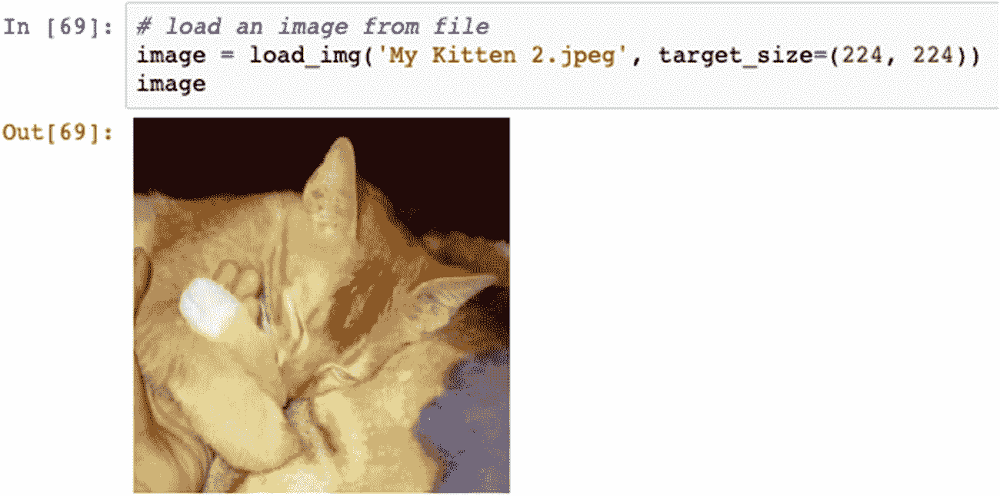

图 11-5
加载另一张图像文件

以下是模型的预测结果：

VGG16:

*   Chihuahua (21.55%)

ResNet50:

*   Pembroke (17.49%)

正如我们所见，一个模型将我的小猫识别为吉娃娃，而另一个模型则将其识别为彭布罗克（经过一番搜索，我发现这指的是彭布罗克威尔士柯基犬）。简而言之，两个模型都认为我的小猫是狗。

因此，当我们学习创建、训练和验证深度学习模型时，我们还需要对它们进行推理，以确保它们确实被正确训练。由于它们只是机器，不可能得到一个完全无误的模型。然而，我们的目标是获得最高的准确率，同时错误数量最少。一旦这样的模型被开发并批准，它们就可以被应用到实际应用中。

现在是时候学习如何构建我们自己的深度学习神经网络了。在接下来的几个程序中，我们将学习各种类型的图像分类器，并了解如何以不同方式设置它们来对多个图像进行分类。

**程序 2：使用 TensorFlow 中的 Keras 进行手写识别（单层，多分类）**

手写体是特定个体独有的。你可能已经注意到，有些人的字迹极其整洁美观，而另一些人的字迹则几乎难以辨认。书写不同字符时也存在明显差异。例如，有些人可能只在字母*i*上点一个点，而另一些人则喜欢画一个小圆圈。此外，在倾斜度、大小、粗细等方面也存在差异。

正是这种独特性使得手写识别颇具挑战性，尤其是对于人工智能机器而言。然而，训练一个模型来找出相似性，从而区分不同字符，并非不可能。

**工作原理**

图像本质上是数字组成的网格。这些数字告诉我们像素值或强度。因此，可以通过操作这些数字来获取图像的特征。这使我们能够在不同图像中找到相似的特征。

**结构**

该模型的架构如下：

1.  加载给定的图像数据集。
2.  将数据分为训练集和测试集。
3.  按照我们指定的层数创建神经网络，并使用我们提供的激活函数。
4.  开始使用训练数据进行训练，以识别每张图像之间的相似性和差异性，并据此进行分类。
5.  然后使用测试数据测试其准确率，以评估它学习每张图像之间差异的效果。
6.  进行推理以确保其预测正确。

**数据集**

我们在这个程序中使用的数据集是 MNIST 数据集。MNIST 的全称是 Modified National Institute of Standard Technology（改进版国家标准与技术研究所数据集）。它是一组手写数字（从 0 到 9），用于训练手写识别模型。

顾名思义，它是之前 NIST 数据集的改进版本。它的优点在于已经预先划分为训练数据和测试数据。训练数据集包含 60,000 张图像，而测试数据集包含 10,000 张图像。它们的大小都是 28x28 像素。

它已成为用于练习图像分类的标准数据库。它与 Keras 和 TensorFlow 紧密集成，使其易于获取并方便地调用到模型中。由于数据已经过处理和划分，使得程序的其余部分易于操作，因此它非常适合向初学者教授机器学习。

**API**

我们将使用 TensorFlow 中的 Keras API，因为它为我们提供了创建神经网络所需的实用工具，使我们的工作更加轻松。

**激活函数**

由于我们只有一个单层，因此我们将仅使用 Softmax 激活函数。

**优化器**

我们将在此神经网络中使用 Adam 优化器。

**程序**

**步骤 1：打开一个新的 Python 3 Jupyter notebook。**

我们将从打开一个全新的 Python 3 Jupyter notebook 开始。我们需要确保它处于正确的环境中。如果需要，我们也可以给它命名。像“我的第一个神经网络”或“使用 TensorFlow 2.0 编程”这样的名称就足够了。

**步骤 2：将 TensorFlow 导入到你的内核中。**

在出现的第一个“代码”单元格中，我们输入以下内容：

```
import tensorflow as tf
```

这会将 TensorFlow 库调用到我们的内核中，使我们能够使用它。

**步骤 3：加载 MNIST 数据集。**

我们现在需要将数据集调用到我们的 Jupyter notebook 中。我们通过输入以下内容来实现：

```
data = tf.keras.datasets.mnist
(ip_train, op_train), (ip_test, op_test) = data.load_data()
```

这告诉程序从库中调用数据集，并将其加载到内核中。如你所见，我们也开始使用 Keras API。`ip_train`和`ip_test`分别是输入的训练数据和测试数据。类似地，`op_train`和`op_test`是输出的训练数据和测试数据。

**步骤 4：准备数据。**

现在，如前所述，我们不需要对数据进行太多处理，因为这部分工作已经为我们完成了。然而，我们确实需要对数据进行归一化。这确保了图像的像素值范围在 0 到 1 之间。我们通过将数据集的每个元素除以 255 来实现，如下所示：

```
ip_train, ip_test = ip_train / 255.0, ip_test / 255.0
```

**步骤 5：构建神经网络。**

我们现在将开始创建神经网络的架构。我们首先将输入图像展平（使其成为一维），然后添加一个全连接层。该层使用 Softmax 激活函数。请参见以下内容：

```
model = tf.keras.models.Sequential([
tf.keras.layers.Flatten(input_shape = (28,28)),
tf.keras.layers.Dense(10, activation = 'softmax')
])
```

最后一个全连接层中的神经元数量取决于我们期望的输出（标签）数量。在这种情况下，我们期望有十个输出（从 0 到 9 的数字），因此神经元数量为十。

**步骤 6：编译模型。**

我们通过选择损失函数、优化器和评估指标来编译模型。

**损失函数：**
它衡量模型在训练期间的准确率。我们需要最小化这个函数，以确保模型沿着正确的路径前进。

我们将使用三种主要的损失函数：

1.  `binary_crossentropy`：
    这是用于二分类的默认损失函数。

2.  `categorical_crossentropy`：
    这是用于多分类的默认损失函数。


3.  `sparse_categorical_crossentropy`：
    用于多类别分类，无需使用独热编码。

**优化器：**
模型会根据数据和损失函数对自身进行调整，以产生最优结果。优化器用于改变权重的值，从而最小化损失函数。
**评估指标：**
该指标用于监控模型在训练和测试过程中的步骤。“准确率”选项会考虑正确识别和分类的图像数量。

要编译模型，我们输入如下代码：

```
model.compile(optimizer = 'adam',
loss = 'sparse_categorical_crossentropy',
metrics = ['accuracy'])
```

这里，我们使用了`adam`优化器、`sparse_categorical_cross_entropy`损失函数和`accuracy`评估指标。
**第 7 步：查看模型。**

这更像是一个可选步骤。我们可以用它来查看模型结构的摘要。

```
model.summary()
```

我们会得到一个微型报告，如图 11-6 所示。

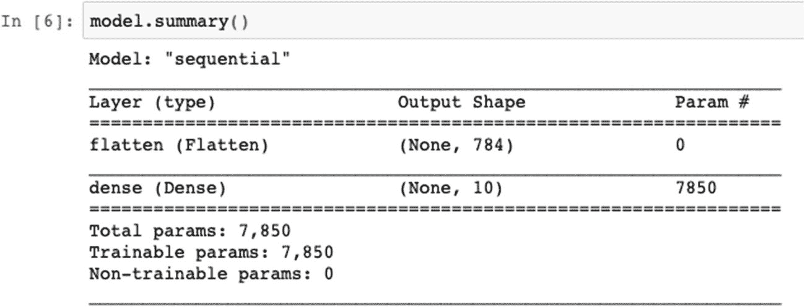

图 11-6
模型摘要

这份报告向我们展示了层的类型、输出和形状，以及每一层中的参数数量。我们还能得到总参数的数量，以及可训练参数和不可训练参数的数量。
**第 8 步：训练模型。**

现在，我们可以借助这行代码来“拟合”模型：

```
model.fit(ip_train, op_train, epochs = 6)
```

拟合模型的过程是帮助模型理解其输入、参数和预测输出之间的关系，以便它在未来能做出更好的预测。
这一步开始训练。模型接收输入数据，并通过其神经网络进行拟合，总共进行六个周期（epochs），如指定所示。
*一个周期是指将整个数据完整地通过模型一次。*

在训练过程中，代码会显示损失值和准确率（以 1.0 为基准），如图 11-7 所示。

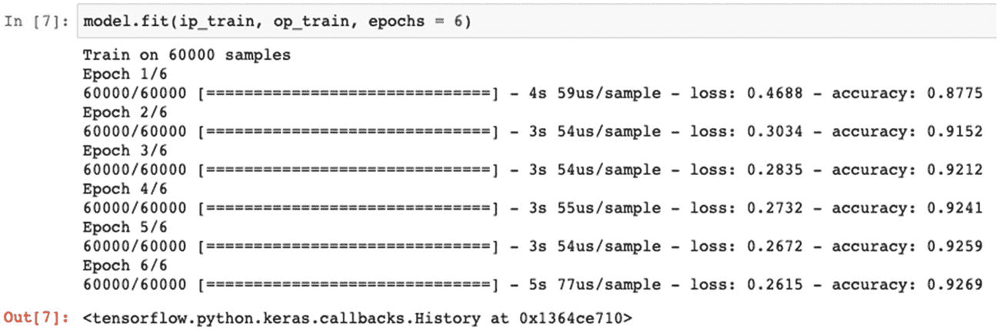

图 11-7
通过六个周期训练模型

**第 9 步：测试模型。**

为了评估我们的模型有多好，我们需要对其进行测试。这次我们使用测试数据，并通过新获得的参数运行它，使用以下代码：

```
model.evaluate(ip_test, op_test)
```

这会将数据运行一个周期，并输出显示损失值和准确率的结果，如图 11-8 所示。

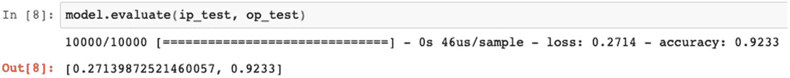

图 11-8
测试模型

正如我们所见，这里的准确率超过了 90%，对于一个单层模型来说已经相当不错了，即使它并非 100% 准确。
现在让我们进行推理，看看我们的模型识别输入的手写数字的效果如何。
**第 10 步：进行推理。**
为此，我们将使用两个额外的库：Matplotlib 和 Numpy。我们不会深入探讨这些库的细节，只会用到它们的一些函数。

首先，将 Matplotlib 库导入到 Jupyter notebook 中，如下所示：

```
import matplotlib.pyplot as plt
%matplotlib inline
```

接下来，从 MNIST 数据集中调用要测试的图像，并将其保存到一个变量中，如下所示：

```
test_image=ip_test[9999]
```

方括号内的数字可以是 0 到 9,999 之间的任意值（还记得吗？测试图像的总数是 10,000 张）。

现在，通过输入如下代码来绘制所选元素的图像：

```
plt.imshow(test_image.reshape(28,28))
```

这将显示如图 11-9 所示的输出。


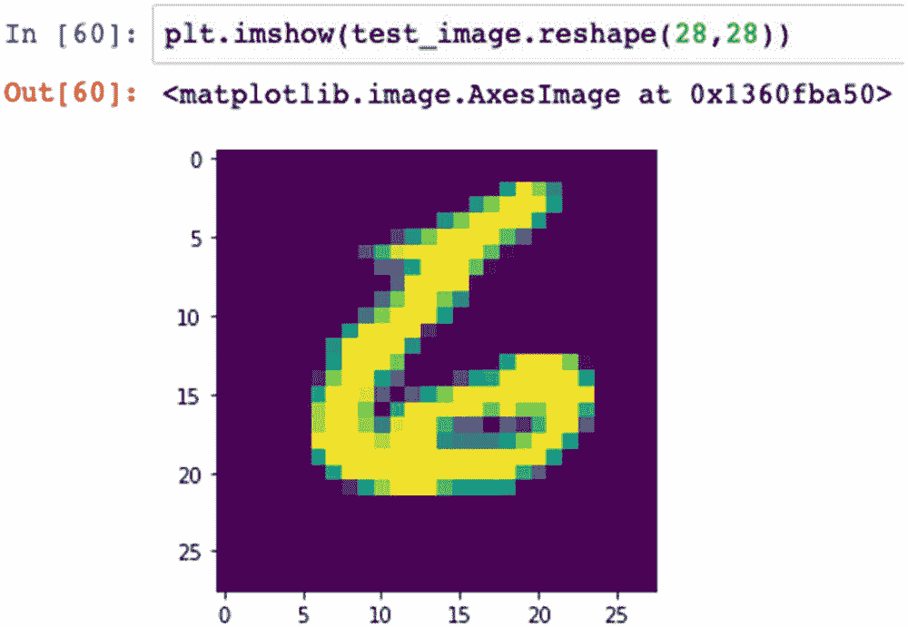

图 11-9
绘制图像

当我们查看图像时，可以识别出它是数字 6。
然而，我们需要检查计算机是否也能做到这一点。

导入 Numpy 库，然后导入 Keras 下的 `image` 函数：

```
import numpy as np
from tensorflow.keras.preprocessing import image
```

将图像转换为 Numpy 数组，如下所示：

```
test_image = image.img_to_array(test_image)
```

像这样重塑测试图像：

```
test_image = test_image.reshape(1,28,28)
```

将模型预测的结果存储在一个变量中，然后调用该变量来显示预测结果，如下所示：

```
result = model.predict(test_image)
result
```

我们将得到如下输出：

```
array([[8.8958717e-07, 4.1242576e-14, 6.5094580e-05, 3.4720744e-09,
4.7850153e-07, 7.9171368e-06, 9.9992573e-01, 7.4808004e-13,
3.1107348e-08, 2.5647387e-11]], dtype=float32)
```

使用以下 Numpy 函数对数组元素进行四舍五入：

```
np.around(result)
```

我们将得到数组的四舍五入值，如下所示：

```
array([[0., 0., 0., 0., 0., 0., 1., 0., 0., 0.]], dtype=float32)
```

现在，要找出数组中所有元素中给出最大值的元素，我们使用以下代码：

```
(np.around(result)).argmax()
```

这将给出如下输出：

```

```

正如我们所见，最大值 1 位于第六个位置（数组从 0 开始，而不是 1）。因此，我们可以验证模型已正确预测了答案。

注意

请记住，有时当你执行包含模型的“代码”单元格时，可能不会出现任何错误。然而，当你尝试运行代码来训练模型时，可能会出现错误，这意味着你需要返回并检查你的模型和参数，然后才能训练它。

好了，就是这样！我们刚刚借助 TensorFlow 2.0 创建了我们的第一个神经网络。
就此打住并感到兴奋是很诱人的。但单层神经网络只是深度学习的第一步。在实际应用中，大多数神经网络需要不止一层才能获得真正出色的结果。让我们在下一个程序中看看如何构建这样的模型。

程序 3：使用 TensorFlow 中的 Keras 进行服装分类（多层、多类）
在现代社会，服装已成为大多数人的首要关注点之一。考虑到个人愿意在穿着上投入多少，时尚在商业中是一个非常重要的行业。现在想象一下，如果我们把人工智能与这个已经蓬勃发展的行业结合起来，整个行业将会发生翻天覆地的变化。
这绝对是一个值得进入的有趣领域，因为它为新创新提供了巨大的空间。现在，我们将通过构建一个神经网络来对服装图像进行分类，从而初步体验一下。
在这个程序中，我们将执行与之前几乎相同的操作，但使用不同的数据集并增加几个额外的层。我们还将添加几行代码，只是为了探索 TensorFlow 下的一些新函数。总体结构、API 和优化器都保持不变或至少相似，因此我们将跳过这一部分，直接进入程序的其余部分。

数据集
我们将用于此程序的数据集是 Fashion MNIST 数据集。
该数据集是 Zalando 研究图像的一部分，可用于替代原始 MNIST 数据集来训练图像分类模型。
它包含 60,000 张训练图像和 10,000 张测试图像。每张都是 28x28 像素的服装物品灰度图像。数据集中总共有十个类别。

激活函数

在这个程序中，我们将使用两个激活函数：

1.  ReLU

2.  Softmax

程序

**步骤 1：在新的 Jupyter notebook 中，导入 TensorFlow 库和 Keras 工具。**

```
import tensorflow as tf
from tensorflow.keras import datasets, layers, models
```

通过添加这个额外的 `import` 步骤，我们现在不再需要在调用每个函数之前都输入“tf.keras”。我们可以直接调用它，正如你将在下一步中看到的那样。
**步骤 2：加载 Fashion MNIST 数据集。**

我们可以像这样将 Fashion MNIST 数据集加载到我们的 Jupyter notebook 中：

```
data = datasets.fashion_mnist
(ip_train, op_train), (ip_test, op_test) = data.load_data()
```

**步骤 3：检查图像的形状。**

这将显示训练和测试输入数据的形状。

```
print(ip_train.shape, ip_test.shape)
```

正如我们所见，它有三个维度：集合中的图像数量、宽度和高度。
**步骤 4：重塑输入值。**
通常，我们使用的数据集包含彩色图像。这意味着所有三个 RGB（红绿蓝）通道都可用。在 TensorFlow 中，全彩色图像的深度为 3。然而，Fashion MNIST 数据集由灰度图像组成，这意味着它只是黑白的。因此，它的深度为 1。
在此步骤中，我们将图像从维度 (n, width, height) 重塑为新的维度 (n, width, height, depth)，其中 *n* 是集合中的图像数量。

代码如下所示：

```
ip_train = ip_train.reshape((60000, 28, 28, 1))
ip_test = ip_test.reshape((10000, 28, 28, 1))
print(ip_train.shape, ip_train.shape)
```

现在当我们显示重塑后的数据时，它将显示四个维度。
**步骤 5：准备数据。**

再次，我们需要对数据进行归一化，如下所示：

```
ip_train, ip_test = ip_train / 255.0, ip_test / 255.0
```

**步骤 6：构建神经网络。**

这次，我们将向神经网络添加两个额外的密集层，分别包含 128 和 1000 个神经元，并且每个都使用激活函数 ReLu。我们还将添加一个额外的“dropout 层”，放在最后一层之前，这有助于防止过拟合。

```
model = models.Sequential([
layers.Flatten(input_shape=(28, 28, 1)),
layers.Dense(128, activation="relu"),
layers.Dense(1000, activation="relu"),
layers.Dropout(0.5),
layers.Dense(10, activation="softmax")
])
```

**步骤 7：编译模型。**

在拟合模型之前，我们编译模型，如下所示：

```
model.compile(optimizer = 'adam',
loss = 'sparse_categorical_crossentropy',
metrics = ['accuracy'])
```

**步骤 8：查看模型。**

```
model.summary()
```

我们将得到模型的摘要，如图 11-10 所示。

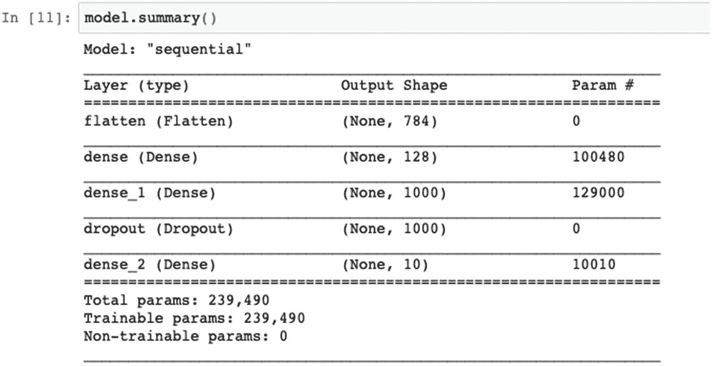

图 11-10
模型摘要

**步骤 9：训练模型。**

```
model.fit(ip_train, op_train, epochs = 5)
```

模型将开始训练，共五个周期，如图 11-11 所示。

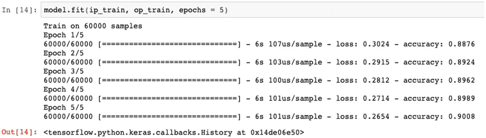

图 11-11
通过五个周期训练模型

**步骤 10：测试模型。**
在此步骤中，我们将使用一个叫做 `verbose` 的东西。
*`verbose` 命令用于提供有关特定任务的信息。*
我们可以通过将 `verbose` 设置为 1 或 2 来改变我们获得的信息量。
设置为 0 时，我们什么也得不到。
设置为 1 时，我们会得到一个进度条和周期数，以及损失和准确率。

设置为 2 时，我们只得到周期数以及损失和准确率，没有进度条。

```
model.evaluate(ip_test, op_test, verbose = 2)
```

我们将获得如图 11-12 所示的输出。

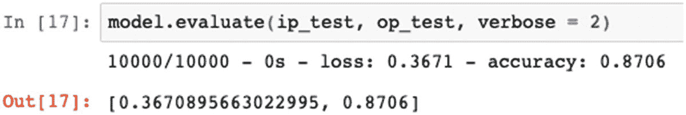

图 11-12
评估模型


**第 11 步：执行推理。**
首先，我们需要定义一个列表来列出类别名称，因为这些名称在数据集中并未给出。该列表可以在 TensorFlow 网站上找到。

我们按如下方式创建列表：

```
class_names = ['T-shirt/top', 'Trouser', 'Pullover', 'Dress', 'Coat', 'Sandal', 'Shirt', 'Sneaker', 'Bag', 'Ankle boot']
```

沿用之前的代码，我们可以检查模型的准确率：

```
:import matplotlib.pyplot as plt
%matplotlib inline
test_image=ip_test[5000]
plt.imshow(test_image.reshape(28,28))
```

这将显示图 11-13 中的测试图像。

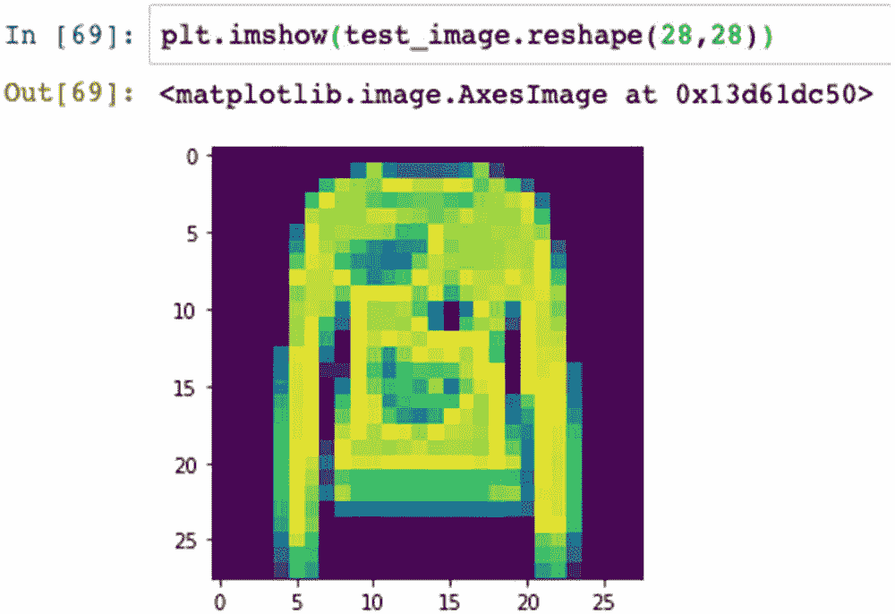

图 11-13
测试图像

现在，我们可以将图像转换为 NumPy 数组，重塑其形状，将其输入模型，并获取预测结果。

```
import numpy as np
from tensorflow.keras.preprocessing import image
test_image = image.img_to_array(test_image)
test_image = test_image.reshape(1, 28, 28, 1)
result = model.predict(test_image)
result
np.around(result)
n=(np.around(result)).argmax()
print(n)
```

这将输出以下结果：

```

```

这个输出非常模糊。它只告诉我们预测类别的索引位置，但没有说明实际的衣物是什么。因此，我们添加一行额外的代码：

```
print(class_names[n])
```

这将输出以下结果：

```
Pullover
```

这样，我们就打印出了列表中第*n*个位置的值，在本例中为“Pullover”。
好了，大功告成！我们构建了第一个多层神经网络，它可以对图像进行分类，准确率接近 90%。

任务时间

我们刚刚完成了两个能够进行多类图像分类的神经网络的构建。其中一个是单层神经网络，另一个是多层神经网络。你能尝试交换数据集，看看模型准确率如何根据层数变化吗？完成之后，再尝试改变层数和迭代次数。你能达到的最高准确率是多少？

接下来，我们将探讨一个在本书开头学过的非常有趣的概念——卷积神经网络。
你可能还记得，CNN 使用卷积层和池化层来处理给定数据。它们的优点在于能够轻松处理二维图像并检测重要特征。这就是它们经常被用于图像分类问题的原因。
让我们看看一些卷积神经网络在图像分类中的表现。

程序 4：使用卷积神经网络进行服装分类（多层、多类）
该模型的结构与之前的类似。唯一的主要区别在于，神经网络现在将包含卷积层和池化层。

结构

以下是 CNN 模型进行图像分类的工作原理：

1.  加载给定的图像数据集。

2.  将数据划分为训练集和测试集。

3.  根据我们指定的层数以及提供的激活函数，创建卷积神经网络。

4.  使用我们提供的参数创建最后的全连接层和输出层。

5.  然后开始使用训练数据进行训练，以识别每张图像之间的相似性和差异性，并据此进行分类。

6.  最后，使用测试数据测试其准确率，以评估模型学习每张图像之间差异的效果。

数据集
本程序将使用的数据集是 Fashion MNIST 数据集。

API
我们将使用 TensorFlow 中的 Keras API。

激活函数
这里我们将使用两种激活函数：

1.  ReLU

2.  Softmax

优化器
本神经网络将使用 Adam 优化器。

程序

**第 1 步：导入 TensorFlow 库和 Keras 工具。**

```
import tensorflow as tf
from tensorflow.keras import datasets, layers, models
```

**第 2 步：加载 Fashion MNIST 数据集。**

```
data = datasets.fashion_mnist
(ip_train, op_train), (ip_test, op_test) = data.load_data()
```

**第 3 步：检查图像的形状。**

```
print(ip_train.shape, ip_test.shape)
```

**第 4 步：重塑输入值。**

```
ip_train = ip_train.reshape((60000, 28, 28, 1))
ip_test = ip_test.reshape((10000, 28, 28, 1))
print(ip_train.shape, ip_test.shape)
```

现在，当我们显示重塑后的数据时，它将显示四个维度。
**第 5 步：准备数据。**

再次强调，我们必须通过除以 255 来对数据进行归一化。

```
ip_train, ip_test = ip_train / 255.0, ip_test / 255.0
```

**第 6 步：构建卷积神经网络。**

这就是主要区别所在。由于我们正在构建一个 CNN 模型，神经网络将需要卷积层和池化层。

```
model=models.Sequential()
model.add(layers.Conv2D(32,(3,3), activation="relu", input_shape=(28,28,1)))
model.add(layers.MaxPooling2D((2,2)))
model.add(layers.Conv2D(64,(3,3), activation="relu"))
model.add(layers.MaxPooling2D((2,2)))
model.add(layers.Conv2D(64,(3,3), activation="relu"))
```

如你所见，我们使用了三个卷积层和两个最大池化层。我们对所有卷积层都使用 ReLU 激活函数。在将图像输入模型之前，也无需将其展平，因为 CNN 可以处理二维数据。这就是我们使用`Conv2D`而不是`Conv1D`的原因。
第一个卷积层包含 32 个滤波器或卷积核，每个大小为 3x3。该层的输出被传递到大小为 2x2 的滤波器池化层。同样，输出会依次传递到后续每一层，直到到达最后一个卷积层。
**第 7 步：添加最后的全连接层和输出层。**
现在，我们必须添加最后的全连接层，然后是输出层。
在这里，我们需要先将输入展平，然后再将其输入到全连接层。
全连接层将使用 ReLU 激活函数，并包含 64 个神经元。

最后一层称为分类层。它使用 Softmax 激活函数，并将包含十个神经元，对应于我们将获得的输出或类别的数量。

```
model.add(layers.Flatten())
model.add(layers.Dense(64, activation="relu"))
model.add(layers.Dense(10, activation="softmax"))
```

**第 8 步：编译模型。**

```
model.compile(optimizer = 'adam',
loss = 'sparse_categorical_crossentropy',
metrics = ['accuracy'])
```

**第 9 步：查看模型。**

```
model.summary()
```

我们将获得 CNN 模型的摘要，如图 11-14 所示。

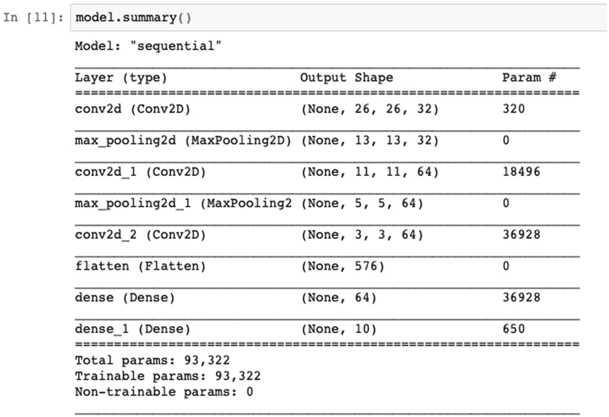

图 11-14
CNN 模型摘要

**第 10 步：训练模型。**

```
model.fit(ip_train, op_train, epochs = 5)
```

这将开始训练模型，共进行五个迭代周期，如图 11-15 所示。

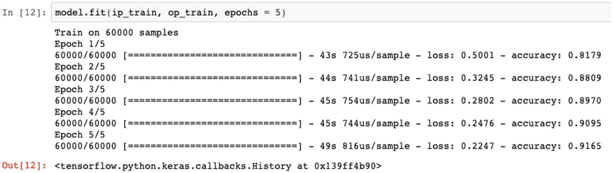

图 11-15
训练模型

**第 11 步：测试模型。**

```
model.evaluate(ip_test, op_test, verbose = 1)
```

这将测试模型并显示其准确率，如图 11-16 所示。

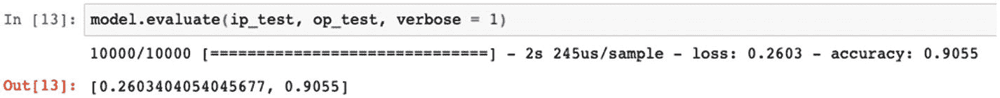

图 11-16
测试 CNN 模型

大功告成！使用卷积神经网络的图像分类模型现已完成。你可以尝试添加或移除层，以及更改参数。
让我们再看一个 CNN 模型的例子。


程序 5：使用卷积神经网络（多层、多类）进行手写识别  
结构、API、激活函数和优化器将保持不变。不过，我们将尝试用另一个数据集来运行此程序。这次，我们还会添加推理代码。

数据集  
本程序将使用的数据集是常规的 MNIST 数据集。

程序  

**第 1 步：导入 TensorFlow 库和 Keras 工具。**  

```
import tensorflow as tf
from tensorflow.keras import datasets, layers, models
```

**第 2 步：加载 MNIST 数据集。**  

```
data = datasets.mnist
(ip_train, op_train), (ip_test, op_test) = data.load_data()
```

**第 3 步：重塑输入值。**  

```
ip_train = ip_train.reshape((60000, 28, 28, 1))
ip_test = ip_test.reshape((10000, 28, 28, 1))
print(ip_train.shape, ip_test.shape)
```

**第 4 步：准备数据。**  

```
ip_train, ip_test = ip_train / 255.0, ip_test / 255.0
```

**第 6 步：构建卷积神经网络。**  
再次强调，我们必须添加卷积层和最大池化层。  

```
model=models.Sequential()
model.add(layers.Conv2D(30,(3,3), activation="relu", input_shape=(28,28,1)))
model.add(layers.MaxPooling2D((2,2)))
model.add(layers.Conv2D(60,(3,3), activation="relu"))
model.add(layers.MaxPooling2D((2,2)))
model.add(layers.Conv2D(90,(3,3), activation="relu"))
```

**第 7 步：添加最终的密集层、丢弃层和输出层。**  

```
model.add(layers.Flatten())
model.add(layers.Dense(64, activation="relu"))
model.add(layers.Dropout(0.5))
model.add(layers.Dense(10, activation="softmax"))
```

**第 8 步：编译模型。**  

```
model.compile(optimizer = 'adam',
loss = 'sparse_categorical_crossentropy',
metrics = ['accuracy'])
```

**第 9 步：查看模型。**  

```
model.summary()
```

**第 10 步：训练模型。**  

```
model.fit(ip_train, op_train, epochs = 5)
```

**第 11 步：测试模型。**  

```
model.evaluate(ip_test, op_test, verbose = 1)
```

**第 12 步：进行推理。**  
将 Matplotlib 库导入 Jupyter notebook，如下所示：  

```
import matplotlib.pyplot as plt
%matplotlib inline
```

选择测试图像：  

```
test_image=ip_test[180]
```

绘制图像：  

```
plt.imshow(test_image.reshape(28,28))
```

我们将得到如图 11-17 所示的图像。  

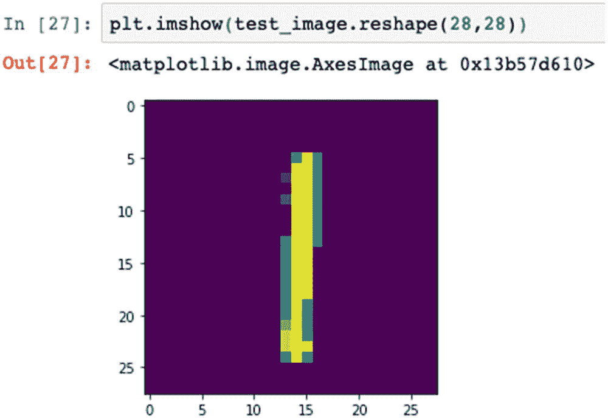  

图 11-17 绘制图像  

导入 Numpy 库和 Keras 下的`image`函数：  

```
import numpy as np
from tensorflow.keras.preprocessing import image
```

将测试图像转换为数组并重塑：  

```
test_image = image.img_to_array(test_image)
test_image = test_image.reshape(1,28,28,1)
```

让模型预测图像的类别：  

```
result = model.predict(test_image)
result
```

对结果进行四舍五入，并找出其中的最大值：  

```
np.around(result)
(np.around(result)).argmax()
```

我们将得到输出为 1。这表明模型正确预测了图像的类别。  
大功告成！我们的第二个 CNN 模型现已完成。通过更改参数，我们可以对其进行调整，看看准确率能有多高。  
现在，让我们尝试最后一个程序来挑战一下自己。这次，我们将使用一个全新的数据集，即 CIFAR-10。

程序 6：使用卷积神经网络（多层、多类）对 CIFAR-10 进行图像分类  
在开始此程序之前，我们先了解一下将要使用的数据集。

数据集  
本程序将使用的数据集是 CIFAR-10，其全称为加拿大高级研究院（Canadian Institute For Advanced Research）。它包含 60,000 张彩色图像，每张图像大小为 32x32。共有十个不同的类别，每个类别有 6,000 张图像。其中 50,000 张为训练图像，10,000 张为测试图像。  
这十个不同的类别分别是：飞机、汽车、鸟、猫、鹿、狗、青蛙、马、船和卡车。研究人员可以借助该数据集快速训练机器学习和计算机视觉模型。  
其他方面与之前的 CNN 程序类似，因此我们直接开始编写程序。既然现在创建模型所涉及的不同步骤应该已经清晰明了，我们就不必逐步讲解此程序了。我们将直接逐行输入代码。

程序  

让我们从编写构建、训练和测试模型的代码开始，如下所示：  

```
import tensorflow as tf
from tensorflow.keras import datasets, layers, models
from tensorflow.keras.datasets import cifar10
(ip_train, op_train), (ip_test, op_test) = cifar10.load_data()
print(ip_train.shape, ip_test.shape)
ip_train = ip_train.reshape(ip_train.shape[0], 32, 32, 3)
ip_test = ip_test.reshape(ip_test.shape[0], 32, 32, 3)
ip_train, ip_test = ip_train / 255.0, ip_test / 255.0
model=models.Sequential()
model.add(layers.Conv2D(32,(3,3), activation="relu", input_shape=(32,32,3)))
model.add(layers.MaxPooling2D((2,2)))
model.add(layers.Conv2D(64,(3,3), activation="relu"))
model.add(layers.MaxPooling2D((2,2)))
model.add(layers.Conv2D(64,(3,3), activation="relu"))
model.add(layers.Flatten())
model.add(layers.Dense(64, activation="relu"))
model.add(layers.Dense(10, activation="softmax"))
model.compile(optimizer = 'adam',
loss = 'sparse_categorical_crossentropy',
metrics = ['accuracy'])
model.summary()
model.fit(ip_train, op_train, epochs = 10)
model.evaluate(ip_test, op_test, verbose = 2)
```

现在让我们编写推理代码：  

```
import matplotlib.pyplot as plt
%matplotlib inline
test_image=ip_test[20]
```

请记住，方括号内的数字可以根据需要更改，以选择不同的测试图像。  

```
plt.imshow(test_image.reshape(32,32,3))
import numpy as np
from tensorflow.keras.preprocessing import image
classes = ["airplane", "automobile", "bird", "cat", "deer", "dog", "frog", "horse", "ship", "truck"]
test_image = image.img_to_array(test_image)
test_image = test_image.reshape(1,32,32,3)
result = model.predict(test_image)
result
np.around(result)
n=(np.around(result)).argmax()
print(classes[n])
```

当我运行推理时，得到了两种不同的结果：

*   第一张测试图像是一匹马，模型能够正确识别该图像。
*   第二张图像是一只鸟，但模型将其分类为飞机。

尝试更改测试图像，然后进行推理。你能得到准确的预测吗？

任务时间  

你可以在网上找到一些很棒的开源数据集，这些数据集可以轻松下载并用于非商业目的。尝试获取一些新数据集，并将其加载到你的 Jupyter notebook 中。然后，创建一个深度学习 CNN 模型来对图像进行分类。不断调整参数，添加或删除层，看看你能让模型达到多高的准确率！

大多数深度学习模型用于多类分类。然而，如果需要进行二元分类（即只有两个类别）呢？通常，这类模型用于答案为“是”或“否”的问题。例如：

*   摩托车手是否戴着头盔？
*   灯泡是否亮着？
*   这封电子邮件是否是垃圾邮件？

话虽如此，让我们来学习一个使用卷积神经网络进行二元分类的程序。我们将使用的数据集是 Kaggle 上的“狗与猫”数据集。


程序 7：使用卷积神经网络进行狗猫分类（多层，二分类）
在本程序中，我们将训练模型来区分狗和猫。这对人脑来说似乎是一项简单的任务，但对机器而言可能并不容易。还记得在程序 1 中，我们使用了两个预训练模型对一张小猫图片进行推理吗？对于第一张图片，它们正确识别为埃及猫。然而，对于第二张图片，一个模型预测该图片是吉娃娃，而另一个模型则说它是彭布罗克威尔士柯基犬。
造成这种情况的原因，可能是因为这三个品种都有尖耳朵和小五官。虽然这对我们来说差别不大，但对人工智能机器却影响巨大，因为每一个微小的特征对于深度学习模型的学习过程都至关重要。
让我们来看看我们的数据集。

数据集
“狗猫分类”数据集可以在 Kaggle 网站上找到。它总共包含 25,000 张狗和猫的图片。虽然我们不知道这些图片最初是如何划分的，但我们将在程序运行过程中找出答案。

程序

**步骤 1：将所有必需的库和函数导入 Jupyter Notebook。**

```
import tensorflow as tf
from tensorflow.keras.models import Sequential
from tensorflow.keras.layers import Conv2D
from tensorflow.keras.layers import MaxPooling2D
from tensorflow.keras.layers import Flatten
from tensorflow.keras.layers import Dense
import os
```

`os`模块允许用户与操作系统进行交互。
这次，我们将先创建模型，然后再下载数据集。
**步骤 2：开发 CNN 模型并编译。**

这里，我们将模型称为`classifier`。我们可以随意命名，只要阅读代码的人能轻松理解即可。

```
classifier = Sequential()
classifier.add(Conv2D(64,(3,3),input_shape = (64,64,3), activation = 'relu'))
classifier.add(MaxPooling2D(pool_size = (2,2)))
classifier.add(Conv2D(64,(3,3), activation = 'relu'))
classifier.add(MaxPooling2D(pool_size = (2,2)))
classifier.add(Conv2D(64,(3,3), activation = 'relu'))
classifier.add(MaxPooling2D(pool_size = (2,2)))
classifier.add(Flatten())
classifier.add(Dense(units = 128, activation = 'relu'))
classifier.add(Dense(units = 1, activation = 'sigmoid'))
classifier.compile(optimizer = 'adam', loss = 'binary_crossentropy', metrics = ['accuracy'])
```

**步骤 3：转换导入的数据。**

```
from tensorflow.keras.preprocessing.image import ImageDataGenerator
train_datagen = ImageDataGenerator(
rescale=1./255,
shear_range=0.2,
zoom_range=0.2,
horizontal_flip=True)
test_datagen = ImageDataGenerator(rescale=1./255)
```

**步骤 4：下载数据集。**

数据集需要从特定链接下载。在这段代码中，我们告诉程序从给定的 URL 下载数据，然后将其存储在我们的系统上。

```
_URL = 'https://storage.googleapis.com/mledu-datasets/cats_and_dogs_filtered.zip'
path_to_zip = tf.keras.utils.get_file('cats_and_dogs.zip', origin=_URL, extract=True)
PATH = os.path.join(os.path.dirname(path_to_zip), 'cats_and_dogs_filtered')
```

**步骤 5：设置目录。**

我们需要为训练数据和测试数据设置不同的目录，然后相应地分离出猫和狗的图片。

```
trainingdir = os.path.join(data_path, 'train')
testingdir = os.path.join(data_path, 'validation')
# 存放训练猫图片的目录
cats_train = os.path.join(trainingdir, 'cats')
# 存放训练狗图片的目录
dogs_train = os.path.join(trainingdir, 'dogs')
# 存放测试猫图片的目录
cats_test = os.path.join(testingdir, 'cats')
# 存放测试狗图片的目录
dogs_test = os.path.join(testingdir, 'dogs')
```

**步骤 6：查找每个目录中的元素数量。**

我们首先查找每个目录中的元素数量，然后显示这些数值。


```markdown
```
cats_train_num = len(os.listdir(cats_train))
dogs_train_num = len(os.listdir(dogs_train))
cats_test_num = len(os.listdir(cats_test))
dogs_test_num = len(os.listdir(dogs_test))
train_tot = cats_train_num + dogs_train_num
test_tot = cats_test_num + dogs_test_num
print(cats_train_num)
print(dogs_train_num)
print(cats_test_num)
print(dogs_test_num)
print(train_tot)
print(test_tot)
```

我们应该得到如下输出：

*   1000

*   1000

*   500

*   500

*   2000

*   1000

**步骤 7：加载训练数据和测试数据，并显示标签映射。**
我们加载训练和测试图像目录，并根据需要添加批次大小、目标尺寸和类别模式。这里，我们将批次大小设置为 128，目标尺寸设置为 64x64。

对于训练数据：

```
train_data = train_datagen.flow_from_directory(batch_size=128,
directory=trainingdir,
target_size=(64, 64),
class_mode='binary')
```

这将产生如下输出：

*   `Found 2000 images belonging to 2 classes.`

对于测试数据：

```
test_data = test_datagen.flow_from_directory(batch_size=128,
directory=testingdir,
target_size=(64, 64),
class_mode='binary')
```

这将产生如下输出：

*   `Found 1000 images belonging to 2 classes.`

然后，我们显示这两个类别的数字标识，如下所示：

```
label_map = (train_data.class_indices)
print(label_map)
```

这将给我们如下输出：

```
{'cats': 0, 'dogs': 1}
```

因此，`0` 指的是 `cats` 类别，而 `1` 指的是 `dogs` 类别。

**步骤 8：训练模型。**

我们现在可以开始训练模型了。这次我们将运行三十个周期：

```
classifier.fit(
train_data,
epochs=30,
validation_data=test_data)
```

三十个周期后，我得到了 77% 的验证准确率。你可以尝试改变周期数，看看这对你的模型是否有显著影响。

模型训练完成后，我们可以进行推理，看看模型的效果如何。

**步骤 9：进行推理。**
在此过程中，我们将使用两张自己的图片：一张是猫，一张是狗。

我们将首先导入必要的包，如下所示：

```
import numpy as np
from tensorflow.keras.preprocessing import image
```

现在，让我们将图像加载到程序中。这些图像已经保存在与程序相同的文件夹中，因此无需添加完整的文件路径。只需文件名即可。

```
test_image_1= image.load_img('Dog.jpeg', target_size = (64,64))
test_image_2= image.load_img('Cat.jpeg', target_size = (64,64))
```

然后，我们可以分别显示测试图像，如图 11-18 和图 11-19 所示。

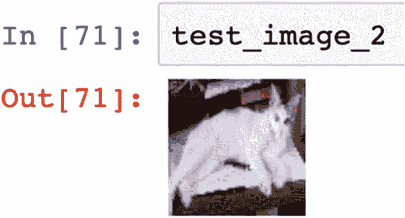

图 11-19 一张猫的图像

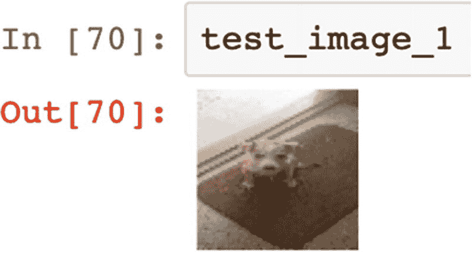

图 11-18 一张狗的图像

```
test_image_1
```

```
test_image_2
```

现在我们输入剩余的代码，如下所示：

```
test_image_1 = image.img_to_array(test_image_1)
test_image_2 = image.img_to_array(test_image_2)
test_image_1 = test_image_1.reshape(1,64,64,3)
test_image_2 = test_image_2.reshape(1,64,64,3)
result1 = model.predict(test_image_1)
result2 = model.predict(test_image_2)
print(result1, result2)
```

现在，为了打印预测结果，我们为第一张图像输入以下代码：

```
if result1 == 1:
prediction1 = 'dog'
else:
prediction1 = 'cat'
print(prediction1)
```

这将给出以下输出：

```
'dog'
```

现在当我们运行以下代码时：

```
if result2 == 1:
prediction2 = 'dog'
else:
n2 = 'cat'
print(prediction2)
```

我们得到以下输出：

```
'cat'
```

就是这样！二元神经网络已经准备好了。我们可以不断修改代码的不同部分来提高准确率，直到获得满意的结果。

注意
```


在某些情况下，你可能还需要安装“pillow”库（Python 图像库，缩写为“PIL”），因为它为处理各种格式的图像提供了支持。使用 `pip` 可以轻松安装它：`pip install pillow`

这些机器学习模型的一大优点是，对于所有类型的数据，其结构几乎保持不变。我们需要知道的是如何在将数据输入模型之前准备和处理数据。当我们自己尝试这些程序，使用不同的数据集并修改输入层和数值时，整个过程会变得容易得多。只要别忘了持续练习，这将帮助你提高技能并精通你所做的事情。

总结
在本章中，我们学习了如何使用 TensorFlow 和 Keras API，在 Jupyter Notebook 的帮助下构建、训练和验证我们的深度学习模型。我们理解了工作机器学习模型的一般结构，并且也更熟悉了 Keras。然后，我们区分了分类问题的类型——二分类和多分类——并快速介绍了图像分类。最后，我们编写了七个不同的程序来巩固我们目前所学的内容，其中涉及一个预训练模型、一个二分类程序、一个单层程序，其余程序则执行多层多分类任务。
对于刚接触 TensorFlow 2.0 世界的人来说，这些程序是一个很好的起点。如果你不能立即理解它们，请不要担心。随着你不断自己动手实践，它们会变得更有意义。你可以将这些模型作为起点，为不同的数据集开发你自己的神经网络。而且，一旦你对编程越来越熟练，你就可以开始对它们进行自己的修改，以创建更专业的模型。

快速链接

*   MNIST 数据集：[`http://yann.lecun.com/exdb/mnist/`](http://yann.lecun.com/exdb/mnist/)

*   Fashion MNIST 数据集：[`https://github.com/zalandoresearch/fashion-mnist`](https://github.com/zalandoresearch/fashion-mnist)

*   CIFAR-10 数据集：[`https://www.cs.toronto.edu/~kriz/cifar.html`](https://www.cs.toronto.edu/%257Ekriz/cifar.html)

*   狗 vs. 猫数据集：[`https://www.kaggle.com/c/dogs-vs-cats/data`](https://www.kaggle.com/c/dogs-vs-cats/data)

*   关于 Keras：[`https://keras.io/`](https://keras.io/)

*   Keras 优化器：[`https://keras.io/optimizers/`](https://keras.io/optimizers/)

索引

A

Addons

AI 伦理

深度伪造

决策制定

AI 寒冬

计算能力

计算时间

数据/存储

定义

第一次（1974-1980）

第二次（1987-1993）

Anaconda

应用程序编程接口（API）

人工智能

优势

挑战

深蓝

定义

劣势

恩尼格玛密码

Ferranti Mark

HAL 9000

Hopfield 网络

KBR

逻辑理论家

数学原理

斯坦福机器人

图灵测试

WABOT

人工神经元（感知器）

激活函数

ReLU

sigmoid

softmax

输入

净输入函数

独热编码

输出

权重/偏置

B

反向传播

生物信息学

C

CIFAR-10，图像分类

数据集

非商业用途

程序

服装分类，TensorFlow 2.0

激活函数

人工智能

CNN

编译模型

图像

输入值

Jupyter notebook

MNIST 数据集

多层神经网络

ReLu

训练模型

详细输出

命令行界面（CLI）

条件语句

elseif 语句

if-else 语句

if 语句

卷积神经网络

服装分类

激活函数

Adam 优化器

数据集

密集/输出层

图像

输入值

Keras API

池化层

TensorFlow 库

测试模型

训练模型

查看模型

狗 vs. 猫分类

参见狗 vs. 猫
分类

CPython

D, E

数据加载/预处理

特征

标签

最佳结果

Panda

半监督学习

电子表格/可视化软件

监督学习

测试

训练

无监督学习

数据科学

大数据

分支

数据分析

定义


数据整理/数据清洗

深度学习

美国国防高级研究计划局（DARPA）

描述性分析

诊断性分析

狗 *vs.* 猫分类

二值神经网络

分类器

数据集

目录

下载数据集

Jupyter notebook

包

预测

训练/测试数据

F

前向传播

G

Google Colaboratory

梯度下降

图形用户界面（GUI）

H

手写识别

Adam 优化器

人工智能机器

CNN 模型

数据集

Keras API

损失函数

Matplotlib 库

指标

MNIST 数据集

神经网络

Numpy 库

像素值/强度

Python 3 Jupyter notebook

Softmax 激活函数

结构

TensorFlow 库

测试模型

训练模型

查看模型

I

图像分类

类别

深度学习

特征

Keras API

自然智能

预训练模型

结构

工作原理

图像识别

集成开发环境（IDE）

优势

特性

IDLE

Pycharm

Spyder

*vs.* 文本编辑器

智能

物联网（IoT）

人工智能

定义

智能温室

智能家居

可穿戴设备

IPython Notebook

IronPython

J

JupyterHub

Jupyter nbviewer

Jupyter notebook

添加新单元格

添加笔记

算术运算

代码单元格

条件语句

参见条件语句

复制单元格

当前输出

删除单元格

创建字典

创建函数

标题单元格

帮助菜单

中断内核

创建列表

创建循环

for 循环

嵌套循环

while 循环

合并单元格

移动单元格

命名

打开

输出

重启内核

运行单元格

拆分单元格

变量

Jupyter Notebook

优势

单元格

创建

仪表盘

定义

环境

特性

IDE

参见集成开发环境（IDE）

安装

内核

快捷键

其他编程应用

文本编辑器

URL

Jupyter Notebook 界面

Jython

K

Keras

二分类

特性

独立库

多分类

TensorFlow API

tf.keras 子模块

内核

K-means 聚类方法

K-近邻算法

基于知识的研究（KBR）

L

惰性执行 *vs.* 急切执行

线性回归算法

逻辑回归算法

长短期记忆（LSTM）网络

M

机器学习

应用

构建模型

数据收集

访谈

观察

投票

数据预处理

参见数据预处理

调查

类型

数据加载/预处理

参见数据加载/预处理

定义

流程图

图像分类问题

神经网络

流程/组件

编程

结构

TensorFlow 库

测试

训练

工作流

机器学习 *vs.* 深度学习

准确率

认知能力

计算能力

因素

硬件要求

数据量

所需时间

最大池化

MicroPython

模块化神经网络

多层神经网络

N

神经网络

反向传播

生物神经元 *vs.* 人工神经元

定义

前向传播

梯度下降

层

神经元

过拟合

步骤

Notebook

特性

Macintosh

开源 notebook

用途

Numpy

O

独热编码

开放式神经电子智能机器人操作系统（ONEIROS）

过拟合

P, Q

Pandas

感知器学习规则

占位符

数据预处理

清洗

定义

缺失值

异常值

转换/降维

规范性分析

主成分分析

Pycharm

PyPy

Python

优势

应用

竞争对手

定义

特性

安装

Anaconda

环境

已安装的包

库

未安装的包

解释器

机器学习库

Pythonistas

Python 编程语言

Python shell

算术运算

exit() 命令

帮助窗口

Mac OS 终端

输出

R

不规则张量

读取-求值-打印-循环（REPL）

修正线性单元（ReLU）

循环神经网络（RNNs）

强化学习

S

Scikit-Learn

Scipy

半监督学习

情感分析

序列到序列模型

Sigmoid

单层神经网络

Softmax

垃圾邮件检测

语音识别

语音理解研究（SUR）

Spyder

无栈 Python

监督学习算法

应用

分类算法

K-近邻

线性回归

逻辑回归

回归算法

*vs.* 无监督学习算法

T

TensorBoard

应用

仪表盘

示例

标签页

TensorBoard.dev

TensorFlow

优势

应用

关闭会话

竞争对手

组件

劣势

重要性

安装，pip 命令

库

TensorFlow 2.0

优势/劣势

API 清理

部署能力

急切执行

实验工具

特性

全局变量

Keras API

机器学习库

生产力

TensorFlow 库

计算图

常量

Hello world 程序

导入

占位符

编程概念

获取输入，占位符

变量

张量

文本摘要

@tf.function 装饰器

tf.global_variables_initializer()

tf.print() 函数

TensorFlow 1.0

TensorFlow 2.0

tf.Session() 行

tf_upgrade_v2 升级脚本

U

无监督学习算法

应用

聚类分析

降维

K-means 聚类

主成分分析

升级脚本

用户界面（UI）

V, W, X, Y, Z

verbose 命令

Voila

```
```