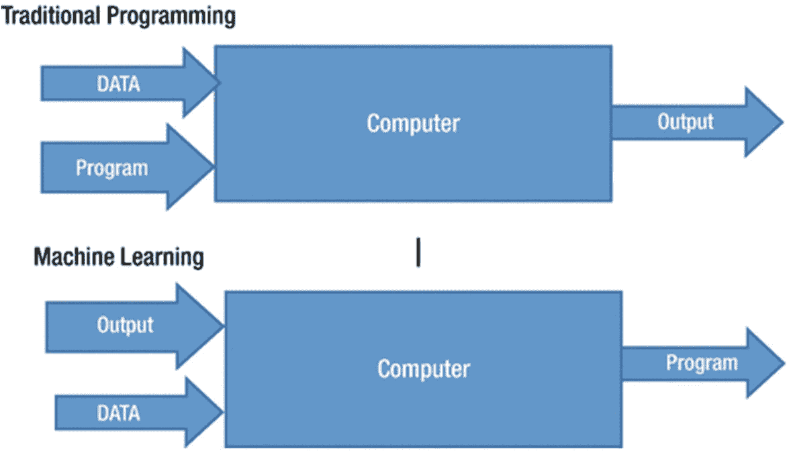
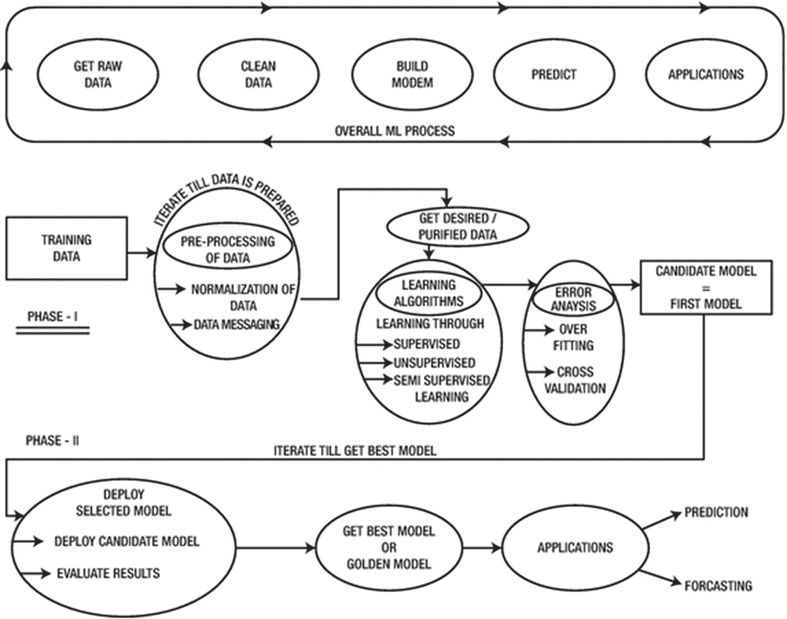
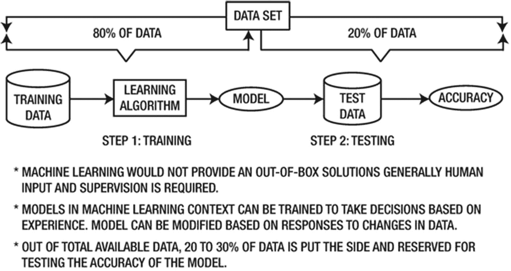
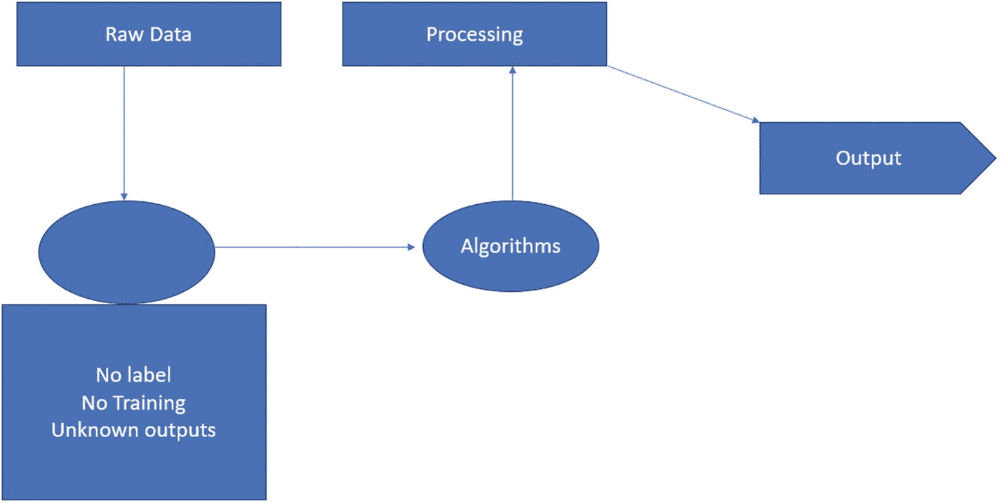
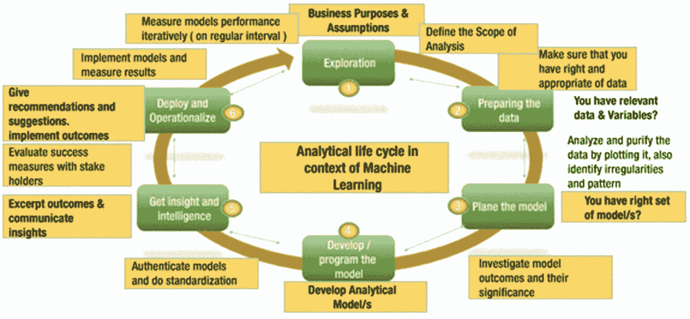
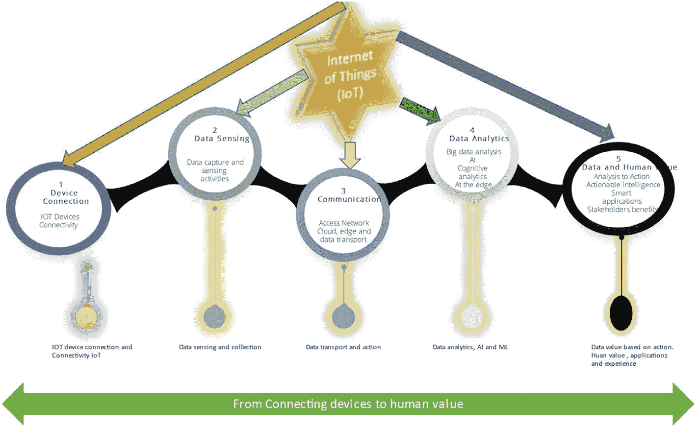
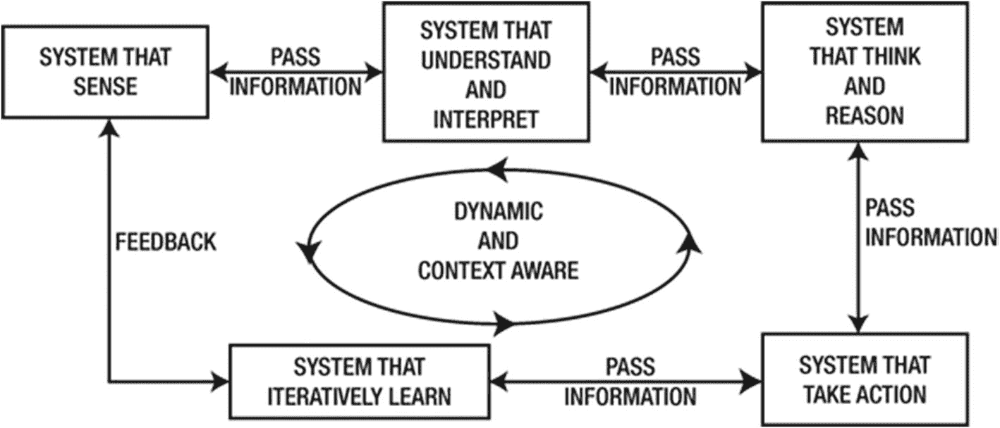
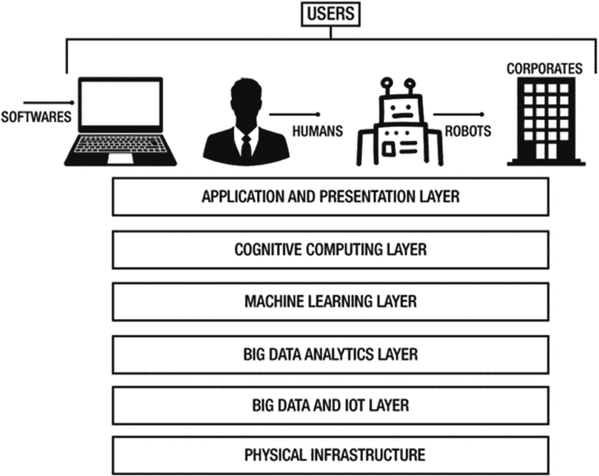
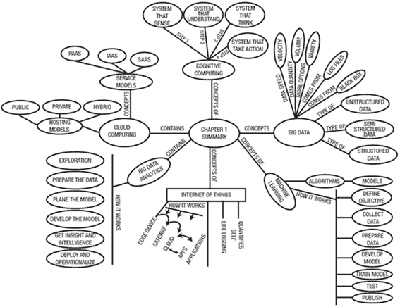

# 1. 让我们与机器学习融合

Patanjali Kashyap 博士^(a*)

^a 印度卡纳塔克邦班加罗尔

在本章中，我将全面概述机器学习如何与物联网、大数据分析、云计算和认知计算等其他技术协同工作。从技术上讲，机器学习不能也不应该被孤立地理解。它是一门多学科交叉的学科。这就是为什么在理解机器学习的技术全景之前，你需要对一系列概念和技术有一个综合的视角。即使出于学术目的，如果有人想理解机器学习的运作方式，他们也必须详细了解其核心细节。因此，对于商业领袖和管理者来说，为了正确掌握这一主题，对机器学习有一个全面而综合的理解至关重要。如果他们出于商业原因对该主题感兴趣，这一点就更为重要。因为你正在阅读这本书，我假设你想熟悉机器学习的概念。

在我努力为机器学习及其相关技术提供概念基础的过程中，我探讨了多个商业问题，包括：

*   什么是机器学习？
*   机器学习的商业案例是什么？
*   我们如何使用机器学习？
*   机器学习的主要特征是什么？
*   我们在哪里可以实施机器学习？
*   机器学习中使用的主要技术/类型有哪些？
*   为什么商业中需要机器学习？

这些问题将在本章及后续章节中详细解答。成功实施机器学习的关键商业利益和价值也将在适当的地方进行讨论。

对于相关技术，也几乎探讨了相同的一系列问题、思路和概念。本章探讨了高级分析背后的核心概念，并讨论了如何在知识驱动的认知环境中利用这些概念。借助适当水平的高级分析，系统可以获得更深入的洞察，并以更准确、更具洞察力的方式预测结果。因此，以实践的方式研究这些概念至关重要。本章介绍了知识平台，并为你提供了你正在寻找的实用知识。

## 你的业务，我的技术，以及我们思想的交融

我的论点非常简单，你会发现它贯穿全书。我认为，像云计算、大数据分析、机器学习和认知计算这样的技术，能够促进增长、利润和收入。我的重点不是逐步解释模型及其好处，而是解释其背后的技术。

在任何商业场景中，结果和成果都具有多个维度。但对企业、商业领袖和利益相关者来说，重要的是了解它们如何影响其商业战略。结果取决于多种因素，例如基础设施准备的速度、每次转型的成本、新应用程序的实施时间，甚至包括供应商在内的合作伙伴如何整合到整体供应链和决策过程中。另一个重要因素是企业（从底层到顶层）的自动化水平。

机器学习——或者换句话说，“自动化的自动化”——以及认知计算正在改变决策的方式。单调、重复且技能要求较低的人工干预正在被“智能”自动化所取代。这正在改变决策的动态。其结果是提高了整体业务流程和决策的效率和有效性。其影响将体现在企业利润、收入增长和运营效率上。企业将在其投资的各个层面和领域（无论是 IT 基础设施、IT 应用程序、业务流程、运营还是财务）体会到商业价值。如果他们采用正确的、基于情境的技术方法，收益必将随之而来。

采用云计算使公司能够快速配置资源，并降低每次转型和每个工作站的成本。在基于云的环境中，应用程序开发的大部分需求都可以按需获得，因此实施新应用程序的速度很快。供应商可以访问强大的供应链，因此整合其服务和物流变得容易。云计算以自动化方式提供按需数据分析以及基于机器学习的、面向情境的认知计算功能。这使得企业能够享受高收入增长和更高的投资回报。

如果你关注了过去几年 IT 行业的趋势和方向，有一个信号是明确的——行业正在大力押注于这一代新技术。旧的思想和技术支柱正在被摧毁，新的支柱正在迅速堆积。IBM、微软、谷歌和 Facebook 近年来提交的专利显示了行业的方向。微软是专利申请的领导者，自 2009 年以来提交了超过 200 项与人工智能相关的专利申请。谷歌位居第二，提交了超过 150 项专利申请。这些专利涵盖了云计算、认知计算、大数据分析和机器学习的元素。以下链接提供了近年来专利格局的概览：

*   [`​www-03.​ibm.​com/​press/​us/​en/​presskit/​42874.​wss`](https://www-03.ibm.com/press/us/en/presskit/42874.wss)
*   [`​cbi-blog.​s3.​amazonaws.​com/​blog/​wp-content/​uploads/​2017/​01/​1-ai-patents-overall.​png`](https://cbi-blog.s3.amazonaws.com/blog/wp-content/uploads/2017/01/1-ai-patents-overall.png)

云、物联网、大数据和分析技术能够实现有效且恰当的机器学习部署与聚焦策略。机器学习是认知计算的核心，为企业提供实时、基于证据的自动化决策能力。你将能够整合所有要素，看清全局图景。这是一条从数据到智慧的旅程：通过物联网系统及其他数据源获取数据，将数据存储在基于云的数据存储中，然后对数据应用分析技术以理解其含义。接着，通过应用机器学习技术来自动化分析过程，以发现模式并做出准确预测。通过迭代运行模型/算法来优化结果。这些选项都有置信水平和证据支撑。这是一套端到端的解决方案！

值得一提的是，这种技术分离和层级划分是逻辑上的。也就是说，在标准和专业文献中并没有定义“硬性”边界。例如，许多技术文献将大数据分析与机器学习结合在一起。有些人将机器学习和认知计算视为一体。然而，这种划分有助于理清思路；因此，我采用这种方法。

通过研究当前和未来基于知识的创新商业生态系统的五大技术支柱（云、大数据、物联网、机器学习和认知计算），你将能够为企业得出正确的推论并做出合适的商业决策。到本章结束时，你将理解这些技术究竟是什么、它们意味着什么，以及它们对商业生态系统的重要性。

## 机器学习概述

输入-处理-输出模型——即输入进入系统，经过处理，然后产生输出——构成了大多数信息和数据处理技术的基础。以文字处理程序为例，每次按键都会在屏幕上输出一个字母。当有人在文字处理程序中按下一个字母时，需要执行的操作是显而易见的。因此，设计一个考虑哪些输入值应产生哪些输出值的过程是简单的。

假设你想创建一个程序，当输入一张马的图片时，程序能说出“这是一张马的图片”。计算机目前面临的根本问题在于，其识别模式的能力不如人类。对计算机而言，一张图片不过是由向量组成的像素组合。如果你试图用传统的编程方法来解决这个问题，会极其困难。然而，借助大数据、统计学和分析技术，这却是一项简单的任务。在后续章节中，你将更详细地了解这一点。

这就是机器学习和人工智能的用武之地。人工智能是指能够模仿人类智能、快速自主完成任务的计算机程序。1943 年，麦卡洛克和皮茨发表了关于可编程“人工神经元”的正式概念，这通常被认为是人工智能领域的关键奠基之作。1956 年在达特茅斯学院举办的一次研讨会上，“人工智能”一词被正式提出。这一事件常被引证为人工智能领域的开端。

如前所述，“机器学习”这个术语是由该领域的一位先驱在三年后创造的。人工系统从示例中学习，并在学习阶段结束后能够对其进行归纳。这个过程被称为机器学习，这是一个广义术语，指从经验中“人工”生成知识。机器学习算法基于训练数据（稍后详述）创建一个统计模型。这意味着它不仅仅是死记硬背示例，而是识别学习数据中的模式和规律。通过这种方式，系统也能处理未识别的数据，尽管也可能失败。

机器学习是当今一个引人入胜的概念，商界几乎人人都在谈论它。这是一项前景广阔的技术，有潜力改变当前的商业环境并带来颠覆性变革。决策者已开始将机器学习视为设计和实施其战略与创新思想的工具。在组织或企业中实施机器学习并非易事。原因之一在于缺乏有用且可靠的数据。拥有相关数据对于有效实施机器学习至关重要。但获取相关且准确的数据是一个巨大的挑战。借助物联网技术和大数据分析领域的最新进展与发展，企业相对更容易高效且有效地存储和分析数据。这种按需、实时获取大数据的便利条件，促成了机器学习项目、产品、应用和服务的成功实施。

这也使决策者能够制定出一些伟大的战略。正因如此，我们开始看到并认识到机器学习带来的成果和成功案例。机器学习的概念并非新近出现，可以追溯到人工智能和专家系统。如前所述，近年来，由于一些突破性的成就，它获得了大量关注和动力。例如，IBM Watson 在预测肿瘤学结果方面比医生更准确，或者 Facebook 在准确识别人脸方面取得的成功。

在机器学习和大数据分析的时代，广义预测几乎是所有科学/商业决策的核心。从数据中学习泛化能力是机器学习的核心主题。在当前和未来的商业场景中，预测结果对于组织的成功至关重要。决策者希望看到并允许制定和实施不仅关注历史数据，还能理解其意义的策略。乐观地说，他们希望这一切能自动发生。期望的系统能够“预测”客户的行为及其未来需求。然后，公司可以基于报告和仪表盘实时做出有效决策。例如，在投资银行领域，决策者希望构建软件，帮助其信用风险官预测最有可能违约的客户。一家电信公司希望基于客户的行为分析，预测客户拖欠账单的倾向。这将为他们提供未来付款负债的实时预测。基于客户的历史付款详情和机器学习，这是完全可行的。

事实上，决策者并不满足于仅仅进行预测；他们更感兴趣的是理解某人为何会做某事。决策者希望探索故事背后的“原因”，并围绕这种心态或行为制定策略。从技术上讲，我们知道机器学习从数据中学习。学习的结果取决于对数据集进行分析的层次。因此，审视学习分析的层次非常重要。我在此简要介绍这一概念，并在后续需要进一步阐述的章节中再次提及。

通常，与机器学习相关的学习分析有四个层次：

*   *描述性分析*：发生了什么以及正在发生什么？这通常关注事实、数据和数字，并提供详细分析。它用于为高级分析准备数据，或用于日常商业智能。

*   *诊断性分析*：为什么会发生？这审视描述性元素，并允许进行批判性推理。

*   *预测性分析*：将会发生什么？这提供不同的元素，并关注结果会是什么。它证明未来的可能性和趋势，并使用诸如线性回归和逻辑回归等统计技术来理解趋势并预测未来结果。

*   *规范性分析*：我应该做什么以及为什么应该这样做？这确定如何通过使用一组特定元素来实现特定结果或成果。其重点在于决策制定和效率提升。模拟用于分析复杂系统行为并识别用途。

认知计算领域的最新发展催生了*认知分析*，其输出更接近人类，因此更有益。认知分析将视角分析提升到了一个新水平。公司本质上需要规范性分析来驱动洞察、建议和优化。认知分析实际上会随着时间的推移进行测试、学习和适应，并得出更深刻的见解。它弥合了机器学习、大数据与高置信度实时实际决策之间的差距，并提供情境化洞察。

基于对数据集进行分析层次的结果，公司会根据自身需求鼓励或阻止特定行为。这开启了一个人机协作、合作与沟通的新时代。当机器识别模式时，人类的职责是解释这些模式，将其划分到不同的微观细分中，并推荐和建议一些行动方案。简而言之，机器学习技术旨在帮助人类完善和提升其潜力。

## 机器学习的细节

机器学习以其多学科性质而闻名。它涵盖多个研究领域，从哲学、社会学到人工智能。然而，在本书中，机器学习被视为人工智能的一个子领域，被解释为机器像人类一样学习、思考和解决问题或议题的能力。它帮助计算机（软件）无需显式编程即可行动和响应。

以下是机器学习的一些正式定义：

*   机器学习涉及允许计算机学习的算法和技术的设计与开发。机器学习的主要焦点是通过计算和统计方法自动从数据中提取信息。因此，它与数据挖掘和统计学密切相关。（Svensson 和 Soderberg，2008）

*   机器学习继承并借鉴了许多领域的概念和成果；例如，人工智能、概率与统计、计算复杂性理论、控制理论、信息论、哲学、心理学、神经生物学以及其他领域。（Mitchell，1997，第 2 页）

以下是关于机器学习的一些重要要点：

*   机器学习是一种人工智能（AI），使计算机无需显式编程即可学习。

*   软件通过机器学习从过去的经验中学习。

*   软件可以通过迭代方式使用智能程序（机器学习）来提高其性能。

*   机器学习算法具有学习、教导、适应变化以及随着数据/环境中的经验而改进的能力。

*   机器学习是关于开发代码以使机器能够学习执行任务。

*   如果一个计算机程序或算法能够相对于某类任务和性能度量（迭代地）从经验中学习，则它被视为一个学习程序。

*   如果一个机器学习程序在任务上的性能随着经验（基于数据）而提高，那么它就是成功的。

机器学习专注于使用先进的计算机制来开发动态算法，这些算法能够检测数据中的模式、从经验中学习、调整程序并相应地进行改进。

机器学习的目的是在混乱的复杂性中找到有意义的简洁性和信息/洞察。它试图基于其学习，利用过去的经验来优化性能标准。它实际上是一门数据驱动的科学，通过一组数据驱动的算法来运作。机器学习赋予计算机在庞大的数据仓库中发现和寻找模式的能力。

机器学习并非使用传统的程序式编程方式（如果条件 A 成立，则执行 B 组任务），而是利用先进的计算机制技术，让计算机从经验中学习，并相应地调整和改进程序。见图 1-1。传统编程是一个手动过程——意味着一个人（程序员）创建程序。但在无人编写逻辑的情况下，程序员必须手动制定或编码规则。另一方面，在机器学习中，算法会自动从数据中制定规则。

一组两幅插图，分别展示传统编程和机器学习。A. 将数据和程序输入计算机，得到输出。B. 将输出和数据输入计算机，得到程序。

图 1-1

传统编程与机器学习的比较

## 快速入门

何时应用机器学习？

*   当系统需要具备动态性、自学习能力和自适应性时。
*   面对多重迭代和复杂流程时。
*   需要即时、实时做出决策时。
*   当你有多个复杂数据源和海量时间序列数据时。
*   需要对观测结果进行泛化时。

机器学习的应用领域：

*   机器洞察与计算机视觉，包括物体识别
*   自然语言处理与句法模式识别
*   搜索引擎、医学分析与脑机接口
*   信用卡欺诈检测、股票市场分析与 DNA 序列分类
*   语音与手写识别、自适应网站与机器人运动
*   计算广告、计算金融与健康监测
*   情感分析/意见挖掘、情感计算与信息检索
*   推荐系统与系统优化

机器学习从根本上帮助教会计算机（通过数据、逻辑和软件）“如何学习以及该做什么”。机器学习程序能够发现或识别数据中的模式，并据此做出相应行为。该计算过程包含两个阶段（见图 1-2）：

*   在计算的第一阶段，机器学习算法或程序识别指定的数据，并在此基础上构建一个模型。
*   第二阶段则利用（第一阶段创建的）该模型进行预测。

这一过程持续迭代，用户将获得不断优化的结果。通过迭代学习是机器学习算法和程序的基本特征。为实现这一目标，机器学习主要采用两种方法，即*监督学习*和*无监督学习*。

机器学习过程的流程图。包括获取原始数据、清洗原始数据、构建模型、预测及应用。该过程分为两个阶段，从训练数据开始到应用结束。

图 1-2
机器学习过程

## 监督学习

*监督学习*是一种输出变量已知的学习过程。变量的输出证据被明确用于训练。在监督学习中，数据带有“标签”。换句话说，你知道自己试图预测什么。实际上，该算法包含一个目标或结果变量，需要根据一组给定的预测变量（自变量）进行预测。利用这些变量集，生成一个将输入映射到预期输出的函数。训练过程持续进行，直到模型在训练数据上达到预期的准确度水平（见图 1-3）。在机器学习相关问题中，训练集与测试集 80:20 的比例是可接受的。在当今的大数据时代，20%的数据量也相当可观。你可以轻松地使用这些数据进行训练，帮助模型更好地学习。不过，该比例会根据数据规模而变化。

监督学习的流程图。从训练数据、学习算法、模型、测试数据到准确度。数据集按 80%和 20%的比例划分。图表下方列出了相关信息。

图 1-3
监督学习

1.  学习或训练：模型使用训练数据进行学习。
2.  使用未见过的测试数据测试模型，以检验模型的准确度。

## 无监督学习

在*无监督学习*中，结果是未知的。对可用数据集进行聚类，以揭示有意义的分区和层次结构。与监督学习不同，无监督学习用于没有历史数据的数据集。在无监督学习中，算法必须发现被隐藏的数据，同时还要找出数据集中任何隐藏的结构。数据的类别级别是未知的。在无监督学习中，不存在需要预测/估计的目标或结果变量。无监督学习的示意图见图 1-4。

无监督学习的流程图。从原始数据到未知输出、算法、处理过程再到输出。

图 1-4
无监督学习

无监督学习用于从不同的可用聚类中填充特定的聚类。该技术最适合将客户划分为不同的群体以进行特定互动。其部分应用领域包括自组织映射、最近邻映射、奇异值分解和 K 均值聚类。像亚马逊这样的电子商务公司使用该技术进行在线推荐、识别数据异常值和划分文本主题。

机器学习改变了数据提取和解读的方式。它使用自动化的通用方法和算法集。在此之前，类似的分析通常采用传统的统计技术。公司正在利用这些新的学习理论和实践来创造收入。因此，机器学习已经开始影响许多商业和研究机构。围绕机器学习构建的产品和服务旨在获得市场领先地位。

由于颠覆与创新是大多数商业战略成功的秘诀，机器学习及其相关技术占据了核心地位。这也是数据密集型机器学习方法在科学、技术、商业和管理领域被广泛采用的主要原因。这场革命正引领各行各业借助计算机做出更多基于证据的决策。基于证据的决策的五个步骤如下：

1.  *提问*：将实际问题转化为一个可回答的问题。
2.  *获取*：系统地搜索并检索证据。
3.  *评估*：批判性地判断证据的可信度。
4.  *应用*：将证据纳入决策过程。
5.  *评价*：评估决策的结果。

机器学习拥有坚实的科学基础，包括模式重组、数学优化、计算学习理论、自我优化、自然启发算法等研究领域。机器学习如此普及，以至于我们每天都会在不知不觉中使用它数十次。我们用它来进行在线娱乐（Netflix）、实现实用的语音识别（苹果的 Siri）、进行高效的网络搜索，以及加深对人类基因组的理解。机器学习回答了如何构建智能计算机和软件的问题，这些计算机和软件能够通过自我学习自主提升能力，并在各行各业协助人类。

## 机器学习的特征

现在是审视机器学习特征的好时机。理解这些特征将使你对这项技术有一个全面的认识。让我们来看看这些特征：

*   能够根据用户需求自动采纳和调整行为。例如，个性化电子邮件或新闻。
*   能够从大型事实数据库中发掘新知识。
*   能够协助人类并替代需要一定智能的单调任务。
*   能够通过迭代处理数据并从错误中学习来生成“洞察”。

## 机器学习当前面临的商业挑战

实施机器学习面临诸多挑战。其应用领域和范围广泛，因此挑战也是多方面的。让我们来看看这些挑战。

### 处理、管理与运用复杂异构数据

每天（准确来说是每秒钟）都有海量复杂数据从多个异构客户数据源中产生。然而，从这些数据中获取洞察是一大挑战。同时，数据的可用性使得业务需求/决策变得更加复杂且耗时，因为客户的需求和期望极高。满足客户期望是一项艰巨的任务。

通常，未知的关系和关联隐藏在海量多源（复杂、异构、动态、分布式且规模巨大）与多结构数据（源自人机交互，如网络应用或社交网络，所产生的多种数据格式与类型）之中。通过对不同质量和可用性的多源多结构数据集运行机器学习模型，你可以更好地理解产品和应用的行为，从而开发出更高质量的产品/应用。然而，开发能够从这类数据中检测出有意义规律的算法是另一项挑战。但机器学习与先进计算、数据处理及分析技术的结合使其成为可能。例如，微软 Azure 云基础设施提供了其“数据工厂”。这是一种基于云的集成工具，有助于整合多源多结构数据。

存储、管理和分析海量数据是另一项挑战。不过，机器学习、大数据及存储技术的最新进展为人类提供了应对这一挑战的一系列解决方案。好在这些解决方案具有可扩展性、定制化、快速、自动化、准确且高效的特点。它们还支持实时环境。

### 动态的业务场景、系统与方法

关于任务、活动和业务的新知识与洞察不断被人类发现、生成和创造。因此，很难持续“手动”重新设计或重建系统与模型，使其在频繁变化（包括组织视角下动态变化的业务环境）时保持同步。因此，复杂数据和不断变化的业务场景需要一些方法和技术来教导系统（计算机）代劳。然而，创建这种动态系统并非易事。为应对这一挑战，机器学习是最重要的工具之一。机器学习系统基于本质上是自动态且自适应的定义方法进行预测（我将在后续章节中讨论这些）。由于它们是动态且灵活的系统，其计算效率可以得到提升。

### 不可预测的系统行为

系统设计者与技术专家常常制造出无法按预期工作的机器。即使它们以最大能力运行，在提供实时辅助和决策支持方面也效率较低。然而，业务通常需要高效、专注且准确的系统，能够轻松高效地满足其需求。因此，能够学习推导结论并在极少或无需人工干预的情况下辅助决策的系统是当务之急。但设计一个能够有效解决不可预测性问题的系统是一项具有挑战性的任务。使用传统技术套件，这变得更加繁琐。机器学习技术可以通过在分析数据时不对数据结构做任何先验假设来实现这一目标。因此，为应对不可预测的系统行为这一挑战，机器学习是现有技术中的最佳选择。

## 机器学习的需求与业务驱动力

机器学习是当今功能和技术上增长最快的领域，处于计算机科学、统计学、人工智能和数据科学的交叉点。决策者、数据科学家、软件开发人员和研究人员正在利用机器学习来获取洞察并保持竞争力。他们正试图实现以前无法企及的目标。例如，能够从经验中学习并理解消费者行为的程序/软件/机器在几年前还是不可能的。然而，如今能够提供购买推荐、识别图像和防范欺诈的系统已成为生活的一部分。

机器学习的最新进展得益于新学习算法的开发和创新研究，并得到了线上线下数据持续爆发的支持。此外，低成本计算的可用性也发挥了重要作用。以下是一些证明机器学习必要性并审视其业务驱动力的推动因素：

*   *数据的多样性*：数据从不同渠道产生，其性质和格式各不相同。
*   *容量与维度*：数据源数量的增加以及业务多样性的全球化导致数据呈指数级增长。
*   *速度*：随着数据量的增加，数据捕获和转换的速度也必须随之提高。
*   *复杂性*：随着数据复杂性的增加，需要高数据质量和安全性来实现数据收集、转换和分析，以便做出便捷的决策。
*   *适用性*：上述因素可能会影响数据对业务流程的适用性并提升性能。

## 什么是大数据与大数据分析？

大数据在克服障碍和催生新颖商业理念方面提供了巨大助力。由于技术如今收集的数据量极为庞大，挑战依然存在。大数据技术具备妥善收集并分析这些数据的能力。大数据基础设施包含新型计算模型，这些模型能够处理分布式与并行计算，并拥有极具可扩展性的存储与性能。

分析与机器学习原理是大数据生命周期的核心。文本分析是一种特定类型的分析，其研究对象为非结构化的文本数据。随着社交媒体的发展，文本分析已变得愈发重要。从社交媒体、在线零售网站及电子商务交易等各类网络来源中“提取”出的文本数据，被用于预测客户行为和分析消费者兴趣。机器学习使文本分析成为可能。通过使用 Tableau 等可视化工具，分析后的数据会以图形化方式呈现，以便最终用户快速理解并做出决策。

数据的复合年增长率已接近每年 60%。研究表明，其中 70% 的数据是非结构化的。视频文件、社交网络数据及其他类型的非结构化数据均属此类。审视数据本身的多样性，挑战便显露无遗。大数据是商业和 IT 领域的热门话题。尽管不同的人持有不同的观点和想法，但所有人都认同以下几点：

*   大数据指的是海量的非结构化或半结构化数据。
*   存储如此庞大的数据超出了传统数据库系统（关系型数据库）的能力范围。
*   传统的软件工具无法捕获、管理和处理大数据。

大数据是一个相对的概念，它取决于组织的规模。大数据不仅仅指传统的数据仓库，还包括可用于实时应用程序的运营数据存储。此外，大数据关乎从现有数据中发掘价值，这是企业成功的关键。公司试图更好地了解客户，以便为他们创造更具针对性的产品和服务。为此，他们越来越多地采用分析技术对更大的数据集进行分析。为了有效、高效且准确地对数据执行操作，他们正在扩展其传统数据集。他们将传统数据与社交媒体数据、文本分析和传感器数据相结合，以全面了解客户的行为。

一旦对数据进行分析，数据就有可能提供准确的洞察。因此，大数据也可以成为优化业务流程的利器。公司开始利用它来创建新流程或微调现有流程。例如，零售商根据预测模型的建议优化库存，该模型通过分析社交媒体、网络搜索趋势和天气预报数据来生成“洞察”。领导者们明白，大数据和分析时代才刚刚开始，如果他们不了解或不愿利用这一优势，他们必将落后并失去竞争优势。这对他们来说是一个巨大的风险！

以下是一些关于大数据的正式定义和见解：

*   大数据指的是那些规模超出典型数据库软件工具捕获、存储、管理和分析能力的数据集。
*   分析公司 IDC 将其定义如下：大数据技术描述了一代新的技术和架构，旨在通过实现高速捕获、发现和/或分析，从海量、多样化的数据中经济地提取价值。
*   David Kellogg 用非常简单的语言将大数据定义为“大到无法被当前/传统技术合理处理”，咨询公司麦肯锡公司对此表示赞同。
*   大数据技术描述了一代新的技术和架构，旨在通过实现高速捕获、发现和/或分析，从海量、多样化的数据中经济地提取价值。在当今世界，大数据在创造卓越商业价值方面发挥着作用。如今，这包括来自各种数据源（如企业级交易系统、机器日志、RFID 系统、传感器数据源、客户呼叫中心、网络日志和社交媒体日志）生成的大量数据。
*   大数据是一种高容量、高速度的数据资源，需要经济高效、创新的信息处理方式，以获得更深入的洞察和有效的决策。

### 大数据的主要来源

*   *黑匣子数据*：这是由飞机（包括喷气式飞机和直升机）生成的数据。黑匣子数据包含机组人员语音、麦克风录音以及与飞机性能相关的信息。
*   *社交媒体数据*：由 Twitter、Facebook、Instagram、Pinterest 和 Google+ 等社交媒体网站生成的数据。
*   *证券交易所数据*：通常包含交易员或个人客户做出的股票买卖决策信息。
*   *电网数据*：包含基于使用信息的节点信息、电力消耗详情等。
*   *交通数据*：包含关于可能运力、车辆型号、车辆可用性以及车辆行驶距离的信息。由于车辆内置了智能系统并通过物联网连接，它们产生的信息量非常巨大。
*   *搜索引擎数据*：这是大数据的主要成因和来源之一。搜索引擎拥有庞大的数据库和信息存储库，用于获取和存储此类数据。

实现大数据需要用到一些重要的技术，我将在后续章节中详细讨论。然而，其中一个重要的技术是 Hadoop 和 HDFS。HDFS 用于存储，而 MapReduce 用于处理。它从许多来源收集数据，且数据格式各异。数据在被放入存储平台（如 HDFS 或 NoSQL）之前，会经过预处理以使其适合分析。分析层接收之前存储在存储平台中的预处理数据，使用 MapReduce 和 YARN 等大数据工具对其进行处理，然后对处理后的数据进行分析，以提取任何隐藏的知识。

大数据依赖于几个重要的支柱，即所谓的“三 V”。让我们来看看。

### 大数据的“三 V”

对于小组织而言的大数据，对于大组织来说可能只是小数据。对于某些企业，2TB 可能看起来很大，而对于其他企业，20TB 可能才算大。一些大型企业则认为 200GB 是大的。这个术语是定性和相对的，很难制定统一的准则。因此，有必要通过几个特征来识别大数据。大数据的特征通常被称为“三 V”：

*   *速度（Velocity）*：近实时、实时、批量等。
*   *多样性（Variety）*：结构化、非结构化、半结构化、日志、传感器数据、图像等。
*   *容量（Volume）*：太字节、拍字节、交易、文件、记录等。

#### 速度

大数据是快速增长的数据。数据增长的速度或速率是惊人的。有预测称，要看完全球每秒产生的视频量，需要花费五年以上的时间。速度表明了数据产生的快慢。不同的应用对延迟有不同的要求。然而，在当今竞争激烈的环境中，领导者和决策者希望尽快从数据/信息中提取出关键的“洞察”。一旦数据进入企业边界，即时分析就是成功的关键。之所以需要这样，是因为数据、信息和洞察与决策紧密相连。不同业务的数据产生速度不同，大多为实时或准实时。例如，交易和股票相关数据、Twitter 上的推文、Facebook/其他社交媒体网站上的状态更新/点赞/分享，以及许多其他类型的数据，都是实时/准实时生成的。

#### 多样性

多样性表明了数据被创建和存储时所采用的不同格式。不同的应用程序以不同的格式创建和存储数据。在当今的商业环境中，组织和企业中创建并维护着海量的非结构化、结构化和半结构化数据。在大数据技术取得巨大进步之前，业界没有任何可靠的工具和技术能够处理海量的非结构化数据。

数据不仅存储在传统的平面文件、电子表格、关系数据库等中，还有大量非结构化数据以图像、音频文件、视频文件、网络日志、传感器数据等多种格式存储。这种数据格式多样的特性，在大数据环境中被称为*多样性*。除了数字、表格和文字等结构化数据，大数据还包含大量非结构化数据，例如来自传感器的视频监控、数据流、医疗记录以及发布到社交网站的照片等等。我们都知道，即使是非结构化数据，也可能非常有用。正是由于这种非结构化的多样性，它带来了最大的挑战。大多数技术专家预测，未来大部分互联网流量将是视频，尤其是长视频。

在当今动态变化的业务场景中，企业需要来自所有数据源的数据。这包括来自企业数据库和仓库系统的结构化数据，以及组织外部产生的数据，如点击流数据、社交媒体数据等。将这些数据整合到组织现有的系统中，使他们能够实时或准实时地与客户保持联系。这种与客户的紧密联系有助于组织保持竞争力和相关性。

#### 容量

*容量*指的是企业用于多种目的的数据规模。随着技术的最新进步和发展以及社交媒体的普及，数据量正在迅速增长。数据分布在不同的地方，以不同的格式存在，容量巨大，从千兆字节到太字节、拍字节甚至更多。数据不仅由个人创建和生成，机器也在产生海量数据。

大数据通常以太字节（1,000 千兆字节）甚至拍字节（1,000 太字节）来衡量。1,000 拍字节等于 1 艾字节，1,000 艾字节等于 1 泽字节，相当于 1 万亿太字节。为了形象地理解 1 泽字节，可以这样想象——如果一杯 11 盎司的咖啡代表 1 千兆字节的数据，那么 1 泽字节就相当于中国的长城。

## 什么是分析？

分析本质上是在有意义的数集模式中发现和寻找通信，这可以通过任何数据集（无论大小）来实现。实际上，大数据并不是利用分析来推动基于数据的决策的必要条件。如果大数据不满足三个 V，它就不能被称为大数据。

分析生命周期经历了六个主要的标准且稳健的程序阶段，这些阶段相互依赖，并且每个阶段在满足特定标准之前都会持续进行（见图 1-4）。操作从理解业务环境开始，到得出结果、制定建议、实施和整合发现结束。最后，通过定期校准来持续提高模型性能的准确性和效率。这些步骤如图 1-5 所示。

分析步骤的循环示意图。它们分别是：探索、准备数据、规划模型、开发模型、获取洞察与智能、部署与运营。

图 1-5

分析中遵循的主要步骤

以下列表以汇总的方式解释了分析中涉及的所有主要步骤：

*   *业务目标与假设*：在此阶段，分析业务场景、目标以及大数据平台中数据的可用性。这也被称为发现阶段。

*   *数据提取、准备与采样*：在第二阶段，定义分析所需的变量列表和暂定时间段。数据预处理是准备原始数据并使其适用于机器学习模型的过程。这是创建机器学习模型时首要且关键的一步。

*   *模型规划与预测模型/算法的开发*：在此阶段，设计模型，并根据结果确定高效的模型。

*   *得出结果并制定战略解决方案*、*建议与运营化*：在此阶段，从模型中得出洞察，基于结果并将其转化为战略解决方案。同时，在此阶段也会提出业务建议。最后，根据建议制定行动项，公司可以根据其优先级和偏好来实施这些行动项。

现在让我们来审视一下数据生命周期，它是大数据、信息乃至机器学习的基础。数据生命周期，也称为信息生命周期，定义为数据存在于系统中的时间段。这个生命周期包含了数据从最初捕获开始的每一个阶段。数据对象以其自身的速率经历生命周期的几个阶段。以下是几个关键数据生命周期组件的描述：

*   *数据生成、摄入或捕获*：无论你是通过数据录入收集数据、从外部来源获取已有数据，还是从机器中吸收信号，你都是以某种方式获取信息。此步骤描述了数据值何时进入你系统的防火墙。

*   *数据处理*：包含一系列程序，包括清理和准备原始数据以供进一步分析。尽管具体的步骤顺序可能有所不同，但数据准备通常涉及合并来自多个来源的数据、验证数据以及执行转换。数据重新格式化、汇总、标准化和改进是数据处理流程中的常见步骤。

*   *数据评估*：无论你如何分析和解释数据，这都是最重要的一步。为了研究和分析你的数据，可能需要进行多种分析。这可能指的是统计分析和可视化。它也可能使用传统数据建模（DM）或人工智能（AI）。

*   *分享或发布数据*：此时，预测和洞察被转化为选择和方向。如果从数据分析中收集到的信息得以分享，你的数据就能发挥其全部商业价值。

*   *归档*：通常，数据在收集、处理、分析和分享后会被保存以备将来使用。如果你希望档案在未来仍具有价值，那么保留记录中每个项目的元数据至关重要，尤其是关于数据来源的信息。

数据生命周期会从一个步骤循环到另一个步骤，周而复始。毫无疑问，有一个因素对 21 世纪人们使用数据的方式产生了巨大影响。每个人都清楚过去几年数据量是如何增长的，并且它们仍在持续增长。企业正在使用越来越多的 SaaS 和网络应用程序，并从中收集更多数据。全球范围内，使用互联网、点击链接、拍摄图片以及填写网络表单的人数也在不断增加。最重要的是，通过物联网和智能设备，量化已知数据的新方法不断涌现。并非世界上所有的数据都必须被收集，你也不一定想要收集所有数据。尽管能够获取每一条信息看似方便，但随着数据的增长，数据管理的难度也会增加。更多的数据意味着更高的数据存储成本。

你拥有的数据越多，就需要越多的资源来进行数据准备和分析。如果没有清晰的数字化转型计划，那些只顾不断收集数据的企业很快就会发现自己管理着一个“数字垃圾桶”。这些数据确实蕴含着丰富的知识。但没有人能找到他们需要的东西，而他们找到的东西又缺乏逻辑，因此无法依赖这些数据来决定如何运营公司。这些流程和技术中的大部分都可以应用于大数据。正确实施数据生命周期实践可以减少通常出现的大数据问题。例如，过度收集数据、低效的数据处理以及存储过时的数据都是常见问题。

要摆脱这些问题，可以通过制定策略来改进数据收集流程，只识别和记录与项目相关的数据。另一个重要因素是善用数据管理。这意味着要维护数据的完整性，并设计一个结合了人工和自动监控与维护的架构。创建数据目录，以便于查找和使用。此外，要清除任何不必要的信息。一旦某些数据不再需要，考虑将其删除并清除旧记录。最后，要考虑保留或删除旧记录的任何法律要求，并为数据删除制定清晰的计划。

请注意，除了速度、体量和真实性之外，还存在其他几个“V”。

*   *价值*：在整个数据生命周期中使用的分析技术将原始数据转化为具有背景和商业目的的知识。企业运营由分析和为决策准备的数据所指导。当这些步骤能够帮助企业节省资金或创造利润时，数据的商业价值最终得以释放。

*   *可见性*：数据可见性使您能够生成既有深度又有广度的数据分析。使用最完整的信息集对于做出最佳决策是必要的，因为您可以观察事物随时间的变化。大量非结构化数据就像在恶劣天气下驾驶。您无法分辨方向，也不知道该在哪里转弯。您可以通过赋予数据结构来提高可见性。在许多方面，这相当于打开了您的雾灯。

*   *真实性*：在大数据中，数据的准确性被称为其真实性。换句话说，就是信息的详细程度和可靠性。它讨论的是数据完整性。大数据的真实性是在高和低的尺度上进行评估的。数据越真实，对后续研究就越有益。

*   *脆弱性*：这是系统或设备代码中的弱点或错误，如果被利用，可能会危及其中存储的数据的机密性、可用性和完整性。这通常通过允许未经授权的访问、赋予用户更多权限或拒绝服务来实现。

此外，请注意，目前研究数据及其驱动的解决方案所带来的商业价值，已经超过了软件本身。数据架构指的是一个系统的整体设置，或者是一组系统协同工作以管理整个数据生命周期的集合。这也表明了如何在由个人、企业和系统组成的数字生态系统中开发和维护数据互操作性，以满足政府、社会、个人和企业的需求。数据基础设施侧重于将必要的设计组件付诸实践。例如，微软 Azure 或谷歌云的网络、虚拟机和数据库解释了其基础设施、组件之间如何通过 API 相互通信和共享数据等。Kumar Illa（2020）描述了现代统一数据架构的关键要素，该架构使企业能够从数据中获取价值。该架构包含两个主要关注领域：

*   **数据工程**，它创建了组织和保存数据的框架。

*   **数据科学**，它使企业能够修改数据以提供洞察。

统一数据架构提供了一个单一的、共享的视角，展示了 IT 组织中的不同角色如何跨云或协同定位环境使用数据和技术资源进行高级分析。这也有助于减少重复工作。本节后面部分以及后续章节将提供该概念的示意图说明。

## 什么是云计算？

一个被广泛采纳的云计算定义来自美国国家标准与技术研究院：

*   *云计算*是一种模型，它支持无处不在、便捷、按需的网络访问，进入一个可配置的计算资源（例如，网络、服务器、存储、应用程序和服务）共享池，这些资源可以快速配置和释放，只需最少的管理工作或服务提供商交互。

在抽象层面上，云计算是一组最佳实践的集合，并且可以是设计、实施和使用传统及创新技术的方式之一。云计算范式使企业能够以简单、高效和可靠的方式实施解决方案。云计算与围绕一系列既定和不断发展的流程、框架和最佳实践来创建稳定、健壮和安全的技朮基础的技术诀窍相关。云计算范式具有以下特点：

*   五个基本特征

*   三种服务模式

*   四种部署模式

让我们详细了解一下这些特征、服务和部署模型。

### 云计算的基本特征

以下是其基本特征：

*   *按需自助服务与资源调配*：该特性赋予用户自行调配计算能力的能力。这包括但不限于管理服务器时间和存储空间。资源调配过程无需人工交互或干预即可自动完成。

*   *更广泛的网络接入*：服务及其他能力可通过网络互联实现。这些服务通过多种平台、框架、设备和终端提供给用户。手机、笔记本电脑、台式机及可穿戴系统等设备通过更广泛的网络接入实现互联，可供大量用户使用。广泛的网络接入提供了高可用性，这在多种业务场景中至关重要。

*   *资源池化*：计算资源和服务被汇集起来，通过不同的物理和虚拟资源为多个消费者提供服务。根据消费者需求动态分配和释放资源的能力，使得资源池化非常实用。

*   *快速弹性*：指能够快速调配计算及其他资源能力（多数情况下自动完成），以实现快速扩容、释放和缩容。

*   *可计量服务*：资源和服务的使用情况可被监控、测量、控制和报告，通常借助仪表盘或图形用户界面完成。服务的提供者和消费者都能清楚了解自己在何时使用了多少服务与产品。这对于战略决策和流程优化至关重要。

*   *动态定价模式*：使用户能够按使用量付费来访问服务及其他能力。

这些特征、需求、部署模式和服务模式的组合，共同构成了云解决方案。该解决方案由众多供应商提供，包括微软、谷歌、亚马逊和 IBM。接下来，你将学习服务模式与部署模式。

### 云计算部署方法

云计算部署模型共有三种类型，通常称为公有云、私有云和混合云。

表 1-1

部署模型的优势与风险

| 部署模型 | 优势 | 风险与问题 |
| --- | --- | --- |
| **公有云** | 成本、上市时间、弹性、自助服务、简易性 | 缺乏控制、安全性、法规与合规性、数据迁移、应用开发、软件许可、供应商锁定、局限性 |
| **私有云** | 控制、安全性、合规性 | 规模、管理工具、成本核算、采用率、投资回报率 |
| **混合云** | 灵活性、安全性、效率 | 多点故障、与公有云和私有云托管模型相关的大部分风险与问题在此同样适用 |

*   *公有云*：在公有云部署模型中，资源通过互联网共享，供不同的群体、个人和组织按需使用。典型的公有云产品是应用和服务。用户同样可以按使用量付费的模式获取这些资源。在此部署模型中，提供者与消费者之间存在一对多的关系。这意味着一个提供者为多个用户服务。

*   *私有云*：如果只有一个提供者和一个消费者，则属于私有部署模型。在此类服务模型中，消费者与提供者之间存在一对一的关系。资源不共享，专用于组织、个人用户和企业。易于定制，但缺乏规模经济效益。

*   *混合云*：混合云是指公有云和私有云的混合或组合。在此模型中，集成了两种或多种部署模型（公有云和私有云）。该模型因多种原因受到用户欢迎。它提供了灵活性和对资源的控制。例如，银行机构可能使用公有云存储非关键且不重要的交易数据，但使用私有云存储和监控关键信息，如客户银行详细信息（有时他们更愿意为此使用本地部署）。有关风险与优势的更多信息，请参见表 1-1。

除了公有云、私有云和混合云等流行部署模型外，还存在另一种变体，通常称为*社区云*。这是一种专业化的产品。

在*社区云模型*中，基础设施由多个组织共享。它支持具有共同关注点的特定社区。因此，这是一种服务模型，为有限数量的个人或组织提供云计算解决方案，这些解决方案由所有参与组织共同治理、管理和保护。另一种可能性是，所有这些都由第三方服务提供商管理和维护，该提供商向所有相关方（在此情况下指各组织）提供通用服务。

### 云计算服务模型

云服务主要有三种——基础设施即服务（IaaS）、平台即服务（PaaS）和软件即服务（SaaS）。除此之外，还有许多其他服务，例如函数即服务、分析即服务、机器学习即服务，甚至生活即服务，直至一切即服务。不过，这里只讨论主要的三种。

*   *基础设施即服务（IaaS）*：提供商提供高度选择性的计算功能，例如计算能力、存储、归档或其他可通过互联网（或更准确地说，在云上）使用的基本基础设施组件。他们通常将可定制的实用定价和交付方案与所提供的服务相关联。服务提供商拥有设备、网络设备和存储硬件，并负责托管、编码、运营和维护。

*   *平台即服务（PaaS）*：服务提供商提供或建立一个功能完备的计算解决方案或技术栈。一旦平台“建立”，应用程序便部署其上。提供商为环境或“平台”提供网络、服务器和存储。他们还负责处理可扩展性和维护相关的需求。

*   *软件即服务（**SaaS）*：应用程序由供应商或提供商托管，并通过网络（通常通过互联网）提供给消费者。软件应用程序功能通过基于用户的定价模型交付。底层应用程序资源在大量用户之间共享。

有关这些服务模型相关优势的详细说明，请参见表 1-2。

表 1-2

服务模型的优势

| 服务模型 | 优势 |
| --- | --- |
| 软件即服务（SaaS） | • 应用程序集中托管• 软件测试速度更快• 降低 IT 运营成本• 无需安装新软件或发布更新 |
| 平台即服务（PaaS） | • 促进托管能力• 设计和开发应用程序• 集成 Web 服务和数据库• 提供安全性、可扩展性和存储 |
| 基础设施即服务（IaaS） | • 桌面虚拟化• 互联网可用性• 使用计费模型• 计算机化管理任务 |

随着云计算模型持续快速发展，以“即服务”模型形式出现的新业务不断涌现。例如，大数据与云的集成催生了分析即服务（AaaS）。其“即服务”平台创造了更快、更具可扩展性的方式来集成、分析、转换和可视化结构化、半结构化和非结构化数据（实时）。

同样，其他模型和服务，如合规即服务、通信即服务和人力资源即服务，则针对特定需求。在最原始的形式中，这种业务模型被描述为“一切即服务”，缩写为“XaaS”，其中 X 表示某人希望在云中获得的任何服务。

### 云计算的挑战

以下是云计算相关的挑战：

*   *隐私与安全*：云环境中的数据并非托管在公司自身的基础设施上，因此公司对安全性和隐私性存在担忧。

    数据泄露或病毒攻击的可能性可能导致安全和隐私方面的危急情况。然而，所有上述担忧都可通过提供商或第三方借助稳健的架构、智能备份技术、安全框架、适当的部署模型以及自动化流程和策略来处理。此外，云计算现在是一项成熟的技术，能够处理任何与安全和隐私相关的挑战。

*   *可用性*：从云的角度来看，可用性是指系统或组件正常运行的时间与其需要或预期运行的总时间之比。这可以通过直接比例（例如，8/10 或 0.8）或百分比（例如，80%）来表示。可用性通常通过应用程序或服务器在给定时间段内的停机时间总和来衡量。通常，一年被用作标准参数。为了准确计算，非计划停机时间和计划停机时间都会被考虑。此外，云提供商无法确保其外部互联网连接的正常运行时间，这可能导致所有对云的访问中断。

*   *可靠性*：在云计算环境中，可靠性是指云相关硬件或软件组件持续达成并执行任务的能力。性能和任务完成的连贯性必须根据服务提供商给出的规范和承诺同步进行。理论上，可靠的产品或服务完全没有错误。实践中，云供应商和服务提供商通常以百分比来表示产品可靠性。

    然而，在现实生活中，云服务提供商的基础设施或设施中会出现中断和服务故障的情况。有时会发生非常严重的事件，最终影响业务。这引发了对云解决方案和产品可信度的担忧。不过，企业现在已准备好并能够应对基于云的环境中一定程度的故障和可靠性问题。云服务供应商通常保证 99.999% 的正常运行时间。随着近期新技术的出现，他们也能够履行这些承诺。但一些公司仍然对发生中断时失去控制权持怀疑态度。

*   *文化变革*：企业渴望在 IT 领域，尤其是在基于云的环境中，拥有“创新、敏捷、灵活和快速采用的文化”，因为其本质就是敏捷和动态的。重要的是，IT 企业能够让新想法、新思路和新项目快速启动，并允许更快的迭代。云计算有助于缩短配置环境的交付周期；它将此时间从数周缩短到数分钟。构建环境的成本也显著下降。按需付费的定价模式确保企业在实验完成后无需担心基础设施和资源成本。同时，这也降低了实验成本。云还提供了多种开箱即用的特性、功能和工具，以赋能敏捷开发。

## 什么是物联网？

物联网（IoT）被理解为一个由传感器和设备组成的自配置无线网络。其最终目标和宗旨是连接所有“事物或物体”。在物联网中，一个物体或事物通过互联网连接到其他物体或事物，既可作为数据源，也可作为数据消费者。一些物体可能配备有小型计算机或处理单元，能够处理它们接收到的数据。

大多数专家认为，物联网对我们生活的影响将远远超过计算机和互联网影响的综合。随着物联网（IoT）的到来，近场通信（NFC）和可穿戴智能智能手机等技术已成为现实，并融入了我们的日常生活。

物联网通过将不同的理念、元素和组件整合在一起，基本上实现了物理世界与数字世界的融合。它试图创建一个无缝互联的设备网络（有线或无线），这些设备以整体方式通过互联网进行通信。连接设备的数量已达数万亿。实际上，我们可以将物联网视为普通物体的网络化互联。

一个公认的事实是，物联网通过对社会和商业的广泛影响，几乎影响着每一个企业和个人。

此外，移动、云、机器学习、认知计算与物联网数据的集成，影响着一系列商业运营和个人习惯。例如，它改变了组织中用于连接目的的设备类型。新一代连接设备与创新服务相结合，催生了独特的智能系统。这些智能系统由物联网设备生成的数据驱动。图 1-6 总结了物联网。

一幅插图展示了从连接设备到人类价值的物联网总结。它们分别是：设备连接、数据感知、通信、数据分析以及数据与人类分析。

**图 1-6**
物联网总结

物联网帮助企业从广泛连接和可用的设备中获取效率并利用智能。总的来说，一旦一个组织由物联网驱动，其运营能力就会提升。这反过来又会以客户满意度的形式带来回报。物联网也将对人们的生活产生深远影响。它通过提供更好的信息以及更快捷的交通和通信，有助于改善公共安全、交通和医疗保健。事实上，物联网以多种方式影响着社会、个人和组织。

以下列出了一些物联网的正式定义：

*   物联网是关于使用互联网技术连接我们周围的日常物品。
*   物联网始于连接你的物品，即那些对你的业务最重要的东西。物联网是关于让你的数据以新的方式汇聚在一起。你可以通过支持物联网的仪表盘挖掘数据，发现可操作的智能信息。物联网帮助你实现业务现代化。（来自微软，其物联网登陆页面。）
*   物联网将智能物体连接到互联网。它可以实现前所未有的数据交换，并以更安全的方式向用户传递信息。你可以利用物联网系统进行分析，获得更深入的洞察，从而提高生产力、创造新的商业模式并产生新的收入来源。（来自思科，其物联网登陆页面。）

### 物联网的演进、发展与未来

物联网的量子级增长和普适性创造了访问异构数据的多种方式。物联网还提升了从不同数据源提取数据并整合对决策至关重要的数据类型的分析技术。积累、存储和连接所有这些数据，然后理解它们的能力，将帮助企业脱颖而出。实时访问和分析数据的能力为快速增长和颠覆商业模式提供了机会。

### 术语解析

*   *生活记录*是追踪和维护由我们自身行为活动产生的个人数据的过程。你可以借助纸笔以及电子设备和应用程序来完成。生活记录最初主要是作为一种保存原始个人数据的方式。生活记录追踪个人行为数据，例如锻炼、移动、跑步、睡眠和饮食。
*   *量化自我*被定义为通过数字进行自我认知。量化自我是关于分析生活记录数据，以发现个人数据集之间的相关性，并在此基础上得出结论。

所有这些的目标都是为了改善个人的健康、福祉和生活。

### 物联网的特征

物联网设备通过无线和有线互联网连接接入互联网。这些传感器和设备使用多种类型的局域网和连接方式，包括 RFID、NFC、WiFi 和蓝牙，以实现连接。传感器也可以具有广域连接能力，例如全球移动通信系统（GSM）、通用分组无线服务（GPRS）、第三代/第四代（3G/4G）移动网络以及长期演进（LTE）。物联网将处理以下各节讨论的壮举。

#### 连接非生命体与生命体

物联网系统必须能够连接到互联网。物联网几乎涵盖从工业机械到家庭再到日常可用物品的一切。物品种类范围从汽车到航天器再到牙刷。它还可以包括生物，例如植物、农场动物和人类。

物联网有潜力通过互联网连接一切。因此，基于其性质，下一步通常被称为“万物互联”，这个术语源自思科。它指的是物联网的自然延伸。其愿景是连接一切——包括人、地点、物体、流程和数据。基本上，任何可能通过传感器和网络连接到互联网的事物都参与在这些互联的生态系统中。

#### 通过传感器收集和传输数据

被连接的物理物体必须包含一个或多个传感器。每个传感器能够感知特定条件，例如位置、振动、运动、手势和温度。在物联网生态系统中，这些传感器和设备相互连接，并连接到其他能够理解并根据传感器数据馈送呈现信息的系统。这些传感器必须能够为企业系统、流程和人员提供新信息。

#### 通过 IP 网络进行通信

支持物联网的设备或设备可以通过底层使能技术相互通信。技术为物联网赋能的物体提供了能力，使它们能够将其状态和周围环境的数据与人员、软件系统和其他机器共享。这些数据可以实时共享、存储和收集。它可以在任何需要的地点和时间最大化商业利益。

随着物联网系统和生态系统的成熟，网络上存在的所有事物（人、地点、流程和物体）都将拥有数字身份和连接性。这意味着它们可以被实时识别和追踪。它们可以根据实时情况的重要性与物体或物体系统进行通信。众所周知，连接设备的数量非常庞大且正在快速增长。因此，由于可用 IP 地址数量有限，IPv4 标准已不够用；因此，鼓励使用 IPv6。

物联网的概念随着互联网的成熟而发展。智能设备和服务正日益变得更加智能。

### 物联网面临的挑战

物联网技术和商业生态系统需要大量的研究和专业知识，才能完成建立、配置、运营和执行，并最终产生回报。由于整合流程、网络多样性以及数据和设备的异构性具有复杂的技术特性，这些生态系统在决策时需要采取谨慎周详的方法。因此，它们的实施伴随着诸多挑战。让我们来看看这些挑战。

*   *与各种利益相关者、设备、标准、硬件和协议打交道*：建立、构建并确保物联网生态系统正常运行是最大的挑战之一。这涉及到与多方利益相关者共同微调和同步一系列多样化的技术、协议、流程和通信方法。同时，还要处理各种设备，并确保所有组件都能以期望的方式整体协同工作，这本身就是一个挑战。

*   *管理远程设备*：物联网云生态系统通常包含大量的传感器、网关、设备和装置。此外，它们分布在不同地域，其中一些可能位于偏远地区。如何高效且有效地远程管理所有这些设备，使其能够以集成的方式工作，是主要的挑战之一。

*   *设备的互操作性*：无缝传输和同步数据是一个挑战。数据在复杂的网络上流动，有时甚至是在网络的网络上流动。这要求传感器、设备和其他装置之间实现无缝通信。通常，设备是由不同的供应商和公司根据其专业领域制造或创建的。实现设备、传感器和装置之间的互操作性是一个挑战。

*   *数据集成与整合*：一旦物联网系统或生态系统建立并配置好，来自多个传感器、移动设备、社交媒体网络以及其他连接资源的数据流就会以即兴的方式涌入。这些数据是持续可用的。最大的挑战之一是如何处理这些数据，确保数据完整性不被破坏，并且数据能够与应用逻辑同步可用。

*   *系统灵活性*：物联网仍处于初期阶段，尚不成熟。其标准和协议仍在发展演变中，处于演进的起步阶段。等到它完全发展成为一个成熟完善的系统时，更多功能更强、种类更丰富的传感器和应用将会以无组织、即兴的方式涌现并加入进来。因此，现有的应用、网络、设备和服务生态系统需要足够灵活，以适应未来的变化。

*   *数据安全*：在物联网生态系统中，大部分数据是从各种设备收集而来的，这些设备是企业或个人私有网络的一部分。这些数据包含敏感的个人和企业关键业务信息，需要加以保护，防止未经授权的访问。

*   *处理海量数据*：物联网系统处理众多设备，导致大量数据以高频率涌入。实时管理、衡量并有效利用这些数据是一个挑战。这与数据性能和延迟问题密切相关。

### 物联网的工作原理

物联网生态系统由许多组件或层级构成。在设备层面，如前所述，它包含传感器和处理单元。然后，互联网或更确切地说是网络介入，将这些设备连接到更大的网络中。网关充当传感器、其他微型设备和装置之间的安全桥梁。它还可以通过标准网络连接到云端。顶层负责物联网生态系统的整体监控和管理。同样在这一层，会对收集和持久化的数据进行分析，包括应用程序以及物联网生态系统所展现的价值。

让我们来看看物联网生态系统的各个部分以及所涉及的主要技术：

*   *边缘设备和传感器*：物联网的核心在于设备与物体之间的无缝通信和连接。这是通过边缘设备和传感器实现的。它们能够感知并触发不同级别的参与度。在可穿戴设备领域，一个例子是腕带和手表中的生物识别传感组件。在汽车领域，你会发现智能设备网络和套件，它们通过传感器相互协调和通信。这些“技术上”连接的系统为驾驶员提供了更愉悦的驾驶体验。

*   *网关及其通信技术*：网关是物联网环境的重要组成部分。物联网网关是设备和网络之间的“中间”设备。网关提供电力，用于从设备和装置收集数据并将其安全地传输到网络。网关本质上不是一个单一的组件，而是一个连接所有远端设备的网关网络。它通常能够随着设备的增长而扩展。

网关可用于多种目的，但其中两个非常重要。首先，它可以作为将收集到的边缘数据迁移到云端的桥梁；其次，它可以作为数据处理器。网关有助于减少传输到云端的数据量，因为它能根据现有数据即时做出决策，过滤掉“垃圾数据”。

云是物联网生态系统不可或缺的一部分。物联网赋予了云扩展和弹性的能力。随着来自边缘设备的数据增长，扩展存储和网络资源的能力变得至关重要。云环境中的计算资源使得物联网生态系统的发展成为可能。在云计算环境中，虚拟化实现了弹性计算。虚拟化提供了灵活性，可以将一个处理器分割成两个或多个虚拟处理器，每个虚拟处理器在逻辑上分时共享物理处理器。当一个处理器需要的计算能力和资源较少，而另一个虚拟处理器需要更多资源时，系统可以在逻辑上利用这些物理资源。这使得可用资源得到最大程度的利用。

虚拟化并非新概念；它已经足够成熟，能够为几乎所有可用的信息技术技术栈（尤其是云计算及相关领域）增加价值。虚拟化意味着，当更多物联网数据从边缘设备流入时，物理处理器可以根据需要自动提升性能，以应对这些数据流的需求。当数据流量减少时，这些资源可以重新分配给其他任务和职责，以节省电力、精力和成本。

## 什么是认知计算？

“认知”一词指的是认知的心理过程，包括意识、简洁性、洞察力、推理能力和判断力等特征。认知计算指的是使用数据挖掘、模式识别与匹配以及自然语言处理的自学习系统，其运作方式与人类大脑非常相似。

认知计算系统能够学习并与用户自然交互，从而扩展人类或机器的能力。没有认知计算，人类能做的事情会受到限制。这些系统无需预先编程，就能自行对环境做出响应。它们能够感知、学习、推断和交互。简而言之，认知计算系统能够感知或察觉环境，并根据需求和情况收集数据。它们能够基于收集到的数据和信息来理解、解释和分析“上下文”，并基于推理做出决策。

认知计算系统使用机器学习算法和大数据分析来实现期望的行为，但其应用并不仅限于这些技术。认知计算的目标是创建自动化系统，这些系统不仅能够解决问题，还能在无需人工协助的情况下提出更优的替代方案。从技术上讲，认知计算系统可以访问和分析海量的历史数据存储，然后应用机器学习算法和技术来确定所有这些信息片段之间的关联和相关性。它使用知识库作为发现模式、决策支持和深度学习的工具。它能在特定情况下判断何为正确，并在恰当的时机、恰当的上下文中提供恰当的答案。

以下是认知计算的一些专业定义：

*   认知计算是在计算机化模型中对人类思维过程的模拟。认知计算涉及使用数据挖掘、模式识别和自然语言处理来模仿人类大脑工作方式的自学习系统。认知计算的目标是创建能够解决问题而无需人工协助的自动化 IT 系统。([Whatis.​com](http://whatis.com))

*   认知计算系统基于面向对话的自然语言界面和机器学习算法。它们拥有知识驱动流程，并模仿类似人类的决策能力，使人类和机器能够更自然地交互。通过智能分析海量数据，并在当前所需时间的一小部分内得出见解和解决方案，从而扩展人类的专业知识和效率。（摘自 Wipro 公司关于认知计算的登录页面。）

认知系统与当前的计算机系统不同。它们超越了制表、计算以及预编译规则和程序的范畴。这项技术允许人们和企业使用英语等自然语言与计算机交互。

这使得客户能够以更自然的方式表达他们的想法、关切和期望。因此，理解客户和用户变得更加容易。这种“自然的类人理解”能力使组织和企业能够实现最高程度的客户满意度，并帮助他们赢得客户的信任。此外，他们还能获得客户的愉悦感，从而带来终身的客户忠诚度。用自然语言与计算机和自动化系统（机器人）交互的想法并不新鲜。这是科幻电影和故事（包括《星球大战》）中最受欢迎的主题之一。

以下是一些认知计算的应用案例，展示了这些系统能够实现的功能：

*   *通过实时诊断进行应用管理*：识别与应用相关的问题，并在用户意识到之前提供解决方案进行修复。

*   *服务台*：通过电话/视频/文字方式与用户交互时理解用户问题，并实时提供解决方案。

*   *安全控制与管理*：利用面部、语音和身体动作识别，为设备、装备和社会提供安全保障。

*   *生产力管理*：将智能融入日常任务中，以减少/最小化人力投入。

### 认知计算的工作原理

认知技术使设备和物品能够像人类一样通过视觉和听觉进行感知，然后通过实时推理和分析，在预测个人需求的背景下得出结论。最后，这些技术使设备能够根据情境，“直觉地”以活动形式采取行动。

过去，用户必须以某种预定义格式编写文本才能执行任务，这样系统才能理解并产生结果。在认知环境中，系统基于数据分析来理解情境，并通过将智能应用于数据集来产生适当的结果。如果用户想要进行搜索，他们必须手动输入关键词；而借助自然语言处理，认知技术允许并赋能人们在与系统交互时，像与另一个人交谈以获取答案一样，用句子提问或说话。

例如，使用苹果的 Siri 或微软的 Cortana，你只需提出一个问题，软件就会基于所有可用选项分析你的问题（内部使用机器学习和大数据技术来实现），并为你提供最合适的答案。

认知计算系统使用机器学习来随着时间的推移变得更智能，就像人类一样（见图 1-7）。与旧技术不同，新一代认知计算系统分析海量数据并生成洞察。认知计算为解决当今人类面临的一些最大挑战提供了机会。它正在帮助医生通过对抗癌症和帕金森病等疾病来解决全球的健康危机。它使科学家能够综合现有研究并取得新的突破。它正在协助政府和非营利组织规划和应对灾难。并且，它使几乎所有行业的企业都能更好地服务其客户。

认知计算示意图。相互连接的模块分别是：感知系统、理解与解释系统、思考与推理系统、采取行动的系统以及迭代学习的系统。

图 1-7

认知计算

认知计算的灵感来源于人脑。它作为我们感官的自然延伸，扩展了我们的能力。它有可能根据情境定制和个性化我们的体验，同时与设备和物品建立类似人类的交互。它能够实现个性化。此外，个性化是基于用户在哪里、用户正在做什么以及他们计划做什么来进行的。例如，当用户参加商务会议时，他们的移动设备将显示与会议相关的信息，代表他们做笔记，甚至建议下一次会议的地点和时间。当用户在家时，它会识别不同的家庭成员，并为每个人呈现合适的内容。它会帮助用户查看工作邮件，而他们的孩子则会看到他们最喜欢的卡通节目。

从根本上说，认知技术通过分析数据以发现其中隐藏的模式，使计算机能够在特定情境下理解结构化、半结构化和非结构化数据。这个过程是迭代进行的，每次迭代后，认知计算机在识别模式方面都会变得更好。

在过去的几年里，我们看到设备、机器和物品（包括汽车、冰箱和其他常用产品）正变得越来越直观。它们正在帮助和简化我们的日常生活。最好的例子是智能手机，它们越来越了解我们的偏好和周围环境。它们已经变得“智能”，能够预测我们的需求，并在适当的时间为我们提供相关信息。

### 认知计算的特征

以下是认知计算的特征：

*   参与对话生成和假设评估
*   理解并解析自然语言
*   为决策提供支持性证据
*   消费异构（大）数据
*   以一定置信度做出响应，并为此提供证据
*   在每次交互中学习，并随时间改进
*   为所提议的行动提供情境指导和洞察
*   为决策提供支持
*   建立关系之间的联系
*   在更深层次上理解用户

### Nervana Systems：一家机器学习初创公司

Nervana Systems 最近被英特尔收购。他们是提供深度学习解决方案的专家。他们使用人工智能和机器学习，或者更准确地说，“深度学习”，作为一种计算范式。Nervana 正在构建从算法到硅片的增强型解决方案，以解决机器学习问题。在过去的两年里，Naveen Rao（创始人）和他位于 Nervana Systems 的 48 人团队一直在构建技术，以驱动下一代智能应用。

Nervana 因成为机器学习和认知技术开发的先驱之一而享有盛誉。最近，美国芯片制造巨头英特尔以据报道的 4.08 亿美元收购了这家总部位于圣地亚哥的初创公司。Nervana 的创始人认为，他们的人工智能专业知识与英特尔的能力和巨大的市场覆盖范围（英特尔拥有世界上最好的半导体技术）相结合，将使 Nervana 能够实现其愿景并创造出真正特别的东西。Rao 向他的团队保证，他们将在与英特尔这样的大公司同步扩张的同时，保持“初创公司的思维模式”。Nervana Systems 由 Naveen Rao、Arjun Bansal 和 Amir Khosrowshahi 共同创立。

Nervana 以多种方式帮助用户。例如，在可预见的未来，Nervana Cloud 将继续成为世界上最快的机器学习/深度学习平台，因为 Nervana Engine 包含了深度学习所需的一切，而没有你不需要的任何东西！

## 云、物联网、机器学习、大数据分析与认知计算如何协同工作

这些技术之间错综复杂的联系，使得认知计算和机器学习在实现物联网与大数据的真正价值方面至关重要。在需要持续创新和颠覆的动态敏捷技术及业务流程生态系统中，这一点尤为重要。物联网的初衷是更紧密地连接企业、数据和人员。数据的效用受其自身复杂性的限制，除非能从中得出有用的推论。没有感知或推论，物联网数据便毫无价值。

机器学习与其分析功能相结合，通过实时持续处理（新）数据，利用模型和算法对数据进行提炼。这训练系统适应数据中不断变化的模式和关联。此外，更广泛的分析流程和工具有助于发现海量数据中的模式和异常，从而预测和预判业务成果。

在整个过程中，数据至关重要。为了提供行动步骤，认知系统需要大量、有效且充足的数据。基于可用数据集的质量，认知系统（借助机器学习算法）可以发现其中的模式。如果数据量不够大，结果就不一致且不准确。这可能导致错误和无用的模式，对企业造成危害，并违背整体目标。认知系统还需要数据的摄取和映射，以便系统能够开始发现数据源之间的联系，从而获得洞察。

为了实现发现洞察和价值的目標，认知系统几乎使用所有形式的数据，包括结构化、半结构化和非结构化数据。机器学习算法是这一切的核心和支柱。它们赋能整个流程，并通过发现数据中的模式、相关性和异常，在提供增值的物联网和大数据服务方面发挥重要作用。

现在来看技术和实施组件。你可以通过物联网系统以及其他来源（如日志文件和归档）获取数据。物联网充当着无限的数据生成器（因为物联网将虚拟和物理对象连接到互联网）和创造者。云可以扮演物联网及其他数据源的组织者和资源提供者的角色。此外，云通常作为一种抽象层，用于隐藏复杂性和实现功能。数据被持续实时地存储在云中，然后对数据应用数据分析以理解其含义。机器学习技术寻找模式以进行预测，从而获得更好的业务成果。

让我们系统地阐述一下。为了便于理解，我将整个流程划分为多个层次。然而，这并不是标准的划分方式，具体取决于实施情况。此外，这也因企业围绕其制定的战略而异。例如，在某些实施中，机器学习层与数据分析层配对；而在其他认知计算实施中，该层与机器学习、数据分析和大数据层合并。但总体而言，所有专家都同意，这些层/技术是任何机器学习或认知计算实施策略中不可或缺的一部分。以下是整个流程的概览（见图 1-8）。

综合模型示意图。软件之后是人类、机器人和企业。这 6 个层次分别是：应用与展示层、认知计算层、机器学习层、大数据分析层、大数据与物联网层，以及物理基础设施层。

图 1-8

综合模型

1.  *云基础设施*：该层提供云中的所有基本基础设施，包括软件和硬件资源。托管模型提供了根据需求选择模型的选项。之后，可以根据需要选择服务模型。一旦完成，你就可以进行下一步。如果你已经准备好了这一层，请直接进入下一层。你不必购买云提供商提供的服务。你可以跳过这一步，直接使用其他层提供的可用服务。

2.  *大数据层*：该层接收、存储并提供所有类型的数据（结构化、非结构化和半结构化数据，包括物联网和实时流数据块），以供进一步分析。

3.  *大数据分析层*：在这一层，对大数据层执行分析操作。该层对于所有认知或机器学习平台、架构或框架都至关重要。

4.  *机器学习层*：在这一层，与数据分析层协作并紧密沟通，对数据执行机器学习活动。可用的机器学习算法（监督学习、无监督学习和半监督学习）在此发挥作用，它们以迭代方式在数据集上反复运行算法。在此基础上，执行规范性、预测性和诊断性预测。

5.  *认知计算层*：在这一层，执行认知计算活动。例如，根据可用的行动项列表建议最佳行动。该层为人类/机器协作与沟通提供了自然语言“真实生活”界面。

6.  *展示与报告层*：这是最终用户与系统交互的层面，无论是提供输入还是获取输出。例如，如果有人想查看一份包含该国特定地区趋势的报告，他们将通过该层涉及的工具（如 Microsoft BI）获取该信息。

## 视频链接

[`​pages.​skytree.​net/​webinar-od-machine-learning-how-to-make-it-work-watch.​html?​aliId=​7353129`](http://pages.skytree.net/webinar-od-machine-learning-how-to-make-it-work-watch.html%253FaliId%253D7353129)

## 总结

本章为商业用户介绍了机器学习及其相关技术。它还简要介绍了技术细节和商业案例，以及它们在当前商业生态系统中的重要性。本章讨论了云、大数据、大数据分析、机器学习和认知计算。在本章末尾，您了解了一个整体集成模型，该模型以分层方式包含了机器学习的全部相关技术。它解释了这些技术如何协同工作，以提供解决业务挑战的方案。

## 思维导图

思维导图示意图。一些主要主题包括大数据、机器学习、物联网、大数据分析和云计算。

