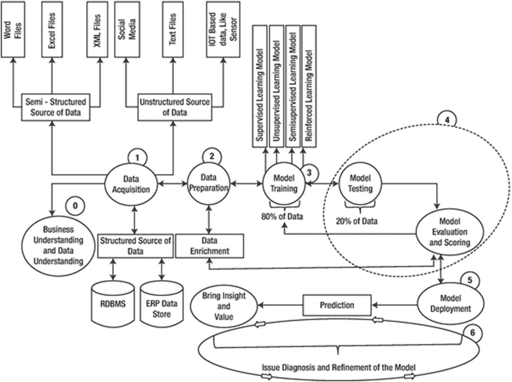
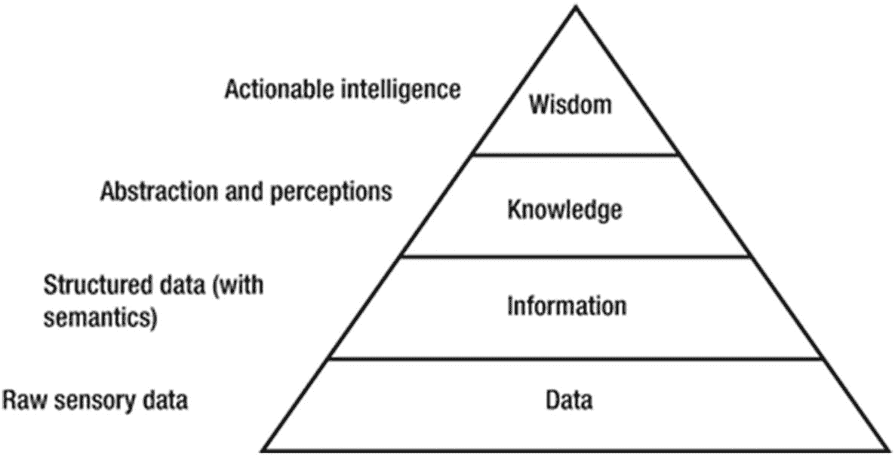
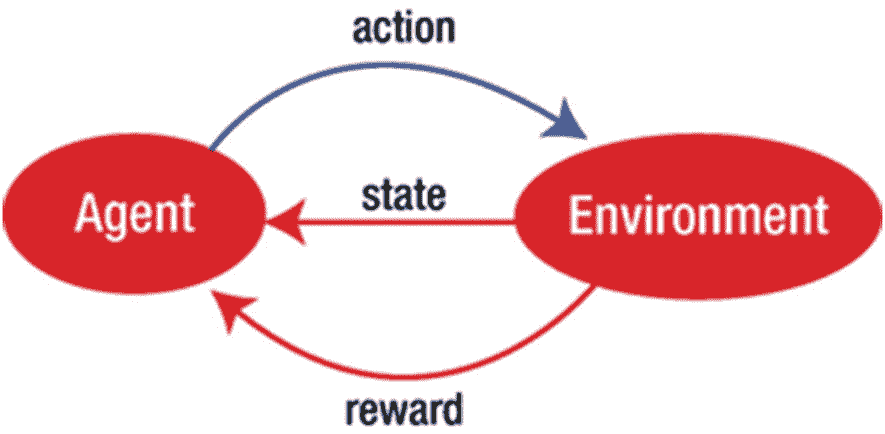
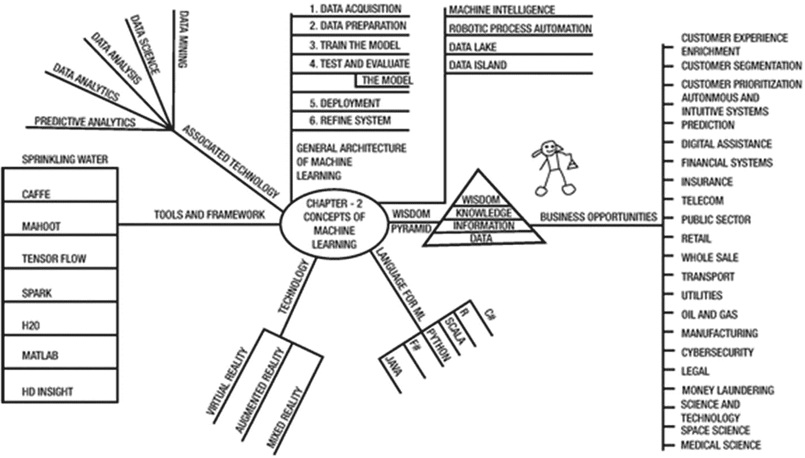

# 2. 机器学习的实用概念

帕坦加利·卡什亚普博士^(a*)

^a 印度卡纳塔克邦班加罗尔

本章至关重要，因为它讨论了机器学习的基本且实用的概念。我并非采用学术方法来解释这些概念。我将我的思考和精力集中在为你提供在实践决策中有用的概念上。因此，在解释概念、术语和技术细节时，我会使用有助于从本章中提取相关见解的示例和案例研究。

本章从机器学习的演变和历史开始，并探讨了不同思想流派与哲学之间的联系。它带你穿越过去几十年的进步，进入人工智能的世界。之后，它展望了机器学习未来的应用前景。本章还包含一节关于机器学习正在创造的商业机遇的内容。这将为你提供对机器学习赋能领域中正在涌现或已经存在的商业机遇的洞察。同样，对于此类工具，会广泛使用相关的示例和案例研究。

应用领域和商业机遇之间只有一线之隔。一项技术的应用领域也可能成为机遇领域。例如，机器学习被广泛应用于零售行业，进行不同类型的预测和推荐。同时，利用机器学习技术增强现有产品和服务、创造新市场，也存在着巨大的商业机遇。他们可以通过基于习惯/行为分析得出的推荐来吸引客户，从而实现这一点。因此，对应用领域和商业机遇的并行讨论，将提供该主题最前沿和最具未来感的视角。

我还讨论了一些机器学习中涉及的重要模型、算法、工具、框架和编程语言。有一节关于机器学习架构的内容，为你提供了机器学习“通用”架构的整体和综合视图。简而言之，本章将为你提供对所讨论技术的全面洞察。

## 连接历史、演变、机器学习与人工智能

人工智能领域建立在自动化人类思维及其认知能力的可能性之上。广义上讲，人工智能技术试图模拟和再现人类的思维和行为。这些思维和行为可以进一步分类为思考、说话、感觉和推理。设计程序使计算机更智能的科学，其目标包括“让计算机做人类更擅长的事情”。

历史上，希腊、印度和中国的学者们坚信“思维机器”的概念。他们认为“思维机器”是可能的，并且是可以建造出来的。他们的哲学家、心理学家和数学家通过他们的思想、发明和发现致力于此。然而，他们大多在各自封闭的地理范围内孤立地工作。由于他们没有像我们现在这样能够随时保持联系的“奢侈条件”，因此从未产生过一种能被所有人接受的统一思想。

例如，在 17 世纪，戈特弗里德·莱布尼茨、托马斯·霍布斯和勒内·笛卡尔探索了仅用数学符号解释思想的可能性。但他们的想法并未相互关联，而是孤立存在的。用符号和逻辑步骤来解释思想是算法研究的一部分。算法开发是数学的一个分支。算法在人工智能和机器学习的演变中发挥了关键作用。因此，不讨论算法，就不可能讨论人工智能和机器学习的演变与发展。

将复杂问题的事实和数据表示、解释并分解为符号和理性/逻辑步骤，是算法的核心主题。算法因其在解释问题时的简洁性和有效性，而成为解决问题的首要工具。算法的发展和运用可以追溯到巴比伦人，他们因在公元前 1600 年发明了首个分解和平方根方法（可通过逻辑步骤实现）而受到赞誉。然而，欧几里得在公元前 300 年发现最大公约数，以及阿耶波多发现零，是人类历史上算法发展和影响的一些最早例证。

阿达·洛芙莱斯在 1843 年推导出第一个旨在由机器执行的算法，这将被视为算法发展的一个里程碑。阿达的工作奠定了基础，但她从未谈论或撰写过任何接近人工智能的内容。正式地，人工智能诞生于艾伦·图灵的论文《计算机器与智能》。这篇有趣的研究论文发表于 1950 年。在论文中，图灵发明、解释并从理论上试图确立机器能否思考这一观点。该论文解释并传达了一些非常重要的概念，但也存在局限性。不利的一面是，这篇论文不够通用，主要局限于概念层面。

图灵的论文借助基于游戏的假设解释了人工智能的概念。这些游戏涉及三个玩家。玩家 A 是一台计算机，玩家 B 是一个人。每个玩家都必须向玩家 C（一个看不见玩家 A 或玩家 B 的人）证明自己是人还是计算机。如果玩家 C 无法持续地判断谁是人谁不是，那么计算机就赢了。我们可能同意或不同意这个假设，但它无疑为人工智能奠定了基础。

术语“人工智能”最早由约翰·麦卡锡于 1955 年提出。他将其解释为“智能机器的科学与工程学科”，并强调计算机具备“无需显式编程”的知识处理能力。这一理念在当时颇具新意。他在阐释人工智能时，对“显式编程”的概念进行了说明。

人工智能因其跨学科特性以及解决人类重大问题的期望而极其复杂。在 20 世纪 50 至 60 年代人工智能诞生与发展的初期，人们对其抱有极大乐观态度。最初，人们相信借助人工智能的潜力与力量，世界将在短短 20 年内制造出智能机器。

如前所述，人工智能包含并受到许多其他学科的影响。浅层学习与深度学习的概念便是一个例证，它们最初源于心理学。这种影响背后的主要原因在于人工智能自身的目标。它主要被构想、记录、解释并想象为一种能够处理“思维过程模拟”的机器。因此，人们期望具备人工智能的系统能够模仿人类的物理和认知行为。同样，人类的思维过程也受到社会学、心理学和生物学等多重因素的影响。因此，人工智能在发展过程中自然会将人类活动的多个领域纳入其范畴。

在过去几十年里，机器学习已发展成一门独立的科学。追溯历史，我们可以在计算机科学和统计学中找到机器学习的基因。早期，机器学习从计算机辅助教学系统中汲取灵感。多年来，机器学习反过来又促进了该领域的发展，催生了基于人工智能技术的智能教学系统。然而，机器学习实际上起源于模式识别和神经网络，这些都是人工智能的子领域。计算机无需编程即可执行特定任务集便能学习——这一理论所支撑的观念，正是机器学习发展的主要动因。

如今看待和处理机器学习的方式已与其原始形态不同。早期，机器学习被视为一项对计算、处理和存储能力要求极高的任务，而现在它被看作一种数据驱动技术。这种思维转变迫使企业和研究人员开展实验，验证计算机从数据（或大数据）中学习的能力。在此过程中，机器学习的迭代特性变得至关重要，因为当模型接触到新的数据集时，它们能够独立地从数据湖中适应模式（参见“术语解析”部分）。它们通过从之前的计算或迭代中学习，来产生可靠、高效且有效的决策、结果和行动。

## 术语解析

*   **机器智能**：与人工智能相关的能力，如机器学习、深度学习、认知分析、机器人流程自动化（RPA）和机器人，共同构成了机器智能。能够增强员工绩效、自动化日益复杂的工作负载，并开发模拟人类思维与互动的“认知代理”（一个用于基于机器学习的智能个人助理的术语）的算法能力，均属于机器智能范畴。

*   **机器人流程自动化（RPA）**：这是一种软件机器人，通常也称为“机器人”。它通过模仿人们与软件应用程序交互的方式，用于完成单调的业务流程。

*   **数据湖**：一个巨大但易于访问的集中式数据源，包含海量的结构化、半结构化和非结构化数据。典型的数据湖被认为是一个能够存储大数据中一切内容的数据存储库。数据湖主要是大数据的“存储”站点，并不对所存储的数据进行任何显著的分类或隔离。因此，与数据仓库相比，数据湖的结构化程度较低。数据湖作为多个智能系统的数据源。一旦这些系统获得经过处理、分析和优化的数据，便会将其用于不同目的。任何类型的分析或机器学习活动通常都在数据湖的“已评估”数据上进行。

*   **数据孤岛**：驻留在 PDA（个人数字助理）或其他计算设备上的数据存储库，这些设备没有或仅有有限的外部连接能力。因此，这限制了用户与其他设备同步或复制数据的能力。因此，当新数据添加到系统时，将“新添加的数据”移动到其他地方变得困难或不可能。从数据库的角度来看，数据孤岛就像一组相关的表。例如，一个数据库有 15 个表，其中 10 个属于一个名为 `group1` 的组，5 个属于 `group2`。条件表明 `group1` 和 `group2` 彼此没有关联。在这种情况下，您的数据库或模型就存在两个数据孤岛——`group1` 和 `group2`——它们孤立地工作。

参考文献：

*   [`http://labs.sogeti.com/wp-content/uploads/2015/01/machineintell-en.pdf`](http://labs.sogeti.com/wp-content/uploads/2015/01/machineintell-en.pdf)

*   [`https://www2.deloitte.com/content/dam/Deloitte/global/Documents/Technology/gx-tech-trends-the-kinetic-enterprise.pdf`](https://www2.deloitte.com/content/dam/Deloitte/global/Documents/Technology/gx-tech-trends-the-kinetic-enterprise.pdf)

IBM 的亚瑟·塞缪尔是第一个使用“机器学习”这一术语的人，当时他正在开发第一个名为跳棋游戏的自学习计算机程序。在塞缪尔的工作之前，没有人正式提出计算机可以自我编程的想法。普遍的思维和假设是，要让计算机执行任何任务，都需要“预先编程”。

机器学习的更正式定义出现在 90 年代末，由汤姆·米切尔（1998 年）提出。他指出：“如果一个计算机程序在某一类任务（T）上的性能（P）随着经验（E）的增加而提高，那么可以说该程序从经验（E）中学习。”简而言之，如果一个计算机程序在数据集上运行时，能够以迭代的方式随着时间的推移以越来越高的准确性预测出确定的结果，那么它就被认为是自学习的。

## 机器学习、人工智能、大脑与智能商业

# 机器学习基础

根据约翰·冯·诺依曼（计算机科学先驱，提出了计算机的第一个正式结构）的观点，神经元可以根据其输入从“模式”中学习。神经科学家现在称之为神经递质浓度。然而，冯·诺依曼当时并不了解神经学习是如何运作的。直到最近神经科学的进展才告诉我们，学习是通过大脑中现有神经元之间连接的生成/创建和破坏来进行的。

## 术语解析

*   神经元：人脑包含约 1000 亿个神经细胞，也称为神经元。神经元拥有收集和传递电化学信号的非凡能力。计算机中的门电路和导线可被视为神经元。神经元与其他细胞具有相同的特征和相似的结构。然而，其内在的电化学特性使它们能够远距离传输信号。它们拥有相互连接并在彼此之间传递信息的卓越能力。

冯·诺依曼指出，神经处理的速度极其缓慢，大约每秒进行一百次计算，但大脑通过大规模并行处理弥补了这一不足。神经元以“并行”计算的方式相互连接并创建新的通路和回路。同样，现代计算机也通过并行处理来执行/学习任务。如前所述，类脑人工智能并非新概念。能够模仿大脑基本结构的神经网络概念，在 20 世纪 80 年代的科学界极为流行。但在当时，人工智能领域缺乏计算能力以及海量高质量的训练数据。计算能力和数据对于由算法驱动的模型真正发挥作用都是必不可少的。

近年来计算机硬件的进步使得处理能力（在速度和内存方面）的成本降低。因此，科学界和工业界的一部分人正努力通过计算机实现人类智能。这一努力的成果以多种机器人和大型设备走出实验室的形式呈现。实现“人类智能”的目标之一，是为了在商业上获得超越竞争对手的优势。IBM Watson 就是其中一个例子。科学界和工业界（主要是包括初创企业在内的商业界）正试图通过多种“快速”产品和服务，从近年来的技术进步中获利。他们利用已有的平台、服务和框架，创建聊天机器人（自动回复用户查询的机器/软件）这类产品/服务。深度学习、自然语言处理等技术为这些平台提供了支持。

新一代企业家正采用“我优先”的方法，接触“目标明确且专注”的客户。这意味着，他们将自己描绘成真正的创新者，以及突破性机器学习产品、应用和服务的提供者。他们“首次”出现在市场上，并有可能颠覆市场/行业格局。为了证明自己的观点，他们快速创建原型，并以敏捷的方式将其转化为产品。他们避免从头开始进行广泛的研究。

然而，两者现在都押注于“数据”，这些领域的大部分成就都是由数据本身驱动的。

机器学习的实际学习能力是通过学习算法实现的，这些算法代表了人脑中的神经网络（因为它最终试图模拟大脑的行为）。机器学习算法的基本“意图”是寻找类似于大脑的模式。人工神经网络的模拟模型帮助系统收集和处理关于给定数据集的信息。然后，凭借其自学能力，它推断数据以预测未来的事件和发生情况。这一整体过程的最终结果，表现为机器和人类共同做出的逻辑决策。

人类通过试错法以及持续不断的逐次逼近过程来学习和理解。人类针对特定任务构建一个理论，并根据第一次尝试或逼近的结果来调整该理论。这个过程迭代进行，直到达到最优结果。机器学习算法的工作方式与此类似。随着机器学习系统收集和处理越来越多的数据，其结果会越来越好。这是因为这赋予了它们优化输出的能力，并帮助它们以越来越高的精度预测现有变量之间的关系。为了更好地理解这一点，想象一下，当一个孩子出生时，他们的大脑是一张白纸。他们通过不同的方式开始学习，包括各种数据来源，如观察、书本学习、声音等等……这同样适用于机器。它从不同数据源和算法接收的数据中学习。

## 机器学习通用架构

图 2-1 展示了机器学习系统的通用架构。通常，它包含六个部分。不过，可以根据项目需求、待创建的系统以及具体要求进行定制。



*图 2-1：机器学习通用技术架构框图*

以下列表包含每个部分的描述：

*   **数据采集**（收集和整理数据集）：要创建一个机器学习系统，你需要两个重要的东西——数据和模型。在采集/收集数据时，你必须拥有足够高质量的数据。根据经验法则，数据越多，预测准确的可能性就越大。因此，你必须非常谨慎地选择数据来源（步骤 1）。

*   **数据准备**（连接、过滤、清洗数据集）：一旦你为机器学习系统准备好了数据，就需要对其进行处理。通过提供适当格式的数据，你使机器学习系统能够进行后续处理。学习系统接收特定格式的数据，而不是原始和临时的格式。此外，需要对数据集执行多种转换操作，包括过滤、处理、采样和缩放。成功完成这些步骤后，数据会被缩减（转换）为所需格式。例如，在准备数据集时，你需要清理缺失值，以特定格式编辑列，并将数据集拆分为训练集和验证集。这使你能够将数据输入到选定的训练模型中（步骤 2）。

*   数据分析的初始阶段称为数据探索，它涉及查看和可视化数据，以立即发现洞察，或指出需要进一步调查的区域或趋势。用户可以通过使用交互式仪表板和点击式数据探索快速获得洞察，从而更好地理解全局。数据粒度是你的数据所能描述的信息量。因此，粒度越高，它能传达的细节就越多。人们可以通过数据可视化快速有效地分析数据，尤其是海量数据。它通过提供清晰的数据可视化表示，使员工能够更准确地基于数据做出决策。

*   所有这些细粒度数据都可以通过数据可视化转化为有价值、美观且易于理解的业务信息。

*   **训练模型**（使用机器学习进行泛化）：在为你工作创建准确的机器学习模型的过程中，你需要发现哪种类型的分析能帮助你实现目标。相应地，你需要训练你的模型。

    一个使用从未见过的数据集来检测模式或做出决策的程序被称为机器学习模型。机器学习模型也是一种算法的表示，它通过搜索大量数据来寻找模式或预测未来结果。机器学习模型是人工智能的数学引擎，由数据驱动。你也可以将模型视为一个经验丰富的算法。例如，机器学习算法可以分析并准确识别自然语言处理中从未听过的词语或词组组合背后的意图。模型可以通过两步过程摄取数据。这可以进一步用于多种目的，包括训练模型。

    *   数据收集涉及从各种来源获取信息，包括数据库、API、传感器和外部数据集。
    *   在摄取之前，必须发现并修复数据中的错误、不一致和缺失值。

    它可以是分类分析（一个典型例子是在系统中识别垃圾邮件与非垃圾邮件）、聚类分析（是否需要自动分类？）或回归分析（我的模型是否要进行预测和预报？）。完成此步骤后，你需要比较多个可用模型的结果。这项工作能让你知道哪个模型对你的数据集最有效（步骤 3）。

    让我们以更系统的方式来看待这个问题：

*   **评估/测试模型**（模拟和交叉验证）：在深入细节之前，我先定义一下交叉验证。基本上，交叉验证是一种机器学习方法，常用于评估数据集的变异性，以及基于该数据集开发的任何模型的可靠性。一个带标签的数据集作为输入提供给交叉验证模型组件。此外，交叉验证可用于测试多个机器学习模型，方法是在输入数据的不同子集上训练它们，然后比较结果。交叉验证可用于发现过拟合，即模式无法泛化的情况。

    机器学习模型的性能是一个非常重要的阶段。它让你了解一个训练好的模型对数据集的预测有多成功。同时，评估和交叉验证是衡量所考虑模型性能的既定标准方法。两者都为你提供评估指标，使你能够评估和判断另一个模型的优劣，从而做出最佳选择（步骤 4）。

*   **部署**（在评分中运行；跟踪概念漂移）：假设前面的步骤都成功完成，并且你对模型的结果（基本上是数值）感到满意，这有力地表明你的评估是成功的，模型已准备好进入下一步。由于你在评估过程中尝试了多个模型，你必须清理所有内容，并确保只留下一个性能最优的模型。你评估机器学习模型以确保它们按预期运行，并且足以胜任其设计目的。模型训练阶段完成后，即进入评估阶段。评估有助于分析模型的主要缺陷。机器学习算法寻找各种模式和趋势。并非所有数据集或用例都适用于同一种算法。你必须运行多个测试，评估机器学习算法，并微调其超参数，才能找到最佳答案。超参数是其值影响学习过程并定义学习算法最终学习到的模型参数值的变量。

*   **最后，发布/部署你的模型**（在 Azure ML 中，你需要定义输入和输出，然后运行并将其发布为 Web 服务）：更多详情请参考步骤 5。

*   **诊断问题并优化系统**：在（通常的）情况下，如果系统第一次未达到成功标准，你需要诊断问题并优化系统。如果当时没有采取纠正措施，将导致预测精度下降。可视化是识别和展示数据、模型或算法问题的强大工具。然而，也可以使用从模型中采样的合成数据来诊断问题（步骤 6）。合成数据是故意创建而非实际事件产生的信息。它通过算法生成，用于训练机器学习模型，并作为生产或运营数据测试数据集的替代品。

    > **注意**
    >
    > 完善系统意味着对数据、模型、可视化、推理和评估进行净化。这是一项持续的活动，旨在使模型趋于完美。诊断问题并完善系统必须反复进行，直到系统达到预期应用所需的性能水平。基于模型的机器学习可以大大加快这一反复完善的过程。完善建议需要立即应用于模型。这允许对多个模型进行快速探索。

## 机器学习：你与你的数据

机器学习是一门古老的科学，但由于异构来源以快速生成海量数据，它正获得发展势头。虽然许多机器学习算法已经存在了很长时间，并继承了统计学的传统，但借助复杂的分析技术，能够自动、反复、越来越快地对大数据应用复杂的数学计算和逻辑，是近期才有的发展。

## 与机器学习相关的技术

本节介绍一些常见的机器学习及相关技术及其关系。它将帮助你理解一些重要概念。

*   **数据科学**：从更广泛的层面来看，数据科学是数学科学、统计学和编程的综合学科。然而，它不应局限于这些研究领域，还应扩展到人工智能、统计行为科学、数据库技术、心理学、社会学、认知科学和神经科学。

*   **数据分析**：一项调查活动。在数据分析中，分析师在扫描可用数据集后，会获得隐藏在数据集中的见解。

*   **数据解析**：当你对可用数据集应用数学、统计学和算法，以发现其中的见解和有意义的关联时，这个过程称为数据解析。解析是分析的结果。而分析是可用于分析数据的方法或一组方法。

*   **预测性解析**：构思并生成一个定量模型，该模型允许基于大量历史数据/信息预测结果或结论，这可能是一项复杂且技术密集的任务。输入数据包含众多变量，需要同时考虑它们。其中一些变量是相关的，而另一些在确定结果时可能不那么重要。预测模型决定了可以从数据中提取哪些见解，并用于在给定场景中做出准确且相关的预测。一个好的模型允许并乐于接受变化，以便能够适应变量的变化。有时需要改变以提高可预测性。正确的改变可能会增加期望结果的可能性。

*   **数据挖掘**：在可用数据集中发现模式。这个术语在 90 年代末和 21 世纪初变得流行，当时组织意识到了整合数据及其用途的力量。通过使用这项技术，来自异构来源的数据被汇集在一起，以发现以前未知的趋势、异常和关联。数据挖掘允许在没有确切目标的情况下搜索海量数据。它通过使用暴力分析和神经网络等技术，帮助识别可用数据集中的关联。

数据挖掘可以被视为从可用数据中提取见解的许多方法和技术的超集。该技术可能涉及传统的统计方法或技术，或机器学习等高级概念。数据挖掘涵盖的一些技术包括统计算法、机器学习、文本解析、时间序列分析以及其他解析领域。数据挖掘还包括数据存储和数据操作的研究与实践。

*   **深度学习**：正在使用技术和算法来识别图像中的特定对象并执行自然语言处理。借助计算资源、大量数据和特殊类型神经网络的综合能力，深度学习可以识别大型数据集中的复杂模式。研究人员、机构和企业现在正寻求将深度学习的模式识别能力应用于更复杂的任务。例如，它被应用于自动语言翻译、医学分析以及其他重要的社会和商业问题领域。

*   **浅层学习**：浅层学习和深度学习的概念最初源于心理学。广义上讲，浅层学习指的是对主题“不了解深层概念”的表面理解。例如，你死记硬背阅读内容，而不试图理解其潜在含义或意义。而深度学习则涉及更详细地探索主题/阅读内容。它包含你理解基本原理的意愿。此外，它还关乎你提出自己论点的能力。简而言之，浅层学习是关于记忆事实，而深度学习是关于构建逻辑和深层次的论点。

人工智能领域将深度学习算法与包含两层或更多层神经元的神经网络联系起来。这些算法主要用于与模式识别相关的任务。然而，它们也用于图像、视频和语音识别活动。广义上讲，未被归类为深度学习的机器学习算法被称为浅层机器学习算法。对于涉及大量训练数据和更大计算能力的任务，深度机器学习算法是一个不错的选择。此外，对于没有明确特征的数据集，深度学习始终是更好的选择。因此，在图像和语音识别等领域，它被广泛使用。如果数据已经具有强大的特征，那么浅层机器学习算法是一个不错的选择，因为它们有效且效率更高。

机器学习诞生于人工智能，因此它们的关系非常密切。在更广泛的层面上，深度学习、模式识别和浅层学习都是相关的。机器学习是一组算法和一套技术，用于设计能够从数据中学习的响应式自动化系统。机器学习算法通常具有强大的数学和统计基础。它们与领域知识和数据预处理没有紧密耦合。因此，机器学习也可以定义为计算机科学的一个领域，它使用统计方法来创建能够随时间改进并在人类不太可能手动发现的海量数据中检测模式的程序。与人工智能一样，机器学习试图用参数的自动检测来取代显式编程。然而，机器学习处理的是包含离散样本（包括正例和反例）的非聚合数据。例如，如果有人想在金融数据集中查找/检测欺诈行为，他们需要显示特定于欺诈的有效交易示例的单个交易记录。

## 机器学习的必要性

我们大多数人有时会认为世界混乱无序，这种不确定性引发了许多问题。然而，有些人将这种“问题”视为商机。他们开始寻找解决方案，利用数据和技术将这种不确定性或不可预测性转化为可预测性。他们开始为新兴企业提供围绕预测的解决方案。老牌成熟企业则磨练自身技能，推出产品和服务，或从供应商处购买这些服务，以维持和加速市场发展。

IBM Watson、微软认知服务以及众多其他产品创造了一系列新的服务。成功案例，例如 Netflix 采用机器学习技术来预测客户行为并提供“个性化”服务，最终提升了其收入和客户满意度，这为企业和客户都带来了新的启示。同时，它也展示了基于推荐的服务、应用和产品的潜力。我们可以看到，软件/应用/机器正在准确预测客户行为，而这在历史上曾以其不可预测性而闻名。

挖掘、编译和使用充足的数据，并全面评估所有涉及的变量，可能无法准确预测即将发生的事件。但它们无疑会让你更接近那个目标。机器学习提供了能够衡量众多变量的算法。例如，一个群体或个人在特定气候条件下表现如何？当一名超级球星被球队开除时，某支体育队能得分/获得多少分？在特定条件下，球队的最佳阵容是什么？

借助数学（更准确地说是统计学），受过训练的人可以调整和运用数学变量来获得期望的结果。但他们无法同时处理成千上万个变量。从神经学角度看，人类大脑在处理如此大量信息方面是薄弱的。这是神经科学和神经可塑性领域众多研究证明的事实。但机器借助高效且有效的算法可以轻松做到这一点。欢迎来到奇妙的机器学习世界——它将助你解决问题，满足你的需求。

预测涉及有效且高效地识别可用数据中的模式，并以恰当的方式使用合适的可用变量。一旦软件识别出这些模式，就会利用它们来预测未来事件。除此之外，这些程序还能更有效地完成许多其他事情，例如帮助你做出决策并提供一系列行动项。预测、自动化决策和行动规划是当下的迫切需求，也是未来的现实。

当谈到赚钱和盈利时，“足够”是一个陌生的词。企业和商业机构必须不断寻找新市场，开发创新产品。他们必须了解新的市场趋势和新的竞争对手，并根据时代和市场不断变化的需求调整思路。在当前的商业世界中，机器学习应运而生，在这方面提供帮助。几乎所有行业都受到了机器学习的影响，且大多是积极的影响。

## 机器学习商业机遇

这些技术——机器学习、大数据分析、云和认知计算——正在改变全球几乎所有行业的商业模式。旧的商业模式正在迅速改变。各个垂直和水平市场的企业都在寻找运营和业务创新的新方法。这为数字和实体企业创造了新的商业机会和途径。创业精神日益高涨；创新思维正在围绕新一代技术创造新的商业模式。这种发展势头的结果体现在优化运营、降低成本、改善服务和/或推出新产品上。许多公司正在利用机器学习获取经济利益并取得了巨大成果：

*   AOL 使用机器学习提供购物推荐。

*   Booz Allen Hamilton 为其业务目的使用机器学习（Mahout 的聚类算法）。

*   Cull.tv 使用机器学习进行其内容推荐系统。

*   DataMine Lab 使用机器学习聚类分类算法来改善其客户的广告定向。

*   Drupal 押注于机器学习算法，以提供其开源内容推荐解决方案和系统。

*   Evolv 使用基于机器学习的平台来预测其与劳动力相关的活动。

*   Foursquare 和 Idealo 使用 Mahout（一个机器学习框架）用于其推荐引擎。

*   Google 使用机器学习为其 AdSense 和其他广告网络计算点击概率。

*   机器学习算法和模型被用于自动化算法交易（AAT）。货币市场公司设置并训练模型，用于在纳秒内进行交易。当今很大比例的交易是由计算机完成的，许多大型金融科技公司都参与其中。

*   零售商使用机器学习来优化和推荐其库存、营销活动、产品布局、定价和目标定位。例如沃尔玛、苹果和 Flipchart。

*   像 Rose Pharmaceuticals 这样的制药公司使用机器学习进行数据挖掘相关活动。

*   印度拥有全球第三大人工智能初创企业集群。这些初创企业致力于开发机器人、识别工具和基于机器学习的虚拟助手（来源：毕马威）。

*   印度在核心业务流程中实施机器人自动化的排名也位列第三。金融专业人士已准备好采用基于机器学习的自动化来节省时间并在决策过程中获得帮助（来源：毕马威）。

*   像微软、IBM、谷歌和亚马逊这样的公司正在提供“现成”的平台。初创企业正在使用这些平台来寻找自己的解决方案。同时，这些巨头近年来还推出了多款机器学习产品和应用，以解决和增强多个行业特定的挑战。

由于机器学习无处不在，几乎所有领域的商业机会都极其巨大。新一代机器学习拥有多项创新功能，这些功能是商业机会的催化剂。除了技术领域，机器学习还在以下职能领域创造着新的机会：

*   研发

*   生产与运营

*   销售与营销

*   客户支持

*   财务、人力资源和行政职能

*   农业、医疗保健、公用事业以及石油和天然气

*   零售

*   采矿、建筑、可穿戴设备、批发、艺术、娱乐和休闲以及房地产

*   教育服务、住宿和餐饮服务、仓储和制造业

除此之外，行业特定的机遇也在不断涌现。近年来，随着机器学习的发展，一些新领域应运而生，其中包括基于情感的产品与服务、直觉学习、智能无人机与机器人、聊天机器人等等。如今的消费者希望应用、产品和服务更加直观。由于广泛接触手机和智能手表等个人辅助设备，消费者比以往任何时候都更贴近应用。他们对应用和产品的期望是能够“理解”自己的工作方式和行为。

这开辟了“可转型”商业机遇的新视野。同时，决策者的思维方式也发生了转变，从创造“数据”转向打造“以洞察为导向且直观”的产品和服务，从而产生巨大的商业前景。这种思维过程是行业和企业所特有的。然而，这种“思维过程”受市场动态和竞争引导，则是另一回事。基于机器学习的数字化正在推动多种类型的创新。数字世界正以出人意料的速度增长，并创造了大量机遇。

现在值得一看`智慧`金字塔（或数据层次结构），因为下一节将重点介绍其各个组成部分。金字塔的底层指的是由非结构化（包括`物联网`设备）、半结构化和结构化数据源产生的大量数据（见图 2-2）。这些设备产生的数据量可达 PB 级甚至更多。数据层之上是“信息”层，它从数据中提供经过过滤、结构化且机器可理解的信息。同时，它作为一个抽象层，对可用数据进行总结。然而，人类和高级复杂应用需要的是服务，而非信息。

```


智慧金字塔层次结构。从顶部开始，依次包括智慧、知识、信息和数据。

图 2-2

智慧金字塔
```

信息层之上是看不见的知识层（第三层），它提供了对数据和信息的更好理解。它还将信息以机器可理解的格式呈现，机器可利用这种格式在分析“精炼”信息后生成洞察。知识层进一步精炼到更高层次，即`智慧`层。它通过从隐藏的“知识海洋”中寻找智慧，对知识层进行精炼。借助隐藏的知识，机器可以得出所谓的`智慧`，用于预测（本质上是预测未来会发生什么），然后提供洞察和行动步骤。这种智慧可用于开发端到端的直观、智能产品和服务。这种从杂乱无章的事实数据逐步精炼到智慧的组织方式，可以通过多种方式可视化。例如，如果从技术角度考虑这些层次，它们可以按以下方式关联：

*   数据层与`物联网`相关，简而言之，包括结构化、非结构化和半结构化数据或大数据。

*   信息层和知识层与大数据分析相关。

*   智慧层与机器学习和认知计算相关。

对于企业而言，商业和商务机遇无处不在，且与机器学习息息相关。领导者必须抓住这些机遇。然而，为了利用机器学习生态系统的巨大潜力，商业领袖和决策者必须投资于技术。同时，他们还必须致力于组织转型。因此，思维方式变得至关重要。以下是一些有助于创造和利用突破性机遇的想法：

*   领导者必须致力于机器、软件、流程和数据的整合方法。

*   采用非常快速的实验、测试、学习和规模化方法。

*   在需要时迅速重新构想、重塑和创新商业模式。

*   采用数字化并构建能力。这不同于土地、劳动力和机器的商业模式。

*   在整个组织内采用并实施技术特定且官僚作风较少的流程。

*   采用鼓励投资于流程、人员和技术的政策和框架。

商业机遇是一个通用术语，用于多个领域。机器学习有助于创造就业机会，开辟盈利渠道，并优化劳动力市场。机器人流程自动化、机器人技术、人工智能、深度学习和机器学习的进步带来了突破、创新和机遇。连接这些不断发展的技术将解决复杂的业务问题，并为公司带来益处。从感知新的商业途径到创建、维护和转型现有商业生态系统，有无数种方法可以利用这些领域的机遇。

例如，机器学习使企业能够提高绩效、效率和效果。这可以通过减少错误、提高质量和加快运营速度来实现。企业正从被动应对运营方式转向主动应对。例如，以前企业必须等待机器故障，然后才呼叫或要求维护，但现在他们可以确定特定设备的状况，以预测何时进行维护。这得益于机器学习技术和算法执行方面的非凡进步。

机器学习的应用几乎遍及人类活动的所有领域。以下领域列出了用例和应用。详细的应用领域以应用、产品和服务（APS）的形式进行描述。接下来的部分将以产品、服务和应用的形式介绍 APS 用例。

所有领域都蕴含着巨大的商业机遇。以下是 APS 的五个领域：

*   客户体验提升

*   自主与直觉系统预测

*   数字辅助与推荐 APS

*   特定领域 APS

*   科学与技术

## 客户体验提升

在此类别中，应用、产品和服务（APS）能够在最少人工干预的情况下自行做出决策。它们是自给自足的，能够自动从系统中提取洞察。由于本书的范围所限，我将讨论局限于客户领域。然而，其边界几乎是无限的，维度也是无穷的。该领域存在巨大的商业机遇。以下部分将解释此类 APS 的更广泛分类。

### 基于自动机器学习的客户支持系统

像 `Wise.io` 这样的公司利用机器学习来提供“明智且智能”的客户支持。例如，它们能更快地响应客服工单。这样一来，其客户的客服人员就能专注于解决更关键的客户问题，而不是处理日常事务。

以下是这对企业有何帮助：

*   机器学习使支持引擎能够根据客服代表的技能组合，预测哪个团队或个人应接收新的客户工单。之后，引擎会自动将工单放入正确的队列。

*   机器学习使支持界面（引擎）能够根据工单的内容和历史记录，向客服代表显示最佳回复模板。

*   如果启用机器学习的系统在知识库中找到了客户提交的工单/问题的解决方案，系统会自动选取解决方案、修复问题并回复工单。`Wipro` 的一个基于机器学习和人工智能的系统正遵循着同样的理念。`Wipro` 正使用这种方法来实现客户满意并提高客服代表的生产力。

### 客户支持与自动化之故事

自动化是指利用技术使流程无需人工干预即可完美运行。这一想法与“业务自动化将取代人力资源和知识工作者”的假设相反。自动化通过让知识工作者得以专注于更直观的任务来为他们提供便利。它使他们免于承担行政性和重复性工作的责任。它仅在必要时才允许人工干预。自动化几乎无处不在，但在那些资源及其知识非常宝贵的组织中，它发挥着更大的作用。以下是客户支持团队可以从自动化中获益的四种方式：

*   `无重复性工作`：支持团队通常会被重复性的请求淹没。大多数时候，他们被迫一遍又一遍地回答相同的问题。有时，这会变得令人沮丧和失去动力。自动化在这些情况下为支持团队提供了帮助。自动化系统以多种方式处理此类情况。例如，根据工单的严重性或优先级，系统会将工单路由给具备解决特定问题所需技能和专长的合适支持主管。例如，假设支持团队收到一个包含特定问题类别的工单。根据工单的分类，系统可以访问现有的知识库，找到解决方案并修复问题。一旦问题修复，系统可以关闭工单并通知请求者问题已解决。

*   `一致性`：自动化允许知识的归集或集中化，并实现其妥善的存储和记录。一旦知识捕获过程实现自动化，就很容易在任何组织中进行优化和参考。这有助于“集中化”知识，因为团队（支持和开发）通常孤立地工作，有时沟通差距会造成损害。此外，团队倾向于为其工作创建支持文档，但不会共享这些信息。

*   `稳健的扩展`：许多支持团队起步时规模很小。他们使用关键工件（如文档），与同事和主题专家交谈以解决遇到的问题，教育客户，并向组织其他部门通报最新进展。只要客户群规模小且收到的工单数量也少，这一切都容易实现。但是，一旦客户群开始增长，工单开始堆积，工单队列就会开始变长，真正的问题就出现了。由于耗时的手动流程无法产生完美的结果，自动化对企业来说变得至关重要。他们必须利用和保护来之不易的知识。随着任何公司的发展，员工流失变得至关重要。在这种情况下，自动化也能防止知识流失。

*   `更高的工作满意度`：客服代表和客户服务代表的工作单调且要求高。他们必须在工作时间内处理相同的一系列活动。为客服代表提供自动知识库和个性化问题解决指导，可以提高他们的满意度。根据特定的技能组合、个性特征和绩效指标自动将工单分配给客服代表，表明你重视他们的个性，并且你拥有适当的数据源来确保他们的成功。简而言之，客户支持自动化认可了个性，并赋予团队主动而非被动的资源。

### 机器学习客户留存系统

产品和营销团队经常面临留住客户的持续挑战。通常，客户行为是不可预测的。例如，企业通常不知道客户为何取消他们之前下的订单。现在，借助由创新机器学习算法驱动的基于机器学习的留存应用程序，公司可以分析客户互动的各种接触点。这使他们能够采取纠正措施来留住客户。这从多个方面帮助企业。这里列举了其中几点：

*   在互动初期预测客户行为偏差，以便采取行动

*   针对每个客户显示其行为偏差的原因

*   推荐和提出最合适的营销策略

*   个性化和定制化的内容以提高客户留存率

*   帮助确保每个面向客户的团队在每次互动中都能了解客户的“专业”健康状况

通过采用更直观、创新和数据驱动的方法来实现客户成功和留存，组织可以更高效、更有效地确定优先级。他们可以在服务最关键客户的同时，持续提升整个客户群的满意度。

### 业务成功、客户参与和机器学习

客户成功始于为企业找到并定位合适的客户。选择客户必须基于产品组合和可用服务。这使企业能够为目标客户提供适当的服务和产品。如果企业无法为其产品找到并选择合适的客户，其利润将受到影响。此外，选择错误的客户会导致客户流失并损害品牌声誉。理想的客户实际上能帮助企业从营销支出中获得最大回报，并实现更高的投资回报率。为了找到“合适的”客户，企业必须了解并理解一些重要事项：

*   客户是谁

*   业务团队将如何根据他们的需求和愿望来接触并获取他们

*   如何定位或呈现产品或服务以提供最大价值


# 机器学习在商业中的应用

如何预测特定客户在未来几天或几个月内可能购买什么
哪些客户将成为最大的消费群体
哪些营销内容最适合目标客户
哪些销售代表最适合处理特定类型的客户

机器学习技术在寻找这些问题的答案方面非常有帮助。通过对与客户相关的历史、结构化和半结构化数据适当应用分析技术，企业可以深入了解客户的行为。此外，基于这些洞察，企业可以制定能带来多重好处的策略。接下来将描述其中一些好处。

## 合适的客户获取

基于机器学习的应用和产品能够帮助销售团队聚焦于能转化为合适客户的潜在客户。这些产品还能帮助营销团队根据客户的个性和购买模式呈现最佳内容。合适客户获取的其他优势包括：
- 更高的销售额和赢单率
- 更好的推广和营销转化率
- 营销和推广支出的更高投资回报率
- 通过个性化实现更精准的营销活动

## 更好的客户支持

基于机器学习的应用、产品和服务能帮助企业为客户提供更好的支持。例如，产品支持通常通过基于工单的系统（记录问题的系统）来实现。如果使用基于机器学习的工单工具或系统来提供客户支持，它能够自动将工单分配给最合适的客服人员，或通过智能利用现有知识库生成自动回复消息。基于机器学习的客户支持优势包括：
- 将服务或客户工单快速引导至合适的客服人员或主管
- 由于系统自动化且所需人工干预较少，支持服务更加可靠
- 客户服务代表效率更高，因为单调的工作由系统处理，他们可以承担更有价值的任务
- 高效的客户自助服务

## 客户群扩展

基于机器学习的系统、应用和产品能帮助企业识别、跟踪和分析客户的使用模式与信息。这有助于他们找到潜在的“合适”客户，从而拓展业务。为商业生态系统增加更多客户意味着额外的收入。此外，如果客户与企业保持互动，这将在多方面带来益处，包括口碑宣传。机器学习驱动的客户扩展的其他优势包括：
- 更高的产品分配率
- 通过交叉销售获得更多收入和成本效益
- 增加向上销售的机会

## 客户留存

基于机器学习的应用能够识别有流失风险的客户及其表现出的信号，同时预测哪些内容或方法最有可能重新吸引他们。这种由机器学习驱动的策略有助于企业留住客户。客户留存对企业至关重要，因为留住一个客户比获取一个新客户成本更低、所需资源更少。客户留存的一些优势包括：
- 降低客户流失率
- 为客户经理提供更可靠的方法
- 客户经理效率更高

### 客户细分应用与产品

在竞争激烈的商业环境中获取新客户十分困难，需要投入大量的辛勤工作与努力。而且，获取新客户只是成功的一半。通过持续提供价值和满意度来留住客户才是成功的关键。企业如何持续为每位客户提供价值，从而让客户更深入地参与其中，这是一个挑战。但一旦企业做到这一点，就可以向客户销售更多的产品和服务。通过向客户提供明智且智能的、基于机器学习的收入增长与金融（FinTech）应用，客户能够认识到其资金的价值。新一代的机器学习应用产品与服务能够增强来自客户的经济、金融和收入流。同时，组织也能从中受益，因为这使他们能够实现有效且高效的客户细分。

它可能在多方面为企业提供帮助：
- 将合适的产品或服务与合适的客户相匹配
- 推荐或建议最佳价格以确定向上销售机会
- 向个人客户提供个性化的营销信息

将客户数据与过往结果相结合，可以呈现一个全面的预测路线图，用于为客户提供额外价值并扩大收入。

### 智能客户优先级划分与分类产品、应用与服务

企业常常试图从海量的现有客户数据库中寻找自己的客户。机器学习帮助企业分类、排序并优先选择最合适的客户。这不仅使团队能够瞄准理想客户，还能快速为他们提供所需的产品或服务。

以下是这对企业的帮助方式：
- 提高销售渠道的成交率
- 提升营销支出的回报率
- 充分发挥销售团队的优势

通过数据驱动的方法来揭示目标市场的模式，销售团队可以制定高效的优先级排序流程，并专注于最佳机会。以下是预测性应用产品与服务的技术与流程运作概览：
1. 机器学习技术分析历史数据（例如，已关闭的工单），并识别其中的模式和相关性。基于此分析，它确定工单是如何被分类、分配和解决的。
2. 当新事件发生时（新支持工单到达），基于机器学习的引擎立即验证内容，预测属性，并推荐适当的响应。
3. 根据预测结果，触发器可以路由规则或响应宏来自动化处理流程。
4. 一旦找到解决方案，系统会学习并调整其预测，使其始终适应当前的需求和流程。

### 自主与直觉式系统

属于这一类的应用、产品和服务通常具备像人类一样“思考”的能力。这是一个不断发展的领域。基本上，这些应用产品与服务试图模仿人脑。它们创建人工神经回路和通路，其方式与人脑生成生物神经元完全相同。它们能够根据情况做出决策，并能在动态变化的环境中进行调整。这个领域蕴藏着巨大的商业机会，并存在多种类型的应用和服务。以下部分描述了这类应用产品与服务的更广泛分类。

#### 自主系统

机器学习在直觉式应用、产品和服务的开发中扮演着关键角色。数据是应用产品与服务的构建模块。这些数据可以帮助统计程序通过数据挖掘在海量数据中识别直觉模式。机器学习过程、算法和方法使用人工神经网络来生成预测。这进而导致了自动化决策和行动规划。例如，西门子借助神经网络创建了一个软件仿真环境（SENN），可用于回答各种问题。西门子正在使用 SENN 来预测原材料价格。

自主系统是直觉式产品和服务的最佳范例。一个全新的市场正围绕它们兴起，并且很快就会成为一项有趣的业务。除西门子外，其他公司也在推出自主系统产品。这些公司提供个性化和定制化的产品。随着市场势头增强，成本也变得越来越有竞争力。从工业和服务机器人到汽车和无人机，所有案例的共同点是执行通用任务的能力。它们还能基于在动态变化环境中感知和处理信息的能力，做出“小”决策（就目前而言）。

#### 最新趋势

无人类参与的面试（技术驱动型）正逐渐兴起。HireVue 是视频面试软件领域的先驱，与约 600 家组织/企业合作，客户名单包括德勤、摩根大通、安德玛以及美国几家主要航空公司。2016 年，HireVue 计划为其客户进行 250 万次面试，这一数量较五年前的 1.3 万次实现了显著增长。HireVue 进行的面试中，绝大多数（90%）为按需面试。在这种场景下，另一端没有任何人存在。

无人类参与的视频面试对招聘经理而言效率很高。同时，企业也能更深入地了解面试对象。在视频面试过程中，仅在审阅面试者提供的回答时才需要人工参与（未来，随着机器学习和认知计算的更高级应用，这一环节也将实现自动化）。人类可以在自己方便的时候进行审阅。例如，他们可以协调自己的日程、任务和空闲时间，在休息时间抽空审阅。此外，他们无需前往面试地点。通过使用 HireVue，许多企业都看到了切实的效益。例如，希尔顿酒店将其招聘周期缩短至 4.5 天，比之前的招聘周期缩短了近 20 天。信诺保险则将其招聘人员的差旅费用从每年 100 万美元降至每年不到 10 万美元。

求职者也从基于机器人的招聘中受益，主要体现在便利性上。求职者/面试者可以在自己方便的时候进行按需面试。这些基于机器人的面试不会完全取代人际互动（至少在短期内不会）。大多数公司将其用于第一轮筛选面试，之后再进行传统的一对一面试。

#### 自学习机器产品、应用与服务

像 AlphaGo 这类新型机器学习系统正在发展，以满足对超级智能系统的需求。像谷歌这样的企业在自学习机器的创造和发展方面达到了一个里程碑。

2016 年 3 月，AlphaGo 击败了世界顶尖围棋选手李世石。李世石是排名第二的职业围棋高手。围棋是一种亚洲棋类游戏，对计算机而言，理解和解读它被认为非常复杂。因为该游戏几乎拥有无限多的可能落子位置，棋手必须依靠直觉，而不仅仅局限于计算走法。

AlphaGo 由谷歌的 DeepMind 开发，该公司专注于解决复杂任务。AlphaGo 使用了强化学习算法（一种机器学习算法）。在强化算法中，系统学会使用一个价值函数，通过分析数百万个过往棋局（数据集）并自我对弈来评估棋局位置。

AlphaGo 本质上是一个将树算法与深度神经网络相结合的计算机程序。这些神经网络将围棋棋盘细节作为输入，并通过由数百万个类似神经元的网络组成的多个网络层进行处理。其中一个神经网络，“策略网络”，负责选择下一步棋。另一个神经网络，“价值网络”，负责预测棋局的胜者。谷歌的 Alphabet 公司让 AlphaGo 学习了大量业余棋局，以理解合理的人类下法。随着时间的推移，AlphaGo 在学习和决策方面变得更好。

西门子也使用了同类型的算法来优化其风力涡轮机和燃气轮机，这同样是自学习机器成功应用的例子。能够从各种类型数据中学习并得出自身结论的计算机系统，其工作基础是机器学习。例如，西门子正在致力于让风力涡轮机能够根据风力和天气等不断变化的环境条件自动调节自身，这将提高其发电量。自优化风力涡轮机的基本逻辑在于，能够基于运行数据从涡轮机中推导出风的特性。相关的参数由传感器和外部风力发电设施测量，包括风向和风力、空气温度、电流和电压，以及发电机和转子叶片等大型部件的振动。

爱立信展示了一个 6G 应用场景，其中数千个传感器被集成到一件 T 恤中，可以帮助追踪血压和血氧水平等关键生命体征。事实上，甚至可以将芯片组植入衣物中而不可见，因为它非常小，只能在显微镜下观察到。其非凡之处在于，它没有电池，但仍能传输数据，因为它能从无线电频率中获取能量。


随着 5G 服务的推出，人们可以坐在家里远程驾驶汽车。这在某种程度上与无人驾驶汽车类似，因为你可以远程控制并驾驶车辆。令人惊讶的是，如果车辆失去连接，它会停下来，从而降低发生事故的几率。

`ChatGPT` 是 `OpenAI` 开发的一种人工智能模型，能够对文本输入产生类似人类的回答。它使用创新的机器学习方式来理解和掌握自然语言，使其能够与人进行交流。它因其类似人类的回答和易用性而广受欢迎。其应用场景遍布多个领域。例如，印度的两大顶级 IT 企业——塔塔咨询服务公司和印孚瑟斯，以及埃森哲等全球技术咨询公司——正依靠针对初学者的 `ChatGPT` 及其他机器学习/人工智能技术的培训和技能提升模块。

像 `ChatGPT` 这样的生成式 `AI` 模型可能会颠覆印度 IT 企业。塔塔咨询服务公司（`TCS`）将为专业人员发展开设生成式 `AI` 主题课程。`ChatGPT` 在整合多源信息与内容以精准回答特定问题等操作中非常有用。对于将要从事写作的人来说，`ChatGPT` 可能成为必需品，这将是写作领域的“阶梯式变革”。

`ChatGPT` 完成的部分任务包括：

*   `ChatGPT` 在美国医疗执照考试中得分超过 50 分
*   它在沃顿商学院 `MBA` 项目运营管理期末测试中顺利通过
*   它在一个周末协助完成了一部小说，随后被发布到网上

还有更多……

随着 `AI` 技术的进步，开发 `AI` 前沿技术（尤其是在生成式 `AI` 领域）的竞赛已经加速，这既带来了希望也引发了担忧。因此，让我们来看看它的一些创新特性，例如基于人类反馈的强化学习（`RLHF`）技术。

这些技术有潜力改变我们的世界，但也伴随着风险。`RLHF` 技术有助于确保 `AI` 模型与人类价值观保持一致，并提供有益、真实且无害的答案。鉴于对生成式 `AI` 发展速度和范围的担忧，纳入持续有效的人类反馈循环比以往任何时候都更加重要。

`RLHF` 结合了强化学习和人类输入来训练 `AI` 模型。通过被称为强化学习的试错训练，`AI` 模型在学习新技能时，会因做出明智决策而获得奖励，因做出错误决策而受到惩罚。

然而，强化学习确实存在某些限制。例如，由于很难定义一个涵盖人类偏好和价值观所有方面的奖励函数，因此可能难以验证模型是否遵循人类价值观。`RLHF` 通过将人类反馈纳入训练过程，克服了这一困难，并提高了模型与人类价值观对齐的有效性。人类可以通过对模型输出提供反馈，帮助模型更快速、更准确地学习，并降低出错的可能性。例如，当人们看到模型以不恰当、有偏见或有害的方式做出回应时，可以提供纠正性输入，帮助模型学习。

此外，`RLHF` 还可以解决强化学习中的样本效率低下问题。当使用强化学习来学习一项任务时，会出现样本效率低下的情况，使得该过程耗时且成本高昂。然而，通过纳入人类反馈，模型可以更有效地学习，并且需要更少的迭代次数就能掌握一项任务。

# 像 `ChatGPT` 这样的大型语言模型是如何使用 `RLHF` 的？

大型语言模型（`LLM`）在语言建模、机器翻译和问答等多种语言任务中表现出色，已成为自然语言处理（`NLP`）中的关键工具。尽管功能强大，`LLM` 也存在缺点，例如倾向于生成质量低下、不相关甚至令人反感的内容。

获取高质量的训练数据是最大的挑战之一，因为 `LLM` 需要大量数据才能良好运行。此外，监督学习需要人工标注员对数据进行分类，这是一项耗时且昂贵的操作。

为了解决这些问题，`RLHF` 被提出作为一个能够为训练数据生成更优标签的框架。在该框架中，`LLM` 首先使用无监督学习进行预训练，然后使用 `RLHF` 进行微调，以生成高质量、相关且连贯的文本。

借助 `RLHF`，`LLM` 可以从用户偏好中学习，并生成更符合用户目标和意图的输出，这可以对各种 `NLP` 应用产生重大影响。通过结合强化学习和人类反馈，`RLHF` 可以用更少的标注数据有效训练 `LLM`，并在特定任务上取得更好的性能。因此，`RLHF` 是提升 `LLM` 能力、增强其理解和生成自然语言能力的有效框架。

在 `RLHF` 中，`LLM` 使用大量文本数据语料库进行预训练。为了生成连贯且可理解的输出，模型需要学习语言的底层模式和结构。预训练完成后，可以使用 `RLHF` 对 `LLM` 进行微调，预训练虽然计算成本高昂，但为后续工作提供了坚实基础。

第二阶段是开发一个奖励模型，这是一个评估 `LLM` 生成文本质量的机器学习模型。奖励模型以 `LLM` 的输出作为输入，生成一个标量数值来表示输出质量。奖励模型可以是另一个经过修改、输出单个标量值而非一系列文本令牌的 `LLM`。

为了训练奖励模型，需要由人工评估员对 `LLM` 生成的文本数据集进行质量标注。当给定一个提示时，`LLM` 会生成多个输出，由人工评估员从优到劣进行评分。然后，奖励模型预测 `LLM` 生成文本的质量。通过从 `LLM` 的输出和人工评估员给出的排名分数中学习，奖励模型形成了对人类偏好的数学描述。

在最后阶段，`LLM` 成为强化学习智能体，建立一个强化学习循环。在每个训练回合中，`LLM` 使用训练数据集中的多个提示生成文本。然后，其输出被送入奖励模型，并根据其与人类偏好的匹配程度获得一个分数。

随后，`LLM` 会被更新，以生成在奖励模型上得分更高的输出。

## 基于深度学习和模拟神经元的应用解决方案

与机器学习相结合的深度学习技术正在创造大量商业机会，例如，使新应用能够使用自动图像识别。围绕这些技术的应用解决方案使用模拟神经元技术，基于可用数据将多个层级的结果关联起来，以给出期望的结果。它们实际上是根据图像中一个像素与另一个像素的关联像素来识别图像。我们大多数人已经在不知不觉中携带了支持人工神经网络的设备或应用。例如，安卓智能手机中的语音命令系统使用人工神经网络技术来接收用户的语音命令。

## 基于情感和情绪分析的应用解决方案

情感是人类活动的重要组成部分，它影响着认知、感知以及其他日常活动，如学习、自我管理以及与他人和自我的沟通。此外，情感还有助于理性决策。传统上，技术人员在很大程度上忽视了工作场所中的情感。此外，在这个领域，只有少数服务与产品能够将纵向、横向及其他业务领域与情感相结合。在大数据分析和机器学习技术蓬勃发展之后，涉及零售、医疗、营销、银行和金融服务的企业已经开始采用“基于情感的应用解决方案”。因为企业意识到，人类是情感动物，情感是其决策过程中不可或缺的一部分。当有人想要购买产品时，他们的情感会在这一决策过程中发挥作用。因此，将情感融入应用解决方案将为商业探索提供新的机遇。该领域的一些先驱包括 `Emotient`、`RealEyes` 和 `Affectiva`。它们都主要（似乎）出于营销目的，利用面部表情来推断情感。像 `CogitoCorp` 和 `BeyondVerbal` 这样的公司则专注于理解语音中的情感线索，以进行市场研究并提供更好的客户体验。

## 其他直观的应用、产品与服务

其他应用包括个性化和定制化的护理与教育。处理冲突解决与谈判的系统可提供定制化培训。还有一类独立的游戏，能够监控并学习你的习惯，为你定制游戏，称为自适应游戏。这一领域蕴藏着巨大的商业机遇。

## 预测、数字助手与推荐型 `APS`

预测与预报类 `APS` 属于此范畴。机器学习与认知计算相结合，有望提供大量仅在几年前还只存在于想象中的智能产品与服务。这类 `APS` 此前仅限于科幻书籍、电影和研究实验室。例如，你的手机甚至能在你想到要做某件事之前，就为你提供建议和推荐，或者建议你添置一套符合你职业形象和性格类型的新衣橱。

如前所述，“智能”系统能够进行预测、提供建议并给予数字协助。例如，假设你正计划为某个喜庆场合举办一场派对。由机器学习算法驱动的认知计算系统，可以根据你近期互动、沟通和协作过的人员生成一份宾客名单。它还会根据你与这些人的关系亲密度来筛选名单。对此类 `APS` 的需求与日俱增，因此该领域存在巨大的商业机遇。以下章节将描述此类 `APS` 的更广泛分类。

### 基于推荐的应用、产品与服务

智能 `APS` 广泛应用于推荐领域，其用途多种多样。例如，当你访问电商网站（如亚马逊）、在手机上搜索冰淇淋店，或在 `Netflix` 或 `YouTube` 上观看影片时，你很可能会看到基于你个人喜好的推荐。实际上，嵌入这些 `APS` 中的机器学习算法会根据你的访问历史和其他参数（模型用于分组模式或决策的因素）为你挑选“合适的”推荐。

### 虚拟数字助手

这类应用为个人提供智能化的数字协助。例如，你早上 9:30 有一个紧急会议，或者你的航班在午夜，而你是个健忘的人，常常错过这类安排。别担心，你的数字助手（如谷歌的 `Allo/Now` 或苹果的 `Siri`）可以帮忙。它能读取你的电子邮件和短信，计算出到达办公室或机场所需的时间，然后与到达办公室或登机的理想时间进行比较。之后，它会向你发送通知，告知你何时该出发去办公室或机场。

## 广告

机器学习算法也扮演着技术娴熟的虚拟销售员和广告商的角色。例如，一位在网上购买孕妇装的女士会收到批量购买尿布的折扣。机器学习算法在整个购买过程的幕后运行；它们收集并处理客户的购买行为，并推送相关内容的广告。

## 照片标记

社交媒体巨头 `Facebook/Meta` 会分析并利用面部特征进行营销、建议和推荐。它通过测量眼睛和鼻子之间的距离来识别人脸。它还利用你的个人资料照片以及你标记过的照片来缩小范围，锁定可识别的面孔。所有这些领域都充满了商业机遇。创建 `APS` 的前景正以思维的速度增长。

## 特定领域 `APS`

显而易见，大数据分析和机器学习的发展几乎影响着我们生活的方方面面。这些领域为不同垂直和水平行业的企业提供了强大的商业机遇。公司可以优化流程、降低成本、提高效率，并提供更好或全新的产品与服务。这最终为所有人带来了巨大的商业机遇和途径。以下章节将描述此类 APS 的更广泛分类。

## 金融与保险服务

考虑一下这些领域存在的商业机遇：

*   基于算法的股票交易与管理，以提高盈利能力。动态追踪资金及其流向的机遇。
*   BFSI（银行、金融服务和保险行业）相关的欺诈预测与发现。BFSI 维护与预测应用。
*   基于客户细分的应用。
*   保险及相关行业中的预测性伤害评估与估值。
*   保险行业的自动化索赔认证、验证与核实。
*   通过整合交易及其他数据，生成客户洞察并管理客户关系。
*   基于情感分析的 APS。
*   基于投资组合、风险敞口评估与管理的 APS。
*   实时客户画像、定位、定向，以及优化交叉销售的产品与服务。
*   基于数据的客户与呼叫中心效率优化与管理。
*   预测性品牌声誉与估值 APS。

## 电信网络、产品与服务

以下领域存在商业机遇：

*   为客户和网络服务提供商提供动态且预测性的网络优化。
*   基于通话数据记录和预测性机器学习分析（机器学习分析 = 机器学习 + 分析），保留或维系客户在原公司。
*   通过智能 APS 优化用户在网络中的活动。
*   基于客户评分、流失识别与缓解的 APS。
*   优化向客户提供的交叉销售方案，以提高效率和效果。
*   实时客户与呼叫中心的改进与管理。
*   欺诈分析、预防与管理。
*   通过使用 GPS 数据和分析改进基于位置的服务。
*   客户中心与呼叫中心效率。
*   基于使用模式的带宽分配。

## 专业服务

以下领域存在商业机遇：

*   通过深度学习和机器学习算法进行广告目标分析。
*   基于机器学习分析的社交媒体关注、实时情感/情绪分析以及定向营销。
*   基于预测分析的有效且高效的营销活动管理，以及及时注入忠诚度计划。在这一领域创建 APS 存在巨大机遇。
*   为安全服务提供商提供实时犯罪识别、检测与预防。
*   基于个人/群体行为分析的个性化旅行定价。
*   实时 IT 基础设施监控与管理。提供 IT 领域的自愈服务、预测性维护与管理。
*   通过机器学习进行实时安全漏洞模式检测，以在 IT 领域创建定制化规则。

## 公共部门与政府举措

商业机会存在于以下领域：

*   提升公民生活方式与生活质量。例如，基于机器学习改善患者服务和高速公路管理。
*   借助基于机器学习（预测分析）的先进预测系统，改进武器与战争情报系统以打击恐怖主义。
*   通过基于机器学习的先进预测系统实现智能税收系统。
*   公共领域和政府中的欺诈识别、检测与预防。
*   增强公共网络及政府组织与部门的网络安全。
*   加强公共与政府组织的监控与响应计划。
*   通过合理运用分析技术，实现高效、有效且优化的健康信息学、生物信息学与药物基因组学。
*   基于人口密度的实时治疗评估与预测。
*   增强型临床决策支持系统。
*   通过支持机器学习的先进预测系统实现智能污染控制与管理。

## 零售与批发

商业机会存在于以下领域：

*   通过使用机器学习先进预测系统实现实时门店选址与布局管理。
*   供应链与价值链的增强与优化。
*   实时 RFID 跟踪与管理。
*   价格与成本优化。例如，基于大数据分析和机器学习提供动态建议定价。
*   客户行为、社交媒体人物画像，以及基于社交媒体信息流的情感与情绪分析。
*   基于异构数据分析生成可操作的客户洞察与反馈。例如，对客户行为数据进行微细分。
*   客户忠诚度与促销活动的分析与预测。
*   基于客户购买模式与行为的实时折扣优化。
*   基于人口统计文化取向的实时市场购物车分析与预测。
*   从电子商务到实体店的欺诈检测、识别与预防。

## 交通运输

商业机会存在于以下领域：

*   实时物流、乘客、货物跟踪、管理与优化。
*   基于位置的分析，利用 GPS 数据改善运输服务与资产。
*   通过相关分析与营销识别客户忠诚度。
*   运输服务的预测性维护与管理。
*   公共与私人交通系统的实时运力、效率与定价优化。
*   智能出租车管理系统。
*   司机行为分析。

## 公用事业、石油与天然气

商业机会存在于以下领域：

*   智能电表监控。通过分析与优化能源消耗识别实时使用模式，并用于定价。
*   利用预测分析进行负荷预测与需求预测。
*   基于状态与预测性维护的实时传感器监控。
*   智能电网优化、实时天气模式预测，以及资源的实时使用与分配。
*   高效且有效的运营建模。
*   实时配电负荷预测与优化调度。
*   针对性客户服务。
*   实时且有效的灾害与停电管理。
*   高效且有效的合规检查与审计。
*   通过机器学习技术实时收集客户反馈与分析通话详单记录。
*   石油与天然气行业中高效且有效的自然资源识别与勘探。
*   实时地震数据处理。
*   高效且有效的钻井监控与优化。

## 制造业

商业机会存在于以下领域：

*   预测性维护
*   流程与质量分析
*   有效的保修与保单管理
*   优化的工厂自动化
*   制药行业中有效的药物不良反应自动检测与预防
*   用于汽车、建筑和机械维护的智能实时传感器监控
*   用于优化能耗与管理的实时智能电表监控
*   通过 GPS 数据分析实现智能且有效的基于位置的分析
*   汽车行业中针对车辆质量与效率管理的社交媒体评论、反馈与情感的预测分析
*   消费品行业中用于营销的社交媒体监听
*   基于需求的有效并行工程与产品生命周期管理
*   基于设计价值的产品实现
*   基于智能分析的众包
*   需求预测与供应规划
*   用于精益生产的数字化工厂
*   分销优化
*   基于社交媒体信息流的质量管理

接下来的章节将讨论三个具体的商业机会领域。

### 机器学习在法律活动中的应用

法律文件通常过于复杂，难以理解。大型组织有自己的律师团队来检查任何问题或交易的法律合规性。然而，新兴和发展中的企业则没有这种条件。机器学习在这两种场景中都能发挥作用。它可以帮助组织在有无协助的情况下解读法律文件。机器学习系统使用深度学习算法。例如，Legal Robot 构建了一个法律语言模型，将“法律语言”翻译成一长串数字，进而再翻译成通俗语言。这使得决策者能够快速理解法律要点。Legal Robot 还帮助客户确定合同或工作说明书中缺失的内容。同时，它还能帮助判断文档中是否缺少要素/信息。例如，系统可以判断保密协议中是否包含版税条款。如果没有，它会建议采取哪些行动步骤来应对这种情况。

### 机器学习预防洗钱

对于政府组织、银行和其他金融机构而言，洗钱是一个大问题。传统手段通常无法有效预防。然而，通过深度学习和机器学习的结合力量，公司能够成功区分合法与欺诈性的买卖双方。归根结底，这都关乎异常检测。PayPal 正在使用深度学习来防范欺诈和洗钱。该领域存在巨大机遇。

### 提升网络安全

对于组织而言，安全是一个非常重要的关注领域。机器学习系统能有效处理这一问题。基于机器学习的系统监控并测量来自工作站和服务器之间以及相互交换的流量。如果识别出任何异常行为，它会自动向利益相关者发送通知，并尝试根据其知识库消除异常。例如，以色列通信服务提供商 Orange 正在使用机器学习应用程序来保护其业务和客户数据。最近，该系统检测到一名员工下载的视频文件中存在恶意代码。安全团队立即通知了该员工。

## 科学与技术

本节涵盖科学领域的商业机遇，从人类心理学到太空科学与宇宙学。

由于科学几乎影响一切，技术、科学与社会研究的融合自然催生了新的商业途径。科学是一个宽泛的概念，同时它也让我们得以一窥人类当下的成功、挣扎与失败。

科学本身也是一门大生意。几十年前，像太空旅行和登月这样的故事还仅限于科学界以及 NASA、ISRO 等政府机构。但现在，像 SpaceX 这样的公司正试图让普通人也能实现这一目标。让人类能够移居其他星球的愿景在几年前还显得遥不可及。随着新一代企业家和公司的涌现，这正在成为现实。

同样，医学和医疗科学如今也是一门巨大的产业。新一代制药公司在研发或改良药物时，会整合多门科学的输入。他们正试图提出整体性的个性化治疗策略，以帮助患者对抗疾病。这是传统医学运作方式的一种范式转变。例如，对抗疗法曾以治疗疾病患者而闻名。现在，医生们将其称为现代医学科学，因为它涵盖了更广泛的思维过程，并融合了心理学、物理学和化学等多门科学。同样，治疗癌症也不再仅仅是对抗疗法的范畴。治疗方案结合了核物理（放疗/化疗）以及后续的康复治疗（心理学）。

机器学习对科学领域具有巨大的商业和商业影响，理想情况下它本身就可以写成一本书。在一个章节的短短一节中不可能涵盖所有机遇。

### 医学科学

机器学习有潜力成为外科手术中卓越而强大的工具。这能使外科医生和内科医生利用复杂的临床数据（借助分析技术）做出关键决策。例如，机器学习和大数据分析可能对整形与重建外科的进步做出重大贡献。机器学习从根本上可以分析历史数据，并开发出能够通过知识获取为医生提供洞察的算法/模型。这并非新闻，因为机器学习已被成功应用于处理医学和外科领域中大量复杂的数据。IBM Watson 是将机器学习与医学科学相结合的一个绝佳范例；它能够提供实时诊断并建议治疗方案。

以下是整形外科中已探索出商业机遇，且机器学习已发挥作用的领域：

*   **烧伤外科**：已开发出一种机器学习方法来分析和预测烧伤的治疗时间。它可以根据烧伤深度提供精确的愈合时间。

*   **显微外科**：监测和预测设备通过智能手机照片并利用深度学习算法，监测组织瓣的血流灌注。基于患者病史提供个性化手术建议是另一个存在大量机遇的领域。

*   **颅面外科**：未来的算法可能有助于识别导致唇腭裂的已知和未知基因。

*   **放射学**：当应用于传统放射摄影、CT、MRI 和 PET 扫描等放射学数据以及放射学报告时，机器学习能自动识别复杂模式，并帮助医生做出明智判断。根据发表在《放射学》上的一项研究，在临床环境中，AI 工具能够可靠地区分正常和病理性的胸部 X 光片。深度学习可用于自动化放射科医生执行的许多耗时操作，例如病灶识别、分割、分类、监测和治疗反应预测，这些操作通常在没有软件的情况下是无法完成的。AI 驱动的图像分析还可能用于追踪流经心脏及其伴随动脉的血流变化，或检测特定肌肉成分的增厚。癌性病变也可以通过 AI 来发现。

机器学习不仅有助于决策过程，还能帮助发现通过分析较小数据集或经验性案例可能无法发现的模式和相关性。机器学习甚至可能帮助在疾病症状出现之前就将其阻止。

## 太空科学

像 SpaceX 这样的公司和 NASA 这样的组织每秒都在分析数 TB 的星系和恒星数据。例如，为了对银河系中的恒星进行编目并确定其位置，NASA 使用不断发展的机器学习技术来加速这一整体过程。为了使分析更加完美，该组织一直使用机器学习来“教”计算机如何根据数据识别新恒星和星系中的模式。太空公司出于多种目的使用机器学习，包括以下方面：

*   他们正在开发机器学习算法和模型，以实现手动密集型流程和任务的自动化。

*   他们正在开发新的工具、框架、能力和自动化基础设施，以改进基于推进的数据处理、分析和审查。

## 物理学

物理学有时会处理复杂的问题和大量的数据。例如，在欧洲核子研究中心（CERN）的大型强子对撞机（LHC）实验中，机器学习在理解碰撞影响方面变得非常有用。它分析了每一次碰撞，并为科学家提供了有用的见解。机器学习算法在回归或分类相关任务上的表现比物理学家高出 25% 到 30%。

*   机器学习算法和模型用于处理卫星数据。同样在大气物理学中，机器学习被用于天气预报和预测。

*   机器学习在天体物理学中常被用于对大量数据进行分类和组织。例如，聚类算法被用于开普勒数据，以排序、定位和识别那些拥有稳定环境、可能适合居住的恒星系统。

## 生物学

像马尔可夫模型、支持向量机、神经网络和图模型这样的机器学习算法和模型，被频繁用于处理和管理数据的随机性和不确定性。这些是分析人类基因组的关键技术。它们特别用于预测基因组的编码区或非编码区；其他用途包括 RNA 预测。在这个领域有许多新兴和成熟的公司。

例如，杜邦工业生物科学公司在酶的蛋白质工程和微生物的代谢工程方面做了大量工作，以保护我们的环境。他们正在分析蛋白质和酶，并借助机器学习算法和模型提取洞察。其他一些存在商业机遇的领域包括：

*   **基因发现算法**：通过使用马尔可夫模型、隐马尔可夫模型（HMM）、维特比算法和参数估计，公司可以提供个性化和个体化的遗传信息。

*   **寻找 miRNA 位点**：像 Rose Pharmaceutical 这样的公司使用隐马尔可夫模型来支持丙型肝炎研究等领域的研究。

*   **分类与预测**：这涉及整合各种生物数据，并选择最佳模型进行数据分类和预测。

商业机遇不仅存在于这些领域，还跨越了其他学科，包括天体生物学、环境科学、社会生物学、心理学等等。这里的重点是突出机器学习在科学领域的广泛机遇。

## 机器学习类型

数据科学领域存在多种机器学习算法。本章主要集中讨论三种类型的算法——监督学习、无监督学习和强化学习。第 1 章涵盖了监督学习和无监督学习的基本概念与运作方式。在此，我将对强化学习进行更详细的阐述。

### 强化学习

强化学习是机器学习的一个类别，它通过奖励和惩罚来训练系统。换句话说，它训练系统的方式就像人类训练宠物一样。例如，如果你的狗服从并按照你的指令行动，你会通过给予奖励来鼓励它，并在它不听话时可能惩罚它。类似地，如果系统表现良好，训练者会给予它正向奖励（正分）。当系统表现不佳时，训练者会惩罚它（负分）。接收到负分的学习系统必须像狗一样自我改进。

这是一个试错机制/过程。强化学习算法会选择性地保留那些在一段时间内利用了已确认奖励的输出结果。广义上讲，强化学习算法试图模仿人类大脑在惩罚和奖励方面的运作方式。它们会选择能带来最大奖励的行动。强化学习也用于从一组可用行动中选择最佳可能选项。它们基于自身的理解选择最佳选项，并在每次行动后以迭代方式获得反馈。这种反馈机制使强化学习能够识别该行动是好的、中性的，还是一个巨大的错误。

通常，强化学习算法最适合自动化系统。它们通过自我学习程序，无需人类指导就能做出小型决策。自动扶梯、自动人行道、供暖系统、冷却设备和照明系统都是实施强化学习算法的绝佳候选对象。强化学习算法最初是为了控制机器人（自动化系统）而开发的。任何无需人工干预就能自主移动的物体，从自动无人机到吸尘器，很可能都运行在强化学习算法之上。基于强化学习算法的程序和系统总能回答“应该采取什么行动”这个问题，尽管行动通常由机器执行。

强化系统通常回答如下问题：

*   网页中哪些位置适合放置特定广告，使其最有可能被用户注意到？

*   我应该根据当前环境条件调高空调温度还是调低它？

*   现在是购买股票的正确时机吗？如果是，我现在应该购买多少股 ABC 公司的股票？

*   面对这个交通信号灯，我应该保持当前车速、刹车还是加速通过？

与其他类型的算法相比，强化学习算法通常需要付出更多努力才能使其发挥作用。其原因是它们与系统的整体逻辑紧密集成和绑定。强化学习算法的优点在于它们可以在没有任何数据的情况下开始工作。它们会在运行过程中积累数据。图 2-3 解释了强化学习的一般工作方式。在这种学习算法中，学习器通过与环境的交互来收集信息。这与监督学习不同，监督学习中存在预定义的带标签数据集。



一张图表说明了强化学习。智能体执行动作，然后环境奖励智能体。

图 2-3

强化学习

在强化学习中，奖励与任务及其相关目标有关。智能体的目标是最大化其奖励。因此，它自然会确定最佳行动方案或策略以获得最大奖励（这与老鼠/猴子/人类的工作方式相同）。智能体从环境接收到的信息是即时奖励（与刚刚采取的行动相关）。环境不提供任何未来或长期的奖励反馈。

强化学习有两个重要场景：

*   智能体了解环境模型的情况。在这种情况下，目标是最大化所获得的奖励。

*   在另一种情况下，智能体不了解环境模型，环境对其是未知的。显然，在这种情况下，它们面临着一个学习问题。

在第二种情况下，智能体必须从状态中学习并优化收集到的信息。这可用于获取关于环境的信息并确定最佳行动。马尔可夫决策过程（MDPs）模型及其与环境的交互在强化学习中被广泛采用。为完整起见，让我们快速了解一下监督学习、无监督学习和半监督学习（我简要介绍它们，因为第 1 章已详细涵盖）。

### 监督学习

在监督学习中，输入被称为训练数据，并具有已知的标签和已知的结果/输出。模型是通过训练数据在两步过程（模型和预测）中生成或创建的。该模型用于进行预测，并在预测不正确时进行修正。（模型的）训练过程会持续进行，直到模型在训练数据上达到所需的准确度水平（以迭代方式）。

### 无监督学习

在无监督学习中，输入数据没有标签，并且在这种类型的学习算法中，目标数据是未知的。在无监督学习中，将通过推断输入数据中存在的结构和模式来准备模型。这可以通过系统地减少冗余的数学过程、通过规则或通过按相似性组织数据来完成。

### 半监督学习：快速了解

我在这本书中没有涵盖这种类型的学习算法。然而，了解它对你会有帮助。在半监督学习中，输入数据是标记数据和未标记数据的组合。在这里，模型基于组织数据的结构进行学习，并且必须能够进行预测。在半监督学习中，少数数据集被标记，但大多数以未标记格式存在。监督和无监督建模以及其他技术的组合被使用。

所有学习算法都有子类型。我在此不解释这些子类型，因为它们是第 3 章的主题。然而，了解一下每种学习算法中可用的不同子类型是值得的（见表 2-1）。

表 2-1

机器学习算法分类

| 监督学习 | 无监督学习 | 强化学习 |

| --- | --- | --- |

| 人工神经网络 | 人工神经网络 |   |

| 贝叶斯统计 | 关联规则学习 | Q 学习 |

| 基于案例的推理 | 层次聚类 | 学习自动机 |

| 决策树 | 划分聚类 |   |

| 学习自动机 |   |   |

| 模型类型 |
|----------|
| 基于实例的学习 |
| 回归分析 |
| 线性分类器 |
| 决策树 |
| 贝叶斯网络 |
| 隐马尔可夫模型 |

## 机器学习模型

机器学习模型是在训练过程中创建的。训练过程包含以下步骤：

1. 提供输入的训练数据源。

2. 提供包含待预测目标的数据属性名称。

3. 提供所需的数据转换指令。

4. 提供训练参数（模型用于对模式进行分组或做出决策的因素）以控制机器学习算法。

### 训练机器学习模型

训练机器学习模型的过程包括向机器学习算法（即学习算法）提供训练数据。训练数据应包含正确答案。这通常被称为`目标属性`，或简称为`目标`。机器学习算法在可用的训练数据集中寻找模式。之后，它将输入数据属性映射到目标（你想要预测的答案或结果），并输出一个汇集了这些模式的机器学习模型。

此时，有必要清楚理解机器学习算法与模型之间的区别。学习算法将模型作为其输出。考虑一个例子来更好地理解这一点。线性回归是一种将点拟合到直线上的技术：`y = mx+b`。一旦拟合完成，你就会得到结果——例如，在这种情况下，`y = 12x + 6`。

### 基于算法的不同类型机器学习模型

你的模型将迭代运行并给出结果。因此，从技术上讲，你可以基于这些算法创建多个模型。接下来讨论几个著名的模型。这些部分将深入介绍这些模型如何基于算法工作。其余模型及其算法关联将在下一章详细讨论。

#### 二分类模型

二分类模型预测二元结果。亚马逊机器学习使用行业标准的学习算法——逻辑回归——来训练二分类模型。接下来的部分列出了一些二分类问题的示例。

该模型使系统能够回答以下问题：

- 这封电子邮件是垃圾邮件吗？

- 股价会上涨吗？

- 这份文件评论是客户写的还是机器人写的？

#### 多分类模型

该模型允许你对多个类别进行预测（它可以从两个以上的结果中预测出一个）。为了训练多分类模型，组织通常使用诸如多项逻辑回归之类的学习算法。多分类问题使系统能够回答以下问题：

- 这个产品是汽车、自行车还是一袋薯片？

- 这本书是动作片、惊悚片还是爱情故事？

#### 回归模型

这些模型通常用于预测数值。为了训练回归模型，企业使用称为线性回归的学习算法。该模型的基本假设是，输出变量可以表示为输入变量组的线性组合（加权和）。以下是回归问题的示例：

- 明天德里的气温是多少？

- 对于这家公司的这只股票，应该卖出多少单位？

如前所述，除了这些之外，确实还存在多个重要模型，它们将在下一章中介绍。

## 机器学习工具

谷歌、微软、IBM、亚马逊以及许多其他创新公司正在通过各自的云平台提供机器学习 API 和工具。这使得工作更加轻松，并且应用程序、产品和服务（APS）能够快速构建。工具是机器学习生态系统中最重要的部分之一。选择合适的工具取决于多种因素，包括需求。与机器学习相关的工具使你能够顺利交付结果。在当前截止日期严格且紧迫的情况下，正确选择工具是一项不可或缺的武器。此外，它们也是架构决策和策略的重要组成部分。在项目层面，选择合适的工具起着非常重要的作用。

### 术语解析

- `API（应用程序编程接口）`：一份指令列表及其设置，一个应用程序可通过它向另一个应用程序发送指令。同时，它也是对一个软件应用/组件如何与其他软件应用/组件进行交互或通信的描述。它的使用方式使得单个程序能够直接与另一个程序互联，并以定义明确的方式使用彼此的功能。

- `平台`：针对广泛问题提供的一站式完整解决方案。例如，Microsoft .NET 和 Windows 平台为多种问题提供了解决方案。多家供应商提供基于云的平台，通常称为平台即服务（PaaS）解决方案。一个平台可能包含许多工具和组件。反过来，这些工具和组件可能有助于解决更广泛的问题，例如持久化、安全性、并发性等。通常，一个好的平台能够满足你的所有需求。平台附带一组预先选定的技术、工具、组件和库，你需要从中选择哪些用于你的系统（你将要开发/修改的系统）。平台是一个基础实体；可以把它看作一个服务提供者。平台提供运行/安装工具和框架的服务；一旦完成，程序就在其上运行。

- `框架`：利用底层平台提供的特性和功能来完成工作。例如，框架可以作为开发人员访问逻辑各个部分和环节的工具。框架为底层平台的多个部分提供了一层抽象。你可以在一个平台上运行多个框架。例如，根据你的项目需求，你可以在不同的平台上运行同一个框架。例如，你可以在 Windows 和 Linux（平台）上运行 .NET Core 框架，而 .NET Framework 4.5 则只能在 Windows 平台上运行。

- `工具`：在编码或执行专门任务时，用于在软件程序中执行特定功能的装置。它具有预定义的输入，并产生预定义的输出。工具包类似于软件开发工具包——它是一个工具的集合，包含代码库和组件，并且通常能节省编码工作量，因为它包含了经过编译和组织的工具和库。

- `库`：你可以从程序中调用的一段代码，用于更快、更轻松地执行任务。例如，一个输入输出（I/O）库将提供加载和操作输入、输出以及文件（以预编码和编译好的代码块形式）的功能。这使你能够更快地完成任务并节省时间，因为你无需自己编写所有代码/程序。

工具可以帮助自动化机器学习过程中的任务和步骤，从而在整个过程中减少人工干预。同时，这也加快了开发速度。通过使用工具节省的时间可以投入到更具生产力的任务中。无论哪种情况，无论你选择使用工具还是自己完成任务——你都需要进行研究并投入时间。

在选择机器学习工具之前，最好根据经过测试的参数对其进行评估。这些参数几乎适用于任何工具的选择，并不仅限于机器学习工具。

- `直观且智能的界面`：机器学习涉及许多复杂的活动。例如，将子任务映射到主任务、创建和执行模型、将训练数据集与选定的模型和算法关联，以及监控进度。因此，直观且智能的界面非常重要。所以，在选择工具时，请牢记这一点。

- `符合最佳实践和标准`：工具必须符合最佳实践、标准、策略以及当前的模式和惯例。没有这些，工具生成的输出将不具备标准价值。

- `由社区更新和支持`：在为机器学习项目选择工具时，确保其得到社区的良好支持、包含完善的文档，并且由供应商/开源社区频繁更新，这一点很重要。所有这些都是一个好工具的最低要求。由于机器学习本身是一项不断发展和动态变化的技术，选择一个频繁更新的工具至关重要。

一个机器学习工具通常提供以下功能：

- `应用程序编程接口（API）`：基于机器学习的工具通常提供一个应用程序编程接口，这让你可以灵活地决定使用哪些元素，以及如何在你的程序/代码/软件中精确地使用它们。

- `图形用户界面（GUI）`：机器学习工具通常提供一个图形用户界面，它通过允许你与窗口交互、接收及时的警报、可视化地查看数据、关联、集成和映射、以可视化形式提供信息和事实等，来简化你所执行的任务。

- `命令行界面`：除了图形用户界面之外，在某些场景下，你需要一个更轻量级的生产力工具来快速执行任务。因此，一个好的机器学习工具通常提供一个交互式命令行界面。你可以通过命令行执行程序和命令，并启用命令行参数化。

## 机器学习框架

创建、运行和执行基于机器学习的系统需要大量的数据和计算能力。云是开发和托管机器学习应用的理想环境。多家公司已经在提供这些应用和服务。例如，微软正通过其 Azure ML 框架以按需付费模式提供此类服务。要在云环境中执行任务，除了技术层面的库、API 和 SDK，以及商业层面的良好工作模式与策略等重要要素外，你还需要优秀的框架和工具集。

拥有一个良好且可运行的框架，是开展机器学习相关工作的“基本”要求之一。机器学习框架允许你创建和训练模型。一旦模型创建并训练完成，它就能提供将框架转化为 API 的功能，供其他服务使用或调用。新一代的机器学习框架提供了丰富的功能，可将算法转化为模型。

以下列表简要介绍了机器学习工具、库、框架和 API。

- `Caffe`：这是一个深度学习和机器学习框架。其开发注重表达性、速度和模块化。使用该框架的公司包括：Flicker、Yahoo 和 Adobe。

- `Google TensorFlow`：实现数据流图，其中批量数据（“张量”）可通过由图表描述的一系列算法进行处理。使用该框架的公司包括：Arm、Google、Uber 和 Airbus。

- `MatLab`：一种高级技术计算语言和交互式环境。常用于算法开发、数据可视化、数据与数值分析。使用该框架的公司包括：Shell、Netflix。

- `Microsoft Azure ML Studio`：允许用户实时创建和训练模型。它还使用户能够将模型转化为 API，以便其他服务使用。使用该框架的公司包括：ESSAR GROUP、CloudMunch 和 ICICI Lombard General Insurance Company Ltd.。

- `Spark`：一个用于大规模数据处理和分析的快速通用引擎。Spark 通过 Java、Scala、Python 和 R 语言暴露其 API。Spark 还提供批处理和流处理 API。使用该框架的公司包括：IBM、Google。

# 机器学习框架与编程语言

## 开源机器学习库与工具

*   `H 2 O`：一个开源的数学库。它用 Java 编写，并为 R、Python、Excel 和 Tableau REST API 提供原生 Java API 驱动程序支持。使用该框架的公司包括：IBM、Google。
*   `Sprinkling Water`：一个通常用于集成 Spark 和 H2O 的框架。它提供了透明地使用 H2O 数据结构和算法与 Spark API 互操作的灵活性，反之亦然。使用该框架的公司包括：Netflix、IBM。
*   PyTorch：深度学习模型（一种常用于图像识别和语言处理等应用的机器学习）可以使用 PyTorch 构建，这是一个功能完备的框架。大多数机器学习工程师发现它相当易于理解和使用，因为它是用 Python 编写的。这个基于 Torch 的开源机器学习工具包旨在提升深度神经网络的安装速度和灵活性。在学术界和工业界，PyTorch 目前是 AI 研究人员和从业者使用最广泛的库。

## 分布式机器学习

现代机器学习算法可以处理任何类型的数据。但当数据量很大时，处理和预测会花费大量时间。不过，有一些技术可以让算法运行得更快。

*   降低算法的复杂度
*   实施优化技术
*   尽可能减少数据量
*   编写分布式算法，使其运行在不同的机器上，并将数据和计算负载“分布”到多台机器上
*   使用高效工具来减少需要处理的数据块

在所有技术中，应用分布式算法最为实用，因为你无需在其它方面做出妥协。此外，随着硬件的商品化，硬件价格会下降，因此成本将降至最低。事实上，这种处理方式能让你最有效、最高效地利用资源。这种处理范式被称为`分布式机器学习`。以下是分布式机器学习的一些特点：

*   以数据为中心，因为它使你能够在大型数据集上训练模型，并将数据拆分到分布式环境中的多台机器上。
*   以模型为中心，因为大量模型参与数据压缩和训练。
*   将模型分布到多台机器上。然而，单次训练迭代会跨越多个机器。
*   以图为中心，因为（不同机器的）映射是以图形方式完成的。

## 大规模机器学习

随着机器学习模型日益复杂，训练数据集的规模也在不断增长。语言模型通过学习数百万乃至数十亿个短语来训练，而嵌入模型则利用网络规模的文本和图数据集进行学习。可以合理认为，在过去几年中，跨大规模数据集训练机器学习模型极大地促进了下游任务的发展，但同时也被证明计算成本高昂。鉴于大数据规模的巨大增长，我们需要一个强大的机器学习系统，其模型能够高效且有效地处理数百万到数十亿个参数。该系统必须能够处理极其庞大的数据量，并提供精确的预测分析。传统的机器学习系统无法处理海量数据，因为它们采用标准的迭代式机器学习算法，以商业或学术方式顺序处理数据。因此，大规模机器学习系统的需求日益增长是合乎逻辑的，因为这些系统能够满足如此大规模下机器学习算法的处理需求。它们通过从拥有数百万到数十亿参数的复杂模型中学习来实现这一点。该系统需要由数十到数千台机器组成的分布式集群才能运行。

由于涉及海量数据，大规模机器学习与典型的机器学习有很大不同。它需要处理大量的训练/测试样本、特征或类别。例如，Facebook、Instagram 和 Flickr 都使用了此类机器学习算法，这些平台在任何时刻都有数百亿张照片可供使用。大规模机器学习数据集中都包含以下内容：

*   超过 1000 亿个训练样本
*   超过 1000 亿个特征
*   每个训练样本约 100 个特征（稀疏数据）

企业和学术界正高度关注大规模机器学习系统的开发，这些系统将提供可扩展、高效、容错的并行系统，用于在海量数据上执行学习任务。对于依赖数据做出决策的公司和组织而言，大规模机器学习是一个至关重要的工具。快速处理海量数据可以产生有洞察力的信息，并改进决策过程。

预测分析、客户细分、风险管理和欺诈检测是大规模机器学习的一些应用场景。大规模机器学习能够识别出在没有海量数据集的情况下难以发现的关联、趋势和联系。因此，企业或许能够变得更智能，并制定出更有效的计划。

从根本上说，大规模机器学习过程利用算法来发现数据中的模式。这些算法通常在一个数据集上进行训练，然后用于预测或定位趋势。一种方法是训练机器学习算法来发现客户数据中的趋势，进而预测客户行为。

机器学习的变体，例如自然语言处理，也使用大规模机器学习。自然语言处理算法用于分析以自然语言编写的材料，并发现文本模式。这可用于解读文本含义、确定主题并形成预测。

大规模机器学习对于公司和组织来说是一个有用的工具。它有助于快速处理海量数据并发现具有洞察力的信息。通过利用大规模机器学习，组织可以制定出更成功的策略。

## 机器学习编程语言

选择一种编程语言来编写“关键任务”是一个困难且明智的决定。它取决于多种因素，这些因素基于特定业务场景的需求和相关性。当与机器学习和认知计算相关联时，这变得更具挑战性，因为编程过程涉及将智能嵌入到原始程序中，并需要大量的数据处理和计算能力。然而，以下列表描述的因素有助于做出这些决定，因为它们为选择合适语言提供了见解和指导。简要讨论了诸如速度、可编程性、库支持、语言内置功能、开源支持和可扩展性等参数。

*   **程序开发速度**：无论是个人开发还是团队开发，速度都非常重要。在紧迫的截止日期下，编写代码所需的时间等因素变得至关重要。然而，其他相关因素，例如找到问题解决方案所需的时间以及快速发现错误的能力，也同样重要。
*   **编程、学习和理解的难易程度**：编程语言越容易学习和理解，开发人员就能越快提高生产力。例如，Java 比 C++ 更容易学习，而 C 可能甚至更容易（然而，这具有主观性，取决于程序员对特定编程语言的熟悉程度），因为几乎所有程序都是编写一次，阅读多次。因此，能够解释和理解程序的本质以及正在发生的事情非常重要。另一个重要因素是编程语言的语法，这通常被忽视，但它对语言使用的难易程度会产生巨大影响。
*   **库支持**：对于机器学习编程语言来说，良好的软件库支持非常重要。这必须包括对数据结构、与操作系统接口、统计和数据处理能力的支持。Perl 编程语言拥有大量的第三方库，这使其成为开发机器学习系统的合适选择。
*   **内置功能语言在原语方面有所不同**：在选择一种编程语言来执行任务时，确定其支持该任务的内置功能非常重要。例如，为了满足机器学习相关的需求，该语言必须支持统计、预测分析和图形。良好的内置能力是必需的。
*   **可扩展性**：这通常是高级语言真正受到考验的地方。在选择编码语言时，要留意语言的可扩展性方面。

除了这些参数之外，可移植性、性能和适用性是在做出选择之前需要考虑的一些额外因素。以下各节简要介绍了机器学习中使用的主要编程语言，涵盖了其优势和显著特点。以下各节可作为决策的便捷工具包。

### R

`R` 是一个用于统计计算、图形绘制、数据挖掘以及基于机器学习的计算的免费软件开发环境。它能在多种可用平台上编译和运行，包括 UNIX、Linux、Windows 和 macOS。`R` 是最受欢迎的软件包和编程语言之一。它在统计学家和研究人员中很受欢迎，因为它提供了出色且优雅的统计编码/编程功能。`R` 提供了超过 4000 个专用软件包，这些软件包主要旨在利用统计功能。简而言之：

*   `R` 是一个数据分析软件包。
*   `R` 也被用作一种编程语言。
*   `R` 是一个用于统计分析和数据处理的環境。
*   `R` 是一个开源软件项目。
*   `R` 在全球统计学家、数据分析师和数据科学家的社区中很受欢迎。

为什么使用 `R`？

*   **数据处理能力**：`R` 允许数据科学家通过划分大型多变量数据集，将数据集形成一种易于检索和分析的格式。
*   **数据分析功能**：`R` 提供了种类繁多的统计数据分析功能。`R` 是一个开源开发工具/环境/编程语言。它得到了由统计学家、程序员、爱好者和计算机科学家组成的大型社区的支持。它受欢迎的原因之一是它提供了多种用于假设检验、统计模型创建和拟合的高效函数。它还提供了几种稳健的聚类技术，用于高效且有效地实现机器学习算法。
*   **数据可视化**：`R` 被确立为数据表示、分析和可视化的“首选统计包”。作为一种编程语言，`R` 提供了许多现成的函数，用于以图形和图表的形式可视化数据。`R` 允许开发人员为任何数据集实现任何可视化想法。`R` 的数据表示不仅限于数据的静态表示；它还提供了实现动画和其他创新交互式可视化技术的能力。
*   **出色的易用性**：`R` 程序具有明确的能力来记录分析中涉及的步骤。因此，它使得模仿和/或更新分析变得容易。此功能使开发人员能够快速测试多个想法，并在需要时立即纠正问题。
*   **集成能力**：`R` 提供了与其他流行语言（如 C/C++、Java 和 Python）出色的集成特性。它原生支持 ODBC，这使其能够与多种数据源通信，例如 Excel、Access 和其他符合 ODBC 标准的数据库（Oracle、SQL Server 并行数据库）。它也能很好地与统计软件包集成（例如 SAS、Stata、SPSS 和 Minitab）。

`R` 不仅是免费的，而且是开源的。这实际上意味着任何人都可以检查可用的源代码，以查看执行某项任务实现了哪些代码，并从中获得见解。

### Scala

Scala 编程语言是函数式编程语言和面向对象编程语言的结合。它运行在 Java 虚拟机（`JVM`）上。它的 `.NET` 版本也可用，这使其也能在 `.NET` 环境中运行。Scala 基于这样一个理念：函数式编程语言和面向对象编程语言之间有很多共同点。作为一种函数式编程语言，Scala 提供了模式匹配能力（这对机器学习相关的编程很有用）。而作为一种面向对象编程语言，它采用了类似面向对象的功能，如使用类和继承。Scala 从 Java 继承了许多特性，同时也包含了许多 Java 中没有的特性。简而言之：

*   它使用了革命性和创新性的框架（例如，`AKKA` 和 `Finagle`）。这些框架是用 Scala 开发的，允许开发人员开发响应式系统。

*   Scala 提供了出色的模式匹配能力，这在基于机器学习的编程中非常有用。

*   Scala 将函数视为一等公民。

*   Scala 对高阶函数有很好的支持。这意味着在 Scala 中开发高阶函数很容易。

*   Scala 运行在 Java 虚拟机之上。因此，它提供了 Scala 代码与用 Java 编写的代码的无缝集成。

*   Scala 可以轻松地与 `.NET` 框架集成。用 Scala 编写的代码可以编译成 `CLR` 字节码。

## 为什么使用 Scala？

*   **函数式语言**：大多数函数式语言为开发人员、程序员和数据科学家提供了一套工具集，用于实现迭代计算和进行预测性程序开发。Scala 也不例外；它也为开发者社区提供了丰富的功能集和能力。Scala 是用于分布式计算的 `MapReduce` 编程模型的扩展。Scala 能非常高效地处理大量数据。Scala 提供了机器学习编程所需的大部分关键元素、组件、`API` 和工具。它也是进行统计分析的一个不错选择。

*   **通用编程语言**：Scala 旨在以简洁、复杂且类型安全的方式快速开发常见的编程模式。Scala 毫不费力地集成了面向对象编程（`OOP`）和函数式语言的特性。因此，它使开发人员能够充分发挥生产力。由于它与 Java 完全兼容，因此它毫不费力地保留了与 Java 的完全互操作性，并受益于现代多核硬件特性。Scala 从根本上避免了共享状态，因此计算和运算可以随时分布在多核服务器的核心之间，以及数据中心内的服务器之间。这使得 Scala 非常适合当代基于多核的 `CPU`。此外，它对分布式计算架构有出色的支持，因此最适合云计算工作负载。云计算工作负载需要并发性和并行性，这些通过 Scala 很容易实现。

*   **简洁**：Scala 的类型推断以及其他简洁和及时的特性使其成为一种简洁优雅的语言。例如，与 Java 相比，它通常能使开发人员将源代码的大小减少两到三倍。Scala 附带了一套丰富的开发和生产力增强工具。因此，与 Ruby 和 Python 等语言的开发者相比（如果他们正确使用这些功能），开发者的生产力要高得多。

*   **可扩展性**：无论是大型开发团队、庞大的代码库，还是大量的 `CPU` 核心，Scala 的可扩展性都从未妥协。此外，对于多核和分布式计算模型，Scala 与 Light Bend 等响应式平台相结合，能够开发出工业级的实现方案。一种名为 `Akka` 的并发模型与 Scala 结合，为处理大规模基于机器学习的项目实现提供了特殊能力。

*   **与 Java 的互操作性**：由于 Scala 是一种面向 `JVM` 的语言，所有现有的 Java 库和工具都可以与其无缝使用。这确保了先前在人力、资金和智力上的投入得到充分保护。

*   **可编程性**：Scala 程序直接编译为 Java 字节码。反过来，字节码在 `JVM` 上运行。`JVM` 非常成熟和稳定。Scala 利用了 `JVM` 的卓越特性，如即时编译、自动垃圾回收功能和出色的部署技术。这些特性使其成为一种非常高效的编程语言。Scala 对开发者的学习曲线并不陡峭，因为开发者可以使用熟悉的工具，并毫不费力地并行学习。Scala 使开发者能够编写更简洁、更快速、更具可扩展性，甚至更有趣的代码。

此外，使用 Scala 时，你还会用到一种叫做 Apache Spark 的东西。这不是一种语言，但经常与 Scala 和 Python 一起使用。

随着关联组织产生出更集中、更多样化的数据产品和服务，对机器素养的需求日益增长，它可以用于开发个性化、推荐和预测性洞察。`Apache Spark` 机器学习库（称为 `MLlib`）允许数据科学家专注于他们的数据问题和模型，而不是处理围绕分布式数据的复杂问题（例如结构、配置等）。`Spark` 允许数据科学家除了解决机器学习问题外，还能处理多个数据问题。

此外，`Spark` 生态系统支持流处理（实时计算）、通过 `Spark SQL` 和数据框进行的实时交互式查询处理，以及图计算（通过 `GraphX`）。`Spark` 是用 Java 编写的，而 Scala 则利用了 `JVM`。

`Spark` 支持多种编程语言，包括 Scala、`Hive` 和 `Pig`。对于 `Spark` 操作，Scala 是最著名的编程语言之一。`Apache Spark` 内置了用于流处理、`SQL`、机器学习和图处理的模块，被誉为用于大数据处理的快速、易用、通用工具。可以利用 `Spark` 框架和 `Apache Spark` 附带的 `MLlib` 库来执行机器学习活动。

你可以在 `PySpark` 中使用 `Spark ML` 模块，因为 `PySpark` 是 `Apache Spark` 的 `Python API`。`MLlib` 提供了众多算法和机器学习服务。`Apache Spark` 是一个超快速的开源数据处理设备，用于涉及机器学习和 `AI` 的操作，并得到了大数据领域最强大开源社区的支持。`Spark` 擅长迭代计算，这使得 `MLlib` 运行迅速。同时，我们监控算法的性能。`MLlib` 中的高质量算法可以复制并产生优于 `MapReduce` 中使用的零星单次近似结果。

`Apache Spark` 提供了改进 `ETL` 的框架。通过自动化，数据管道使组织能够形成更快速的数据驱动决策。它们是有效 `ETL` 流程中不可或缺的一部分，因为它们允许从多个来源有效且准确地聚合数据。

## Python

`Python` 是一种解释型、交互式、面向对象的高级编程语言。它被称为一种强大的通用编程语言。`Python` 非常强调代码的可靠性和简洁性，以便程序员能够快速开发应用程序。它是一种多范式编程语言，允许用户以多种不同的编程风格编写代码。简而言之：

*   `Python` 支持跨平台开发，并通过开源方式提供。

*   `Python` 可以轻松地与 `C/C++`、`.Net` 和 Java 集成。

*   大多数 `Python` 程序实现相同功能所需的代码要少得多，这需要更少的精力和代码行数。

### 为什么使用 Python？

*   **可读性**：`Python` 具有良好的代码可读性，适合快速软件开发。高水平的可读性是 `Python` 语言的核心。`Python` 使用一套完整的代码风格指南和“`Pythonic`”习语。这提高了用 `Python` 编写的代码的可读性。

*   **更少的编码工作**：`Python` 使用更少的代码，提供更高的生产力。

*   **对数学和统计的良好支持**：`Python` 的应用跨越多个领域，包括 `Web`、`GUI`、操作系统、科学和统计。

*   **快速增长**：它是开源社区中增长最快的编程语言之一。

*   **灵活性**：`Python` 极其灵活。

*   **良好的数值和符号特性**：它提供数值和符号计算功能。

*   **良好的绘图特性**：在 `Python` 中轻松实现 `2D/3D` 绘图。

*   **机器学习兼容性**：`Python` 对科学和机器学习相关任务非常有用。

*   **用户界面支持**：它对用户界面有很好的支持。

*   **支持高级计算**：它支持并行和分布式计算。

*   **优秀的预构建库**：它拥有用于机器学习和图像处理的特殊库。

*   **对开发者友好**：它包含游戏和 `Web` 开发功能，吸引了各种类型的开发者。

*   **经久不衰**：`Python` 不会很快消失。

*   **简单**：`Python` 易于设置和使用。

`Groupon` 的软件工程总监 `Adam Geitgey` 提供了一些有价值的见解：

[`https://jaxenter.com/python-popular-programming-language-today-machine-learning-128942.html`](https://jaxenter.com/python-popular-programming-language-today-machine-learning-128942.html)

## 机器学习的最新进展

到目前为止，在本章中，我讨论了在过去几十年中机器学习领域取得的突破。我还描述了大数据流如何影响高速互联网和云计算等技术。然而，在与机器学习密切相关的领域，如深度学习，正在发生大量创新。深度学习将机器学习作为其核心，但其影响范围更广。它涵盖了推荐系统（`Netflix` 和 `Amazon`）、人脸识别技术（`Facebook`）、电子邮件垃圾邮件过滤器（`Google` 和 `Microsoft`）以及语音识别系统（`Apple` 的 `Siri`）。

进步的深度通常不为普通用户所知，直到它公之于众。但基于进步的速度，我们可以非常肯定地说，过去五年发生的发展与未来五年我们将看到的相比，几乎微不足道。基于机器学习技术发展和吸引力的当前状态，以下部分讨论了一些可能取得卓越进展的领域。

### 基于图像的识别

借助深度学习，当前基于图像的识别技术将实现质的飞跃，因为该领域正在进行大量研究。例如，基于机器学习的系统/应用将能够高精度地识别图像，并辨认出图片中的人物及其行为。其最大优势在于，应用仅凭图像本身就能完成这一任务，对外部数据的依赖更少。现代的深度学习算法和模型不仅能识别新图片，还能从整个人类历史图片和视频片段中获取洞察。这将彻底改变这些资产的整理、定位、查看和分享方式。例如，YouTube 可能很快就能智能地找到与你观看并喜欢的视频片段或镜头内容相关的素材。这一切将仅基于视频的视觉内容来完成。

### 案例研究：人脸识别

#### 挑战

为跨多个领域的应用设计一个人脸检测与识别算法。

#### 方法

创建了一个人脸数据库，并使用 Haar 级联算法进行人脸检测。将捕获的人脸图像与现有的人脸图像数据库进行匹配。采用基于主成分分析的人脸识别算法。

#### 结果

人脸识别准确率达到近 60%，人脸检测准确率达到 70%。这可用于加强组织内的安全措施，或在零售店中识别并优惠老顾客。

来源：`BlueOcean AI 网站`

### 医疗保健

机器学习分析和存储海量数据的能力（结合大数据技术）将为医生和患者提供实时且急需的第二诊疗意见。这将使他们能够按需诊断和治疗疾病。这些支持物联网的智能可穿戴计算设备和个人健康监测系统可以实时检测各种健康和健身状况，并向患者发送通知，从而降低患病风险。该领域的最新进展将使这些技术在未来五年内得到广泛应用。佩戴这些设备可能会像今天拥有手机一样普遍。机器学习正通过推动突破性进展，在医疗保健领域引领一场静默的革命。

### 旅行与通讯

实时翻译技术是许多行业和企业押注的领域。在不久的将来，我们将在手机上看到能够将语音和文本（所有类型的对话）即时翻译成听者母语的应用。这些应用将做到天衣无缝，让听者感觉不到差异。在全球化的世界形成之后，语言界限已变得模糊。企业/公司不断追求全球市场。谷歌和微软等科技巨头敏锐地察觉到了市场需求，并开始采取必要措施来构建此类工具。它们早期的一些产品包括谷歌个人助理和微软小娜。然而，这仅仅是个开始。基于当前的研究状况，请准备好迎接未来即将涌现的大量此类应用/产品和服务。

### 广告

机器学习的最新进展使广告公司能够将增强现实技术与品牌推广相结合。这将使广告商能够通过适当识别产品和服务的深度、相对和可量化的大小、光照和阴影，将产品和服务信息无缝地植入现有内容中。而且，这不仅限于新内容；它可以扩展到任何内容。因此，这将使广告公司能够将任何历史视频资产与新技术相结合。计算机视觉技术公司 Mirriad 已经尝试了这一点。这项技术的进步将彻底改变广告公司的能力。

### 术语解析

`虚拟现实` 用于创建逼真的模拟和再现。它营造出一种沉浸式环境，让用户感觉仿佛在现实生活中与数字环境进行交互。

`增强现实` 通过刺激感官，提供数字增强功能来补充现有的现实生活情境。虚拟现实的基本元素是通过用户佩戴的头显或其他 VR 设备实现的。通常，这些虚拟现实设备会显示或投射现实生活环境的模拟。这些设备提供的环境是沉浸式、交互式的，并给人以真实生活环境的感觉。由于虚拟现实设备有多种价位和款式，公司和用户很容易使用这项技术。例如，房地产行业可以利用这些技术，让潜在客户真实感受待售房产。增强现实是一种强大、精密、便携且经济高效的技术。它使消费者能够与公司或品牌进行互动、丰富且有意义的体验。

由于这个创新驱动的市场，基于机器学习的产品、应用和服务正在以非常快的速度商业化。这些领域只是众多领域中的一小部分。经济的几乎所有部门（垂直和水平领域）都深受这个机器学习新时代的效率和效果的影响。我们已经看到消费者对预测性应用和产品的需求在增长，而这些本质上都需要机器学习。目前，我们只是触及了可能性的表面。如果事情按照我们预期的轨迹发展，机器学习的黄金时代很可能使未来五年的技术成为迄今为止最激动人心的时期。

## 更多案例研究

本节包含两个最终的案例研究。

### 案例研究：机器学习文本分析

#### 挑战

客户正在从多个来源（技术论坛、呼叫中心客服记录、电子邮件和聊天）捕获消费者对话。他们目前正在基于最小化的样本量手动对客户体验（文本数据）进行分类，这无法提供客户体验洞察的整体视图。

目标是实现对整个数据集的文本分类自动化，这将使他们能够收集关于客户体验的详细洞察。

#### 方法

他们收到的数据主题广泛，每一行都有六个级别的分类。第 5 级拥有最多的不同节点，共 4277 个，其次是第 3 级，有 616 个节点。

他们对论坛、客服记录、聊天和电子邮件数据进行了合并和清理，创建了 130,000 行训练数据。工作的最初重点是简化复杂的层级结构，以确保根据业务需求进行适当的分类。

他们设计了一套全面的基于自然语言处理的规则集，并开发了一种机器学习算法来构建一个自动编码引擎，以确保能够捕获大多数类别。他们创建了业务规则，并与同义词集结合来构建模型。

#### 结果

准确率达到近 70%。

来源：`BlueOcean AI 网站`

### 案例研究：自动化将解决时间缩短 50%

#### 挑战

在七个月的时间里，一家游戏行业领军企业收到了近 50 万个支持案例和超过 90 万封电子邮件，亟需提升其客户支持流程的效率。支持团队严重依赖回复模板，但可用的模板数量超过 8500 个。此外，缺乏有效的自动回复机制或模板选择流程来帮助客服代表快速选出最佳模板。尽管他们的支持软件记录了每个回复模板的使用频率，但并未提供哪个模板用于哪个案例的信息，导致技术支持人员每次处理新工单时都得从头开始。

#### 方法

Wise.io 与这家公司紧密合作，帮助其模板库变得更加实用和高效。通过应用先进的自然语言处理（NLP）技术，Wise.io 能够识别出可从库中删除的重复模板。随后，Wise.io 开发了一个应用程序，该程序能根据过去对类似案例的回复，推荐最合适的模板。推荐的回复会直接显示在客服代理的视图中，这样客服代表无需学习新的工作流程就能利用这些建议模板。

#### 结果

通过这种自动识别方法，这家游戏公司成功将其模板库减少了 90%以上，使得代理培训和使用管理变得更加容易。此外，通过向客服代表展示推荐的回复，中位解决时间减少了超过 50%，这意味着代理在相同时间内可以解决两倍数量的工单，或者能够更深入地处理那些真正需要更多关注的客户问题。

来源：`Wise.io 网站`

## 音频与视频链接

观看这些关于数据挖掘和机器学习一些非常有趣应用的演讲：

*   [`https://www.ted.com/playlists/56/making_sense_of_too_much_data`](https://www.ted.com/playlists/56/making_sense_of_too_much_data)

*   [`http://iasaglobal.org/3-iasa-august-esummit-machine-learning-101/`](http://iasaglobal.org/3-iasa-august-esummit-machine-learning-101/)

## 总结

本章简要阐述了基本实用机器学习概念的论点。同时，讨论了机器学习在人工智能和脑科学背景下的演变与历史。本章概述了通用机器学习架构等概念，并探讨了其相关组件。还详细介绍了机器学习在多个领域存在的商业机会。借助创新的“WISDOM”前景框架，本章对未来可能出现的可见与不可见机遇进行了展望。本章还简要介绍了机器学习生态系统中的工具、框架、库、语言和 API。

## 思维导图



一张思维导图展示了机器学习的概念。