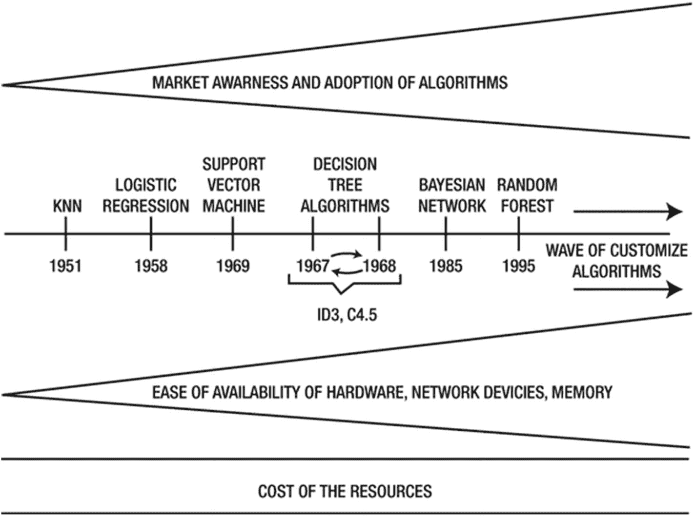
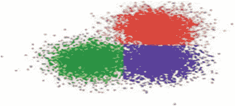
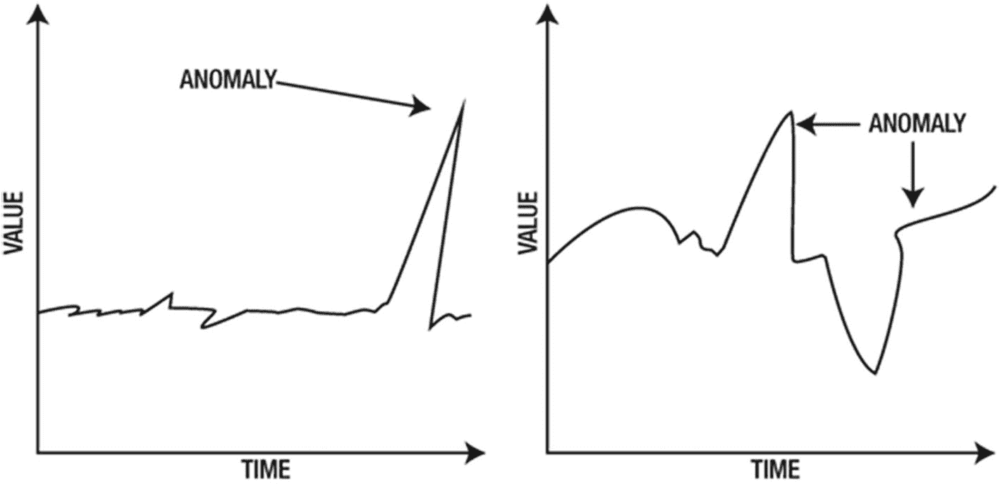
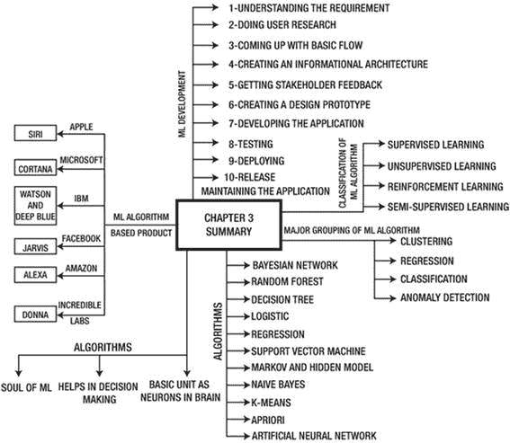

# 3. 机器学习算法及其与现代技术的关系

Patanjali Kashyap 博士^(a*)

^a 印度卡纳塔克邦班加罗尔

本章提供了机器学习算法的执行摘要。决策者理解、分析和评估业务与技术领域的现实情况至关重要。这对管理者同样关键，因为正确理解算法及相关技术将使他们在管理项目时更加自信。当涉及基于机器学习的项目实现和策略时，这一点变得尤为关键，因为该主题具有高度的技术性。因此，对算法及其在实时业务场景中的行为有一个实用的概述，将帮助您做出准确的决策，并为您的团队和组织制定深思熟虑的路线图。

算法是机器学习过程和技术的灵魂。但它们复杂且难以理解。在本章中，我弥合了复杂性与理解之间的鸿沟。我借助示例、成功案例和实际场景，用通俗易懂的语言解释这些算法，以便任何人都能解读其中的潜在智慧并加以运用。

## 算法，无处不在

*算法*是解决问题的一系列步骤。人们通常将它们与计算机联系在一起。但为什么呢？为了执行任务，计算机需要精确的指令和步骤。因此，如果您想让计算机解决特定问题，就必须以步骤的形式提供适当的精确指令。换句话说，算法对计算机很重要，因为它们是计算机智能的基石。更准确地说，没有算法，计算机就只是由材料和塑料组成的笨重盒子。正如细胞在生物系统中发挥作用一样，算法在软件中也有类似的重要性。为了更好地理解，您甚至可以将细胞与算法进行类比。

在过去的几十年里，硬件变得越来越便宜、更强大、更高效。这一进步使得移动设备能够在本地以及云端运行强大的机器学习、人工智能和深度学习算法。硬件的这种进步将为所有设备带来更深入、更集成的机器学习算法。然而，为了获得机器学习最大效益，建议采用云模型。产品和服务的本地实现与云端实现之间并没有严格的分离规则。它们协同工作。

算法已成为商业中普遍且不可或缺的一部分。例如，壳牌公司使用算法进行石油勘探并实现市场竞争力，而微软和 IBM 则使用算法为客户提供创新产品。在这个变化的时代，公司已开始使用机器学习算法来提高内部效率，并加深消费者的忠诚度和信任。例如，Netflix 的观众信任算法能为其提供个性化的娱乐内容。同样，亚马逊的客户相信算法能为其定制购买提供有用的产品和推荐。

事实是，当今的算法是生产力和智能的非凡巅峰。那些不尽快拥抱算法的公司将面临风险。打个比方，这就像在计算机处理器和键盘时代使用打字机一样。为了赢得大众的信任，算法经历了一段非凡的旅程（见图 3-1）。考虑机器学习算法的演变是件好事。但在此之前，先看看一些广泛使用的术语。

一张机器学习算法演变的图表。从 1951 年的 K N N 开始，1969 年的 S V M，一直持续到 1985 年的贝叶斯网络和 1995 年的 R F。

图 3-1

机器学习算法的演变及其应用

### 术语解析

*   *神经元* *与人工神经元*：神经细胞，负责在全身传递信号，使呼吸、说话、进食、行走甚至思考等活动得以进行。大多数神经科学家（即研究大脑的科学家）认为，人类出生时便已拥有所需的所有神经元。合成神经网络中的一个连接点被称为人工神经元。与人体生物大脑网络类似，人工神经网络具有分层设计，每个网络节点（连接点）都能处理输入信息，并将输出传递给网络中的其他节点。

*   *过拟合*：当机器学习模型能准确预测训练数据的结果，却无法预测新数据的结果时，便出现了过拟合。这是一种不良行为。数据科学家使用机器学习模型进行预测时，首先会用已知数据集对模型进行训练。

*   *推理*：将数据点输入机器学习模型以产生输出（例如单个数值评分）的行为。此过程的其它术语包括“将机器学习模型投入运营”和“将机器学习模型部署到生产环境”。

### 机器学习算法分类

数据科学或统计算法可进一步细分为多种机器学习特有的算法类别：

*   监督学习算法（标签和输出均已知）

*   无监督学习算法（标签和输出均未知）

*   强化学习算法（基于奖励的智能体行为）

*   半监督学习算法（监督学习与无监督学习的混合）

这些算法本身又包含多个子算法和类型（见表 3-1）。例如，有些算法属于参数化类别，而另一些则属于非参数化类别。在参数化算法中，关于总体的信息是完全已知的，而非参数化算法则不然。通常，参数化模型处理有限数量的参数，而非参数化学习模型则能够处理无限数量的参数。因此，当训练数据增长时，非参数化模型的复杂度也会增加。线性回归、逻辑回归和支持向量机是参数化算法的例子。K-近邻算法和决策树则是非参数化学习算法。与非参数化算法相比，这些算法的计算速度更快。

如表 3-1 所示，机器学习算法种类繁多。

表 3-1

机器学习算法

| 监督学习 | 无监督学习 | 强化学习 |
| --- | --- | --- |
| 人工神经网络 | 人工神经网络 |   |
| 贝叶斯统计 | 关联规则学习 | Q 学习 |
| 基于案例的推理 | 层次聚类 | 学习自动机 |
| 决策树 | 划分聚类 |   |
| 学习自动机 |   |   |
| 基于实例的学习 |   |   |
| 回归分析 |   |   |
| 线性分类器 |   |   |
| 决策树 |   |   |
| 贝叶斯网络 |   |   |
| 隐马尔可夫模型 |   |   |

为方便和实用起见，算法可进一步分为四大类：

*   聚类

*   回归

*   分类

*   异常检测

这种分组有助于理解算法并使其更清晰。你可以在机器学习的相关文献中找到更多的分类方式。然而，本书将遵循上述分类方法。那么，让我们从聚类开始，探索算法的奇妙世界。

### 聚类

聚类是根据某种预定义的相似性或差异性，将样本收集到不同组中的活动。简单来说，在聚类中，特定聚类中的数据必须与该聚类中的其他成员相似（见图 3-2）。由于具有将相似样本分组的独特特性，例如，它可以用于将客户划分到不同的市场细分中。

聚类数据的示意图。数据集用三种不同的颜色表示。

图 3-2

聚类数据

这里列举了几种聚类类型：

*   *层次聚类*：生成一个组/聚类的树状结构，其中每个节点是其母节点的一个子组。这是一种聚类之间的父子关系形式。
    *   *优点*：适用于详细数据分析

    *   *缺点*：效率低于非层次聚类

*   *非层次聚类*：聚类之间的关系通常是不确定的。大多数非层次聚类算法是迭代的。它们从一组初始聚类开始，然后通过重新分配机制反复改进。
    *   *优点*：适用于数据集非常大的情况

*   *互斥聚类*：一个项目只属于一个聚类。

*   *重叠聚类*：一个项目属于多个聚类。

K-均值算法是应用最广泛的聚类算法之一。

#### 聚类的应用与用例

以下是一些用例：

*   基于相似功能进行分组。

*   用于汇总或缩减大型数据集的规模。

*   客户细分。

*   图像和视频处理，用于识别视频中的物体。

*   根据特定类别对植物、动物和人类进行分类。

*   根据地震数据的类型，识别可能的石油勘探区域。

#### 何时使用聚类

当你需要发现数据集中的结构时，聚类是一个很好的方法。

### 回归

回归用于预测数值。例如，这类算法可以回答诸如“明天的气温是多少”或“这场足球比赛的最终比分是多少”等问题。回归算法属于监督学习。回归分析用于估计两个或多个变量之间的关系。

回归类型有数百种。这里讨论主要的几种：

*   *线性回归*：一种统计建模技术，用于检验因变量与自变量之间的关系。它是最古老的回归类型之一。

*   *逻辑回归*：一种统计建模技术，广泛应用于工业界的多种用途，包括欺诈检测。

*   *多项式回归*：一种回归分析类型，处理自变量 x 与因变量 y 之间的关系，该关系被建模为 x 的 n 次多项式。多项式被定义为两个以上算术项的组合，特别是包含同一变量不同幂次的多个项的总和。它用于交叉验证。

*   *岭回归*：一种建模技术，用于处理高度相关的多个自变量。

以下是优点：

*   预测和预报

*   用于发现异常值

*   易于使用

*   高效利用数据

*   为基于数据分析的业务决策提供支持

*   发现隐藏的、新的见解

以下是缺点：

*   有时输出结果超出范围

*   在长距离范围内，需要假设条件

*   对异常值非常敏感

#### 回归的应用与用例

一些用例：

*   预测

*   优化

*   评估金融服务和保险领域的风险

*   分析营销效果

*   企业和政府机构的需求预测

*   分析拟议的放射治疗对缩小肿瘤体积的效果

#### 何时使用回归

当你需要预测和预报数值时，回归是一个很好的选择。

### 分类

分类用于预测类别。例如，当需要将一张图片归类为人或机器的图像时，用于完成此任务的算法就属于这一范畴。它包含监督类型的算法。当只有两种选择时，这种分类被称为二分类或二项分类。当存在两个以上类别时，用于对其进行分类的算法集合被称为多类分类。例如，在回答“哪辆车最需要紧急维修？”或“哪趟航班从德里飞往亚特兰大？”这类问题时，存在多个选项。这些场景就属于多类分类。

### 分类与回归的区别

| 分类 | 回归 |
| --- | --- |
| 分类算法将输出结果归入不同的类别。例如，它们用于回答诸如“这个被识别的肿瘤是癌性的吗？”之类的问题。 | 回归算法用于利用训练数据预测数值。例如，它可用于预测某家公司特定股票的股价。 |
| 分类问题中使用的是离散型和类别型变量。 | 回归问题中使用的是数值型和连续型变量。 |

分类算法的更广泛类别如下：

*   ***人工神经网络（ANNs）***：模拟人脑功能的计算模型。它们基于生物神经网络的结构创建。

*   ***决策树***：广义上讲，决策树是一种支持工具。它们提供树状图或模型用于决策。它们还解释了决策的各种可能后果，包括但不限于随机事件结果、资源支出和效用。它们是呈现算法的一种方式。

*   ***集成学习***：一种基于机器学习的模型，其中多个学习器被训练来解决同一个问题。

分类算法的一些示例如下：

*   线性分类器

*   支持向量机

*   二次分类器

*   核估计

*   Boosting

*   决策树

*   神经网络

*   随机森林

*   朴素贝叶斯

分类算法包含多个子类别，因此算法众多。所有算法和类别都有其自身的优缺点。以下是一些普遍优点：

*   非常简单，易于解释和理解

*   高精度

*   关于过拟合有坚实的理论基础

*   数据集之间易于关联

现在来看缺点：

*   对大型数据集效果不佳

*   容易过拟合

*   参数难以调整

*   构建模型耗时

#### 分类的应用与用例

一些用例：

*   视频、图像和音频分类

*   网页分类

*   产品分类

*   根据客户的行为和财务历史预测可能的银行贷款违约者

*   识别客户流失

#### 何时使用分类

当你需要预测和预报类别时，分类是一个很好的工具。

### 异常检测

*异常*被定义为偏离标准、正常或预期的事物。有时你需要在可用数据集中发现异常。那个“被识别出的异常”数据点可能有助于检测独特的行为（见图 3-3）。例如，你可以检测到员工行为的变化，这可能指向员工实施的潜在安全漏洞。此活动将提醒你的雇主在损害发生前采取纠正措施。异常检测也有助于欺诈检测。例如，任何极其不寻常的信用卡支出模式都会被标记。

两张数值随时间变化的折线图。左图：遵循一致的模式，异常值随时间推移出现峰值。右图：异常值的高度变化不定。

图 3-3

异常检测

异常检测所采用的方法是从正常行为或活动中学习。在前面的例子中，算法分析了非欺诈交易的历史数据，并识别出任何显著不同的内容。

分类算法的更广泛类别如下：

*   ***监督式异常检测***：一组在标记数据集中检测异常值的技术。正常数据和异常值都有标签。

*   ***无监督式异常检测***：一组在未标记数据集中检测异常值的技术。仅正常数据有标签。

*   ***半监督式异常检测***：一组在未标记数据集中检测异常值的技术。不存在标记数据集。

由于异常检测算法包含多个子类别，因此算法众多。所有算法和类别都有其自身的优缺点。以下是一些普遍优点：

*   无需监督

*   易于在线模式下适应

*   适用于从时间序列数据中进行异常检测

现在来看缺点：

*   计算成本高

*   将数据聚类成不同密度的组，这可能导致易于管理

#### 异常检测的应用与用例

*   检测信用卡及其他金融欺诈

*   检测电信和零售欺诈

*   检测故障

*   发现异常实例

*   识别错误数据

*   检测网络入侵

#### 何时使用异常检测

当你需要发现异常数据点时，异常检测是应使用的工具。

## 构建机器学习模型

构建机器学习模型看似是一项艰巨的任务，但有了正确的工具和资源，它比你想象的要容易得多。我首先研究最适合数据的最佳算法和技术，然后收集并准备数据以确保其准确性。此时，像 `scikit-learn` 和 `TensorFlow` 这样的 Python 库等工具对于构建和训练模型非常有用。这个过程通常具有挑战性，但也极其令人满足。这种方法有助于解释机器学习，同时也允许你创建可能对现实世界产生影响的东西。

如果你想构建自己的机器学习模型，不要害怕，大胆去尝试吧！如果你在此过程中需要任何指导，除了本书之外，还有大量资源可以为你提供帮助。

### 根据需求选择合适的算法/模型

通常，模型开发与维护包含多个阶段，从数据收集到数据准备与暂存。应用不同的机器学习技术和算法来寻找最适合特定需求的模型至关重要。根据数据集的变化持续调整算法参数并优化结果，是重中之重。传统上，数据科学家需要完成大量工作才能实现这一切。他们必须编写模型代码，选择合适的参数（包括运行时环境）。数据科学家还需在数据（包括批量数据）上训练模型，监控过程，并在必要时排查错误。由于流程会迭代重复，跟踪完整周期中的所有步骤十分单调。

最终，数据科学家会与其他团队协作，比较多个模型。他们基于准确率和性能等参数进行比较，选出并部署表现最佳的模型。从验证到部署，涉及多个团队和个人。简而言之：

1.  业务专家定义问题。
2.  基于问题，专家利用流程、智能、经验和技术，确定数据来源，并提供收集和存储数据的机制。
3.  数据科学家借助算法创建实际模型，然后测试并部署应用或产品。他们通过流程、智能、经验和技术来完成这项工作。
4.  业务专家确定一切是否运行正常。
5.  整个流程以迭代方式运行。
6.  流程的迭代执行有助于消除错误并优化模型。

在正确的地点、时间、条件和场景下使用正确的算法非常重要。此外，将算法与能够高效、有效地满足其需求的特定要求关联起来，既是一门艺术，也是一门科学。以下各节将介绍算法的概要。

### 处理问题

新一代编程语言中有许多编写良好、经过测试、灵活、健壮且高效的库可用于实现任何机器学习算法。它们也是可定制的。因此，您可以根据自己的需求对其进行调整。然而，选择最佳的机器学习算法是一项非常主观的工作。它主要取决于您的需求、任务、领域、业务需求以及可用的技术状况。

此外，算法的选择基于所面临的问题。例如，如果需求是处理文本分类问题，那么支持向量机可能是一个不错的选择，因为它能提供准确率和效率。而对于基于推荐的情况，决策树算法将是选择和推进的良好候选。因此，找到最佳算法和方法是一个相对的决定，它基于与您特定需求相关的领域和情况，并取决于问题和业务需求。

### 选择正确的算法

当选项较少时，做出决定很容易。例如，如果您需要解决一个连续性问题，使用回归模型是一个直接的选择；而如果您必须从二元选项中选择，则建议使用逻辑回归算法。然而，决定并非总是如此简单。我们会遇到许多需要解决的复杂问题和需求。通常，标准算法或其定制/修改版本被用来解决问题。以下是一些最佳实践、指南和标准，它们肯定能帮助您选择正确的算法或模型。

1.  数据调查与变量间关系发现。
2.  算法与模型的理性选择与高效比较。
3.  交叉验证。
4.  经过适当研究、仔细审查、净化的数据。
5.  工具选择、易用性以及基础设施、人才和其他资源的可用性。
6.  确定适当的目标和商业价值。
7.  学习并培养灵活性、适应性、创新性和突破性思维。

#### 步骤 1：数据调查与变量间关系发现

在选择算法时，了解数据的性质非常重要，这样才能将合适的算法与数据集关联起来。例如，如果业务需求是分析以视频和图像文件形式存在的非结构化数据，那么关联的算法必须能够高效处理非结构化和半结构化数据，例如文本、时间序列数据、空间数据、图形和图像。如果您不了解数据的性质，就永远不可能做出合适的算法选择。

数据调查是构建正确、有效且高效的预测模型不可或缺的一部分。为了根据您的需求选择合适的算法和模型，需要识别变量之间的关系并评估它们对彼此以及整体环境的影响。为了获得完美的模型，必须恰当地选择方法及其相关参数。

为了在给定数据集中获得尽可能高的准确率而寻找最佳值，这需要进行深入的数据调查并发现变量之间的关系。直觉和经验有助于获得最佳结果。通常，数据科学家会训练大量模型，查看它们的交叉验证分数，并思考下一步尝试哪些参数。他们还会进行适当的聚类或分组以获得最佳结果。市场上有多种工具可用于进行数据调查，包括 Microsoft Azure。然而，只要数据集不是特别庞大，手动方法和流程也同样有效。

#### 步骤 2：算法与模型的理性选择与高效比较

一种算法无法满足所有需求，因此需要进行逻辑、理性且基于统计（数学驱动）的比较。对不同指标（如参数的统计显著性）的分析起着重要作用。例如，决策树是一种流行的学习算法，用于进行预测和提出建议。因此，由于其准确性，它们被企业从业者广泛使用。然而，尽管决策树在各行各业广受欢迎并被采用，但不应不加思考地将其作为解决所有问题的算法。相反，您应该始终使用最符合数据特征和问题类型的算法。

#### 步骤 3：交叉验证

交叉验证通过将输入数据划分为子类别，训练多个机器学习模型，并在对应的数据子类别上进行评估，从而对 ML 模型进行评价。将数据集分成两个簇或组并进行交叉验证，是获得正确模型和算法的绝佳方法。交叉验证将训练数据分割成若干部分，通常称为*折*。折是数据的子类别。分割后，除一个子类别外（即全部减一），其余所有子类别都用于训练。

下一步是在未用于训练的子类别上评估模型。此过程会重复多次（等于折的总数），每次保留一个不同的子类别用于评估（并从训练中排除）。最后，选择性能最佳的模型。如果使用大量数据，交叉验证可能需要很长时间才能运行完成。因此，建议在构建和测试的初始阶段使用交叉验证模型。交叉验证常用于检测过拟合。交叉验证也是评估用于预测和预报模型的最佳方法之一。

#### 步骤 4：充分研究、仔细研究、净化数据

研究模型和算法在类似情况下的历史表现会有所帮助。机器学习算法的性能取决于数据的质量；它们的好坏完全取决于数据。因此，不当的数据收集和清理方法会对您构建良好、可预测且可泛化的机器学习模型的能力产生负面影响。另一方面，当经过仔细研究的数据与自动化工具相结合时，可以提供出色的见解。数据清理有助于识别与记录、特征、值和采样相关的数据质量问题。

#### 步骤 5：工具选择、易用性以及基础设施、人才和其他资源的可用性

选择实现算法的工具是非常重要的一步。此外，在为特定项目选择算法之前，需要考虑实现的难易程度、是否拥有合适的人才以及基础设施/资源。例如，算法处理的数据越多，它就会变得越准确、越高效、越有效。因此，选择能够处理海量数据集的工具成为最关键的因素。然而，如果您没有合适的人才来使用该工具，那么该工具实际上毫无用处。因此，在做出任何决定之前，必须考虑这些相互关联的方面。

#### 步骤 6：确定适当的目标和商业价值

理解数据中的隐藏特征，然后通过创建新特征和消除无关特征来改进它们，对可预测性有很大影响。机器学习算法和方法旨在处理原始数据，并将其转换为丰富的特征空间，公司可以有效地利用这些特征空间来实现适当的商业目的。因此，需要找到用于表征数据的特征集合，这些特征能更好地捕捉数据的各种复杂特性，例如非线性以及多个特征之间的交互/相互依赖。这些对于学习过程也很重要。选择算法来确定目标如何影响商业价值非常重要。因此，在选择算法或模型时，也必须考虑这一方面。

机器学习算法必须根据业务问题来选择。例如，某些业务问题——如欺诈检测、产品建议/推荐、垃圾邮件检测和广告定向投放——都有“标准”的机器学习公式和算法，在这些特定场景中有着经过验证的成功记录。然而，即使对于这些众所周知的问题，也存在一些鲜为人知但更强大的公式，可以带来更高的预测准确性。因此，基于该知识、业务目标和研究来选择算法是关键。

#### 步骤 7：学习并培养灵活性、适应性、创新性和跳出框架的思维

我们时代的一些重要业务问题——如欺诈检测、产品推荐/建议和广告娱乐定向投放——通常与标准的机器学习算法公式相关联。它们与特定公式相关联，是因为这些公式相当成功。然而，存在一些鲜为人知但更强大的方法，其能力可能带来更高的预测准确性。因此，创新方法和跳出框架的思维非常重要。机器学习本质上是一个非常具有创造性和实验导向的领域，因此灵活性和适应性是成功的重要参数。最后，将业务需求转化为实现既是一门艺术也是一门科学，它是这些品质（灵活性、适应性、创新性和跳出框架的思维）的副产品。

## 专家观点

*   “当一项新技术像机器学习一样具有普遍性和颠覆性时，将其置于黑箱之中是不明智的。不透明性为错误和滥用打开了大门。亚马逊的算法，比任何一个人都更能决定当今世界阅读哪些书籍。美国国家安全局的算法决定你是否是潜在的恐怖分子。气候模型决定大气中二氧化碳的安全水平。选股模型对经济的推动作用超过我们大多数人。你无法控制你不理解的东西，这就是为什么你需要理解机器学习——作为公民、专业人士，以及一个追求幸福的人。”

——佩德罗·多明戈斯，华盛顿大学教授，机器学习领域的顶尖研究员。他著有《终极算法：机器学习和人工智能如何重塑世界》一书。

## 一些重要机器学习算法的回顾

在考虑将某个算法用于业务或项目需求时，总需要评估几个方面。这包括该算法在不同关键业务场景中的实用性、其使用频率等等。找到诸如“该算法如何在特定项目中使用？”、“它的效率和效果如何？”、“实现起来有多容易？”以及“该算法是否有助于实现业务竞争力？”等问题的答案变得非常重要。

我根据算法的流行程度和前景挑选了几个。在得出最终结论的过程中，我向决策者、开发人员、数据科学家和业务分析师提出了多个问题。我通过多种渠道收集了数据科学家、业务领导者和项目经理的意见，包括市场调研、技术和流程文档分析、公司新闻分析、市场预测、财务洞察等。这些数据在得出最终结论前都经过了分析。我向他们提出的几个问题包括：

1.  在行业及不同企业中的使用强度
    1.  差

    2.  一般

    3.  良好

    4.  很好

    5.  优秀

2.  未来前景
    1.  暗淡

    2.  一般

    3.  高

    4.  很高

    5.  光明

我的分析基础是主要数据源。次要数据源来自互联网、大学图书馆和企业知识库。其他来源包括行业访谈、供应商简报、会议见解以及公司提供的产品演示。案例研究、白皮书、研究论文、技术文章以及这些算法在特定情况下的历史表现也是我研究的重要来源。简而言之，几乎所有可用的定量和定性数据都用于此目的。我的研究还辅以对该主题所有可用次要信息的审查和分析，包括可用的技术规格信息、产品属性、政府经济数据和技术愿景文件，以及来自第三方的行业报告和数据库。

用户对这些问题的回答均被记录。这些回答通过其他信息来源进行了验证。此外，通过对报告、案例研究、产品文档等进行仔细研究，也产生了洞察。基于所有这些信息，计算出了这些算法的未来前景。

以下各节讨论了九种算法的优缺点及应用，以及其他细节，如它们的历史和创造者。为了提供实践见解，只要可能，我都会包含成功案例。接下来将讨论业界常用的九大算法。

### 随机森林算法

随机森林算法采用一种“捕捉”方法，使用数据的随机子集创建一组决策树。树创建完成后，将其输出组合起来做出最终预测。随机森林算法的最终预测是通过对所有决策树的结果进行投票，或者选择在决策树中出现频率最高的预测来得出的。随机森林本质上是一组特定类型的决策树。

*   开发者：由 Tin Kam Ho 于 1995 年提出。其扩展版本由 Leo Breiman 和 Adele Cutler 开发。

*   算法类型：分类/监督学习

*   在行业和企业中的使用强度：良好

*   行业未来前景：光明

*   为何使用此算法：随机森林算法可用于分类和回归类型的问题及需求。

*   何时使用：当准确性很重要时。

*   谁会使用随机森林算法：从事在线业务且分类很重要的团队/企业/组织。

*   如何实现随机森林算法：可以通过多种方式实现，并且有许多工具可用。不过，Apache Mahout 和 Microsoft Azure ML 是流行的选择。

*   应用：点击流分析：电子商务公司正在使用随机森林算法，根据用户的点击历史和当前模式来分析和预测客户购买行为。它还用于语音分类和识别。例如，谷歌将其用于 Siri。

#### 随机森林的优点

*   在数据缺失时能很好地保持准确性，并且能抵抗异常值。

*   能有效节省数据准备时间，因为它不需要任何输入准备。

*   提供隐式特征选择的好处，因为它能估计哪些变量在分类器中是重要的。

*   通常能有效地处理大型数据集。当数据集很大时，建议使用随机森林算法，因为很难构建出糟糕的随机森林算法。

*   具有更高的分类准确性。

*   可以并行生长多个随机森林算法。

*   无需删除变量即可处理数千个变量。

#### 随机森林的缺点

*   该方法在实践中易于使用，但其理论分析较为困难。

*   它往往倾向于低估高值而高估低值。此外，它无法预测训练数据中响应值范围之外的值。

#### 随机森林的成功案例

百度是一家中国网络公司。他们名为 WRAP-CTC 的人工智能软件用于改进其名为 Deep Speech 2 的端到端语音识别程序的语音识别能力。该软件能识别英语和中文。在某些情况下，该软件的表现优于人类。很难确切说出他们在软件程序中为实现这些功能内部使用了哪种算法。然而，对于分类和语音识别相关功能，随机森林算法是与其他机器学习算法并列的选择之一。该软件在 GitHub 上对开源社区开放。来源：百度研究院网站（[`​research.​baidu.​com/​institute-of-deep-learning/​`](http://research.baidu.com/institute-of-deep-learning/)）

Netflix 是采用机器学习技术的先驱之一。他们对机器学习采取了整体和集成的方法。Netflix 在其业务中使用了多种算法。Netflix 正在应用这些算法来改善客户体验。

### 决策树算法

决策树算法是一种使用树状图来提供决策的决策支持工具/算法。它是一种分支方法，用于展示基于某些条件的决策可能产生的结果。决策树是对实例进行分类的简单描述。决策树机器学习算法是监督式机器学习中使用最广泛的技术之一。

决策树创建了一种流程图，它由一个节点（称为叶节点）和一组基于该节点做出的决策（称为分支）组成。内部节点（非叶节点）代表属性（用输入特征标记）。从节点出发的弧线用特征标记，用于表示该特征的每个可能值或结果。决策树的每个叶节点都用一个类别或类别上的概率分布进行标记。分类规则通过从根节点到叶节点的路径来表示。叶节点和分支结构形成了一种模仿树形结构的层级表示。决策树是机器学习中使用最广泛的算法之一。它比其他算法更贴近人类的决策方式。决策树生态系统中广泛使用的三种基本算法是 ID3、C4.5 和 CART。

*   历史与发展：决策树由 J. Ross Quinlan 在悉尼大学任职期间开发。他用于创建决策树的第一个算法被称为迭代二分器 3（ID3）。

*   算法类型：分类/监督式。

*   行业使用强度：良好。

*   为何使用此算法：决策树是解决线性决策边界类型问题的最佳候选算法之一。

*   何时使用：当准确性和速度至关重要时。

*   谁会使用决策树算法：在线业务的团队/企业/组织，以及当分类/分组很重要时。

*   如何实现决策树算法：你可以通过多种方式实现它，因为有许多可用的工具。然而，Apache Mahout 和 Microsoft Azure ML 是实现此算法的流行工具。但这取决于项目场景及其需求。

#### 决策树的优点

*   快速、准确（与其他分类技术相比）、简单，且构建和分类未知记录的成本低廉。

*   生成易于理解和解释的规则。

*   清晰展示哪些字段对于分类和预测最为重要。

*   C4.5 是决策树的一种，也是 ID3 的扩展，因其能够提供快速鉴定和高精度而被多个行业使用。

*   CART 是另一个重要的决策树算法，它在生成回归树方面非常高效，被许多需要快速决策的行业（如电子商务行业）所使用。

*   它可以处理数值型和分类型数据。这一特性使其比其他算法更具优势，因为大多数算法专门分析仅包含一种类型变量的数据集。例如，关联规则只能用于名义变量，而神经网络只能用于数值变量。

#### 决策树的缺点

*   如果数据集中存在大量不相关的变量，性能不佳。

*   训练计算成本高，因为它会形成许多子树并进行比较。

*   通常易于使用，但构建它们，特别是那些具有众多分支的大型决策树，则很复杂。这是一项耗时的工作。

#### 决策树的应用

*   在决策过程中用于多种目的。例如，广泛用于风险识别和分析。

*   用于流程优化。例如，壳牌公司将其用于石油和天然气流程优化。

*   在分类对象、产品和商品方面高效且有效，因此许多电子商务组织使用它。使用这些算法的一些领先组织包括亚马逊和 Flipkart。

*   在金融领域用于期权定价。此外，银行等金融机构使用这些算法对贷款申请人进行分类，以区分优质风险和不良风险。

*   用于基于遥感的模式识别应用。

#### 成功案例

股票市场基于供需和经济增长。在股票市场中，预测非常重要，通常会对股票市场数据应用多种数学和统计技术，以获得更好的结果和洞察。交易员和分析师根据从基本面技术分析和心理分析中得出的金融和客户状况，使用一系列不同的方法进行预测。在机器学习时代，多种决策树机器学习算法被用于价格和股票预测。通常，交易员和经纪人使用由 LR 和 SVR 等算法与决策树算法组合驱动的软件，以获得有效且高效的结果。

### 逻辑回归（分类）与线性回归

逻辑回归算法用于对因变量和自变量之间的关系进行建模。它们还会考察模型的拟合度，以及被建模的因变量与自变量之间关系的显著性。在线性回归中，因变量和自变量之间的关系是线性的，而逻辑回归则不做此假设。

回归模型是基于包含因变量和自变量的历史数据开发和构建的。通常，因变量是使用自变量测量的一个特征或性质。一旦完成此（因变量/自变量的泛化）操作，这些信息便可应用于新案例，用于未来的预测。

当响应变量是连续变量时，使用线性回归。例如，确定产品销售额或查找/预测公司收入。当需要对类别（两个或多个层级）进行预测时，使用逻辑回归，例如，根据历史数据预测一个人的性别或一场板球比赛的结果。除了逻辑回归和线性回归，还有多种类型的回归算法。其中一些包括：

*   多项式回归
*   逐步回归
*   岭回归
*   Lasso 回归
*   弹性网络回归

然而，逻辑回归和线性回归是通用算法，也是业界最常用的算法。其他算法则更为专门化，用于特定目的。

*   **历史与发展**：回归技术源于最小二乘法，由勒让德于 1805 年和高斯于 1809 年提出。然而，“回归”一词是由弗朗西斯·高尔顿在 19 世纪用来解释一种生物现象的。后来，乌德尼·尤尔和卡尔·皮尔逊将他的工作扩展到更一般的统计背景中。
*   **算法类型**：分类/监督学习。
*   **行业使用强度**：良好。
*   **行业未来前景**：光明。
*   **为何使用此算法**：当需要预测连续值且分类不那么重要时，回归算法是最佳选择。此外，它也用于结果的优化。
*   **何时使用**：当需要确定影响输出的因素时。回归算法也可用于非永久性研究。
*   **谁会使用回归算法**：任何对建立数据类型间关系感兴趣的个人/团队/企业。任何希望从庞大但简单的数据集中生成洞察的人都会使用逻辑回归。
*   **如何实现回归算法**：可以通过多种方式实现。例如，机器学习编程语言提供的所有主要统计软件包和库都可以进行回归分析，包括 F#（微软）、R 和 Python。此外，除了 Apache Mahout 和 Microsoft Azure ML 之外，Classias（一个用于分类的机器学习算法集合）也用于其实现。

#### 逻辑回归的优势

*   基于回归的预测技术用于研究和分析，以预测未来会发生什么。因此，许多公司使用这些算法来预测下一季度、下一年甚至更远的未来会发生什么。基于回归的分析作为一种预测工具，可以提供关于如何管理（例如）更高税收的见解。
*   回归和预测算法也用作决策支持工具。它们通过将大量原始数据转化为可操作的信息，为业务管理带来了科学和统计的视角。
*   预测和回归可以为管理直觉提供实验支持。当证据表明相反时，这些算法有可能纠正管理决策。例如，一家零售店的经理可能认为延长营业时间会大大增加销售额。然而，回归分析可能会表明，延长营业时间并不会显著增加销售额，以证明增加运营成本（如额外员工劳动力）是合理的。
*   大型数据集有潜力揭示有价值的新信息，并提供关于企业的智慧。然而，数据本身不会说话，因此分析是必要的。回归和预测技术可以通过揭示管理者以前未曾注意到或考虑过的模式和关系，产生新的见解。

#### 逻辑回归的劣势

*   在解决问题时，由于数学方程的复杂性，模型有时会变得复杂。在创建模型时，需要多个方程。
*   线性回归只关注因变量和自变量之间的线性关联。它在理论上认为变量之间存在直线关联。然而，情况并非总是如此，并且在许多场景中被证明是不正确的。例如，将线性回归应用于员工的收入和年龄之间是不准确的。
*   线性回归假设数据是独立的，但这并不总是成立。因此，在考虑将此算法用于实现关键需求时，需要谨慎的方法和策略。例如，假设一个班级中的一组学生在多个方面相似——例如，他们可能来自同一地区，有相同的老师等等。然而，他们也可能存在差异，如文化、宗教、智力水平以及父母的财务状况，这些都可能影响他们的整体行为。因此，他们并非完全独立。在这种情况下，基于回归算法的预测可能是错误的。

#### 逻辑回归的应用

*   在决策过程中用于多种目的。例如，它被广泛用于风险识别和分析。
*   用于流程优化。例如，壳牌公司将其用于基于石油和天然气的流程优化。
*   在分类对象、产品和商品方面高效且有效；因此，许多电子商务组织都在使用这些算法。一些使用这些算法的领先组织包括亚马逊和 Flipkart。
*   在金融领域用于期权定价。此外，像银行这样的金融机构使用这些算法对贷款申请人进行分类，区分优质风险和不良风险。
*   在基于遥感的模式识别应用中使用。

#### 成功案例

PayPal 是一家备受尊敬的金融公司，为金融交易提供第三方服务。他们有必要定期提出欺诈预防技术，并不断完善和推进其复杂算法的使用，以高效且有效地管理海量数据。PayPal 结合使用线性和神经网络机器学习算法，智能地整理和分析海量数据。此外，他们借助智能算法从现有的数据山中提取关于买家和卖家的洞察。他们收集的数据包含网络信息、基于机器的信息和交易数据。他们利用所有这些数据来保护客户的财务身份和交易。简而言之，巧妙地使用算法使他们能够追求最终品牌目标——信任。PayPal 还使用神经网络机器学习算法在其组织中实施深度学习技术。

来源：摘自 2015 年 *InfoWorld* 的文章。基于 PayPal 风险科学高级总监王辉博士的观点。

### 支持向量机算法

支持向量机算法分析数据并寻找模式。例如，给定一组训练样本，每个样本被标记为两个类别之一，SVM 训练算法会构建一个模型，将新样本分配到其中一个类别，从而使其成为一种非概率二元线性分类器。SVM 将样本表示为空间中的点，并以一种方式映射，使得不同类别的样本被一个尽可能宽的清晰间隔分开。新样本随后被映射到同一空间，并根据它们落在间隔的哪一侧来预测其所属类别。

*   **历史与发展**：最初形式由弗拉基米尔·N·瓦普尼克和阿列克谢·雅·切尔沃年基斯于 1963 年提出。然而，通过应用核技巧到最大间隔超平面来实现非线性分类器（这更特定于机器学习）的方法，是由伯恩哈德·E·博瑟、伊莎贝尔·M·居永和弗拉基米尔·N·瓦普尼克于 1992 年开发的。

*   **行业与企业使用强度**：高，因为它在分类相关任务中表现最佳。在文本数据和基因组数据上同样表现出色。

*   **算法类型**：分类/监督学习。

*   **行业前景**：光明。

*   **为何使用此算法**：适用于二元分类类型的问题。

*   **何时使用**：用于简单分类以及当速度是优先考虑因素时。

*   **谁会使用 SVM 算法**：当决策前实践集已充分暴露时。电子商务公司使用它进行分类。

*   **如何实现这些算法**：有多种实现方式，因为有许多工具可用。然而，`SVMlight`及其相关工具/算法/方法专门用于 SVM 实现（用于学术和科学目的）。对于商业用途，您可以使用 Microsoft Azure ML、Apache Mahout 等。

#### SVM 的优点

*   阈值形式选择的灵活性。
*   对少量数据点的鲁棒性。
*   使用正确的核函数几乎可以处理任何情况（但很棘手！）。
*   当结构未知时，SVM 表现非常好。
*   当维度数量高于可用样本数量时，性能更佳。

#### SVM 的缺点

*   尽管 SVM 具有良好的泛化性能，但在测试阶段可能非常缓慢。需要以适当方式解决此问题，以获得良好、优化的解决方案。通过使用干净准确的数据，可以对此进行优化。
*   SVM 最严重的问题是在大规模任务中所需的二次规划具有高算法复杂性和大量内存需求。
*   如果边界上的点信息量不大（例如，由于噪声），SVM 表现不佳。
*   计算成本可能很高。

#### SVM 的应用

*   手写字符识别。
*   面部识别。
*   应用于多个科学领域进行分类。例如，蛋白质和基因组分类。
*   应用于医学领域进行肿瘤分类。例如，对特定类型的癌细胞进行分组。
*   文本和超文本分类。
*   电子商务公司用于比较购物网站。例如，从许多网站提取产品和定价信息。

#### 成功案例

Netflix 将多种机器学习算法用于多种目的——流行度和评分预测是其中两个。通过使用这些算法，他们改进了排名。典型的选择包括逻辑回归、支持向量机、神经网络、基于决策树的算法和梯度提升决策树（GBDT）。Netflix 利用其丰富的源数据、创新的测量技术和实验，创建了一种数据驱动型组织文化。自公司概念化以来，数据一直是 Netflix 文化的一部分。他们称之为消费者（数据）科学。广义上讲，他们的首要目标是以创新方式，有效且高效地为其会员（客户）提供消费者科学方法。

### 朴素贝叶斯算法

朴素贝叶斯属于算法的分类类别。它并非单一算法，而是代表一组算法。该组中的所有算法共享相同的属性和原则集。贝叶斯网络是一种图形模型，它对感兴趣变量之间的概率关系进行编码。朴素贝叶斯算法是机器学习世界中最常用的算法组之一。尽管朴素贝叶斯基于贝叶斯定理的简单原理，但在垃圾邮件检测等场景中非常有效。

例如，如果一个蔬菜是橙色的、短的、长约 5 英寸，它可能被认为是胡萝卜。朴素贝叶斯分类器认为这些特征（橙色、短、5 英寸长）各自独立地对蔬菜是胡萝卜的概率做出贡献，而不考虑特征之间的任何相关性。但通常，特征并不总是独立的。以这种方式处理问题通常被认为是朴素贝叶斯算法的一个缺点。这也是它被称为“朴素”的显著原因之一。简而言之，朴素贝叶斯算法允许您利用概率论，根据一组特征来预测一个类别。

*   **历史与发展**：贝叶斯定理以数学家托马斯·贝叶斯牧师的名字命名，他生活在 1702 年至 1761 年间。贝叶斯的工作是二项分布领域的里程碑。贝叶斯去世后，他的朋友理查德·普莱斯于 1763 年编辑并发表了他的工作。然而，在机器学习中，朴素贝叶斯分类器是一系列简单的概率分类器，其基础是应用贝叶斯定理，并假设特征之间具有强（朴素）的独立性。

*   **行业与企业使用强度**：高，因为它在分类相关任务中表现最佳。在文本数据和基因组数据上同样表现出色。

*   **算法类型**：分类/监督学习。

*   **行业前景**：光明。

*   **为何使用此算法**：当特征和变量彼此条件独立时，朴素贝叶斯是一个不错的选择。此外，它易于实现。

*   **何时使用**：用于通过机器和算法进行简单的过滤和分类。

*   **谁会使用朴素贝叶斯**：电子商务、软件产品和制造公司。

*   **如何实现朴素贝叶斯**：有多种实现方式，因为有许多工具可用。然而，通过 Apache Mahout 实现很常见。其他工具包括 Microsoft Azure ML、Weka、jBNC 等。

#### 朴素贝叶斯的优点

*   相对简单易懂且易于构建。
*   即使使用小数据集也能轻松训练。
*   速度快。
*   对不相关特征不敏感。

朴素贝叶斯算法在以下条件下特别有效：

*   如果您有中等或大型训练数据集。
*   如果实例具有多个属性。
*   给定分类参数，描述实例的属性应是条件独立的。
*   在文本分类和垃圾邮件过滤中同样有效。
*   推荐系统应用机器学习和数据挖掘技术来过滤未知信息，并能预测用户是否会喜欢某个给定资源。
*   在线应用。
*   简单情感建模。

#### 朴素贝叶斯的缺点

*   它们假设每个特征都是独立的，但这并非总是如此。变量之间通常存在依赖关系。
*   计算密集。

#### 朴素贝叶斯的应用

*   **情感分析**：Facebook 使用它来分析表达积极或消极情绪的状态更新。

*   **文档分类**：谷歌使用文档分类来索引文档并查找相关性得分，即 PageRank。PageRank 机制会考虑那些在数据库中标记为重要的页面，这些页面是使用文档分类技术进行解析和分类的。

*   也用于对科技、娱乐、体育、政治等领域的新闻文章进行分类。

*   **电子邮件垃圾邮件过滤**：谷歌邮箱使用朴素贝叶斯算法将电子邮件分类为垃圾邮件或非垃圾邮件。

*   **信用审批与目标营销**。

*   **医疗诊断与治疗效果分析**。

#### 成功案例

微软 SQL Server 2005 在分析服务（SSAS）中使用朴素贝叶斯算法进行分类。它在那里用于预测建模。其主要原因是该算法擅长计算输入列与可预测列之间的条件概率。在此过程中，该算法假设各列是独立的。然而，其缺点在于，即使不同列之间存在依赖关系，该算法也不会考虑这些依赖关系。

该算法在分析服务中用于实现数据挖掘功能，因为与其他可用算法相比，其计算复杂度较低。SQL Server 2005 在其“分析服务”引擎中，将此算法与其他算法一起用于数据的初步探索。该算法将初始阶段的结果提供给另一组算法，这些算法利用这些结果来创建更精确的挖掘模型。在数据挖掘分析的后期阶段，需要更密集的计算处理（这是朴素贝叶斯的弱点）以提供更准确的结果。除此之外，许多电子商务公司（包括亚马逊、特易购等）也使用它进行分类。

### k-均值聚类算法

k-均值聚类算法用于发现类别。k-均值聚类是一种探索性数据分析技术/算法。它是一种对不同对象进行分组的非层次方法。根据定义，聚类分析是将一组对象进行分组的技术。通常，聚类允许你将对象放入相似的组（称为簇）中。例如，零售商店在其店内对相似的对象或物品进行分类或聚类，如女装和男装。此外，像亚马逊这样的在线电子商务网站，通过将个人信息与购买历史相结合，对产品进行分组并向客户展示个性化产品。

k-均值聚类使用直接逻辑执行聚类任务。首先，它在可用数据集中随机选择 *k*（分区数）个点。然后，它将数据中的每个剩余样本映射到最近的“均值”。之后，对于每个簇或组，通过取映射到该簇的中点来计算一个新的均值。这些不同的新均值将导致数据到簇的映射发生完全不同的变化。此过程迭代进行，直到达到数据的合理分区。

*   **历史与发展**：詹姆斯·麦奎因于 1967 年提出了该算法。它也被称为劳埃德算法，因为斯图尔特·劳埃德在 1957 年将其用于贝尔实验室的脉冲编码调制。
*   **算法类型**：聚类/无监督学习。
*   **行业使用强度**：中等。
*   **行业未来前景**：正常。
*   **为何使用此算法**：当需要对数据进行分组时，k-均值聚类算法非常有用。
*   **何时使用**：当存在大量需要分类的组时。
*   **谁会使用 k-均值**：对算法有深入理解的团体或个人。
*   **如何实现 k-均值**：由于有许多工具可用，你可以通过多种方式实现它。然而，使用 Apache Mahout 实现是常见方法之一。其他工具包括 Microsoft Azure、IDL Cluster、MATLAB k-means 等。

#### k-均值的优势

*   通常，当给定数据集的时间复杂度为线性时，k-均值能提供更快的处理结果。如果簇是球形的，它效果很好。它不适用于非圆形簇形状。球形 k-均值是一种无监督聚类方法，其中所有向量长度被归一化为 1，导致被比较的向量之间仅在方向上存在差异，而在幅度上没有差异。非圆形簇形状的情况则相反。

此外，为了获得更好的结果，需要预先指定簇的数量和初始种子值。

*   提供易于解释的聚类结果。
*   在计算成本方面快速且高效。
*   与其他聚类算法相比，非常适合预聚类。
*   通常比层次聚类更快（如果 k 值较小）。
*   在 k-均值算法中，项目会自动分配。
*   最简单的算法，易于分析和实现。你只需要确定 k 值并运行多次即可。

#### k-均值的劣势

*   对异常值和噪声非常敏感。有时难以预测 k 值。
*   不适用于非圆形簇形状。此外，需要预先指定簇的数量和初始种子值。
*   跳出局部最优解的能力较低。
*   对于全局簇（更宽泛且分布广泛），效果不佳。
*   不同的初始分区可能导致不同的最终簇。
*   对于密度和大小各异的原始原始簇，效果不佳。为了获得更好的结果，需要根据需求重新组织数据，然后将其分离成逻辑组。
*   固定的簇数量可能使预测 k 值变得困难。

#### k-均值的应用

*   用于必应和谷歌等搜索引擎，对相似的网页进行聚类，使搜索结果更具相关性。
*   适用于任何希望从随机分布的事物集合中创建相似事物组的场景。例如，在企业中，需要文档聚类，因为它们必须出于多种目的对涉及各种不同主题（如 Java、ERP 和 ETL）的大量文档进行分类。
*   将 k-均值算法应用于一组图片，并根据用户的相似测试对其进行分类。

#### 成功案例

Salesforce 通过其 Salesforce1 平台，使用 k-均值算法对客户和用户的记录进行聚类。例如，他们的一个客户 Acme Inc. 销售不同的冷却和加热设备，拥有超过 10 万名客户。他们使用 Salesforce1 平台，该平台反过来使用 k-均值将他们的客户分成不同的组并进行分析。他们可以更好地向每个组营销和销售产品。该算法还帮助他们了解组成员的特征。

来源：[`​developer.​salesforce.​com/​page/​Machine_​Learning_​With_​Apex`](https://developer.salesforce.com/page/Machine_Learning_With_Apex)

### Apriori

Apriori 是一种用于无监督学习的“分离与协同”类算法。它能帮助你在给定数据集中确定频繁项集。当拥有大量交易数据时，Apriori 算法表现良好。例如，亚马逊利用 Apriori 算法对海量数据进行处理，从而向客户提供推荐。这类算法实际上试图在数据集中寻找模式。它获取用户的历史交易数据（通常存储在数据存储中），并识别频繁出现的项或项集，这些项集随后可被归纳为有意义的规则。

例如，如果有人购买了笔记本电脑，那么他们极有可能也会购买一个电脑包。Apriori 算法是识别和预测此类交易的最佳选择之一。

*   **历史与发展**：由 Agrawal 和 Srikant 于 1994 年提出。Apriori 基本设计用于处理包含交易记录的数据库存储。

*   **行业应用强度**：高，因为它在分类相关任务中表现最佳之一。同样适用于文本和基因组数据。

*   **算法类型**：分类/监督学习。

*   **行业前景**：光明。

#### Apriori 的优势

*   处理大型项集时高效且有效。

*   易于实现。

*   能提供关于关联促销的真实洞察（即根据对客户过往购买行为的分析，预测他们可能购买哪些产品）。

#### Apriori 的劣势

*   假设交易数据库常驻内存。

*   需要多次扫描数据库。

*   速度慢。

*   执行时运行时间较长。

#### Apriori 的应用

*   用于生成关于哪些产品可能被一起购买的洞察，并向客户提供建议。

*   用于文本（搜索）的智能感知/自动补全建议。

*   通过对消费者购买行为进行实证分析来执行客户分析。也用于识别消费者行为的频率或特定购买的倾向。

*   用于市场购物篮分析和产品分组。也用于发现购物行为中的规律性。

*   通过进行网络取证分析来预测犯罪行为。

#### 成功案例

Apriori 是一种典型的传统预测分析机器学习算法，它通过关联分析技术来发现关联规则。关联分析是一种揭示隐藏模式和关联性的技术。例如，通过关联分析，你可以了解客户正在寻找哪些产品和服务，然后预测客户的未来行为。

SAP HANA 正在使用此算法，通过实时处理大量内存数据来进行预测分析。此外，像 BestBuy、亚马逊和 eBay 这样的公司也在多种场景下使用 Apriori 算法。例如，根据点击行为提供个性化推荐和建议。

### 马尔可夫模型与隐马尔可夫模型

在马尔可夫模型中，模型的状态对观察者来说是直接可见的，因此状态转移概率被视为唯一的参数。然而，在隐马尔可夫模型（HMM）中，观察者无法直接观察到状态。在 HMM 中，依赖于状态的输出是可见的。

马尔可夫模型是概率序列模型。马尔可夫模型通过一系列状态运行并发射信号。如果无法从单个序列中确定状态序列，则该模型被称为隐模型。隐马尔可夫模型用于识别模式，例如，在手写识别和语音分析中。在马尔可夫模型中，被建模的系统被假定为一个具有隐藏（未观察）状态的马尔可夫过程。

*   **历史与发展**：安德雷·马尔可夫于 1906 年以马尔可夫链的形式提出了该模型。隐马尔可夫模型由 L. E. Baum 及其同事在 20 世纪 60 年代下半叶提出。语音识别可被视为 HMM 的首次应用。

*   **算法类型**：分类/回归。

*   **行业应用强度**：良好。

*   **行业未来前景**：光明。

#### 马尔可夫模型的优势

*   可读性和可理解性较好。

*   是经过充分研究和验证的成熟算法。

*   在具有顺序步骤的问题中非常有用。

*   可以处理记录结构中的变化，例如：
    *   可选字段
    *   字段顺序变化

#### 马尔可夫模型的劣势

*   只能观察状态的输出，而不能观察状态本身。

*   并非完全自动化。

*   可能需要手动标记。

*   训练数据的大小可能是一个问题。

#### 成功案例

Absolutdata 公司致力于解决诉讼推荐问题，为诸如特定案件需要多长时间、案件总成本以及诸如此类的常见问题提供解决方案。美国每年大约有 1500 万起诉讼案件被提起（2016 年数据，来源：Common Good）。律师们面临着选择适合自己资质的案件并确定哪些案件能够胜诉的问题。Absolutdata 正在开发一个分析系统，用于根据 20 多年来的案件和诉讼数据对诉讼特征进行分类，这些数据来自该公司从公共存储库（如 PACER）中提取的。然后，该公司应用文本分析技术将文字数字化为主要概念。之后，它使用机器学习算法（如隐马尔可夫模型）来发现数据中的相关性。

### 贝叶斯网络与人工神经网络

贝叶斯网络基于概率论，确切地说是基于贝叶斯定理。贝叶斯网络在概率的背景下建立事件之间的关系。简而言之，它们描绘了某些事件的存在对不同事件发生概率的影响。

而神经网络是一种计算方法，贝叶斯网络则基于大量神经元素的集合，粗略地模拟了生物大脑工作和解决问题的方式。这种由连接电子元件组成的人工网络，其工作方式与人类大脑中大量生物神经元集群的工作方式相同。

通常，基于人工神经网络的算法是一种模拟人脑的机器学习方法，由大量人工神经元组成。人工神经网络中的人工神经元往往比生物神经元拥有更少的连接。人工神经网络中的每个神经元接收多个输入。对这些输入应用一个激活函数，从而产生神经元的激活水平（神经元的输出值）。关于学习任务的知识以示例的形式给出，这些示例被称为训练样本。

人工神经网络由三部分定义：神经元模型（神经网络的信息处理单元）、架构（一组神经元以及连接神经元的链路）以及学习算法（用于通过修改权重来训练神经网络，以便在训练样本上正确地模拟特定的学习任务）。

*   **历史与发展**：以提出贝叶斯定理的托马斯·贝叶斯命名。他的朋友弗兰克·罗森布拉特于 1958 年提出了这个名称。

*   **行业使用强度**：高，因为它可以解决涉及分类属性和连续值属性的问题。

*   **算法类型**：监督学习。

*   **未来前景**：光明。

*   **为何使用此算法**：人工神经网络算法适用于多类分类问题。当遇到非线性边界时，它们也表现良好。为了实现类似人类的决策，神经网络一直是一个不错的选择。它们也用于聊天机器人和机器人技术。为了实现数据分类器功能，神经网络是一个很好的选择。

*   **何时使用**：当你有足够的时间、处理能力和技术来模拟并行处理时，神经网络是一个不错的选择。当你有时间训练系统时，你可以使用人工神经网络。此外，如果你有足够多的处理器阵列可以显著地进行并行处理，那么神经网络就非常有意义。

*   **谁会使用人工神经网络**：需要进行预测、数据分析全息术以及应用神经动力学因素的行业、企业和组织。

*   **如何实现人工神经网络**：你可以通过多种方式实现它，因为有许多工具可用。大多数面向机器语言的编程语言都支持它。然而，市场上也有许多特定的工具，包括 NeuralWorks、NeuroShell Predictor、Xerion 等。

#### 人工神经网络的优点

*   神经网络实现起来相当简单。

*   神经网络通常表现出与人类相似的模式。因此，使用这些算法来模仿人类任务是合适的。

*   人工神经网络在特征选择、密度估计、分类和异常检测方面提供了有效且高效的解决方案。

*   人工神经网络适用于在线学习，因为它能够通过仅改变权重值，非常高效地将新实例的信息反映到模型上。

*   与经典的统计建模方法相比，人工神经网络方法作为一种建模技术，在处理显示非线性关系的数据集时，证明了自己具有优越性。

#### 人工神经网络的缺点

*   训练需要很长时间。神经网络无法重新训练。如果之后添加数据，几乎不可能将其添加到现有网络中。

*   在神经网络中处理时间序列数据非常复杂。

*   由于训练时间较长，通常需要大量的数据集。

#### 人工神经网络的应用

*   语音、人脸和图像识别。

*   自然语言处理。

*   推荐系统。

*   分类与聚类。

*   模式关联与预测。

*   光学字符识别。

*   股票市场预测。

*   汽车导航。

*   应用于智能安防系统。

#### 成功案例

百度在其视频段落字幕生成程序中使用分层循环神经网络。该程序根据情况和需求生成一个或多个句子，为真实视频添加适当的字幕。

此外，对于其“基于大规模知识库的条件聚焦神经问答程序”（通常称为 CFO），使用了不同变体的神经网络算法。Compology 使用神经网络进行垃圾清理。Netflix 和亚马逊也使用它。

## 机器学习应用构建

随着机器学习（有意或无意地）成为我们生活中不可或缺的一部分，围绕该技术创建应用程序并非易事。从了解利益相关者的需求或确定应用程序的目的，到部署它，应用程序会经历多个阶段。以下是应用构建的各个阶段：

1.  *理解需求*：这包括将业务视角分解为可行的现实。基本上，这一步完全是关于理解最终用户，以及当应用程序在他们手中时，他们对应用程序的期望。例如，应用程序是为儿童、青少年和成人设计的，还是像 Facebook 或 Netflix 那样更广泛？

2.  *进行用户研究*：作为实践研究的一部分，在开始工作之前，必须采访大约 5% 到 10% 可能成为产品或应用程序潜在用户的人。这提供了关于他们需要什么、应用程序/产品应该给人什么感觉等方面的见解。

3.  *提出基本流程*：在此阶段，规划用户的旅程。第一步是注册，接下来可以是应用程序的介绍，然后是搜索产品，最后完成任务。

4.  *创建信息架构*：应用程序应该是什么样子？哪些信息应该最显眼？接下来可以放什么？某个任务应该放在哪里以及为什么？

5.  *获取利益相关者反馈*：在每个主要步骤之后，设计师、开发人员和架构师（通过协调员与利益相关者核对）检查是否需要进行任何方向修正。

6.  *创建设计原型*：创建最终产品的原型，以获得利益相关者的批准。

7.  *开发应用程序*：在此阶段，创建应用程序。

8.  *测试*：对应用程序进行测试，以便开发人员确保它在各种环境中都能以相同的效率运行。最佳实践是在每个主要步骤之后进行测试。

9.  *部署和发布*：应用程序最终发布到市场。

10. *维护应用程序*：在此进行应用程序的维护。这是一个持续的过程。

遵循敏捷方法是实施有效机器学习项目的一种有效方式。让我们来看看这种方法。

## 敏捷、机器学习与分析

传统上，分析以及基于分析的数据可视化是采用瀑布式方法创建的。在瀑布式方法中，客户/团队/专家在所谓的流程*需求阶段*将需求交给 IT 团队，并在该阶段（称为*实施*）结束时根据需求验证最终结果。然而，在大数据领域，敏捷方法更为合适，利益相关者和 IT 团队以更协作的方式共同构建解决方案。敏捷流程本质上是动态且有时间限制的。此外，可见性和整体透明度对此流程至关重要。以下各节简要总结了敏捷方法，并将其与瀑布式方法进行了比较。

敏捷方法论是一种迭代、增量且渐进式的项目开发方式。敏捷以短迭代周期运作，通常为一到三周。每个迭代的目标是提供对用户有价值的功能（即用户真正关心的内容）。每个开发的功能都必须在特定迭代的开发过程中进行充分测试。敏捷开发方法论并非要创建在现实世界中毫无价值的枯燥示例。此外，实施敏捷方法论时的期望之一，是尽可能实现日常流程的自动化。其中，测试自动化可能是最重要的理念。敏捷存在多种变体和类型，例如极限编程、Scrum、精益用户体验、看板、Scrumban 等。所有这些方法都有各自的优势、适用性和缺点。其中，Scrum、看板和 XP 最为常见。

### 为何需要敏捷？

分析和机器学习项目本质复杂，如果跟踪得当，你有可能更好地开发它们。否则，你可能会遇到以下缺点：

*   项目超支。
*   进度延误。
*   某些预期功能未实现。
*   用户不满意。
*   性能不可接受。
*   仓库应用程序可用性差。
*   缺乏扩展能力。
*   数据和/或报告质量差。
*   项目成本不合理。
*   管理层未认识到项目的益处。

这些问题的出现是因为：

*   缺乏经验。
*   目标宏大且不切实际。
*   缺乏领域知识和主题专家。
*   对项目抱有不切实际的期望。
*   只关注技术而非业务。
*   缺乏协作。
*   缺乏专业技能。
*   项目/组织内缺乏多种技能。
*   实施敏捷方法存在困难。
*   工具支持：支持测试驱动机器学习开发等技术实践的工具有限。
*   数据量：需要创造性思维，使用轻量级开发实践来构建高容量数据仓库和 BI 系统。你需要使用小型、有代表性的数据样本来快速构建和测试你的工作。
*   知识匮乏：对端到端敏捷开发实践了解不足。

### 请展示一些瀑布式方法

瀑布式软件开发生命周期（SDLC）是一种传统方法论。在瀑布式开发方法论中，产品生命周期的每个阶段都按顺序进行。之所以称为瀑布，是因为进展像瀑布一样稳定地向下流经这些阶段。瀑布式软件开发模型以分阶段方式运作，且通常较为僵化。通常，它包含定义、开发、测试和实施等阶段。

对瀑布式项目进行更改的成本相对较高。而在敏捷中，对需求的更改通常可以在流程的任何阶段进行整合。即使在开发的后期阶段，敏捷也愿意接受并适应变化。因此，其成本较低。

### 敏捷的缺点

*   需要利益相关者持续参与、投入和合作。
*   要求客户有清晰的优先级和愿景，但这有时无法实现。不遵守有时会导致项目偏离轨道并失败。
*   在实施过程中需要具备决策能力的高级且有经验的程序员。因此，如果没有经验丰富的资源提供帮助，缺乏经验的程序员有时可能会感到不适。
*   由于流程的定性性质，难以量化总工作量、估算和成本。
*   在分布式团队中难以执行。

### 敏捷的适用场景

*   最适合截止日期紧迫的情况。
*   适用于需求模糊的项目。在项目后期适应变化方面表现出色。
*   适用于复杂项目。
*   适用于创新项目。

## 一些基于机器学习算法的产品和应用

借助机器学习，人工智能（AI）正达到一种状态，像 ChatGPT-4（见表 3-2）这样的聊天机器人使用大型语言模型，结合监督学习和强化学习技术，能够通过医学和法律考试。这听起来令人不安——直到我们明白人类智能与机器智能如何协作。例如，国际象棋特级大师加里·卡斯帕罗夫。他输给 IBM 超级计算机“深蓝”改变了他的棋路。在与一位他曾轻松击败的对手的比赛中，当两人都使用计算机对弈时，卡斯帕罗夫战平。卡斯帕罗夫得到的启示是，人类与机器要成功合作，交互质量是关键。一场在线国际象棋锦标赛的结果清楚地证明了这一点：几位外行人在使用计算机对弈的情况下战胜了特级大师。

与 AI 交互的过程，通过为企业提供增强智能，为最具变革性的生产力提升提供了空间。

机器对人类行为的监督在处理重复性工作的封闭系统中效果更好。而在需要跳出固有思维、面对动态外部条件的开放系统中，情况则相反。机器不具备人类那种可视化、预测、感知和判断的能力，而这些能力至关重要。企业自然会寻求影响人类将洞察解码为数据驱动流程的能力，这些流程为机器学习提供养分。

当然，自工业革命以来，一些工作岗位会像以往一样消失。然而，如果人类与 AI 的互动从怀疑转变为接受，制造业和服务业可以以更低的成本实现。如果没有强大的政治阻力，经济体将适应效率的提升。这就是立法者需要介入的地方，向选民阐明 AI 在工作方面并非零和博弈。政府还需要积极规划劳动力重新部署的路径。工作的终结远未到来。

目前有多种使用机器学习和人工智能技术来辅助人类的应用和产品。它们的分布无处不在，从我们的日常生活到工作场所，从宇宙飞船到棋盘。表 3-2 展示了一些产品的概览。

表 3-2

使用机器学习和人工智能的产品

| 产品 | 公司 | 描述 |
| --- | --- | --- |
| Bard | Alphabet | 一款 AI 聊天机器人，与 ChatGPT 竞争，采用 LaMDA（对话应用语言模型）。Google Bard 是为了应对 ChatGPT 等竞争对手 AI 系统而推出的。它结合了机器学习和自然语言处理技术，在模拟人类交互的同时，为用户的问题提供精确、有益的答案。这些技术对于希望在不招募大型支持团队的情况下为客户提供自然语言支持的小型企业，或用于改进 Google 搜索工具，可能最为有用。 |
|  |  | 微软宣布，由 OpenAI 赞助的 ChatGPT 将为下一版 Bing 搜索引擎提供支持。Google/Alphabet 尚未将 Bard 整合到其新发布的解决方案中。LaMDA 并未被用于替代它。当前的 Google 解决方案套件将采用 2022 年推出的 Pathways 语言模型 API。开发者可以通过此 API 访问 Google 的基础模型，使用自己的数据集进行训练或微调，并在此基础上扩展应用。Google 还提供了另一项服务：面向开发者的 AI with Maker Suite。这个低代码工具将帮助开发者根据其提供的示例编写代码。在特定开放期间，选定的用户将能够访问这些解决方案。此外，Google 还宣布在其 Workspaces 生产力套件（包括 Gmail、Google Meet、Docs、Sheets 和 Slides）中推出 AI 驱动的解决方案。这些解决方案将使用户能够总结、解读、校对、协作，并快速创建文本、音频和视觉材料。此外，通过 Generative AI App Builder，组织和政府可以设计自己由 AI 驱动的聊天界面和数字助手。它们还能完成交易。通过这种方式，Google 将为企业提供在其自有数据集上部署基础 AI 模型的知识、能与这些数据集配合使用的企业搜索引擎解决方案，以及从数据中生成内容的对话式 AI 技能。 |
| ChatGPT | OpenAI | ChatGPT 是由 OpenAI 开发并于 2022 年 11 月推出的人工智能聊天机器人。它基于 OpenAI 的 GPT-3 系列大型语言模型构建，并通过监督学习和强化学习技术进行了微调。ChatGPT 是 InstructGPT 的姊妹模型，后者经过训练，能够遵循提示中的指令并提供全面的回应。InstructGPT 也采用了相同的技术。微软已将 OpenAI 的模型集成到其 Bing 搜索引擎中。 |
| Siri | Apple | 苹果公司的语音/个人助理应用。该应用得名于一位挪威女性，她是 Siri 的联合创始人之一，名为 Dag Kittlaus。在 Siri 推出一年后，苹果还引入了男性语音选项。Siri 于 2011 年 10 月推出。 |
| Cortana | Microsoft | 微软的个人助理应用。它于 2014 年 4 月推出。Cortana 的名字来源于大受欢迎的《光环》电子游戏系列中 26 世纪的女性人工智能角色。 |
| Deep Blue | IBM | Deep Blue 是一款人工智能国际象棋对弈机器。IBM 的 Deep Blue 因其与国际象棋大师加里·卡斯帕罗夫的对弈而闻名。1996 年 2 月，Deep Blue 成为第一台击败卫冕冠军的机器。这款强大的国际象棋对弈机器严重依赖于大规模并行处理和基于人工智能的技术，其名称来源于 IBM 举办的一场命名竞赛。 |
| Jarvis | Facebook（马克·扎克伯格） | 这是最新加入的。作为新年决心，马克·扎克伯格发起了一项个人挑战，构建了这个简单的人工智能应用，用于控制家中各种事物。这个家庭助手的名字来源于科幻电影*《钢铁侠》*中的助手。它由摩根·弗里曼和阿诺德·施瓦辛格的声音驱动。 |
| Alexa | Amazon | Echo 是亚马逊的一款产品。它是无线扬声器和语音命令设备的结合体。它使用一个名为 Alexa 的女性声音进行交流。亚马逊试图复制电视剧*《星际迷航》*中全知电脑的概念，该电脑通过单一的语音命令激活。选择 Alexa 这个名字是为了表达对亚历山大图书馆的敬意，该图书馆是古代世界最大的图书馆之一。 |
| Watson | IBM | Watson 是 IBM 的一个认知系统。它的名字来源于第一任 CEO 托马斯·J·沃森。作为认知系统，Watson 参加了热门问答节目*《危险边缘》*并获胜。这款先进的软件/系统正被用于肺癌治疗，并利用机器学习算法对多个其他领域进行预测。像凯捷这样的公司使用它来为客户提供高效的解决方案。现在，Watson 的精简版“Baby Watson”也已推出。 |
| Donna | Incredible Labs | Donna 的名字来源于虚构角色 Donna Moss。Donna Moss 在电视剧*《白宫风云》*中担任白宫助理。Incredible Labs 于 2013 年被雅虎收购。雅虎决定于 2014 年 2 月关闭其服务。 |
| Google Home | Alphabet | Google Home 强调了其专为家庭设计的定位。它是一款由 Google Assistant 驱动的声控 WiFi 扬声器。它还可以作为智能家居控制中心。其背后的理念是为整个家庭提供一个助手。Google Home 将用于为整个家庭提供娱乐。这款语音助手可以顺畅地管理日常任务。Google Home 与亚马逊的 Alexa 不同，因为它实际上就像一个握在手中的 Google。 |

## 基于算法的商业主题与趋势

变化是现实。社会、技术、流程、商业，乃至生活，都在飞速变化。新思想被接受，旧思想被推翻。例如，就在几年前，还没人认为无人驾驶汽车和智能服装能成为现实。与之相关的故事只存在于科幻电影和小说中。然而，无人驾驶汽车已成为现实，并即将上路。这些突破性技术的真实案例正迅速从实验室走向现实世界。同时，商业领袖和消费者也准备好快速适应这些快速变化。以下部分提供了一些现实的见解以及可能在未来几年影响我们商业和生活方式的企业主题与趋势。

### 可穿戴设备经济

对智能物联网（IoT）可穿戴设备的偏好始于智能手表和腕带。如今，它们已发展到成为人们生活中不可或缺的一部分。现在我们有了智能眼镜、智能服装、夹式设备和头盔。服装品牌和电子公司正在推出更直观的智能服装，这些服装可连接蜂窝网络，以访问或传输人类产生的海量数据。IDC 报告称，全球可穿戴设备市场在 2016 年底将达到 1.019 亿台，到 2020 年将达到约 2.14 亿台。物联网、大数据分析和机器学习算法为与消费品相关的各个行业的企业创造并持续带来巨大机遇。

### 基于共享经济的新型商业模式

企业不再需要拥有资产（例如，优步没有一辆出租车）。爱彼迎没有一家自营酒店，但它们却以前所未有的方式改变了市场经济学。来福车，一家在美国超过 200 个城市提供基于应用的拼车服务的公司，其运营模式将改变人们对汽车所有权的观念。它们提供拼车服务，并鼓励人们使用这些服务而非拥有汽车。这正成为一股主要的交通趋势。

在来福车联合创始人约翰·齐默撰写的一篇发人深省的文章中，他预测到 2025 年，美国主要大都市区的私家车所有权将终结。这些趋势并不仅限于美国。在世界各地，企业、个人和企业家都在采纳这些理念。例如，在印度，人们通过 Oyo（一个基于互联网的酒店和物业预订平台）向度假者开放自己的房屋。他们提供将你的房产转变为度假目的地的服务。这一策略正迫使旅馆和私人招待所重新调整其商业策略。

### 基于连接的经济

全球范围内设备、机器和其他资源之间动态且随时随地的连接，是当今企业的支柱。在未来，越来越多的设备将智能地相互连接。并且，这将在设备之间创建一个智能网络进行通信。这个智能网络是最近才发展起来的。现在，围绕它形成了一种新经济，因为在世界任何地方做生意都和在自家附近一样简单。例如，总部位于印度班加罗尔的 Practo 公司，如今被誉为全球最大的预约平台。它每年处理超过 4000 万次预约。

### 永续在线经济时代的管理新方式

技术驱动的服务在我们的生活中演进和普及得如此之快，以至于我们实际上已将其视为理所当然。例如，排队购买火车票或从银行取款曾是过去不久的现实。事物变化如此迅速，以至于人们开始相信“网上银行”和“在线预订”一直是我们生活的一部分。

网上银行、ATM 取款、手机银行和数字钱包已经改变了传统的货币交易方式。推动这一数字经济的驱动力是交易成本、速度、易用性、节省时间和安全性。像 Paytm、Apple Pay、Android Pay 以及专有的多零售商支付解决方案等应用内支付方式正以光速渗透我们的经济。零售商提供与强大后台流程集成的创新解决方案，以允许客户进行安全无缝的交易。

### 宏观层面的变化与受冲击的经济

在过去几年中，我们看到企业及其政策受到了地缘政治环境变化的影响，例如英国脱欧和中东危机及其对世界的影响（例如，燃料价格）。监管变化也影响着企业。例子包括关于《萨班斯-奥克斯利法案》、《偿付能力 II》的变化、印度的废钞令，以及德里拟议的柴油出租车禁令。自然灾害和疾病，如海啸、地震、埃博拉在非洲的蔓延或寨卡在南美的爆发，同样影响着企业。

这些宏观层面的偏差超出了任何人的控制，并扰乱了世界和商业。企业、公司、组织和政府正在制定多种策略来缓解这些问题并提供有效的解决方案。由于其中大部分都需要以有效的方式处理数据，机器学习发挥着核心作用。机器学习（基于算法）与大数据分析技术一起，是这些宏观层面解决方案的核心，能够修复受冲击的经济。

### 物联网、大数据分析、机器学习与工业安全的结合

物联网与机器学习和认知计算的结合正在演进，并且值得关注。这对组合（物联网和机器学习）已经开始推动各行各业的创新。机器学习、物联网和大数据的融合正逐渐成为 IT 基础设施和创新的一个组成部分。

企业以及普通用户正在广泛采用基于智能算法的连接设备。这是推动协作和生产力提升的最大驱动力之一。这种跨层级的超智能连接可能会暴露企业中所有连接到互联网的事物，因此安全性变得非常重要。同时，这也迫使企业采用严格的安全协议。他们明白，如果不遵循必要的安全措施，灾难将会接踵而至。诸如 Dyn DDoS 攻击等事件已向世界，进而向企业展示，不安全的物联网可以被操纵和入侵。

汽车行业也承诺将成为制造商、用户和开发者之间的安全战场。随着越来越多的智能部件与车辆关联，它们很容易被操纵和入侵。此外，随着无人驾驶汽车也即将上路，这种情况下的安全漏洞最终可能导致物理损害。随着自动驾驶汽车成为近在咫尺的现实，汽车黑客攻击也成为了市场热议的话题。例子包括汽车被勒索赎金，这可以通过获取汽车位置进行劫持来实现。这也可能导致软件供应商和汽车制造商之间的责任问题，这将对联网汽车的未来产生长期影响。说了这么多，这方面的未来绝对值得关注。在当今全球化的世界中，任何地方的企业都可能受到影响，需要时刻关注市场变化并相应调整其模式。

### 创业案例研究：Belong

传统上，大多数招聘都是通过招聘门户网站进行的。候选人筛选过程如下：候选人需要在招聘门户网站上保持活跃，然后招聘人员从那里获取他们的简历，并根据自己对候选人资料的理解，将其提供给合适的公司。他们会为候选人安排与感兴趣公司的面试。最后，根据面试结果，候选人被选中或淘汰。这是一个耗时的过程，并且无法保证候选人的可信度。它无法提供任何关于候选人行为特征的洞察。公司和招聘人员想知道候选人是否如实陈述了自己的履历。但大多数情况下，他们对此一无所知。当前的流程无法回答这些问题/疑虑。如今，机器学习正在改变一切。

由于竞争激烈的人才市场中可用人才有限，公司在从市场上挑选合适的候选人时也面临着诸多挑战。招聘成本和招聘时间也是一个重大问题。因此，招聘公司面临着越来越大的压力来克服这些障碍。因此，他们正在寻找一套新的技术、流程和能力来应对这些挑战，并确立自己作为市场领导者的地位。

总部位于班加罗尔的初创公司 Belong 选择利用机器学习和**大数据**技术来改变这一领域。他们使用机器学习的创新方式正在帮助公司实现他们的目标。他们将雇主与潜在雇员联系起来。他们正在将这种联系推进到下一步，即超越技能和经验。他们试图协调雇员和雇主的价值观与文化。

为了实现这一目标，Belong 通过大数据和机器学习技术，分析候选人在 Facebook、Twitter、Quora、GitHub、博客等平台上可获取的行为和反应。为了分析候选人的喜好，他们利用这些信息进行就业匹配，使其融入相应的文化。这有助于创建更全面的候选人档案，然后通过机器学习算法将其与相关的公司和职位进行匹配。Belong 专有的预测分析平台能够识别每个候选人档案的“DNA”——最合适的候选人会出现在结果的第一页，类似于排名。该公司的算法确保没有两家公司会为同一个职位看到相同的候选人档案集。

完整故事，请参见 Subramanian Senthamarai Kannan / 2016 年 12 月 3 日，发表于 LinkedIn。

## 工业 4.0：物联网与机器学习算法

维基百科将工业 4.0 定义为当前制造技术中自动化与数据交换的趋势。它包括信息物理系统、物联网和云计算。工业 4.0 的核心在于将所有事物集中连接，并通过算法以更好的方式加以利用。这包括公司可能自身不提供或外包的服务、产品和事务。在工业 4.0 中，计算机以及一般的智能处理与自动化将以一种全新的方式被整合。远程连接到由机器学习算法驱动的信息系统的系统（包括机器人技术）将能够在极少人工操作员输入的情况下学习和控制自动化系统。

本节从技术角度探讨工业 4.0 的更大生态系统，其中包括但不限于机器学习技术、分析学和物联网。这些技术相辅相成。例如，基于物联网的技术用于与第三方和连接系统共享简单信息。而通过基于云的门户网站，最终用户可以访问所有协作方和系统的数据。分析学和机器学习则用于理解这些数据。最终，通过使用物联网、分析学和机器智能，许多以前不可避免的生产流程（曾经的必经阶段）现在可以被跳过。这为公司创造了空间，使其能够审视现有的商业模式，并对其进行调整，以便以大众化产品的价格提供客户服务。

实施工业 4.0 系统需要一个强大的信息技术系统，该系统必须有能力处理和分析海量数据。此外，还需要技术基础设施和流程来全天候记录数据传输和信息交换。工业 4.0 模式在危险的工作环境中非常有用，因为在这些环境中，人类工人的健康和安全面临风险——使用该模式将极大地改善他们的生活质量。

借助基于工业 4.0 模式的技术和流程，制造公司可以更有效地控制其供应链，因为数据是通过自动化连接系统在每一个层级进行收集、分析和处理的。这将增强制造和交付流程。计算机控制可以产生更可靠、更一致的生产力和产出。正确实施工业 4.0 技术生态系统有助于企业增加收入、市场份额和利润。从农业到零售，工业 4.0 模式和物联网正在改变许多行业公司的运营方式。以下是工业 4.0 模式已展现其潜力的领域：

*   *农业*：在农业中实施工业 4.0 模式的影响之一是在农业产品（拖拉机和耕作机械）中安装自动化和基于物联网的设备。通过自动化系统，农民可以实时收集有关其作物的数据。借助云、分析学和机器学习技术，这些信息被转化为洞察。其结果以多种方式用于优化产量。

*   *医疗保健*：通过自动化系统连接医疗保健行业不仅意味着更高效的业务，也意味着为患者提供更好的服务。例如，通过将核磁共振成像机连接到互联网和信息系统，医院员工在需要帮助时会收到通知。

*   *制造业*：这是受工业 4.0 影响最大的行业。全球制造商在物联网和工业 4.0 解决方案上的投资约为 700 亿美元。这不仅使工厂工人能够看到设备部件何时需要维修或改造，还能提供如何使整个系统更高效运行的洞察。

*   *能源*：工业 4.0、物联网和机器学习技术的结合正在改变能源公司的运营方式。世界各地的能源和公用事业公司，例如 PG&E，都开始使用智能技术。由于通过设备进行的智能有效通信，能源和公用事业公司可以更好地预测需求、发现故障并安排维修。

*   *交通运输*：从供应链物流到公共交通，工业 4.0 和物联网解决方案的结合正被用于以多种方式增强交通运输。例如，通过将运输车辆与监测温度的传感器连接起来，企业可以帮助安全地交付货物，尤其是食品。传感器和基于机器学习的软件可用于以自动化方式收集数据，这可以帮助驾驶员以节省燃油的方式操控车辆。未来，互联、高效、有效且智能的基础设施还将与其他连接系统协同工作，以帮助减少交通拥堵、预防事故和其他有害事件。

## 综述：生成式 AI——机器学习技术引领的奇迹

OpenAI 拥有 ChatGPT，这款基于生成式人工智能的聊天机器人已风靡全球。然而，ChatGPT 只是生成式 AI 被用于提升成果与生产力的一个例子。ChatGPT 能以类似人类的对话语言，对查询提供精准回复。此外，其技术与应用场景都在飞速发展。简单来说，生成式 AI 利用算法处理数据并生成全新结果。多家科技公司已开始将生成式 AI 融入其内部运作或客户产品中。从根本上讲，生成式 AI 提供了一种与人工智能交互的全新方式。它基于预训练的大型语言模型，使用户能够根据文本提示生成原创文字、图像及其他内容。

使用 ChatGPT 的常见方式之一，是将其集成到聊天机器人中。因此，该领域涌现了大量创新。这些创新型聊天机器人目前正被用于内部咨询和客户支持，将产品手册或人力资源政策手册提炼成清晰简短的回复。例如，Salesforce 开发的 Einstein GPT 使客户能够在整个 Salesforce 生态系统中创建定制化内容。它可以生成个性化电子邮件、针对营销人员的定向内容、定制化的客户服务回复，甚至为开发者自动生成代码。再如，德国商业软件公司 SAP 已开始与印度客户就跨行业使用生成式 AI 进行终端用户交互展开高层讨论。

全球生成式 AI 市场规模价值 79 亿美元。根据 Acumen Research and Consulting 的一项调查，预计该市场将以年均超过三分之一的速度增长，到 2030 年达到 1108 亿美元。据 Gartner 研究，生成式 AI 预计到 2025 年将生成 10% 的所有数据，以及 20% 面向消费者的测试数据。

### 企业中的 ChatGPT

2019 年，微软向 OpenAI 投资 10 亿美元，成为其最早的投资方之一。在 ChatGPT 推出后，微软又追加了更为重要的 100 亿美元投资。由于生成式 AI 的特性，该技术将在从保险评估、金融分析到药物研发和时装设计等各行各业找到应用。基本上，生成式 AI 几乎在每一个能想到的行业中都开始产生生产力并催生更多应用案例。例如，在混合工作模式下，集成生成式 AI 的生产力工具（如 Teams）可以帮助总结、转录和跟踪会议成果。或者，AI 可以利用你自己的数据在文档上创建摘要和文章。

更广泛的技术和开发者社区认为生成式 AI 潜力巨大。为了掌握与生成式 AI 配合使用的语法算法，需要在内容审核、安全、开发、编码和上下文知识等领域培养新的能力和技能。对话式聊天机器人提供商 Gupshup 最近发布了一款造船工具，该工具集成了 GPT-3（生成式预训练 Transformer 模型的第三版）来创建复杂的企业级聊天机器人。这些聊天机器人要强大得多。其运作方式略有不同且更简单，因为查询必须以特定方式措辞，机器人才能理解和回应。此外，回复更加清晰，且用词规范，几乎就像在与真人交谈。这不仅改善了客户体验，也有助于建立信任。

ChatGPT 技术的采用速度极快。最近，Pegasystems 也通过其 Pega Infinity 低代码平台引入了生成式 AI 功能。Pega 正在创建这些功能，以便用户能够使用简单的自然语言提示来执行操作，例如“生成报告”、“优化此报价文案”或“构建应用程序”，同时结合组织治理使用生成式 AI。提升平台工程的速度、智能性和易用性将提高用户生产力。

### ChatGPT 的风险

企业需要确保其生成式 AI 模型值得信赖且透明，并遵守或挑战法律约束。由于这些模型必须在应用层面进行监管，企业还必须投资建设必要的基础设施，并雇佣训练有素的人员来支持其开发和维护。大量数据（包括需要保护的潜在敏感个人和企业数据）是生成式 AI 的关键组成部分。企业还必须确保这些模型能够与其现有系统和解决方案无缝集成。企业可以通过三种方式从这项技术中获益：自动化、增强和加速。然而，它也带来了一系列独特的挑战。

对于需要精确计算的应用场景，生成式 AI 模型可能没有足够的容错空间。在受版权保护的数据集上训练这些模型可能会带来一系列问题，包括向外部人员泄露私人信息。此外，企业级应用场景要求对生成式 AI 进行治理，以包含不断更新和变化的企业特定信息。此外，还存在可能生成冒犯性或仇恨内容的问题。

针对这些问题，一个可能的应对措施是在部署过程中实施“人在回路中”的生成式 AI。例如，在呼叫中心，人工客服可以使用 AI 生成的输出，而不是由最终消费者直接使用。另一个有趣的应用是利用 AI 生成的代码建议，这采用了“生成式 AI 担任导航员的结对编程模式”。

### 值得信赖的 AI

输入系统的数据质量对于确保生成式 AI 产生正确类型的结果至关重要。对于生成式 AI 而言，关键决策可能取决于其生成的内容，这使得行业内关于可信 AI 和负责任 AI 的讨论变得更加重要。当然，数据是最重要的因素。数据集在算法方面并不欠缺什么。换句话说，如果没有必要的数据集，即使是最出色的算法也无法工作。

事实上，保护企业数据的需求促使谷歌推出了一款生成式 AI 应用构建器，该构建器将允许企业和政府进行搜索。

## 音频与视频链接

1.  Pedro Domingo 在 Google 的演讲：“终极算法”。

    来源：[`​www.​youtube.​com/​watch?​v=​B8J4uefCQMc`](https://www.youtube.com/watch%253Fv%253DB8J4uefCQMc)

2.  如何解读基因组并构建人类。

    来源：[`​www.​ted.​com/​talks/​riccardo_​sabatini_​how_​to_​read_​the_​genome_​and_​build_​a_​human_​being`](https://www.ted.com/talks/riccardo_sabatini_how_to_read_the_genome_and_build_a_human_being)

## 收尾之前

还有两件最终事项需要你考虑：

*   特斯拉制造了一款具备 100%自动驾驶能力的汽车。无人驾驶汽车可通过以下方式改善我们的生活：
    *   减少碳排放

    *   每年有成千上万的人（124 万）因驾驶员失误死于车祸，而自动驾驶可以挽救生命

    *   缓解交通拥堵

    *   因交通状况改善而拥有更多空闲时间

    *   提高生产力

    *   提升人们的出行便利性

    *   不再需要寻找停车位

*   爱立信一份关于未来消费趋势的报告指出，随着智能技术应用的加速，人工智能和虚拟现实的市场将会增长，但人们也可能面临被困在信息茧房中的风险，无法接触到对立观点和多元化的世界观。

## 本章小结

本章讨论了一些重要的算法及其用途，并提供了有效且高效使用算法和机器学习模型的指导方针。在探讨算法重要方面的同时，本章还介绍了与特定算法/模型/技术相关的成功案例。本章末尾包含了一些基于机器学习的重要趋势及其对商业的影响。

## 思维导图

思维导图展示了本章小结，内容包括机器学习开发、机器学习算法的主要分类以及具体算法。

