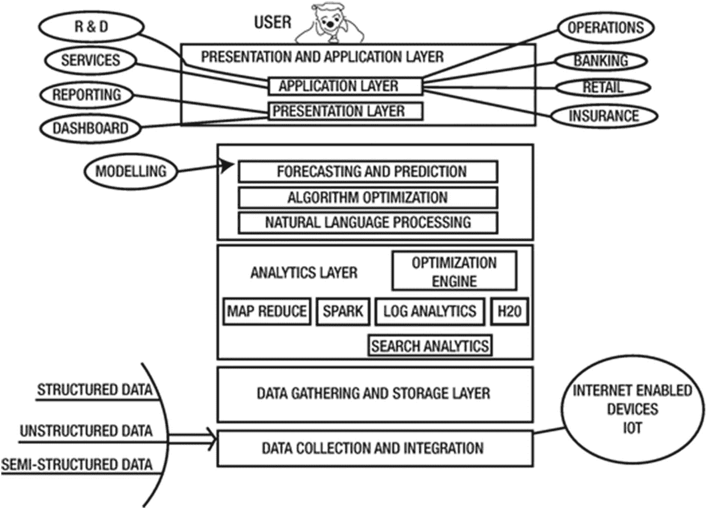
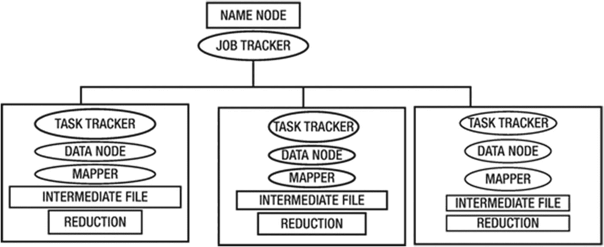
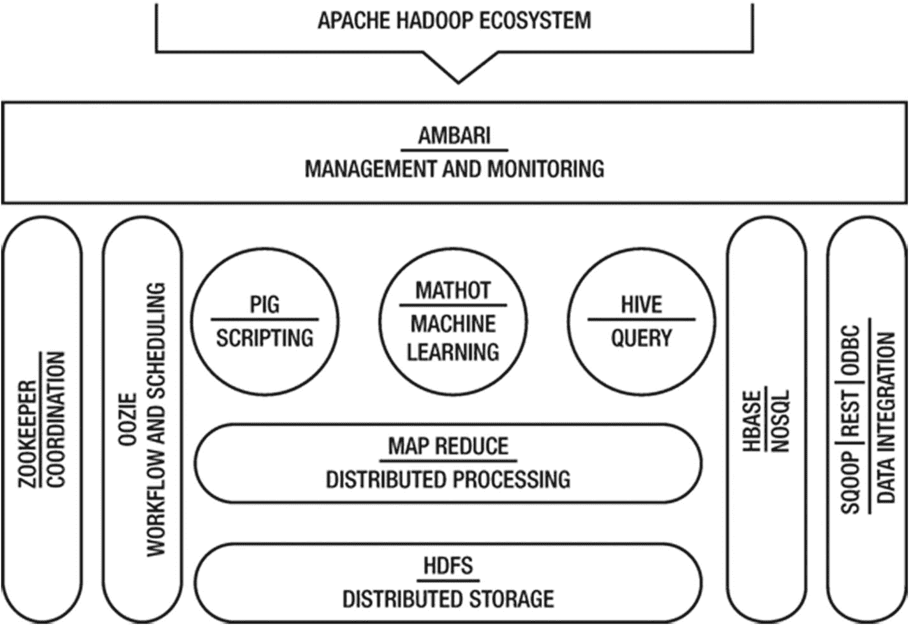
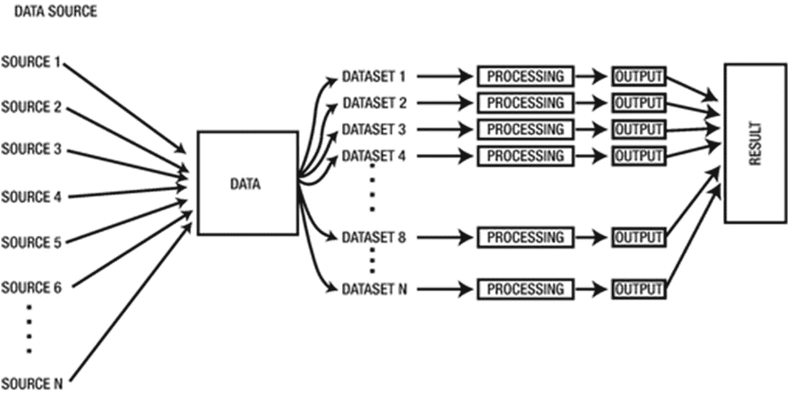
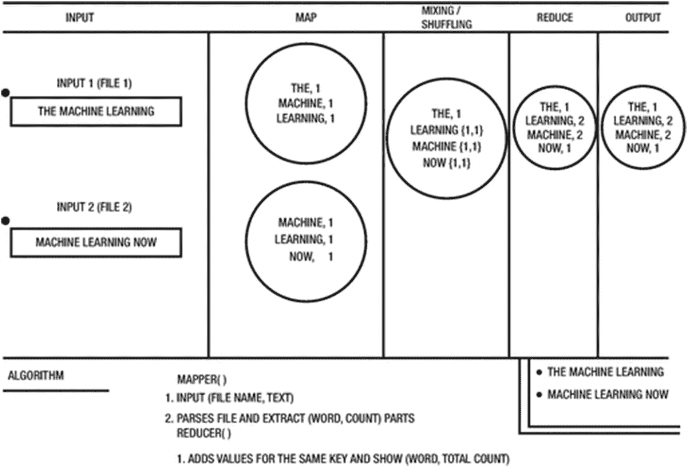
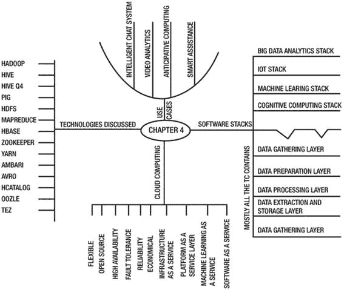

# 4. 机器学习及相关技术的技术栈

帕坦加利·卡什亚普博士^(a*)

^a 印度，卡纳塔克邦，班加罗尔

机器学习是一个庞大且不断发展的领域，它充满潜力，拥有巨大的开发空间。前几章探讨了机器学习一些重要且相关的方面。

在各个层面，技术都扮演着至关重要的角色，因为没有技术，（几乎）一切都不可能实现。商业策略在会议室中制定，但落实到具体实现时，技术是赋能者。技术有助于打造产品或应用，并助力其营销，包括实体或虚拟供应链。在产品或应用的整个生命周期中，在开发、维护和支持阶段，技术都占据了主导份额。

由于机器学习生态系统所涉及的技术（如物联网、大数据分析、云计算和认知计算）的特性，技术和技术讨论之间存在自然的交叉。例如，如果有人想讨论数据分析，这个话题在所有相关技术的讨论中都适用。物联网技术栈和大数据分析都是其中的一部分。

在采用或开发基于物联网和机器学习的产品、平台或服务之前，企业必须评估、创建或重新审视其公司战略。规划和战略必须是重中之重。这是有原因的，因为它几乎关系到从产品概念化、设计到采购和生产（制造）的方方面面。在实施有效的销售和服务时，这一点也至关重要。企业必须微调其实体和虚拟物流及供应链管理系统，以便能够安全地收集来自客户和供应商的数据并做出响应。我们正处于一个产品本身就能自动收集数据并将其传输到所需之处的时代。

从传统战略转向数据优先战略最初很困难，但这是在市场中保持竞争力所必需的。同时，这也需要开发先进的分析能力。Netflix 是这方面最常被引用的例子。为了捕捉、探索和利用物联网、大数据和机器学习领域中存在的巨大经济机遇，需要新的技术基础设施和思维方式。它们能让公司加快将智能互联产品和运营推向市场的速度。物联网提供了一系列能力和组件，使企业能够实现以下目标：

*   部署用于监控、管理和控制互联设备的应用程序。

*   在业务背景下收集、处理（通过大数据分析）和分析（通过机器学习技术）机器和传感器数据。

*   确保设备与实时数据流之间的安全连接。

*   提供有效的设备/传感器管理，并支持远程设备更新。

*   创建一个支持快速、持续、迭代的基于物联网的解决方案创建的应用环境。

*   高效地与第三方系统集成。

*   在动态工业环境中，使用增强现实（AR）进行下一代营销、销售、服务和培训。

让我们接受这个事实：技术栈是关键。

## 软件栈

任何软件应用程序都可以通过使用技术栈来开发，因为它是任何工程工作的基础。在为构建应用程序/产品选择技术栈时，需要谨慎行事，因为修改技术栈通常很困难。本章讨论了可用于机器学习及其相关领域的多种技术栈，并提供了机器学习技术栈的全面视图。由于本书和本章的范围所限，本章仅局限于信息技术相关的具体细节。

本章还讨论了多家供应商（包括 Apache、IBM、微软等）在相关领域提供的技术。此外，还描述了不同层与技术之间的映射关系。技术栈通常与特定概念及其相关生态系统相关联。例如，物联网与一种技术套件相关联，而机器学习和大数据则与另一种相关联。然而，出于实际原因，如技术重叠（同一套技术可用于在底层实现多个概念）、业务需求、实施、财务依赖和客户需求，现实情况大多不同。因此，本章提供了技术栈的整体性和综合性视图。话虽如此，在可能的情况下，本章也提供了特定技术的信息。同时，还描述了一些通用的技术概念。例如，本章详细描述了 `MapReduce`。

## 章节地图

第 1 章讨论的综合模型包含多个层级，每个层级在输入和输出方面都不同程度地依赖于其他层级。因此，整体而言，该模型是一个层级嵌套的模型。每个层级或子层级都涉及特定的技术。然而，大多数情况下，不同技术之间存在重叠。在本章中，我将对该模型进行扩展，并提供其详细视图。我将深入到“技术映射”层面，描述每个层级的技术细节。例如，物联网主要涉及从多个设备和传感器获取数据，并将其传输到云端或本地基础设施以供进一步利用和处理。之后，大数据技术接管控制权，并借助特定的技术栈，应对存储、管理、处理和理解这些数据的挑战。如有需要，它们会以适当的方式将处理后的数据呈现给更广泛的受众。此外，大数据分析技术栈会将其输入传递给机器学习框架，以便从处理后的数据中获取智能。然而，你也可以将大数据技术与特定物联网栈的一部分关联起来。机器学习、大数据分析和认知计算也是如此。

关于本章结构和内容的一些要点。

*   **技术讨论**：技术讨论存在重叠。然而，这仅在必要时才会发生。例如，在解释大数据和物联网技术栈时，会讨论数据收集和网络技术。处理技术则在大数据技术栈下讨论。为了完整性，这些概念会在机器学习的连接器层再次提及。机器学习的数据处理器和存储层下的处理/存储技术也是如此。

*   **经验法则**：如果某个概念在前面已经详细讨论过，本章将不再赘述其细节。回顾一下，第 2 章提供了一些重要机器学习框架、库和工具的简要描述。如果你有兴趣了解这些技术，可以在阅读机器学习技术栈时，回头查阅大数据部分。

*   **讨论目的与内容结构**：本章讨论的技术栈可以通过两种方式进行可视化。

    *   **特定层级的独立视图**：讨论特定层级的技术。例如，大数据分析被视为一个层级。与该层级相关的技术会在该部分提及。因此，如果你只想了解大数据技术栈，可以仅参考该部分，遵循数据采集 ➤ 分析 ➤ 机器学习 ➤ 表示层的层级结构。类似地，如果你想了解机器学习技术栈，则遵循连接器 ➤ 存储 ➤ 数据处理 ➤ 模型与运行时 ➤ 表示层的层级结构。

*   **复合连接视图**：这提供了一个连接视图。它不深入子层级的细节，而是将各层级视为综合模型的组成部分。

在深入探讨技术栈的细节之前，让我们先看一下表 4-1 中展示的概念和技术映射图。这是一个表格形式的表示，说明了哪些概念出现在本章的哪些位置。

表 4-1

概念与技术映射图

| 技术栈 | 层级名称 | 详细讨论的层级 | 讨论的技术与概念 |
| --- | --- | --- | --- |
| 物联网 (IoT) | • 设备和传感器层 • 通信、协议和传输层 • 数据处理层 • 表示与应用层 | • 设备和传感器层 • 通信、协议和传输层 | 传感器、设备、网关和通信技术 |
| 大数据分析 | • 数据采集与存储层 • 分析层 • 机器学习层 • 表示与应用层 | • 数据采集与存储层 • 分析层 • 表示与应用层 | `OBIEE`, `Cognos`, Infographics, `HDInsight`, `Apache Spark`, `Apache Solr`, `Apache Storm`, `MangoDB`, NoSQL, `HBase`, `YARN`, `MapReduce`, `Hive`, `Pig`, `HiveMall`, `Amazon Simple Storage Service (S3)`, `HDFS`, `HCatalog`, `Oozle`, `Avro`, `Ambari`, 和 `ZooKeeper` |
| 机器学习 | • 连接器层 • 存储层 • 处理层 • 模型与运行时层 • 表示与应用层 | • 连接器层 • 模型与运行时层 | `Logic App`, `Apache Flume`, `MQTT`, `Apache Kafka`, `Apache Sqoop`, `Apache Mahout`, `Amazon’s Deep Scalable Sparse Tensor Network Engine (DSSTNE)`, `Google TensorFlow`, `Microsoft Cognitive Toolkit`, 和 Video analytics |
| 认知计算 | • 数据收集层 • 数据准备、提取和转换层 • 数据处理层 • 分析、机器学习和认知层 • 表示与应用层 | 大多数层级已在物联网、大数据分析和机器学习部分讨论过。因此，由于这些层级的概念和功能保持不变，本节不再讨论。 | 预期计算 |
| 云计算 | • 基础设施即服务层 • 平台即服务层 • 机器学习即服务 • 软件即服务 | 这些层级主要在第 1 章中讨论。此处不再提及。 | 基础设施即服务, 平台即服务, 机器学习即服务, 和 软件即服务 |

接下来的章节将讨论机器学习生态系统的主要技术和技术栈（在需要的地方），我在第一章中将其称为“支柱”。

## 物联网技术栈

要提出通用的物联网技术栈非常困难，因为不同行业有其自身需求，需要不同的应用、产品和服务来满足。不过，本节将提供一个通用概览，介绍跨行业实施物联网技术的主要组成部分，并提供物联网技术栈的技术细节。可根据个人/用户/企业的具体需求进行进一步定制，但技术栈的基本结构保持不变。物联网带来了巨大的可能性，并预示着光明的未来；它必将长期存在。

基于传感器的设备和装置数量正以惊人的速度增长，该领域的发展也极为迅猛。因此，现有的商业模式需要与这项快速变化的技术相适应。为此，商界需要对其员工进行相关培训，这包括但不限于项目、产品和技术经理。他们负责收集信息，为更高管理层提供输入。基于中层管理人员（项目/产品和技术经理）提供的数据和洞察，组织的高层（CTO/CFO/COO）才能做出决策。

中层管理人员是组织整体生态系统中不可或缺的一部分，他们确保基于物联网系统的产品/应用或服务的成功。在这个变革的时代，显然，具备技术能力的经理人将为其组织提供更好的方向指引。因此，经理人的角色和职责也发生了变化。成功需要更强的技术协同能力和创新思维。经理人的技术之旅始于理解技术栈。因此，只有那些理解技术栈的人才能评估需求和项目的复杂性。由于本书的目标读者是经理人，让我们从物联网技术栈开始这项知识收集工作。

物联网技术栈分为以下几层：
*   设备与传感器层
*   通信、协议与传输层
*   数据处理层
*   表示层与应用层

*层级（Tiers）* 表示设计中的表示、业务、服务和数据功能在物理上分布于不同的计算机和系统。*层（Layers）* 是构成应用程序的软件或硬件组件的逻辑分组。它们以逻辑方式对组件执行的各种任务进行划分。这使得创建支持现有组件可重用性的健壮可靠的设计变得更加容易。此外，每个逻辑层可以包含多个独立的组件类型。这些组件类型被分组到子层中，每个子层执行特定类型的任务以实现特定功能。

## 物联网、你与你的组织
构建一个完整的物联网系统或解决方案是一项成本高昂且关乎业务成败的决策。它需要现代技术技能、专业知识、时间和资金。在实施之前需要进行妥善规划。如果资源没有得到合理利用，解决方案可能会经历漫长的 `IT` 项目周期，最终投资回报率低下。因此，确定一个有效的物联网平台是必须的。一个配备了合适技术栈的有效物联网平台将简化物联网解决方案的开发。因此，可扩展性、健壮性和性能等因素对于优秀平台至关重要。在需要时，平台应能轻松适应持续的增长和变化。

这些必备特性使企业能够（在平台之上）开发系统和解决方案，帮助行业/组织/企业构建强大的物联网解决方案，这些方案能够轻松连接各种设备和传感器。它们可以受益于系统与运营资产之间的无缝信息流，并通过物联网/万物互联/工业物联网为客户提供切实的商业价值。如今的客户对技术、其未来以及用例都了解甚深。因此，拥有一个好的平台能让用户对其需求的满足充满信心。

## 设备与传感器层
这是物联网系统的起点。从这里，“物”开始了它们的（技术）旅程。设备与传感器层始于一个设备，并传递到多个其他连接的“物”或更大的网络（或网络之网络）。此外，该层负责与物理世界进行交互。以下列表从技术角度解释了该层的一些重要要点。本节属于物联网范畴，具体涉及设备、物和网关。

随着时代变迁，边缘计算变得非常重要，这是一种将计算服务物理迁移到更靠近用户或数据源的做法。这些计算服务可在所谓的*边缘设备*上获得，这些计算机能够实现实时原始数据收集和处理，以进行更快、更准确的分析。得益于边缘机器学习，物联网和其他边缘设备现在可以在本地执行机器学习模型。

本节简要介绍了物联网设备和传感器的技术格局、技术框架及其他细节。
*   物体或“物”通常体积小、容量有限。因此，这些物体和“物”使用微控制器进行编程，因为它们轻量级且资源消耗少。微控制器专用于执行特定的技术任务集。
*   运行在物联网设备上的软件通常包含一个非常轻量级的操作系统；这是一个软件层，使物体能够访问硬件（`MCU`）的功能。
*   设备或物体支持有线或无线协议，例如`蓝牙`、`Z-Wave`、`Thread`、`CANBus`、`CoAP` 和 `MQTT`。这些通常用于连接设备。
*   物联网设备通常具有远程管理能力。当需要远程管理“物”时，此功能非常有用。示例包括软件升级和远程修复小问题。

### 为您呈现的事实
谷歌的物联网操作系统名为 `Android Things`。它专为互联设备构建，并用于物联网领域。它经过优化，能够充分利用英特尔创新的架构。在 `Android Things` 上进行物联网应用开发既快速又稳健。

`Windows 10 IoT Core` 是 `Windows 10` 的精简版本。`Windows 10 IoT Core` 针对小型设备进行了优化。它可以在树莓派 2 和 3、`Arrow DragonBoard 410c` 以及 `MinnowBoard MAX` 等设备上运行。`Windows 10 IoT Core` 可以通过使用其 `API` 来扩展通用 `Windows` 平台 (`UWP`) 的功能，以构建下一代解决方案。`Windows 10 IoT Core` 还支持 `Arduino Wiring API`，该 `API` 用于 `Arduino` 草图和库，以实现对硬件的直接访问。`Windows 10 IoT` 应用程序是使用 `Visual Studio Community Edition` 开发的。`Visual Studio Community Edition` 提供了高质量的开发工具，包括通用应用模板、代码编辑器、强大的调试器和丰富的语言支持。借助 `Connect-the-Dots` 等框架，针对 `Windows 10 IoT Core` 的设备可以与微软 `Azure` 云平台集成。微软 `Azure` 允许您利用先进的基于云的分析服务。

在选择技术栈时，您需要一个专注、基于思考的实用战略方向，主要涉及需要收集何种数据以及所需的硬件类型。显然，需要为这个技术栈规划出业务模型和需求。此外，支持模型和执行计划也必须提前定义并得到充分验证。

这种规划在创建、修改、维护和淘汰技术栈的整个生命周期中都很有帮助。这种方法能够使物联网技术栈与任何解决方案的创建保持同步。如果考虑到这些因素，技术栈就能处理任何类型的实际需求。无论是通过单个智能传感器进行简单的数据收集，还是处理更复杂的场景，例如从托管众多传感器、强大处理器、先进存储系统和网关系统的工业计算机和处理系统中收集数据。

传感器测量数值并发送原始数据，同时功耗极低。传感器可以嵌入到任何设备或物体中。这包括智能手机、手表、腕带、咖啡机、汽车、卫星、牙刷、隐形眼镜、织物等等。它们可以佩戴在身上或植入皮肤内。例如，诺基亚最近为一种嵌入皮肤内的磁性纹身系统申请了专利。当有来电或收到消息时，这种纹身会振动。其方法描述称，该专利技术将一种铁磁材料喷涂到用户的皮肤上。完成后，纹身可以与任何移动设备配对进行通信。

另一个例子是 `Fitbit` 的新型高级睡眠追踪设备，它使用传感器来测量用户在夜间处于不安、深度睡眠或清醒状态的时间。它内置了心率监测器，可以将数据分解并分析成临床定义的阶段。（更多信息，请访问 [`www.fitbit.com/global/in/technology/sleep`](http://www.fitbit.com/global/in/technology/sleep)。）

印度理工学院孟买分校的团队开发了一款可穿戴婴儿健康监测器的原型。它帮助父母借助多个传感器追踪孩子的临床和总体健康状况。该团队创建了一个物联网设备，可以轻松嵌入或附着在尿布上。这是一种监测婴儿活动（包括体温、血压等）的创新方法。

微软与华盛顿大学合作，推出了一款创新的隐形眼镜，用于分析并提供人体内生化不稳定性状态的实时更新。随着微机电系统（通常称为 `MEMS`）的进步，这些传感器的尺寸和成本已显著下降。因此，基于 `MEMS` 的设备正成为主流。`MEMS` 在微小的电子层面工作。它们结合了电子学、物理学、化学和机械工程学的综合力量来集成传感器和执行器。传统上，传感信息以及通过网络共享和传输该信息是由设备中的独立组件处理的。然而，最近的技术进步使得将传感、联网和电源集成到一个单元中成为可能。因此，它们可以轻松地在多种环境中使用，因为它们作为一个单一单元工作。

巨大的电源需求和网络能力不再是限制因素。例如，市场上许多配备全球定位功能的设备和传感器都具有出色的联网能力。它们可以追踪个人的位置，并帮助他们实时找到丢失的宠物、他们的汽车、附近的医院、购物中心或停车位。

在所有设备中，传感器的性质和类型以及基本的通信技术几乎相同。它们通过无线网状网络协议相互通信。设备的这种能力推动了一些公司非常雄心勃勃的计划。例如，惠普的一个名为“地球中枢神经系统 (`CeNSE`)”的项目结合了材料科学、纳米技术和 `MEMS` 的进步，以开发一个覆盖全球的传感网络。他们使用大量廉价的传感器，通过整合物理世界和数字世界来获得对世界的整体视图。这些“硅基神经”基本上绘制了整个地球的地图。反过来，这张地图被用来监测桥梁、高速公路、河流、森林以及人们呼吸的空气的状况。

物联网设备使用计算处理单元，但它们不是通用计算机。这些设备的主要目的是充当目标物联网系统的“眼睛”和“耳朵”。低功耗、移动性、易用性、在恶劣条件下工作、善于使用低吞吐量通信信道以及通过无线电接口与网络通信，是这些物联网设备的一些显著特点。传感器和网关及其相互作用创造了一些非常有用的用例。

以下部分将讨论物联网中使用的一些主要技术。

## 通信、协议与传输层
通信层与传输层共享传感器信息（集成于设备、事物或物体中）。通俗来说，这指的是信息/数据交换的各种不同方式。在技术领域，它大致意味着通过设备“交换”信息。然而，在物联网术语中，它指的是通过“事物”与世界其他部分交换信息。这种信息交换通过网络进行，包括物理网络和虚拟网络，并使用不同类型的协议。

# 通信机制

通信机制由设备或事物（包括硬件和软件）的相互作用构成。因此，在构思和考虑构建物联网协议栈时，选择正确的通信机制（包含所有类型的传输和协议需求）非常重要。这一层表明并决定了如何与底层基础设施进行交互。这反过来又为以下问题提供了答案：哪种平台最适合你的解决方案，是第三方平台、本地部署还是云基础设施？如果你打算采用基于云的解决方案，这一层负责数据管理。例如，如何将数据放入云基础设施以及从中取出？它借助广域网、局域网、WiFi 及其他相关技术来实现这一点。

网关是物联网环境中的一个关键组成部分。物联网网关是一种“中间”设备，它连接传感器、设备、系统和应用程序。它提供了巨大的价值，因为它过滤并传递从传感器和设备收集的数据。网关使物联网生态系统能够高效地收集数据，并将数据从设备和装备安全地传输到目标系统或基础设施。网关并非单一组件。它可以被设计成一个网关网络/组合，能够连接所有远程设备，并具备随增长而扩展的能力。网关与物联网传感器和设备相结合，在物联网生态系统中扮演着重要角色，因为它们提供了实现、保护、管理和维护整个系统的能力。网关可用于多种用途，但其中几个非常重要：

*   用于将有意义的数据迁移到云端，并通过过滤掉垃圾数据来减少在传输到云端过程中的可用数据量。

*   用作数据处理器。

以下是通信、协议和传输层的一些要点：

*   物联网网关是传感器的集成点。

*   充当执行器，将事物或设备相互连接或连接到外部网络。

*   物联网网关可以是集成了、构建于或附加到设备上的物理硬件或功能。

*   物联网网关用于从传感器收集数据。

*   网关的一些重要协议包括：
    *   `CoAP`
    *   `MQTT`
    *   `HTTP`
    *   `XMPP`

*   物联网网关能够在边缘处理数据，并可能具备存储能力以应对网络延迟。

现在是时候了解一些流行的通信和网络术语了。正确理解这些术语有助于理解物联网技术。其中一些术语目前正在使用，而另一些则正在快速涌现（见表 4-2）。

**表 4-2 无线网络选项**

| 网络类型 | 描述 |
| --- | --- |
| 蜂窝移动网络 | 有多种变体，包括 2G、3G、4G 和 5G（最新版本），其中“G”代表“代”。 |
| 蓝牙与低功耗蓝牙 | 无线个人区域网。一种短距离传输数据的标准。 |
| `ZigBee` | 一种无线网状网络协议。非常适合低数据速率和长电池寿命的场景。 |
| `Z-Wave` | 用于家庭自动化的无线协议。 |
| 城域网 | 城域网类似于局域网，但其覆盖范围可延伸至一个城市、大型园区或多个园区。通常为城市或城镇设计。 |
| 个人区域网 | 个人区域网是围绕个人组织起来的网络。它可能使可穿戴计算机设备能够与附近的其他计算机或智能设备通信并进行数字数据交换。 |
| 广域网 | 广域网跨越广阔的地理区域。它可能连接较小的网络，包括局域网或城域网。 |
| `6LoWPAN` | 基于 IPv6 的低功耗无线个人区域网。 |
| `WiFi` | 用于局域网的无线技术。它是目前大多数可用设备（包括手机、平板电脑和个人电脑）不可或缺的一部分。然而，它并不仅限于设备，其覆盖范围也延伸到了电子产品（冰箱、洗衣机等）。 |

## 数据处理层

云平台是现代物联网解决方案的支柱，也是数据科学和机器学习蓬勃发展的最大推动力之一。根据数据处理原则，理论上只要技术基础设施到位，数据可以在任何地方进行处理。然而，出于显而易见的原因，企业更倾向于在云端处理数据。以下是与此相关的一些关键方面：

*   数据收集与管理：借助现代数据流技术，智能设备可以轻松地将数据（包括杂乱和含噪的数据）传输到云端。数据可能来自多种来源，其内部结构、格式和组织方式也各不相同。此外，可能需要对数据进行预处理，以处理或发现丢失及不需要的数据。同时，在将数据定向并存储到数据存储库之前，需要将来自不同来源的不同数据集进行整合，以形成统一的表示。因此，在定义基于物联网的技术栈需求时，充分了解数据的类型和数量至关重要。清晰掌握每日、每月和每年的数据需求，是设计和构建一个稳健、高效且有效的技术栈的重要步骤之一。提前正确定义可扩展性参数，有助于架构师、数据科学家和数据管理员确定合适的数据管理解决方案及相关生态系统。

*   分析：分析是任何物联网解决方案的关键组成部分之一。在物联网的背景下，分析指的是以有意义的方式处理数据、发现隐藏模式并生成洞察的能力。为了执行关键的业务预测，机器学习和大数据分析的技术协同作用便应运而生。同时，它也使整个生态系统具备从可用数据中提取认知洞察（即理解人类如何以自动化方式解读数据）的能力。此阶段还包括不断回溯和检查对已归档数据执行的操作和存储的记录，以理解过去的数据并预测未来的动向，或发现数据中可能提示需要进一步检查或采取行动的异常情况。请记住，原始数据本身无法提供业务解决方案。正是基于分析的洞察力，借助现代数据驱动技术和机器学习，才能点石成金。因此，物联网技术栈必须能够集成分析能力，并促进构建高效且有效的解决方案。

*   云 API：物联网的核心在于将多个设备或对象相互连接，连接到网络，或连接到网络的网络。创建这个设备网络的目的，是为了满足企业及个人在业务和个人需求方面的不同数据共享需求。在物联网解决方案内部及其周围，数据无处不在。数据从物/对象/设备传输到云基础设施，从云端传输到后端系统，从多个处理者或用户传输到他们的对象或设备。这一过程的核心是 API，它实现了设备间的所有通信与协作。多个对象、事物、设备和网络之间的这种无缝通信，通常是通过在云端或设备层面调用公开的 API 来实现的。这些 API 由供应商和服务提供商作为云服务的基本要素之一提供。API 允许用户与设备交互或交换数据。请记住，向目标受众开放 API 不是一个技术决策，而是一个业务决策。恰当的 API 管理能够确保数据安全地流动，从而有助于保护敏感数据。

## 表示层与应用层

该层提供了与应用程序用户交互的方式。安装在设备/对象上的软件充当通信的接口。该层还包含最终用户用来进行通信的应用程序和交互式产品。该层位于技术栈的顶层，大部分技术复杂性都隐藏在底层。因此，几乎每个人都能轻松理解这一层。对于接触过一点技术的人，甚至是对外行人来说，这就是“使用层”，因为它包含了他们使用的应用程序和产品，而无需了解背后隐藏的复杂性。

企业的大部分收入来自这一层。技术和产品经理很容易理解这一层。位于此层的应用程序、产品和服务通常是基于 Web 的。然而，这并非强制性标准，具体取决于用户的需求。这些 APS（应用程序、产品和服务）旨在面向桌面、移动设备和可穿戴设备。此外，许多应用程序或应用都是为了满足客户的需求而提供的。在日新月异的时代，客户更倾向于使用支持云计算的应用程序或产品，因为它们提供了“随时随地”从智能物联网设备访问信息的灵活性。这种“随时随地”的访问方式，与物联网为用户提供自由和敏捷性的最终目标是一致的。

特定行业的应用程序也位于这一层。消费者使用这一层来满足家庭、生活方式和健康相关的需求。企业和行业则将其用于专业需求。

### 物联网解决方案的可用性

微软是基于物联网的技术、产品和解决方案的端到端提供商之一（还有其他多家，包括 `IBM`）。物联网需求旺盛。许多公司正在这一领域帮助他们的客户和利益相关者。他们不断创新，并在市场上推出突破性产品。在当今世界，仅仅进行研究和创新是不够的。产品的正确定位、品牌建设、市场营销，以及将研究、创新和相关产品恰当地传达给合适的人，这些都同等重要。这些因素有助于客户针对特定目的，做出能够满足其需求的产品和应用的明智决策。

为了更好地理解，可以看看 `Azure IoT` 生态系统，它将帮助你更好地解读这一层。

物联网（IoT）连接了各种设备，并使跨业务的数据驱动决策成为可能，从而改变了人们与技术互动的方式。随着企业利用物联网来改善运营和推动创新，开发复杂的物联网应用需要强大的开发工具。作为对这些需求的全面回应，微软的 `Azure IoT` 软件开发工具包（`SDK`）使开发人员能够在 `Azure` 平台上构建尖端的物联网应用。本节将深入探讨 `Azure IoT SDK` 的领域，分析其关键组件，并解释其在物联网开发中的重要性。

### 现实场景

#### 纳米传感器

纳米技术是一门在纳米尺度（极小的尺度）下研究粒子的学科。它已被广泛应用于医学领域，用于在疾病早期阶段进行治疗。当纳米技术与物联网、大数据分析和机器学习相结合时，其效果变得非常显著。

1.  向患者注射纳米颗粒，使其释放到血液中。纳米颗粒能够识别生物或化学变化。这一过程通过监测患者体内的化学和物理变化，从而在疾病早期阶段进行检测。其基本原理是：体内生物、化学和生理机制出现意外变化可能是疾病的征兆。
2.  纳米颗粒与可穿戴设备交互，以指示外来颗粒干扰体内正常流动所引起的变化。可穿戴设备持续从纳米颗粒接收数据。
3.  可穿戴设备利用这些数据进行疾病诊断，进而使用预测性和规范性分析。
4.  机器学习结合认知建模和计算算法，学习体内机制的变化过程和行为，并有效、主动地诊断任何疾病。

整个过程提高了疾病诊断的有效性和效率。因此，它有助于减少住院时间和成本。同时，它还能生成直观且有效的报告。

#### 监控

机器学习将监控提升到了认知智能的水平。机器学习为物联网系统提供了以下优势：

可穿戴设备全天候提供健康警报和通知。但它们在追踪这些警报和通知的操作并正确记录方面通常效果不佳。

机器学习在神经网络的支持下，能够根据人类行为追踪活动并记录响应。

记录的数据将被转发给医生。

以下是一个有趣的未来应用场景的步骤：

1. 患者起床，地板和床上的传感器记录这一事件。
2. 配备传感器的马桶检查患者的粪便和尿液，然后将详细信息上传到云端。配备传感器的牙刷检查患者的口腔健康。
3. 重要的健康指标，如脉搏、血糖水平和血压，被记录并上传到云端。
4. 墙壁和地板中的传感器根据患者的动作评估跌倒风险。
5. 利尿药物中含有微型发射器，可向可穿戴设备发送信号，表明患者已服药。

让我们再看几个医疗保健应用案例。这些案例也凸显了技术和应用程序的重要性。

*   **改变患者行为。** 许多常见疾病是可以控制甚至预防的。例如，改善生活方式有助于预防 2 型糖尿病、肥胖症和心脏病等疾病。然而，改变生活方式需要改变行为，这需要持续的提醒。为此，机器学习算法可以编译来自患者使用的互联健康设备和传感器的数据，以洞察他们的行为，并在这一转变过程中为他们提供指导。
*   **使用 SmokeBeat 改变吸烟习惯。** 一款名为 SmokeBeat 的创新软件能在用户不知情的情况下收集其吸烟习惯信息。该程序利用腕表或智能手环上的加速度计检测手到口的动作。SmokeBeat 处理这些数据，并提供实时的认知行为疗法激励。为了提高效果，用户对此类激励的反应会被持续监控和记录。SmokeBeat 还会将用户的吸烟数据与其首选同伴群体的数据进行对比，从而建立一种鼓励性的社交网络。
*   **虚拟护理。** 在当今繁忙的医院环境中，护士可能会不堪重负，难以给予每位患者足够的个性化护理。医疗机构利用虚拟护士来解决这个问题。计算机生成的虚拟护士像真正的护士一样与患者交谈。她们友善、亲切且富有教育意义。

在医疗预约的间隙，虚拟护士比真实护士更频繁地与患者互动并提供信息。她们全天候随时可用，并能提供快速响应（比等待真实护士更快）。

## 大数据分析技术栈

构建大数据技术栈取决于业务的需求和特定要求。此外，在决定大数据技术栈时，必须考虑三个 V（速度、多样性和容量；更多细节请参考第 1 章）以及分析基础设施的可用性。大数据技术栈能够创造价值。然而，数据的清洁度也受到需求、规则、业务逻辑和分析能力的指导。

通常，大数据技术被划分为多个层，以分离关注点和逻辑（见图 4-1）。以分层形式对复杂性进行逻辑细分，构成了大数据技术套件的构建模块。各层之间存在一些冗余，因为孤立的层无法实现此目的。

大数据分析的软件架构图。数据收集与集成之后是数据采集与存储层、分析层、预测与预报、算法优化、自然语言处理、表示与应用层以及用户。

图 4-1 大数据分析栈

注意

数据处理和分析是“洞察”生成过程中的重要步骤，并且与机器学习紧密相关。机器学习和数据分析可以被视为一个层。然而，为了清晰分离，最好将它们分开（至少在逻辑上）。机器学习，包括其工作原理及与各项技术的关系，将在“机器学习”部分进行更详细的讨论。图 4-1 展示了机器学习与大数据分析紧密绑定的一种方式。

表 4-3 简要展示了大数据分析技术和流程套件。下一节将解释一些与大数据技术套件密切相关的重要软件、框架和库。

表 4-3 大数据的主要技术

| 技术名称 | 描述 |
| --- | --- |
| Hadoop | MapReduce 的一种实现。可与多种数据源协同工作。也被称为企业数据操作系统（详情请参阅“Hadoop”章节）。 |
| Hive | 允许传统数据驱动型应用（如商业智能）对 Hadoop 集群执行查询。同时，它也被视为一种数据仓库服务，提供读取、写入和管理大型数据集的设施。它是 MapReduce 之上的一个抽象层（隐藏了技术内部的复杂性）（详情请参阅“MapReduce”章节）。 |
| Hive QL | 一种类似 SQL 的语言，用于提交 MapReduce 任务。 |
| Pig | 允许应用在 Hadoop 集群上执行查询。然而，它是一种类似 Pearl 的语言，而非类似 SQL 的语言（Hive）。详情请参阅“Pig”章节。 |
| HDFS | 一种分布式文件系统技术。通常用于存储非结构化数据（详情请参阅“HDFS”章节）。 |
| MapReduce | 一种分布式计算框架。然而，与新兴的计算框架相比，其计算速度较慢（详情请参阅“MapReduce”章节）。 |
| HBase | 基于列存储的服务，以表格格式存储数据。 |
| ZooKeeper | 分布式协调服务。 |
| Yarn | Yarn 代表另一种资源导航器。在大数据分析系统中，其作用是充当中央操作系统，为技术栈提供和管理资源及应用生命周期。 |
| Ambari | 用于配置、管理和监控 Hadoop 集群。 |
| Avro | 一种数据序列化系统。其 .NET 版本也存在于微软的一个产品中，名为 HDInsight，这是 Hortonworks 提供的一个 Hadoop 发行版。它也被视为运行在 Microsoft Azure（微软提供的云平台即服务）上的 Apache Hadoop。 |
| HCatalog | 提供 Hadoop 集群上数据的关系视图。像 Pig 和 Hive 这样的工具运行在 HCatalog 之上，它充当了一个抽象层。 |
| Oozle | 用于协调 Hadoop 作业工作流的应用。 |
| Tez | 一个用于高性能批处理和交互式数据处理的应用框架。它使 Hadoop 作业更快，并保持了 MapReduce 的可扩展性和鲁棒性。它通常处理 PB 级的数据。 |
| Azure Data Factory | Azure 中最突出的 ETL 服务是 Azure Data Factory。它定义传入数据（就其格式和模式而言），根据业务规则和过滤器转换数据，扩展现有数据，然后将数据传输到易于其他下游服务访问的目标存储。它可以在 Azure 上执行 SQL Server Integration Services 包、自定义基础设施和管道（包含 ETL 逻辑）。 |
| Azure Data Lake Storage Gen 2 | 企业级大数据存储，开箱即用，具有弹性、高可用性和安全性。它可以扩展到 PB 级数据存储，并且与 Hadoop 兼容。因为它构建在 Azure 存储帐户之上，所以直接受益于其所有功能。在整合了 Data Lake Storage Gen1 和 Azure Storage 的功能后，创建了最新版本，即 Gen2。 |
| Databricks | Databricks 的基础是 Apache Spark。用户可以通过此平台即服务访问托管的 Spark 集群。它提供了大量额外功能，包括用于管理 Spark 集群及其节点的全面网关，以及对笔记本创建、作业调度和执行、安全性和多用户支持等方面的协助。 |

## 数据采集、集成与存储层

这是大数据技术栈的底层或最低层。该层负责收集所有类型的数据（结构化/非结构化和半结构化）并进行存储。数据来自多个来源，包括物联网设备、社交媒体和 RSS 订阅源。由于在此层接收到的数据具有海量、高速和多样性的特点，一些公司使用数据湖作为其大数据存储库的来源。数据湖是一种数据采集和存储方法。它以其自然的状态、形式和格式存储并容纳原始数据。其主要目的是存储数据，而不是对其应用任何类型的智能和复杂操作。例如，数据如何/为何/在何处存储并不是数据湖关注的重点。其技术也不关心数据的治理和安全方面。

提供大数据技术的解决方案是一个巨大、开放且不断发展的市场。许多公司都在这个领域提供自己的解决方案。主要参与者包括 Apache、Hortonworks、IBM、Amazon 和 Microsoft。Hortonworks 等公司提供了一套全面的大数据、大数据分析和机器学习工具与技术。有关更多详细信息，请参阅以下链接：

*   Apache 提供的技术（来源：[`https://hortonworks.com/products/data-center/hdp/`](https://hortonworks.com/products/data-center/hdp/)）
*   Apache 的技术创新（来源：[`https://hortonworks.com/products/data-center/hdp/`](https://hortonworks.com/products/data-center/hdp/)）

一旦从多个来源收集到数据，就会将其集成为一个来源。过去十年中，数据的生成和可用性急剧增加，导致数据集成量激增。数据几乎无处不在，其数量、种类和速度都大幅增长。

每个组织都使用各种各样的程序，许多程序以独特的专有格式生成数据。数据也经常在公开市场上购买。

即使在组织合并期间，也必须移动和合并数据。将来自多个来源的数据组合起来，以创建具有更重要性的新输出的实践被称为数据集成。

许多公司在这个领域提供了多种技术产品。简要了解主要技术将使您对数据采集、集成和存储有很好的理解。

### Hadoop 分布式文件系统 (HDFS)

分布式文件系统是允许通过计算机网络从多个共享主机访问文件的任何文件系统。分布式文件系统可能包括透明复制、处理大型数据集的能力、一次写入多次读取以及容错等功能。它用于在廉价的商用硬件上存储大量数据。`Hadoop` 分布式文件系统被 `Hadoop` 应用套件/生态系统用作主要的数据存储系统。

`HDFS` 是一个可扩展、鲁棒、容错的基于 `Java` 的分布式文件系统。`HDFS` 创建数据块的多个副本，并将它们分布在整个集群的计算节点上，以实现可靠、极速的计算。`HDFS` 分别存储系统元数据和应用程序数据。它将元数据存储在一个名为 `NameNode` 的专用服务器上，并将应用程序数据存储在其他名为 `DataNodes` 的服务器上。`HDFS` 中的所有服务器都是完全连接的，它们使用基于 `TCP` 的协议相互通信。`HDFS` 中的文件内容会复制到多个 `DataNode` 上以确保可靠性，并且其优势在于数据传输带宽成倍增加，因此有更多机会在所需数据附近定位计算。

### 核心 Hadoop 架构

`Hadoop` 集群基于主从架构（见图 4-2）。然而，其术语与传统主从架构有所不同。在 `Hadoop` 术语中，`NameNode` 是 `Hadoop` 集群的主节点，负责文件系统命名空间和客户端的访问控制。`JobTracker` 将作业分发给等待中的节点。`NameNode` 和 `JobTracker` 是 `Hadoop` 架构中的主节点。从节点包含 `TaskTracker`，负责管理作业执行。它承担全部责任，从启动、监控到捕获作业输出，并通知主节点作业完成情况。`DataNode` 是 `Hadoop` 集群中的存储节点，代表分布式文件系统。`TaskTracker` 和 `DataNode` 在 `Hadoop` 集群中作为从节点工作。

`Hadoop` 集群的树状图。带有作业跟踪器的名称节点连接到 3 个数据节点，每个数据节点都包含任务跟踪器、映射器、中间文件和归约器。

图 4-2

`Hadoop` 集群的组成元素

`Hadoop` 拥有灵活、高效且稳健的架构。因此，它在支持单节点集群（所有对象都存在于单个节点上）和多节点集群方面同样有效。这样，`JobTracker` 和 `NameNode` 可以分布在数千个节点上。

### HDFS 的显著特性

以下是 `HDFS` 最有趣的特性：

*   **可靠性和容错性**：它被设计为可靠地存储非常大的数据集（容错性），这得益于集群内或多个集群间的数据复制。通常，一组数据被可靠地存放在机器集群上。因此，如果一台机器宕机，数据仍可在其他机器上获取。它还能以高带宽将数据集流式传输到用户应用程序，以实现高性能。

*   **高可用性**：即使某些机器或硬件无法工作或已崩溃，数据仍可通过其他路径访问。

*   **分布式存储**：`HDFS` 在分布式存储环境中表现出色，并能跨多个异构服务器执行计算。即使资源随需求增长（可扩展性），其有效性也保持不变。此外，它在任何规模下都保持经济性。

*   **开源**：它是一个开源项目，因此可以根据需要修改和定制代码。

*   **可扩展性**：它具有高度可扩展性，这意味着添加新硬件很容易。可以轻松地将硬件添加到节点。它可以水平扩展，从而能够在不宕机的情况下动态添加新节点。

*   **灵活性**：`Hadoop` 能够轻松访问新的数据源，并利用不同类型的数据，包括结构化、半结构化和非结构化数据，从而从这些数据中产生价值。

*   **快速**：`Hadoop` 独特的存储技术基于分布式文件系统，该文件系统从根本上将数据映射到其在集群中的任何位置。

*   **经济性**：`Hadoop` 为大数据集提供了经济高效的存储解决方案。基于 `Hadoop` 的解决方案价格低廉，因为它运行在安装在商用硬件上的集群上。它不需要专用机器。因此，`Hadoop` 提供了巨大的价格节省。

### Amazon Simple Storage Service (S3)

`S3` 是一个基于云的、可扩展、稳健且容错的文件系统。它是亚马逊提供的一个分布式文件系统。它可以作为大数据和基于分析的应用程序中的数据层来构建架构。然而，它可能需要额外的组件。`Amazon S3` 提供了一个简单的基于 Web 服务的接口。它可以用于随时随地在网络上存储和检索任意数量的数据。它还提供了一个高度可扩展、可靠、快速且廉价的数据存储基础设施。亚马逊自身也使用 `Amazon S3` 来运行其全球网站网络。

### 分析层

该层通常为分析而组织和准备数据。它借助不同的流程、技术和算法，处理从数据采集层获取的海量且多样化的数据集。这里有多种分析工具、框架、技术和稳健的算法，它们具有不同的能力。根据需求和市场需求，会使用其中一种或多种技术的组合。该层将原始数据转化为可操作的见解。这一层处理多种类型的分析，包括描述性分析、诊断性分析、预测性分析和规范性分析。从技术上讲，许多作者将机器学习视为该层的组成部分之一。然而，本章将在机器学习部分讨论这些概念，因为机器学习库、框架和工具位于分析层之上。

`Apache` 无疑是提供基于 `Hadoop` 的大数据解决方案的领导者。图 4-3 展示了 `Hadoop` 技术栈，其中显示了 `HDFS` 和 `MapReduce` 在整个技术栈中的位置。

`Apache Hadoop` 生态系统的架构图。`HDFS` 之后是 `MapReduce`、`Pig`、`Mahout` 和 `Hive`，左侧有 `Zookeeper` 和 `Oozie`，右侧有 `HBase`、`Scoop`、`REST` 和 `ODBC`。顶部是用于管理和监控的 `Ambari`。

图 4-3

`HDFS` 和 `MapReduce` 在整个 `Hadoop` 技术栈中的位置（覆盖了大数据分析的所有层）

多家供应商正在大数据领域提供他们的解决方案，从数据收集到数据呈现，包括 `Apache`、`IBM` 和微软的产品。然而，很难涵盖所有这些供应商的所有产品。因此，本章将讨论范围限定在基于 `Apache/Hadoop` 的产品，并在少数地方提及其他供应商的产品。让我们从名为 `MapReduce` 的革命性技术开始。

### Hadoop MapReduce

`Hadoop MapReduce` 是一个出色的软件框架，用于在分布式计算环境中处理大型数据集。`MapReduce` 是 `Hadoop` 框架的核心和灵魂。它是一种编程模型，支持在 `Hadoop` 集群中数百或数千台服务器上实现大规模扩展。它运行在商用硬件的计算集群上。组织、企业和公司使用该框架来调度任务，以及监控和重新执行任何失败的任务。由于它是 `HDFS` 的子项目，其工作方式继承了 `HDFS` 的基本理念。

术语 `MapReduce` 指的是典型 `Hadoop` 程序执行的两个独立且不同的操作。一个 `MapReduce` 作业通常将输入数据集分割成独立的数据组，这些数据组由映射任务并行处理。“映射”作业从可用的数据存储中获取一块数据，并将其转换为另一组数据，其中单个元素被分解为键/值对。该框架对映射的结果进行分类，这些结果成为归约任务的输入。

然后，“归约”作业将映射步骤的输出作为输入，并将这些数据键/值对组合成更小的 *元组* 集合（键/值对的常用同义词）。正如 `MapReduce` 这个名称所暗示的，归约作业总是在映射作业之后执行。通常，作业的输入和输出存储在分布式文件系统中。（图 4-4 展示了 `MapReduce` 的整体架构。）

`MapReduce` 的流程图。数据源 1 到 N 通向一个数据层，随后是数据集 1 到 N，这些数据集经过处理并单独输出，然后合并成一个单一结果。

图 4-4

`MapReduce` 架构

#### MapReduce 单词计数示例

*挑战*：统计给定文档中不同单词的数量。

`Map()` 和 `Reduce()` 函数在 `Hadoop` 集群机器上并行运行，以并行方式解决这一挑战。这些函数的输入和输出均为键/值对。涉及以下步骤：

1.  映射

2.  归约

3.  整体计算

一个表格，分别包含输入文件 1 和 2，内容为 `machine learning` 和 `machine learning now`，随后依次是映射、混洗、归约和输出。该算法包括一个映射器、输入、解析文件并提取部分、归约器，以及为相同键添加值并显示。

图 4-5

机器学习

#### MapReduce 快速入门

`MapReduce` 是改变大数据处理方式的主要算法。

谷歌是 `MapReduce` 的先驱。两篇主要论文是：

*   第一篇论文是 Sanjay Ghemawat 等人于 2003 年发表的《谷歌文件系统》。它描述了文件如何在谷歌集群上以分布式方式进行处理。

*   2004 年，Jeff Dean 等人在其论文《MapReduce：大型集群上的简化数据处理》中详细讨论了 `MapReduce`。该论文描述了谷歌集群上使用的编程模型。

`MapReduce` 是谷歌内部用于索引万维网以支持谷歌搜索的框架。

### Pig

## Pig

Pig 位于 Hadoop 框架之上，用户无需编写基于 Java 的 `MapReduce` 代码即可处理大型数据集。Pig 是一个用于创建与 Hadoop 配合使用的 `MapReduce` 程序的高级平台。Apache Pig 允许 Hadoop 用户通过使用 `Pig` 脚本（一种简单、易于理解的脚本语言）来编写复杂的 `MapReduce` 代码。`Pig` 将 `Pig Latin` 脚本转换为 `MapReduce`，以便在数据上执行。

存在多种编码方法和技术来解决大数据问题。Apache Pig 可以被视为 Hadoop `MapReduce` 的选项之一。每种编码方法和编程语言都有其优缺点。Pig 也不例外。由开发人员评估并选择哪种编码方法或编程语言最能满足他们的需求和要求。

然而，根据一般指导原则，不熟悉 Hadoop `MapReduce` 技术细节的程序员会发现 `Pig` 很容易上手。它易于入门且不那么混乱。`Pig` 可以通过遵循 `UDF`（用户自定义函数）进行潜在扩展。`UDF` 使用户能够使用他们选择的语言（包括 `Java`、`Python`、`JavaScript` 和 `Ruby`）编写代码或程序。这些函数可以直接从编程语言中调用。

## Hive

Hadoop 的开发目的是组织和存储海量的、各种类型和格式的数据。数据分析师、企业和公司使用 `Hive` 来查询、汇总、探索和分析数据，这些数据有可能转化为可执行的商业洞察。表 4-4 展示了 `Hive` 的特性。

**表 4-4 `Hive` 的特性**

| Hive 的优势与特性 | 详情 |
| --- | --- |
| 类似 SQL 的脚本 | 通过 SQL 脚本提供查询灵活性。用户可以使用：`子查询，如 IN/NOT IN` `永久用户自定义函数` `从 Flume 流式传输数据。Apache Flume 是一种分布式服务，用于收集、整合和将海量流数据移动到 HDFS 中` `WHERE 子句中的 JOIN 关键字` |
| 速度 | 提供：`更快的查询规划功能和基于成本的优化` `通过 Hive 进行交互式查询` |
| 集成 | 轻松与传统的数据库和 `ETL`（提取、转换、加载）工具集成 |
| 支持可扩展和可伸缩的架构 | 易于扩展和伸缩。当数据量在异构环境中增长时，此功能非常有用 |

`Hive` 的一个重要扩展是 `HiveMall`，它是一个开源的、可扩展的机器学习库，提供了一系列机器学习算法作为 `Hive UDF`。`UDF` 允许您修改 `Hive` 评估数据和操作查询的方式。`HiveMall` 通过提供带有 SQL 抽象的交互式且稳定的 API，使机器学习对开发人员变得简单。它支持回归、分类、推荐、异常检测、k-近邻和特征工程算法。此外，`HiveMall` 运行在 `Hive` 之上，无需编程即可执行基于机器学习的开发活动。它基于 `Hive`，因此 `Hive` 用户易于学习。

表 4-5 对 `MapReduce`、`Pig` 和 `Hive` 进行了比较研究。

**表 4-5 `MapReduce`、`Pig` 和 `Hive` 技术总结**

| Pig | Hive | MapReduce |
| --- | --- | --- |
| 脚本语言 | 类似 SQL 的查询语言 | 编译语言 |
| 更高层次的抽象 | 更高层次的抽象 | 低层次抽象 |
| 与 `MapReduce` 相比代码行数更少 | 与 `Pig` 相比代码行数最少 | 与 `Pig` 和 `Hive` 相比代码行数更多代码行数：`MapReduce` ➤ `Pig` ➤ `Hive` |
| 与 `MapReduce` 相比开发工作量更少 | 与 `Pig` 和 `MapReduce` 相比开发工作量最少 | 开发工作量：`MapReduce` ➤ `Pig` ➤ `Hive` |
| 更少暴露于错误 | 错误数量最少 | 更容易出现错误 |
| 处理非结构化数据（如图像、视频、音频、边界模糊的文本以及日志数据）效率较低 | 高效处理非结构化数据，如图像、视频、音频和文本 | 有效处理非结构化数据，如图像、视频、音频和文本 |
| 代码效率 | 代码效率 | 与 `Pig` 和 `Hive` 相比代码效率更高 |

## HBase

`HBase` 是一种运行在 Hadoop 分布式文件系统之上的非关系型 `NoSQL` 数据库。`NoSQL` 数据库技术旨在支持基于云的应用程序不断变化的需求，这些应用程序包含并处理海量的非结构化数据。`HBase` 正是为满足这些需求而设计的。它能够克服传统数据库存在的问题，例如扩展性差、性能缓慢、数据模型低效以及海量数据的数据分布问题。

前面提到的参数和瓶颈是关系型数据库的典型限制。`HBase` 为大数据集提供实时的读写访问。如果需要，`HBase` 可以线性扩展以处理海量数据集。它能高效地处理大量的行和列。当需要整合来自多种不同结构、格式、类型和模式的数据源时，`HBase` 非常方便。`HBase` 原生支持将多种数据格式与 Hadoop 框架及技术生态系统集成。

它通过 `YARN`（通常被称为大数据系统的操作系统）与其他数据访问引擎无缝协作。`YARN` 和 `HDFS` 是 Hortonworks 数据平台（`HDP`）的基础组件。`HDFS` 为大数据存储提供可扩展、容错且经济高效的存储，而 `YARN` 则旨在提供集中式、灵活、健壮且可扩展的架构。它使用户和自动化应用程序能够同时处理多个作业。`YARN` 还负责资源管理活动。`YARN` 的即插即用架构设计促进了多种数据访问方法。表 4-6 列出了关于 `NoSQL` 和关系型数据库的有趣信息。简要对比一下 `NoSQL` 和 `RDBMS` 是很有益的。

**表 4-6 `NoSQL` 数据库、`RDBMS` 和 `MangoDB` 的多个方面**

| RDBMS 与 NoSQL 对比 |
| --- |
| `优势` |   |
| `RDBMS` | `NoSQL` |
| 结构化且支持事务。能高效处理高性能工作负载。 | 半结构化、无模式架构允许频繁变更，并提供向系统添加各种数据的功能。 |
| 适用于关系型数据。 | 面向对象，适用于非关系型数据。 |
| 基于约束。 | 最终一致性约束。 |
| 僵化、成熟且稳定。 | 灵活、新兴且可扩展。 |
| `劣势` |
| 为组织数据定义了僵化的模式。难以扩展。 | 不成熟。因此安装困难和工具集可用性差。 |
| 无法高效处理海量数据、图片或视频。 | 响应时间较慢。 |
| 示例：`SQL server`、`Oracle` 和 `MySQL`。 | 示例：`MangoDB` 和 `Amazon Dynamic DB`。 |

表 4-7 展示了 `NoSQL` 数据库的总结。

**表 4-7 `NoSQL` 数据库的类型、供应商和用途**

| NoSQL 数据库 | 特性 | 用途 | 示例和供应商 |
| --- | --- | --- | --- |
| 基于图 | • 突出数据元素之间的连接。• 将数据存储在相关节点中。 | • 空间数据存储• 推荐引擎 | • `Infinite graph`• `NodeJS` |
| 基于列 | • 处理大量列。• 适用于基于互联网的搜索。• 适用于大型的、基于 Web 的应用程序。 | • 读写扩展• 有效存储大数据• 在分布式环境中高效 | • `HBase`• `SampleDB`• `Hypertable`• `Cassandra` |
| 基于键值 | • 使用键值概念存储数据。• 通常将一个键与一个值关联。• 非常适合点击流类型的应用程序。 | • 在小型读写操作中高效且有效• 适用于高可用性系统• 适用于大型数据库需求 | • `Riak`• `Oracle BDB`• `RADIS` |
| 基于文档 | • 以类似文档的结构存储数据。• 通常使用 `JSON` 格式。• 适用于内容管理。• 非常适合基于 Web 的应用程序。 | • 用于一致性数据• 高效且有效地存储非结构化数据 | • `Couchbase`• `MangoDB` |

图数据库是 `NoSQL` 数据库的一种类型。从根本上说，它是一个专门用于构建和修改图的专用单用途平台。图数据库利用图的节点、边和属性来表示和存储数据，这是关系型数据库无法做到的。

图论是图数据库概念的基础。它于 2000 年发布。由于使用节点、关系和属性来存储数据，而非传统数据库，因此它们也被称为 `NoSQL` 数据库。图数据库对于高度关联的数据尤其有用。Hadoop 和 `Neo4j` 的主要类别分别是“数据库”和“图数据库”。图中的弧（箭头）显示了节点之间的关系。作为一棵树，`XML` 文档是一种特殊类型的有向图。

鉴于人工智能的快速应用以及围绕大型语言模型发生的创新，收集海量数据、将其情境化、分析并使其具有可搜索意义的能力至关重要。

能够访问*向量嵌入*（一种数据类型，提供人工智能所需的语义，使其具有类似长期记忆的处理能力），是生成式 AI 流程和正在构建以原生集成生成式 AI 功能的应用程序的先决条件。

在做出复杂判断时，AI 模型（例如大型语言模型）会构建并使用向量嵌入作为其数据表示。

复杂性、深度、模式和关联都需要作为底层结构的一部分进行存储和表示，就像人脑中的记忆一样，这使得管理这一切充满挑战。

在 NoSQL 的背景下，另一个重要的数据库是向量数据库。它是一个为 AI 工作负载专门构建的数据库（或大脑），专为高度可扩展的访问而创建，特别用于存储和访问这些向量嵌入。特别是对于嵌入，像 `DataStax Astra DB`（基于 `Apache Cassandra`）这样的向量数据库旨在提供优化的存储和数据访问能力。

向量数据库是一种专门为存储和查询高维向量而设计的数据库类型。在一个多维空间中，每个维度代表一个不同的特征，这些向量是对象或数据点的数学表示。

向量数据库的优势和力量最终体现在这一领域。向量搜索——即人工智能流程通过将数据的数学嵌入或编码与搜索参数进行比较，以提供数据相关性，并返回与查询具有相同轨迹和路径的结果——其根本在于能够以向量的形式在多维空间中存储和检索大量数据。与标准关键词搜索相比，这能产生范围更广的结果，并且在添加新数据时能够处理更多的数据。

大多数人可能都熟悉推荐引擎，它会分析用户的搜索并推荐其他可能感兴趣的项目。例如，考虑一位观众正在其偏好的流媒体提供商上狂看一部科幻西部题材的剧集。无需为每部媒体内容打上主题标签，`Netflix` 就能通过对整个媒体库进行向量搜索，快速轻松地推荐最邻近的其他剧集或电影。此外，这位观众可能还会收到其他主题的最邻近结果，这些主题可能并非他们明确查询的，但根据他们感兴趣的节目，这些结果与其观看模式相关。

提供基于 NoSQL 的解决方案是一项大业务。因此，除了 `Apache` 之外，多家供应商也提供这方面的产品。例如，`Cassandra` 是一个开源分布式 NoSQL 数据库，具有高度可扩展性、容错性，用于管理海量数据。它基于亚马逊的 Dynamo。决定使用关系型数据库系统还是 NoSQL 系统，取决于多种因素和需求。表 4-8 展示了在该决策过程中起关键作用的一些条件。

**表 4-8**

**RDBMS 和 NoSQL 系统的特定业务用途**

| 当您需要/拥有以下情况时，使用 RDBMS | 当您需要/拥有以下情况时，使用 NoSQL |
| --- | --- |
| 集中式应用程序（例如，`ERP`） | 去中心化应用程序（例如，Web、移动和物联网） |
| 合理到高可用性 | 持续可用性；无停机时间 |
| 合理速度的数据 | 高速数据（设备、传感器等） |
| 数据来自一个或少数几个位置 | 数据来自多个位置 |
| 数据主要以结构化形式提供时 | 数据是结构化或半/非结构化时 |
| 复杂/嵌套事务 | 简单事务 |
| 主要关注的是扩展读取 | 关注的是扩展写入和读取 |
| 纵向扩展以应对更多用户/数据的理念 | 横向扩展以应对更多用户/数据的理念 |
| 维护中等数据量并具备清除能力 | 维护高数据量；永久保留 |

## MangoDB

另一个流行的 NoSQL 数据库是 `MangoDB`。它本质上是一个分布式数据库。然而，`MongoDB` 也因其出色的可扩展性和灵活性等特性而被用作文档数据库。它还提供查询和索引功能。以下是 `MangoDB` 的一些有趣特性：

- 非常适合通用用途
- 作为文档数据库表现出色
- 一个开源产品

`MangoDB` 非常适合处理时间序列数据（在不同时间戳检测到的值集合），包括传感器数据。这一特性使 `MangoDB` 成为针对以下应用的主要选择之一：

- 金融市场价格
- 传感器（温度、压力和接近度）
- 工业车队（位置、速度和操作）
- 社交网络
- 移动设备

在云计算时代，`MangoDB` 公司推出了其“特定云产品”，称为 `MongoDB Atlas`。它是一种面向云并托管的数据库即服务产品。该软件包采用按需付费模式，主要允许用户在亚马逊网络服务（`AWS`）上部署其应用程序。它还支持微软 `Azure` 和谷歌云平台。最近，`MongoDB` 推出了一个用于 `Spark` 的连接器，为用户提供了一个分析处理引擎，使他们能够查询实时的 `MongoDB` 数据。

## Apache Storm

`Storm` 是一个分布式实时计算系统，用于处理大量高速数据。`Storm` 是一个免费且开源的分布式计算系统。它具有容错性，并且在实时环境中非常有效。其实时能力使其易于处理无界数据流。它不同于传统的批处理系统。传统系统以存储再处理的方式工作，而 `Storm` 使用无界的元组序列（数据的核心单元）。`Storm` 使得可靠地处理无界数据流变得容易，它在实时处理方面的作用就像 `Hadoop` 在批处理方面所做的那样。

在 `Storm` 中，应用程序通过拓扑来定义和标识。拓扑将其逻辑解释为操作符和数据流的有向无环图（`DAG`）。在 `Storm` 的术语/语境中，图是由边连接的节点的集合。节点表示可执行任务，边是任务依赖关系。在最简单的形式中，`DAG` 可以可视化为一个流程图，告诉系统要执行哪些任务以及以何种顺序执行。让我们看看 `Storm` 的两个最重要的组件——`Spout` 和 `Bolt`。

- `Spout`：数据流的来源。它们的作用是从外部源（例如，`Twitter` 或 `Facebook API`）或从物理/虚拟磁盘读取数据，并将数据发射或传递到拓扑中。
- `Bolt`：处理输入流并（最终）产生输出流。它们代表应用程序逻辑。

## Apache Solr

`Apache Solr` 是基于 `Java` 搜索服务器的开源企业搜索平台。它用于与搜索相关的多种目的和应用程序。通常，它用于搜索存储在 `Hadoop` 集群的 `HDFS` 中的数据。这是 `Solr` 在企业中的主要应用之一。`Solr` 之所以受欢迎，是因为它灵活且易于集成到机器学习和大数据技术中。它是一个可扩展、容错、成熟且可靠的开源企业搜索平台。`Solr` 构建于 `Apache Lucene` 之上，后者是一个信息检索软件库。

`Solr` 广泛用于企业内容管理系统，为大型互联网站点提供全文和近实时索引。例如，`Alfresco` 和 `Drupal` 使用 `Apache Solr` 来整合搜索功能并为最终用户提供便利。它非常擅长查找存储在 `Hadoop` 中的表格、文本、地理位置或传感器数据，并针对处理高流量网络流量进行了优化。

## Apache Spark

`Apache Spark` 是一个基于开源集群计算的处理框架，用于大规模数据处理。它构建在内存计算引擎之上。`Spark` 在内存中的运行速度比 `Hadoop MapReduce` 等旧技术快 100 倍。此外，它在磁盘上的程序执行速度也可以快 10 倍。

`Spark` 提供内存计算（处理发生在本地内存中），这意味着与 `MapReduce` 相比，它实现了更高的速度和数据处理能力。`Spark` 支持对大数据进行高性能查询。它利用并行数据处理框架，将数据持久化在内存中，并在需要时持久化到磁盘。它运行在现有的 `Hadoop` 集群之上，可以访问 `HDFS`，并且还能处理来自 `Hive` 的结构化数据。它从 `HDFS`、`Flume`、`Kafka`、`Twitter` 和其他来源（`Flume` 和 `Kafka` 将在本章后面解释）中提取数据。`Spark` 主要受到大数据供应商和开源社区的支持。然而，微软 `Azure` 上的 `Spark` 实现既简单又经济高效。在微软 `Azure` 上部署 `Spark` 及基于 `Spark` 的解决方案的一个主要原因在于，由于其基于云的特性，无需采购任何硬件，也无需配置任何软件。`Azure` 还促进了 `Spark` 与商业智能工具的第三方集成。

### Azure HDInsight

微软和 `Hortonworks` 正在合作，通过 `HDInsight` 帮助企业实现大数据分析的优势。`HDInsight` 是一个 `Apache Hadoop` 发行版，它充分利用了云计算的巨大潜力和高效性。它能根据动态需求进行水平和垂直扩展。这一能力使 `HDInsight` 能够处理任何数据量。它还原生集成了 `Azure Data Lake Store`。`Azure HDInsight` 旨在通过更低的管理成本，让 `Hadoop` 和 `Spark` 变得简单易用。它为开发基于大数据的解决方案提供了更高的开发效率。它为客户降低了 63% 的总拥有成本。实际上，`HDInsight` 以 `Hadoop` 即服务的形式提供，因此无需额外的硬件。

`Azure HDInsight` 使用 `Hortonworks` 数据平台，并能轻松集成本地和云解决方案。它还使得在本地和云之间进行混合部署变得简单。通过用一个通用平台来应对这两种环境，微软正在引导用户走上一条既能享受公有云优势，又能兼顾当今本地大型数据项目复杂性的道路。

当客户想要将代码或项目从本地迁移到云端时，只需点击几下，几分钟内即可完成，无需购买硬件或聘请通常与大数据基础设施相关的专业运维团队。它是一种托管式 `Hadoop` 服务，并且拥有云中最多的 `Apache` 项目。它受益于核心 `Hadoop` 产品，如 `HDFS`、`YARN`、`MapReduce`、`Hive`、`Tez`、`Pig`、`Sqoop`、`Oozie`、`Mahout` 和 `Zookeeper`，以及高级工作负载，包括 `Spark`、`Storm`、`HBase` 和 `R Server`。

将来自多个来源的数据组合起来，以创建更具意义和实用性的新输出的实践，被称为数据集成。在以下情况下，数据集成无疑是必需的：

- 将数据从一个或多个源移动到目标位置。这是为了以各种格式让不同的利益相关者和消费者能够访问数据所必需的。

*   从数据中获取知识。组织寻求从现已唾手可得的数据中获取洞察。他们需要将来自不同来源的数据进行合并、清理、丰富并存储在数据仓库中，以便开发能够提供洞察的解决方案。
*   实时生成报告和仪表板。
*   开发基于分析的解决方案。

Microsoft Azure HDInsight 是 Cortana 智能套件的一个组成部分，该套件是一个微软机器学习解决方案，提供从信息管理到机器学习、仪表板和认知服务的端到端解决方案。Azure HDInsight 基于支持冗余的架构，这为其提供了高可用性。其可用性达到 99.9%，并为企业提供 7x24 小时的支持。

## 表示层与应用层

这一层是集成性的，意味着它结合了多个层。然而，分层仍然是可能的。我在这里分别讨论表示层和应用层。

*   **应用层**：该层为使用大数据应用程序提供用户界面。来自不同领域的应用程序——如交通、零售、医疗、制造供应链和政府——都位于此层。
*   **表示层**：该层将借助机器学习和数据分析层生成的洞察与智能，呈现给目标受众，包括用户和决策者。通过该层，可以提供清晰、简洁、可视化、易于理解的演示。此外，向决策者的关键沟通也通过该层进行。没有恰当的呈现和阐述，数据和事实便毫无意义，尤其是对于那些没有统计学背景的人来说。沟通和演示通过交互式报告、图表、图形、关键建议和推荐来完成。

以下列表描述了与该层相关的主要技术。除此之外，您还可以根据特定需求考虑其他多种产品。

*   **SQL Server Reporting Services (SSRS)**：该工具是微软的一款产品。`SSRS` 提供了一个创建和交付报告的平台，这些报告可以以多种电子文档格式查看，包括 Excel、Word、PDF、图像和 XML。它还可以通过 `HDInsight` 集成到 `Hive` 表，以获取和显示数据。
*   **Excel/Excel BI/Power BI**：事实和数据可以通过多种方式呈现给用户、经理和决策者。Microsoft Excel、Excel BI 和 `Power BI` 提供了许多功能，包括：
    *   条形图
    *   折线图
    *   饼图（多种选项）
    *   散点图
*   **Oracle Business Intelligence Enterprise Edition (OBIEE)**：Oracle 的一款优秀产品。它可以轻松集成到像 `Hive` 这样的大数据存储中，以获取和展示数据。`OBIEE` 也能与传统数据存储无缝协作。因此，它可以作为结构化和非结构化两种数据类型的数据可视化工具。它还为没有编程知识的用户提供了 `Hadoop` 访问权限。它擅长在 `Hadoop` 和 Oracle 之间进行联合查询，以避免频繁的数据移动。如果需要，它可以与 SQL Server 等其他数据存储分层结合使用。
*   **IBM Cognos**：IBM 在 `Hadoop` 架构之上创建了一组大数据和分析工具，他们称之为 BigInsights。它包含用于扩展和管理大数据及机器学习平台的工具。`Cognos` 是该套件的一部分，它使用 `Hadoop` 作为数据源。`Cognos` 通过 `Hive` 连接到 `Hadoop`。
*   **新型数据可视化工具**：如果数据呈现没有意义，那么再好的展示也是不够的。因此，以有意义的方式呈现数据同样重要。随着大数据的发展，出现了多种可用于此目的的新型数据可视化工具。唯一的标准是它们能够有效地展示地图、文本、数据连接、行为和情感。

谷歌地图、谷歌地球和谷歌地点是用于以多种方式呈现地图的几个选项。`D3.js` 是一个 JavaScript 库，可用于以多种格式和类型显示数据，包括箱线图、气泡图、子弹图、非连续面积图、弦图、等高线图、事件调度、样条插值和树状图。像 Crazy Egg 这样的工具可用于多种目的，以捕获和呈现用户的行为和情绪，例如跟踪访问者在网站上的点击。它还能生成热力图，指示网站/页面的哪个部分获得了最多的关注。有多种工具及其在线版本可用于显示连接，包括微软知识图谱和 Ayadsi。连接工具通常有助于建立不同可用数据集之间的关系，从而形成整体洞察。
*   **信息图**：信息图是呈现大数据的新方式之一。顾名思义，它是信息与图形的结合。在信息图中，事实以图表、文本或图形的形式呈现，为用户提供事实的快照。通常，这是一页纸的内容，旨在为用户提供即时信息。

数据分散在多个地方并以多种形式存在。例如，它存在于 Excel 表格、多份报告、电子邮件、图表和数据库中。忙碌的管理者和决策者无法逐一查看以获取洞察。信息图在此处就派上了用场，因为它们在一页上提供了所需的信息。因此，一个好的信息图必须在视觉上具有吸引力，并包含有用的内容。
*   **仪表盘上的众多其他工具**：这是一种向管理层直观呈现信息的方式。借助仪表盘，管理层的战略决策变得容易，因为所有所需信息都以整合的格式提供给用户/决策者。仪表盘不必与战略相关联。它们可以扩展到运营层面或呈现运营信息。关键绩效指标（KPI）可以集成到其中，为用户提供快照。

这一层非常有用，因为它提供了以图形格式快速查看和分析整体情况的自由、灵活性和机会。因此，它能够实现快速决策。所有这些只有在针对正确的受众时才是有用的。

### 大数据领域供应商的产品

在讨论大数据和大数据分析技术时，Apache 的产品是焦点。除了 Apache，还有其他公司提供端到端的解决方案。这包括 IBM、谷歌等公司。由于篇幅限制，这里无法讨论所有供应商的产品和解决方案。但是，你将快速了解几个重要的产品。这将有助于你做出决策。

在 [`https://biz-excellence.com/2016/09/13/machine-learning-dt/`](https://biz-excellence.com/2016/09/13/machine-learning-dt/) 上有一个优秀的决策树，它提供了与大数据实施相关的决策概览。该图描绘了各种情况，并从微软的角度提供了建议。

### 现实场景

大数据在许多领域都发挥着作用。这里提供几个用例：

*   **反洗钱与大数据**：反洗钱是金融机构的重要领域之一。通过使用有效的交易监控，反洗钱解决方案和系统得到增强，并与大数据分析解决方案良好配合。它们通过利用结构化和半结构化数据中的额外交易数据，用于开发复杂的检测模型。这种类型的开发模型可以有效处理以不一致格式存在的数据。结合机器学习技术，这些模型会根据需求进行调整。应用无监督机器学习来发现未知的新属性，这些属性可能与反洗钱相关风险有关。此外，由于大数据分析，可以创建行为模型，这最终有助于发现异常行为。这进一步扩展到基于异常情况的通知和警报。
*   **为决策者提供智能报告**：决策者需要智能且有洞察力的报告，因为原始数据毫无用处。此外，为了解释公司业绩并提供预测，他们需要良好的报告。机器学习与大数据一起，为报告带来了质的飞跃。通过以端到端的方式连接多个流程，并使用正确的数字技术和分析，组织可以开始更快地交付更具洞察力的成果。这导致市场信心的增强。在基层，他们通过使用直观和智能的报告，以自信的方式呈现公司业绩的预测。基于机器学习分析的报告解决方案为数据组织、认证和理解提供了一种新风格。这是因为使用了尖端的数字技术和分析来自动化注释和报告生成。

大数据和机器学习的集成使得基于云的报告解决方案成为从内部和外部数据源提取和整合结构化、非结构化的财务和非财务数据的绝佳选择。它还使用创新的以流程为中心的技术（如自然语言处理、机器学习以及认知和预测分析）来自动化报告。机器学习报告解决方案借助以下技术栈的关键组件，向决策者呈现有影响力的洞察：

*   **数据源**：该解决方案从相关的内部来源识别和提取数据。
*   **数据准备**：使用机器学习准备数据以供分析。这允许通过个性化的报告视图自动创建报告。
*   **数据分析**：在此层，定义业务规则并进行分析。此外，数百种“假设”情景和趋势分析功能也集成于此。
*   **评论生成**：使用自然语言处理和生成，该解决方案以有条理、有组织的方式自动进行差异分析和评论脚本编写。

通过重新构想报告结果并将智能报告解决方案植入财务和其他支持职能，机器学习能够实现更高质量的预测和预报。利用大数据和机器学习使报告企业能够影响：

*   **投资者信心**：了解企业拥有更多信息有助于增加利益相关者的信任。
*   **敏捷性与动态性**：支持职能可以通过更快地报告数据来生成可操作的洞察，从而实现实时决策。自动化还帮助决策者快速适应不断变化的业务需求和需求，这将显著提高决策的敏捷性。
*   **熟练度**：企业，尤其是决策者，通过多种方式利用高效、实时的报告，包括快速响应市场情绪，并相应地调整其业务职能和决策。

## 机器学习技术栈

构建机器学习解决方案的主要原料是数据。数据的来源显然是物联网设备、社交媒体等。从传感器收集的数据存储在云端、本地或两者混合的环境中。通常，这些系统被设计为能够扩展并处理海量的各类数据。随后，能够从数据中学习的机器学习特定算法和模型会对新数据做出推断。之后，通过代码，使用数学和机器学习库、框架以及诸如 R、Python 和 C# 等编程语言来实现需求。构建有效的机器学习解决方案涉及众多技术、框架、流程和技能，本章将对此进行详细讨论。不过，首先从技术角度审视机器学习的整体流程是一个好主意。

# 机器学习技术栈

机器学习项目、应用和产品的成功基于多个方面。因此，选择最佳的技术栈（包括硬件和软件）变得至关重要。好的选择能带来非凡的成果，而糟糕的选择则可能导致灾难性的局面。例如，从技术角度来看，机器学习项目需要强大的计算能力来实时处理和分析数据，这能缩短系统训练所需的时间，并使整体响应速度更快。对海量非结构化数据（如视频流和实时传感器数据馈送）进行并行处理，使机器学习系统能够提供及时可靠的结果。

速度、敏捷性以及底层硬件的利用是构建优秀机器学习平台的重要标准。因此，在考虑为机器学习系统构建技术栈时，你需要考虑配备多集成核心处理器和更快内存子系统的开发系统（硬件和软件）。它们必须拥有能够并行化处理并具备出色并发多线程能力的优秀架构。该平台必须具有内置的灵活性，以支持可扩展的集群（如果需要构建复杂解决方案），你将使用这些集群来训练复杂的机器学习模型。

选择专用硬件至关重要。押注于像`Intel® Xeon Phi™`这样的产品是一个绝佳选择，因为它是第一款专为高度并行工作负载设计的可启动主机处理器。它也是同类产品中首款集成内存和结构技术的产品。在`Caffe`和`Theano`等框架上开发的机器学习应用是不错的选择。然后，选择与底层硬件协调一致的软件框架也很重要。

软件、库、框架和硬件的选择必须基于需求、易用性和具体要求。例如，选择提供良好拖放界面以使数据科学家和程序员能够创建高性能机器学习应用的工具，是机器学习项目成功的一个主要因素。`Microsoft Azure ML`易于使用且速度快。如果需求、基础设施和成本允许，`Azure ML`是一个不错的选择。最后，但同样重要的是，人是成功的关键因素。归根结底，人是实现企业愿景并为利益相关者服务的真正资源。因此，需要将他们的福祉视为产品愿景不可或缺的一部分并加以考虑。

如第 1 章所述，机器学习层从大数据分析层获取输入。这个概念可以通过多种方式可视化。例如，机器学习技术可能是数据分析层的一部分，或者它们可以被整合到专门用于机器学习的独立层中。然而，关注点的分离或划分具有多重好处，因为它使企业能够调整技术架构以同步其需求和需要。这实现了呈现一个解耦且可扩展的架构的总体目标。

从平台角度来看，机器学习技术栈可以分为多个层。每一层又负责执行和协调一些任务。这里描述了主要的层和相关技术：

*   连接层

*   存储层

*   处理层

*   模型与运行时层

*   展示与应用层

## 连接层

该层从云中或本地系统中的应用程序和其他数据源收集数据。这打开了从企业系统（包括`ERP`、`CRM`、`HR`、营销自动化、商业智能、采购和财务系统）或物联网设备获取数据的大门。例如，假设一个企业使用多个来源从供应商提供的系统（包括`Salesforce`、`Oracle`、`NetSuite`、`Workday`、`Birst`、`Concur`和`Coupa`）收集和处理数据。这些数据将通过该层被拉取并传递到后续层。这里会使用诸如`Informatica`的`BigML`或`Kafka`、`MQTT`甚至`REST`等工具（其中一些在大数据部分讨论过）。该领域有众多供应商提供了大量产品，它们各有利弊。很难在一章中总结该领域所有可用的技术。不过，下一节将描述一些重要的技术。让我们从该领域的新秀——微软的`Logic Apps`开始。

### Logic Apps

`Logic Apps`是微软`Azure`云平台中托管的集成逻辑片段。它像其他在线/离线方式为任何`Web`应用所做的那样，在`Azure`上进行托管。它还提供了通过创建触发器然后执行一系列类似于创建工作流的操作来构建逻辑的功能。`Logic Apps`的优势在于微软提供了许多连接器，使应用程序/产品能够通过各种协议快速连接。它也使得应用程序能够连接到广泛的应用程序。`Logic Apps`在云端运行，因此托管、可扩展性、可用性和管理都不是瓶颈。

### Apache Flume

`Apache Flume`用于高效且有效地收集、聚合和移动大量流数据。这些数据可能包含应用日志，或`Hadoop`分布式文件系统上的传感器和机器生成的数据。它以分布式方式工作。`Flume`拥有基于流数据流的健壮且灵活的架构。它具有出色的容错、故障转移和数据恢复能力。

### MQTT

`MQTT`是一种二进制消息传输协议。它遵循`OASIS`标准，并使用客户端-服务器特定的发布和订阅模型。它是一种开放、简单且易于实现的消息传输协议。`MQTT`最大的优点是其轻量级特性。因此，它成为基于物联网设备的完美选择。对于物联网设备来说，`HTTP`协议过于庞大。`MQTT`设计时具有最小的协议开销。因此，它已成为机器对机器（`M2M`）和基于物联网的应用/设备/对象的完美选择。`MQTT`还擅长利用低网络带宽，并继承了`TCP`传输的大部分特性。对于`MQTT`来说，`TCP`协议栈是最低要求。

### Apache Kafka

`Kafka`是一个高吞吐量的分布式消息系统。它是一个出色的容错工具，能够存储和处理实时产生的记录流。通常用于构建需要对数据进行转换或快速响应的实时流式应用程序。它作为集群运行在服务器上，这些服务器可以是一台或多台服务器的组合。

`Kafka`的“组织”将记录划分为多个类别，称为主题。每条记录由一个键/值对和一个时间戳组成。`Kafka`中的消费者是订阅主题并处理已发布消息馈送流的进程。`Kafka`作为一个由一个或多个服务器组成的集群运行，每个服务器被称为一个代理。

`Kafka`通过四个主要`API`完成其工作：

*   *生产者*：允许应用程序将流记录发布到一个或多个`Kafka`主题。

*   *消费者*：允许应用程序订阅一个或多个主题，并处理由这些主题产生的记录流。

*   *流处理*：使应用程序作为流处理器工作。它通过从一个或多个主题（取决于设计和架构）吸收输入数据或记录流，进而产生一个或多个输出主题的输出流来实现这一点。基本上，它将输入流转换为输出流。

*   *连接器*：通常用于为其他用途构建和运行可复用的生产者和消费者。`Kafka`基本上为已经使用应用程序或数据系统/源的生产者和消费者提供了连接到主题的能力。例如，如果一个连接器在关系数据库上工作，它必须收集并捕获对表发生的更改。

### Apache Sqoop

`Apache Sqoop`用于在非结构化数据源和关系数据库系统之间传输数据。它也可以用于将数据传输到大型机系统。它使用诸如`Hadoop MapReduce`之类的技术来转换数据。此外，它还提供了将数据导出回`RDBMS`的功能。

## 存储层

与该层相关的大部分细节和技术已在物联网和大数据技术栈部分讨论过。然而，如果您想了解这些技术，可以参考那些部分中的具体细节。

## 处理层

与该层相关的大部分细节和技术已在物联网和大数据技术栈部分讨论过。然而，如果您想了解这些技术，可以参考那些部分中的具体细节。许多技术在大数据分析部分也有讨论。除此之外，还有其他可用的数据处理和分析工具与技术。不可能涵盖所有内容，但下面会进行简要讨论。

## 模型与运行时层

该层包含、促进并使用管理机器学习模型整个生命周期的框架、工具和运行时系统。机器学习模型在部署到生产环境之前必须经过训练、验证和监控。这需要许多步骤来实现模型生命周期的可操作化。以系统化的方式管理机器学习模型是一项具有挑战性的任务。它涉及很多复杂性，并依赖于监控、重新训练和重新部署等因素。

接下来的部分将讨论该层中的一些相关技术。

### Apache Mahout

`Mahout`是`Apache`的一个可扩展的机器学习库。它使用`MapReduce`范式。当与其他`Hadoop`技术结合使用时，它可以作为解决机器学习问题的低成本解决方案。它是在`Apache Hadoop`之上实现的。`Mahout`是一个出色的工具，可以通过在底层数据集上运行来发现有意义的模式。一旦大数据存储在`HDFS`上，`Mahout`就会自动在其上运行，并从多样化的数据集中提取有意义的模式。`Apache Mahout`以更快、更高效的方式将大数据转化为信息，进而转化为知识。`Mahout`执行所有重要的机器学习核心活动，包括以下内容：

*   *协同过滤*：用于通过挖掘用户行为来提供产品推荐。从技术上讲，协同过滤是一种利用用户信息（如评分、点击和购买）为网站用户提供特定推荐的技术。协同过滤的用途多种多样，包括根据设计推荐消费类商品（如音乐和电影），以及针对特定业务的目标受众。

*   *聚类与分类*：执行聚类活动。例如，它从特定组中获取项目（网页、报纸文章、电子邮件和电话），并将它们组织成相似的集合（相同类型的网页、相似类型的电子邮件等）。此外，它还可以组织和重新组织特定类别的事物，并将它们分类为自然形成的组。将项目组织成属于同一聚类的组（彼此相似）非常有帮助。聚类和分类技术对于从现有组中获取知识非常有用。

*   *项集挖掘*：此活动涉及分析一个组中的项目（例如，购物车中的项目或查询会话中的术语），然后识别哪些项目通常一起出现。

`Mahout`支持多种算法。这里列出其中一些：

*   聚类：`K-means`和`Fuzzy K-means`

*   分类：`SVM`和随机森林

*   推荐器

*   模式挖掘

*   回归分析

### Amazon 的深度可扩展稀疏张量网络引擎 (DSSTNE)

# 机器学习技术栈与应用场景

这是一个用于训练和部署推荐模型的开源软件库。DSSTNE 已在 Amazon 用于为客户生成定制化和个性化的产品推荐。它旨在用于需要强调速度和规模而非实验灵活性的真实世界应用的生产部署。它还能够将深度学习扩展到语音、语言理解和物体识别之外。它将深度学习应用于搜索和推荐等领域。

## Google TensorFlow

Google 最初开发 TensorFlow 是为了创建自己的机器学习系统。后来，他们将该框架发布用于通用和商业用途。它是一个开源软件。Google 希望在其现有和即将开展的项目中使用 TensorFlow，例如下一代 Gmail、视频智能以及图像和语音识别应用。目前，它通过 Python 或 C++ 接口进行访问。因此，为了使用 TensorFlow，需要了解如何使用 Python 或 C++ 进行编码。

## Microsoft 认知工具包

该工具允许用户制作以聚焦图形式呈现的神经网络。虽然最初是为语音识别技术而设计，但现在它被用作一个通用的机器学习和认知工具包，支持图像、文本和 RNN 训练。它还允许用户通过深度学习从海量数据集中推断智能，而不会在扩展性、速度和准确性上妥协，并具有商业级的价值和兼容性。它借助用户已经使用或熟悉的编程语言和算法来完成所有这些工作。

它采用复杂的算法构建，能够与海量数据集一致地工作。Skype、Cortana、Bing、Xbox 以及行业领先的数据科学家现在都在使用 Microsoft 认知工具包来创建高质量的人工智能应用和产品。Microsoft 认知工具包还提供了最具沟通性、易于使用的架构。它允许使用熟悉的语言和网络。例如，用户可以使用 C++ 和 Python 等语言来使用 MCT（Microsoft 认知工具包）。它还允许用户修改任何内置的训练算法，或使用他们自己的定制版本。

## Microsoft ML.NET

无需离开 .NET 生态系统，`ML.NET` 即可让你使用 C# 或 F# 构建独特的机器学习模型。借助 `ML.NET`，你可以将机器学习轻松集成到 Web、移动、桌面、游戏和物联网产品中，因为它允许你复用作为 .NET 开发者已掌握的所有知识、技能、代码和库。为了让创建自定义机器学习模型变得极其简单，`ML.NET` 提供了模型构建器（一个直观的 UI 工具）和 `ML.NET CLI`。这些工具使用了自动化机器学习（AutoML），这是一项先进的创新技术，能够简化针对你的机器学习场景创建性能最佳模型的过程。

你只需加载数据即可开始开发模型，其余工作由 AutoML 处理。`ML.NET` 可与 `TensorFlow`、`ONNX`、`Infer.NET` 以及其他知名机器学习框架配合使用，从而访问更多机器学习场景，包括图像分类、物体识别等。`ML.NET` 曾使用 9GB 的亚马逊评论数据集成功训练出一个情感分析模型，准确率达到 95%。由于内存问题，其他知名机器学习框架无法处理该数据集。为了让所有框架完成训练，仅使用了数据集的 10% 进行训练，而 `ML.NET` 展现了最高的速度和准确率。在性能评估中，其他机器学习场景（如点击率预测）也发现了类似的结果。

除这些产品外，还有多种其他解决方案，其中一些将在第 3 章中介绍。

## 其他解决方案

许多供应商和公司都提供机器学习解决方案。例如，Spark 提供了 MLLib 机器学习库，微软提供了 Azure ML。一些产品相互重叠或借鉴彼此的技术，以便为更广泛的受众提供良好的解决方案。例如，Mahout 和 MLLib 共享一个共同的执行引擎。然而，Mahout 专注于机器学习并拥有丰富的算法集，而 MLLib 仅采用了一些成熟且必要的算法。谷歌的 TensorFlow、Nervana Systems 的 Neon、IBM 的深度学习平台、Caffe、Torch 和 Theano 是供应商在机器学习方面现有的一些技术产品。然而，这个列表远不止于此，并且每天都在增加。

许多初创公司和成熟的软件公司一直在开发自己的机器学习框架和应用。例如，微软推出了[分布式机器学习工具包](http://www.dmtk.io/)，英特尔提供了[可信分析平台](http://trustedanalytics.org/)。Netflix、Pandora、Spotify 和 Snapchat 也提供以机器学习为核心的产品。一些不太知名的初创公司——包括 Teradeep、Enlitic、Ersatz Labs、Clarifai、MetaMind 和 Skymind——在其基于机器学习的产品中提供了许多创新功能。下一节将讨论一些以机器学习为中心的框架的比较研究。

### 表示层与应用层

关于这一层的详细信息已在上一节中介绍。请参考相应章节以获取更多细节。

## 实际应用场景

### 视频分析

该技术用于分析从摄像头接收的实时视频流。它可以实时分析人员、物体和事物的活动。它有助于实时识别边界内外的活动或变化。智能视频分析能够跨摄像头和传感器编目警报、通知和其他操作。因此，可以索引涵盖每个事件的完整特征集。使用该技术的主要原因之一是情感识别领域，视频分析在此用于实时分析情绪。它还在最热门的自动驾驶汽车领域找到了应用。

### 数字采纳与客户互动

如前所述，银行可以使用机器学习分析来建立更牢固的客户关系。尤其是在需要关联客户关系与交易历史分析的不同数据点时。该解决方案还将满足个性化客户产品的需求，并提供客户的全局视图。本案例研究重点介绍了在客户互动应用的每个层级使用的特定技术。该应用的技术栈同时处理多个用例，例如客户行为映射与分析、定向广告推荐等。

### 基于自动化智能机器学习的邮件与聊天管理系统

机器学习应用能够解读和理解收到的电子邮件和聊天内容，以了解客户并提供相关回复。这可以帮助客服人员提供快速、有效且高效的客户服务。这个提供深思熟虑结果的整体过程建立在坚实的技术和情感分析基础之上。机器学习解决方案会自动分离和分类收到的电子邮件和聊天内容。以下是基本步骤：

1.  自动分离和分类收到的电子邮件和聊天内容。
2.  基于上下文分析电子邮件和聊天内容，以理解其中蕴含的意图和情感。
3.  分析后，提供见解并给出建议。
4.  收集反馈并利用其进一步改进系统。

针对邮件和聊天管理的智能机器学习自动化，有助于客服人员处理与客户的反复沟通，并为他们腾出更多时间处理其他事务。

### 其他用例

*   基于机器学习的预测系统能够实时预测电力需求，尤其是峰值和谷值。它们会相应调整系统，以最大化利用现有电网。同样的技术可用于最大化利用间歇性可再生能源。
*   软件中集成的面部识别技术，结合机器学习、自然语言处理和深度学习，使虚拟代理和实体代理能够提供基于上下文的信息。根据你的情绪、情境、文化和地理条件，虚拟代理可以调整问候方式。它们可以“预判”订单并提供个性化的指引和指导。
*   计算机视觉以及深度学习和机器学习能够识别零售店中顾客带来的商品。根据上下文，它们可以添加通过传感器获得的更多相关数据。之后，在基于机器学习的系统上进行分析，从而实现不间断结账和自动付款。
*   配备计算机视觉和机器学习技术的交互式屏幕和家用设备能够识别/确认商品，并推荐符合客户生活方式的互补产品。

## 云计算在机器学习技术栈中的作用

近年来，云计算对商业产生了巨大影响。企业 IT 中几乎所有功能都受到云计算范式的影响。从开发测试到弹性备份，云计算的 IT 生态系统无处不在。它已确立为构建和管理应用程序的新范式。云计算不仅影响 IT 部门的每个人，也影响整个企业。话虽如此，现实情况是并非所有内容都已迁移到云端。本地系统和基础设施仍将存在。在未来，云与本地基础设施的混合搭配将成为现实。机器学习或大数据分析解决方案将在这些混合模型上进行开发、测试和验证。像谷歌、IBM 和微软这样的供应商在云计算领域提供了出色的产品和服务。他们提供端到端的解决方案，几乎可以在云上实现任何目标，从小型零售应用到高性能机器学习和认知计算解决方案。

全球各地的公司已经或正在开始实施和使用基于云环境中的分布式技术平台（如 Hadoop 和 Mahout），以满足机器学习特定需求。他们这样做是为了在更大的数据集上运行日益先进的实验和业务逻辑。技术团队受到本地可用资源（例如计算、磁盘、内存和网络）明确最大数量的限制。这种情况是动态变化的数据集和需求的副产品。因此，如果他们使用本地基础设施，就会受到计算机组件或集群可用资源的限制。

这些限制以多种方式影响项目团队的生产力，包括生产力损失、准确性降低、资源浪费以及容量规划的限制。数据是云和机器学习产品的原始可量化资源。数据量每五年增长十倍。利用这股滚滚洪流来获得适度优势，正在推动大数据分析和机器学习技术的发展。

# 云和机器学习分析

云和机器学习分析（大数据分析和机器学习）是近年来几乎融合的两个主题。云允许企业将业务应用程序的维护和托管外包。同时，他们也对其 IT 基础设施进行同样的操作。这节省了大量资金，因为他们按“使用”付费，而不是投资于采购、维护和扩展基础设施。这导致了价格大幅下降、易于扩展以及更高的就绪性或可用性。然而，为了获得云的优势和稳健性，公司必须将其数据迁移到云服务提供商的数据中心。在云计算的初期，存在数据安全问题。但系统和整个云生态系统已经足够成熟，这已不再是问题。成本效益和易用性促使公司在云上配置机器学习和大数据技术栈。借助基于云的配置技术栈，他们可以存储和分析海量数据。这使他们能够对数据产生更深入的洞察（包括认知和预期性认知洞察）。机器学习技术栈可以私有化托管，也可以作为混合云、预生产环境或公有云托管。

## 认知计算技术栈

认知计算系统借助自然语言处理（`NLP`）技术，以自然的方式收集和处理结构化和非结构化数据。它们从支持分析和机器学习的应用程序接口（`APS`）获取输入，然后进行推理、学习，并生成上下文模式和关联。认知计算的这种能力使人类能够更快、更智能地连接各个点，做出更明智的决策，并取得更好的成果。

借助 `Semantic Kernel`、`TypeChat` 和 `LangChain` 等工具，围绕 `Azure OpenAI` 等生成式 AI 技术开发应用程序是可行的。这是因为它们允许你对底层大型语言模型（`LLM`）施加限制，将其用作创建和使用自然语言界面的工具。

在 `LLM`（一种探索语义空间的工具）中，深度神经网络会预测初始查询之后一系列标记中的下一个音节。当提示是开放式的时，`LLM` 可能会超出其输入范围，生成看似合乎逻辑但实际上完全是胡言乱语的内容。

由于 `LLM` 的结果只是众所周知技术的一个方面，你往往也会比搜索引擎结果更相信它们。当大型语言模型在来自维基百科、Stack Overflow 和 Reddit 等网站的可信数据上进行训练时，所获得的仅仅是生成遵循这些来源内容相同模式的文本的能力。结果有时可能是准确的，但也可能是错误的。

如何确保你的消费者在收到问题的逻辑且准确的答案的同时，又能防止你的大型语言模型产生错误和荒谬的输出？

必须限制 `LLM`，使其能够从更小的数据集中生成文本。微软新的基于 `LLM` 的开发栈满足了这一需求。它提供了所需的工具来控制模型并防止其犯错。

可以通过使用 `TypeChat` 等程序强制规定特定的输出格式，或使用 `Semantic Kernel` 等编排管道来处理其他可靠数据源，从而限制 `LLM`，有效地将模型“锚定”在已知的语义空间中。在这里，`LLM` 可以发挥其最佳功能——总结构建的提示并根据该提示生成文本——而不会出现越界（或者至少大大降低了这种可能性）。

这最后一种策略的基础是微软所谓的“语义记忆”。为了从 `LLM` 提供事实性输出，语义记忆执行向量搜索以生成提示。向量搜索定位与初始用户问题匹配的已存储内容，向量数据库控制初始提示的上下文，然后 `LLM` 根据该数据生成文本。微软的 `Bing Chat` 采用了这种策略，它利用 `Bing` 的搜索数据库和原生向量搜索功能来构建回复。

借助语义记忆，向量数据库和向量搜索成为创建实用、可靠的基于 `LLM` 的应用程序的工具。有越来越多的开源向量数据库可供选择，或者你也可以将向量索引添加到流行的 `SQL` 和 `NoSQL` 数据库中。一个脱颖而出且非常有用的新竞争者通过为你的数据提供向量索引以及用于搜索该索引的额外 `API`，增强了 `Azure` 认知搜索。

## 认知计算 vs 机器学习

认知计算应用系统与典型的机器学习应用系统在以下方面存在差异：

*   认知计算基于`情境驱动的动态算法`。通常，它非常擅长自动发现模式并匹配理解知识。例如，波士顿大学的研究人员开发了一种基于认知计算的算法，使机器人在试图获取最佳可用物体时，如果感到困惑，能够提出智能问题。它们可以量化用户的“需求”。当对“需求”的确定性较高时，它们会提供所需物体；而如果确定性不高，机器人则会根据最佳猜测判断用户想要什么，并提出相关问题，例如“是这个吗？”以进行确认。

*   认知计算应用系统能够基于数据以动态方式进行推理和即时学习。简而言之，它们通常擅长理解事物。例如，罗格斯大学的科学家为智能手机开发了一个系统，用于判断用户是希望被打扰还是独处。该手机通过收集、分析和处理用户的个性特征，可以预测用户对手机打扰的可接近性。

*   认知系统能够进行推断、假设、适应，并随着时间的推移和数据的积累不断改进，而无需显式编程。

*   它们能够使用自然语言（如英语）与人类进行交互。

机器学习是关于创建智能应用系统和机器的。然而，行业正逐渐从仅仅开发智能设备和应用系统转向。他们正在寻找并思考那些更像人类的直觉型应用系统和机器。各行各业的科技公司、研究人员以及研究实验室，正在开发基于数据和其他自然输入类型为用户做决策的决策型应用系统和设备。认知计算能够实现这一点。这是企业创新并开发类似人脑解决方案的巨大动力。

认知计算技术栈有多种定义方式（大多数层级已在前面章节讨论过）。认知计算系统的基本特征是：它必须能够理解海量数据、应用推理、提供基于情境的洞察，并在与人、机器或其他系统交互时持续学习。基于这些特征，它可以大致分为三个层级：

*   `数据处理层`：在此层级，处理海量数据集以支持智能人类辅助并实现明智的商业决策。在此层级，涉及超大规模计算、高性能搜索和自然语言处理等相关技术。

*   `推理与机器学习层`：在此层级，机器以自动化方式模拟人类思维过程。在此，涉及神经网络、统计建模以及机器学习和深度学习等技术。

*   `感知层`：此层级启用并模拟通常与生物体（通常是人类）相关的感官感受。模拟触觉、视觉、味觉和嗅觉等感觉。此外，情感模拟也在此发生。

如果你想概括上述讨论并可视化这些层级，你需要考虑另一种解释版本，如下所述。

*   `数据收集层`：此层级从所有可用来源收集数据，例如结构化、非结构化和半结构化数据。涉及的技术包括 `AppLogic`。

*   `数据准备、提取与转换层`：在此，通过从数据存储中提取原始数据并将其转换为所需格式，将原始数据准备成可用格式。该技术包括基于 `ETL` 的系统，如 `Informatica`。

*   `数据处理层`：在此处理转换后的数据。涉及的技术包括 `Hive`、`Spark` 及其他处理技术。

*   `分析、机器学习与认知层`：通过应用多种分析和机器学习技术生成洞察。涉及的技术包括 `Apache Mahout`、`Microsoft Azure` 等。此外，此处还执行多种类型的分析，包括描述性、预测性、规范性及认知分析。

*   `呈现与应用层`：此层级以可用的方式将洞察呈现给决策者，以便他们做出关键业务决策。此层级还包含使用基于情境信息的应用程序。`IBM Watson` 的用户界面和 `Microsoft Cortana` 就是例子。所有图表和商业智能工具都属于这个“逻辑”层级。

在认知计算技术栈中，数据按以下顺序流动：数据收集层 ➤ 数据准备、提取与转换层 ➤ 数据处理层 ➤ 分析、机器学习与认知层 ➤ 呈现与应用层。

数据在认知计算技术栈中从数据收集层以原始格式开始其旅程，当它到达呈现与应用层时，已变成“黄金”。决策者通过多种商业智能工具利用这些信息来做出关键业务决策。此外，存在于这个“逻辑”层级中的应用程序对决策者和个人都很有用。

## 应用场景

### 智能辅助

借助认知计算，智能数字助手和知识管理活动能够带来巨大收益。例如，通过分析实现的内容分离与动态内容编排，企业可利用仪表盘和综合报告来识别未知用户访问，从而产生销售线索。这是通过监控细分研究报告、情境化监管报告与评级来实现的，最终提升员工效率。

### 创新变现

基于云的认知解决方案，结合智能企业联合关键词搜索与智能学习管理系统，能够管理图像和视频，对获取商业优势大有裨益。例如，它能使企业创建一个集前瞻性图像处理与文档组织能力于一体的单一管理控制台。此外，它还能提供批量上传和下载功能，以更好地利用交叉销售/追加销售机会。

### 预期计算案例

预期、机器学习与人工智能是紧密相关的概念。预期性认知计算指的是这样一个领域：它不仅基于历史数据，还基于行为、特定手势、身体动作、行走模式、步态及其他生物特征数据，在自动做出决策之前预测未来。它解读数据，并根据从所有可用来源收到的反馈来修正数据。

预期性认知计算与预测分析的结合是未来的趋势。用户不仅想知道最佳行动方案是什么，还想知道下一步该做什么。预期性认知计算能同时回答这两个问题。预期基于系统的预测模型。想象一下板球比赛中的场景：三柱门后的守门员。当快速投球手投球时，守门员会通过预判球是“飞向三柱门”还是“靠近三柱门”来移动方向，以便接住球。这是一种反应性动作。现在想象在 `T20` 板球比赛的“超级回合”中同样的场景。守门员会通过预判投球手和击球手的脚步移动、眼神以及该特定球员的历史数据，朝一个方向扑去接球。这就是一个关于预期的实际例子。

认知系统本质上并非高度反应性，而是具有预期性和预测性，并带有行为特征。例如，如果一个机器人被赋予了预期能力，从技术上讲，它就能针对一些基本问题读取、理解和领会一个人的面部表情和手势，然后提出建议和推荐。值得探讨一下预期性认知计算的几个重要方面。

认知预期的关键阶段如下：

*   阶段 1：手势捕捉

*   阶段 2：情绪识别

*   阶段 3：人脸识别

*   阶段 4：社交网络数据分析
*   阶段 5：借助大数据分析和机器学习技术，对前一阶段进行实时整合与分析
*   阶段 6：行为预测

预期性认知计算是以下领域的融合：心理学 + 神经科学 + 语言学 + 人工智能 + 社会科学。

认知预期按以下顺序演进：
1.  描述性计算
2.  预测性计算
3.  感知计算
4.  认知计算
5.  预期计算

## 云计算技术栈

云计算技术栈在第 1 章中有详细讨论。但为完整起见，我从机器学习的角度提供一个简要概述。云计算是机器学习领域革命的最大推动力，因为它能够解决两大主要障碍——随时获取低成本计算资源以及访问海量数据。所有机器学习系统都需要这两点才能运行。以下是云计算的主要层次。

*   基础设施即服务层：提供包含硬件、网络和存储解决方案的基础设施。
*   平台即服务层：在云基础设施中提供平台。操作系统、数据库和中间件等平台属于此服务范畴。
*   机器学习即服务：在此层，基于机器学习的技术以按需付费模式提供。因此，任何人（包括个人和企业）都能轻松使用并利用其优势。大数据分析、语音识别、计算机视觉和自然语言处理等技术均可在此获得。
*   软件即服务：最后，在此层，软件作为服务提供，它使用了所有下层堆栈的技术。企业资源计划（ERP）、客户关系管理（CRM）、手机游戏、视频和金融科技（FinTech）等软件存在于这一领域。

## 音频与视频链接

*   Microsoft 认知服务：[(3392) 如何使用 Microsoft Azure 认知服务构建应用 - YouTube](https://www.youtube.com/watch%253Fv%253DrvKrtHt4YhA)
*   Azure 认知服务入门：[(3392) Azure 认知服务入门 - YouTube](https://www.youtube.com/watch%253Fv%253DMvDjbjB0Lsw)

## 最新研究

*   新款 iPhone 配备了增强现实功能。拥有 3D 摄像头使得设备能够测量物体与它的距离。这是将计算机图形无缝融入现实世界的基本且必要的步骤之一。
*   佐治亚理工学院的研究人员提出了控制智能手机的创新方法。他们在实验中使用了 LG 和索尼的智能手表。研究表明，通过滑动表带、触摸皮肤和呼吸动作可以“控制”智能手机。利用麦克风和机器学习系统的组合，一种名为`whoosh`的新技术能够独立识别和区分吹气、呼气、嘘声、啜饮和喷气等动作。如果用户在智能手表上发出“嘘”声来静音来电，意味着他们不想接听电话。如果他们需要接听电话，则对着手机吹两下来接听。
*   Snapchat 开发了一款名为 Spectacles 的智能眼镜，目前正处于研究的最后阶段。这款眼镜的镜框上装有摄像头，用户可以拍摄视频并上传到 Snapchat。Spectacles 可录制 10 秒的 115 度圆形视频，内置 115 度镜头。拍摄的视频会自动传输到本地机器以及云端。
*   名为 Hinge 的约会应用配备了一个个人助理，它会向用户发送最合适的约会对象信息。这个虚拟助理名叫 Audrey。

## 总结

本章详细阐述了物联网、大数据分析、机器学习和认知计算可用的技术栈。它简要介绍了这些技术栈所涉及的所有主要技术，并讨论了这些技术在当前商业场景中的应用。

## 思维导图

第 4 章的思维导图。云计算包括可靠性和高可用性。软件栈包括大数据分析栈和 5 个层次。4 个应用场景包括智能聊天系统和视频分析。讨论的 14 项技术包括 Hadoop、Hive、Pig、HDFS 和 Ambari。