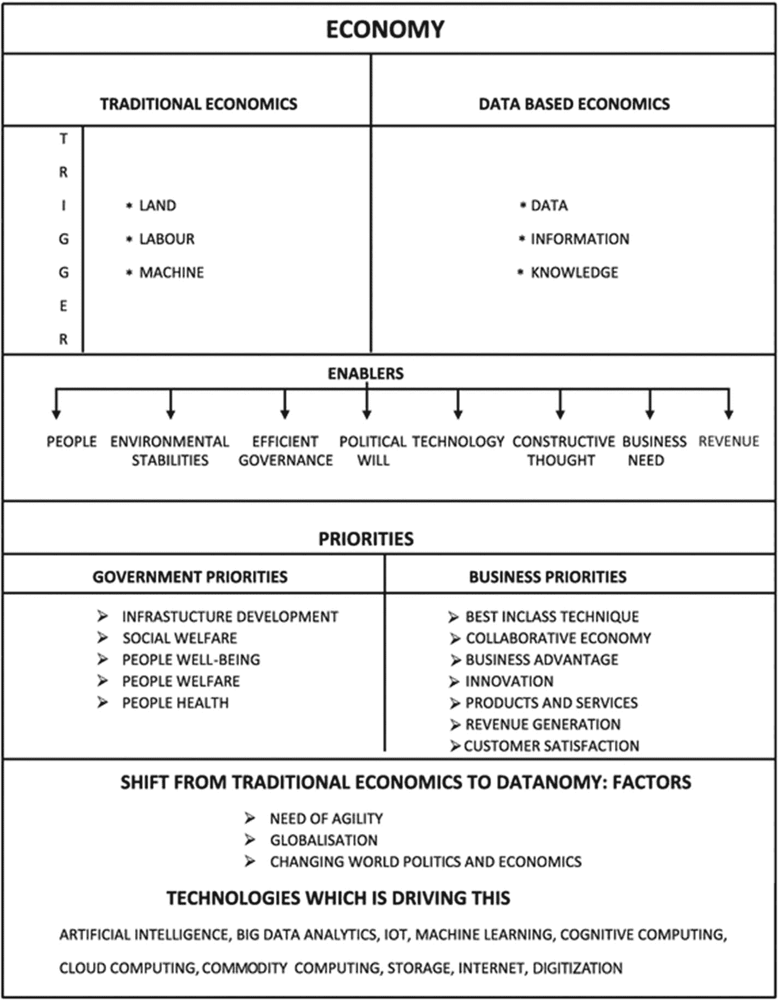
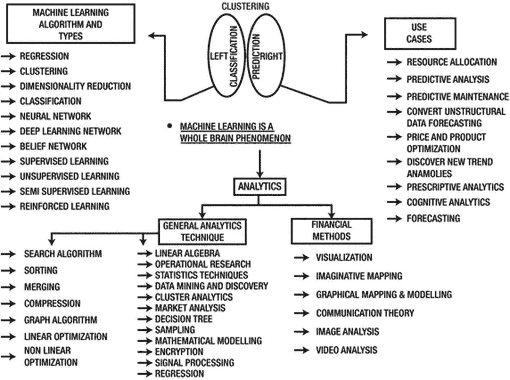
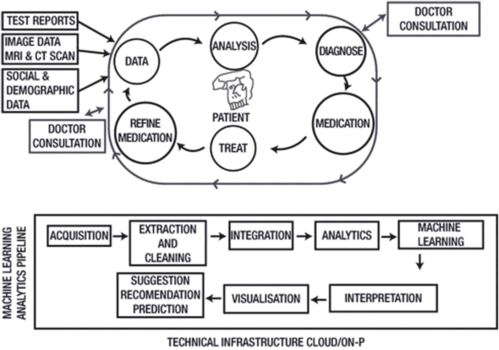
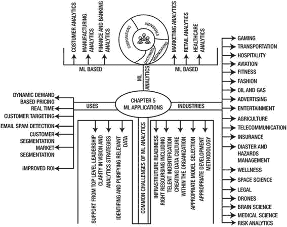

# 5. 机器学习的工业应用

Patanjali Kashyap 博士^(a*)
^a 印度，卡纳塔克邦，班加罗尔

## 摘要

机器学习即将掀起下一波数字颠覆浪潮。企业正在为此做准备。早期采用该技术的公司已从中受益。机器人技术、自动驾驶汽车、计算机视觉、自然语言处理、虚拟代理、深度学习和机器学习等技术，正是未来的技术方向。新一代机器学习应用建立在数字化基础之上。在大多数情况下，率先实现数字化的行业在机器学习领域也处于领先地位。此外，这些行业预计将推动增长。机器学习可能会加速市场份额、收入和利润池的变化。所有这些都是被数字颠覆的行业、产品和应用的典型特征。

对机器学习技术进行分类的方法有很多，但要列出一个互斥且完全穷尽的清单却存在问题。原因在于，人类通常会融合并组合多种技术来解决不同的问题。这些组合形式有时被视为独立的技术，有时被视为辅助技术的子类别，有时则被视为应用。一些框架根据基本功能（如文本、语音或图像识别）对机器学习技术进行分组，而另一些框架则根据商业应用（如商业或网络安全）进行分组。因此，机器学习在各行业的采用情况极不均衡，至少目前如此。这种技术接受趋势并非新鲜事；我们在企业接受社交技术时也曾遇到过类似行为。这表明，至少在不久的将来，机器学习部署有望在数字前沿领域加速推进。最终结果是，企业、行业和地理区域之间的采用者与落后者之间的差距日益扩大。

IT 文献中的一个传统观点是，大公司通常是创新技术的早期采用者，而小公司通常不愿成为先行者。这种数字鸿沟在机器学习领域同样存在。大公司在机器学习采用方面具有非常高的接受率和响应率。大公司中的行业、应用和产品，尤其是那些在员工数量方面具有更大优势的，比小公司更有可能采用机器学习技术。原因之一是，大公司通常能够获取更多且结构更优的数据。此外，他们拥有具备适当技术技能的员工，能够理解机器学习投资的商业案例，并有效与供应商合作。大公司还有一个额外优势，即能够进行固定成本投资，而这通常是实施机器学习所必需的。由于它最初需要较高的价格和收入基础，因此往往能产生更高的回报。商业驱动因素也因行业、产业、应用和产品而异。更有可能采用机器学习技术的企业，通常是那些流程复杂且地域分布广泛的。他们的行动由预测、快速精准的决策以及定制化客户所驱动。

本章将讨论机器学习的商业影响。机器学习以独特的方式影响着商业和经济。它改变了我们规划、行动和执行的方式。以数据为中心的机器学习和基于分析的经济正在蓬勃发展。我将其称为“数据经济”。这种经济不同于基于土地、劳动力、机器和产业的传统经济。它也不同于知识经济。这种经济建立在数据及其智能利用之上。它影响着各行各业，以及所有类型的个人、群体、社会和国家——最终影响整个世界。

## 数据、机器学习与分析

近年来，数据呈指数级增长。这推动了基于分析和机器学习的行业、技术和服务的发展。制造业、医疗保健和零售等传统行业正以超快速度采用机器学习和分析的最佳部分。与此同时，基于云的客户服务等相对较新的行业，从根本上将机器学习作为其商业模式的基础。然而，分析和机器学习并不仅限于商业、行业和企业。在宏观层面，政府政策和世界政治也受到其影响。例如，在建设“智慧城市”之前，政府必须进行大量的数据处理和基于数据的技术评估。为了制定亲民政策或预防犯罪，数据分析和洞察生成正逐渐成为政府机构的必备能力。在不久的将来，所有政策、社会福利活动和基础设施发展都将由大数据指导（见图 5-1）。

一张图表。传统经济学包含土地、劳动力和机器，而基于数据的经济学包含数据、信息和知识，并有 8 个推动因素。政府优先事项包括社会福利。商业优先事项包括创新。从传统经济向数据经济的转变包含 3 个因素和 11 项技术。

图 5-1 传统经济学与基于数据的经济学

全球大部分治理和商业生态系统已发生明显转变。基于数据的决策并非精英或小众能力，而是现实，并将持续存在。国家、次大陆和政府正在利用机器学习分析来提高其人口的生活水平。商业机构、企业和公司正在利用它来获取市场份额，并提高利润率和收入。数据正在改变经济学的 DNA 和 RNA。

本章旨在为你提供一个关于机器学习背景下各行业运作、工作机制及未来的综合性概述。本章还探讨了将机器学习应用于核心商业模式的好处，并涵盖了其对更广泛视角（如政府政策制定）的影响。同时，它还提供了针对这些特定行业的相关用例。本章讨论了一个新术语：“数据经济”。本章试图论证数据如何能够在国家、企业和商业的经济中发挥关键和核心作用。

## 什么是机器学习分析？

分析的范围非常广泛，是一门多学科科学（事实上，它常被称为数据科学）。它包含了从数学到心理学再到视觉科学等多个领域的优秀元素。因此，它需要擅长逻辑和想象力的人。能够同时运用大脑左右半球的人在分析领域更为成功。总体而言，机器学习分析包括机器学习，以及其他类型的分析（见图 5-2）。

一张关于机器学习作为全脑现象的思维导图。聚类左侧有分类，包含 11 种机器学习算法和类型；右侧有预测，包含 9 个用例。分析包括通用分析技术，分为 2 个分支，以及 6 种财务方法。

图 5-2 机器学习分析的概念视图

### 机器学习分析的必要性

机器学习分析是当下的迫切需求；众多市场与商业因素都对其提出了要求。例如，全球经济格局的持续变化、知识工作者成本的不断上升，以及客户要求降低总成本的持续压力，都迫使企业寻求创新方案来应对这些挑战。然而，在期望的领域实施机器学习分析并非易事，因为存在诸多阻力。

最终，组织必须利用信息技术（无论是否涉及大数据）来提升分析效率，从而向客户提供基于价值的服务或产品。此外，借助基于预测分析的机器学习，企业能够取得更优成果，减少合规与法律问题，并降低不必要的运营负担。这使得企业能够以更低的成本为客户带来更高水平的满意度。简而言之，如果正确应用机器学习分析，可以实现以下益处：

*   基于数据的、持续优化的动态组织战略
*   提升客户与利益相关者的参与度
*   改进且透明的数据驱动治理
*   优化的服务交付模式
*   基于事实与数据的成果衡量改进
*   提升核心竞争力
*   减少欺诈损失
*   实现最优定价，提升盈利能力
*   提高营销投资回报率
*   降低信贷损失

### 机器学习分析面临的挑战

以下是组织在准备和实施机器学习分析阶段遇到的一些主要挑战：

*   以统一方式整合不同形式的数据
*   管理从异构来源接收的海量数据
*   技术的集成与互操作性
*   梳理并定义整个组织的数据需求
*   文化转变与变革阻力
*   缺乏合适的人才
*   缺乏统一的数据模型
*   缺乏安全模型/框架/标准
*   基础设施不足
*   缺乏合规标准
*   定义合适的指标来衡量实施效果

然而，通过对受影响方进行恰当的解释、说明与教育，这些“阻力”可以被减少或消除。实现更好的业务成果、监管合规和战略目标所面临的复杂性，意味着组织需要在客户关怀方面更加积极主动。当前的技术已允许解决方案提供商在跨不同系统（运行数据库、数据仓库以及结构化或非结构化数据集）上执行数据分析，而不会影响日常运营或访问现有数据。有些组织已经实施了分析，而另一些则处于更高级的阶段。

### 机器学习分析的业务驱动力

组织始终有动力去挖掘市场潜力并赚取利润。然而，实现这一目标并非易事。盈利并成为领导者受到多种因素的驱动，包括社会、政治和环境因素。其中最重要的因素是价格、收入、效果和效率驱动因素。以下是组织在市场中脱颖而出需要考虑的一些重要驱动因素。

成本与收入驱动因素：

*   为已证明的服务和产品实现有效定价
*   最小化损失
*   提高效率并充分利用产能
*   获取市场份额
*   建立品牌
*   刺激需求增长

效率与效果驱动因素：

*   需求与供应预测的准确性
*   库存管理

组织押注机器学习分析，是因为他们明白，在这个数据驱动的世界里，利用这些技术能够取得成功。

### 行业、领域与机器学习分析

基于机器学习的分析有可能适用于所有行业和领域。以下部分讨论了一些已经将基于机器学习的分析作为解决方案的领域。

#### 基于机器学习的制造业分析

制造业以其严格的流程导向、文档记录、程序合规、流程矩阵、风险与质量框架以及详细的报告而闻名。技术领域，特别是数字化、制造组织/企业以及通过遥测、传感器和其他机器生成数据补充的生产和技术日志领域，出现了蓬勃发展。它们正在利用机器学习、物联网、云计算和数据科学技术来帮助客户。一场静悄悄的革命正在发生，它将数据转化为多种用途的宝贵工具，包括盈利能力和生产力。其应用涵盖化学、气象、汽车以及制造业的许多其他领域。从历史上看，与金融、客户服务和医疗保健等其他行业相比，制造业对采用机器学习技术的热情并不高。然而，机器学习分析在各行业的广泛成功已促使领导者们采纳它。

#### 在制造业实施机器学习面临的挑战

*   缺乏适当的基础设施以及将机器学习应用于业务问题的意识。
*   缺乏适当且高质量的数据。
*   数据标准化问题。
*   由于对业务需求缺乏足够了解和清晰认识，导致组织内缺乏应用机器学习的承诺。
*   组织内缺乏数据文化和思维模式，使得机器学习实施无法服务于日常工作。
*   缺乏具备扎实机器学习知识的合适人才。

# SCADA系统、数据分析与机器学习在制造业中的应用

遗留系统的集成是制造组织面临的一项挑战，它们传统上使用老旧系统。引入新系统和技术并将其集成到现有的技术流程生态系统中并非易事。

统一的数据模型同样具有挑战性，需要整合不同的数据模型并使其相互共享数据。然而，随着分析运营（类似于DevOps）等新业务和流程模型的出现，这一问题将得到解决。

联网的分散控制系统（尤其是通过互联网连接的系统）带来了安全挑战。它们虽有利于快速响应变化的情况，但也可能使系统暴露于黑客的非法、未经授权和不受欢迎的访问之下，这些黑客可能破坏系统或导致中断。物联网设备通过网关相互连接并接入网络，这潜在地允许从任何地方控制和访问系统、机械和设备。使用智能软件和系统可以有效地降低这种风险。

## SCADA 与 PLC 的案例

一种名为`监控与数据采集系统`（SCADA）的系统旨在监控和管理远程站点的现场设备。SCADA系统至关重要，因为它们能够收集并处理实时数据，从而维持运行效率。SCADA是一个集中式系统，负责监控和管理整个区域。

PLC与SCADA的区别在于，PLC基于硬件，而SCADA基于软件。两者都属于“控制系统”范畴，但SCADA凭借其众多组件，拥有比PLC更强大的功能。

SCADA系统通常用于监控和管理石油天然气、电力生产、水处理以及制造业等行业中的关键流程和机械设备。然而，为了在性能和效率方面充分发挥SCADA系统的优势，你需要使用数据分析和自动化技术，这些技术有助于简化流程、降低成本、提升质量并增强安全性。

## 数据分析工具

数据分析工具是一种软件程序，可以帮助你收集、处理、可视化并解读来自SCADA系统的数据。借助数据分析工具，你可以进行预测性和规范性分析，并发现数据中的模式、趋势、异常值和相关性。通过使用数据分析工具，你可以深入了解SCADA系统的运行状况，包括其效率、生产力以及能源消耗情况。

SCADA系统通常用于监控和管理石油天然气、电力生产、水处理以及制造业等行业中的关键流程和机械设备。然而，为了在性能和效率方面充分发挥SCADA系统的优势，你需要使用数据分析和自动化技术，这些技术有助于简化流程、降低成本、提升质量并增强安全性。

### 自动化工具

你可以利用自动化技术来对SCADA系统中的流程、工作流和操作进行自动化。通过使用自动化解决方案，你可以减少人工干预、人为错误和操作风险，并提高一致性、准确性和速度。随后，你可以使SCADA系统的各项功能（如数据采集、传输、存储、备份、恢复以及数据安全）更加高效。自动化工具还可用于实施自适应控制、反馈控制、前馈控制、串级控制以及其他先进的控制系统。

### 数据分析与自动化的集成

通过结合数据分析与自动化解决方案，你可以提升SCADA系统的有效性和性能。通过将数据分析与自动化技术相结合，你可以构建一个反馈回路，使SCADA系统能够从数据中学习、适应不断变化的条件，并执行相应的操作。例如，可以使用数据分析工具来跟踪和预测电网中的能源供需情况，并利用自动化技术根据需要调整电力的生产和分配。通过这种方式，你可以平衡负载、减少损耗并节省成本。

### 数据分析与自动化的优势

数据分析与自动化技术可以从多个方面提升SCADA系统的性能和效率，包括改进决策、提高性能、降低成本以及增强安全性。例如，通过提供准确、及时且相关的信息和建议，数据分析与自动化解决方案可以优化你的决策过程。此外，它们通过优化影响流程和设备输出及质量的参数、设置和变量，最大限度地减少浪费、返工和缺陷，从而降低成本。通过预防可能危及人员、环境或设备的危险、风险和事件，它们还能提高安全性。

## 制造业中机器学习分析的驱动因素

将大数据分析、物联网技术与机器学习相结合，可以使组织和制造商受益。在故障发生前进行分析和预测的能力将成为机器学习的一个有用特性，一些制造企业已经在利用它来最大限度地减少生产损失以及风险和财务损失。及时的预测有助于在生产与规划中实现更高水平的效率和效果。在制造业中，机器学习技术有数百种应用和用例。

机器学习分析的一个重要用途是让用户能够实时跟踪需求并预测波动。这有助于组织优化其需求并及时做出响应。这实际上提高了以平衡方式管理供需的效率。最终，这些将促使成本、废料和冗余最小化。机器学习分析可应用于制造业的多个领域，从生产规划到产出优化。以下是推动机器学习分析应用的一些因素：

- 高效的生产与运营管理
- 工厂优化
- 有效的需求预测
- 准确且主动的错误检测
- 高效的绩效管理
- 更好的预测性维护与互操作性
- 设备故障预测
- 有意义的模式识别
- 增加收入和盈利能力
- 提高员工积极性
- 通过技术采用保持市场相关性和领先地位

## 基于机器学习的分析：制造业中的应用

机器学习分析有可能应用于制造业的各个层面，从降低成本到提高效率。以下是一些用途：

- `机械监控与预测`：持续监控机械/设备并预测其健康状况和状态。借助机器学习分析，可以收集所有关于设备和机械的信息并建立基准。这反过来又能比较机器、生产线和工厂，以推动持续改进。

- `通过预测分析进行预测、需求与营销管理`：机器学习的这些功能帮助制造组织根据市场需求找到特定机械的合适推出时间。同时，它们还能制定具体的营销计划。机器学习也可作为制造组织有效的营销活动工具。

- `智能质量保证`：利用机器学习分析，实时持续监控将成为现实。这对于监控已售产品或生产过程中的产品将变得非常重要。这使得质量检查变得简单有效。如果产品有缺陷，很可能会在早期被发现。因此，机器学习通过在造成损害之前收集、识别并预警质量问题，有助于减少测试需求。基于机器学习的分析通过提高整体质量，提升了机械/设备/产品的效率和有效性。

- `能耗优化`：借助实时跟踪和预测能力，现代机器学习设备能够捕捉需求波动并预测能源消耗模式。这些洞察被用于优化能源消耗。

- `使用正确的分析模型预测部件故障`：预测建模是一种流行的预测行为统计方法。这种称为预测建模解决方案的数据挖掘技术，通过分析过去和现在的数据来创建模型，并用于预测未来结果。例如，使用装袋决策树预测借款人的信用评分，或使用神经网络确定一杯葡萄酒来自哪个酒庄。曲线和曲面拟合、时间序列回归以及机器学习技术常用于预测建模。

    复合分析模型在应用统计分布预测故障之前，增加了一个探索性步骤。需要探索的数据量巨大，涉及识别各种数据元素之间的关系，以及识别性能相似的设备、从数据中发现故障的常见原因等。关联分析和决策树等技术能有力地帮助执行此类分析。这反过来有助于降低维护成本、提高产品成功率并确保客户满意度。

- `深入理解根本原因`：通过找到真正的根本原因来解决复杂的工厂问题。因此，频繁出现的问题不会影响生产力和效率。假设情景分析和模拟是两种实现方式。当它们与机器学习分析相结合时，能产生出色的结果。

## 机器学习分析在制造业中的其他用途

机器学习在制造业中应用于多个层面。因此，其用例也存在于从设备维护到预测和预报未来事件的所有层面。以下是一些被捕捉的应用场景：

- 制造流程优化与改进
- 供应链与价值链优化
- 通过基于数据预测结果来降低研发成本
- 智能电表与电网管理
- 预测资产故障
- 利用历史数据、趋势和特定于制造的算法，主动管理潜在的资产故障
- 减少停机时间。洞察最常见的停机原因，有助于专注于对业务损害最大的停机问题
- 提高机器/系统的产能利用率。实时资产利用率和智能停机统计使组织能够在正确的时间最大化利用正确的资产
- 擅长监控监管信息、产品出生证明以及设备的追踪与追溯
- 帮助维护关于产品的全面准确信息
- 实时制造良率优化

## 基于机器学习的金融与银行分析

金融市场总是充满活力、不断演变并乐于接受变化。该行业始终欢迎能够有效分析市场行为、情绪和金融专业人士态度的技术和新系统。最近出现了一种新的金融范式，它将行为金融学倡导者所考虑的心理特征与成熟新古典金融从业者所青睐的量化技术结合在一起。

机器学习分析是将金融的行为方面与量化方面进行分析、融合和利用的绝佳方式。机器学习分析在金融和银行业有成千上万的应用。精通且智能的移动银行应用、智能聊天机器人和搜索引擎就是其中的几个例子。维护和收集大量客户数据、保存准确的历史记录以及理解金融世界的量化/数字本质，是机器学习在金融和银行业得以应用的触发因素。

### 在银行和金融机构实施机器学习分析的挑战

机器学习分析的实施涉及战略、财务、流程导向和技术等多个方面。因此，实施之路并非一帆风顺，会遇到一些非常严峻的挑战。以下是该行业在实施机器学习分析时面临的一些挑战：

- `预测错误`：人工预测会带来错误。
- `处理不确定性`：数据孤立存在，关联、分析并从中获取洞察是最大的挑战。
- `数据的统一视图`：事实、数据和数字来自组织内不同领域和不同系统，并以各种形式存在。整合这些统计数据是一项巨大的挑战。
- `协作与沟通`：整合来自多个来源的输入，对其进行分析，并以决策者能够理解且有意义的格式沟通结果或输出，是另一个重大挑战。
- `实时结果`：每个人都希望利用可用信息实时更新。在需要时即时提供所需信息是一项巨大的挑战。

# 金融机构采用机器学习分析的驱动因素

数据安全：由于多种未知原因，大多数数据存在于云基础设施上，有时甚至存在于公共云上。因此，数据被篡改的风险增加了。

大规模应用/实施机器学习分析技术的驱动力，在于为客户提供完美的解决方案。该行业正在积极寻找具有卓越价值主张的解决方案/产品。为此，他们正在整合不同产品的精华元素、客户行为数据、营销策略、可用财务输入、地理详情以及多渠道分析。然而，这也给银行和金融机构带来了最大的挑战之一。通过有效利用数据科学来设计针对合适客户的新产品和服务至关重要。因此，银行正在运用机器学习分析技术，构建灵活且集成的流程，以更好地了解客户。他们通过分析客户的购买习惯并洞察其互动渠道来实现这一目标。这对于银行以高效和优化的方式销售其产品至关重要。将机器学习应用于个性化产品推荐，是下一代银行业成功的关键。

- **优化商业策略**：借助基于数据的机器学习动态建模，金融机构可以制定更有利可图且以客户为中心的策略。保持市场竞争力是最大的驱动因素之一。数据是董事会中正在发生的变革的灵魂，它已被记录并公认为关键的业务优势。决策者应了解他们目前可以访问哪些数据，以及从何处获取更多适合其企业未来发展的数据。谷歌、亚马逊、Netflix 和 Facebook 是最常被引用的例子，这些公司围绕数据制定战略，并以巨大方式颠覆了市场。它们从根本上转变了企业文化，从传统的业务运营方式转向基于数据和创新的运营模式。这种转变开始产生回报，如今它们的大部分收入都基于对数据的智能和巧妙运用。它们从客户日常使用其服务所产生的海量数据中提取洞察，并反过来利用这些数据制定盈利策略。
- **让数据可用**：一项关键能力是让那些无法以关系型格式获取，或无法用传统方法分析的数据变得可用。当今产生的数据中，有很大一部分是“平面数据”，这意味着它没有关系结构。据估计，90% 的数据是平面数据。让这些数据可用需要能够高效处理大量不同类型数据的新方法——例如，`NoSQL` 和 `Hadoop` 技术。
- **稳健的风险管理**：金融机构是黑客、攻击者和欺诈者的主要目标。因此，稳健的风险管理是强制性的。机器学习分析是实现这一目标的方法之一，通过使用自动异常检测技术和实施其他算法方法。
- **更好的营销**：客户细分、活动管理和潜在客户生成等技术，有助于金融机构在这方面表现更佳。
- **渠道执行**：向客户提供最佳可用优惠，有可能提高组织的盈利能力和销售业绩。因此，这也是实施基于机器学习的分析的主要驱动因素。
- **卓越的客户体验管理**：在变革的时代，通过向客户提供实时信息来吸引他们是最大的挑战之一。随着虚拟代理（聊天机器人）的出现，根据客户的需求、行为和财务状况建议下一步最佳行动，有助于建立客户忠诚度。因此，这是实施机器学习分析的驱动因素之一。
- **客户洞察**：通过情感分析、社交媒体分析和客户盈利能力分析来获得市场优势，是金融机构的重要驱动因素。

# 基于机器学习的分析：在金融机构中的应用

基于机器学习的分析在金融和银行生态系统中扮演着至关重要的角色。其应用广泛且多维，包括欺诈检测、贷款审批、风险处理以及保障在线交易安全。

- **违约贷款识别与预测**：金融巨头使用机器学习来预测不良贷款。原因很简单，如果应用得当，学习算法可以很容易地根据客户数据进行训练。例如，基于算法的模型可以使用与客户年龄、工作、婚姻状况、财务状况以及历史与当前贷款支付相关的数据来生成洞察。系统收集并分析这些数据，然后进行处理。这一执行流程通过寻找以下问题的答案来确定客户财务行为的事实：客户是否按时还款或违约？他们的在线行为如何？他们是否曾卷入任何类型的金融欺诈或其他欺诈？等等。
- **良好的决策制定**：机器学习分析有可能自动化端到端流程，从数据收集到生成可操作洞察，再到从可用选项中建议最佳行动。预测性、感知性和认知性洞察远不止提供“做什么”的想法，而是延伸到“何时做”以及“如何做”。
- **欺诈检测**：金融欺诈是金融机构关注的主要领域。机器学习系统可以识别独特的行为或活动，检测异常并标记它们。通常，机器学习欺诈检测解决方案可以使用基于算法的模型分析可用的历史交易数据，该模型能够识别客户进行的交易和活动中的欺诈模式。然而，挑战在于训练系统检测误报情况。当合法交易被识别为风险并被标记时，就会发生误报。
- **交易算法**：在当前市场状况的背景下，基于算法的交易正变得越来越流行。算法交易的概念是多方面的，并且与全球所有金融市场都相关。它们涵盖了几乎所有重要领域，如股票、固定收益和货币。机器学习分析正在为制定盈利交易决策的算法中发挥作用。算法交易，也称为高频交易，有助于自动化或创建足够智能的系统，在海量数据集中发现有用模式，以获取与交易决策相关的盈利决策。机器学习分析在通过工具提取市场趋势的任何隐藏洞察方面极其高效。机器学习交易系统通常每天进行数百万次交易，金融机构在近期也变得更具技术性。
- **客户服务**：金融领域的专用聊天机器人正变得越来越流行，因为它们能为客户提供答案。这些聊天机器人也被称为虚拟助手。它们使用英语等自然语言与客户沟通。它们包含智能且高效的自然语言处理引擎以及大量金融领域客户互动的数据。聊天机器人不仅限于银行和客户服务领域，它们也被用于许多其他行业。（详情请参阅本章的聊天机器人部分。）
- **情感分析**：这正成为更重要的软技术工具之一，并且随着时间的推移，它将确立自身作为有效处理组织、市场和商品商业智能与绩效评估的重要因素/技术之一。基于不同商品期货价格新闻所捕捉的情感，被用于制定可盈利的基于情感的交易策略。新闻和观点在金融领域非常重要，因为市场动态在很大程度上依赖于它们。结构化和非结构化数据经过分析、处理和呈现，为相关利益方提供有价值的见解。例如，为了提高交易员和营销人员的绩效，情感挖掘可应用于新闻、微博和在线搜索结果的文本挖掘。在情感分析过程中，大量数据被净化，并从中提取信息。这些信息进而被用于制定可执行的路线图。从金融角度来看，情感分析在交易、基金管理、投资组合开发、股票动态分析以及风险评估与控制中发挥着作用。
- **金融与保险产品及服务的推荐**：金融公司/机构、银行和保险组织现在已开始频繁使用机器人顾问向客户推荐产品和服务。即使在诸如根据当前财务状况和行为状况建议投资组合变更、从一项服务切换到另一项服务等领域，公司也在使用机器学习技术。未来几年，这些功能将变得更加可靠，客户也会像信任 Flipkart 等电商产品推荐网站一样，更加认真地对待它们。

# 机器学习分析在金融机构中的其他用途

机器学习分析有可能应用于银行和金融的各个层面，从降低成本到提高效率。以下是一些用途：

- 以自动化方式理解并分析组织的财务绩效。
- 基于数据，帮助管理和维护组织有形及虚拟资产的价值。
- 智能管理公司的投资。
- 在坚实的数据驱动决策基础上，预测和预报市场变化，从而强化信息系统的功能。当这些预测与数据驱动的文化相结合时，结果便体现为优化的业务流程和利润。
- 机器学习分析是强化合规与监管要求的关键技术。它用于交易审查，能够识别异常的交易模式和行为。
- 客户细分是机器学习的另一个非常有用的领域。银行和金融机构的愿景正从以产品为中心转向以客户为中心。因此，通过处理数据并检测有用信息，机器学习分析被用来实现这一愿景。
- 企业正在使用机器学习分析进行个性化营销。金融机构借助分析技术为客户提供个性化产品。此外，它还被用于创建客户或财产的信用风险评估。这为金融机构提供了洞察，以判断是否继续进行某项交易。
- 用于更好的风险管理。例如，提供实时预警（如果风险阈值被超过）。另一个例子是发现金融系统中新的复杂交互，并进行高级风险建模。
- 用于增加银行业的销售额和收入，因为它有助于及早识别与客户流失相关的风险，并据此实施重新谈判策略。
- 用于优化熟练劳动力。这有助于金融机构以优化方式利用现有技能，并降低整个组织（包括前端和后端）的运营成本。
- 优化分行和 ATM 网点。
- 根据客户偏好（通过分析多模式/多渠道数据，如社交媒体、移动端和网页端获得），将电话适当路由至呼叫中心。这最终有助于提高客户满意度并降低整体运营成本。
- 金融市场的概念很广泛，包括多种市场，如股票、商品、加密货币和外汇市场。金融时间序列是通过在预定时间段内按固定间隔追踪资产价格而在金融市场中产生的。所有金融时间序列都是随机且可变的，即使它们根据市场有不同的数值范围。金融时间序列根据数据点之间的时间间隔，分为逐笔、分钟、小时、日、周、月等类型。为了创建有可能产生可观回报的成功证券交易技术，必须进行金融时间序列预测（也称为价格预测）。
- 研究人员已经为金融时间序列创建了许多预测技术。用于分析和预测金融市场行为的最广泛使用的技术包括经典统计技术，如自回归积分滑动平均模型（`ARIMA`）、指数平滑模型（`ES`）和广义自回归条件异方差模型（`GARCH`）。近年来，得益于计算能力的快速提升和通过互联网获取海量数据的便利性，机器学习技术已成为预测问题的最佳方法。众多机器学习模型，如神经网络（`NNs`）、支持向量回归（`SVR`）和随机森林，在预测金融时间序列方面已展现出卓越的准确性，并在商业应用中变得越来越普及。

# 基于机器学习的医疗分析

医疗行业影响着我们每一个人。创新技术正在改变传统医疗机构的工作方式。短短几年间，它已从医生主导的行业转变为技术驱动的行业，包括分析在内的各种技术如今在管理患者群体健康方面发挥着关键作用。机器学习分析是在控制成本的同时改善治疗结果和成效的绝佳方法。机器学习与深度学习结合人工智能，正在通过变革医疗行业赋予其新的意义和方向。例如，深度学习算法通过将影像数据库与能够自动发现并向医生提示问题的算法和模型相结合，教会计算机读取医学影像。准确的影像诊断帮助数百万人及时获得适当的药物治疗。因此，这有助于挽救数百万人的生命。

医生们也在接受这种变革，因为它增强了他们应对癌症、艾滋病等危及生命挑战的能力。借助所有可用信息，系统试图在现有数据点中寻找模式和相关性，并将其与相关数据集进行比较（见图 5-3）。整个过程在几分钟内完成，最终向医生建议合适的治疗方案。

两个流程图。上方：医生咨询流程包含数据、分析、患者诊断、用药、治疗和调整用药。下方：一个管道流程包含采集、提取、清洗、整合、分析、机器学习、解读、可视化以及建议、推荐和预测。

图 5-3 医疗分析工作流程

机器学习系统提供的建议反过来可以由医生根据您的需求和个性化健康状况进行定制。这听起来像科幻小说，但并非如此。`IBM` 的 `Watson` 和 `Baby Watson`（一种认知计算系统）已经在做类似的事情。此外，一家名为 `AiCure` 的公司基于人工智能的平台可以利用面部识别技术确认患者是否服用了所需剂量的药物。同时，它还提供实时摄入确认和自动药物识别。`AiCure` 是一个经过临床验证的平台，可在智能手机上运行。`AiCure` 在开展临床试验的制药公司中非常受欢迎，因为在这些试验中，按时服药至关重要。

### 在医疗领域实施机器学习分析面临的挑战

机器学习分析有可能应用于医疗保健的各个层面，从降低成本到提高效率。然而，它也有其自身的挑战，尤其是在像这样传统上组织混乱的领域。以下是医疗机器学习分析中存在的一些挑战：

*   **缺乏集中信息**：医疗机构需要一个集中的信息数据库来保存患者记录。这有助于医疗机构更好地管理其数据。企业主患者索引（`EMPI`）是医疗机构用于此目的的数据库。它保存着关于患者的一致、准确且最新的健康、人口统计和关键治疗数据。该数据库通过收集和存储特定患者访问医疗机构多个部门所产生的数据（可能包括社交、个人及其他形式的数据）来构建。通常，患者会被分配一个唯一标识符，用于在整个企业范围内引用/识别他们。`EMPI` 只有在能够跨所有数据集唯一识别患者记录时才有用。真正的挑战在于如何一致地实施这一点。由于多种原因，例如技术实施不正确、新系统与遗留系统缺乏集成等，这并未在所有地方实现。

*   **不同格式**：医疗和临床数据包含与现行编码方案不同的代码。用于临床目的的编码方案通常是 `CPT`、`ICD9`、`ICD10` 和 `NDC`。这些代码包含非标准编码方案，因此需要进行转换，以便为数据分析建立通用字典。

*   **非结构化数据**：来自医疗系统的数据源大多是非结构化的（占 80%），并以 `HL7` 等平面文件格式提供，在投入使用前需要进行反序列化。一旦这些文件被反序列化，就必须将其转换为临床处理管道可用的格式。此外，数据通常分散在包含数百万行的多个平面文件中。因此，需要强大、有效且高效的提取-转换-加载（`ETL`）流程。

医疗机构将患者的健康记录和健康信息保存在其数字数据存储中（有时也采用传统方式），用于记录和分析目的。显然，这些数据包含敏感内容。因此，信息保护至关重要。试想一下，如果包含患者信息的数据发生泄露会怎样。关乎生命的数据必须得到尽可能的保护。机器学习分析是保护信息的重要武器。机器学习算法/系统/解决方案能够识别网络或数据存储中的异常行为。当未经授权访问数据的人试图篡改或窃取数据时，就会发生这种情况。

全球隐私法强制要求保护三类主要个人数据：个人身份信息（`PII`）、支付卡行业（`PCI`）数据和受保护健康信息（`PHI`）。任何包含 `HIPAA` 列出的 18 个组成部分之一的健康信息都被视为受保护健康信息（`PHI`）。研究中使用的、不被视为 `PHI` 且因此不受 `HIPAA` 隐私和安全规则约束的数据被称为个人身份信息（`PII`）。《健康保险可携性和责任法案》（`HIPAA`）是一套旨在保护来自医疗机构、保险公司和医院的患者信息的法律要求。

`PII` 包括任何单独或与其他信息结合可用于识别个人身份的信息。面部照片本质上是 `PII` 数据。有时信息被视为 `PII`，是因为当与额外的主题信息结合时，它可能被用来识别该主题。正是由于 `PHI` 和 `PCI` 的子类别非常敏感，因此有必要对其进行监管。这就是美国对 `PII`、`PCI` 和 `PHI` 进行区分的原因。当主要信用卡公司成立一个独立机构来制定保护 `PCI` 的规则，并对处理 `PCI` 的组织施加合同约束时，私营部门主动解决了 `PCI` 问题。

如果您能洞察组织内部存在的数据及其存储位置，您就可以决定需要采取哪些步骤来遵守有关 `PII`、`PCI` 和 `PHI` 的相关法律或行业标准。人工智能可以通过在跨多种语言的非结构化数据中定位多个 `PII`、`PHI` 和 `PCI` 实体来帮助做出该决策。利用机器学习的最新进展，可以减少识别和分类数据所需的时间，这也将使合规变得更加容易。例如，一家名为 `Private AI` 的创新公司就从事此项活动。

### 医疗行业机器学习分析的驱动因素

机器学习分析在预测和预报不良状况方面至关重要。通过预测，医疗专业人员及患者亲属收到的通知/警报，使他们能够采取主动预防措施，以利于患者。因此，疾病治疗与预防的结果，或受试者的健康状况得以改善。此外，它还可应用于对当前医疗相关政策与规程进行动态评估，以制定新的或修订后的政策。患者信息通常可通过多种渠道和来源获取，因此数据分析变得相对容易。以下是关于患者的一些重要信息来源。将这些信息关联起来，能提供关于患者的隐藏洞察，这将极大提升治疗效果。

*   扫描报告
*   健身追踪器
*   物联网设备
*   基因测序
*   药物研究
*   临床试验
*   地理记录
*   文化信息
*   社交媒体
*   治疗记录
*   其他患者相关记录（例如与特定患者相关的医生/护士对话）

所有这些因素共同驱动着医疗领域的分析。应用机器学习分析能同时惠及多个利益相关方，包括但不限于患者及其亲属、保险公司、医生等。

### 基于机器学习的分析：在医疗行业的应用

机器学习分析有潜力应用于医疗保健的各个层面，从降低成本到提高效率。以下是一些应用实例：

*   影像分析：通过训练计算机自动读取、处理和诊断医学影像数据，机器学习分析可用于基于患者基础医学影像数据自动处理并诊断病情。例如，机器学习分析公司 `Zebra Medical Vision` 拥有一个临床研究平台，为医疗行业提供下一代影像分析服务。其影像分析技术帮助医疗机构识别特定疾病的高风险患者，从而使医疗专业人员能够提供预防性治疗路线图，以改善患者护理。他们的平台名为“`Zebra 平台`”，已通过利用数百万病例验证的影像洞察，开始为医学界做出贡献。其算法应用于骨骼健康、心血管分析以及肝脏和肺部指征等领域。

*   药物开发：药物开发面临的挑战之一是充分的测试。正在开发的药物可能含有副作用未知的新生化学物质。因此，在向公众推出之前，需要在真实受试者身上进行测试。然而，由于生命威胁和伦理问题等多种原因，受试者的可用性对制药公司来说是一个挑战。机器学习分析通过使用预测建模提供了非常便捷的解决方案。它们能准确预测药物对具有特定医疗状况下特定反应的个体患者会产生何种效果。例如，`Life Extension` 和 `Insilco Medicine` 公司共同开发了基于人工智能的抗衰老技术，以寻找能够模拟与健康和长寿相关的多种已知干预措施和通路中组织特异性转录反应（即细胞调控 DNA 向 RNA 转化的过程）的营养保健品（药用级和标准化营养素）。这反过来提供了真实的人体组织模拟，有助于药物测试。

*   合规性：机器学习在发现模式方面表现出色。因此，公司正利用机器学习检测模式，以阻止对诊所和医院中患者医疗记录和病史的未授权访问，并合法实施访问控制。例如，健康数据保护初创公司 `Protenus` 正在构建一个足够智能的系统，用于判断患者数据和记录何时被不当访问。其产品帮助医疗系统理解医疗记录被访问的方式和原因。

*   患者的实时监测与护理：传统医学与智能物联网传感器的结合，为医学科学和医疗保健开辟了新的可能性和途径。机器学习、分析和物联网有助于实时收集并无缝聚合疾病和医疗数据。医学正作为由互联设备、传感器和技术组成的更大生态系统的一部分运行。从患者身上提取或捕获的传感数据通过网络传输到云基础设施。然后，机器学习分析从这些数据中获取实时洞察。在医学科学和医疗保健中使用传感器并非新鲜事。体温计、血压监测仪、尿液和妊娠分析试纸都是该领域长期使用的传感器。然而，这些传感器是“哑”的，而通过使用机器学习分析为这些设备注入智能，是一种惠及行业及其患者的新现象。

*   危重疾病决策支持：对于传染病，基于机器学习的动态模型非常有效。通过使用马尔可夫决策过程（`MDP`）等算法创建，并经由强化学习优化的模型，能够生成模式。医生从而获得更好的数据点来治疗疾病。这一策略有助于快速做出有效决策。

## 有效利用非结构化文档

疾病是按时间顺序发展的。患者对于病情进展或好转的确切时间信息有限。因此，定期检查以及患者收集的其他形式数据很有帮助。但挑战在于，这些数据通常以非结构化格式（处方、扫描报告、检验报告等）存在。然而，如果能够正确且高效地解读这些数据，它们就能阐明疾病的时间发展路径。通过对聚合的大数据集进行分析可以实现这一点。机器学习分析通过有效解码数据集并从中获取洞察，提供了解决方案。一旦数据被分析，它甚至能预测患者未来可能患上哪些类型的疾病。例如，基于腹部超声报告，结合肝功能和肾功能检验报告，支持机器学习的系统可以预测患者患上肾病的可能性，甚至预测可能发生的时间。医生也可以利用这些洞察来回答患者的问题。

## 关联历史与当前数据以获取健康洞察

对所有事件、治疗、行为方面和健康趋势的数据进行分析，有助于正确诊断疾病。将历史处方信息与最新的健康数据关联分析，能呈现患者健康状况的真实图景。此外，算法模式提取和机器学习分析能够揭示那些尚未被确诊患有某种特定疾病，但其医疗历程显示他们可能患有或正在患有某种特定疾病的患者群体。

## 利用智能分析进行有效临床试验

制药公司现在利用分析技术，在为患者选择特定临床试验之前，分析纳入和排除条件的影响。

## 治疗与药物市场规模评估

这是通过考虑药物的使用、转换、提供者类型以及标签内/标签外处方模式等因素，分析市场上产品的当前状况，以了解潜在市场规模。基于分析结果，可以识别出机会。

## 远程医疗

机器学习解决方案通过移动设备或其他便携设备远程分析患者健康状况，然后实时与相关医疗记录进行比对，预测健康状况，并建议健身计划或对可能出现的疾病发出预警。

## 智能诊断设备

利用机器学习和其他人工智能技术，无需人工干预或协助即可进行简单的医学检测，如血糖检测、血压监测以及识别“发烧”程度。这有助于医生、护士和其他医疗辅助人员将精力集中在更重要的工作上，而非处理与患者相关的常规事务。

## 精准诊断

由机器学习驱动的分析工具，利用历史医疗数据和患者档案，能够更快速、更准确地识别和分类疾病。

## 识别公共卫生威胁及最高风险患者

初级医疗工作者将掌握关于预防措施的信息，这些措施包括医疗服务以及生活方式和环境因素，如营养、运动史和避免污染。同时，医院管理人员将能够以目前无法实现的智能方式，更好地预测入院高峰。他们将能够更有效地追踪传染性病毒的发生。此外，结合个人医疗记录、天气数据以及地理、文化等信息，将帮助机器学习工具对需要住院治疗的人数做出智能预测。

## 机器学习分析在医疗行业的其他用途

*   预测患者的终身价值。
*   预测患病客户流失的风险。
*   追踪患者的行为变化以提供合适的药物。
*   基于可穿戴设备接收的数据创建有效的应急系统。
*   实时分析疾病的严重程度。
*   实时分析医生的表现并提出适当的改进建议。
*   通过个性化消息、提醒和基于传感器的观察，改善和追踪老年人的健康状况。
*   预测医院中需求最高的区域。
*   通过自动化追踪更好地管理药物及其及时流转。
*   预测健康中心和医院的人员及患者入院率。
*   优化人员配置和资源分配。
*   通过分析可用的异构数据（临床/运营/行政），识别、预测和预报欺诈、盗窃、异常和浪费。
*   借助对活检、检验、扫描和核磁共振成像的准确分析，在疾病实际发生前进行诊断。
*   快速的 DNA 分析和图谱绘制。
*   降低药物测试、开发和营销的研发成本。
*   基于过去和当前数据，优化并制定精准的药物上市策略。
*   创新并发现药物的新用途。
*   优化药物组合的定价策略。
*   为医疗保险公司提供宝贵信息。
*   更准确地提供患者特异性生存预测（PSSP）。
*   协助放射科医生发现异常指征。
*   帮助医生了解其患者的风险状况。
*   改进基因组分析。
*   通过利用医疗和环境因素预测患者行为和患病可能性，优化医院流程、员工排班和会计核算。
*   智能通信终端对患者进行分类，并将其引导至合适的医生处，从而提高患者参与度并减少等待时间。

## VR 在医疗保健领域的独特应用

集成机器学习的虚拟现实已广泛应用于众多领域和行业，包括游戏、制造、室内设计、客户支持、银行、金融和时尚。苹果公司正在开发许多能够改变医疗保健行业的应用和技术。以下是这些产品的简要总结：

*   `Apple Vision Pro` 是一款混合现实头显，能够显示完全虚拟并叠加在真实环境上的沉浸式信息。但需要注意的是，该头显并非透明。你只能看到数字图像。
*   `New Vision` 是一项心理健康功能，用于监测一个人的情绪状态。它是苹果健康应用的新增功能，并通过正念应用首次在手表上亮相。用户通过滑动刻度尺回答一系列简单问题，苹果会分析汇总的健康数据以得出结论和关联。它可以进行临床抑郁症和焦虑症评估，医生可能会用这些评估来治疗更严重的疾病。
*   苹果正在通过一项新的视力方案解决近视的两个成因，即儿童近视，通过同时关注日照和屏幕距离。`Apple Watch` 中的环境光传感器会监测并激励佩戴者每天达到建议的 80 到 120 分钟户外时间。此外，由于苹果的主要业务基于屏幕，它利用 `iPhone` 上的 `FaceID` 传感器来检测设备是否过近，从而减少美国人沉迷屏幕的时间。
*   `Fitness+` 会员将不得不等待他们的 VR 锻炼，即使苹果确实发布了备受期待的、售价 3500 美元的头显。全身锻炼很麻烦，因为第一代 `Vision Pro` 需要持续供电，无论是通过插座还是需要两小时充电的额外电池组。

以下是一篇文章的链接，对于决策者来说是一篇极好的读物：[`http://economictimes.indiatimes.com/small-biz/security-tech/technology/a-virtual-revolution-in-the-head/articleshow/57932219.cms`](http://economictimes.indiatimes.com/small-biz/security-tech/technology/a-virtual-revolution-in-the-head/articleshow/57932219.cms)

## 基于机器学习的营销分析

营销的核心在于适应。新一代营销人员正在利用社交技术来衡量和了解客户。网络分析技术使组织能够追踪网络用户并了解其浏览行为。理解与追踪技术的进步是智能机器学习技术的副产品。机器学习分析在多个方面为营销提供帮助。例如，在个性化消息和产品推荐领域，其潜力巨大。这能将客户从特定网站的单纯访客转变为该网站或业务的忠实客户。客户能够与公司产生共鸣，因为感觉这家企业关心他。高度相关的成功营销会带来客户忠诚度、参与度和消费额的增长。

基于机器学习的分析使营销组织能够收集、分析和处理来自不同来源（例如，购买行为、网站访问流程、移动应用使用情况以及对以往营销活动的响应）的海量数据。实施营销机器学习分析可以弥合数据、信息和分析之间的差距。基于机器学习的分析使组织能够利用数据生成洞察，从而获得竞争优势。数据科学、数据挖掘、预测建模、“假设”分析、模拟、新一代智能统计和文本分析都可以识别数据中有意义的模式和相关性。生成的洞察能够预测不断变化的条件，并评估各种行动方案的吸引力。

## 营销中机器学习分析的挑战

这里提到了一些主要的营销分析挑战（其中大部分不言自明或已在章节前面解释过，因此在此处进行更详细的讨论）：

*   数据整合
*   寻找合适的人才和高层支持
*   行业竞争
*   替代产品的威胁
*   确定产品/产品组存在哪些类型的客户
*   实施细分并针对特定细分市场优化产品/服务
*   由于错误或不恰当地使用数据，未能专注于特定的业务计划
*   投资于产生很少或没有收入的工具
*   未能将发现结果付诸实践

你可以通过以下步骤克服这些挑战。

1.  确定并阐明你想要解决的问题领域。
2.  收集、存储、处理和分析解决问题所需的数据。
3.  确定在解决问题的过程中哪些信息可用，哪些不可用。
4.  获取不可用的信息。
5.  根据可用的信息和知识，选择解决问题所需的适当工具、技术和策略。
6.  解决问题。

## 机器学习分析在营销领域的驱动因素

当今商业由数据驱动。大数据、基于云的交付模式以及机器学习等技术正在推动数据驱动的营销和销售。因此，预测分析获得了极大的关注。机器学习分析的早期采用者已经看到了显著的投资回报。机器学习和评分技术被用于在营销和销售流程的特定节点识别金融记录、潜在客户、联系人和客户并确定其优先级。为了充分利用并提高投资回报，营销组织正将机器学习分析视为其营销技术栈中不可或缺的新组件。不同的经济部门会受到宏观经济变量（如利率、通货膨胀和 GDP 增长）以及微观经济变量（如供需、税收和法规）的显著影响。微观经济变量的其他例子包括定价、个人投资、公司市场份额、需求量、消费量、生产量、预算和投入成本。相比之下，宏观经济模型同时使用内生变量和外生变量。恒等式或随机方程都可以用来解释内生变量。模型不对外生因素提供解释。从模型的角度来看，这些因素被假定为存在。

除了提供经济状况信息外，产出增长、通胀率和利率等宏观经济指标对于确定最佳货币和财政政策也至关重要。宏观经济预测对央行官员、政策制定者和学者来说至关重要，因为它可以作为经济未来增长潜力的预测指标。实际上，经济政策的制定依赖于对经济状况的精确预测。此外，预测在家庭、企业和金融投资者的决策过程中也扮演着关键角色。

尽管精确预测宏观经济变量有诸多优势，但在过去 20 年里，更新传统模型已被证明是困难的。此外，现有文献在很大程度上忽略了经济学和机器学习中大数据的发展。借助大数据和机器学习工具，你可以做很多事情。例如：

*   使用机器学习技术进行宏观经济变量预测
*   使用机器学习技术进行金融变量预测
*   比较机器学习工具与传统计量经济学技术的预测能力
*   分析机器学习模型规范以及基于大数据的宏观经济预测的新进展

以下是机器学习分析在营销方面的一些驱动因素：

*   提高客户留存率
*   为产品/业务定位最合适的客户
*   潜在客户生成
*   销售拓展
*   机会管理
*   整合社交媒体策略
*   实时与客户互动
*   可视化整个企业的成功
*   将数据视为战略资产
*   为客户确定下一步最佳行动以吸引他们

### 基于机器学习的分析：在营销分析中的应用

营销是一个充满活力和适应性的领域。客户通过营销活动了解产品、服务或策略。以下是一些应用说明：

*   **客户细分**：客户细分模型能够高效地挖掘具有相同行为和偏好的小型、相似的客户群体。成功的客户细分能增加价值。
*   **客户流失预测**：这是通过确定过去流失客户所产生的数据集中存在的模式来实现的。支持学习分析的系统可以准确预测哪些客户流失风险较高。这种流失预防措施可以为市场提供行动方案，以留住高风险客户并与之互动。因此，如果营销人员成功做到这一点，他们就能为提高收入做出贡献。
*   **客户生命周期价值预测**：通过结合机器学习和客户关系管理（`CRM`），企业可以预测客户生命周期价值（`LTV`）。`LTV` 用于细分客户，并通过预测增长和关联性来衡量他们对企业未来价值增长或减少的贡献。
*   **客户价值最大化**：通过实施客户价值最大化技术及其建议的行动，企业可以鼓励客户增加交易频率并扩大交易规模。它还能延长客户保持活跃并与企业保持关联的时长。
*   **客户行为建模**：客户行为建模用于确定特定客户群体中观察到的共同行为和模式。同样，它也被用来预测相似客户在相似条件或情境下会如何表现。客户行为模型是通过数据挖掘客户数据构建的。在客户行为模型中，每个模型被设计为在某个时间点回答一个问题或查询。例如，可以应用一个特定的客户模型来预测特定客户群体对某个特定营销活动的反应。这将为做出正确决策提供必要的洞察。
*   **数字营销**：机器学习分析使数字营销人员能够在客户进入时进行预测、分类和区分，并个性化内容以最大化业务成果。最终，由于这种努力，客户会受到积极影响。他们看到的广告和优惠变得与他们的需求更相关、更定制化。
*   **客户排名**：机器学习分析的重要用途之一是根据商业价值对客户进行排名。这将帮助公司根据客户价值定制其产品/服务。例如，电商公司借助机器学习算法，根据客户排名动态定制和个性化页面设计、优惠、帖子和内容，这些算法可以评估每位访客的预期价值。
*   **虚拟助手**：用于为各个层级提供支持，并且正变得越来越智能。例如，聊天机器人现在可以解读两个回复之间的语义相似性。此外，它们不仅能建议措辞不同，还能建议基本含义不同的回复。
*   **让用户生成内容变得有价值**：例如，`Yelp` 利用用户上传的照片为个人摄影师创建语义数据。
*   **改善客户服务**：从海量数据中智能识别有用的数据集，并生成洞察以提供卓越的客户服务。此外，机器学习算法能发现隐藏在客户数据中的深层洞察。而且，通过找到诸如提供什么、何时提供以及向谁提供等问题的答案，它们将这些洞察转化为数据资产。

#### 术语解析

**市场规模**：市场规模分析旨在提供关于你的产品和服务市场潜力的洞察，例如特定产品的市场规模有多大。它还提供有关产品增长前景的信息。市场规模分析对于了解产品的潜在市场规模和预测至关重要。了解你的产品处于生命周期的哪个阶段，以及你是在一个增长的市场还是衰退的市场中竞争，这一点至关重要。

### 机器学习分析在市场营销中的其他用途

机器学习分析可应用于多个领域，以获取商业和竞争优势。以下是一些应用案例：

*   基于店内客流量预测来设计营销策略。
*   审查客户行为分析以确保支付安全。借助异常检测技术，即使面对海量数据/交易/通信，也能实时识别不当行为。
*   创建、分析和优化实时运营指标。
*   识别并分析根本原因。
*   设计基于数据的未来型业务与运营关键绩效指标。
*   基于实时数据进行销售预测和预报。可开发模型用于预测客户流失、信用风险或火车/公交/航班延误。
*   预测筹款活动的成功率。例如，根据元数据报告特定筹款活动的成败。
*   预测合适的买卖时机，提供有效的产品推荐，并为业务筛选最佳客户。
*   防止数据泄露。
*   执行社交语义分析。
*   执行语音和语言识别。

### 音频与视频

一系列有趣的视频，深入探讨了机器在网络广告活动中的作用，包括数字媒体在时代变迁中的角色等。请参阅以下内容：

*   [(223) 人工智能如何改变广告业 | Storyboard18 | CNBC TV18，来自 YouTube](https://www.youtube.com/watch%253Fv%253DcIT4psv0P7M)
*   [生成式人工智能热潮如何永久改变在线广告 (cnbc.com)](https://www.cnbc.com/2023/07/08/how-the-generative-ai-boom-could-forever-change-online-advertising.html)

### 零售业中的机器学习分析

机器学习正以建设性的方式改变零售业。它使零售商能够识别隐藏在未利用数据和机遇之海中的关键行动领域，并赋予他们消费和分析数据的能力——这些数据曾被认为超出了人类（至少是手动）的处理能力。这些分析使零售商能够借助客户流失分析预测未来，并做出有用的决策。由于数据采集和存储技术的进步，与产品、价格、销售、绩效、消费者行为、物流细节等相关的海量数据唾手可得。组织正利用这些信息来解码消费者的购买行为和财务基因。

#### 零售业实施机器学习分析面临的挑战

随着零售业的增长，其相关挑战也在增加。这些挑战是多维度的，影响着人员、流程和技术。本章的讨论仅限于基于机器学习的分析挑战。以下是一些关键挑战：

*   **正确数据**：收集高质量数据是最大的挑战之一。
*   **数据导向管理**：获取数据后，其管理至关重要。组织获得的大部分数据本质上是异构的，且通常来自多个来源。
*   **技术专长**：合适的人才极度匮乏。寻找数据科学家、数据工程师和技术经理等专门管理机器学习或分析项目的角色人才非常困难。
*   **集成**：在大多数情况下，组织内实施基于机器学习的分析是作为新举措来决定的。然而，如果新成立一些初创公司，情况则有所不同。但无论哪种情况，集成多个系统和技术都更为重要。因此，需要在各个层面拥有正确的策略、人才和专业知识。这有助于组织减少“孤立”系统之间的差异，并促进核心业务应用之间的数据顺畅流动。

所有项目都是独特的，需要根据情况、需求和需求来制定解决方案。因此，挑战也各不相同。然而，有一些指导方针确实有助于应对困难局面并制定适当的策略。以下是一些最佳实践/指导方针。这些内容以“零售业”为背景提出，但几乎适用于所有其他行业：

*   将信息技术融入组织的基因。
*   保持敏捷，通过试点项目快速将愿景转化为现实。
*   在数据进入复杂系统之前，或通过有效利用现有工具进行恰当且智能的过滤之前，确保数据质量良好。同时，制定简便的数据访问策略。
*   重用现有流程、技术及人员技能。必要时对人员进行交叉培训。
*   在尝试理解问题之前，先提出正确的问题并记录意见。
*   建立高效且有效的团队，以理解和解读问题。同时，努力将合适的人放在合适的岗位上。
*   根据自身需求选择技术，而非跟风炒作。
*   产出易于且有效付诸行动的洞察。

#### 零售业机器学习分析的驱动因素

*   为客户提供可靠、量身定制、个性化的产品组合和合理定价，从而增加销售额。
*   在市场中脱颖而出。
*   采用“我的首创”方法，成为市场差异化因素，并提供创新产品以打造差异化的客户体验。
*   通过理解客户行为和购物模式来提高客户忠诚度。
*   基于客户特征和心理开展精准营销活动。
*   通过改进库存、价值和供应链管理来降低成本。
*   提高通过多渠道了解产品和服务的客户的转化率。
*   手动数据分析如今正变得过时。因为即使是最有经验的零售商，也发现难以通过数据库、电子表格和旧式仓储技术等传统技术从现有数据中获取价值。原因有多种，包括数据量大、按需分析的需求以及基础设施能力的动态变化。然而，借助机器学习分析，零售业可以确保每一比特数据都得到分析，并为其提供有效的洞察。

### 基于机器学习分析的分析：零售业应用

## 零售业机器学习分析

零售业是最早采用机器学习分析的行业之一。它帮助采用者在市场中脱颖而出，并获得相对于竞争对手的竞争优势。以下是零售业中的一些应用：

*   **定价**：机器学习分析使零售商能够通过比较和考虑竞争对手的价格来实时管理其产品价格。基于预测定价模型的智能算法可以处理各种形式的数据，并实时提供准确信息。例如，它可以分析销售数据，并针对特定时间点动态优化价格。
*   **库存管理**：智能、高效且有效的库存管理是成功的关键。而低效的管理则会导致业务损失。例如，在销售中，基于不准确的过往数据做出的预测会给出不准确的需求预测，并对某些商品产生错误的需求；而基于历史数据和实时数据的适当组合做出的预测，则有助于生成正确的商品需求，并最终推动库存周转。零售商可以使用预测分析，根据敏感性、环境差异、区域偏好、天气和客户情况，来决定存储什么商品以及存储在哪里。
*   **推荐引擎**：为了向客户推荐合适且最匹配的产品，电子商务公司正在使用推荐引擎。然而，这并不仅限于电子商务公司；传统零售业也在使用它们。
*   **智能收入预测**：零售业正在利用机器学习分析，根据客户的购买习惯进行准确的预测。

### 零售业机器学习分析的其他用途

*   根据客户需求优化店内产品种类，以最大化销售额。
*   根据客户数据，为客户提供次优和个性化的优惠。
*   通过动态库存管理，实现基于实时数据的库存优化。
*   利用实时数据预测和预报超理性销售、需求、供应及其他相关的业务洞察。
*   分析、预测和创新市场规模与潜力。
*   优化支出。
*   通过流程优化优化市场组合。
*   通过情感、情绪、评论、视频和语音分析，增强理解客户的能力。
*   根据人口统计数据、客户认知及其他数据输入，预测、预报并决定将哪些产品运输到相关且最合适的门店。
*   根据客户数据优化店内产品摆放位置，以增加获得关注的可能性。
*   根据客户偏好实时优化广告，以增加销售额和客户忠诚度。

## 客户机器学习分析

客户分析使公司能够预测和预判他们能为客户做什么、哪些客户有流失风险、如何为企业增加客户、哪些客户对企业忠诚、哪些不忠诚。此外，机器学习分析有助于组织对客户进行合理细分，以便他们能够实施最佳的商业计划来留住和获取客户。它还能找到诸如哪些高价值客户面临风险、或者我们应该向特定客户群体提供何种优惠等问题的答案。

当拥有海量数据时，将基于机器学习的分析应用于客户数据对于做出适当的业务决策至关重要。然而，基于机器学习的分析的成功取决于拥有正确的策略、高质量的数据、计划以及适当解决方案的实施。

客户数据对组织来说是现成的，因为他们擅长从多个来源收集数据。然而，除非进行智能处理和分析，否则数据的可用性和存储是毫无用处的。因此，组织的关注点需要从收集数据转向从数据堆中提取“洞察”。通过应用机器学习技术，组织可以更深入地了解客户，并使公司的产品和服务与客户更相关。

为了建立、关联并构建亲密的客户关系，大数据和机器学习技术发挥着关键作用。它们在组织制定以客户为中心的商业战略的旅程中占据了核心地位。然而，客户满意度的基本原则——每个客户都是不同的，需要区别对待——仍然适用。这一点很重要，因为每个人都带有不同强度的情感、习惯和偏好。分析与机器学习相结合，通过将客户分类和细分为不同的群体并对其进行独特对待，发挥了出色的作用。成功细分的最重要目标是实现优化。

### 实施客户机器学习分析面临的挑战

在客户领域实施机器学习分析存在一些挑战。以下列举了其中几点：

*   **高层领导对分析战略的愿景与支持**：在实施客户分析时，需要高层领导对分析愿景给予支持。这需要在组织政策、框架和思维模式上进行重大变革。例如，客户收集的数据存在于多个异构系统中，有许多人员/群体在访问和使用这些数据。强有力的领导、愿景和支持能够确保分析战略在整个组织内得到正确实施并保持一致。这能确保组织中的每个人都朝着同一个方向前进，并清楚了解数据将如何被收集、分析、处理以及用于实现业务成果。
*   **选择正确的数据**：要使客户分析工作取得成功，第一步是为组织选择合适的数据。这是一项资源密集型工作，但至关重要且值得投入。在竞争激烈的时代，需要定义并制定清晰的数据战略和路线图。如果存在差距，则需及时填补。这将使组织能够有效地将数据转化为洞察，进而转化为智慧。
*   **基础设施就绪**：机器学习分析项目不同于一般的软件或硬件项目。因此，它们的需求、要求和条件也有所不同。构建基础设施可能需要额外的投资，领导层必须愿意接受这一点。
*   **合理配置资源**：选择能够将组织的愿景、战略和思想转化为可执行步骤的合适资源非常重要。然而，由于客户分析是一个多学科领域，找到合适的资源和人才十分困难。确定哪些数据集重要且相关对成功至关重要，而找到具备这些能力的所谓数据科学家也并非易事。培养以业务为导向（具备社会学、商业、心理学知识）的科学家至关重要，因为他们能为企业带来竞争优势。
*   **在组织内部创建数据文化**：这一点非常重要。数据文化意味着组织中的每个人都怀有尊重数据的思维。整个组织以及每位员工都必须理解数据的重要性。所有团队，尤其是数据密集型分析团队，必须实现整合。必须提供有助于他们整合数据并实现无缝沟通的工具。所有业务线必须通过统一平台进行协作和数据共享。即使是非技术用户也应有机会处理数据。简而言之，一个具有数据意识的企业会在各个层面投资工具，让业务人员能够利用数据驱动决策。

### 客户机器学习分析的驱动因素

来自机器学习分析的数据需要以可执行步骤的形式呈现，并且必须足够简单以便付诸行动。然而，仅仅知道该做什么是不够的。决策必须以相关方能够理解的形式提供。采取行动的最终决定权在于决策者，例如首席信息官、首席执行官和产品经理。因此，行动步骤必须清晰准确。只有这样，决策者才有信心在现实场景中实施这些步骤。诸如根据行为数据分析向特定个人或群体提供或推荐合适的产品或服务，或为客户创新独特产品等决策，都需要谨慎对待。任何基于所有这些参数做出的决策都至关重要。任何决策的成败通常都会影响公司的业务和品牌形象。因此，在采取任何行动之前，对基于数据的决策进行充分的测试和复测至关重要。

*   为了更好地了解客户
*   为了改进产品和服务
*   为了创造新的收入来源
*   为了改进欺诈检测和预防

### 客户机器学习分析的其他用途

机器学习分析在客户支持/服务领域得到了最充分的利用。以下是一些示例。

*   情感分析
*   最佳下一步优惠分析
*   客户流失分析
*   预测客户钱包份额
*   持续的客户忠诚度
*   客户体验与销售分析
*   虚拟客户关怀助手
*   识别和管理最佳客户
*   客户留存
*   跨渠道行为追踪
*   访问微交易数据
*   客户快速入职
*   服务质量
*   绘制客户全景视图。企业正在使用多种渠道获取客户数据。通过使用自助服务终端、呼叫中心、移动设备、合作伙伴、电子商务和社交媒体渠道，可以收集数据并用于获取客户的完整视图。
*   打造更具主动性和高效性的组织。基于机器学习的营销分析有助于组织预测客户和市场行为。据此，他们可以制定策略，主动且恰当地做出响应。
*   个性化客户营销与互动。基于机器学习的营销分析使组织能够预测客户对不同优惠做出回应的概率。因此，他们能更好地做好准备并了解自己的客户。

## 现实生活中的机器学习分析

*   谷歌推出了新的语音识别技术，并将其集成到其手机中。苹果的 Siri 和微软的 Cortana 是其他例子。
*   谷歌 Gmail 的垃圾邮件检测和邮件标签功能都基于机器学习。
*   电子商务公司正在使用机器学习来预测客户可能会退回哪些产品。
*   从用户评论中提取洞察，以更好地了解客户和评分系统。
*   以自动化方式回答客户的复杂查询。
*   欺诈和重复检测，例如，自动识别某人是否使用重复图像而非原始图像进行授权。
*   评估客户评分的质量。
*   推荐和预测重复购买。
*   产品分类。
*   苹果 iPhone 使用机器学习分析从说话者的声音中提取背景噪音。
*   苹果 iPhone 的虚拟键盘技术使用机器学习分析来确定每个按键的点击区域。
*   微软、安卓和 iOS 的拼写纠正技术都使用了机器学习分析。
*   在 iPhoto 应用和 Facebook 社交媒体网站中识别人脸。
*   IBM Watson 将其用于癌症诊断。许多其他公司正在利用它根据扫描和核磁共振成像检测疾病。

## 其他行业的机器学习分析

机器学习分析已应用于从时尚到空气动力学的许多行业/领域。以下部分描述了其应用的一些行业/领域。

### 电子游戏

尽管游戏公司尚未广泛使用它，但它已开始在该领域崭露头角。例如，微软 Kinect 中的手势识别就是其主流应用的一个例子。

### 灾害与危害管理

机器学习在控制和预测自然灾害（如地质、生物、水文和气候问题）方面发挥了作用。通过分析和处理地球物理及生物数据，它提供了控制灾害或至少采取主动措施的洞察。物联网、大数据和云计算的整合为组织和政府提供了以下帮助：

*   监测危害
*   预测灾害风险强度
*   追踪灾难影响并监控恢复工作
*   控制灾害暴露程度
*   借助传感器和分析技术检测地震、洪水和飓风，并预测此类危害的未来发生

### 交通运输

（注：原文在此处结束，未提供交通运输部分的具体内容，故此处仅保留标题。）

# 机器学习在各行业的应用

交通运输公司正大规模使用机器学习进行实时精准预测。以下是其部分应用：

*   为运输服务选择最优/最盈利的网络
*   预测未来事件/对运输系统提供及时反馈
*   车辆延误分析
*   出行方式选择与行程分配
*   不同出行方式（包括时间、地点和需求）的出行模式行为
*   追踪拥堵情况，节省驾驶员时间并减少烦恼

## 酒店业

在该领域，机器学习分析的应用已相当成熟。许多公司使用多种机器学习技术来解决各自的问题。他们收集不同形式的海量数据，包括视频、音频和网络数据。这些数据被用于客户细分、忠诚度信息、动态定价、资源（客房）分配、客户画像、选址、客房可用性预测、客户关系管理、菜单设计、个性化营销、网站优化、以合适价格提供合适客房，甚至投资管理。此外，机器学习分析还被用于提升客户价值和改善酒店运营。

## 航空业

航空航天业已高效地采用了机器学习分析技术。传统上，飞机使用传感器收集数据，这些数据集成在飞机系统中，用于在飞行期间采集信息。这些数据/信息被用于监控飞机健康状况及其维护计划。如今，机器学习分析能够更精确地预测天气状况，并在故障部件失效前识别问题，从而使整个系统更加安全。

## 健身

许多健康和健身公司在其健身产品中使用机器学习，以更好地了解用户。例如，`Atlas` 设备能根据用户的手势和动作检测其正在进行的运动类型。市面上有大量设备可收集睡眠模式、饮食选择、监测心率和血糖水平，所有这些都旨在提供更健康生活方式的建议。`Fitbit` 是提供此类设备系列的公司之一。苹果、微软和三星也都有各自的版本，并集成到其设备/软件中。

## 时尚

时尚产业在全球具有社会和经济影响。该行业充分利用机器学习技术为客户创造价值。数据挖掘、知识发现、深度学习、计算机视觉以及结合结构化与非结构化时尚数据的自然语言理解等技术，正在改变该行业的运作方式。奢侈时尚品牌正在为其虚拟渠道重塑实体店体验。许多科技初创公司也为时尚行业提供潮流预测、趋势分析和造型服务。

## 石油与天然气

石油和天然气传统上是数据密集型行业，在勘探过程中会产生海量数据。机器学习分析结合物联网和大数据技术，用于处理与运营活动相关的数据——监测、压力点、泥浆特性、地表硬度、地震波和温度。这最终帮助算法准确了解特定井下的实际情况。这些数据以自动化方式被研究，以了解与勘探相关的当前状况。此外，还会分析非最优事件，如井涌、井喷和井口故障。算法理解导致非最优事件因素的能力被识别出来，并可据此提出建议。石油和天然气公司还使用机器学习算法来开发更好的钻井、工具维护等模型。

## 广告

在线广告正使用先进的机器学习技术来处理诸如如何为广告选择合适观众、如何定价广告或如何衡量广告效果等问题。广告的两大类——搜索广告和展示广告——在机器学习分析中非常流行。

## 娱乐

在为恐怖电影《摩根》制作预告片时，广泛使用了机器学习技术和 `IBM Watson` 平台的实验性 API。该片的制片人和导演希望向观众展示一些不同的东西。他们与 `IBM` 合作，将 `Watson` 送进了电影学院。在那里，系统分析了数百个现有的恐怖电影预告片。他们融入了这项研究产生的洞察。程序选出了电影中最紧张的十个时刻。最后，人类编辑使用 `Watson` 选出的这些片段制作了完成的预告片。

## 农业

农业行业利用机器学习分析和物联网为农民带来益处。例如，卡特彼勒公司在其农业机械上使用传感器。该设备提供关于土壤质量的洞察，并建议哪种作物最适合该条件。

## 电信

电信行业成功的最重要标准之一是减少客户流失。客户会频繁且以不可预测的方式更换服务提供商。借助机器学习分析，分析结构化和非结构化数据变得容易。因此，公司可以精确预测哪些客户有流失风险。这一洞察有助于他们减少流失。在机器学习指导下的营销个性化和客户体验衡量等措施，有助于管理和维系客户。

## 保险

机器学习分析帮助保险公司审查分析并处理所有形式的数据，包括图片、视频和音频。由此产生的洞察被用于改进合规性，防止不当销售产品和服务。其他好处包括：

*   通过客户数据的机器学习分析实现产品个性化和推荐。
*   基于异构数据源（如社交媒体、点击流和网络）的分析进行风险分类。
*   通过自动图像分类（深度学习算法）加快理赔处理。
*   实时预测客户流失。
*   快速准确地识别和检测保险欺诈。
*   增加收入和盈利能力。

# 机器人与聊天机器人的奇妙案例：从实体到正念的旅程

`Touchkin` 公司推出了一款名为 `Wysa` 的幸福伙伴。它是一个基于机器学习的情绪健康与福祉聊天机器人。这个聊天机器人以一只可爱、讨喜且“贴心”的企鹅形象出现，能够与用户谈论他们的感受并尝试理解他们。一旦收集到用户的输入，它就会根据用户的特定需求，通过提供个性化的正念冥想建议或推荐合适的练习来引导用户。这只企鹅聊天机器人的设计和开发旨在理解人的情绪和心境。它能高效地追踪用户的情绪状态。因此，它可以通过最合适、最恰当的机制来激励用户。它还配备了健身应用的一般功能，例如通过手机追踪睡眠模式的能力。为了完整性，该聊天机器人会每周向用户提供一份包含整体健康总结的报告。这些报告能让用户深入了解自己整个星期的状态。

目前，聊天机器人尚未得到充分利用，但它们的发展前景绝不仅限于短信交流。新一代支持机器学习的智能聊天机器人正在涌现。它们将被用于与利益相关者建立关系，并将这种令人兴奋的关系提升到新的水平。随着界面不断演进，交互性也将得到改善。个性化、定制化的机器人将被用于与利益相关者、用户和客户建立长期联系，并帮助企业树立品牌。在未来几年内，围绕机器人的技术融合将是革命性的。我们消费和处理信息的方式将改变。交互式语音应答技术、认知计算和机器学习技术将为机器人带来全新的信息消费方式。

机器人的用途非常广泛。例如，它们在对抗孤独方面将变得非常有用，比如当没有人能与老人交谈，或者父母没有时间与孩子交流时。机器人可以伸出援手。

近期新闻中，机器人的一个用途是帮助签证申请人。由 Andrey Zinoviev 和 Artem Goldman 开发的名为 `Visabot` 的机器人，可以帮助申请人完成美国签证的申请流程。最初，它在 B-2 旅游签证和 O-1 签证申请上进行了测试。它的工作方式非常自然，从询问国籍和访问目的开始。一旦信息收集完毕，它就会进行处理，然后向特定用户推荐合适的签证类型。之后，它会建议相关文件并填写表格。表格填写完毕后，它会检查表格的正确性和顺序。试想一下，`Visabot` 能为人们节省多少时间、精力和不必要的麻烦。人们喜欢它，数据本身也证明了这一点。截至撰写本文时，已有 40,000 人（2017 年 2 月/3 月）使用了 `Visabot`。其使用范围遍布全球，包括中东、欧洲、拉丁美洲、印度和中国。因此，其推广者计划扩大其覆盖范围，并围绕此制定了雄心勃勃的计划，这很自然。在未来的时间里，你将看到能够处理 H-1B 签证的 `Visabot`，以服务更广泛的受众。

通过分析机器人市场需求的预测，包括服务提供商在内的众多企业，都在押注互联网机器人/聊天机器人，用于与客户进行对话。一种观点认为，对自动化机器人和聊天机器人需求的增长，使许多低端工作岗位面临风险。特别是，信息技术支持的服务行业将受到聊天机器人崛起的冲击。然而，另一种观点则认为，机器人实际上可以创造更多就业机会，尤其是高端岗位。实际上，机器人将为动态变化的市场带来动力，并提高现有流程的效率。它肯定会影响到金字塔底层的就业岗位。

一家名为 `HDFC` 的印度私营银行推出了名为 `Eva` 的聊天机器人来处理客户聊天。它具有根据需求扩展自身能力的出色能力。因此，当需求增加时，它会使用并发聊天技术，一次大约可以处理 150 名客户。`Eva` 是一个基于机器学习的、基于网络的聊天机器人软件，旨在模拟与人类的对话。它被 `HDFC` 银行用来帮助那些在线寻找最佳产品和服务的客户和访客。

这些机器人（其中 95% 的机器人是聊天机器人）在商业界流行的原因之一是它们易于集成到现有的通信平台中。语音机器人（会说话的机器人）可能需要更多时间才能投入运营，因为存在技术挑战，例如理解与语音相关的不同语言、口音、语调和情绪。在世界各地，基于软件的企业、研究组织和实验室都在努力创造接近人类的机器人，尤其是在理解和模仿人类方面。聊天机器人背后的最终愿景和理念是，它们充当沟通与协作的网关。这就是私营银行、电信公司和服务提供商、旅游公司、电子商务门户网站、私营保险公司和药品制造商纷纷押注机器人的原因。

机器人正在被组织内部跨地域地采用。只有发展中国家和大型企业才在寻找问题解决方案的日子已经一去不复返了。由于其潜力和可用性，机器人已经超越了帮助发达国家的界限。例如，亚洲公司采用机器人的比率高于欧洲和美国的同行。总部位于亚洲（如中国和印度）的企业/公司是聊天机器人的最大买家。其主要原因是手机和其他便携式设备的普及。这使得机器人的“安装”变得容易。此外，从长远来看，机器人具有成本效益，并且与传统投资和成本削减方法相比，其投资回报率良好。例如，建立一个专门的客户服务中心比找到合适的机器人更昂贵且更具挑战性。每天服务和满足客户的需求非常昂贵。而且，日常任务通常是例行公事、无聊且单调的，员工通常不太投入这类工作。因此，使用机器人执行常规和单调的工作更具商业意义。如果这一策略得到正确实施，将显著节省运营成本。多项研究表明，在执行单调任务时，“机器”效率更高，并且能够同时服务更广泛的人群（此处指客户）。

### 机器人如何工作

机器人（一种互联网机器人）是一种基于软件的应用程序，可在网络/互联网上执行自动化脚本（用某种编程语言编写）。机器人用于执行简单且结构重复的任务。与人类相比，它们执行这些任务的速度要快得多。例如，人类不擅长执行并发任务，因此很难同时回答多个问题/查询。然而，单个机器人可以高效且有效地同时处理来自众多客户的多种格式（语音、聊天或电子邮件）的多个查询。典型的机器人通过自动化脚本实现这一点，这些脚本通常在服务器上执行，并根据数据操作和用户提供的输入提供响应。数据被接入数据存储中，并驻留在云基础设施上的超大容量服务器上。为了向用户提供答案，机器人会与知识库进行通信。

一旦聊天机器人收到客户查询，它就会读取并尝试理解和解释这些查询。基于其理解，它会查找知识库（通俗地说，就是一个智能数据存储/数据库）以寻找答案。一旦聊天机器人获得答案，它就会向用户/客户提供合适的响应。因此，随着时间的推移，知识库会因包含更多内容而变得更加广泛。经常更新数据有助于机器人回答复杂的用户查询。机器人的智能和效率取决于知识库中存储数据的质量。

借助不断发展的技术、框架和 API，聊天机器人正在被定制，以在其响应中融入“人情味”。例如，`Watson` 认知 API 和 `Microsoft` 认知 API 都具有整合视觉、图片和情感的能力。为了更好地与客户建立联系，公司不希望只有纯粹的机械式机器人。他们希望机器人听起来像人类，并且对文化和语言差异敏感。因此，他们将文化信息融入机器人中，这是最大的挑战之一。随着时间的推移，借助知识库和机器学习技术，机器人可以学习并处理当地的风土人情，并且更具上下文感知能力。因此，它们的响应会变得更加恰当。为了变得更像人类，机器人需要理解非正式术语和短语。例如，它们需要学习一些俚语或当地问候语，这样它们的对话才具有人性化元素。

数据导向、机器学习和人工智能技术是基础。为了从机器人中获得最大收益，公司必须收集和存储高质量的数据。各种异构数据的多样性使机器人变得智能、敏锐、更直观，并且更擅长进行类人对话。企业也在利用机器人来提高内部效率。例如，客户服务主管有效地使用机器人来回答客户的查询。机器人可以帮助主管为客户提供合适的解决方案，并与他们建立有意义、有效且高效的对话。

### 机器人的可用性

为了对客户进行整体映射以更好地了解他们，公司正在将客户行为数据输入机器人。基于这些机器人，他们可以理解和捕捉客户的行为模式。因此，他们可以找到关于客户行为变化的“异常”信息。机器人的这种能力是通过异常检测来预防欺诈的量子跃迁。

新一代聊天机器人可以测量和预测客户情绪，感知更广泛的情感，并根据输入的语言预测想法。例如，如果有人向机器人输入“为什么你直到现在才给我信息！！！”，机器人会预测用户很生气，并自动进入警报模式，因为该语句包含大写字母和感叹号。它会回复类似这样的话：“看起来你今天心情不太好。我将为您转接一位客户服务主管，他会帮助您。”这并非天方夜谭，因为机器人已经具备这些特性和功能。

基于机器人的咨询服务，例如“机器人咨询”金融服务（投资建议），已在全球范围内流行起来。在印度，像 `FundsIndia.com`、`Scripbox` 和 `MyUniverse` 这样的公司是一些正在创造势头的热门机器人咨询平台。咨询机器人是机器人表现出色的领域之一。这些机器人帮助客户做出正确的投资决策。这些程序在考虑了大量技术参数后提供信息。最棒的是，与人类投资顾问不同，机器人不受情绪、偏见或贪婪的驱使。

电信公司也在使用机器人来完成日常运营和提供客户服务。电信公司正在尝试将他们的机器人部署到各种通信和协作平台上。与客户互动较多的行业倾向于在机器人实施上投入更多。因此，全球范围内电子商务初创公司的数量正在增加。旅游公司和保险公司正在使用机器人来满足客户的需求。

### 机器人导致失业

人们越来越担心机器人会取代人类的工作。像 `BPO`（业务流程外包）和基于语音流程的呼叫中心等行业和服务，由于其工作的单调性，可能会受到影响。企业和公司雇佣机器人是为了降低运营成本并保护/增加利润率。企业将机器人用于较低级别的过渡性和操作性工作；因此，他们需要的工人更少。在 `BPO` 行业，聊天机器人可以通过最大限度地减少代理（呼叫中心）的重复性工作，使企业更高效地运作。如果使用得当，它们可以减少等待时间。它们甚至可以通过在代理与客户通话时建议回复来减少平均客户处理时间，从而更快地解决问题。这类工作大部分是重复性的，可以通过机器人实现自动化和处理。因此，在这个层面上，机器人确实有可能取代技能较低工人所做的常规工作。原因很简单——机器人最擅长单调和常规的工作。然而，先进的机器人技术必将推动更多需要人类智能的高价值工作岗位。在可预见的未来，机器人不会取代人类。即使它们取代了，其理念是人类将拥有其他高价值、高薪的工作。

## 总结

本章详细讨论了机器学习分析。它广泛讨论了机器学习分析在制造业、零售业、市场营销、销售、银行和金融等领域的用途、应用、挑战和用例。除此之外，本章还简要讨论了机器学习分析在电子游戏、农业、灾害管理、石油和天然气、时尚、酒店、旅游和航空等重要领域的作用。如今，几乎所有行业都需要其功能和运营的敏捷性。机器学习本身就是一个非常敏捷和迭代的研究领域。本章包含了一节关于敏捷软件方法论的内容。还简要比较了敏捷方法和瀑布方法。

## 思维导图

