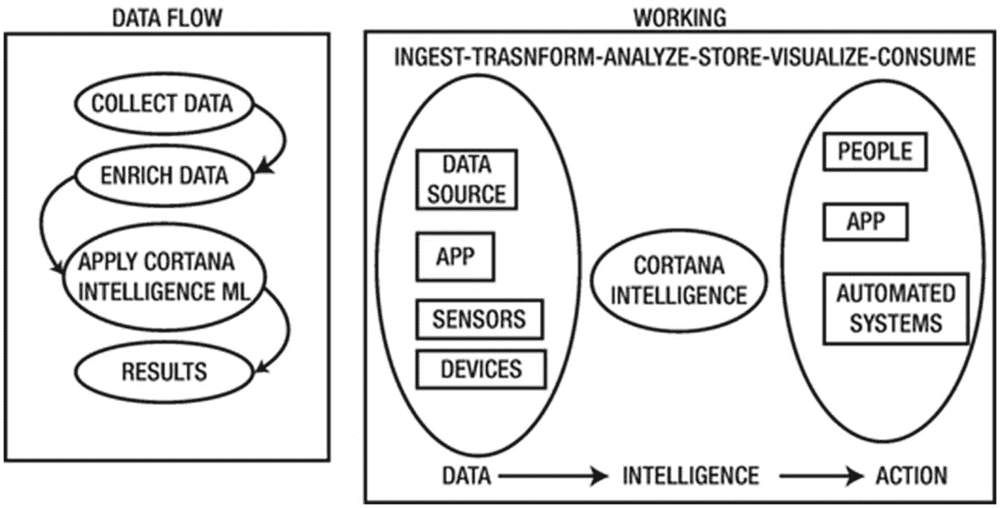
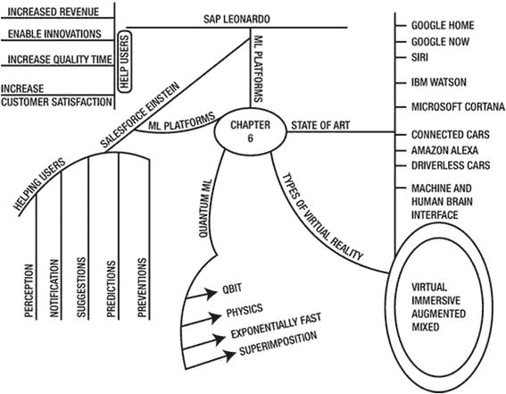

# 6. 我是未来：机器学习在行动

帕坦加利·卡什亚普博士^(a*)

^a 印度卡纳塔克邦班加罗尔

随着机器学习和人工智能等新兴或更新技术的接受度不断提升，企业正在重新审视其对业务需求的理解。为了识别能够带来最高价值的业务功能，决策者已表现出投资新技术的意愿。在这一过程中，大多数人发现这些技术具有巨大的价值和潜力。他们也认识到，如果不进行颠覆性变革，他们的业务将会失败。

颠覆是当今变革与创新企业的最新口号，而且理由充分。它正在塑造新的方向。企业正在关注颠覆性技术，以赋能新的发展前景，并在有活力的市场中保持相关性。企业也希望通过技术的无缝应用来提高效率和效益，但短期内，它们在无缝应用这些技术方面正面临挑战。这些挑战主要源于：

*   更高的投资成本
*   维护技术的技能差距
*   整合新技术的速度
*   数字化前景诱人，但风险更大
*   全球法律和法规的变化

供应商开始针对这些问题提供现成的技术解决方案。多家公司和供应商正在提供经过试验和测试的解决方案。此外，如果有人想开发适合其特定需求的方案，也有可定制的版本可供选择。本章将讨论其中的一些方案。但是，在决定采用任何一种解决方案之前，您必须谨慎。以下是一些需要注意的陷阱：

*   机器学习必须被视为业务主导，而非 IT 主导。这种策略有助于与 IT、网络安全、风险、人力资源和其他企业职能部门建立稳固的合作伙伴关系。
*   在试点之前，必须重视商业案例和准备工作。
*   对准确的流程进行分类，以便技术能够产生价值。
*   重点必须放在放大员工潜力和创新优先级上。
*   重点必须放在赋能每个人减少手动任务，而不是寻求削减成本。

简而言之，机器学习几乎存在于所有环境中。它可以被集成到工业机器人、智能应用和其他产品中。它的形式、形状、大小、用途和功能会根据需求和用途而变化。在采用该技术时，规模、资本和其他资源的可用性等因素很重要，但从长远来看，技术本身是由创新驱动的。这意味着加速会自然发生。

尽早采用任何事物，尤其是技术，都会带来不同。本章讨论了机器学习解决方案的独特性及其广泛的应用范围。讨论范围从语音辅助技术到认知技术。它还深入探讨了无人驾驶汽车、VR 技术和脑机接口。机器学习领域的供应商提供了多种现成平台形式的解决方案，但决策者通常并不了解它们。本章以 SAP 的 Leonardo 和 Salesforce 的 Einstein 为例进行讨论。

## 最新技术实例

像苹果这样的公司使用机器学习和深度学习来跟踪和检测苹果商店的欺诈行为，并从测试人员和用户那里获取关于其产品的反馈。它们以自动化方式从数千份报告中提取见解。苹果还使用这些技术来确定苹果设备用户是在锻炼还是在休息。

脸书使用机器学习和深度学习从用户的照片中识别人脸和位置。通过机器学习技术，苹果设备可以确定你在未来几周是会变胖还是保持苗条。你的应用可以一键快速将你拍摄的快照和视频编译成微电影。苹果提供的应用和设备会记住你停车的位置，并实时提供相关信息。它们会根据你电子邮件的内容，从你的日程安排中给出提醒。它们在你打字时提供实时建议，等等。

### Siri

Siri 在理解查询后以自然的方式回应，这是使其如此受欢迎的特点之一。Siri 在深度学习技术的帮助下做到了这一点。深度学习是一个研究领域，它使机器学习能够以智能和巧妙的方式执行类似人类的任务。机器学习技术平衡了单个单词的声音，这使得 Siri 听起来像一个真实的人。Siri 能够做到以下几点：

*   语音识别能力：将人类语音转换为文本
*   卓越的自然语言理解能力：解释人类所说的话
*   完美的执行：理解问题后，完成查询或请求
*   卓越的响应能力：回复请求

Siri 使用机器学习技术，如深度神经网络、卷积神经网络、长短期记忆单元、门控循环单元和 n-gram，结合深度学习技术，将其支持的所有语言的错误率降低了一半。此外，它还能检测用户的声音并拼写出用户的姓名和密码，而不是让用户输入。以下是 Siri 的基本工作流程：

1.  你向 Siri 输入/提问，例如“谁赢得了 1983 年板球世界杯？”。
2.  手机应用将语音转换为 Siri 能理解的格式（二进制代码）。通常，它通过收集模拟语音并将其转换为音频文件来实现。
3.  语音转换后，它会将数据发送到苹果服务器。数据提交到苹果服务器后，会在那里生成适当的响应。Siri 不会在本地（手机上）处理数据；它在苹果云上进行处理。因此，如果你没有网络连接，与 Siri 通信就会遇到问题。
4.  服务器返回响应。数据在服务器上使用自然语言处理进行处理。适当的响应通过服务器返回到你的设备，Siri 将其转换为文本和语音。
5.  Siri 回应你。“印度赢得了 1983 年板球世界杯。”文本会显示在屏幕上，同时，如果音频反馈选项开启，语音也会播放出来。

### Alexa

自然语言处理（NLP）是一种将语音转化为文字、声音和思想的方法，它是构建 Alexa 的基础。

*   Amazon 会捕捉你的语音。由于解析声音需要大量处理能力，你的语音录音会被传输到 Amazon 的服务器上进行更深入的分析。

*   Amazon 会将你的“指令”分解为不同的声音。然后，通过查阅一个单词发音数据库，找出与这些单个声音组合最匹配的单词。

*   接着，它会突出显示关键短语，以便你理解任务并执行必要的操作。例如，如果 Alexa 检测到“运动”或“篮球”等词语，它可能会打开体育应用。

*   你的设备会从 Amazon 的服务器接收数据，然后 Alexa 就可以开始说话了。

信号处理是第一步，它通过增强信号，为 Alexa 提供尽可能多的机会来理解音频。远场音频中最大的问题之一就是信号处理。

其目标是增强目标信号，这意味着要能够识别并降低背景噪音。设备使用七个麦克风来大致检测信号的来源方向，以便聚焦于该信号。声学回声消除可以消除任何无关信号，只留下关键信号。

唤醒词检测用于判断用户是否说出了“Alexa”或其他能开启设备的词语。这对于减少误报和漏报是必要的，因为误报和漏报可能导致错误购买和愤怒的客户。这非常具有挑战性，因为它需要在利用设备有限的 CPU 处理能力的同时，区分不同的发音。

如果检测到唤醒词，信号随后会被传输到基于云的语音识别软件，该软件将音频转换为文本。由于要考虑英语中的所有单词，输出空间非常巨大，而云技术是唯一能在此情况下良好扩展的技术。许多人通过 Echo 听音乐，而音乐家的数量比单词还多，这一事实使问题变得更加复杂。

Alexa 会分析用户的语音特征，例如频率和音调，并为你提供特征值，以便将音频转换为文本。给定输入数据和模型（该模型分为两部分），解码器会计算出最可能的单词序列。第一部分是先验模型，它在不考虑特征的情况下，基于大量已发布的文本，提供最可能的序列。第二部分是声学模型，它通过分析音频和文本配对，利用深度学习进行训练。这两部分被合并，并应用动态编码——这需要实时进行。

### Google Assistant

Google 最初在 2016 年加州 I/O 大会上发布了 Google Assistant，这是一款语音激活的虚拟助手。与 Amazon 的 Alexa、Apple 的 Siri 和 Microsoft 的 Cortana 类似，Google Assistant 能提供上下文信息并执行任务，例如代表用户预订餐厅或发送消息。如果智能手机用户不想使用语音输入，也可以通过文本向 Google Assistant 发送请求。

为了理解用户所说的话、提供建议或对该输入采取行动，Google Assistant 使用了包括机器学习和自然语言处理在内的人工智能技术。Google Assistant 是 Google “AI 优先”战略的基石。

在 Google Assistant 之前，Google 开发了一款名为 Google Now 的数字助手程序。尽管 Google Now 理论上仍在使用，但这两个系统之间存在一些细微差别。Google Now 可在 Android 和 iOS 的应用中运行，而 Google Assistant 仅适用于少数产品，例如 Google Allo 和一些智能手机。此后，Google Now 已被逐步淘汰，其功能已整合到 Google 的其他产品中。

Google Assistant 的目标是“为每一位用户打造一个专属的 Google”。Google Assistant 是连接 Google 所有核心软件和硬件产品的纽带。

Google Assistant 的重要性，与其说在于其功能或能力，不如说在于它预示着 Google 未来在消费产品领域的策略。如前所述，Google 认为科技行业将像从网页转向移动端一样，从移动端转向人工智能。

随着硬件日益商品化，智能手机制造商必须在下一代软件和人工智能所能提供的功能上进行竞争。此外，还需要开发一个共享人工智能访问权限的产品和设备生态系统。Google Assistant 是许多 Android 手机的内置功能，但它也能在 Allo 智能聊天应用中运行，并且是 Google Home 智能音箱的核心组成部分。

### IBM Watson

IBM 称其不仅仅是一台人工智能设备，并为其近期最受瞩目的产品之一——Watson——创造了“认知计算机”这一术语。Watson 利用自然语言处理能力、机器学习技术以及输入其中的海量数据，在数秒内直接精确地回答以日常人类语言提出的问题。

Watson 是最强大的人工智能计算系统之一。它通过三种方式从环境中学习：

*   其学习形式之一是阅读。例如，为了增强其癌症知识，它从各种来源“阅读”了超过数百万页的资料。

*   另一种学习方式是通过回答问题，或处于“教学阶段”。例如，在癌症项目中，医生向 Watson 提出问题，如果 Watson 的回答不够精确，他们就会调整其回应。

*   最后，它通过实践或从自身错误中学习。它会发现工作中的新规律，这与人类的行为类似。

从非常高的层面来看，Watson 的结构如下：

*   大量公开可用的非结构化和半结构化数据被输入到 Watson 的数据库中。
*   问题以文本形式或通过语音指令输入给 Watson。
*   这些问题被用作搜索查询来检索数据库。这与在 Google 或 Bing 上进行搜索的方式类似。
*   搜索结果连同问题被进一步用于从现有知识库中获取支持性证据。
*   每个用于回答问题的搜索结果都构成一个假设。反过来，该假设会根据检索到的证据进行评估。之后，答案会在多个维度上进行评分。
*   高维度评分的答案由内置算法进行排序。
*   如果 Watson 对其最终答案有足够信心，它会向用户显示或说出该答案。

Watson 是一个高度精密复杂的系统。这里提到的几乎所有步骤都涉及一个复杂的机器学习算法网络，该网络在并行平台上运行，以尽快向用户提供答案。

人类会犯错，并非完美无缺。此外，随着数字设备/媒体向大众普及，信息正从各种来源涌入。例如，可用的医疗信息量每五年翻一番。每天大约有 130 篇关于肿瘤学的研究论文发表。然而，医生和其他医疗专业人员没有足够的时间来更新自己，了解大多数最新进展，这可能导致诊断不佳。例如，在美国，据预测五分之一的诊断是不正确或不完整的。此外，每年大约发生 150 万起用药错误。

Watson 有潜力提高诊断的正确性，提升患者护理的质量，并降低患者的治疗成本。许多公司已开始利用 Watson 为自己谋利。例如，美国领先的医疗保险公司之一 Wellpoint 正在使用 Watson 来提高保险审批和授权的准确性和速度。

欧洲软件服务公司 Capgemini 正在使用 Watson 来改善其服务并提高组织效率。在印度，Manipal 医院集团正在使用 Watson 来协助医生，并为其客户/患者提供医疗保健福利。该医院最近开始向患者提供这项服务，来自 Watson 的医学检测报告不收取额外费用。IBM Watson 还在帮助农民了解何时施肥以及使用多少肥料才能实现最佳作物产量。他们可以根据作物产量、天气模式和土壤湿度，从 Watson 那里获得帮助，以了解实际情况。考虑到那些清楚显示农民平均利润率有多低的报告，这一点尤为重要。决定使用多少肥料可能决定一整年的盈亏。

### Microsoft Cortana

> *“**Cortana** 旨在帮助你高效完成任务。从第一天起，它就能提供答案并完成基本任务，并随着时间的推移不断学习，日益精进。你可以信赖 Cortana 来管理提醒事项，并在你的各种设备上协同工作。Cortana 擅长提醒和帮助你信守承诺。她可以根据时间、地点甚至人物来提醒你做事。你还可以为提醒添加照片，作为直观的视觉提示。”*

[`https://www.microsoft.com/en-in/windows/cortana`](https://www.microsoft.com/en-in/windows/cortana)

微软一直善于感知市场潜力。他们意识到分析和机器学习是大势所趋。因此，为了满足市场需求，他们推出了一套基于机器学习的分析套件，即 Cortana 分析套件。机器学习是 Cortana 的基础。其独特的即时、无限数据存储和实时处理能力，结合感知智能，帮助其实现了“将数据转化为智能行动”的愿景。

Cortana 帮助你减少遗忘，提高效率。Cortana 最擅长提醒，并能在正确的时间和地点发出提醒。Cortana 在帮助用户组织任务方面表现出色，例如发送电子邮件、安排活动以及在设备、云端或网络上进行搜索。Cortana 的搜索方式被称为*多步搜索*，它通过层层叠加查询，仅凭语音就能完成复杂任务。Cortana 在决策用户查询时会使用分析套件。因此，对其内部运作机制的整体了解将有助于用户理解全貌（见图 6-1）。

一个数据流图和一个架构图。左侧：收集数据之后是丰富数据、应用 Cortana 智能 ML 和结果。右侧：包含数据源、应用、传感器和设备的数据层之后是 Cortana 智能，以及人员、应用和自动化系统的操作。

图 6-1

Cortana 的工作原理

当有重要事项需要用户关注时，Cortana 会向用户发出提醒。简而言之，Cortana 是一个语音激活的搜索引擎，或者说是一个“交互式个人助理”。它与苹果的 Siri 和 Google Now 属于同一类别。在微软设备上，它能有效地与必应搜索集成，以捕获用户的使用行为。并在此基础上，向用户推荐感兴趣的内容。因此，它使计算体验变得更好、更流畅。

Cortana 会不断学习用户的习惯和兴趣。此外，除了常规的网络信息搜索，Cortana 还是发现和搜索 Windows 10 环境/生态系统中信息的主要方式。Cortana 最令人兴奋的功能之一是其能够基于操作创建活动，这与流行的网络服务 IFTTT 有些相似。例如，说“下次我给我儿子打电话时提醒我，我们需要谈谈辛巴”，就会创建一个提醒，当你下次准备给儿子打电话或他给你打电话时，该提醒就会被激活。毫无疑问，这是一个非常强大的功能。

Cortana 借鉴了苹果 Siri 和谷歌内部产品的一些优秀理念并将其整合。然而，微软面临的挑战是如何利用 Xbox、Windows 和其他产品，将 Cortana 融入各处。Cortana 无处不在的道路并非那么艰难和充满挑战，因为凭借 Windows 10、Kinect、Azure 和 MS Office 产品，微软已经无处不在。以下是 Cortana 的一些亮点：

*   发送电子邮件和短信。

*   根据用户的联系人拨打电话。

*   跟踪日历事件。

*   设置闹钟。

*   提供及时的提醒。

*   代表用户启动应用程序。

*   根据用户指令在互联网上搜索内容。

*   进行单位换算。

*   根据用户需求修改设置。

*   查看电影和航班时间，并在需要时提供适当的通知。

*   根据用户需求提供导航路线。

Cortana 和 Siri 似乎有很多相似之处，因为两者都提供基于语音的辅助。然而，它们之间有一条细微的界限——Cortana 作为个人助理，根据上下文提供协助，而 Siri 则是语音命令执行器。

Cortana 更贴近你的思维过程，并理解你的个人背景。例如，当你向 Cortana 提问时，它会寻找现有历史数据之间的联系。它会将你的问题历史联系起来，并提供与你给定场景和上下文相关的答案。当你向 Siri 提问时，她会根据苹果云数据存储中可用的数据提供最佳答案。

### 联网汽车

联网汽车以整体和集成的方式运用遥测技术、机械技术、电子技术、机器学习和人工智能技术，与周围环境进行交互，以提供更好的服务、安全性、娱乐性和互联生活体验。联网汽车延伸至多个消费者适用领域，例如一体化城市出行、辅助驾驶、无人驾驶汽车和汽车共享。

根据分析师和多份报告，预计到 2025 年，联网汽车市场将超过 400 亿美元。联网汽车的演进和增长必须被视为消费者选择过程的自然延伸。

个人偏好联网汽车的原因有多种，包括强烈希望避免道路拥堵和驾驶压力等问题。它们还为老年人和残障人士提供了更好的出行便利性。客户愿意在联网汽车上花钱，因为他们希望在驾驶汽车时也能享受到与生活中相同的体验和互联性。企业正在构思和构建解决方案，以应对当前和未来的挑战。然而，这些解决方案显然需要对制造、远程信息处理和车载系统有深刻的理解。在技术和领域专业知识之上，对消费者心理的实践知识在整个解决方案设计中也扮演着重要角色。

车联网通信（V2I）和车车通信（V2V）有许多解决方案。这些技术驱动的服务使汽车能够频繁地与它们交互和经过的周围环境交换数据/信息。其益处并非单向的，因为多个行业和部门也受益于这一演进。像保险、银行、金融、零售和农业等行业现在能够更好地收集和处理客户数据，并将其用于自身目的。例如，保险公司现在可以获得关于汽车健康状况更准确的数据。这使他们能够为客户开发更定制化和个性化的产品。

#### 联网汽车系统亮点

*   实时获取导航路线

*   精确且互联的导航系统。

*   按需娱乐。

*   动态实时路线信息。

*   事故警报。

*   减少碳足迹。

*   最佳速度辅助。

*   汽车故障预警。

*   发生事故时自动呼叫救援。

*   保养通知。

*   优化保险；按需付费。

*   车辆生命周期管理。

*   驾驶员绩效分析与建议。

### 无人驾驶汽车

交通事故大多是由于驾驶员的失误和粗心造成的。人们对车载娱乐功能、手机集成和音乐的需求日益增长，这些都会分散驾驶员的注意力，使其更容易犯错，从而导致更多事故。

然而，这些并非唯一的罪魁祸首。其他引发事故的因素还包括日益增长的交通流量、混乱且颠簸的道路系统（尤其是在发展中国家）。这些干扰和复杂情况不会消失，那么谁来替驾驶员集中注意力呢？嗯……技术可以为你代劳。你只需坐着享受音乐和娱乐，而技术则为你驾驶汽车。这就是无人驾驶汽车的终极承诺。将无人驾驶汽车/卡车推向大众的承诺正在以迭代、分阶段的方式实现。例如，自动泊车和预安全系统等功能已被一些汽车制造商实现。

近年来，无人驾驶汽车获得了极大的关注。然而，这个概念本身并不新鲜。无人驾驶车辆的想法早已存在。它一直是詹姆斯·邦德和蝙蝠侠电影的一部分。那些能够自动、智能地运行和工作的汽车一直让人们着迷。然而，如今它已不再是想象，而是现实。

在 20 世纪 80 年代，防抱死制动系统（ABS）可以被视为迈向这一想法的第一步。防抱死制动系统可以防止在快速、用力踩刹车时车轮抱死。汽车借助与车轮相连的速度传感器，以自动方式完成这一操作。汽车制造商利用这些传感器迈出了下一步，通过加入所谓的“牵引力与稳定性控制”系统，使汽车实现无人驾驶。这些系统是对 ABS 的改进。这些传感器使车轮能够检测到汽车何时可能（危险地）打滑或侧翻，并向 ABS 和发动机管理系统发出信号，以保持汽车在正确的轨道上。由于这些系统是智能的，它们会在正确的时间施加制动，并根据需要增加或减少对单个车轮的制动力度。这种智能技术显然比在紧急情况下对所有四个车轮进行制动要好得多。

许多汽车制造商正在致力于研发无人驾驶汽车。谷歌引领着这些举措。他们的原型车在很大程度上基于这项技术。谷歌称之为“Chauffeur 系统”。他们使用了 LIDAR，即“光探测与测距”。激光雷达继承了雷达和声纳的概念，但精度更高。它通过使用 64 束旋转激光束来绘制空间中的点。它每秒进行超过一百万次测量。然后，基于这些数据，通过集成的机械装置形成一个 3D 模型，该模型能以厘米级的精度定位物体。

通过使用预加载的地图，汽车可以精确定位交通信号灯、人行横道、电线杆、商店和保险杠。激光雷达还能识别移动的物体，比如人类。除了激光雷达，它还配备了常规雷达、智能摄像头和 GPS，以精确地定位其路径上的障碍物和物体。汽车每天都在进步，但驾驶员角色不会完全自动化。无人驾驶汽车有时仍然需要驾驶员接管。例如，将汽车驶出或驶入车库或车道，或处理复杂的公路交汇处。卡车、直升机和摩托车也正处于转型之中，在不久的将来，所有车辆都将通过一种名为“机器学习”的赋能技术实现自动行驶或飞行，实现无人驾驶。

谷歌并非自动驾驶和无人驾驶汽车市场的唯一参与者。特斯拉、梅赛德斯-奔驰和奥迪等制造商也在研发自动驾驶汽车。例如，宝马计划推出一款 5 级自动驾驶汽车。这意味着该车辆将能够凭借其自身智能处理任何与驾驶相关的情况，无需任何人工干预。目前，大多数汽车制造商正在研发 4 级汽车。苹果公司最近向加州监管机构提交了一份培训自动驾驶汽车操作员的计划，并获得了许可。这清楚地表明了他们对自动驾驶汽车的积极态度。驾驶辅助等级定义如下：

*   **1 级**：大多数功能仍由驾驶员控制。然而，少数明确的功能由汽车处理，例如加速。1 级汽车足够智能，可以保持指令或设定的速度，自动减速以避免其他车辆，并保持在规定的车道内。但它无法处理任何灾难性状况，在不利情况下，驾驶员必须完全接管控制。

*   **2 级**：在此级别，驾驶员不再参与汽车的“基本”操作。例如，驾驶员可以同时将手离开方向盘或将脚离开踏板。但是，要求驾驶员在复杂、不利的情况下随时准备接管车辆控制权。

*   **3 级**：汽车可以根据数据做出决策。车内仍然必须有驾驶员，但他们的职责发生了变化。仅在涉及高度复杂的交通或灾难性环境条件的“安全关键功能”时，才需要他们的干预。3 级汽车目前尚未在市场上销售。然而，一些原型车已处于最后阶段。例如，奥迪的 A7 原型车可以满足该级别的一些期望。这些汽车不仅会保持在车道内并远离其他车辆，还会做出决策。

*   **4 级**：这是完全自动驾驶的汽车。4 级汽车旨在处理几乎所有安全及危及生命的驾驶情况。它们可以监控和分析道路。驾驶员不再是必需的。

*   **5 级**：这指的是一个完全自主的系统，其驾驶能力与人类驾驶员相当。它们在各种驾驶情况下都像真正的“人类”驾驶员一样行动。谷歌和特斯拉正以此级别的汽车为目标。理想情况下，此级别的汽车可以在没有驾驶员的情况下前往任何地方。它们不需要监控、方向盘或踏板。

## 机器与人类大脑接口

一家名为 Neuralink 的公司，由埃隆·马斯克支持，正在致力于将人类大脑与机器接口连接起来。他们计划推出微型设备，帮助脑损伤患者更好地进行交流。借助人工智能和机器学习技术，该公司正在创建系统，帮助人类将“神经链接”植入大脑以实现沟通。

这一理念基于大脑将概念压缩成低数据流活动（如语言）的设想。同样，如果两个大脑能够通过接口进行未压缩的直接概念交流，就需要建立一个通信通道。凭借其技术，Neuralink 将实现这一点。Neuralink 正试图融合生物智能与数字智能。如果这一概念被 Neuralink 实现，最终将帮助人类借助人工智能的快速发展实现飞跃。其目标是实现人工智能与人类意识的融合。

Neuralink 从根本上将允许人类将人工智能作为感官之上的辅助能力来使用。例如，利用我们的自我意识或其他更高层次的大脑思维功能，以达到建设性目的。将高带宽直接连接到大脑，并将基于云的人工智能计算与我们的大脑融为一体，使其与我们的核心自我难以区分，这将成为可能。

许多其他公司和研究实验室也在致力于开发通过观察和分析脑电波来读取人类思维的机器或设备。例如，丰桥技术科学大学的日本科学家开发了一套系统，在识别数字 0 到 9 时成功率达到 90%，在识别日语音节时成功率达到 61%。科学家们还声称，这些设备易于操作，可以通过移动应用程序进行控制。简而言之，当人们说话时，使用脑电图（EEG）来追踪人类脑电波。然后，利用机器学习将脑电波模式与音节和数字进行匹配。随后，参与者说出数字，系统根据脑电图（EEG）脑部扫描的实时读数进行实时猜测。研究人员现在正更进一步，开发一种所谓的“脑机接口”，能够识别和辨认那些人类思考但未说出的词语。这可能在五年内通过一种电极更少、连接智能手机的设备实现。

## 虚拟现实、沉浸式现实、增强现实

SLAM（即时定位与地图构建）是一种利用机器人或无人驾驶车辆生成地图的方法，该车辆在利用其生成的地图或规划的同时，引导自身所处的环境。它通常指试图同时定位传感器与环境的问题。大多数 SLAM 系统基于通过连续摄像头帧追踪一组“点”。这些摄像头帧或轨迹被系统用来识别和定位三维位置上的“点”。凭借假设的环境地图，SLAM 在追踪与建图之间交替，并计算*姿态*（位置和旋转）。一旦找到姿态，它便修正地图，然后再次估计姿态。这一过程在循环中持续进行，直到地图构建准确。

由于无标记 AR（增强现实）的出现，应用 AR 来解决更大问题成为可能。例如，它可以用于规划和设计住宅、家具和办公室，并以有趣的形式可视化数据。无标记 AR 的算法与机器学习算法相辅相成。这些算法在分析各种参数集（如摄像头位置、环境映射和视觉内容）时发挥作用。这与位置和环境相关。然而，由于开发和实施算法的动态条件，提供无标记 AR 体验是一项复杂的任务。

### 混合现实

继大型机、个人电脑和智能手机之后，计算领域的下一个重大事物是混合现实。对于消费者和企业而言，混合现实正变得越来越流行。通过在我们生活空间以及与朋友之间提供与数据的直观交互，它将我们从局限于屏幕的体验中解放出来。数亿互联网用户已在移动设备上体验过混合现实。目前社交媒体上最流行的混合现实选项是移动 AR。人们甚至可能没有意识到 Instagram 的 AR 滤镜使用了混合现实事件。通过逼真的人类全息影像、高度精细的全息 3D 模型以及周围的真实环境，Windows 混合现实提升了所有这些用户体验。

结合物理世界与数字世界，可以实现人、机器及其周围环境之间更自然、更直观的三维交互。计算机视觉、图形处理、显示技术、输入方法和云计算的发展是这一新世界的基础。保罗·米尔格拉姆和岸野文郎在 1994 年的研究《混合现实视觉显示的分类法》中首次使用了“混合现实”这一术语。在他们的研究中，他们探讨了视觉显示的分类法以及虚拟连续体的概念。自那时起，混合现实的应用已不仅仅局限于显示，例如：

*   环境认知，包括空间映射和锚点。
*   人类理解：语音输入、眼球追踪和手部追踪。
*   空间音频。
*   在现实世界和数字世界中的定位与位置。
*   在混合现实环境中协作处理 3D 资产。

#### 不同的混合现实算法

1.  *校准*：构建 MR 应用时，通常使用固定的 MR 设备。
2.  *空间与模拟模型*：该算法确保模拟所需的空间量是准确的。空间建模与模拟通常分为两类：
    *   *物体识别*：此方法识别现实世界中的实际物体，以便创建这些物体的虚拟副本，从而构建 MR 环境。
    *   *物体追踪*：此方法有助于追踪物理物体，以便根据其运动来定位虚拟物体。

### 元宇宙

元宇宙是一个不断演进的 3D 数字环境，它利用虚拟现实、增强现实以及其他前沿的互联网和半导体技术，在线上实现栩栩如生的个人与职业互动。

为了融合并拓展比特币、人工智能、增强现实（AR）、VR、空间计算及其他数字技术的应用，这象征着这些技术的一次汇聚。此外，“企业元宇宙”可能会以一种开启更多可能性的方式融合，超越其当前作为在线交流平台的用途。

元宇宙本质上将具备三个特征：实时交互性、沉浸感和用户自主性。

此外，完整的元宇宙愿景最终将包含以下要素：

*   平台与设备之间的无缝集成
*   数千用户之间的持续互动
*   远超游戏范畴的应用场景

元宇宙并非逃避现实。相反，它是通过虚拟内容和体验来拥抱和增强现实，这些内容和体验能让事物更充实，让我们感觉与亲人更亲近、工作更高效、生活更幸福。

当前的元宇宙由十个层级构成，这些层级分为四大类：平台、硬件与基础设施、赋能者、以及内容与体验。以下是每类的一些示例。

信息与体验：

*   用户、创作者和开发者生成的内容提升了元宇宙体验
*   人们可以聚集、交谈和创作的虚拟空间；与特定元宇宙用例（如教育或活动）相关的软件
*   专为 3D 体验设计的平台，便于查找和访问信息、体验及应用

#### 元宇宙的基础设施与硬件

元宇宙的支持性基础设施包括云计算、半导体、网络及其他技术。人们通过设备、操作系统和配件与元宇宙进行交互。

赋能者：安全、隐私和治理对于元宇宙的正常运行至关重要。

哪些新技术发展将推动元宇宙的增长？

正如区块链为去中心化的创意经济注入了活力，快速的技术进步有望开启未来的元宇宙体验以及不同现实之间的互操作性。一旦 5G 全面实施，用户将能够在移动设备上处理庞大的世界。其他将助力元宇宙发展的技术包括：

*   后端引擎将消除创造力的障碍，让更广泛的受众能够制作前沿的体验和游戏。这将使从 2D 互联网环境向完全沉浸式体验的过渡变得更加容易。
*   边缘计算将为元宇宙提供其运行所需的计算能力。通过允许数据在本地而非云端进行收集、存储和处理，边缘计算有助于解决带宽和延迟问题。

物理世界和虚拟世界将通过硬件设备融合在一起。2021 年，Meta 发布了 1000 万台 Oculus Quest 2 头显，而手套和全身套装等其他设备也正在流行起来。

在基础设施之上，元宇宙应用由软件开发驱动。

必须记住，当前的技术不足以完全发挥元宇宙的潜力。计算、网络和接口硬件方面的基础设施都需要改进。

## 创业案例研究：Absentia

Absentia 创立的初衷是打造首个虚拟现实操作系统。同样，正如许多伟大创意往往出自大学辍学生之手，Absentia 也不例外。它由果阿校区 BITS Pilani 的三名计算机科学辍学生构思并创立。其目标是开发一个能够以更快速度、在极少人工干预下生成游戏交互内容的人工智能引擎。Absentia 始于 2015 年初，从那时起，该公司就将虚拟现实技术与数字视频内容整合在一起。他们开发了自己的头显，类似于 Oculus Rift 虚拟现实系统。目前，该公司正在开发一款名为 Norah AI 的人工智能产品。Norah AI 本质上是一个机器人，能够根据向其提供的简单指令来开发游戏设计和构建。这些指令或命令可以是基于文本或图形输入生成的机器故事、对话、角色、武器以及各种游戏场景。

这对于不具备编码能力的个人尤其有帮助。他们可以基于文本输入与 Norah AI 进行交流。例如，像“创建一个留着胡子的胖子”这样的命令会触发 Norah AI 的功能，从而生成该角色。这个机器人将帮助在两到三个小时内生成高达 80%的游戏设计和构建。这在自动化内容设计方面是一个巨大的进步，并可能将游戏创作时间缩短至大约 15 天。Norah AI 将能够为柱廊游戏、休闲游戏、解谜游戏、动画和图形生成一套新颖的协作内容。从技术上讲，Norah AI 交互式引擎平台和框架包含一个巨大的神经网络。幕后神经网络的相互作用使交互式内容设计师能够在更短的时间内创建游戏、GIF 和模拟。

Facebook 在这些技术上押下了重注。他们正在将摄像头打造为第一个 AR 平台。他们的 Camera Effects 平台有可能将智能手机摄像头转变为 AR 平台。这可能意味着艺术家和开发者可以通过 Facebook 摄像头开发特效。Facebook 平台包含两个创意工具——Frame Studio 和 AR Studio。它们使 Facebook 用户能够创建摄像头特效，范围从简单的相框生成到交互式 AR 体验。这个平台将允许艺术家和设计师将艺术与数据连接起来，通过 Facebook 摄像头将 AR 带入日常生活。

传统上，机器学习并非艺术创作的一部分。然而，在时代变迁中，它正在将其影响力扩展到艺术等领域。Facebook 向 AR、VR 和无标记 AR 的扩展就是其中一个例子。此外，最近有 29 幅版画由基于神经网络架构的谷歌计算机创作，并在旧金山拍卖，中标价为 8000 美元。这些计算机在创作艺术品之前先通过示例数据进行学习。计算机随着时间的推移被输入了大量图像，这使它们能够识别视觉模式（来源：[`https://news.artnet.com/market/google-inceptionism-art-sells-big-439352`](https://news.artnet.com/market/google-inceptionism-art-sells-big-439352)）。同样致力于提升沉浸式视频质量的三星声称，他们最近的 Gear 360 产品能够拍摄 4K 360 度视频内容。更多信息，请参见 [`https://en.wikipedia.org/wiki/Projection_augmented_model`](https://en.wikipedia.org/wiki/Projection_augmented_model) 上的图片和内容。

## Google Home 与 Amazon Alexa

Google Assistant 是一款语音控制的数字助手。它运行于多种设备之上，包括手机、Google Home 和智能电视。它能为用户提供情境感知的帮助。Google Assistant 已逐渐出现在安卓手机以及一些其他基于物联网的设备上，例如基于 Android Wear 的智能手表。Google Assistant 也已集成到 Google Allo（集成聊天应用）中。然而，Google Home 设备是唯一搭载 Google Assistant 的智能音箱。

Amazon Alexa（AI 助手音箱）构建于 Echo 之上，并向与 Echo 产品系列相关的任何第三方授权方开放。亚马逊正努力将其集成到汽车、洗衣机以及其他设备中。亚马逊的联网家庭音箱近年来取得了成功，因为它将 Alexa 定位得非常好，并为其加载了大量功能。Alexa 拥有超过 3000 种语音驱动能力。虽然消费者可能不知道如何使用智能家居，但他们可以通过语音命令让助手打开灯、播放特定歌曲、录制电视节目或执行其他任意数量的任务。

Google 最近宣布，其智能音箱将以逐步指导的格式提供超过 500 万种菜肴的烹饪食谱。它会为你朗读食谱。你只需通过 Google Assistant 找到食谱，然后按下“发送到 Google Home”按钮，即可将指令传送到你的音箱。Alexa、Google Home 和 Google Assistant 都是机器学习技术的副产品。机器学习是这些设备/技术的核心。

## Google Now

Google Now 和 Google Assistant 是两回事。Google Now 使用户能够快速搜索互联网，并执行一系列任务，例如安排日程和闹钟、根据语音命令调整设备音量，以及通过自然语音命令将信息发布到社交媒体。

当用户想在移动设备上搜索互联网而无需拿起设备使用时，Google Now 是一个不错的选择，这与 Siri 和 Cortana 类似。Google Now 的出色功能之一是其免提锁屏访问，只需一个简单的语音命令——“OK, Google”即可启用。Google Now 使您能够搜索互联网并访问您个人 Google 帐户中的信息。它不具备情境感知能力，也不会连接或了解用户，而 Google Assistant 则具有情境感知能力，并且实际上“了解”你。这是它们之间的主要区别。两者都充分利用了机器学习技术，并融合了其中一些最佳要素。

Google Now 并非特定于平台，可在 Google Android 和 iOS 上运行，而 Google Assistant 则针对 Google 的 Allo 聊天应用。Google Assistant 已集成到 Google Home 和 Google 的 Pixel 手机中。理论上，Google Now 可以在 iOS 和 Android 上无缝运行，但实际上，其在 iOS 上的硬件控制能力是有限的。

## 脑电波与简洁计算

Facebook 正在研发一项技术，使用户能够借助大脑进行打字。Facebook 正在创建一个系统，该系统通过转换大脑信号，每分钟可输入 100 个单词（科学家们已经通过脑电波实现了每分钟八个单词的打字/发短信）。该系统不需要在用户体内进行任何类型的移植，只需通过“监测”大脑即可完成。

Facebook 正在与多所大学和学术机构合作。根据他们的简报，该系统将使用户无需打电话就能与朋友进行交互（发送文本）。例如，你只需思考内容就能发送一封电子邮件。该技术可能不需要思考构成句子的字母，只需思考内容，文本就会被打出。除了这项研究，Facebook 还在努力实现让人们通过皮肤“听”到声音的可能性。这些研究成果已在 Facebook 开发者大会上分享。

## 机器学习平台与解决方案

本节介绍两个较为常见的机器学习平台——SAP Leonardo 和 Salesforce Einstein。

### SAP Leonardo

Leonardo 是一个数字创新系统，包含多种技术，包括机器学习、区块链、数据智能、大数据、物联网和分析，以提升企业竞争力。它正在帮助企业创新业务模式和流程，并改变人们的工作方式。SAP Leonardo 通过数据将事物与人及流程连接起来。它提供了一个极具突破性的、基于物联网和机器学习的解决方案生态系统，包含自适应应用、产品和服务，以及大数据管理和连接性，以实现以下目标：

*   新的业务流程（例如，工业 4.0）
*   新的业务模式（例如，云计算）
*   新的工作环境

SAP Leonardo 拥有出色的创新组合，可帮助企业从事物/对象/设备到成果，提供服务并构建应用程序。例如，在制造业中，它可以带来以下好处：

*   *实时洞察*：提供状态监控、位置跟踪、环境、使用和消费模式等信息
*   *预测性分析*：实时分析设备健康状况、剩余寿命、供需预测和到达时间
*   *优化流程*：降低维护成本、提高效率、减少浪费、减少索赔、更快响应、缩短周期
*   *新的业务模式*：基于使用量的定价、产品即服务

SAP Leonardo 遵循“智能连接人、物和业务”的理念。

Leonardo 在客户留存方面表现出色，解决了一个业务难题：

*   从各种渠道接收传入的动态数据，并构建客户旅程概览
*   对事件进行排序、分类和路由，然后识别关键事件/流失指标，包括识别即将流失的客户
*   识别即将流失的客户，并采取主动措施防止客户流失

另一个领域是服务工单：

*   *对工单进行分类*：读取工单内容，确定类别，并自动将工单路由到相应的客服人员或部门。
*   *建议解决方案*：向客服人员提供潜在的解决方案。
*   *提升客户体验*：通过自动化智能工作流程提高解决率、解决时间和结案率。

SAP Leonardo 为企业带来的一些好处包括：

*   增加收入
*   重塑流程
*   提高工作质量时间
*   提高客户满意度
*   实现创新

### Salesforce Einstein

Salesforce Einstein 不属于“通用人工智能”解决方案的范畴，这类方案通常旨在模拟人类的洞察力和思考能力。相反，Einstein 是集成到 Salesforce 平台中的一项智能能力。它专注于实现更智能、更高效的客户关系管理（CRM），旨在发现隐藏的洞察、预测结果、推荐行动并自动化任务。Einstein 致力于帮助用户实现与人工智能相关的七项成果：

*   感知
*   通知
*   建议
*   自动化
*   预测
*   预防
*   态势感知

Salesforce 将其解决方案称为全球最智能的 CRM。它能够将卓越的机器学习能力融入应用程序中。因此，任何应用只要与 Einstein 集成，理想情况下都能提供个性化体验和预测性客户能力。Salesforce Einstein 经过调优，可以自动发现合适的洞察、预测未来结果，并主动推荐最佳后续步骤。

Einstein 基于 Salesforce 平台构建，因此任何人都可以利用它创建由机器学习驱动的应用。Einstein 提供多种功能，下文列举了其中一部分。这些功能通过 Salesforce 云服务提供，并进一步细分为销售云、服务云、社区云、营销云、应用云、商务云和分析云。

*   *Einstein 主管洞察*：为管理者提供实时的全渠道洞察和 AI 驱动的分析，以便高效地大规模管理服务运营。
*   *Einstein 商机洞察*：了解哪些商机最有可能或最不可能成交及其原因。
*   *Einstein 客户洞察*：随时了解影响您客户公司的因素。
*   *Einstein 活动捕获*：自动记录客户互动，将更多时间用于销售。
*   *Einstein 邮件*：为每位客户的邮件提供定制化内容。
*   *Einstein 推荐*：为每位购物者提供个性化推荐。
*   *Einstein 商务洞察*：将客户数据转化为可执行的商品销售洞察。
*   *Einstein 专家*：帮助成员找到他们最关心主题的认证专家。
*   *Einstein 热门帖子*：智能地展示公司内最有趣的讨论。
*   *Einstein 社交洞察*：通过分析社交对话，更深入地了解您的客户。
*   *Einstein 细分*：为每个营销活动构建最佳受众群体。
*   *Einstein 旅程洞察*：揭示事件的最优序列，以优化每一次客户旅程。
*   *Einstein 数据发现*：在几分钟内自动分析数百万种数据组合。

Salesforce Einstein 可通过 Salesforce 云服务获取。一些由 Salesforce Einstein 的卓越性驱动的新颖创新功能需要额外付费。然而，基本功能已作为标准 Salesforce 许可证和版本的一部分存在。

## 安全与机器学习

在未来十年，全球数据量预计将达到惊人的 163 Zettabytes。希捷的一份报告称，所有这些数据中，大部分由各类企业产生，包括金融、银行和保险等关键行业。为了直观感受这种数据增长，可以想象一下将整个 Netflix 目录观看 489 次。

Verizon 最近收集了全球 65 个组织的数据，并对 42,068 起安全事件和 1,935 起数据泄露事件进行了分析。结果令人惊讶：它清楚地表明，网络钓鱼攻击、恶意软件安装以及出于经济动机的入侵事件正在增加。勒索软件攻击也增加了 50%。

一个亟待解决的问题是，组织如何控制这一切并摆脱困境。答案在于大数据和机器学习分析，因为它们有能力发现数据中的异常。这些技术可以自动分析海量数据，并在坏事发生前向组织内的相应团队发出警报。它们可以检测恶意软件安装、通过电子邮件进行的网络钓鱼或恶意的机器学习系统，然后自动修复系统。

## 印度软件产业与机器学习

印度软件服务产业价值 1460 亿美元，这一成就是在过去二十年中主要通过帮助全球客户管理其技术需求而实现的。然而，商品化的后台维护工作已不再有利可图，且面临巨大的定价压力。像塔塔咨询（TCS）、印孚瑟斯（Infosys）、马恒达科技（Tech Mahindra）和威普罗（Wipro Ltd）这样的印度 IT 巨头正感受到这种压力，它们正在寻求构建新的平台和服务，以维持利润率并更好地服务客户。

像 Infosys Nia、Mana、Wipro 的 Homels 以及 Tech Mahindra 的 TACTiX 这样的平台，都是基于机器学习的产物，是这种思维模式的副产品。通常，这些平台将机器学习与对组织的深入了解及其现有知识库相结合。IT 公司正押注于其自动化平台以实现差异化。例如，Wipro 最近推出了 HOLMES，TCS 通过推出 Ignio 彰显其存在，而 Tech Mahindra 则推出了 TACTiX（他们称之为集成自动化平台）。然而，其基本动机是相同的——通过提高效率和效果来帮助客户实现项目自动化。从根本上说，这些平台将有助于实现后台工作的自动化并支持相关岗位。

从商业角度来看，机器学习就是为用户发现深刻的洞察和价值。这些深刻的洞察本质上引导组织发现新的机遇前沿，以增强、简化和机械化复杂的业务流程。如今，客户要求将机器学习和人工智能整合到他们的服务和产品中。因此，几乎所有主要的印度 IT 公司都在推出产品，以满足对机器学习/人工智能的需求。这些产品可能以平台、服务和产品的形式出现。然而，基本原则保持不变。相应地，系统利用知识库来自动化重复性的业务和 IT 流程。这使得企业能够利用其人力资源来解决更高价值的、需要创造力、激情和想象力的利益相关者问题。

这些产品的目标业务和客户也各不相同。例如，Ignio 并非旨在与 Watson 竞争。它是一个由人工智能驱动的产品，能够识别、诊断、分析并从 IT 基础设施/支持的问题中学习。反过来，它实现了基础技术工作的自动化。此外，该产品通过将有价值且需要智力/创造力的工作分配给员工，并使他们从单调重复的工作中解放出来，帮助 TCS 有效地利用其优秀的人力资源。另一方面，Watson 的创建价值驱动在于帮助跨多个行业的客户理解大量非结构化、结构化和半结构化数据集。

Tech Mahindra 的机器学习赋能产品 AQT 用于利用技术驱动智能自动化用例。该平台集成了 RPA（机器人流程自动化）、自主计算、自然语言处理、机器学习和预测分析。同样，其意图是满足客户的需求。例如，他们的自动化框架 AQT（自动化、质量、时间）整合了他们所有现有的自动化平台、实践和工具。Tech Mahindra 使用 AQT 来全面地为利益相关者提升业务效率。实际上，AQT 为客户带来了许多好处，并有助于更快、更好地交付结果，这得益于其对智能自动化和自动化思维的出色实施。此外，AQT 使马恒达的价值链变得高效，因为它以积极的方式影响了他们的流程、质量、用户体验、上市时间和交付成本。

Infosys Nia（新人工智能）是一个人工智能和机器学习平台。它与之前名为 MANA 的人工智能平台无缝集成。这扩大了第一代人工智能平台的范围，使其超越了 IT 普遍化和优化。它使客户能够将人工智能引入其核心业务并实现转型。Infosys 的客户使用 Infosys Nia 来增强其组织知识，产生深刻洞察，并确定增强、简化和自动化复杂业务流程的机会。

### 这些产品的用例

*事件管理* *与自动化之路：* 一家顶级食品供应商希望在其客户订单分配系统中实时查看产品指南、成本和定价信息。此外，他们需要一个符合《萨班斯-奥克斯利法案》的用户流程。借助 Nia，Infosys 为访问权限的配置和取消配置提供了“零接触”自动化解决方案。它还提供了一个能够跨多个企业系统自动同步数据的解决方案。

该解决方案的亮点：

*   所有群组的事件减少了 24%，导致整体 IT 支持工作量减少了 16%
*   合规相关审计报告和数据请求失败解决的周转时间改善了 70%
*   6%的服务需求和 11%的事件解决方案实现了自动化

*三级自动化* *与自动化之路：* 三级支持专业人员认识到，应用程序增强和问题修复是 IT 企业中最重要的人才。然而，这些人才将大部分时间（60-80%）花在了单调的手工活动上。例如，执行根本原因分析、影响分析、测试计划创建和测试。这导致了在进行变更请求和错误修复时员工生产力低下和交付周期延长。

Infosys Nia 通过摄取源代码、历史事件工单和其他文档，以创新方式解决了这个问题。它创建了一个源代码的知识模型，该模型映射了所有可用的模块。然后应用自然语言处理、文本分析和机器学习技术，以自动化方式完成错误定位、根本原因识别、影响分析和测试计划生成。

该解决方案的亮点：

*   提升了员工能力
*   提高了员工生产力和利用率
*   缩短了工单的常规处理时间
*   缩短了工单的平均解决时间

*来源：用例灵感来源于 Infosys 和 Tech Mahindra 网站上的内容。*

## 量子机器学习

量子物理学是一门研究原子及其在微观层面相互作用的学科。原子包含电子、质子和中子。新型近期的量子设备能够有利地解决模拟、优化和机器学习中计算僵化的问题。

量子机器学习（QML）是量子信息科学的一个分支，旨在借助量子算法解决整个机器学习问题。这些算法/方法和模型在量子计算机上运行。这些算法可能包括最近邻算法、神经网络和贝叶斯网络。量子计算机依赖于原子的状态。量子计算机探索了量子机器的一个特性，称为*叠加态*，它推动了超快并行计算和模拟的实现。

在经典计算机所基于的硅芯片上，数据以两种状态呈现——0 或 1。而在量子计算机（QC）上，数据同时存在于这两种状态中。量子计算机的基本处理单元称为*量子比特*。它具有同时获取两种状态的特性。因此，其处理速度呈指数级增长。

量子力学为改进机器学习提供了引人注目的预测。它带来的好处包括降低计算难度以及提升泛化性能。例如，用于主成分分析、量子支持向量机和量子玻尔兹曼机的量子增强算法，共同享有这两个领域的优势。相关发展正以超快速度进行。中国科学家已在上海高等研究院建造了世界上第一台量子机器。在不久的将来，量子计算机将超越其经典同类。量子计算机有可能轻松解决大规模计算问题。因此，由于量子计算机的巨大潜力，欧美正在合作开展相关研究。谷歌、微软和 IBM 等公司也正在研究量子计算机。

## 实践创新

以下是一些实践创新的例子：

*   *增强现实 资生堂虚拟化妆镜*：它采集你的面部照片，让你尝试不同的外观和颜色。还有许多其他公司正在基于类似理念开发自己的版本，例如美国服饰公司的变色应用。

*   *跨商户基于位置的优惠*：Visa 和 Gap 合作开展了一项基于位置的营销能力试验，当持卡人在 Gap 附近刷卡时，会向常客触发优惠。

*   *店内游戏化*：Target 9 宣布了一款名为 Bullseye Playground 的游戏，孩子们可以在与父母购物时游玩。这款在手持设备上进行的游戏会揭示店内隐藏的“彩蛋”。

*   *远程/机器下单*：Amazon8 Dash 是一个按钮，客户可以将其放置在厨房、浴室、洗衣房或任何存放常用产品的地方。当库存不足时，客户按下按钮，该商品就会被添加到客户的在线购物车中。然后客户会在其手持设备上收到通知以订购该产品。

*   机器学习帮助在流行病爆发前进行预测：AIME 利用大数据和机器学习算法，在登革热爆发前三个月精确定位其地理位置。

*   *Ross Intelligence*：基于 IBM 的 Watson 构建，它使用自然语言处理来回答法律问题。

*   *Player XP*：利用机器学习技术在手机视频游戏评测中获取有效反馈。

*   *Pefin*：一个基于机器学习的财务顾问，分析超过两百万个数据点以提供决策。

*   *智利公司 NotCo*：利用机器学习技术、生物化学和植物科学，复制动物食品的味道和质地。他们使用机器算法来创造营养丰富的素食餐。

## 机器学习采用记分卡

目前有多种平台/工具和产品可用，因此审视采用策略是个好主意。从消费者的角度来看，机器学习采用策略非常重要。因为如果他们不制定采用策略并以有计划的方式进行，消费者最终可能会为效果较差的解决方案/产品支付更多费用。采用策略是多方面的，这意味着必须评估价格、规划和需求。这里值得一提的是，“消费者”可能是一个组织/企业或个人。

由于云基础设施易于获取，使用基于云的分析和机器学习解决方案是合理的。这样做有很多原因，包括将成本降低到基础设施和服务的 100% 可用性。然而，并非所有应用和服务都能适应基于云的机器学习。并非每个消费者都需要采用所有可用的云分析服务。它们需要首先被评估。采用策略的评估是主观和客观分析的结合。

表 6-1 展示了一个针对十个关键考虑领域的评估问卷。每个领域都被评估并得出一个客观分数。您可以使用此模板进行评估。累积分数表明了采用基于云的机器学习/分析的适用性。该模板不言自明且简单，以便即使对考虑采用云的应用/产品/服务只有中等了解程度的决策者也能快速进行评估。

在评估一个项目是否采用云时，用户需要进行主观分析，以确定每个关键领域所占的比例权重。然而，这些类型的细节在此不赘述。将原始分数乘以您分配给每个领域的权重，以得出满足您特定需求的总分。累积分数将为您提供采用适用性的指示。

请注意，此方法并非在任何方面都具有决定性，但它可以作为基于机器学习的云采用评估的良好起点。根据技术、业务、行业垂直领域等因素，还有许多其他考虑因素会发挥作用。

表 6-1

云采用考虑与评估问卷的十个关键领域

| 序号 | 关键领域 | 详细说明 | 评分标准（请使用指南计算分数） |
| --- | --- | --- | --- |
| 1 | 业务领域 | 您的主要业务领域是什么？技术还是服务？如果您处于服务行业或初创公司，建议将注意力集中在服务领域，并将云分析视为业务推动因素。 | 1 技术服务产品 2345 非技术服务提供商 |
| 2 | 应用的关键性 | 您的应用/服务有多关键？在将关键任务和关键业务应用迁移到云端之前，请三思。此外，本地解决方案也是一个不错的选择。然而，由于易用性、成本降低和更少的管理负担，如果您想迁移到基于云的分析解决方案，请从关键性较低的服务开始。 | 1 任务关键型 2345 非业务关键型 |
| 3 | 使用频率 | 您使用该应用的频率如何？有多少用户使用该应用？使用频率较低的应用更适合采用云分析。 | 1 用户基数大且使用非常频繁 2345 用户基数小且使用频率较低 |
| 4 | 定制化 | 您的定制化需求高吗？是否需要高度定制的界面？云供应商可能无法满足高度定制的需求。 | 1 非常高的定制化需求 2345 无需定制化，可开箱即用 |
| 5 | 合规需求 | 您的应用是否需要特殊的合规性（除了供应商提供的标准云合规性，如 FISMA）？特殊合规性可能包括针对二级、联邦、政府和管理机构政策的合规标准。 | 1 法定机构强制要求的特殊合规性 2345 无需特殊合规性 |
| 6 | 集成需求 | 该应用是否需要与组织内的其他应用紧密集成？重度集成为采用云分析带来了挑战。 | 1 需要与其他系统和流程进行强集成 2345 无需集成 |
| 7 | 成本/费用规划 | 您希望如何分配费用？您是否倾向于低经常性费用而非一次性大额投资？如果是这样，采用云可能是首选方案。 | 1 愿意一次性大额投资 2345 偏好低额且经常性的费用类型 |
| 8 | 隐私需求 | 您在公司网络外共享/存储数据的隐私需求/政策有多严格？某些行业垂直领域和业务线可能有严格的需求，从而阻碍云计算的采用。 | 1 强隐私需求 2345 低隐私需求 |
| 9 | 性能服务等级协议 | 您的性能 SLA 需求有多严格？如果您对客户的服务交付有严格的 SLA，云部署可能无法帮助您。互联网连接的固有问题可能会妨碍高性能 SLA 的遵守。 | 1 严格的性能 SLA，极低的停机容忍度，极低的响应延迟 2345 宽松的性能 SLA |
| 10 | 基础设施需求与可用性 | 您的基础设施需求高吗？您是否已有未充分利用的基础设施可用？如果是，您可以使用这些基础设施来部署您的应用/软件，而不是采用云。 | 1 需要大型基础设施，且有未充分利用的基础设施可用 23 现有基础设施可通过优化后投入使用 45 需要大型基础设施，但无可用设施，需要采购 |
|   |   | **采用总评分** | **> 40 适合****20-40 中等****< 20 不适合** |

## 总结

本章涵盖了关于市场上提供和流行的机器学习产品、服务和应用的许多重要信息。本章详细讨论了一些成熟的产品，并聚焦于机器学习，例如 Siri、IBM Watson、Microsoft Cortana 以及互联和无人驾驶汽车。本章还简要介绍了一些正在推广新理念的现有初创公司。最后，本章展望了量子机器学习，这是未来十年该技术的最终发展方向。

## 思维导图

第 6 章的思维导图。当前技术水平包括 Google Home、IBM Watson 和 Amazon Alexa。虚拟现实的类型包括增强现实和混合现实。量子机器学习包括量子比特和物理学。Salesforce Einstein 机器学习平台包括帮助用户和感知。SAP Leonardo 包括增加收入。

