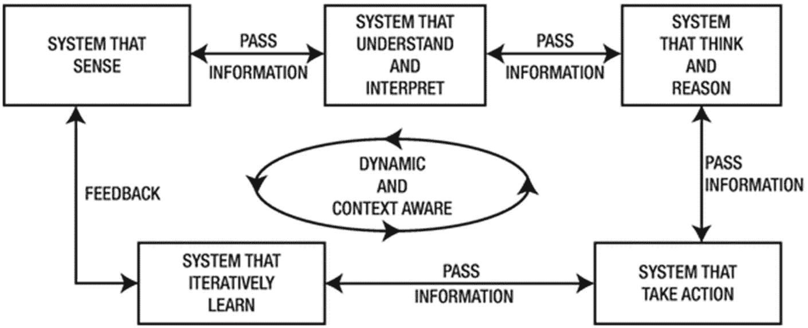
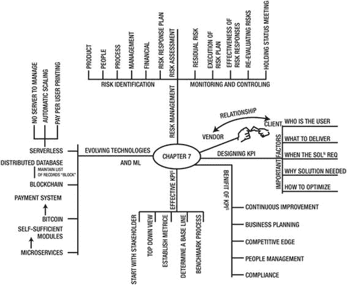

# 7. 机器学习的创新、KPI、最佳实践等

帕坦加利·卡什亚普博士^(a*)

^a 印度卡纳塔克邦班加罗尔

## 摘要

本章重点阐述了传统商业模式如何发生变化，以及新模式如何在主流行业和市场占据一席之地。本章还简要介绍了传统 IT 供应商如何采用新思维，并押注于思想伙伴关系的工作方式，而非订单交付模式。内容涵盖从当前 IT 供应商转型状态的背景设定，到他们针对微服务和区块链等新兴技术的采用策略。

本章阐述了思想伙伴关系过程如何在整体变革场景中发挥作用。它还涵盖了机器学习生态系统背景下的风险、合规性、最佳实践和 KPI，并深入探讨了这些技术将如何潜在地改变行业、领域乃至世界的未来状态。本章还提供了跨领域和技术识别某些 KPI 的指南。

本章还强调了创新过程以及围绕创新建立文化的重要性。这一讨论之所以相关，是因为最终是创新将一个表现平平的普通组织推动成为表现卓越的组织。尤其是在过去几十年里，正是创新推动了组织的卓越发展。例如，谷歌的无人驾驶汽车、亚马逊的云服务以及特斯拉制造可重复使用火箭的使命，都使它们在未来的市场中站稳了脚跟。

## IT、机器学习、供应商、客户与变革时代

信息技术（IT）构成了所有以增长为导向的机构在这个加速增长与动态决策的超现代时代中核心战略投资的主要部分。因此，企业越来越依赖创新、技术和敏捷性来实现其快速发展和成功。实现两位数增长的组织通常押注于其独特的产品、更高的生产力或利基专业领域，并且常常将纯粹的创新置于次要位置，直到竞争对手迎头赶上，迫使他们将收入的很大一部分用于创新。

组织利用这段时间来清理现金盈余或达到理想的规模，以吸引潜在和现有客户的注意。那些已经跨越所有这些障碍并确立自身地位的组织，在实现持续增长方面面临着更艰难的道路。因此，他们期待做一些新的事情，并将创新置于主导地位。他们大力投资于机器学习、大数据、物联网等创新技术，并在产品/服务、业务流程和客户管理方面引入新颖性。

在那些已经成熟并曾引领组织成功直至需要应对时代变迁的主要和次要流程中，也看到了同样的趋势。概念很简单。创新的任何延迟或失败都将导致组织的迅速消亡。随着客户和用户可选择的替代方案不断增加，残酷的竞争迫使这些组织进行创新。

创新和自动化成为这些组织的增长推动力，这背后有多种原因。这些参数之所以成为增长推动力，是因为像机器学习和大数据这样的创新技术需要为传统技术（如大型机）注入新的思维模式。此外，这些都与盈利能力、增长和生产力息息相关。创新不再是奢侈品，而是必需品。然而，创新涉及成本和时间。因此，高层管理人员对其执行和围绕其建立文化的承诺至关重要。这里列出了一些重要的项目：

*   确保所有创新想法都有平等的机会——对来源保持中立。
*   建立成熟的文化和能力，以鼓励、监控和发展想法。从多种来源挖掘创新。
*   培养发现、评估、指导和孵化具有商业价值的想法的能力。为其实施适当的流程。
*   建立一个能够对新想法做出早期投资决策的框架和团队。
*   让员工/合作伙伴参与其中。组织必须鼓励他们挖掘自身的创意潜力。
*   为员工/合作伙伴建立一个稳健且可持续的平台，以因他们的想法获得奖励/认可。

在这种激烈的竞争下，组织寻找一切可能的机会进行创新。他们要求并期望其员工、管理层、供应商、业务伙伴、渠道伙伴和其他利益相关者帮助他们创新。他们愿意接受帮助或支持利益相关者在各自领域进行创新。由于 IT 和创新技术是增长的加速器，组织将 IT 创新置于最高优先级。日常交付卓越、降低成本、提高生产力以及“接受订单并交付”的方法现在被所有 IT 供应商默认视为理所当然。任何仅通过这些所谓的默认利益来提供价值的公司将被视为 IT 供应商，而组织（尤其是大型组织）正在寻找能够展示在范围上更优越、思维上更广阔、方法上更大胆，并能清晰、可衡量地阐述商业价值的 IT 供应商。

这些组织被称为 IT 合作伙伴，他们将获得更多收益、承接更大项目，并赢得市场更多的尊重。IT 公司必须不断重新审视其与客户合作的方式，并引入更卓越的思维过程，以满足市场对知识和创新的需求。这些公司必须将自己转变为“思想伙伴”。

这种合作的结果是产品与服务的共同创造。共同创造是关于持续协作，客户和合作伙伴共同努力，在服务和产品方面创造卓越。例如，供应商通常拥有良好的新一代技术研发和测试中心。同时，他们运营卓越中心和思想领导力计划，而客户则以领域为中心。因此，客户可以利用这些服务或专业领域，与供应商紧密合作，创造出卓越的服务和产品。这种策略使供应商和合作伙伴/客户/利益相关者能够实时测试 APS，并向供应商提供即时反馈。持续协作是这个想法的支柱。同时，相同的策略可以用作反馈机制，并持续进行，直到完成的 APS（应用程序、产品和服务）被恰当地交付给利益相关者。

除了常规的技术任务外，组织还将同时进行广泛的增强、升级、实施和其他具有战略重要性的举措。要将所有这些并行活动成功完成并实现清晰的 ROI 衡量，需要大量的技能资源和管理时间。在大多数情况下，这些举措传统上被分解成较小的工作块，并交给多个供应商，导致不必要的协调问题、不合规问题以及成本和时间升级。尽管这种模式在减少对单一供应商的依赖、提供多组技能劳动力以及风险分散方面具有优势，但一个更大的合作伙伴可以利用其专业知识和实力单枪匹马地提供所有这些优势。

客户必须非常谨慎地选择他们的合作伙伴，考察其将高端 IT/商业咨询与广泛的基础 IT 服务完美结合的能力。这对于新兴的 IT 服务公司来说是一个巨大的升级，因为他们面临着提供高端咨询服务以及其常规服务的严峻挑战，而这些能力他们必须去获取。这种模式与已存在多年的现有模式不同。然而，这是当下的需求，因为为了追求卓越，客户希望将这种卓越融入其工作文化的 DNA 中。

这种追求卓越和获取卓越的愿望带来了对自动化、自动化的自动化以及智能应用程序的需求，这些应用程序可以帮助组织用更少的人力资源管理任务。它有助于以更低的成本、更高的盈利能力和更高的 ROI 来实现效率和效果。机器学习及其相关技术非常适合这一追求。此外，如果围绕机器学习生态系统创建并实施解决方案，则无需过度分配工作。一些常规和重复性的任务可以很容易地由支持机器学习的智能解决方案执行。然而，对于高技术要求，仍然需要智能劳动力和强大的基础设施准备，以及其他因素，而供应商可能是其中一个选择。

构建机器学习解决方案需要基于技术、流程、人员和治理的综合方法。因此，必须采取适当的预防措施。这要求对现有流程、指标、设计考量和评估方法进行合理评估。此外，在机器学习解决方案实施前、实施中和实施后，都需要遵循某些标准指南，否则所有努力都将付诸东流。

这些指南包括风险管理、资金保障、合规对齐等诸多因素。以下是机器学习解决方案和策略的一些先决条件：

*   设计机器学习实施流程（从创意生成阶段到快速原型阶段）。
*   设计机器学习项目与组织治理结构，包括相关人员的角色与职责。
*   整合设计赋能要素。
*   支持机器学习解决方案的实施与项目管理。
*   通过快速原型工厂推动创意的孵化。

## 为基于机器学习分析的领域设计关键绩效指标（KPI）

KPI 是可衡量、可计算的指标，通常与企业目标保持一致。存在多个关键流程点会影响组织及项目的整体绩效。绩效衡量有助于确保流程产出符合一系列业务目标，并满足利益相关者的期望。因此，KPI 的设计应能衡量个人贡献者、项目及部门层面的活动，且这些指标必须相互对齐。KPI 应基于业务驱动因素和基准进行识别和定义，并持续监控以跟踪服务绩效。

最终，这些绩效参数可汇总为业务绩效参数。在定义 KPI 时，五个 W（谁、什么、何时、何地、为什么）以及如何（How）可作为实现效率的指南。为衡量基于机器学习的项目/个人贡献/组织能力或单元绩效而设计 KPI 始终是一项巨大挑战。不过，以下指南会有所帮助。从回答这些问题开始总是好的：

*   用户是谁？
*   业务将交付什么？
*   利益相关者何时需要解决方案？
*   利益相关者在何处、出于何种目的需要解决方案？
*   利益相关者为何需要此方案？
*   业务如何优化流程和技术？

绩效衡量机制在帮助组织衡量绩效并制定未来战略方面发挥着重要作用，同时也有助于跟踪当前绩效状态。此外，在大数据和机器学习等项目中，由于涉及高投资需求、上市时间、客户体验等重大因素，绩效衡量至关重要。定期衡量业务和运营绩效是一项关键任务，其重要性不言而喻。

例如，除非进行绩效监控和衡量，否则无法引入改进或控制措施。企业会使用多种统计技术和方法，定期对照设定的 KPI 衡量绩效。衡量绩效的主要目标在于：

*   了解业务、项目和运营在设定参数下的表现如何
*   将数据点整合到一处，以洞察全局
*   设定持续改进绩效的目标
*   进行主动规划和预测，以保持竞争优势

定义关键 KPI 和绩效衡量的过程，也有助于企业和决策者制定章程并规划扩张与增长战略。任何 KPI 或绩效管理系统成功的必要条件是其必须切合实际，不应流于理论。因为如果理论脱离实际，就无法衡量和报告与给定流程/运营无关的指标和 KPI。以下是关于 KPI 及指标衡量框架的几点建议，您应将其纳入考量以有效执行 KPI：

*   与客户和供应商可能已商定的任何合同义务
*   从人员、流程和技术角度重要的衡量指标
*   高层管理者希望看到的衡量指标，例如收入增长、年度盈利能力等

## KPI 与机器学习团队

在理解 KPI 之后，您需要进一步延伸，明确最终由谁负责实施这些 KPI。您还需要知道如何衡量他们的生产力，因为这样才有机会进一步优化。让我们从这个角度审视一些重要的 KPI。

数据分析团队的关键 KPI：

*   每月产出的洞察数量
*   常规使用分析工具的决策者比例
*   分析团队预测的精确度
*   分析团队产出结果的速度

数据工程师团队的关键 KPI：

*   系统和数据管道的可用时间比例
*   每月错误和事件的发生频率
*   解决故障和问题的周转时间
*   自动化生产部署的成功率
*   每月交付的新功能或更新数量

数据科学家团队的关键 KPI：

*   每月创建的模型数量
*   数据科学模型预测的精确度
*   数据科学已解决的业务问题数量

## 监控 KPI

设计和实施 KPI 固然重要，但了解并理解这些 KPI 的表现同样关键。因此，明确需要监控哪些机器学习相关的 KPI 至关重要。

以下是为监控机器学习而设置的 KPI：

*   训练
*   准确率
*   行数和列数
*   时间
*   变量重要性
*   评分
*   迭代数据验证
*   预测
*   数据健康摘要
*   准确率摘要
*   数据错误率
*   缓存命中率
*   监控
*   生产阶段的模型数量
*   模型运行的位置
*   模型已投入业务使用的时间
*   模型是否经过验证和批准
*   批准模型的人员
*   已执行的测试
*   结果是否可靠/准确
*   是否满足合规与监管要求
*   模型是否在阈值内运行
*   模型的投资回报率（ROI）

## 使用平衡计分卡设计有效的 KPI

定义 KPI 和指标有多种方法。其中一种有效的方法是使用平衡计分卡。平衡计分卡原则在定义 KPI 和构建整体绩效管理体系时非常有用。简而言之，平衡计分卡（BSC）是一种战略制定、规划、预测和管理方案，企业和组织可借助它来：

*   传达他们试图实现的目标
*   将每个人的日常工作和常规任务与战略对齐
*   对项目、产品和服务进行优先级排序
*   衡量并监控朝着战略目标的进展和改进

平衡计分卡技术不仅关乎根据已确定的 KPI 衡量绩效，还能帮助组织高效地制定或修订其战略。以下是定义 KPI 时需要遵循的基本步骤：

*   *从利益相关者（包括客户）入手*：优先考虑对质量至关重要的客户期望。
*   *自上而下的视角*：从服务层面开始，逐步分解到所涉及的最低层级。这能提供全面的视图。
*   *建立关键且一致的指标*：这有助于洞察仪表盘上需要哪些指标。
*   *确定基线*：需要识别当前状态，因为它能提供对当前流程中关键指标的洞察。
*   *对标流程*：找出谁在相同或类似的事情上做得更好。
*   *设定目标*：定义需要实现的新参数。

在为任何流程定义 KPI 和指标时，应牢记以下一些关键属性：

*   *相关性和有效性*：为给定流程选择相关的 KPI 是关键方面之一。除非确定了相关的 KPI，否则绩效报告的目的将无法实现。
*   *可控性*：KPI 的定义方式应使其能够被衡量和控制。这一点很重要，因为流程及其运营的整体有效性在很大程度上取决于此。
*   *完整性*：KPI 应尽可能量化。绩效指标在本质上应该是完整的，因为除非所有相关方就关键 KPI 达成一致，否则很难衡量绩效。这种完整性最终会带来更高的准确性并产生预期的结果。
*   *逻辑性/一致性*：KPI 和指标应使用数学公式来定义。应该存在一种逻辑，有助于衡量和整体绩效验证过程。

## 准备工作

在开始定义 KPI 和指标之前，还应处理好以下几个广泛要点：

*   KPI 将如何为当前和未来的客户/业务创造价值。
*   KPI 是否有助于衡量运营流程和 IT 系统的绩效，并有助于得出关于业务绩效的结论。
*   应进行深入探讨，以制定、讨论和规划开发绩效管理体系的策略，包括 KPI 和指标的定义。
*   沟通是此过程中发挥关键作用的非常重要的一环。应将已定义并达成一致的策略告知相关方，以便所有各方达成共识。
*   在制定 KPI 时，考虑任何第三方或其他内部团队（可能直接或间接参与提供部分服务）的角色也很重要。
*   即使在引入 KPI 之前，将其分发给所有相关方也很重要。改善业务是每个人的权利和责任。

## 衡量类别

以下是在平衡计分卡方法背景下的一些重要衡量类别：

*   财务
    *   销售与服务
    *   服务成本
    *   净资产回报率
    *   营业利润率
    *   利润率与收入之比——服务产品盈利能力
    *   运营支出与资本支出之比
    *   运营支出与收入之比

*   客户体验
    *   客户满意度
    *   产品质量
    *   易用性
    *   准确性
    *   可用性
    *   安全性
    *   服务质量
    *   及时性
    *   首选访问渠道：客户可用的渠道和接触点，如真人客服、网站和实体店面
    *   定价灵活性

*   内部业务流程
    *   流程再造
    *   单位成本
    *   时间
    *   缺陷
    *   产能与需求
    *   简洁性
    *   流程灵活性与自动化
    *   资源利用率

*   学习与成长
    *   员工保留率
    *   员工多样性
    *   培训时长
    *   支出
    *   绩效评估
    *   员工满意度

## KPI 的益处

以下是使用 KPI 的一些益处：

*   *持续改进*：通过高效的绩效管理体系，有效跟踪流程、人员和技术成为现实。同时，客户体验和最终用户对所提供服务的看法也能被密切跟踪。
*   *业务规划与预算/收入预测*：绩效衡量使组织能够定期内省地审视自身绩效，做出有意义的结论，不时修订预算并调整收入预测。需求和规划团队也可将其用于未来的业务规划。
*   *竞争优势*：可以轻松地与市场竞争对手进行绩效比较，并持续改进以保持领先地位。
*   *人员管理*：员工在组织的成功和成长中扮演着重要角色。在当今时代，将奖金和绩效薪酬与员工绩效 KPI 挂钩已成为一种惯例。这也激励员工发挥出最佳能力。
*   *法规与标准合规*：许多客户希望供应商遵守某些行业标准。一个符合行业标准和最佳实践的绩效管理体系将有助于满足监管标准。

KPI 有助于判断、衡量和改进组织的绩效标准，并且它们会向下渗透到所有部门。机器学习和大数据在技术上可以是领域无关的。它适用于所有领域，无论是零售、制造、时尚还是任何其他感兴趣的领域。本节对此进行了详细讨论。不过，最好看一个实际展示其工作原理的示例。下一节将描述零售行业中销售 KPI 的一个案例。

## 特定组织和行业视角下的一些重要 KPI

KPI 可以被设计用来衡量几乎任何事物。本讨论主要基于机器学习。本节包含一些重要的 KPI，它们能为组织带来可衡量的收益，并可用于创收。其他 KPI 则衡量与机器学习行业视角相关的全球现象的重要方面。这有助于公司评估机器学习在其各个领域的相关性和影响。

### 组织/企业特定的机器学习关键绩效指标

*   特定组织中使用机器学习技术的项目百分比。

*   组织内使用的机器学习特定技术百分比。例如，整个组织中有多少项目正在使用 Mahout 或 MS Azure ML。

*   组织内有多少产品、服务和应用程序是使用机器学习构建的，其中有多少是全新的。此外，有多少是增强型项目。

*   组织内机器学习项目的成功率是多少。

*   基于机器学习的项目人员效率与非基于机器学习的项目人员效能和效果相比的百分比。

### 行业特定的关键绩效指标

*   在零售、酒店、医疗、教育等领域使用机器学习及相关技术的公司百分比。

*   在客户服务、销售与营销、财务、银行、保险及运营中使用机器学习的组织百分比。

*   使用云、大数据分析、认知计算和机器学习的公司百分比。

### 库存与客户分析关键绩效指标

目标：降低成本，消除缺货和库存过剩的不必要开支，识别重要客户以进行精准营销，培养忠诚度，并做出强大、快速的决策。

零售商在实时跟踪商品、通过优化供应与库存地点同步方面面临巨大挑战。与所有利益相关者、物流和连接保持持续沟通是快速响应消费者需求的关键。跟踪季节性趋势和时尚风格可确保客户在正确的时间获得正确的产品。库存分析将改善与库存相关的决策。基于机器学习的分析可以通过实时评估畅销产品来实现快速发货。预测分析可以通过分析季节性销售数据、取消滞销产品的发货以及与供应商进行更有效的沟通，帮助企业快速做出决策。

以下是库存分析列表：

*   部门贡献
*   热销商品报告
*   库存百分比
*   库存周转率
*   线性英尺
*   降价百分比
*   拉动率
*   重新分配
*   季节性采购
*   销售率
*   供应周数

以下是一些客户分析：

*   行为画像
*   偏好建模
*   关联追踪
*   附加率
*   购物篮-收银机关联
*   品牌转换
*   客户忠诚度
*   人口统计购物篮
*   购物篮内价格
*   每篮商品数
*   收入贡献

## 关键绩效指标与指标的区别

区分关键绩效指标和指标至关重要。关键绩效指标可以被视为共同提供成绩单的指标。指标仅仅是活动的摘要。用医疗保健的类比可以更清楚地说明这一点：关键绩效指标提供了个人整体健康状况的详细信息，而指标则包括测量患者的体温或呼吸急促程度。关键绩效指标就像编程语言中的隐藏变量，在后台存储值。

## 风险、合规与机器学习

历史上充满了因欺诈和不合规而导致组织失败的案例。这是一种全球现象。例如，美国的安然公司、印度的萨蒂扬公司以及韩国总统朴槿惠的欺诈案。欺诈可以在任何层面由任何人实施。它可能以误导性会计实践的形式出现，也可能是组织内员工提交虚假的投资证明，甚至是政府官员的军火交易。

最终，所有这些行为都会侵蚀股东的财富。这也会导致人力掺水，并可能毁掉职业生涯。这些事件会触发对现行监管政策的修改，并导致新法案的出台，例如《萨班斯-奥克斯利法案》，以加强控制。注册舞弊审查师协会的一份报告预测，企业高达百分之五的利润因欺诈而消失。

尽管过去几年监管趋严，但洗钱和金融丑闻仍持续发生。金融行动特别工作组预测，每年有超过一万亿美元被洗白。近年来，金融服务行业受到越来越多的审查。因此，银行已被指示采取全面措施以避免金融腐败。监管机构逐渐要求机构进行更大范围的监督，包括更密切地监控反洗钱举措和落实情况。大多数此类欺诈行为未被发现。在当前世界，欺诈检测变得更具挑战性，因为机器产生的数据量巨大。随着技术时代的变迁，欺诈者总是领先一步。因此，使用传统技术来串联线索是无用的。

较旧的洗钱检测技术使用业务规则、神经网络和统计方法。模式识别技术也用于检测欺诈行为。为了产生有意义的见解，这些技术需要大量的历史数据。由于欺诈的性质可以归入更广泛的类别，因此存在大量已确认的欺诈行为存储库，并用于训练这些监督式技术（标签/输出是已知的）。然而，对于洗钱，没有标记数据可供学习。此外，除了缺乏历史数据之外，每个洗钱案例都是独一无二的。基于规则的系统对每个实体应用相同的逻辑，因为它们没有实时学习的能力。因此，依赖较旧的检测方法，洗钱检测的成功率很低。此外，部署传统模型通常需要昂贵的硬件和数据库。即使在此基础上，最终的解决方案也无法提供实时性能。

由大数据分析、物联网和机器学习驱动的新一代异常检测技术，正在改变风险、审计和合规职能的工作方式。这些技术在知识产权盗窃、员工合规、虚假员工索赔、应付账款和保险理赔处理等领域非常有用。基于机器学习的系统的实施，在熟练度和识别高风险及可疑交易的能力方面提供了显著改进，速度比以往更快。同时，它使后台和审计团队等员工能够专注于其他重要任务。他们可以更高效地提出想法，最终有助于调查和揭露新的欺诈手段。

与洗钱相关的历史数据不易获取，通常既稀少又不可靠。因此，使用无监督机器学习技术从数据中提取洞察至关重要，而无需事先了解要寻找什么。从技术上讲，无监督学习利用渐进式聚类、关联分析、联想学习等技术，使客户能够追踪交易不可预测性、实体交互和行为变化。

然而，要充分利用无监督学习来检测洗钱行为，公司必须收集并整合来自多个来源的数据。只有这样，系统才能正确处理数据。一旦优化实施，追踪个人及其洗钱/资产的行为将变得容易。需要监控的一些关键数据元素如下：

*   资金流入与流出

*   实体与账户之间的关联

*   账户活动，例如速度、交易量和匿名性

*   休眠账户的重新激活

*   存款构成

*   警报区域的交易活动

*   多个账户及账户类型的使用

检测洗钱活动是一项复杂的任务，因此应用一种能够潜在地追踪每个相关个人或群体行为并将其关联起来的技术至关重要。借助机器学习、虚拟现实和人工智能技术，可以更轻松地分析每个特定实体（持卡人、商户、账户、计算机等）及其随时间变化的活动，并生成任何可能试图洗钱者的全面视图。

组织执行基于机器学习的项目。他们负责处理大量活动。广义上，这些活动分为组织层面和项目层面。从一个典型的中层经理项目来看，特定活动非常重要。从组织角度来看，为了项目的完美执行，及时识别风险至关重要。最终愿景是通过项目获得实现感。

技术经理和团队面临的一个主要问题是如何以最小风险或无风险执行项目。由于风险组合的复杂性及其多维性质，这并非易事。因此，恰当的识别、分析、规划、评估和应对是降低风险的关键。

### 机器学习项目的风险与风险管理流程

风险始终存在。因此，为任何已识别的风险制定相应的缓解计划非常重要。尽早识别风险并在项目整个生命周期中持续跟踪至关重要。识别、分析和应对风险始终是一项挑战。机器学习有可能自动化这一整体流程。目前已在局部开始实现。然而，手动风险管理仍有其重要性（至少目前如此）。因此，以下章节将更详细地讨论风险管理。图 7-1 展示了整体风险管理流程。

风险管理的闭环流程图。信息在感知、理解与解释、思考与推理、采取行动以及迭代学习的系统之间传递。反馈存在于感知系统与迭代学习系统之间。该流程是动态且自我感知的。

图 7-1

风险管理流程

### 风险识别

风险有多种类型，可由团队任何成员或组织中的任何人识别。营造无风险的环境/项目/组织是每个人的责任。然而，本章的讨论仅限于项目风险（见表 7-1）。

表 7-1

风险类型

| 项目/产品 | 人员 | 流程 | 管理 | 财务 |
| --- | --- | --- | --- | --- |
| 集成 | 培训 | 质量 | 客户/供应商/合作伙伴关系 | 合规性 |
| 可扩展性 | 可用性 | 可管理性 | 合作 | 保密性 |
| 可用性 | 培训 | 质量 | 进度与成本 | 法律 |
| 性能 | 采用率 | 可追溯性 | 财务 | 进度与成本 |
| 安全性 | 技术知识 | 可衡量性 | 管理流程 | 价值实现 |

如果风险由团队成员识别，那么在记录风险之前，该成员应与其主管沟通此问题，以确保情况符合项目风险的定义。如果风险得到确认，则应为该风险指定一名负责人。负责人通常是对解决该风险感兴趣，或在该风险发生时将受到主要影响的人。之后，进行风险评估。

### 风险评估

必须根据威胁发生的概率以及（如果发生）影响的严重程度来评估整体威胁。使用以下公式进行估算：

*风险敞口 (RE)* = *概率 x 影响*

一旦评估完成，就需要制定风险应对计划。

### 风险应对计划

这是一个在风险发生之前实施的计划或行动方案。它旨在消除或降低风险发生的概率，或减少（如果风险发生时的）影响。你必须确定缓解风险的策略，并制定一套明确定义的步骤。以下是主要活动：

*   识别潜在的风险应对措施

*   选择风险应对措施

*   将风险应对措施添加到风险日志中

*   指定负责人

*   指定截止日期

### 监控与控制风险

风险监控与控制在此阶段进行。请考虑以下有助于监控和控制风险的任务：

*   监控残余风险。这些风险是在实施缓解计划后仍然存在的风险。

*   确保风险计划的执行。

*   评估风险应对措施的有效性。

*   重新评估风险。

*   召开状态会议。

在了解了风险框架之后，你应该从数据隐私、模型泄露和数据偏差的角度来考虑它。

“隐私”一词在科技行业涵盖范围广泛。“用户控制”和“数据保护”这两个类别可用于总结现有的隐私与机器学习方法。因此，在“用户控制”部分，用户的权利可以通过了解谁在收集什么信息、为何收集、收集多久等因素来确立。这些模型需要海量数据集进行学习，才能达到合理的准确度。但你提供给它们的信息是高度私密和敏感的。因此，弄清楚如何在维护数据隐私的同时释放机器学习的潜力至关重要。

当你的训练数据包含关于目标的信息，但模型用于预测时却无法访问相同的数据，这被称为数据泄露（或泄漏）。由于这个原因，模型在训练集（可能还有验证数据）上表现良好，但在实际使用中表现会很差。

换句话说，泄露会使模型看起来正确，直到你开始用它来做判断，这时它会变得完全错误。在许多数据科学应用中，数据泄露可能造成数百万美元的损失。通过仔细分离训练数据和验证数据可以避免这种情况。可以使用管道来执行这种分离。类似地，运用审慎态度、良好判断力和数据研究可以定位目标泄露。当你的预测变量包含在做出预测时不可用的数据时，就会发生目标泄露。重要的是要从数据变得可用的时间或时间顺序来考虑目标泄露，而不仅仅是一个特征是否能做出好的预测。

当一组数据不可靠且不能准确反映整体人群时，就会产生数据偏差。这是一个严重的问题，因为它可能导致片面的回答和扭曲的结果，从而造成不公平。因此，及早发现并避免它们至关重要。

一旦你识别出偏差，就必须避免它们：

*   寻找能够实现相同功能但偏差较小的替代数据集是实现这一目标的一种方法。

*   机器学习会复制人类的思维过程，从而也会复制偏差。因此，在收集数据时减少人为偏差是另一个明智之举。

*   此外，有大量的基准测试可以衡量歧视性信号。算法中有一个子句可以自动识别某些情况。

好了，现在让我们来看看机器学习的最佳实践。

## 机器学习最佳实践

最佳实践在机器学习领域非常重要。机器学习是一个非常专业的领域。因此，它需要技术专长、卓越的流程以及恰当及时地应用合适的方法论和框架。因此，最佳实践变得至关重要并占据核心地位。以下是一些重要的最佳实践：

*   确定你的需求并理解业务要求。

*   明确你的需求，并根据需要进行调整。

*   保持你的开发方法简单。

*   确定可靠的数据来源。收集所需数据并使其无噪声。

*   在使用算法之前对数据进行归一化处理。

*   根据你的需求确定合适的语言、框架和库。

*   定义训练模型的策略，包括硬件基础设施和许可。

*   定义执行策略，例如实现并行化和迭代。

*   分别测试基础设施和软件，然后再进行组合测试。这有助于实现整体测试。

*   设计并创建合适的模型。同时，不要忘记集成这些模型。

*   从一个独立的模型开始，以帮助进行测试。

*   并行训练多个单线程模型。

*   使你的代码可移植，并尽量与环境无关。使用云环境是实现这一目标的最佳方式。

*   根据底层数据的变化，迭代你的模型以进行净化并使其更准确。

*   衡量模型之间的输出差异。

*   业务问题会随时间变化，因此要使模型与需求保持同步。监控模型准确性的下降。

*   跟踪预测和预报。

## 不断发展的技术与机器学习

机器学习领域正在发生许多快速变化。因此，多种支持技术围绕它发展以使其更好、更高效是很自然的。然而，机器学习本身并不是这些技术成为主流的唯一驱动因素。云、大数据、物联网和认知计算也是驱动因素。使用最新的技术进步总是好的。请考虑以下即将到来的技术：

*   *无服务器计算*：根据无服务器计算的概念，你可以开发、构建和运行应用程序和服务，而无需头疼的基础设施管理。在无服务器环境（云基础设施）中，应用程序仍然可以在服务器上运行，但所有服务器管理都由供应商或云服务提供商完成。亚马逊是无服务器架构的先驱。亚马逊网络服务（AWS）通过 AWS Lambda 实现无服务器计算。AWS Lambda 运行用户的代码，而无需预置或管理服务器。Lambda 为你提供了几乎可以运行任何类型的应用程序或后端服务的能力，并负责运行和扩展（向上和向下）代码所需的一切，同时保持高可用性。采用无服务器架构的好处很多：
    *   *无需管理服务器*：用户无需头疼基础设施管理，可以专注于功能。这也是无服务器范式也被称为函数即服务（FaaS）的原因之一。

*   *自动扩展*：根据应用程序的需求，通过获取应用程序触发器（例如，一个事件）来实现应用程序扩展。

*   *按用户使用量付费*：如果你使用服务十秒钟，你就为这十秒钟付费。

*   *区块链*：区块链是一个分布式数据库，维护着一个不断增长的、有序的记录列表，这些记录被称为区块。每个区块包含一个时间戳和一个指向前一个区块的链接。从设计上讲，区块链天生具有抵抗数据修改的能力。一旦记录，区块中的数据就不能被追溯更改。通过使用点对点网络和分布式时间戳服务器，区块链数据库自主运行。从概念上讲，区块链可以被定义为“开放的、分布式的账本，能够高效、可验证且永久地记录两方之间的交易。”账本本身也可以被编程以自动触发交易。

*   *比特币*：数字货币和支付系统。大致来说，这是一个开源软件。这意味着没有个人、企业或国家维护这个网络，就像没有人维护互联网一样。这是一个点对点系统，个人可以直接进行交易，而无需像银行、信用卡组织或清算所这样的中间系统或个人。比特币交易由节点网络进行验证，并记录在一个称为区块链的公共分布式账本中。它也被称为区块链的货币。

*   **微服务**：一种基于分层的架构，它指导你将代码划分为多个层级，从而实现代码的清晰分离。因此，其执行和管理变得容易。例如，在三层架构中，你将核心代码分为三层——表示层、业务逻辑层和数据层——实现了整洁与分离。即使将代码划分到不同层级，这些层级在传递、处理、整合和呈现整体信息时仍然相互依赖。微服务提供了一种解决此问题的机制，因为你根据功能划分应用程序，并将这些层级开发并部署在一个自给自足的模块中，使它们能够独立工作。如果项目包含客户、发票、CRM、SCM 和用户界面模块，你必须将每个服务拆分为一个可独立部署的模块。每个模块必须包含自己的维护、监控、应用服务器和数据库。因此，在微服务架构中，不存在集中式数据库的概念，因为每个模块都是自给自足的，并拥有自己的数据库。

## 总结

本章讨论了供应商、客户和组织之间的技术关系。它还强调了在机器学习、物联网和认知计算背景下创新的重要性。在简要讨论 KPI 之后，接着讨论了风险与合规性。最后，本章概述了与机器学习相关的最佳实践，并解释了对围绕机器学习不断发展的技术（包括无服务器架构、区块链和微服务）的一些见解。

## 思维导图

第 7 章的思维导图。风险管理包括风险识别、监控和控制。不断发展的技术与机器学习包括区块链。设计 KPI 有 5 个因素。KPI 的益处包括合规性。有效的 KPI 包括自上而下的视角。供应商和客户之间存在关系。

