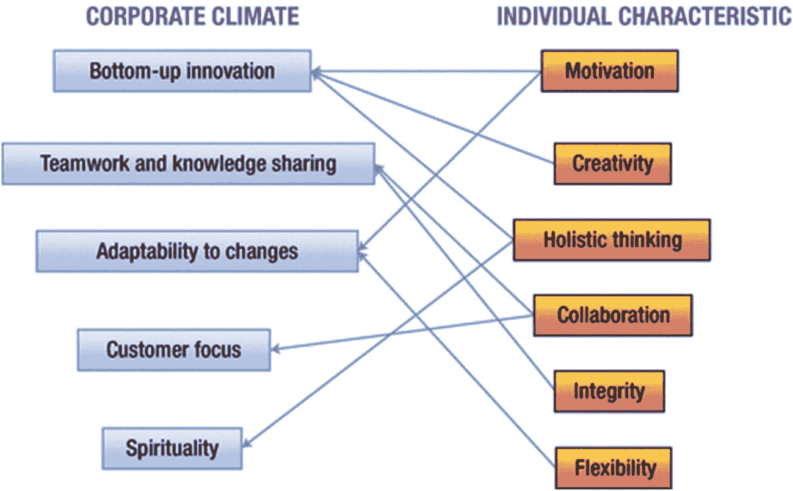
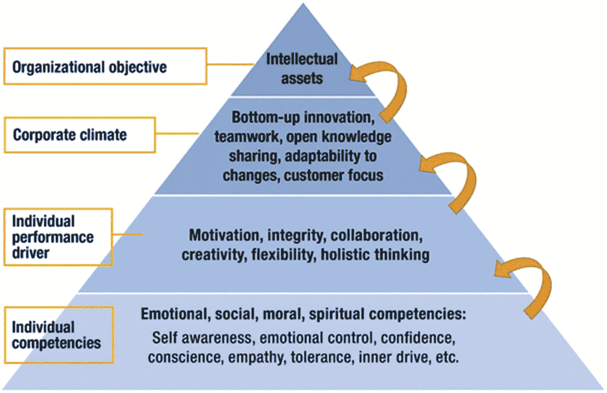
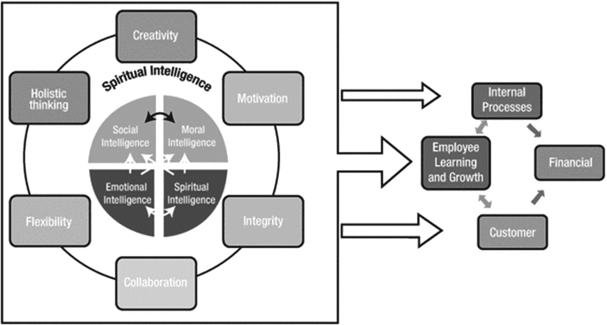
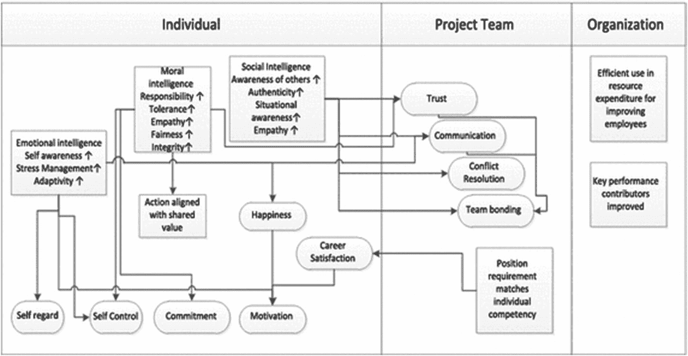
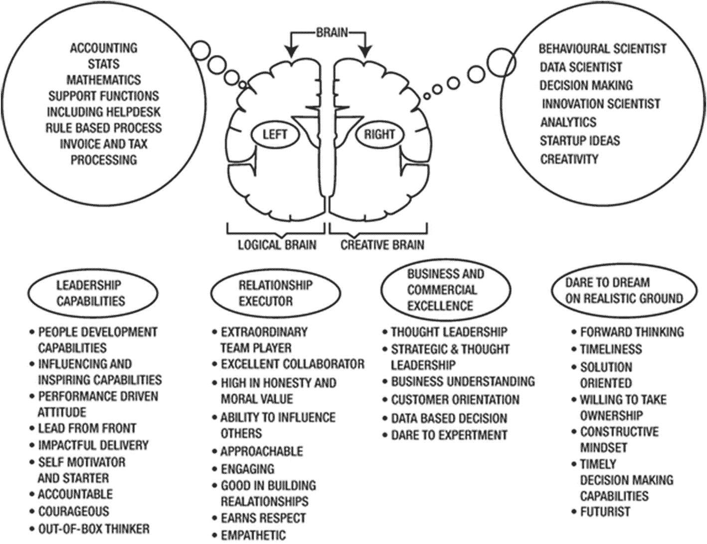
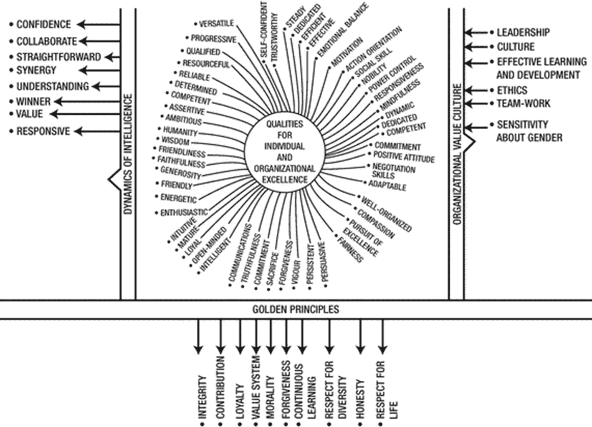
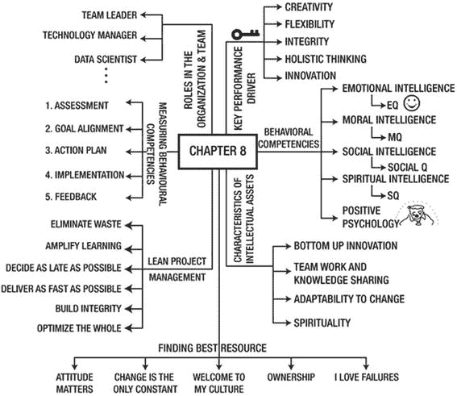

# 8. 勿忘我：机器学习中的人性层面

帕坦加利·卡什亚普博士^(a*)

^a 印度卡纳塔克邦班加罗尔

本章是所有章节的统领，但它并不讨论机器学习或其相关问题。一本关于机器学习的书中的一章，如果不讨论技术，又怎能成为所有章节的统领呢？简单直接的答案是：本章关注的是在基层实现机器学习的人。本章关注的是那些为组织中的机器学习实施及其未来制定战略的人。本章之所以重要，是因为它涵盖了如何管理机器学习项目以及如何培训参与整个流程的人力资源。

简而言之，本章讨论以下问题：

*   为什么社交和情商对机器学习团队很重要？
*   团队成员应具备哪些基本素质才能更好地规划和执行项目？
*   什么是精益项目管理原则？为什么机器学习项目需要它们？
*   像游戏化这样的创新技术如何提高团队生产力？为什么需要它们？
*   如何在机器学习项目中实现团队成员的最佳绩效和承诺？
*   什么是思想与创新领导力的技巧？为什么机器学习项目需要它们？

## 经济、工作场所、知识、你与技术

劳动力由人类及其复杂的社会、道德、情感、行为和心理互动构成。高超的技术技能并不能自动带来高绩效，除非团队成员有承诺、有动力并享受他们的工作。同样重要的是，他们能够处理压力和冲突，并在工作场所中进行沟通与协作。

为了实现卓越，需要将员工的价值观、技能、能力和目标与组织、客户/供应商以及技术方法论的理念保持一致。事实上，许多学术和专业观点都认识到，在工作场所中觉察和管理情绪（**情商**，EI）具有重大贡献。驾驭和促进社会关系的能力（**社交智力**，SI），以及将普遍原则应用于个人价值观和行动的能力（**道德智力**，MI），通常能带来工作场所的成功。通过这种方式，可以实现组织的效率和效能。在高度技术化的团队中，实施这些创新的激励方法已变得非常重要。

在当今以知识为基础的经济中，许多人注意到企业市场价值创造正向无形资产转移。早在 1995 年，IT、医疗、通信和教育行业（其主要附加值来自智力和信息处理过程）就占美国所有工作岗位的 79%和美国 GNP 的 76%（Quinn, Anderson, & Finkelstein, 1996）。

扩展智力资产的潜力巨大。通过正确利用员工潜力，并最大限度地发挥员工的才智，你可以最大化员工的潜能。知识、批判性推理、情感、道德和社会能力——以及灵性——都参与到了创造性和技术性过程中。大多数公司知道他们要求员工具备的技术技能和知识，但对于所需的情感、社会、道德和灵性智力却不甚明了。

大量研究结果已经证实，这些衡量标准比智商更重要。丹尼尔·戈尔曼和达纳·佐哈在他们里程碑式的著作（《情商：为什么比智商更重要》和《灵商：所有智力的根源》）中，详细解释了这些能力和技能在工作场所的重要性。随着时代变迁，公司开始意识到，磨练资源/人才的情感、社会、道德和灵性维度对于实现最佳绩效至关重要。

机器学习及其相关技术是高度技术性的，因此它们需要创造力和创新方法。因此，一个能够同时运用其智力和心理能力的知识工作者，比一个只拥有出色数学技能的人更有可能成功。例如，一个数据科学家如果非常擅长解决问题，但不善于阐述、展示以及创造性地将分析与全局联系起来，那么他可能不是组织的理想人选。因此，组织以及项目本身，需要许多既擅长数学、逻辑和问题解决，同时又必须具备良好沟通和社交技能的人。

同样，银行处理的是其数据库中存有财务数据的账户持有人。在这种典型情况下，这些数据有可能被滥用，因为最终只有一小部分员工可以访问这些数据。因此，道德价值观和伦理问题就出现了。技术和流程可以提供帮助，但仅限于一定程度。最终，处理此事的经理才是最重要的。如果员工在道德上坚强，所有这一切都会自动得到妥善处理。

灵性智力本质上关乎理解一个人的核心潜能与渴望，它旨在寻找人生中真正的意义、价值与方向。它促使人们提出根本性问题，例如：我为何要做这件事？目的是什么？我是否适合这个角色？这些问题的答案至关重要，尤其是在机器学习等专业领域。如果某人不适合某个特定岗位且不愿从事该工作，将会拖累所有人。消极情绪会从个人蔓延至团队乃至整个组织，最终可能导致项目失败等灾难性后果。

三心二意的努力会导致工作低效且无效，进而向客户交付低质量的成果，这会影响组织的品牌形象、创收能力和盈利能力。此外，在即将到来的机器学习时代，任务和活动正迅速自动化，基于机器学习的 APS（高级计划与排程系统）正成为主流，这些技能对员工和组织都大有裨益。这些任务可以被自动化，但自动化情感和社交技能，即便并非不可能，也绝非易事。

最新研究（McKinsey & Company: MGI-A-future-that-works_Full-report.pdf）表明，拥有出色人际交往能力、社交智慧和职业兴趣的人，受工作自动化影响的可能性较小，因此失业风险也更低。这些独特的人类技能能带来灵活性和敬业精神。

总之，押注于高技术项目的组织在选拔人才时需要格外谨慎。他们必须选择高度自我激励、兼具技术素质与心理素质的人才。这只有当他们考虑选拔除智商（IQ）之外，还具备高情商（EQ）、高灵商（SQ）和高德商（MQ）特质的人时才有可能实现。好消息是，这些素质是可以培养的。它们不像智商那样“固定不变”，通过适当的培训和积极的环境，人们可以学会这些素质。

## 术语解析

*   *情商（EI）与情商商数（EQ）*：以建设性方式发现、运用、评估和实现自身情绪的能力，用以释放压力、有效沟通、与他人共情、克服挑战和解决冲突。这项技能还能使人识别并理解他人的情绪感受。这主要是一个非语言过程，影响思维并决定人们与他人建立联系的质量。情商商数（EQ）是衡量情商（EI）的量化指标，可通过多种方式测量，例如发放问卷。

*   *德商（MI）与德商商数（MQ）*：以理性和共情的方式辨别是非的能力。它是指拥有坚定的道德信念并积极付诸行动的能力，使人能够以正确和体面的方式行事。德商商数（MQ）是衡量一个人德商（MI）的量化指标，可通过多种方式测量，例如发放问卷。

*   *社交智力（Social I）与社交商数（Social Q）*：与他人建立联系并鼓励他们积极与你合作的能力。它也被称为“人际交往技巧”，但社交智力（SI）远不止于此。社交智力关乎对情境的觉察力以及对工作中社会力量的认知。这项能力使人能够了解有助于在与他人及社会打交道时实现预期目标的沟通风格、策略、政策与实践。社交智力提供洞察力和认知力。社交商数（Social Q）是衡量一个人社交智力（SI）的量化指标，测量方式之一为发放问卷。

*   *灵性智力（SI）与灵商（SQ）*：人们用以处理和解决意义与价值问题的智力，人们用以将自己的行动和生命置于更广阔、更丰富、更具意义背景中的智力，以及人们用以评估某条行动路线或某条人生道路比另一条更有意义的智力。灵商（SQ）是智商（IQ）和情商（EQ）有效运作的必要基础，是“终极智力”（Zohar & Marshall 2000, pp 3-4）。灵商（SQ）是衡量一个人灵性智力（SI）的量化指标，测量方式之一为发放问卷。

## 智力资产的关键特征

本节讨论促进智力资产创造的企业氛围的关键特征。这不仅适用于组织层面，也适用于部门和团队层面。

### 自下而上的创新

创新在当今企业中的重要性怎么强调都不为过。知识创造被提出有两种类型——通过组合先前不相关的元素（渐进式创新），或通过开发结合先前相关元素的新颖方式（突破式创新）。由于智力资产产生于组织的各个层级，创新也需要以自下而上的方式进行。整个组织的员工贡献改进意见和新颖想法，完善各个层面的操作细节（渐进式创新），这些积累最终汇聚成重大的变革性想法。这依赖于两个促成因素：创新的组织文化和富有创造力的个人。

### 团队协作与知识共享

如前所述，新知识的创造依赖于不同想法和知识的结合。因此，不同主体之间的交流越多，就能将更广泛的专业知识和经验引入创造过程。事实上，知识在共享时会呈指数级增长。团队内部、合作伙伴之间以及通过外部知识库进行的共享与协作都能加速增长。然而，由于最终产品是无形的，共享的有效性和可行性在很大程度上依赖于高尚的道德标准、社会关系以及保护知识产权和信息安全的机制。

### 适应变化的能力

知识型组织的大部分收益源于不断创造市场需求并及时跟进变化的需求。以电子设备行业的一个著名例子为例，像苹果这样的创新领导者，在短短几年内就创造了一个不断扩大的智能手机市场。该行业的其他公司如果不通过提供自己的替代产品或更具创新性的产品来适应新需求，就无法生存。为了持续创造价值，组织必须察觉并适应最新的外部市场变化，在内部变革中保持灵活、迅速行动并维持质量，同时能够管理每次变革带来的巨大压力。

### 以客户为中心

在当今的知识型商业中，产品质量已不再是客户唯一关心的问题。整个服务体验都至关重要。无论是识别并服务客户的未来需求、提供卓越的沟通体验，还是组织行为中展现的社会责任和诚信，这些都能产生大量的无形资产。只有通过提供卓越的客户服务体验，企业才能获得独特的身份和声誉，建立信任关系，从而赢得竞争优势。

### 灵性

该领域的研究者和专家已经认识到，员工需要在工作中找到意义和目标。这一点不能再被低估（丹娜·佐哈尔与伊恩·马歇尔合著：《*SQ*：*灵性智力*，终极智力》）。此处，灵性指的是个体自我与其精神追求、知识以及社会/自然环境之间的和谐。当员工能够与真实的自我建立联系、获得自由，并能整合来自不同视角的知识时，他们就会获得创造的动力和灵感。当员工将工作视为为社区或社会更高目标做贡献的途径时，组织的高灵性水平也会对客户体验产生积极影响。

## 个人的关键绩效驱动因素

要形成上一节所分析的理想企业氛围，对每位员工有何要求？通过理解企业氛围的各个方面，可以总结出六项个人绩效驱动因素，如图 8-1 所示。

关系图。个人特征（动机、创造力和整体思维）在企业氛围下促成自下而上的创新。协作与诚信促成团队合作与知识共享。灵活性促成变革适应能力。协作促成客户导向。

图 8-1

个人的关键绩效驱动因素

### 衡量智力

图 8-1 中列出的个人绩效驱动因素是复杂的技能组合，需要整合个人的情感、道德、社会和灵性能力。表 8-1 展示了这些心理能力如何协同作用，以实现所需的动机、灵活性、诚信、创造力、协作和整体思维技能。

表 8-1

个人绩效驱动因素所需的情感、道德、社会和灵性能力

| 能力指标 | 动机 | 诚信 | 协作 | 创造力 | 灵活性 | 整体思维 |
| --- | --- | --- | --- | --- | --- | --- |
| 情感能力 | 自信、情绪意识、情绪管理、持续动力、耐力、成就驱动力 | 情绪与冲动控制、对自身价值观和原则的信心 | 健康的自我尊重、乐观、冲动控制 | 乐观、情绪管理、自信 | 压力管理、情绪与冲动控制、稳定的自尊 | 情绪意识 |
| 社交能力 | 激励/管理他人情绪 | 同理心、理解复杂社会关系 | 同理心、情境感知、解决冲突、变革催化剂、吸引他人、响应能力、真诚、诚恳 | 自我表达、影响他人 | 建立联系、有效沟通、情境感知、解决冲突 | 同理心、情境感知 |
| 道德能力 | 责任感、自我控制 | 道德判断、反对不公、信守承诺 | 尊重、宽容 | 社会责任 | 宽容 | 社会责任、将普遍原则应用于个人行为 |
| 灵性能力 | 自我理解、触及深层价值观与意志、内心和谐、寻求目标 | 服务与奉献的内在驱动力、触及自我深层价值观、寻求意义并受愿景引领 | 拥抱多样性、爱与团结 | 自发性与活力、寻求真理、好奇心、视角灵活性 | 时间管理、视角灵活性 | 洞察根本与本质、与自然/宇宙的爱与统一 |

组织培养员工情感、道德、社会和灵性能力的目标和动机，是为了创造智力资产（见图 8-2）。该图展示了捕获智力并对其进行衡量的最终目标。其目标是提升员工的整体绩效，进而通过调整组织目标和企业氛围，为组织提供竞争优势。

层级金字塔图。底部的个人情感、社会、道德和灵性能力，向上依次导向 6 项个人绩效驱动因素、5 个企业氛围方面，以及顶层的组织目标——智力资产。

图 8-2

从员工情感、道德、社会和灵性能力出发的层级结构

衡量至关重要。情商、灵商和道德商本质上是主观的。它不像 2+2=4 那样精确。因此，为这些能力定义关键绩效参数是成功的关键标准之一。根据表 8-2 至 8-5 中阐述的能力和参数，有多种衡量资源绩效的方法。例如，一种衡量方法是创建问卷。问卷包含具体问题，每个问题都附有权重。

表 8-5

社会智力关键绩效参数要点

| 关键社交智力绩效参数 |
| --- |
| 同理心 | 有效沟通 | 影响他人 | 积极心理学 |
| --- | --- | --- | --- |
| • 关心他人的担忧和感受。理解他人的感受、担忧和观点• 能够通过融合他人的需求和感受来调和矛盾意见• 了解人际关系中的规则和规范• 自我定位与认知（一般情境与特定情境下） | • 自信果断• 提供反馈• 真实、真诚• 表达自身感受• 表达同情• 良好的倾听技巧 | • 印象管理• 吸引他人靠近• 变革催化剂• 激励/管理他人情绪• 建立纽带 | 大量研究已证明，积极情绪与幸福感提升、寿命延长及健康状况改善相关，而长期的愤怒、焦虑和攻击性则会增加患心脏病及其他情绪障碍的风险。个体对这些情绪的反应表现为血压升高和血管增厚。然而，始终保持健康积极的情绪状态并非易事。原因之一在于，人们通常会错误估计什么能让自己感到快乐和满足。积极心理学是心理学的一个分支，研究人类行为的积极方面，并可延伸至组织层面。它将愉悦与正念的影响与个体的内在力量联系起来。其实践方法能使个体找到幸福与快乐。 |
| • 判断他人性格• 理解复杂的社会关系• 制定在当前社交情境中最可能成功的策略 |  |  | 有多种方法可以评估和提升幸福感，包括自我评估测试和有助于最大化生活中积极情绪的练习。机器学习项目团队正承受压力，因为他们要应对海量数据和紧迫交付期限的挑战。因此，组织必须让员工掌握这些技能，以便更好地应对这些情况。 |

表 8-4

灵性智力关键绩效参数要点

| 关键灵性智力绩效参数 |
| --- |
| 自我整合 | 知识整合 | 爱与团结 | 其他 SQ 特质 |
| --- | --- | --- | --- |
| • 触及深层价值观与自我意志• 整体性：理解/评估自身倾向、能力及与世界的关系定位• 追求目标、愿景引领下意志与现实的内心和谐• 慈悲：具备“感同身受”的品质与深度同理心• 庆祝多样性：因他人的差异而珍视他们，而非无视差异• 积极利用逆境：从错误、挫折和痛苦中学习与成长 | • 寻求真理，保持好奇• 洞察根本与本质• 视角的灵活性• 时间管理• 重构能力：从情境或问题中抽离，看到更宏大的图景或更广阔的背景 | • 与人和自然/宇宙相连• 服务与奉献的内在驱动力• 同理心• 竞争力• 谦逊：意识到自己是宏大戏剧中的一员，明白自己在世界中的真实位置• 倾向于提出根本性的“为什么”问题：需要理解事物并追根究底 | • 自我意识：了解自己的信仰、价值观以及深层动力• 自发性：活在当下并对当下做出回应• 愿景与价值观驱动：依据原则和深层信念行事，并以此生活• 整体论：看到更大的模式、关系和联系；拥有归属感• 场独立性：不随波逐流，拥有自己的信念• 使命感：感到被召唤去服务、去回馈 |

表 8-3

道德智力关键绩效参数要点

| 关键道德智力绩效参数 |
| --- |
| 正直 | 责任 | 尊重 | 宽容 |
| --- | --- | --- | --- |
| • 行为与普世原则、价值观和信念保持一致• 说实话• 挺身反对不公、腐败等• 信守承诺 | • 致力于完成分配的工作• 对决策和行为的后果负责，尤其是错误• 承担团队/组织福祉的责任• 社会责任 | • 尊重并关心他人的感受、工作、文化和福祉• 礼貌待人• 不伤害他人• 公平待人 | • 妥善处理建设性批评• 容忍不同意见• 容忍不同的能力和个性• 原谅他人的错误 |

表 8-2

情绪智力关键绩效参数要点

| 关键情绪智力绩效参数 |
| --- |
| 情绪自我觉察 | 情绪管理 | 自我态度 | 动机 |
| --- | --- | --- | --- |
| • 意识到正在经历的情绪• 理解情绪如何与自身想法和行为相关联• 理解情绪如何与自身价值观和目标相关联• 洞察触发情绪的环境因素 | • 冲动控制• 控制负面情绪：痛苦、嫉妒等• 在需要时有意激发和维持情绪• 对变化的心理适应能力• 压力管理• 乐观 | • 对个人价值观和原则的信心• 对个人能力和判断的信任• 自我尊重：不卑不亢• 自尊的稳定性• 考虑环境因素：在该领域的专业知识和熟悉程度 | • 成就需求• 自我提升的动力• 维持动力/耐力• 考虑环境因素：管理、团队、对该特定项目/团队/领域的承诺/兴趣 |

最后，所有权重相加得出综合得分。这些分数表明哪些领域需要改进，以及员工在哪些方面表现良好。在员工需要改进的领域，通常会附上培训计划并提供相应的培训。另一种方法是提供绩效辅导以优化员工表现。对所有能力项重复相同的流程：

*   评估：
    *   了解自己和他人的优势与劣势

*   关于情绪智力、道德智力、社交智力和灵性智力的定向研讨会

*   与团队讨论和分享

*   目标对齐
    *   内省：将真实自我与理想自我及团队目标对齐

*   关于共同价值观和目标对齐的团队讨论

*   输入追踪系统

*   行动计划
    *   建议新行为

*   记录行动计划

*   在论坛上分享

*   实施
    *   结对练习新行为

*   寻找并建立辅导关系

*   追踪进展

本节介绍的整体智力与能力并不仅限于“仅仅”提升团队成员。其应用范围和领域非常广泛。图 8-3 展示了情绪、社交、道德和灵性智力的整合性与综合性视图，表明这些能力几乎适用于所有领域，包括财务、客户满意度、内部流程以及员工学习与成长。所有这些领域实际上都是平衡计分卡方法论的一部分，该方法是衡量组织及其员工绩效的方式之一。然而，它也可以扩展到衡量几乎任何事物，包括个人生活活动的表现。

一个关于社交、道德、精神与情商的二级循环图，包含创造力、动机、诚信、协作、灵活性和整体思维等能力，最终导向一个包含内部流程、财务、客户以及员工学习与成长的循环图。

图 8-3

对情商、社交智商、道德智商和精神智商的整体全面审视，及其多样化的应用领域

### 智力能力组合的优势

为个人配备这些能力组合，在组织的各个层级都大有裨益。它们能为个人、项目团队和组织带来好处。图 8-4 展示了这些好处。

一个流程图。个人的情商、道德智商和社交智商，在项目团队中会带来自我尊重、自我控制、承诺、动力和职业满意度，以及信任、沟通、冲突解决和团队凝聚力。组织则能改善关键绩效驱动因素。

图 8-4

多种智力类型带来的好处

一些思考：

*   情商、社交智商、道德智商和精神智商对人力资源绩效有着显著影响。
*   提高情商、社交智商、道德智商和精神智商，能通过客户满意度与盈利能力相关联。
*   情商、社交智商、道德智商和精神智商能够培养服务质量，从而提升客户满意度。
*   这些能力组合可用于全面提升团队绩效和人类行为，包括智力能力在内的所有维度。
*   管理科学、人力资源开发、组织行为学和工业心理学的理论与实践，可以与这些能力相结合，并通过恰当运用合适的方法论和框架，应用于团队。
*   这些能力可以与游戏化、故事叙述（自动和手动）以及概念漫画相结合。反过来，这些方法可用于提高软件开发和支持团队的效率与效能。

## 游戏化

*游戏化*是将游戏机制应用于非游戏场景，以引导出期望行为的过程。精妙的游戏化能够挖掘人类内在的动机。

游戏化的一些亮点：

*   组织发现，很难让员工投入工作、吸引客户，并为用户提供良好的服务交易体验。据估计，这个问题每年给企业造成数十亿美元的损失。好消息是，由于游戏化对人类心理的独特作用，它可以提供帮助。
*   高德纳公司的报告指出，全球性组织正在使用游戏化，并成功从中获取商业价值。

### 漫画与游戏化

企业使用漫画来推广其产品和服务，方式可以是直接推广（作为广告和营销的一种形式），或通过在漫画中植入产品。组织也可以使用漫画来阐明如何使用应用程序/产品/服务，因为漫画易于使用和理解，最重要的是能同时调动大脑的两个半球。因此，与基于文本的解释相比，用户的参与度更高。最新研究已经证实了视觉元素在互动或沟通中的重要性（Scott & Vargas, 2007, p. 342）；该研究提到，漫画能传达更多细节，类似于“更详细的写作”。许多企业已开始使用漫画来教育员工了解内部流程和程序。此外，他们还用漫画以更具吸引力的方式解释技术细节。因此，游戏化和漫画可用于实现员工激励、客户忠诚度和服务改进。它们也可用于更好地管理项目。

### 企业故事叙述

为了娱乐、参与、教育和启迪而讲故事并非新概念。在企业故事叙述中，其理念与传统故事相似。然而，你是利用故事来推广应用程序/产品/服务，或提升品牌形象。故事通常以文本形式呈现。但是，为了讲述一个关于企业/组织/公司的好故事，也可以使用视频。故事可以是自动生成的，也可以是手动创作的。故事的形式取决于需求以及基础设施、预算和其他资源的可用性。

## 构建高效机器学习团队：情商、社商、德商与社会商

本章讨论的德商、社商等各类智能，有助于打造世界一流的机器学习团队。世界级技术团队需要勇气、毅力以及应对模糊性的能力。同时，给予团队成员充分的自主权，也是打造高效能团队的必备条件之一。

从机器学习的角度出发，构建优秀团队可参考以下通用标准：

*   高级管理人员参与团队组建。
*   高级管理层提供持续支持。
*   团队目标与组织的愿景和使命保持一致。
*   机器学习团队必须由业务专家和技术专家共同组成，因为在技术实施之前，必须理解需求和业务需要。
*   团队必须能够在跨职能环境和情境下工作。
*   团队有权发展自己的工作风格并创建内部角色。
*   团队有明确的指导方针，用以衡量团队及其成员的成功。
*   团队成员和领导者必须基于多样性、知识和能力进行选拔。
*   团队应由外部新聘人员与团队现有成员共同组成。这能为团队带来不同的视角。
*   必须包含持续学习、有效的知识管理以及发展环境。
*   必须优先考虑适当的沟通流程和基础设施的可用性。
*   必须为团队、领导者、经理和团队成员个人建立适当的奖励和认可机制。所有层级的价值增值都应得到赞赏。
*   必须有重复、及时且有效的反馈和绩效评估机制。
*   必须为技术演进、团队技能、问题解决和决策制定提供适当的培训。
*   健康与福祉框架必须与团队成员的需求相匹配。
*   必须有一个明确定义的 RASCI 矩阵。RASCI 矩阵是一种表格形式，用于表示团队/组织/项目中角色的责任、问责、支持、咨询和知情属性。
*   团队必须知道如何进行可视化沟通。他们必须通过图表、信息图、动画和报告，向利益相关者传达从数据中获得的见解。仅仅提供原始数据在商业中毫无用处。
*   团队成员必须拥有好奇心，能够回答问题的“如何”、“是什么”和“为什么”。
*   简而言之，团队及其成员必须掌握数学、统计、计算、编程、数据管理以及积极心理学、沟通和变革管理技能。

在一个组织中，团队具有多个维度并包含多种角色。讨论几个重要的角色及其品质是很有益的。像组织领导、决策制定和数据科学家等角色，必须同时运用左右脑。因此，图 8-5 从脑科学的角度展示了这些技能和角色如何匹配。以下各节将讨论每个团队中的关键角色。

图表展示了一个大脑的插图，分为左脑（逻辑脑）和右脑（创造脑），并标注了角色和技能。下方列出了 9 项领导能力、9 项关系执行者技能、5 项业务与商业卓越技能，以及 7 项在现实基础上敢于梦想的技能。

图 8-5
脑科学

### 团队领导者

一位优秀的团队领导者必须：

*   与业务视角和问题保持一致。
*   了解组织层面的框架、流程和公司目标。
*   了解并跟进团队面临的技术、流程和人员问题，并能够解决这些问题。
*   具备良好的领导能力和中级管理技能。
*   具备良好的项目管理技能。
*   具备良好的问题解决、冲突解决和团队管理技能。
*   具备良好的协作和沟通技能（包括人际和内省技能）。
*   充满热情、富有创造力和创新精神。
*   自我激励，善于时间管理和行政工作。
*   了解业务。
*   能够领导和指导由技术专家组成的多学科团队。
*   擅长统计分析方法及数学概念。
*   在敏捷软件开发方法（如 Scrum 和极限编程）方面经验丰富。

### 技术经理

一位优秀的技术领导者必须：

*   具备出色的沟通技能。
*   以透明和诚实的方式进行领导。
*   为员工提供明确的方向并清除任何障碍。
*   拥抱技术。
*   通过积极的反馈和认可来激励员工。
*   成为该领域的专家。
*   以高效和冷静的方式进行调解。
*   促进跨层级和跨职能的协作。
*   创造富有成效且充满活力的工作环境。
*   信任自己的员工。
*   在机器学习项目方面经验丰富，并能区分普通技术项目和机器学习项目。

### 团队成员

一位优秀的团队成员必须：

*   在自身工作中技术精湛。
*   具备多任务管理技能。
*   能够进行个人决策和集体决策，并善于管理冲突。
*   对接受反馈持开放态度。
*   善于规划和安排。
*   是优秀的问题解决者，并具备分析和数学技能。
*   具备良好的协作和沟通技能。
*   能够主动采取行动。
*   灵活变通。
*   对数据处理充满热情。
*   善于采纳新概念。
*   善于处理非结构化数据并进行分析。
*   了解高性能计算和多线程编程模型。
*   了解敏捷软件开发方法。

### 组织领导者

一位优秀的组织领导者必须：

*   具备良好的社交、道德、伦理和情商技能。
*   是一位有远见、有承诺并能激励他人的人。
*   诚实且具有自我认知。
*   善于决策。
*   负责任地采取行动。
*   在工作中富有成效、创新且深思熟虑。
*   具备简化事物并以易于理解的方式沟通/呈现信息的能力。
*   对工作、生活和自我持有积极的态度。
*   在工作中实事求是。
*   具备清晰的思维和良好的判断力。
*   有意识、体谅他人并表现出敏感性。
*   能够以身作则。
*   追求卓越并渴望完成任务。
*   具备出色的指导和激励技能。
*   是一位优秀的倾听者和强有力的执行者。
*   对业务、流程和人员技能有深刻的理解。

### 领导者与管理者的区别

一个世界级的团队建立在领导者提供的方向和指导之上，而在执行层面，则由项目/开发/支持/技术经理进行管理。有时人们会混淆这些角色之间的界限，错误地认为它们是相同的角色并互换使用。然而，这两个角色之间存在巨大差异：

*   管理者负责行政，而领导者则负责创新和鼓励。
*   管理者总是执行并维持现状；而领导者则始终寻求发展。
*   管理者关注系统、流程和结构；领导者关注人及其赋能。
*   管理者依赖控制；领导者激发信任。
*   管理者目光短浅，信奉完成任务；领导者拥有长远眼光。
*   管理者始终盯着底线；领导者则着眼于地平线。
*   管理者模仿；领导者创造。
*   管理者接受现状；领导者挑战现状。
*   管理者是典型的优秀士兵；领导者拥有自己的个性。
*   管理者把事情做对；领导者做正确的事。

## 如何为机器学习构建数据文化

机器学习项目本质上是技术性的。然而，相关利益相关者的行为方面也扮演着重要角色。在基于机器学习的项目和组织中，最重要的方面是数据。因此，期望在项目和公司内部都建立起基于数据的文化。这方面的典型例子是亚马逊和奈飞，它们是各自领域的先驱。以下是在组织中构建和培养基于数据的文化的一些指南：

*   对团队（几乎所有人）进行数据动态、数据经济学（基于数据的经济）和统计学的培训。为利益相关者提供这些主题的进修课程。
*   向利益相关者提供领域知识、信息流、数据流、存储能力以及内外部数据源的知识。
*   建立并教育利益相关者了解数据在组织内外的重要性。
*   向紧密相关人员深入解释技术，向松散相关人员则进行 200 英尺层面的概述。这必须包括架构。
*   参与项目。
*   为你的员工提供适当的奖励和认可。
*   鼓励各个层级的研究、创新和思想领导力。
*   将知识分享会议融入组织的 DNA。
*   创造一种共享成功庆祝的文化，将人们凝聚在一起。
*   团队不应受组织政策和变化的困扰。本质上，他们应摆脱组织的官僚主义和层级制度。
*   为团队配备最新的技术和工具。给他们具有挑战性的工作，并鼓励他们解决问题。
*   鼓励团队在内部和外部论坛上发表他们的工作成果，包括参加会议、申请专利和撰写白皮书。

除了这些一般的区分特质外，以下几点是机器学习团队及其成员必须具备的一些特征。

*   他们必须掌握数据科学技能，擅长统计、数值计算、问题解决、分析、数据处理和建模技术，并具备过程研究和创新思维。
*   他们必须接触过处理大量数据，并了解多样化的数据源和收集技术。
*   他们必须掌握与机器学习相关的工具、框架和库的知识。
*   他们必须了解业务流程、公司特定政策和商业术语。
*   他们必须具备出色的能力，能够借助数据可视化工具，以简单易懂的方式向非专业受众呈现复杂想法。
*   他们必须灵活、适应性强、富有创新精神且自我激励。

团队是一个复杂的实体，因为它围绕着人。因此，管理团队始终是一个挑战，满足其组织需求是一项重大责任。每个团队成员都想脱颖而出。如果周围环境支持他们，他们总是希望表现得更好。他们有一些疑问。如果提供了恰当的答案，将激励他们更好地工作。以下部分列出了每个团队成员都希望得到解答的问题清单。如果这些问题得到恰当的回答，将带来整个团队的透明度。

## 为团队和企业带来透明度的问题

团队应该解决什么业务挑战？谁选择团队领导？团队与其他组织单位的关系如何？谁给团队成员分配工作？团队成员和团队领导的角色和职责是什么？团队成员和团队领导的角色和职位描述是什么？团队成员和领导的选择标准是什么？团队成员和领导需要哪些技术、工具和编程语言？个人如何将时间分配给团队与其他职能职责？谁衡量团队成员的总体绩效，衡量标准是什么？团队成员和领导的评估周期是多久？团队的最佳规模是多少？谁确定团队的优先事项？谁管理团队与组织其他领域的边界？虚线汇报结构意味着哪些权力和责任？如何解决跨职能和跨文化的冲突及优先级问题？

哪些流程有助于团队提高生产力、效率和效果？团队如何改进内部和外部沟通？团队应该多久开一次会，以及以何种格式分享会议纪要？团队分布在哪些地点？如果无法面对面会议，他们如何会面？沟通和协作的技术手段是什么（视频会议）？团队需要制作哪些报告，受众是谁？可以使用哪些流程来帮助团队成员持续进步和发展？团队的价值是什么？

如何激励团队？如何提高团队忠诚度？如何衡量团队成果和个人绩效？谁评估团队成员，标准是什么？个人和团队绩效如何与公司绩效及薪酬挂钩？有哪些培训计划可以发展技能？

最终，目标是使团队成员与更高的价值以及组织的愿景保持一致。在掌握了这里提到的技能和能力之后，个人和团队在交付和创造高质量产品以及处理团队动态方面将变得非常高效。他们实现了个人和组织的有效性。图 8-6 描绘了这一过程。

一个图表显示了 55 项个人和组织卓越品质，呈放射状排列在中心。左侧标明了 8 项智力动态，下方是 10 项黄金原则，右侧是 6 项组织价值文化技能。

图 8-6

实现有效性

## 机器学习领域的特定角色与职责

一个成功且优质的项目，至少需要在人才层面兼具技术能力和行为素养。因此，还有许多其他因素需要考虑。例如，业务领域知识、挑战现状的勇气以及资源的可视化沟通能力，这些都同等重要。一个成功的机器学习团队包含一些典型角色，而这些角色自然也伴随着相应的职责。在广泛讨论了通用角色与职责之后，现在是时候总结一下机器学习领域中实际存在的角色了。

这些信息有助于决策者/管理者为其项目招聘最合适的人选。同时，也能帮助组织创建和组建一支高效的团队。以下各节将探讨其中一些重要的角色。

### 角色 1：深度学习/机器学习工程师

典型头衔：他们极具创新精神，且勤于思考。他们擅长解决问题、分析数据和编程。

与该头衔相关的角色和职责：

*   利用既定的统计理论、框架、库和分析方法，收集、分析、理解并解释数据的定性、数学、统计和定量方面。
*   能够开发创新、直观且以客户为导向的用户界面。
*   通过 API 向数据科学家（另一个头衔）提供数据。数据科学家则利用这些数据进行查询。
*   从原始数据中提炼出有价值的见解，并且必须具备处理大数据的实际工作经验。
*   研究、修改并应用数据分析与科学原型。
*   制定并构建机器学习的计划和流程。
*   利用测试结果进行统计分析并改进模型。
*   在线寻找易于获取的训练数据集。
*   确保模型和机器学习系统按需进行训练和更新。
*   增强和扩展现有的机器学习库和框架。
*   根据用户或客户需求开发机器学习应用程序。
*   研究、尝试并使用合适的机器学习工具和算法。
*   评估机器学习算法解决问题的潜力，并根据成功可能性对其进行排序。
*   通过探索和可视化更全面地理解数据，并识别可能影响模型在实际场景中性能的数据分布差异。

技能与天赋：

*   掌握实践中使用的机器学习框架。
*   识别数据模型、数据结构和软件架构。
*   具备计算机架构的实用知识。
*   理解微积分、线性代数和贝叶斯统计，以及高等数学和统计学。
*   能够在特定业务场景中应用既定算法。了解机器学习专用库。
*   能够理解不同机器学习算法的优缺点。
*   了解预测建模、机器学习和数据挖掘技术。
*   理解数据库技术。
*   熟悉机器学习友好的编程语言，例如 R、Python、C/C++、SQL 和 NoSQL。
*   能够进行情感分析和假设分析。
*   了解面向对象编程，包括多线程和高性能计算环境。

心理与行为技能：

*   沉着冷静，富有创新精神和创造力。
*   逻辑天才，具备情商和社交智慧。
*   能够理解企业内部的业务术语。

寻找机器学习工程师的最佳途径，是在组织内部找到一位优秀的数据工程师并加以培养。为此，你需要找到一位优秀的工程师或开发人员，并对其进行特定机器学习技术和方法的培训。另一种方法是通过招聘门户网站寻找。如果组织可以接受雇佣自由职业工程师，也可以通过这种方式找到。

### 角色 2：数据科学家

典型头衔：好奇心强，乐于分享和分析数据，并能发现趋势。此外，他们还能识别异常和数据关联。数据科学家通常擅长检测数据模式和依赖关系。通常，他们能够平衡研究与业务成果。他们跨越多个学科，如统计学、数学、工程学、心理学、社会学、语言学和商业管理。

数据科学家的角色和职责包括：从各种来源收集数据，使用机器学习工具组织数据，处理、清理和验证数据，在数据中寻找信息和模式，开发预测系统，清晰呈现数据，并为战略和解决方案提出建议。

与该头衔相关的角色和职责包括：

*   寻找有用的数据源，并自动化数据收集流程。
*   预处理结构化和非结构化数据。分析海量数据以发现趋势和模式。
*   创建机器学习算法和预测模型。通过集成建模来组合模型。
*   针对企业问题提出策略和解决方案。
*   与产品开发和工程团队合作。
*   使用既定的统计理论和分析方法，分析、理解并解释数据的定性、数学、统计以及定量方面。
*   解决业务/数据学习问题。创建机器学习解决方案以实现组织目标。
*   清理现有的原始数据，并构建模型以预测未来事件。
*   从多个角度审视数据并理解其含义。

技能与天赋：

*   了解分布式计算和数据可视化。
*   能够理解不同机器学习算法的优缺点。
*   了解预测建模、机器学习和数据挖掘技术。
*   理解数据库技术。
*   熟悉机器学习友好的编程语言，例如 R、Python、C/C++、SQL 和 NoSQL。
*   了解面向对象编程，包括多线程和高性能计算环境。
*   了解数据挖掘和数据仓库。
*   全面了解人工智能、深度学习和神经网络。
*   在高性能计算、自然语言处理和分布式计算方面有经验。
*   具有可查证业绩的数据科学家或数据分析师经验。
*   数据挖掘专业知识。
*   了解机器学习和运筹学。
*   有使用 Hadoop 等数据框架和 Tableau 等商业智能工具的经验。
*   具备分析思维和商业头脑。
*   扎实的数学能力（例如代数和统计学）。
*   解决问题的能力。
*   出色的演示和沟通能力。
*   优先考虑拥有数据科学或其他定量学科的高级学位；要求拥有计算机科学、工程学或相关领域的学士学位。

行为与心理技能：

*   沉着冷静，富有创新精神和创造力。
*   逻辑天才，具备情商和社交智慧能力。
*   能够理解业务术语。
*   能够理解企业使命、愿景、战略以及相应的关键绩效指标。

优秀的数据科学家并不容易获得。因此，寻找他们是一项艰巨的任务。你可以通过招聘门户网站或他人推荐来寻找经验丰富的数据科学家。然而，他们通常要价很高。另一种选择是从学术机构和大学招聘他们。理想的候选人必须拥有计算机科学、数学和统计学方面的高等学位。博士学历更佳。此外，也可以从太空科学、生物信息学或神经科学等领域招聘候选人，这些领域需要大量的数据处理和分析技能。一旦这些候选人被录用，针对机器学习和项目需求的特定培训将会很有帮助。

### 其他重要角色

除了这些重要角色外，机器学习团队和组织中还有其他角色。其中一些角色非常特殊，你可能从未听说过。技术角色或多或少需要相同类型的能力。因此，本章不会详细讨论每一个角色。不过，简要了解一下还是有好处的。

| 分析实践负责人 | 数据架构师 | BI 分析师 |
| --- | --- | --- |
| 物联网专家 | 数据卫生员 | BI 解决方案架构师 |
| 机器学习教练 | 数据挖掘师/统计学家 | 大数据研究员 |
| 机器学习专家 | 元数据管理员 | 大数据解决方案架构师 |
| 信息架构师 | 数据建模师 | 大数据可视化专家 |
| Hadoop 开发人员/工程师 | 可视化工具开发人员 | 预测分析开发人员 |
| 大数据加载专家 | Java 开发人员 | OLAP 开发人员 |
| 算法专家 | 机器学习研究员 | 创新负责人 |
| ETL 架构师与开发人员 | 安全与归档专家 | 变革负责人 |
| 基础设施专家 | 应用程序开发人员 | 实验分析师 |
| 项目经理 | 技术经理 | 开发经理 |

这份清单并不完整。然而，它应该能让你从机器学习的角度，感受到组织中存在的相关角色。除了这些角色，还有很多其他的“领导与决策者”角色。让我们也来看看它们。

*CEO——首席执行官*：企业中最高决策职位。其主要职责包括制定商业决策。他们负责管理企业的全部运营和资源（包括资金）。他们通常是董事会与公司运营（包括高管层）之间的主要沟通桥梁。以下是典型 CEO 的主要直接下属。

*   *CRO——首席风险官*：负责与组织风险相关的风险实践和政策制定的最高级别权威。该角色定义并提供在企业层面实施风险策略的路线图。

*   *CFO——首席财务官*：提供并管理组织财务路线图和策略的领导者。CFO 对内对外负责，尤其是对利益相关者负责。

*   *CMO——首席营销官*：负责与营销策略相关的营销实践和政策制定的最高级别权威。定义并提供在企业层面实施这些策略的路线图。

*   *CIO——首席信息官*：负责为组织制定信息技术实践和政策的最高级别权威。定义并提供在企业层面实施 IT 策略的路线图。

*   *CAO——首席分析官*：负责在整个组织内制定商业智能相关政策的最高级别权威。广泛负责与分析相关的活动，包括大数据和机器学习相关策略。定义并提供在企业层面实施这些策略的路线图。

*   *COO——首席运营官*：为组织制定运营策略的高管。COO 的任务是负责业务的日常管理和运营。确保业务照常运行。

*   *CDO——首席数据官*：负责与数据相关的数据实践和政策制定的最高级别权威。定义、设计并提供在企业层面实施数据策略的路线图。CDO 和 CAO 定期相互协调，围绕以下方面制定策略：
    *   数据安全与隐私

*   数据架构

*   数据集成

*   数据管理

再次强调，并没有硬性规定这些角色“必须”存在于组织内部。有时这些角色会相互融合。

## 精益项目管理与机器学习项目

软件系统本质上具有灵活性，并且会随着时间推移而演变（除了许多传统系统，它们通常灵活性较差）。因此，与这些领域的集成并非一次性活动，而是一项持续进行的工作。应用于 IT 领域的精益原则，其核心目标是以尽可能少的资源和零缺陷为客户交付价值。通过使用精益工具和技术，可以减少多种类型的浪费，但这是一个持续的过程，而非一次性的举措。从更宏观的层面来看，精益可以帮助 IT 合作伙伴支持创新，凭借其技能快速交付 IT 赋能的能力，从而推动业务的营收和利润增长。

精益 IT 流程还指导企业如何在知识密集型行业中提高效率、最小化浪费，并减少不均衡性，从而有效提升流程能力。精益的基本思想是通过最小化浪费来为客户提供最大价值。简而言之，精益意味着用更少的资源创造更多的价值，其最终目标是通过一个零浪费的价值创造过程，完美地满足客户需求。

*价值*被定义为客户愿意为之付费的任何行动或流程。精益思想起源于制造业，现已扩展到许多其他领域。如今，精益在 IT 领域有着深厚的根基，它有助于提升信息处理能力、优化成本、改进 IT 流程管理，并为核心业务提供更高的 IT 价值。

精益项目管理对于那些希望在关键周转任务上快速取得成果的团队领导者来说，颇具吸引力。大多数项目经理在面临预算削减或其他限制时，会决定“走向精益”。由于肩负着消除项目或流程中浪费的任务，管理者必须发现如何利用更少的资源使团队更高效。一些项目经理被精益项目管理所吸引，认为“消除浪费”意味着缩短或放弃传统的项目周期。

事实上，精益团队比传统项目团队更依赖于项目周期及其组织流程。其理念是通过识别和减少浪费，消除多余的努力，并用更优、更高效的流程取代低效流程。精益项目管理可以概括为七项原则：

*   *消除浪费*：任何不能为客户增加价值的事物都被视为浪费。

*   *强化学习*：通过让所有利益相关者参与简短、迭代的反馈会议，可以加速学习过程。减少文档/规划，增加对行动事项的快速连续直接审查，将强化学习。

*   *尽可能延迟决策*：精益主张决策应基于事实，而非假设和预测。为此，如果所有必要的事实和信息尚不具备，有时应推迟决策。采用基于选项的方法，手头掌握更多可用信息，可以期待更好的结果。因此，某些关键决策会被推迟，直到客户更好地理解他们的需求。这减少了在开发取得重大进展后，因返工和变更请求而造成的资源、时间和精力浪费。这最大限度地降低了交付计划失败的风险以及最后一刻出错的可能性。

*   *尽可能快速交付*：按时交付在 IT 领域至关重要，通过合理的规划和工作分配，快速识别特定的客户需求和环境。最终产品越早无重大缺陷地交付，就能越早收到反馈并将其纳入下一个迭代。项目进度计划必须预留必要的缓冲时间，以确保按时交付，从而保证业务连续性和可交付物的测试。

*   *赋能团队*：在大多数企业中，传统观念认为组织内的决策应由管理者告诉工人如何完成工作。在精益技术中，角色发生了反转，管理者被教导如何倾听开发者的意见，以便他们能更好地解释可能采取的行动，并提供改进建议。精益方法推崇“找到优秀的人，让他们做好自己的工作”这句格言，通过鼓励进步、发现错误和消除障碍来促进工作，而不是进行微观管理。人们需要激励和更高的目标，并确信团队可以选择自己的承诺。

*   *构建完整性*：客户需要对系统有一个集成且整体的体验，以识别任何解决方案为他们交付的价值。系统如何被宣传、交付、部署和访问，其功能的智能程度、价格，以及最重要的是它解决问题的效果如何。这被称为*概念完整性*。理解系统的不同组件如何作为一个整体协同工作以创造价值至关重要。客户必须对系统有一个集成的视图，为此，解决方案团队管理应确保信息流畅。间隔一段时间后共享的一大块信息会引起混淆，而在较短间隔内共享和分析的小块信息则能带来详细的理解。在敏捷软件开发中，在每个阶段结束时，会创建一个更深入、更集成的知识库。这减少了重复、理解上的孤立以及期望与现实之间的差距。构建和共享系统的集成视图有助于在最大程度上维持灵活性、可维护性、效率和响应能力之间的平衡。

*   *优化全局*：一个系统应具备清晰且定义明确的标准结构，以便通过将大任务分解为小任务，并标准化开发的不同阶段，来发现并消除缺陷的根本原因。全局图景应对所有利益相关者都清晰明了。

## 如何正确配置资源并找到最佳人选

在结束之前，让我们看看机器学习团队如何正确配置资源。无论是组织方还是潜在候选人，都需要关注与入职相关的几个重要因素。例如，候选人必须具备不畏失败、勇于担当等重要特质。而组织方则需要考察文化契合度。以下是需要考虑的几个要点：

*   *做对的事*：在任何职业承诺中，态度最为重要。技能固然重要，但态度更为关键。正确态度的重要体现之一是能够以不同视角看待事物，因为这能带来独特的见解。机器学习项目始终需要多元视角，要求持续学习、尝试新方法并保持灵活性。因此，态度至关重要。

*   *唯一不变的是变化*：要在机器学习项目中取得成功，你需要具备学习的意愿、获取新思想的能力以及适应变化的灵活性。在这个技术领域，变化是常态。没有人能成为所有领域的专家。因此，适应意愿是关键。拥有智识和行为上的谦逊是保持学习态度的核心。

*   *包容性文化*：营造创新的文化氛围不仅对从事机器学习的公司是必要的。如果数据文化尚未建立，就需要进行范式转变来创建它。在接纳新思想的过程中，人们必须接受变化并激励自己融入不断变化的文化框架。实现这一目标的秘诀之一是：每个人都能成就非凡，或至少持续为此努力。高能量和热情是高效机器学习专业人士的其他必备条件。文化契合度如此重要，以至于公司已经开始在潜在招聘中测试这一点。例如，一家名为 Chumbak 的公司设有专门负责文化测试的团队。当候选人通过技术和面试环节后，他们会进行这项测试。测试中常见的一个问题是：“如果金钱不是问题，你会做什么？”这个面试小组拥有一票否决权。如果他们不确信候选人与公司文化契合，即使候选人技术能力出众，也有权拒绝录用。

*   *勇于担当*：通过分析发现问题，然后在最少干预下按时完成任务是关键。因此，这是机器学习专业人士必备的技能之一。

*   *热爱失败*：失败是现实且不可避免的。如何应对失败至关重要。在机器学习项目中，这种“应对”能力是必需的。有时你会尝试多种方法并等待结果。虽然过往的成功经历很好，但像“你上次失败是什么时候？”这样的问题更有意义。找到不重复犯错的候选人非常理想，因为他们清楚自己错在哪里并从中吸取了教训。

## DevOps

DevOps（开发与运维的合成词）是一种弥合软件开发人员与信息技术专业人员之间鸿沟的软件开发方法。它强调软件开发与 IT 运维之间的相互依存关系。DevOps 旨在在软件项目中建立开发与运维之间的沟通渠道，以减少交付和维护软件系统所需的时间和人力。它帮助公司持续、更快、更频繁地交付高度稳定的功能。因此，业务部门对 IT 组织的要求越来越高，这反过来要求两个传统上独立的团队协同工作，以便在持续确保系统稳定性的同时交付更多功能。

各组织采用的开发方法遵循传统模式，设有独立的开发、部署和质量保证部门。这些活动在部门间缺乏整合。DevOps 则推动了一套跨部门的流程、沟通方法、协作与整合机制。

DevOps 关乎文化变革，因此了解其概念对你很有帮助。它旨在将行为与技术层面相结合。本章详细讨论了构建数据文化和高效团队，而 DevOps 在这方面具有相关性。

### DevOps 的必要性

以下是需要 DevOps 的一些原因：

*   多平台需求
*   频繁交付软件的即时解决方案
*   代码复杂性与日益增长的应用程序复杂性
*   业务需求与发布频率
*   团队间的协作以及开发与部署流程之间的差距
*   减少频繁变更并缩短发布规划周期
*   增强合规性与控制力，包括安全性、可用性和性能
*   以更低成本实现一致、快速交付的需求

### DevOps 的优势

DevOps 的优势众多：

*   加速软件交付
*   消除手动流程中的等待时间和延迟
*   通过减少/消除返工来提升创新能力
*   基于软件创新，以更高的成功率抢占市场并实现价值变现
*   强调快速且持续的迭代
*   平衡风险、成本、质量和速度
*   缩短客户反馈时间
*   通过交付分析优化风险管理

## 总结

本章探讨了机器学习中的人员因素。它阐述了机器学习团队需要具备的一些最重要能力——情商、社交智商、道德智商和灵商。同时还讨论了衡量这些能力的方法。除这些概念外，本章还讨论了构建优秀团队的基础以及相关的不同角色。例如，它解释了团队领导者、团队成员和技术经理的基本特征。你可能拥有一个优秀但管理不善的团队，如果是这样，这个团队将毫无用处。

本章还简要讨论了精益项目管理原则。与机器学习相关的还有许多新兴技术，包括游戏化和漫画。本章也对这些概念进行了快速介绍。

## 思维导图

第 8 章思维导图，包含 5 个关键绩效驱动因素、5 项行为胜任力、4 项智力资产特征、5 个寻找最佳资源的因素、6 项精益项目管理原则、5 项行为胜任力衡量指标，以及组织与团队中的 3 种角色。

