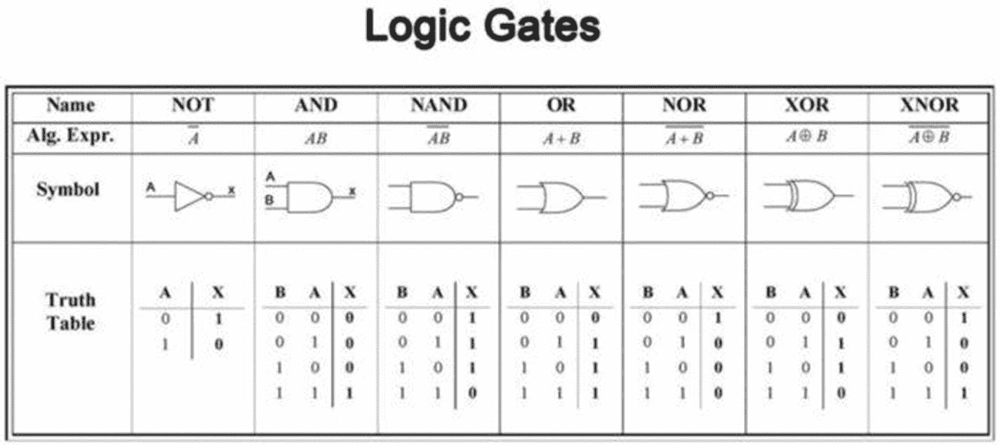
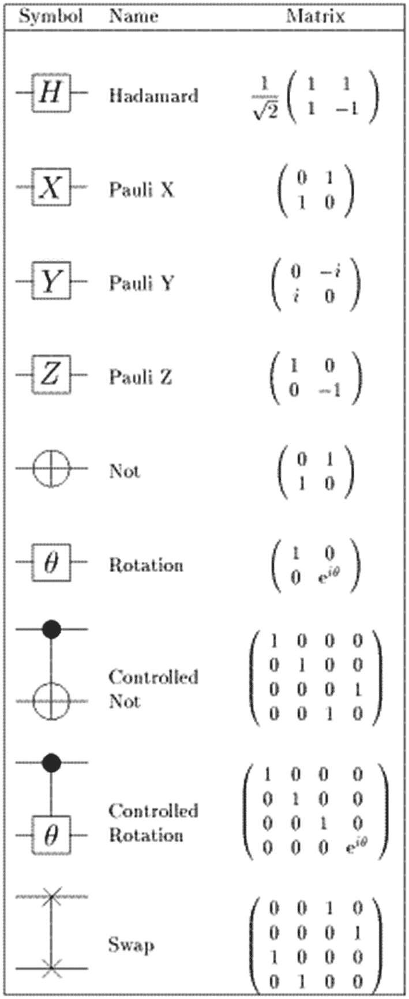
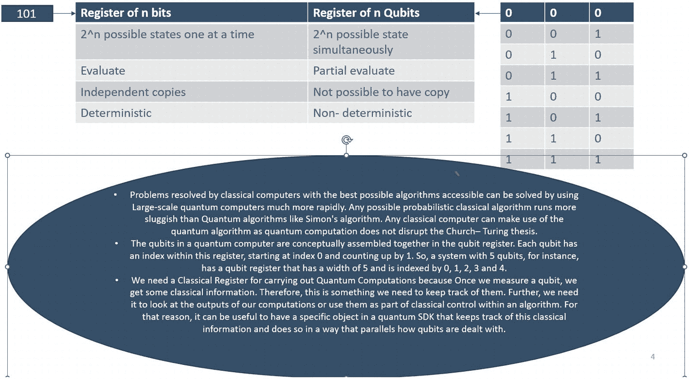
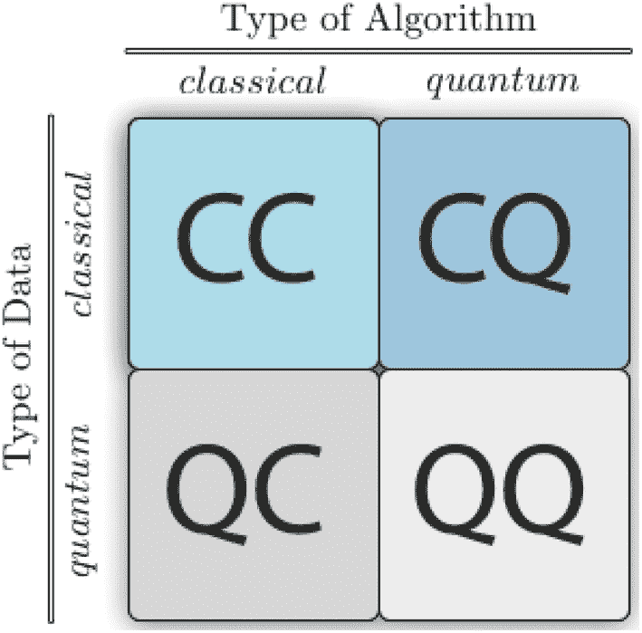

# 9. 量子计算机、计算与机器学习：综述

## 引言

在过去一百年间，量子理论或许对逻辑进步产生了最为深远的影响。它引入了一系列全新的逻辑思路，预见了难以理解的状况，并影响了现代创新的多个领域。在其诞生五十多年后，量子理论与软件工程相结合，催生了量子计算这一新学科。量子计算融合了上个世纪的两场逻辑革命：量子物理学和软件工程。

由传统计算机的 1 和 0 所表示的数据，必须始终通过某种物理设备（无论是硅片还是纸张）来存储。所有物质都由原子构成，而原子又由原子核和电子组成。原子的相互作用和时间演化受量子力学原理的支配。如果没有我们从量子角度对固态的理解，以及对金属、绝缘体和半导体的能带理论，整个半导体工业及其晶体管和集成电路，乃至计算机，都不可能发展起来。

晶体管、激光器以及其他引发计算革命的发明，其理论根源都在于量子物理学。然而，在算法层面上，现代计算机设备仍然使用“经典”的布尔逻辑。量子计算则是开发在计算层面上利用叠加和纠缠（而非布尔逻辑）来处理信息的硬件和软件。由于一切从根本上来说都是量子力学的，因此可以想象将信息存储在单个原子或电子上。被称为量子力学“牛顿定律”的 `薛定谔方程`，支配着这些微小粒子的演化和相互作用，而非经典物理学的牛顿定律。

量子计算有望显著加速某些任务，例如优化、采样、搜索和量子模拟。人工智能和机器学习中的许多工作都需要解决具有挑战性的优化问题或执行有效的采样，因此量子计算也被应用于这些领域。对于化学、材料科学和机器学习中的计算问题，量子算法能提供显著的加速。分子与材料建模、物流优化、金融建模、密码学以及包括深度学习人工智能在内的模式匹配任务，都是量子计算机将超越传统计算机的潜在应用实例。传统计算机需要数年才能处理的数据量，量子计算只需片刻即可完成。

本章将简要讨论量子计算机、量子计算以及量子机器学习。它将介绍量子计算机及其与机器学习和人工智能的关系。在此过程中，您将了解到几个概念，包括 `叠加`、`干涉`、`纠缠`和`隧道效应`。

## 量子计算机与量子计算

分子与材料建模、物流优化、金融建模、密码学以及包括深度学习和人工智能在内的模式匹配任务，都是量子计算机优于传统计算机的潜在应用实例。传统计算机需要数年才能处理的数据量，量子计算只需片刻即可完成。（注：在本章中，术语经典计算机/老式计算机/传统计算机可互换使用。）

在老式计算中，机器利用二进制代码（一系列 1 和 0）来发送和处理数据。在量子计算机中，`量子比特`（一个量子位）实现了这些任务。同样，正如 `比特` 是经典计算机中数据的基本单位，`量子比特` 是量子计算机中数据的基本单位。`比特` 可以存储 0 或 1，而 `量子比特` 可以存储 0、1、0 和 1 的叠加态，或介于两者之间的无限多种状态。它还可以同时处于多种状态。

在量子计算机中，`状态` 是一个非常重要的概念，源自量子物理学。`量子态` 是一个数学概念，在量子物理学中代表对量子系统的认知。量子力学描述了 `量子态` 的创建、演化和测量。其结果是对该状态所描述系统的量子力学预测。

量子计算机中的两个 `量子比特` 可以各自表示四种可能状态（00、01、10 或 11）中的一种。由于 `叠加` 原理，`量子比特` 可以同时表示所有四种状态。这相当于同时运行四台标准计算机。一台十 `量子比特` 的计算机将拥有略超过一千种状态的叠加，而一台一百 `量子比特` 的机器——大约相当于当今最大量子计算机的规模——则拥有令人难以置信的 10³⁰ 种状态。有了量子计算机，经典计算机并不会消失。在未来很长一段时间内，模式将是混合型的。你将拥有一台处理所有事务的经典计算机，然后使用量子计算机来处理特定的指令。之后，你将从经典计算机那里获得结果。

### 量子浪潮

第一次创新浪潮是关于蒸汽动力，第二次是电力，第三次是高科技，而我们目前正在进入的第四次浪潮是原子层面的物理科学，如人工智能、纳米和生物技术。届时，我们将看到第五次创新浪潮，它将被核和亚核层面的物理科学所主导，即利用电子自旋和光子偏振来处理数据。未来，一些大型主机将被量子计算机取代，但手机和工作站不会被替换，因为 `量子比特` 需要冷却基础设施。

量子力学是奇特的。量子系统可以产生用传统方法极难制造的奇特模式。然而，与经典系统不同，量子系统也可以学习和识别旧的模式。它们能够做到这一点的原因是，线性代数是量子物理学和量子计算的基础。但是，我们可以用非常少量的 `量子比特` 来表示高维向量空间中的向量状态。然后，像傅里叶变换、特征向量和特征值发现以及矩阵求逆这样的线性代数运算，可以在量子计算机上以比传统计算机快得多的指数级速度执行。

## 量子计算基础

数学和计算机科学中的优化问题，是指从所有潜在答案中选出最优答案的问题。从无限多的选择中找到问题的最佳答案，正是优化问题的本质。对于大规模问题，传统计算机可能需要数百万年才能配置并筛选所有潜在解决方案。利用 `叠加` 和 `纠缠`，量子计算机能够同时定位每一个可能的变体，并在极短的时间内筛选海量的输入变量。让我们快速了解一些有助于理解量子计算机概念的重要术语：

*   `纠缠`：量子粒子将其计算结果相互关联的能力。尽管一个粒子系统的量子态无法彼此独立地描述，即使它们相距遥远，这些粒子仍被称为纠缠态。
*   `叠加`：当两个量子态结合，并产生第三个合法的量子态时发生。`叠加` 包含了一个粒子处于多种状态的不确定性。在量子计算中，`叠加` 被解释为量子粒子成为所有可能状态之混合体的能力。
*   `经典比特或比特`：在传输介质中或通过传统电气设备传输的最小信息单位。
*   `传统逻辑门`：能够处理和传输 `比特`（或“经典 `比特`”）的硬件组件，常见于电路板或集成电路（芯片）上。
*   `触发器`：一种能够发送、改变和存储单个 `比特` 的传统逻辑门。
*   `寄存器`：在传统计算机上，`触发器` 的一种并行配置，共同表示一个数字，通常是一个 32 位或 64 位整数。在量子计算机上，某些编程工具可以将 `寄存器` 模拟为一系列连续的 `量子比特`，但仅限于初始化和测量，而不能像传统计算机那样进行完整的 `比特` 和算术运算。无论如何，一个 `量子比特` 实际上就是一个单周期的 `寄存器`，并具备 `叠加` 和 `纠缠` 的能力。
*   `存储单元`：内存芯片或存储介质中一个可寻址的区域，能够存储一个数字，即一个经典周期。
*   `量子数据`：量子计算机上的数据。与传统 `比特` 要么是 0 要么是 1 不同，`量子数据` 可以是 0 或 1，也可以是 0 和 1 的 `叠加` 态，或者与另一个 `量子比特` 的 `量子数据` 纠缠。
*   `量子比特`：名义上是一个量子位，它代表 `量子数据`，同时也是一种能够存储该 `量子数据` 的硬件设备。它相当于一个 `比特` 以及存储该数据的 `触发器` 或 `存储单元`。总的来说，`量子比特` 是一个硬件设备，与可能存储在该设备中的 `量子数据` 无关。
*   `量子态`：有很多讨论认为，拥有 n 个 `量子比特` 的量子计算机可以同时显示和处理 2^n 种不同的叠加 `量子态`。一个四 `量子比特` 的机器有 16 种状态，八 `量子比特` 的机器有 256 种状态，20 `量子比特` 的机器有超过一百万种状态，而拥有超过 32 个 `量子比特` 的机器，其状态数之多，连四 `量子比特` 的机器都无法计数。这些 `量子比特` 的力量在于其固有的指数级扩展能力，因此，一个两 `量子比特` 的机器可以同时执行四次计算，三 `量子比特` 的机器执行八次计算，而四 `量子比特` 的机器则能同时执行 16 次计算。
*   `指令`：计算机要执行的单个操作。适用于经典计算机和量子计算机。
*   `量子逻辑门`：量子计算机上的 `指令`。与传统逻辑门毫无可比性。
*   `薛定谔波动方程`：一个数学表达式，在描述原子内电子的能量和时空位置时，考虑了电子作为波的特性。
*   `物质的波动性`：认为物体由以波形式运动的粒子构成的概念。始终处于运动状态的粒子构成了原子和分子。这些波可以被视为振荡或振动。这赋予了物质存在及其特性。
*   `干涉`：当两个波在同一介质中传播并相遇时，就会产生波的 `干涉`。介质所呈现的形态，是两个独立波对介质粒子产生的净 `干涉` 效应的结果。
*   `电磁辐射`：物理学指出，`电磁辐射` 的波动特性导致了被称为`偏振`的现象。由于太阳光穿过真空到达地球，它是 `电磁波` 的一个例证。这些波之所以被称为 `电磁波`，是因为电场与磁场相互作用。其最基本的形式是，`偏振` 是将非偏振光变为偏振光的过程。非偏振光是指粒子在所有可能平面上振动的光。
*   `磁场`：在磁性物质或运动电荷周围，磁力作用的区域。运动电荷和磁偶极子形成一个称为 `磁场` 的力场，该力场会吸引其他邻近的运动电荷和磁偶极子。
*   `电场`：当存在任何类型的电荷时，空间中的每一点都关联着一个 `电场`。通常用 E 值（称为电场强度、电场大小或简称为电场）来表示 `电场` 的大小和方向。
*   `辐射`：从源发出并以光速在空间中传播的能量。这种能量具有波的特征，并伴随有电场和磁场。`辐射` 也可以称为“`电磁波`”。
*   `希尔伯特空间`：一个具有自然内积（或点积）的向量空间，该内积提供了一个距离函数，与 n 维欧几里得空间直接类似。在此距离函数下，它成为一个完备的度量空间，并且是数学家所称的完备内积空间的一个实例。
*   `欧几里得空间`：一个具有有限维数的空间，其中点由坐标（每个维度一个坐标）标识，两点之间的距离由距离公式确定。`欧几里得空间` 可以是二维或三维的。
*   `向量空间`：一组向量的集合，这些向量可以相加，也可以与称为标量的数字相乘（“缩放”）。也称为线性空间。

*   点积推广为内积。这是一种在向量空间中两个向量相乘的方法；这种乘法的结果是一个标量。两个向量的点积由这两个向量的大小以及它们之间夹角的余弦共同决定。请记住，向量乘法有两种方式。
    *   点积或向量的标量积
*   叉积或向量的向量积

这两种方法的唯一区别在于，第一种方法的结果是一个标量值，而第二种方法的结果是一个向量。

## 传统量子计算

计算改变了数据处理的方式。计算技术彻底革新了信息的处理与管理。自查尔斯·巴贝奇时代起，人类便认识到信息可以通过物理系统进行处理；而近期（例如通过罗尔夫·兰道尔的研究）又发现，信息必须以物理形式呈现，才能遵循物理规则。理解适用于信息处理系统的物理规则所施加的计算约束至关重要。由于遵循经典物理学原理，传统计算设备被称为“经典计算机”。而拟议中的“量子计算机”则遵循量子物理学原理，其计算能力因此存在显著差异。

从根本上说，量子力学为经典力学补充了缺失的要素。例如，物理量首先被“量子化”，因此不可分割。以光为例，光是被量子化的；光的基本单位是光子，且光子无法被分割成两个光子。此外，根据量子物理学，物理状态必须随时间变化，以防止对随机、不可知状态进行独立复制。这为量子密码学中的信息复制提供了防护。同时，量子物理学通过叠加态来描述系统，这种叠加态允许同时处理多个不同的输入，尽管在处理结束时只能观测到其中一个结果，且结果通常具有概率性质。最后，量子力学中可能存在经典物理学中无法实现的关联。这类关联包括所谓的 `纠缠态`。

### 逻辑门

传统计算机在两个方面表现出色。它们可以将数字存储在内存中，并能对存储的数字执行基本的数学运算（如加法和减法）。通过将这些简单操作组合成称为算法的序列（例如，乘法可以通过一系列加法来实现），它们可以完成更复杂的任务。晶体管开关——即你墙上用来开关电灯的开关的微型化版本——同时执行存储和处理这两项任务。就像灯可以亮或灭一样，晶体管可以处于开或关的状态。

我们可以用晶体管在任一状态下存储一个数字：如果它处于开状态，则存储 1；如果处于关状态，则存储 0。任何数字、字母或符号都可以用基于二进制的代码来记录。例如，计算机可以将大写字母 A 存储为 1000001，将小写字母 a 存储为 01100001。一个由八个比特组成的字符串可以包含 255 个不同的字符（包括字母 A-Z、a-z、数字 0-9 以及大多数符号），每个字符都由一个二进制数字（也称为 `比特`）表示，这些数字要么是 0，要么是 1。

计算机通过将多个晶体管连接在一起形成的电路（称为 `逻辑门`）来进行计算。这相当于我们大脑中称之为加法、减法或乘法的计算机版本。逻辑门比较存储在称为 `寄存器` 的临时存储器中的比特模式，然后将它们转换为新的比特模式。执行特定计算的算法在物理上由一个由多个逻辑门组成的电路表示，其中一个门的输出流入下一个门的输入。由于依赖普通晶体管，传统计算机存在一个问题。如果你考虑到过去几十年电子学取得的惊人进步，这可能看起来不像个问题。晶体管（其前身是真空管）在 1947 年发明时，它所取代的开关大约有拇指大小。而现代微处理器（单芯片计算机）现在可以在你指甲盖大小的硅芯片上容纳多达 300 亿个晶体管！这些集成电路（有时称为 `芯片`）是微型化领域的非凡成就。这与现代计算机重达 30 吨的前身（拥有 500 英里长的电缆和 18,000 个真空管）在本质上基本相同。

尽管计算机变得更具便携性且速度显著提升，但操作和解码二进制比特并将其编码为可用计算输出的挑战并未改变。数字逻辑和比特是我们日常使用的传统计算机的基础。简单来说，比特是一种可以具有两种不同值之一的思想或事物，通常用数字 0 或 1 表示。计算机通常使用晶体管（可以处于充电状态（1）或未充电状态（0））来表示这一概念。逻辑门是一种对计算机编码为信息的一组比特执行操作的电路。逻辑门只是将给定的规则应用于一个比特。例如，一个 `OR` 门输入两个比特，并输出一个单一值。如果任一输入为 1，则该门输出 1；否则，输出 0。操作完成后，这些比特可用于解码关于输出的信息。只要输入和输出信息能够存储在比特中，工程师就可以设计出执行加法、减法、乘法以及几乎任何能想到的其他操作的电路。

## 通用计算设备

被誉为计算机科学创始人的艾伦·图灵，在 1936 年提出了我们现在所知的 `通用计算设备` 的构想。图灵设想创建一个读写头，它可以移动磁带、读取每个帧中的各种状态，并根据接收到的指令进行复制。他在实际计算机问世之前数年就提出了这一构想。尽管看似不同，但理论上的图灵机与笔记本电脑在本质上并无区别。笔记本电脑每秒极高的读写帧速率，让人难以判断它是否真正在进行计算。传统计算机中，这些计算由晶体管执行。第一个晶体管于 1947 年由威廉·肖克利、沃尔特·布拉顿和约翰·巴丁共同创造。`晶体管` 一词是“转移”和“电阻器”的混合体。图灵所设想的多状态帧就是晶体管，这是一种封装在硅片内部的开关。当开关打开时，电流通过晶体管；当开关关闭时，则无电流通过。因此，在计算机中使用晶体管是二进制的：如果电流流过晶体管，则比特（即二进制位）为 1；如果没有电流流过晶体管，则比特为 0。

随着晶体管的发展，情况正在向小型化演进。晶体管越小，就越有可能在硅片上封装更多数量，从而执行更复杂的计算。从一个晶体管发展到包含四个晶体管的集成电路，整整花了十年时间。又过了十年，到了 1965 年，已经可以在一个芯片上封装 64 个晶体管。在这个阶段，戈登·摩尔预测，每块硅片上的晶体管数量将持续呈指数级增长。

就这样，我们迎来了计算机的黄金时代：1982 年的英特尔 286，拥有 134,000 个晶体管；1985 年的 386，拥有 275,000 个晶体管；1989 年的 486，拥有 1,180,235 个晶体管；以及 1993 年的奔腾，拥有 310 万个晶体管。如今，人类每秒正在制造数十亿个晶体管。你的手机大约有 20 到 40 亿个晶体管。根据晶体管专家吉姆·康尼恩的估算，自 1947 年制造出第一个半导体以来，已经生产了 2,913,276,327,576,980,000,000 个晶体管——也就是 2.9×10²¹ 个——并且在未来几年内，地球上的晶体管数量将超过地球上所有人类身体中所有细胞的总和。

集成电路上每英寸的晶体管数量将每两年翻一番，并且这一趋势将持续至少 20 年。这一预测由戈登·摩尔于 1965 年提出。如今，摩尔定律仍然适用。如果天真地将摩尔定律外推到未来，就会发现，在某个时刻，每一比特的信息都应该由亚原子大小的物理排列来编码。如果我们继续以摩尔定律的速度缩小半导体，我们将达到原子大小的晶体管阶段。

当新技术允许制造大约 5 纳米（nm）的芯片时，问题就会出现。当前的芯片采用 64 位架构，集成了超过 7 亿个晶体管，并且可以在超过 3GHz 的频率下工作。例如，第三代英特尔酷睿（2012 年）的宽度从 32nm 缩小到 22nm，使得每单位表面积上的晶体管数量得以翻倍。一款双核移动版的英特尔酷睿 i3/i5/i7，在 101.83 平方毫米的芯片面积上拥有约 17.5 亿个晶体管。这相当于每平方毫米的密度为 1718.5 万个晶体管。此外，更多的晶体管意味着给定的计算机系统可以执行更多、更快的操作。然而，根据费曼（一位物理学家，量子计算机的先驱）的论点，这存在一个“基本极限”。即所谓的“隧道效应”的限制。

现实情况是，微芯片正被制造得越来越小。设备越小，计算过程越快。然而，我们无法无限地缩小芯片的尺寸。存在一个临界点，超过该点它们将无法正常工作。当达到纳米尺度时，一种被称为“隧道效应”的奇特量子现象会导致电子从它们通常流动的通道中逃逸。由于电子是量子粒子并表现出波动性活动，其中一些电子有可能逃离周围空间的束缚。这阻止了芯片正常工作。

在这种情况下，由于我们已经超出了仅几十纳米的尺寸范围，传统数字计算应该离其极限不远了。但极限究竟在哪里？极其微小的世界可能在解决方案中扮演重要角色。在这方面，目前用于计算原子半径的不同技术得出的数值范围在 0.5 到 5 之间。普通原子的大小约为埃（Å）量级，而现代晶体管的尺寸则在纳米（nm）量级。但 10 埃等于 1 纳米。

在考虑量子物理极限来构建计算机之前，你需要将规模提升一个数量级！支配微小物质的量子物理定律，与支配普通逻辑门特性的经典定律大相径庭。小型化进程——它使得现代经典计算机变得价格低廉且功能强大——已经推进到量子效应发生的微观尺度。芯片制造商通常费尽心思来抑制这些量子效应，但人们也可以选择尝试与之合作，以促进进一步的小型化。

当经典计算机中元件的尺寸缩小到其行为实际上由量子理论而非经典理论控制的程度时，研究人员已经开始探索利用这些量子行为进行计算的可能性。令人惊讶的是，一台所有部件都以量子方式运行的计算机，似乎比任何传统计算机所能达到的都要强大。量子计算的研究，正是源于传统计算机所面临的物理限制，以及量子计算机能够比任何经典计算机更快地完成某些有价值任务的潜力。

### 量子力学

# 量子力学概述

对极微小物体的研究被称为量子力学。它描述了在原子和亚原子粒子层面上，物质如何与能量相互作用。相比之下，经典物理学只能描述与人类经验尺度相关的物质和能量，这包括像月球这样的天体行为。在许多当代研究和技术中，经典物理学仍被应用。然而，随着19世纪接近尾声，研究人员在宏观世界和微观世界都发现了经典物理学无法解释的现象。解释可观测事件与经典理论之间差异的需求，引发了物理学中两次重大的革命，它们改变了原有的科学范式：相对论和量子力学。

根据牛顿物理学，世界由离散的物体组成，类似于网球或石块。根据这一理论，每一个作用力都会产生一个大小相等、方向相反的反作用力，宇宙是一台由相互连接的部件组成的巨大机器。不幸的是，在亚原子层面，牛顿的宇宙观崩塌了。在量子领域，一切似乎都像是一片相互关联的可能性海洋。每个粒子都只是一个`波函数`，可能在任何时刻存在于任何地方。它甚至可以同时存在于多个位置。旋转的电子可以同时是波和粒子，因为它们同时占据两个位置。

物理学家最近了解到一种被称为`量子纠缠`的现象。两个乍看之下独立的粒子，在一个纠缠系统中可以像一个紧密结合的整体一样运作。根据理论，如果两个纠缠粒子被分离，它们具有相似的旋转速度，但方向相反。量子领域的双胞胎。尽管这些想法看似荒谬，但在过去120年里，研究人员已经证明，这个被称为量子力学的领域，正是我们物理存在的基础。它是当今最被广泛接受的科学假说之一。没有它，我们将无法拥有原子钟、计算机、激光器、LED、全球定位系统和磁共振成像等诸多突破性技术。

# 量子理论基础

在量子力学发展之前，基础物理学以奇特的二元论为特征。一方面，我们有由麦克斯韦方程组控制的电场和磁场。这些场是连续的，并覆盖整个空间。另一方面，原子则受牛顿力学支配。原子是独特的、空间受限且相对微小的粒子。光与物质之间的区别——这个吸引了艺术家、神秘主义者和科学家数个世纪的主题——正是这种二元论的核心。对物质二元论的理解已被统一的理解所取代，这是量子理论的奇迹之一。

我们发现了如何从电子和场中创造出原子，以及从光子和其他基本粒子中创造出场。用于解释光子和电子的数学框架是相同的。它们是粒子，因为每个粒子都由独特、可重复的单位构成。然而，这种新的量子力学类型的“粒子”不能被束缚在空间中的某个特定点上。相反，一个概率分布提供了测量其位置的可能结果。该分布的所谓`波函数`是一个充满空间的场的平方。

量子力学，包括量子场论，是一种基础物理学理论，它描述了自然界在最小尺度（包括原子和亚原子层面）上的表现。它也被称为量子物理学、量子理论、波动力学模型或矩阵力学。

1900年，马克斯·普朗克向德国物理学会提出了能量和物质都以离散单位（他称之为“量子”）存在的概念，这标志着量子理论发展的开端。在接下来的30年里，其他科学家进行了更多研究，最终形成了对量子理论的现代理解。

量子理论的基本组成部分如下：

*   能量，类似于物质，由离散的单位组成，而非仅仅作为一种连续的波。
*   能量和物质的基本粒子，根据条件的不同，可以表现得像粒子或波。
*   基本粒子的运动本质上是随机的，因此是不可预测的。对两个互逆性质（如基本粒子的位置和动量）的同步测量，不可避免地存在缺陷。一个值测量得越精确，另一个值的测量误差就越大。

### 量子理论的进一步发展

尼尔斯·玻尔提出了量子理论的哥本哈根诠释，该诠释指出，一个粒子可以是任何它被推测为的状态（例如，波或粒子），但在被测量之前，它不能被预期具有明确的属性，甚至不能预期其存在。因此，玻尔是在说客观现实并不存在。这引出了所谓的`叠加态`，它声称：当我们不知道某个物体的状态时，只要我们不进行观察，它实际上同时处于所有可能的状态。

`多重宇宙`，通常被称为`多世界理论`，是量子理论的第二种诠释。根据这一理论，一旦某个物体有可能存在于任何状态，该物体的世界就会转变为一组平行宇宙，每个宇宙中该物体都有相同数量的可能状态。此外，这些世界之间存在一种相互作用的方法，允许访问所有潜在状态，并最终以某种方式对其进行操控。已故的斯蒂芬·霍金和已故的理查德·费曼都是支持多世界理论的科学家。

# 量子力学与经典物理学

在宏观尺度上，自然界由经典物理学来描述，这是在相对论和量子力学理论发展之前就存在的物理学描述。大多数经典物理学理论都可以从量子力学中推导出来，作为其宏观近似。在能量、动量、角动量以及束缚系统的其他量方面，量子力学与经典物理学的不同之处在于：这些量被限制为离散值（`量子化`）；物体表现出波动性和粒子性（波粒二象性）；以及不确定性原理限制了在测量之前预测物理量的精确程度。

逐渐地，用于解释经典物理学无法解释的观测结果的理论——例如马克斯·普朗克1900年对黑体辐射问题的解答，以及阿尔伯特·爱因斯坦1905年解释光电效应的论文——导致了量子力学的发展。在20世纪20年代中期，埃尔温·薛定谔、沃纳·海森堡、马克斯·玻恩等人从根本上重新思考了早期的量子理论。现代理论通过一系列新创立的数学形式体系来表达。在其中一种形式体系中，一个被称为`波函数`的数学函数描述了粒子能量、动量和其他物理属性的概率幅。由于量子物理的许多部分表现出的行为与在较大尺度上观察到的行为截然不同，因此它们显得矛盾且可能看起来毫无意义。例如，量子力学的不确定性原理指出，对一个测量值（如粒子的位置）确定得越精确，对同一粒子的互补测量值（如它的速度）就必须越不精确。另一个例子是`纠缠`，即对两个相距甚远的“纠缠”粒子中的任何一个进行测量（例如，测量光子的偏振向上或向下），会导致对另一个粒子的后续测量结果总是这两个值中的另一个（例如，偏振方向相反）。最后一个模型是`超流性`，其中一容器中的液氦，在冷却到接近绝对零度时，会突然（缓慢地）沿着容器壁向上流动，克服重力。

### 量子力学的结构基石

量子力学试图克服传统物理科学合法性面临的严重障碍，其中最主要的异常现象是普朗克辐射定律。爱因斯坦、德拜、玻尔、德布罗意、康普顿、海森堡、薛定谔和狄拉克等人是发展量子力学理论的先驱。

量子力学的基本结构基石如下：

*   `量子化`：束缚系统的物理量，包括能量、动量、角动量等，被限制为离散数值。
*   由于波粒二象性，物体既是波又是粒子。
*   海森堡原理指出，对粒子位置知道得越精确，对其动量的计算就越不精确，反之亦然。因此，测量粒子物理属性的精度存在一个基本极限。
*   `脆弱性`：当我们测量一个量子系统时，会抹去所有先前的知识。由此产生了不可克隆定理，该定理声称不可能制造出任何随机未知量子态的精确副本。

量子场论将量子力学与其他物理学概念相结合，以解释事物在现实世界中的运作方式，它主要基于阿尔伯特·爱因斯坦的狭义相对论，该理论描述了物体高速运动时发生的情况。三种不同的量子场论分别解释了物质相互作用的四种基本力中的三种：强核力（解释了原子核中心的稳定性）、电磁力（解释了原子为何能结合在一起）以及弱核力（解释了为何某些原子会发生放射性衰变）。

### 量子纠缠详解

根据泡利不相容原理，单个系统中的两个电子不能处于相同的状态。自然界并未排除两个电子可能同时“叠加”两种状态的可能性。在叠加的`波函数`坍缩之前，一切都不确定。根据两个叠加波形的复值振幅之和的绝对值的平方所确定的概率，电子会在那个精确时刻出现在某个位置。关于这个问题，已经存在很多不确定性。我们可以概念化纠缠光子，即在同一事件中，每个光子都叠加了两种相反状态的光子。想象一下，有两种光子状态，分别由它们的颜色标识：蓝色和红色。让蓝色和红色状态一起（在你的脑海中）呈现为紫色状态。你可以分析一个场景，其中单个原子事件会产生两个光子。它们可能源于晶体的受激辐射，这种晶体通常会吸收一个特定频率的光子，并产生两个频率为原始光子一半的光子。这个例子中的光子彼此相关，因为它们都源于同一个原子事件。这种配置导致光子最终处于混合状态。

通过这种方式，两个光子呈现为紫色。如果实验者目前进行一些测试，以确定其中一个光子是蓝色还是红色，那么该测试会将所涉及的光子从具有蓝色和红色混合属性的状态，改变为仅具有其中一种属性的状态。爱因斯坦对这种设想情景感到困扰的地方在于：如果其中一个光子在地球实验室的镜子之间持续反弹，而另一个光子在其孪生光子被迫揭示自己是蓝色或红色时，已经走完了前往最近恒星的大部分路程，这意味着那个遥远的光子现在也必须失去其紫色状态。因此，无论何时在其孪生光子被测量后对其进行探测，它基本上都会呈现出与其孪生光子所揭示的任何状态相反的状态。

为了试图证明量子力学不是一个完备的理论，爱因斯坦从该理论的预测出发：至少两个在过去有过相互作用的粒子，当它们的不同属性随后被测量时，可以表现出强烈的相关性。他试图以一种经典的方式，通过它们共同的过去，来理解这种看似存在的相互作用，并且理想情况下，不是通过某种“鬼魅般的超距作用”。这个论证在爱因斯坦、波多尔斯基和罗森（1935年；缩写为 `EPR`）的一篇著名论文中得到了阐述，提出了现在所谓的 `EPR` 悖论。假设现在通常所说的局域实在论，`EPR` 悖论从量子理论中推导出，一个原子同时具有位置和动量，而根据哥本哈根诠释，这两个属性中只有一个真实存在，并且仅在被测量的那一刻存在。`EPR` 得出结论，量子理论是不完备的，因为它无法考虑客观存在于自然界中的实际属性。（爱因斯坦、波多尔斯基和罗森1935年的论文是爱因斯坦在物理科学期刊上被引用最多的出版物。）大约在同一时间，埃尔温·薛定谔使用了“纠缠”一词，并宣称：“我不会称其为量子力学的特征，而是其本质特征。”但爱尔兰物理学家约翰·斯图尔特·贝尔在理论上和实验上反驳了爱因斯坦、波多尔斯基和罗森的“隐变量”理论。现在，让我们来看看量子比特和量子计算机。

### 量子计算机中的叠加与纠缠

**叠加**状态对于执行计算至关重要，但实现起来极具挑战性，维持起来更是极其困难。物理学家使用激光和微波束将量子比特置于这种工作状态，然后利用各种方法保护它们免受最微小的温度变化、噪声和电磁波的影响。由于工作状态的脆弱性，当前的量子计算机容易出错，这种状态在大多数任务执行之前就会在一个称为退相干的过程中消散。量子计算能力由一台机器可以同时处理的量子比特数量及其影响决定。从20世纪90年代末期首次实验中实现的区区两个量子比特开始，如今由谷歌制造的最强大的量子计算机可以使用大约72个量子比特。为了总结量子比特和叠加在量子计算机世界中的重要性，务必记住以下几点：

- 与传统计算机中的比特不同，量子比特可以处于0和1的叠加态。

- 一个令人难以置信的量子比特排列可以同时处于多种叠加态。例如，5个量子比特模型可以处于32种状态的叠加态（`2⁵ = 32`）。

- 两个纠缠的量子比特彼此关联；一个量子比特上的信息会揭示另一个未知量子比特的信息。

### 量子计算、经典计算与数据创新

信息技术领域或许是我们最终最应归功于量子力学的地方。为了构建能够解决传统计算机无法处理的问题的超强计算机，研究人员计划应用量子原理。这些难题包括：增强网络安全、模拟化学反应、开发新型药物以及优化供应链。这些目标可能会彻底改变计算的某些领域，并释放新的技术可能性。得益于大学和行业研究中心的进展，一些企业现已发布了量子计算机原型，但关于量子技术实现其全部潜力所需的硬件、软件和连接，仍有许多未解之谜。

从根本上说，量子力学为经典力学增添了缺失的元素。首先，物理量是“量子化”的，因此不可分割。例如，光就是量子化的；光的基本单位是光子，它不能被分割成两个光子。此外，根据量子物理学，物理状态必须以这样一种方式演化：无法创建一个任意、未知状态的独立副本。这在量子密码学中起到了防止信息复制的作用。此外，量子物理学用叠加态来描述系统，这种叠加态允许同时处理多个不同的输入，尽管在处理结束时只能观察到其中一个结果，且结果通常具有概率性质。

最后，量子力学中可能存在传统物理学中无法实现的关联。其中一种关联就是纠缠。然而，许多此类计算可能无法在传统机器上高效执行。想象一下，你想了解像原子这样的化学行为。这种行为取决于原子中电子的行为，而这些电子处于多种经典状态的叠加态。一种称为纠缠的量子力学现象使事情变得更加复杂，因为它导致每个电子的量子态都依赖于其他所有电子的状态。即使对于非常简单的原子，使用传统方法计算这些纠缠态也可能变成一场复杂度呈指数级增长的噩梦。

要描绘一个含有300个原子的简单粒子——青霉素——假设你需要 `2³⁰⁰` 个示例半导体，这比宇宙中的原子数量还要多。而且，这仅仅是在特定时刻描绘该粒子。要在模拟中运行它，你需要制造更多的宇宙来提供所需的所有材料。相比之下，量子计算机可以通过叠加和捕获自身的量子比特，来管理所关注电子的交织命运。这使得计算机能够处理异常庞大的数据量。每增加一个量子比特，框架能同时存储的状态数就会翻倍：两个量子比特可以存储四种状态，三个量子比特可以存储八种状态，以此类推。

沿着这些思路，你可能只需要50个纠缠的量子比特，就能展示那些需要数量惊人（精确地说，是1.125千万亿）的经典比特才能编码的量子态。因此，量子机器或许能使再现大型量子力学系统这一传统上棘手的问题变得易于处理，至少看起来是这样。“大自然不是经典的，真见鬼，如果你需要模拟自然，你最好让它量子力学化，”物理学家理查德·费曼在1981年广为流传地打趣道，“而且，天哪，这是一个绝妙的问题，因为它看起来并不那么容易。”

经典计算在其最终层面上，依赖于布尔代数所表达的规则，通常使用七模逻辑门原理进行运算。然而，理论上存在三种模式（`与`、`非`和`复制`）即可。数据在任何时刻都必须在一种排他的二元状态下处理——即要么是0（关/假），要么是1（开/真）。

这些数字是二进制数字，通常被称为**比特**。计算机包含数百万个晶体管，每个晶体管在任何时刻只能处于一种状态。即使每个晶体管在翻转状态前必须保持在0或1的时间目前以十亿分之一秒计，但这些设备切换状态的速度是有限度的。更小、更快的电路将我们推向材料的物理极限和经典物理学的临界点。超越这一点，量子领域将接管一切，带来与挑战同样重大的机遇。

相反地，可以使用一种双模逻辑门来执行操作，这种逻辑门允许量子计算机将0转换为0和1的叠加态（一种在经典计算中不可能实现的逻辑门）。量子计算机可以利用多种基本粒子，包括电子和光子（但在实践中，离子也取得了成功），用它们的电荷或偏振来表示0和/或1。这些粒子（称为量子比特，或 `qubit`）中的每一个的性质和行为，构成了量子计算的基石。叠加和纠缠这两个概念是量子物理学中最重要的组成部分。

一个量子比特可以比作磁场中的一个电子。电子的自旋可以与磁场对齐，称为自旋向上态，也可以偏离磁场，称为自旋向下态。可以使用能量脉冲，例如来自激光的能量脉冲——假设你使用一个单位的激光能量——来将电子的自旋从一个状态切换到另一个状态。但是，如果你完全屏蔽粒子免受所有外部力的影响，同时只施加半个单位的激光能量，会发生什么？根据量子理论，粒子随后会进入一种状态的叠加态，表现得仿佛同时处于两种状态。所使用的每个量子比特都可以同时叠加0和1。

在某个时刻相互作用过的粒子（如光子、电子或量子比特）会保持某种特定关系，并且可以成对地相互纠缠。通过观察纠缠粒子自旋的状态（无论是向上还是向下），你可以推断出其伙伴粒子的自旋方向。更令人惊叹的是，由于叠加现象，被观测的粒子在测量之前并没有单一的自旋方向，而是同时处于自旋向上和自旋向下的状态。

由于量子纠缠，相隔难以想象的遥远距离的量子比特可以瞬间（而不仅仅是以光速）相互影响。无论相关联的粒子相距多远，只要它们分离，它们就会保持纠缠状态。

量子纠缠与叠加的结合极大地提升了计算机的性能。与传统计算机中一个两位寄存器在任意时刻只能存储四种二进制配置（`00`、`01`、`10`或`11`）中的一种不同，量子计算机中的两位量子寄存器可以同时容纳所有四个数值，因为每个量子比特代表两个值。随着量子比特的增加，这种额外容量呈指数级增长。利用叠加和纠缠等量子力学特性来执行计算，被称为量子计算。这类计算（无论是理论上的还是实际中的）都在量子计算机上完成。目前，操作量子计算机主要有两种方法：简易型和计算机型。计算机型量子计算机使用量子逻辑门来执行计算。两种方法都使用量子比特。计算机型量子计算的世界观提供了极具优势的特性，包括包容性、灵活性和量子纠错能力。然而，执行有价值的纠错量子计算所需的实际资源是有限的。

通用量子计算机的核心逻辑基于与经典计算机类似的逻辑门和函数。因此，通用量子计算机对于解决计算问题和扩展当前对解决方案的理解非常有帮助。通用量子计算机是最强大、应用最广泛的量子计算机，但也是构建难度最大的。有估算认为，一台真正的通用量子计算机需要100万个量子比特。请记住，我们目前能访问的量子比特数量甚至不到128个。通用量子计算机的基本概念是，当被用于解决任何极其复杂的任务时，它可以快速求解。

绝热量子计算机结构简单，但更易于实现。它们对量子比特状态的稳定性要求更宽松。因此，在绝热量子计算机上更容易实现数千个量子比特。然而，绝热量子计算机只能用于有限的应用场景，例如优化问题。

现在，我们已经为量子计算机的基础、结构和基本工作原理打下了良好的基础。是时候进入量子编程的世界了。

## 量子编程

量子计算提供了一种全新的编程方法，其潜力甚至比其强大的计算能力更令人兴奋。例如，在量子计算机上，可以实现诸如“取所有先前计算的叠加态”这样的编程序列——这在经典计算机上是无用的——从而能够极其快速地解决某些数学问题，例如大数分解。

# 量子编程概述

到目前为止，量子编程已经取得了两项重大突破。第一个突破是在 1994 年由彼得·肖尔实现的，他创建了一种能够快速分解大数的量子算法。该算法专注于一个利用数论来确定长数字序列周期性的系统。另一个重大进展是由洛夫·格罗弗在 1996 年实现的，他开发了一种极快的算法，已被证明是搜索非结构化数据集时可用的最快算法。与经典计算中通常需要 N 次搜索不同，该算法效率极高，平均只需大约√N 次搜索（其中 N 是元素总数）就能找到所需结果。

了解与量子生态系统相关的一些基本术语及其数学符号，将有助于理解量子编程。

*   `线性代数`（向量和矩阵）：在量子计算中，量子态由向量表示，量子操作是对这些向量应用的线性变换。
*   `复数运算`：量子态向量的系数是复数。如果不了解复数，你或许能理解量子计算的一些基本概念，但在需要将它们整合到你的量子工具箱之前，你无法走得更远。你必须学习复数运算，它解释了使用量子计算机所需的一些基础数学知识。
*   量子计算机更具概率性，而非严格确定性：基于图灵机概念的经典计算机的一大特点是其严格确定性。你可以模拟非确定性，例如生成随机数，但这只是例外而非常态。

    另一方面，量子计算机本质上是概率性的而非确定性的，这与量子计算机所基于的量子力学非常相似。这种区别要求我们在为量子计算机设计算法和代码时进行重大且根本性的反思。量子计算不像经典计算那样直接计算出问题的答案，而是为任意数量的可能解生成概率。类似于经典图灵机，量子程序可以模拟确定性，但这样使用并未发挥量子计算机的威力。
*   量子比特与叠加的相互关系：你在典型数字计算机中使用的普通比特是 0 或 1。你可以随时读取它们，除非发生硬件故障，否则它们不会改变。量子比特则不同。它们有 0 和 1 的概率，但在你测量它们之前，它们可能处于不确定状态。这种状态，连同允许进一步计算复杂性的其他状态信息，可以被描述为球体（半径为 1）上的任意一点，反映了被测量为 0 和 1 的概率（什么是北极，什么是南极）。

    布洛赫球用于表示单个量子比特的可能状态。量子比特的状态是沿三个轴的值的一种组合。这被称为分层。一些文献将这种特性描述为“同时处于所有可能的状态”，而另一些则认为这种说法（介于 0 和 1 之间）有些误导，最好坚持概率解释。无论如何，量子计算机实际上可以在量子比特处于这种状态时对其执行计算。

    量子比特通常从 0 状态开始，但通过哈达玛门（Hadamard Gate）操作后，它们常被置于不确定状态，此时测量结果有 50%概率为 0，50%概率为 1。其他逻辑门可用于按不同幅度和方向翻转量子比特的状态——这些操作既相对于 0 和 1 轴，也涉及代表相位的第三轴，该轴为信息表征提供了更多可能性。这个代表相位的第三轴开辟了更多编码信息的途径。您选择的量子计算机和工具包将决定可用的具体操作和逻辑门。

仅靠独立的量子比特组无法实现量子计算所承诺的巨大进步；`纠缠`才是关键所在。当运用量子物理中的纠缠概念时，真正的魔法才开始显现。一位业内人士将无纠缠的量子比特比作"非常昂贵的经典计算机"。根据爱因斯坦委婉称为"鬼魅般的超距作用"的现象，无论相距多远，纠缠量子比特在被测量时会瞬间相互影响。这相当于在传统计算中，每个内存位都与所有其他位通过逻辑门相连。与传统计算机必须分别读取和写入每个内存元素再进行操作相比，您就能开始理解这种能力有多么强大。因此，纠缠带来了多个巨大的潜在收益。

首先，至少对于某些类型的问题，可用的编程复杂度显著提升。复杂分子和材料的建模（传统计算机难以模拟）是引发极大热情的领域之一。如果能够实现远距离维持量子态，长距离安全通信也可能取得进展。纠缠编程通常从 `CNOT` 门开始，该门会在其伴生粒子被读出为 1 时翻转该粒子的状态。这在某些方面类似于传统的 `XOR` 门，但仅在执行测量时生效。

虽然传统计算机能够完全优化小型系统，但对于定价和运输路线等大型系统，它们只能进行微调。这是因为其运行时间会随问题规模急剧增长。集成电路上逻辑门的布局就是一个例子。芯片设计工具的优化器将逻辑门放置在芯片表面，门之间留有刚好容纳定义芯片功能的导线的空间。更优的布局能减小芯片尺寸和成本，同时提升芯片速度，因为更短的线路能更快传输信息。

不过，完美优化并非必需；即使芯片比所需尺寸大几个百分点，仍可能盈利。模拟退火等传统布局方法的原理类似于雨滴通过向下移动寻找最低点。想象一下美国的水能景观：无论水流向何处，最终都会汇入海洋。虽然海洋地势低洼，但不如死亡谷低。偶然的雨滴不太可能落入死亡谷有限的降雨盆地，因为该盆地被高山环绕。

## 算法复杂度

量子算法擅长解决少数特定的复杂问题。因此，讨论这种复杂度至关重要。

数学家将问题划分为不同的复杂度类别。`P` 类问题对普通计算机而言很简单。解决这些问题所需的时间随多项式增长，例如 5×3 就是一个多项式问题。我可以持续进行乘法运算，计算时间与问题中数字位数呈线性增长。还有与非确定性多项式时间相关的 `NP` 问题。例如，我给你 15，你需要找出其质因数——5 乘以 3。在此情况下，如果问题规模线性增长，计算时间会呈指数级增长。`NP` 复杂度问题对经典计算机来说很困难。原则上问题仍可解决，但计算时间会变得不切实际。复杂度是算法的科学。图灵机的"通用性"使计算机科学家能够将算法划分为不同的"复杂度类别"。例如，两个 `N×N` 矩阵相乘所需的操作数随矩阵大小按 `N³` 增长。通过在图灵机上对算法进行简单实现，可以详细分析这一点。

然而，"通用性"的关键在于：虽然你可以比图灵机稍快地执行矩阵乘法，但无论你使用奔腾芯片还是专用乘法硬件，都无法改变 `N³` 的增长操作。因此，像矩阵乘法这类运行时间和资源随问题规模呈多项式增长的算法被视为"可行"，属于 `P` 复杂度类。而时间和资源随问题规模呈指数级增长的算法则被称为"困难"。这种分类方案存在许多细微之处：例如，著名的"旅行商问题"属于 `NP` 复杂度类（稍后会看到）。

计算复杂度是一种高效计算理论，其中"高效"是一个渐近术语，指计算步骤数（"时间"）最多为输入比特数的多项式。复杂度类 `P` 是指能在输入规模的多项式步骤数内运行的算法类。复杂度类 `NP` 指非确定性多项式时间。本质上，这类问题中，只要获得解的多项式"索引"，就能证明可以在输入规模的多项式操作数内完成。如果子程序 `A` 能在多项式步骤内解决所有 `NP` 问题，则算法问题 `A` 是 `NP` 困难的。`NP` 完全问题是指属于 `NP` 类中的 `NP` 困难问题。一个有用的类比是：将 `NP` 与 `P` 之间的差距想象为寻找定理证明与验证给定定理证明是否正确之间的差距。`P` 和 `NP` 是 `PH` 多项式层级中最低的两个计算复杂度类，该层级由这些类的可数序列构成，并且存在大量关于 `PH` 之外复杂度类的理论。

`P-NP` 问题是计算机科学中最重要的未解难题。它探讨的是：一个能快速验证答案的问题，是否也能被快速求解。也就是说，是否存在一种算法能在多项式时间内解决问题，使得任务的运行时间随算法输入规模呈多项式函数变化（而非指数时间）。某些算法能在多项式时间内回答的一类问题统称为“`P` 类”或简写为“`P`”。而对于另一些问题，目前尚无快速求解的方法。然而，若你获得能告知答案的信息，便可快速验证该答案。能在多项式时间内检验答案的问题类别称为 `NP`，即“非确定性多项式时间”。`P=NP` 这一问题的答案将决定：能在多项式时间内验证的问题，是否也能在多项式时间内求解。如果最终证明 `P≠NP`（这也是普遍观点），则意味着 `NP` 中存在某些问题，其计算难度高于验证难度——它们无法在多项式时间内求解，但答案却能在多项式时间内被验证。

我们对计算复杂性世界的理解依赖于一系列猜想：`P≠NP` 是最广为人知的一个，而更强的理论是多项式层级（`PH`）不会坍缩，即计算复杂性各类别之间存在严格的分层，定义了多项式层级。这些关于计算复杂性的观察虽然是渐近性的，但同样强有力地适用于有限且小规模的算法任务。

没有优化问题是 `NP` 完全的，因为只有判定问题才属于 `NP`。优化问题可以关联 `NP` 中的判定问题，而这些关联的判定问题可能是 `NP` 完全的。例如，寻找最小规模的顶点覆盖是一个优化问题，但判断是否存在规模不超过 k 的顶点覆盖则是一个判定问题。这个判定问题是 `NP` 完全的，但优化问题则不是。

## 量子门

为了介绍量子门，我先以经典逻辑门作为对比。图 9-1 所示的门集提供了一套位操作工具。最简单的门是 `NOT`，它有一个单比特输入，输出是原始状态 `H` 的反相。如果 `A` 为 0，则输出转换为 1 状态，以此类推。其他门有两个比特输入，并根据图示的输入进行处理。请注意，如果一个门被称为通用且功能完备的，意味着所有其他门集只能通过该通用门的某种组合来构建，例如 `NAND` 或 `NOR` 门（见图 9-1）。有了足够的比特和一组通用逻辑门，你就拥有了创建任何数字电路的工具。

*图 9-1：一个包含 7 列 3 行的表格，列出了 `NOT`、`AND`、`NAND`、`OR`、`NOR`、`XOR` 和 `XNOR` 逻辑门的代数表达式、符号和真值表。*

*传统逻辑门*

请注意，这些常见逻辑门大多是不可逆的。如果一个逻辑门可以通过检查输出来重建其输入比特，则称该逻辑门是可逆的。因此，要构建可逆数字电路，你需要一个具有多个输出比特的通用门，例如弗雷德金门或托福利门。所有量子门都是可逆的，因为所有量子门都是酉矩阵。

# 量子门与量子计算

**图 9-2** 用于通用计算的一组代表性量子门

量子系统可以执行两种操作：测量和量子态变换。大多数量子算法涉及一系列量子态变换，随后进行测量。经典计算机拥有通用门集，意味着任何经典计算都可以通过这些门的序列来执行。同样，也存在一组基本的量子态变换，称为量子门（见图 9-2），它们对量子计算是通用的。

## 量子门是酉矩阵

由于量子门将由物理器件构建，它们必须遵循量子物理原理。根据一条相关的物理定律，信息在时间点之间传递时永远不会丢失。酉性正是描述这一特性的术语。我们的量子门也必须遵循酉性，因为它们决定了我们在状态之间如何变换。其次，请注意我们的量子门将与量子比特一起使用。由于量子比特实际上是简单的向量，量子门必须以某种方式处理向量。请记住，矩阵本质上就是向量的线性变换！

结合这两个概念，我们将量子门视为酉矩阵。任何复数的方阵，若其共轭转置等于其逆矩阵，则称为酉矩阵。复习一下，矩阵的共轭转置是通过先取矩阵每个元素的共轭，再进行转置（元素 `ij` 变为元素 `ji`）得到的。符号`†`通常用于表示共轭转置。酉矩阵的一个重要性质是保持范数（或向量长度）。如果你允许改变范数的门，那么你的量子比特的概率之和可能不等于 1！这毫无意义，因为所有概率的总和在任何时刻都必须等于 1。

此外，请注意酉矩阵本质上是可逆的。这意味着你不能将量子比特“赋值”到任意状态。想象一下，你有一个量子门可以“赋值”，从而将任意两个复数的向量变换成特定的两个复数的向量，以此理解为什么不能。这个量子门的底层表示是一个酉矩阵，而该矩阵有一个逆矩阵，可以将那个特定向量变回量子比特在操作前的状态！然而，我们无法得知量子比特在操作前处于哪个状态。因此，你无法将量子比特“赋值”到任意给定状态。所有量子门都是可逆的这一事实，也是我们常将量子计算视为一种可逆计算的高级原因。最后但同样重要的是，请记住，由于量子门是酉矩阵（其定义即为方阵），它们必须包含相同数量的输入和输出量子比特（因为方阵将 `n` 个标准基向量转换为 `n` 列）！这与大多数逻辑门（如`AND`门，它有两个输入和一个输出）的工作方式有所不同。

## 量子算法

当采用电路模型作为计算模型时，量子算法可以通过量子电路来描述。量子电路由量子比特以及作用于这些量子比特上的量子门组成。所有量子门都是可逆的幺正操作，并由 `2^n × 2^n` 的幺正矩阵表示，其中 `n` 是它们作用的量子比特数量。最常用的量子门是单量子比特门和双量子比特门及其对应的矩阵表示。量子电路中的另一个基本操作是测量。这种测量有两个重要特性：
*   测量行为会将量子态坍缩到与测量结果相对应的状态。
*   这意味着，通过单次量子测量，你无法读取叠加的量子比特状态。
因此，无法在不丢失量子态及其存储信息的情况下直接测量量子态。最后，请注意，量子计算中也存在通用门集，任何量子操作都可以通过来自该门集的有限序列门来近似。

量子门会改变量子比特的状态。例如，Hadamard 门会产生两个基态的等效叠加。如果没有它们，你的量子计算机与经典计算机相比会有多大不同？事实上，正是这些量子门让量子计算机如此强大。量子计算机可以并行处理多个经典状态。随着量子比特数量的增加，维度数量呈指数级增长！尝试用经典计算机解决一个 `50` 量子比特（或 `2⁵⁰` 复空间）的问题——那将花费永恒的时间！想想在那段时间里你可以做多少事情。量子计算之所以极其强大，是因为它能做经典计算机做不到的事情：通过同时计算所有可能性来解决优化问题。两个纠缠量子比特的一个简单而基础的例子被称为 Bell 态，表示为
`|ψ⟩ = (|00⟩+|11⟩)/√2`
其中，使用相同的概率推导，我们发现两个量子比特的概率为 `50%`。例如，`0.50%` 表示找到两个量子比特都处于状态 `1` 的可能性，而 `0%` 表示量子比特可能处于相反的状态 `01⟩` 或 `10⟩`。制备 Bell 态的一种方法是取两个量子比特，都初始化为 `0⟩`，然后对一个量子比特应用 Hadamard 门，再应用一个 `CNOT` 门。如果你达到 Bell 态并测量其中一个量子比特，你会立即知道另一个量子比特的状态。与经典计算机一样，存在一组量子门，使得模拟任何可逆量子电路成为可能，即一组通用量子门。这组门可以通过 `CNOT` 门和单量子比特幺正门来实现，或者通过多量子比特门（例如 Fredkin 门的量子等效门）来实现。

## 量子电路

量子电路（也称为量子网络或量子门阵列）通过用基本量子门替换 `AND`、`OR` 和 `NOT` 门，推广了经典电路族的概念。量子门是对少量（通常为 `1`、`2` 或 `3` 个）量子比特进行的幺正变换。你见过的最重要的双量子比特门是受控 `NOT` 门（`CNOT`）。添加另一个控制寄存器会得到一个三量子比特的 Toffoli 门，也称为受控-受控-非（`CCNOT`）门。如果前两个输入位为 `1`，则该门会取反第三个输入位。Toffoli 门之所以重要，是因为它对于经典可逆计算是完备的，也就是说，任何经典计算都可以用 Toffoli 门电路来实现。很容易看出，通过使用具有固定值的辅助线，Toffoli 门可以实现 `AND`（将第三根输入线设置为 `0`）和 `NOT`（将第一和第二根输入线设置为 `1`）。众所周知，`AND` 和 `NOT` 门组合在一起足以实现经典的布尔电路。因此，如果我们能够应用（或模拟）Toffoli 门，我们就可以可逆地实现任何经典门。

## 计算

从数学上讲，这些基本量子门可以通过张量积（当门并行应用于寄存器的不同部分时）和简单的矩阵乘积（当门顺序应用时）组合成更大的幺正操作。经典计算机中存储的基本元素是比特，它可以有两种状态——`0` 或 `1`。计算机（或电路）拥有 `𝑛` 个比特，并可以对它们执行特定的逻辑操作。对于通用的经典计算，作用于单个比特的 `NOT` 门和作用于两个比特的 `AND` 门就足够了。这意味着基于一组不同的逻辑门（每个门作用于有限数量的比特）的计算，可以替换为仅基于 `NOT` 和 `AND` 的计算。带有随机比特的经典电路可以产生实用且理论上可靠的随机算法。

量子计算机能够创建远超经典计算机（即使能访问随机比特）能力的概率分布。量子比特是一块量子存储器。量子比特的状态可以用二维复希尔伯特空间 `𝐻` 中的一个单位向量来描述。例如，`𝐻` 的基可以对应于氢原子的两个能级，或者光子的水平和垂直偏振。量子力学允许量子比特处于基向量的叠加态，由 `𝐻` 中的任何单位向量描述。

量子计算机的存储器由 `𝑛` 个量子比特组成。设 `𝐻𝑘` 为与第 `𝑘^(个)` 量子比特相关的二维希尔伯特空间。整个 `𝑛` 量子比特存储器的状态由张量积 `𝐻1 ⊗ 𝐻2 ⊗ ⋯ ⊗ 𝐻𝑛` 中的单位向量描述。你可以将一个或两个量子比特送入代表作用于相应二维或四维希尔伯特空间上的幺正变换的门中，并且就经典计算机而言，存在一个足够用于通用量子计算的小型门列表。计算过程的每一步都包括将一个幺正变换应用于一个大的二维希尔伯特空间，即 `H`。它将一个门应用于一个或两个量子比特，并通过恒等变换约束所有其他量子比特。

在计算过程结束时，可以测量整个计算机的状态，并得到长度为 `𝑛` 的 `0-1` 向量上的概率分布。

最后，简要说明一下量子电路的数学模型与量子物理学的关系：在量子物理学中，状态及其演化（随时间变化的方式）由薛定谔方程支配。薛定谔方程的解可以描述为希尔伯特空间中的一个幺正过程，而如上所述的量子计算过程构成了此类量子演化的一大类。

## 量子寄存器与经典寄存器

寄存器是一种计算机内存，用于快速接收、存储和传输数据及指令，以供 CPU（中央处理器）即时使用。处理器寄存器可以保存一条指令、一个内存地址或任何数据（例如一串比特或特殊字符）。寄存器是内置于 CPU 中的临时存储区域。有些寄存器在内部使用，处理器外部无法访问，而另一些则可供用户访问。大多数现代处理器架构都包含这两种类型的寄存器。寄存器的数量和大小因处理器架构而异。有些处理器有 `8` 个寄存器，其他则有 `16` 个、`32` 个或更多。多年来，寄存器一直是 `32` 位，但现在许多寄存器已是 `64` 位。`64` 位寄存器对于 `64` 位处理器来说是必需的，因为它允许处理器访问 `64` 位内存地址。`64` 位寄存器还可以容纳无法加载到 `32` 位寄存器中的 `64` 位指令。因此，大多数为 `32` 位处理器编写的程序可以在 `64` 位计算机上运行，而 `64` 位程序则无法向后兼容 `32` 位计算机。

**图 9-3** `n` 量子比特寄存器与 `n` 位寄存器的详细对比

然而，这两个`n`的幂并不真正对应信息存储容量。这是叠加状态的能力，随后被应用于处理过程，以根据指定算法突出显示正在寻找的组合。

## 量子计算机算法

## 算法与代码

算法和代码并不相同。基本上，许多人（包括经验丰富的专业人士）认为算法和代码是同一回事，但这并不正确。如前所述，`算法`是解决问题、执行任务或进行计算的一系列步骤。在数学和计算机科学中，算法是一个有限的、定义明确的指令序列，可由计算机实现，通常用于解决一类问题或执行计算。相反，算法代表了如何实现所需功能或目标的更高级别规范，其抽象层级高于原始代码层级。它可以包含相对详细的段落，但不如直接翻译成经典或量子计算机机器语言所需的那么详细。

另一方面，代码则非常详细，可以直接且完整地翻译成可执行的机器语言指令。代码总是用编程语言表达，然后编译成可执行代码，或编译成可被解释执行的中间形式（如同它已被编译成可执行代码一样）。

算法有时可以用表面上类似代码的形式来表达，或者至少是一种类似代码的语言，但它们通常用更具表现力的语言形式来表达。代码通常简单、重复且不具批判性。例如，显示用户界面、验证输入、执行事务或计算数值的代码通常易于实现。算法具有不同的复杂程度，并且可能始于一个研究项目或类似的密集型工作。需要注意的是，公司经常使用“算法”这个术语，仅仅是因为它听起来不错。结果，这个术语逐渐失去了其本意，并越来越成为代码的同义词。

## 量子算法的主要类别

本节涵盖不同类别的量子算法：

*   `搜索算法`：基于 `Deutsch-Jozsa`、`Simon` 和 `Grover` 算法的搜索算法。这类算法通常用于搜索复杂系统的平衡点。例如，训练神经网络、在网络中寻找最优路径或优化流程。
*   `基于量子傅里叶变换（QFT）的算法`：例如 `Shor` 的整数分解算法，这引发了那些想要构建能够破解 `RSA` 型公钥的量子计算机的人，与那些希望用能够抵抗快速整数分解的算法来保护数字通信的人之间的争论。
*   `量子机制模拟算法`：这些算法特别用于模拟各种分子、无机和有机结构中原子之间的相互作用。新量子算法的开发是一个活跃的研究领域，近年来发展迅速。许多公司和研究机构正试图开发新的量子算法，以比经典算法更好地解决重要的计算问题。

## 重要的量子算法

以下各节将讨论迄今为止已开发出的最重要的量子算法。

### Shor 算法

该算法用于分解大整数并解决离散对数问题。该算法可以破解目前使用的大多数公钥加密。`Shor` 算法运用了精妙的数论论证：对于任何与 `N` 互质的 `y`，正整数 `N = pq` 的两个质因数 `p`、`q` 可以通过求函数 `f(x)=yx mod N` 的周期来找到。`N` 不等于 1。

`Shor` 的结果是迄今为止量子加速计算最引人注目的例子，尽管人们认为该分解仅适用于 `NP` 问题，而非 `NP` 完全问题。要检查 `n` 是否为质数，需要遵循一系列 `log[2]n` 个多项式步骤（自然数 `n` 的二进制编码需要 `log[2]n` 个资源）。但没有人知道如何在多项式时间内完成质数判定，而我们针对此问题拥有的最佳经典算法是指数级以下的算法。这是计算复杂性理论中另一个未解决的问题。

快速找到大质数很容易，但在合理时间内分解大合数却很困难。因此，发现量子计算机可以在多项式时间内解决分解问题，具有深远的影响。在物理机器上实现该算法将带来经济上和科学上的双重后果。

### 格罗弗算法

该算法用于在无序列表中执行搜索。这是一种通用方法，可应用于多种类型的计算问题。量子计算机能为某些问题提供多项式级别的加速。最著名的例子是量子数据库搜索，`格罗弗算法`能以远少于经典算法所需的数据库查询次数解决该问题。在这种情况下，其优势不仅可验证，而且是最优的。`格罗弗算法`能在任意次数的 `Oracle` 搜索中，提供找到目标条目的最大可能概率。此后，在查询问题中又发现了许多可检测的量子加速实例，例如二对一函数中的碰撞检测以及 `NAND` 树评估。

`格罗弗算法`在量子计算机上的运行时间与条目（或数据库中的项目）数量的平方根成正比，而经典算法则是线性比例。`格罗弗算法`可应用的一类通用问题是布尔可满足性问题。在这种情况下，算法迭代所依据的数据库包含了所有可能的答案。一个（可能的）应用示例是密码破解程序，它试图猜测加密文件或系统的密码或密钥。

对称加密尤其容易受到此类攻击。对称加密使用单一密钥进行加密和解密。如果你加密一个 `ZIP` 文件，然后用相同的密钥解密，你就在使用对称加密。对称加密也被称为“密钥”加密，因为该密钥必须对第三方保密。

### 量子近似优化算法 (QAOA)

这是一种在特定条件下解决优化问题的通用方法。金融、制造、交通运输等领域的许多问题都可以表述为优化问题，这显示了该算法的潜在影响。

量子算法成功与否的一个重要参数是其与经典算法相比的性能。从理论角度来看，某些计算问题被证明难以用经典计算机解决（或至少无法在合理时间内解决）。实现一个量子算法来解决此类问题将是一项巨大成就。在更实际的层面上，如果一个量子算法的性能优于经典算法，那它就已经非常成功了。这在经典算法和量子算法的开发者之间创造了（良性的）竞争。归根结底，即使在第一台量子计算机演示之前，该领域的进展已经对整个领域产生了普遍的积极影响。

## 将算法翻译成编程语言

你需要量子代码库来实现这一点。如今，无数包含函数、类、模块、框架和示例程序的库都充满了经典计算内容，因此启动一个新项目并不意味着从零开始。虽然要赶上经典计算 80 多年来积累的庞大代码库还需要时间，但需求是明确的。像 `GitHub` 这样的开源项目及源代码仓库将简化这一过程。

40 多年前，微软凭借数字设备公司用户协会 (`DECUS`) 在磁带上提供的软件，充分利用了其微型计算机工具。目前 `GitHub` 上已有少量量子代码示例，但我们仍处于非常早期的阶段。这些示例非常零散，尚未准备好集成到实际程序中。量子世界缺乏用于结构化代码的丰富工具，例如编译函数、类、模块和正式库，这使得在独立示例程序之上进行更高级别的代码共享变得困难得多。

基于此背景，让我们来看看量子计算编程语言。量子算法允许你分析数据并基于数据提出模拟方案。这些算法用量子编程语言编写。科学家和科技公司已经开发了多种量子语言。以下是一些用于量子计算机的编程语言：

*   `QISKit`：`IBM` 的量子信息软件工具包是一个用于编写、模拟和运行量子程序的综合库。
*   `Q#`：包含在 `Microsoft Quantum SDK` 中的编程语言。该开发工具包包含一个量子模拟器和算法库。
*   `Cirq`：由 `Google` 开发的量子语言，使用 `Python` 库来编写电路，并在量子计算机和模拟器上运行。
*   `Forest`：由 `Rigetti Computing` 创建的开发环境，用于编写和运行量子程序。

由于量子比特是量子计算范式的基本单位，理解量子编程的“是什么”、“为什么”和“怎么做”，以及量子计算机的通用结构至关重要。

## 量子比特详解

现在你已经知道，量子比特是量子计算机的基本单元。然而，在物理实现量子计算机时（与用于实现量子比特的物理系统相对），人们仍在探索许多候选方案。

到目前为止，“量子计算”被用作所有利用量子现象进行计算的总称。事实上，存在多种操作框架。基于门的量子逻辑计算或许是最广为人知的。在这种框架中，量子比特被制备到初始状态，然后根据量子比特的类型，对其施加一系列“门操作”，例如电流脉冲或激光。通过这些门，量子比特被叠加、纠缠，并执行逻辑运算，例如传统计算机科学中的 `AND`、`OR` 和 `NOT` 门。随后，对量子比特进行测量，并得到结果。

另一种框架采用基于测量的计算，它从高度纠缠的量子比特开始。这种方法不是操纵量子比特，而是对单个量子比特进行测量，使单个目标量子比特处于最终状态。根据测量结果，再对其他量子比特进行进一步测量，最终得到答案。

第三种结构是拓扑计算，其中量子比特和操作基于准粒子及其卷积操作。尽管量子计算机拓扑组件的早期实现尚未得到验证，但这种方法之所以引人关注，是因为这些系统在理论上能够屏蔽破坏其他量子比特相干性的噪声。

最后，还有费曼发明的模拟量子计算机或量子模拟器。量子模拟器可以被视为一种特殊的量子计算机，可以通过编程来模拟量子系统。凭借这种能力，它们可以回答诸如超导体在高温下如何工作、某些化学物质的反应，或具有特定性质的材料设计等问题。

以下是量子比特的一些物理实现方式总结：

*   超导量子计算（量子比特来自称为约瑟夫森结的小型超导电路的状态）
*   离子阱量子计算机（量子比特由被捕获离子的内部状态实现）
*   光晶格（量子比特由被困在光晶格中的中性原子的内部状态构成）
*   基于自旋的量子点计算机（例如，`Loss-DiVincenzo` 量子计算机），其中量子比特由被捕获电子的自旋状态决定
*   基于空间的量子点计算机（量子比特由电子在双量子点中的位置决定）
*   配对量子线（量子比特由通过点量子接触连接的一对量子线实现）
*   核磁共振量子计算机（`NMRQC`），利用溶液中分子的核磁共振实现，其中量子比特由溶液中分子的核自旋提供，并用无线电波探测
*   半导体 `Kane` `NMR` 量子计算机（量子比特由硅中磷施主的核自旋状态制成）
*   氦上电子量子计算（量子比特是电子的自旋）
*   量子腔电动力学（`CQED`）（量子比特提供与高精细度腔耦合的被困原子的内部状态）
*   分子磁体（量子比特由自旋状态决定）
*   基于富勒烯的 `ESR` 量子计算机（量子比特基于被困在富勒烯中的原子或分子的电子自旋）

# 量子计算

*   线性光学量子计算机（量子比特通过使用镜子、分束器和移相器等线性元件处理不同光模式的状态来实现）
*   钻石量子计算机（量子比特由钻石中空氮中心的电子或核旋转制成）
*   基于玻色-爱因斯坦凝聚态的量子计算机
*   晶体管量子计算机（具有静电正空穴陷阱的弦量子计算机）
*   基于掺杂稀土离子的无机晶体的量子计算机（量子比特由光纤中掺杂剂的内部电子状态实现）
*   基于类金属碳纳米球的量子计算机

大量的候选方案表明，尽管进展迅速，但该主题仍处于起步阶段。同时，这也意味着极大的灵活性。

## 量子计算机系统的一般结构

设计的几乎每个部分都非同寻常，因为量子效应通常（但并非总是）需要组件在接近绝对零度的环境下运行。当量子计算机组件在正常温度下运行时，计算机结构中原子的热运动会给组件带来问题。必须使用量子纠错来消除这些故障。然而，如果不将组件冷却到仅比绝对零度（`-273.15 °C` 或 `0 K`）高几千分之一度的温度，错误累积的速度将使纠错变得不切实际。因此，必须将量子比特维持在约 `15 mK` 的温度。

它们需要基于约瑟夫森结的传统超导电子学的辅助，这些电子学在 `4 K` 的温度下运行，大约相当于氦气沸腾的温度。在量子计算系统的一般设计中，用户与传统计算机进行交互。经典计算机可以将用户的问题转换为量子计算机的标准形式，例如 `QUBO`（二次无约束二元优化），或者如果需要不同的量子方法，则转换为新的形式。在接收到来自量子比特测量的信息后，传统计算机会为低温环境中的量子比特生成控制信号。一些经典电子设备被放置在低温环境中，以通过低温温度梯度最大限度地减少通过布线向环境温度传递的热量。

## 量子软件示例：`Qiskit Aqua`

了解市场上量子软件的类型，对于理解量子计算机及其仿真的工作原理非常重要。然而，由于篇幅限制等多种原因，不可能涵盖所有程序。因此，我将详细介绍一个名为 `Qiskit Aqua` 的程序，它是一个用于量子算法的库和应用程序。

Aqua 包含在含噪中等规模量子（`NISQ`）计算机上运行的跨领域量子算法和应用，并且它位于 `Qiskit` 生态系统之上。Aqua 是一个开源库，其设计初衷是在多个层面上实现模块化和可扩展性。它完全用 `Python` 开发。这种适应性使得具有不同经验水平和科学兴趣的用户能够为 `Aqua` 做出贡献，并在整个技术栈中对其进行扩展。

自 `Aqua` 加入以来，`Qiskit` 已成为唯一一个能够将最高级别的特定领域问题需求，通过电路创建、编译，并最终在 `IBM Q` 量子硬件上执行的全流程量子计算科学软件框架。

### 输入生成

目前，`Aqua` 支持化学、人工智能、优化和金融这四个领域的应用，这些领域长期以来都被认为是量子计算的潜在用途。`Aqua` 可适配的接口使得添加新领域变得简单。在此应用层面，`Aqua` 允许使用经典计算软件作为量子应用的前端，而最终用户无需学习新的编程语言。在后台，`Aqua` 使用经典/量子混合流程，其中部分初始计算以传统方式进行，其结果随后与任务特有的配置信息混合，并转换为一个或多个量子算法的输入。负责创建、构建和运行量子电路的 `Qiskit` 的 `Terra` 组件，是 `Aqua` 算法的基础。`Aqua` 算法运行在 `Terra` 之上，`Terra` 是 `Qiskit` 中负责在模拟器或真实量子设备上构建、编译和执行量子电路的组件。

### `Aqua` 上的量子算法

专攻量子算法的研究人员可以尝试 `Aqua` 中提供的众多算法。其中包括许多领域无关的方法，例如 `Grover` 搜索算法、`VQE` 算法、量子近似优化算法以及其他量子相位估计技术。此外，还有一些针对特定领域的监督学习方法，例如支持向量机量子核和变分算法。通过增强 `Aqua` 量子算法接口，研究人员可以添加自己的算法。逆量子傅里叶变换、局部和全局优化器、变分形式、变分形式初始化的起始状态、预言机、特征映射以及用于二分类到多分类的扩展，只是有助于这些工作的众多支持元素中的一部分。为了便于集成新组件，`Aqua` 包含一个自动组件发现机制，允许组件在运行时注册自身以进行动态加载。

### 用户体验

在 `Aqua` 的前端使用经典计算软件具有独特的优势。`Aqua` 软件栈顶层的用户是行业领域专家，他们很可能非常熟悉自己领域内现有的经典软件，例如代码中使用的 `PySCF` 计算化学软件驱动程序。这些从业者有兴趣尝试量子计算的潜在优势，但同时，他们可能对学习底层量子物理的复杂细节有所顾虑。理想情况下，这类从业者将受益于以他们熟悉的计算软件为中心的工作流程，将其作为前端，而无需学习新的量子编程语言或应用程序编程接口。此外，这些研究人员可能随着时间的推移收集了大量问题配置，这些配置对应于与特定经典计算包相关的各种实验。`Aqua` 从一开始就被设计为能够接受其接口的任何经典计算包语言格式的输入文件，因此，特定领域的经验丰富的用户无需为同一任务学习新的量子专用语言。

### 功能

其他量子软件库在混合程序的经典和量子组件之间强制加入一个中间编程层或 `API`，但 `Aqua` 的特殊之处在于它可以直接与经典计算软件交互。这使得构建量子算法输入所需的中间数据能够以其最高精度进行计算，而不会丢失底层经典软件固有的任何功能。

## 调试量子程序

在经典计算机上，任何专业的程序员都不会考虑不使用调试器，但在量子计算机上，这样的工具甚至无法想象。由于在理论上无法检查量子比特的量子态（波函数），量子程序带来了以下重大困难：

*   你无法在量子程序中单步执行或设置断点，检查量子态，甚至可能改变量子态，然后继续执行。
*   你无法检查量子系统或量子比特的波函数——你只能测量或观察一个单一的观测量，这会导致波函数的其余部分坍缩。
*   量子退相干意味着，即使你可以停下来研究一个状态，你也不能停下来思考它，因为量子态往往会在极短的一秒内衰减——不到万分之一秒。在 `50` 量子比特的 `IBM` 量子计算机上，一秒相当于 `90` 微秒。
*   由于量子态往往会在极短的一秒内衰减，即不到万分之一秒，或在 `50` 量子比特的 `IBM` 量子计算机上相当于 `90` 微秒，量子退相干意味着，即使你可以暂停并研究该状态，你也不能停下来思考它。

你只能将量子程序完整地运行到底，然后查看结果。因为调试是不可能的，这实际上意味着量子程序员需要更加、更加小心地编写正确、无错误的代码。然而，量子模拟器至少提供了部分解决方案。

## 量子模拟器与量子计算机

在当前的经典计算机上，对较小规模的量子计算机及同等复杂度的算法进行模拟效果良好。诚然，量子模拟器的运行速度要慢得多，但对于较简单的算法而言，这并非问题。与使用昂贵的真实量子计算机相比，在模拟器上运行量子计算具有最大的优势。

目前已有基于云的量子计算服务，因此你可以将程序排队，待量子计算机可用时自动执行。但如果你的算法规模较小，且需要进行大量不同变体的实验，那么这个过程可能会变得繁琐、不便，且最终成本高昂。

另一个支持模拟器的有力论据是其混合运行模式。如果混合算法在经典代码与量子代码之间快速切换，那么直接在真实量子计算机上执行的效率优势可能会被完全抵消。并非所有提供基于云量子计算服务的公司都会对混合运行模式给予同等的支持。

消除开发量子程序过程中的三大主要障碍，是量子模拟器的关键优势：

*   在量子系统或量子比特中，你只能测量或观测单个可观测值，这随后会导致波函数的其余部分坍缩。
*   无法查看基于量子比特的向量的概率幅。
*   在量子程序中，无法单步执行、设置断点、查看量子态，然后恢复执行。

量子模拟器能够完成以上所有三项任务，因为它模拟了量子计算机的物理过程，保留了其完整状态（或至少是高度近似的状态），包括量子比特的波函数以及单个量子比特基态的概率幅。量子模拟器的第三个缺点是，尽管它在许多用途上已经足够接近，但它并非量子计算机运行方式的完美复制品。不过，在撰写本文时，我尚未发现任何提供符合所有量子要求的函数的量子模拟器，但理论上可以创建此类函数。

本质上，量子模拟器、将量子计算机用作协处理器的混合运行模式以及量子启发式算法，将使量子计算方法的发展速度远超当前正在开发的纯量子硬件和算法。

## 量子计算、人工智能与机器学习：基础概念

计算机通过机器学习来发现数据中的模式。利用叠加和纠缠等量子力学现象来执行计算，被称为量子计算。此类计算由量子计算机执行，量子计算机可以在理论上或实践上实现。因此，量子机器学习研究的是量子计算机及其他量子信息处理器如何发现传统机器学习算法无法发现的数据模式。

尽管“人工智能”一词现在使用得相当宽泛，但它指的是机器人最终能够执行体现人类智能的活动这一理念。人工智能/机器学习有助于快速分析海量数据，以及开发和分析模型、预测趋势，从而揭示难以理解的模式。机器学习是实现人工智能的一种简单技术。与使用传统编写的算法相比，机器学习是一种更快识别和评估这些模式的方法，可用于多种不同的应用，而人工智能则是当今世界关注的焦点。量子物理学家正在寻找更多性能显著优于经典算法的量子算法。一些人工智能挑战似乎是寻找符合条件的新问题的理想候选。另一方面，人工智能界认为，量子计算在克服以前难以解决的问题方面具有巨大潜力。智能机器的构建是人工智能的一个技术目标，而理解人类、动物和机器智能行为的科学目标也是如此。

人工智能研究人员通常使用计算方法来实现其技术和学术目标。为了强调计算机在人工智能中的核心作用，“计算智能”比“人工智能”更适合作为该领域的名称。鉴于量子计算的快速发展，我们自然会好奇这种新的计算方法如何帮助我们实现人工智能的目标。

显而易见，在不同的人工智能系统中使用量子计算来加速计算过程，将极大地推动人工智能的技术目标。要创建比现有算法更有效地解决某些人工智能问题的量子算法，是极其困难的。此外，量子计算如何应用于人工智能这一科学目标，目前尚不明确。然而，引人注目的是，大量研究并非专注于量子计算机本身，而是致力于将量子理论应用于人工智能，反之亦然。源于量子理论与人工智能相互作用的两种主要研究类型是：

*   利用量子理论中的特定概念来解决人工智能中的特定问题。

*   反之，将人工智能中发展的概念应用于量子理论。

从当前的工作来看，由于量子理论本质上具有概率性，它似乎更自然地与数字人工智能相结合，而非逻辑人工智能。

## 机器学习与量子计算的交汇点

量子计算可能使人工智能机器学习解决方案处理数据集的速度比传统计算方案呈指数级增长，尽管这些机器学习/人工智能算法无法以传统方式编码。然而，这两个领域的交汇点远不止于此，并非只有人工智能应用能从中受益。存在一个交汇点，其中量子计算机实现机器学习算法，而传统机器学习方法则用于评估量子计算机。这一研究领域发展如此迅速，以至于催生了一个全新的领域，称为*量子机器学习*（`QML`）。近期的工作已经产生了可作为机器学习程序构建模块的量子算法，但硬件和软件方面的挑战仍然巨大，功能完备的量子计算机的开发仍遥遥无期。

根据所考虑的系统是经典系统还是量子系统，以及信息处理设备是经典设备还是量子设备，机器学习有四种方法，如图 9-4 所示。

一个 2x2 矩阵，表示数据类型与算法类型的关系。经典数据与经典算法称为 `C C`。经典数据与量子算法称为 `C Q`。量子数据与经典算法称为 `Q C`。量子数据与量子算法称为 `Q Q`。

图 9-4

结合量子计算与机器学习的四种方法

### 人工量子智能

量子人工智能（`QAI`）这一多学科课题专注于开发量子算法，以增强人工智能领域的计算任务，包括机器学习等分支。与计算机视觉、自然语言处理和机器人技术中使用的传统人工智能方法相比，量子计算由于量子力学中的叠加和纠缠现象而效率更高。量子增强型人工智能算法的整体概念仍处于概念研究阶段。初步的实证研究表明，基于近期的理论建议，这些想法可能在严格控制的实验室条件下付诸实践。

### 量子机器学习（`QML`）

量子机器学习是一个新兴的跨学科研究领域，处于量子物理学和机器学习的交叉点。该术语最常见的用法是指，在量子计算机上执行的、用于经典数据分析的机器学习算法，即容量辅助的量子机器学习。当机器学习算法用于计算海量数据时，量子机器学习通过为分析量子态和量子系统创造可能性，智能地扩展了这些算法。这包括同时涉及经典计算和量子计算的混合方法，其中计算量大的任务被外化到量子设备上。借助量子设备，这些过程可以更复杂、更快速地执行。

此外，量子态分析可以使用量子算法而非传统数据来进行。“量子机器学习”这个短语在量子计算之外的语境中也经常被使用，指代应用于从量子实验中获得的数据的传统机器学习技术（即，该术语包含了一个研究分支，该分支考察某些物理系统与学习系统之间的方法论相似性和结构），特别是系统中的神经网络。例如，能够使用量子物理学中的某些数学和数值方法来解决经典深度学习问题，反之亦然。最后这一部分探讨了学习理论中与量子信息相关的、更晦涩的概念，这些概念通常被称为“量子学习理论”。

### 使用量子计算机进行机器学习

*增强型量子机器学习*指的是那些解决机器学习任务，同时改进并通常加速经典机器学习技术的量子算法。此类算法通常需要将一组特定的经典数据编码到量子计算机中，使其可用于量子信息处理。然后应用量子信息处理方法，并通过测量量子系统来读取量子计算的结果。例如，量子比特测量的结果揭示了二元分类任务的结果。虽然许多关于量子机器学习算法的提议仍纯粹是理论性的，并且需要测试大型通用量子计算机，但其他一些算法已经在小型或专用量子设备上得以实现。

### 量子神经网络

量子神经网络（`QNN`）通常指经典神经网络的量子对应物或泛化形式。该短语用于描述多种技术，例如光子神经网络、分层变分电路和量子伊辛模型的发展与应用。多伊奇的量子计算网络概念常被用来定义量子神经网络。在这种方法中，使用与哈密顿算子不同的、非线性和不可逆的门，来对提供的数据集进行预测。这些门会产生特定的振荡，并阻止对特定相位的观测。量子神经网络将传统的神经计算与量子信息和量子计算的概念相结合。

根据最近的研究，`QNN` 可以指数级地增强计算机的处理能力和自由度，而这两者都受到经典计算机物理尺寸的限制。量子神经网络能够通过减少所需的时间、量子比特数和步骤来加速计算。量子力学的波函数类似于神经网络中的神经元。

量子深度学习的局限性与发现：

*   阻碍深度学习向量子计算过渡的关键障碍。缺乏可用的量子计算机进行实验，是量子神经网络发展的最初障碍。

*   无法训练量子网络是第二个障碍。

*   经典神经元/感知器的非线性函数使其与只能以统一性和线性方式运行的量子比特相冲突。这是第三个问题。

伟大的发现改变了这些障碍。在过去一年中，包括 `IBM` 在内的几家公司已经部署了量子计算机，`IBM` 已将其计算机免费提供给互联网上的研究人员使用。

*   一种新算法通过两个主要阶段解决了这个问题：简单量子神经网络和训练量子神经网络。

*   这个问题通过一种使用特殊量子电路（即重复直至成功（RUS）循环）的新型量子感知器得到了解决。

在人工智能技术中使用量子算法将增强机器学习的能力。这将带来开发方面的改进，例如预测系统，以及在金融领域。然而，我们必须等待，才能开始实施这些改进。从当前收集的、难以管理的数据中获取附加值，特别是应用机器学习等人工智能技术所需的计算能力正在不断增加。

如您所知，科学家们试图通过将量子计算算法应用于人工智能技术来找到加速这些过程的方法，从而催生了一个名为*量子机器学习*（`QML`）的新学科。量子机器学习可能比经典机器学习更强大，至少对于某些传统计算机难以学习的模型而言是如此。机器学习和人工智能技术是量子计算算法应用中的两个关键研究领域。

这种计算机系统的特点之一是它允许同时表示多种状态，这在应用人工智能技术时特别有用。例如，根据 `英特尔` 的说法，语音助手可以从这种实现中受益匪浅，因为量子技术可以指数级地提高其准确性，同时增加其计算能力和可处理的数据量。量子计算增加了机器能够同时处理的计算变量数量，从而使它们能够像人类一样更快地提供答案。

量子计算能够表示和处理大量状态，因此适用于解决多个领域的问题。`英特尔` 已在量子算法方面开辟了多种新的研究途径。其最初的应用将集中在材料科学等领域，这些领域模拟微小分子需要巨大的计算能力。未来，更大型的机器将使得开发药物或优化物流（例如从众多选项中选择最实用的路径）成为可能。目前工业界的大多数人工智能应用都包含“监督学习”，它被应用于图像识别和消费预测等任务。

基于已经提出的各种 `QML` 方案，我们很可能会看到该领域开始加速发展，在某些情况下，这种加速甚至可能是指数级的。非监督学习领域是一条较少被探索但潜力巨大的路径。降维算法就是其中一个例子。这些技术用于在保留原始数据大部分特征的同时，在更小的空间中表示这些数据。研究人员表示，在这个阶段，利用量子计算将特别有助于识别数据集中的特定全局特征。

### 量子计算应用

随着技术的进步，量子计算可能会在众多领域带来重大进展，从化学和材料科学到核物理和机器学习。关键的潜在应用包括：

*   信息安全

*   药物研发

*   金融模型

*   更好的电池

*   更好的肥料

*   天气预报与气候变化

*   人工智能

*   电子材料发现

*   构建超级催化剂

*   生物信息学

*   光伏技术

*   物理学高级计算

*   医疗保健

*   更安全的飞机

*   发现遥远行星

*   优化、规划与物流

*   基因组学

*   分子建模

由于通用量子计算很可能永远不会变得廉价，因此量子计算的应用将是有限且集中的。然而，这项技术有潜力彻底改变某些行业。量子计算可能在以下方面实现突破：

*   *机器学习*：通过更快的结构化预测来改进机器学习。例如玻尔兹曼机、玻尔兹曼量子机、半监督学习、无监督学习和深度学习。

*   *人工智能*：更快的计算可以改善二元分类器/电路中的感知、理解和错误诊断。

*   *化学*：新型肥料、催化剂和电池化学品将有助于改善资源利用。

*   *生物化学*：新药、改良药物，甚至可能还有护发素。

*   *金融*：量子计算机可以实现更快、更复杂的蒙特卡洛模拟；例如，交易、路径优化、市场波动性、价格优化和套期保值策略。

*   *医疗保健*：例如，DNA 基因测序（用于优化放射治疗/脑肿瘤检测）可以在几秒钟内完成，而不是几小时或几周。

*   *材料*：超耐用材料、耐腐蚀涂料、润滑剂和半导体。

*   *信息技术*：更快的多维搜索功能；例如，查询优化、数学和模拟。

### 云端量子计算

计算的未来无疑由量子计算机代表。与传统计算机不同，它们利用量子物理的力量来产生计算能力。真正可运行的量子计算机的底层技术仍然相当模糊，因此它仍然只是一个幻想。通过向用户提供对量子计算机的在线访问，可以创建量子云计算。基于云的量子计算涉及使用虚拟量子计算机、模拟器或仿真器。越来越多的人正在考虑使用云服务来访问量子计算。云端量子计算指的是使用用户可以通过互联网访问的量子计算机。

基于云的量子计算在多种场景中得到应用：

*   教师可以利用基于云的量子计算来构建和评估量子算法，同时帮助学生理解量子物理。

*   研究人员可以使用基于云的量子资源来测试量子信息理论、进行实验以及比较设计等。

*   游戏创作者可以利用基于云的量子资源设计量子游戏，向玩家传授量子原理。

以下是一些现有的云端量子计算平台：

*   Forest，由 Rigetti Computing 创建的量子计算工具包，提供开发工具、一种编程语言和示例算法。

*   LIQUi|>，微软的量子计算软件架构和工具包，附带一种编程语言、示例调度和优化方法以及量子模拟器。微软的 Q#，一种用于.NET 框架的量子编程语言，被视为 LIQUi|>的替代品。

*   IBM Q Experience 允许用户访问 HPC 模拟和量子硬件。这些可以通过 IBM Q Experience 图形用户界面进行图形化查看，或使用基于 Python 的 Qiskit 框架以编程方式访问。两者都基于用于量子操作表示的 OpenQASM 标准。还提供教程和在线社区。

一些量子模拟器和设备包括：

*   多个 transmon 量子比特处理单元。拥有 5 个和 16 个量子比特的设备可供公众使用。在 IBM Q 网络上，有 20 个量子比特的设备。

*   一个拥有 32 个量子比特的云端模拟器。Qiskit 还包含用于本地托管模拟器的软件。

*   布里斯托大学的 Quantum in the Cloud，由一个四量子比特光学量子系统和一个量子模拟器组成。

*   谷歌的 Quantum Playground，包含一个具有易用界面的模拟器、一种编程语言以及量子态的三维可视化。

*   清华大学的 Quantum in the Cloud，是一个基于 NMRCloudQ（核磁共振）的新型四量子比特量子云体验。

*   Qutech 的 Quantum Inspire 提供对量子模拟器后端 QX 的访问。在荷兰国家超级计算机 SurfSara 的 Cartesius 上，可以使用 16 个胖节点模拟多达 37 个量子比特，而使用普通的云端服务器则可以模拟多达 26 个量子比特。基于 Python 的 Quantum Inspire SDK，作为 projectQ 框架和 Qiskit 框架的后端，可用于构建基于电路的量子算法。Quantum Inspire 提供了一个包含用户手册和几个用 cQASM 编写的示例算法的知识库。

*   QC Ware 的 Forge 允许用户访问 D-Wave 硬件以及来自谷歌和 IBM 的模拟器。该软件提供 30 天免费试用，并附带一分钟的量子计算时间。

### 量子计算即服务（QCaaS）

与任何新技术进步一样，产品开发可能会落后于炒作，这可能会对认知和投资产生不利影响。在量子计算领域，这被称为`量子寒冬`。媒体炒作除了提高认知和推动社会进步外，往往还会在时间节点和能力上引发不切实际的期望。这种程度的炒作带来的有害副产品是幻灭感，因为量子计算需要长期、持续、有针对性的投资。由于围绕它的热议，量子计算作为一项投资颇具吸引力。但鉴于基础物理学仍处于发展阶段，至少需要五到十年，甚至可能更长时间，才能取得一致的成果。因此，任何为寻找量子计算前景而进行的投资，都必须产生能够商业化的发现。

在物流方面，维护量子计算机极具挑战性，需要冷却至 0.015 开尔文的特殊环境。量子处理器需要一台稀释制冷机，其隔热效果比地球磁场弱 50,000 倍，并且需要高真空环境，其真空度比大气压低 100 亿倍。此外，它还需要定期校准。这对大多数企业来说并不现实。为了降低风险和控制成本，Gartner 建议对量子计算感兴趣的组织使用量子计算即服务（QCaaS）。95% 正在探索量子计算战略的公司都在考虑 QCaaS。

### 亚马逊云服务（AWS）推出量子计算即服务 Braket

电子商务巨头亚马逊悄然打出了所有底牌。这家电商巨头的云计算平台在意识到利用量子力学创建比经典计算机更强大的信息处理工具的潜力后，与 D-Wave、IonQ 和 Rigetti 合作，推出了`Braket`，一项全新的量子计算服务。AWS 有史以来第一个量子计算服务 Braket 的预览版刚刚正式发布。“Braket”一词源于“bra-ket notation”，这是量子力学中描述量子态的常用术语。亚马逊 Braket 是一项完全托管的服务，通过提供一个开发环境来探索和构建量子算法、在虚拟量子计算机上测试它们，并在多种量子硬件技术上运行它们，从而帮助用户开启量子计算的初级阶段。

#### Amazon Braket 如何提供帮助

获取运行算法和优化设计所需的量子计算硬件可能既昂贵又繁琐。编程量子计算机以解决问题还需要一套新的技能。Amazon Braket 通过提供一项服务，使开发者、研究人员和科学家能够探索、评估和试验量子计算，从而帮助解决这些挑战。

该服务的用户可以从一系列量子计算机中进行选择，例如 IonQ 的离子阱计算机、D-Wave 的量子退火超导计算机以及 Rigetti 的基于门的超导计算机。此外，Braket 的用户可以选择从头开始创建自定义量子算法，或者从多个预制算法中选择一个。一旦算法开发完成，Amazon Braket 会提供一项完全托管的模拟服务，以帮助调试和评估实现效果。然后，该程序可以在上述任何一台量子计算机上执行。

此外，Amazon Braket 还帮助管理经典计算资源并创建与量子系统的低延迟链接，以便客户更轻松地创建结合了传统和量子工作负载的混合算法。

### 量子计算的现状

`NISQ 设备`，即含噪中等规模量子设备，是当今的常态。这意味着即使涉及 20-70 个量子比特，它们也毫无用处，无法用它们做任何有益的事情。主要原因是它们对各类噪声极其敏感，必须在 15 毫开尔文的温度下工作。此外，任何与外界的接触都可能导致量子态的消亡。第二个原因是，通常无法让两个任意的量子比特相互交互，这极大地限制了它们的计算能力。第三个原因是，为了有用，这些机器必须胜过普通计算机，而普通计算机至少领先了 50 年。请记住，我们谈论的这些“糟糕”的机器，实际上是现代工程的奇迹，有专门的团队致力于改进这项技术。

## 总结

本章解释了从量子力学到量子计算机的历史。讨论了典型量子计算机中可用的不同类型的量子门。还讨论了量子计算机、机器学习和人工智能之间的相互关系。此外，你了解了量子机器学习以及量子计算机的通用架构。除此之外，你还了解了不同类型的量子算法及其复杂性。最后，本章简要介绍了基础量子云以及亚马逊 Braket 提供的服务。