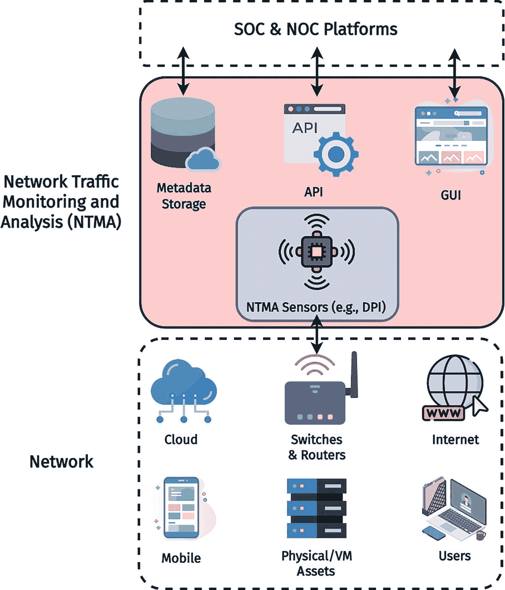
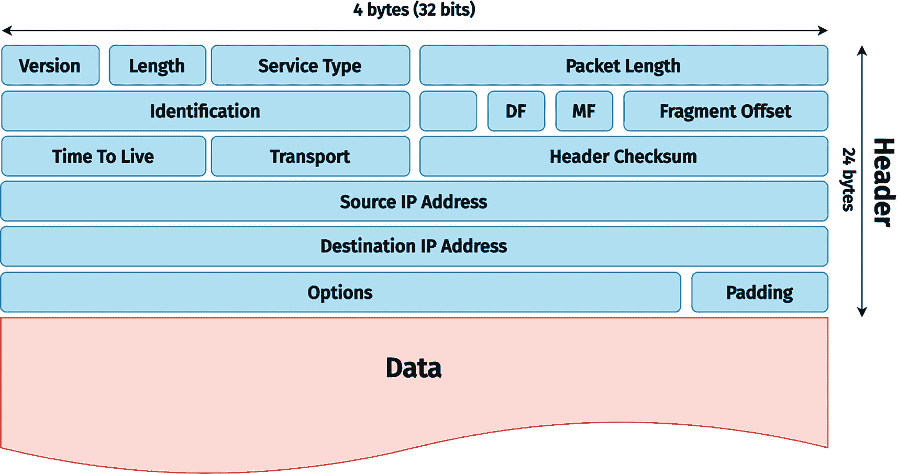
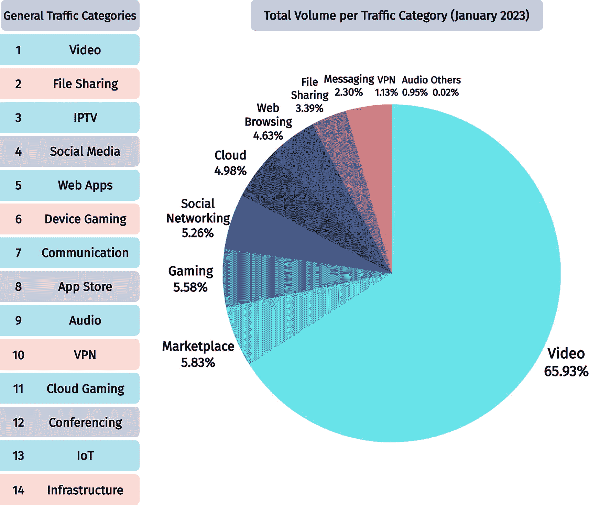
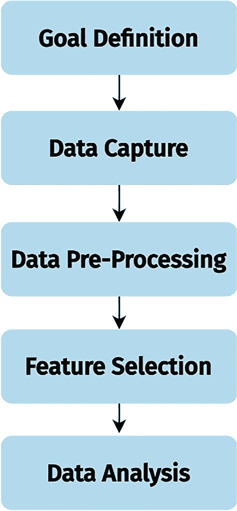
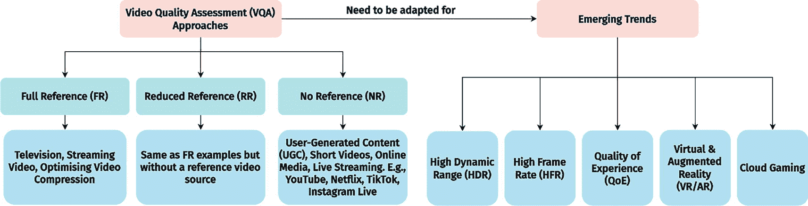
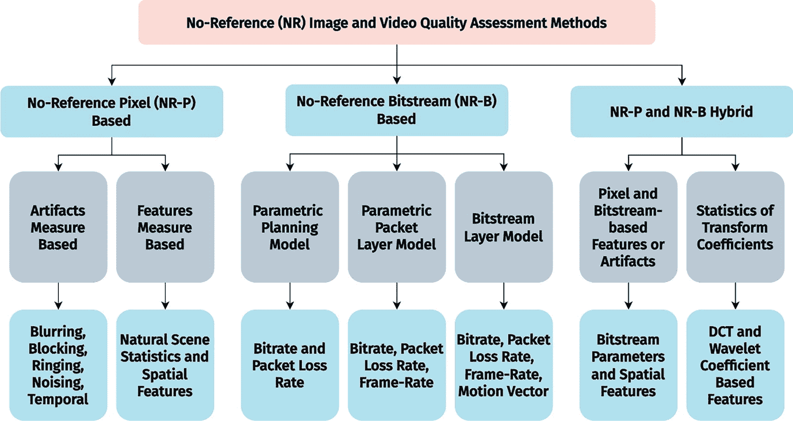

# 1. 引言

本章介绍了网络流量监控与分析（NTMA）和视频质量评估（VQA）的概念。通过强调实现最佳网络性能和提升用户体验（涵盖网络参数流和视频流质量）的必要性，讨论了 NTMA 和 VQA 在现代电信领域中的重要性。本章各节首先探讨了在不同网络环境中保持服务质量（QoS）方面对 NTMA 和 VQA 的需求，为实施阶段奠定了基调。为了在任何设备上（无论操作系统如何）执行这些流程，我们结合使用了机器学习（ML）、JavaScript 和 Java，并以 Node.js 和 Apache HTTP 服务器作为后端框架。在简化客户端-服务器交互以产生有意义的预测和分类结果之前，先从本地设备读取网络流量参数。同样，对正在播放的视频应用一系列失真伪影，以生成视频质量评分。以下各节概述了本书的结构，并简要介绍了后续章节将涵盖的内容。

## 1.1 网络流量监控与分析概述

NTMA 是当今电信环境的基石，对于确保网络效率、安全性和用户体验至关重要。数字交互的指数级增长，加之 5G 和物联网（IoT）的引入，凸显了监控和调节网络流量模式的必要性。NTMA 在网络生态系统中充当着监督者的角色，积极监控数据流不断变化的模式。这种加强的监控源于评估流量状况、识别异常以及改进性能以为消费者提供流畅数字体验的主要目标 [1]。

行业出版物的统计数据清晰地揭示了 NTMA 的规模。根据思科年度互联网报告，到 2022 年，全球 IP 流量预计将增至每月 396 EB，是 2017 年的三倍 [2]。在这个海量多媒体内容以闪电速度被消费的时代，NTMA 被证明是电信运营商的基本辅助工具，因为它们不仅能解读复杂的流量趋势，还能预测并缓解网络拥塞、瓶颈以及潜在的安全漏洞。

NTMA 范式内部包含一系列复杂性，首先是互联网流量的多样性。这种混杂无序的组合包含来自不同多媒体流的数据包头部、有效载荷数据和元数据。将这种信息马赛克置于分析显微镜下，可以洞察设备、应用程序和服务之间的传输动态，揭示那些可能被忽视且未被报告的规律。然而，要从穿越典型网络的巨大流量（通常每秒超过数十亿个数据包）中提取有意义的信息，计算和数学强度都非常高。通信数据包的加密特性进一步增加了障碍，它隐藏了关键信息，从而进一步需要复杂的方法来进行有用的分析。

NTMA 在现实世界中的影响是多方面且多层次的。例如，NTMA 是网络运营中心（NOC）和服务运营中心（SOC）的支柱，有助于快速识别有害活动、防止数据泄露以及保护敏感资产 [3]。同样，NTMA 通过动态主动监控和报告网络拥塞点并重新路由流量，改善了网络优化方面的服务质量（QoS）。Spiceworks 的另一项调查表明，53% 的信息技术（IT）专业人士认为 NTMA 是维护其基础设施的最关键组成部分，这凸显了服务提供商实时评估用户体验并保证无缝连接的必要性 [4]。

随着 NTMA 经历这一技术变革加剧的时期，机器学习（ML）已成为一个强大的盟友。ML 利用尖端算法推动预测能力、强大的异常检测和响应式网络管理，将 NTMA 推向了前所未有的高度。同样，ML 框架在轻量级、紧凑、快速和高效方面的适应性，成为了支撑典型最终用户在客户端执行 NTMA 能力的支柱。这彻底改变了数字生态系统，使最终用户能够配备高性能算法来衡量多媒体内容的接收质量，从而形成一个更复杂、更完整的生态系统。

NTMA 可以表示为网络组件与 SOC 和 NOC 平台之间的一个层，如图 1-1 所示。

一个架构图。网络流量监控与分析（NTMA）层中的元数据存储、API 和 GUI 连接到 SOC 和 NOC 平台。NTMA 传感器连接到包含云、交换机与路由器、互联网、移动设备、物理或虚拟机资产以及用户的网络。

图 1-1

现代框架中的 NTMA 层

以下各节将详细阐述构成 NTMA 的不同方面，例如其必要性和优势。

### 1.1.1 NTMA 的重要性

在当今复杂的电信网络中，NTMA 如同哨兵般屹立，时刻监控着为互联世界提供养分的虚拟脉络。随着数字交互变得无处不在，网络中传输的数据量呈爆炸式增长。国际数据公司（IDC）估计，到 2025 年，全球互联网用户将创造 175 泽字节的数据 [5]。面对日益汹涌的数据洪流，NTMA 是网络安全、隐私和效率的守护者。

NTMA 的主要目标之一是理解网络流量的随机性。从全局来看，网络流量是各种交互、数据流和终端节点混杂而成的混沌集合。首先，通过描述这些模式，NTMA 为网络管理者提供了优化性能的坚实基础；其次，通过识别与预设规范的异常和偏差，NTMA 确保在可能发生安全漏洞或中断时触发警报和通知 [6]。

如果来自特定地理位置的数据包突然激增，可能预示着分布式拒绝服务（DDoS）攻击即将来临。NTMA 的力量不仅在于发现这种异常，更在于它能迅速采取行动以限制其造成的损害。威胁环境正在变化，根据 Cloudflare 的报告，2022 年记录的 DDoS 攻击数量比上一年增加了 67%。卡巴斯基也记录了近 58,000 起此类事件 [7]。因此，NTMA 充当着数字灯塔的角色，使网络专家能够对新威胁保持警惕，并在遭受攻击后迅速恢复正常。海量数据的传输也要求对资源进行战略性使用和对网络进行精细优化。借助 NTMA，互联网服务提供商（ISP）和其他电信运营商可以精准定位瓶颈、缓解拥塞并更有效地分配带宽。这一点至关重要，因为自 2020 年疫情以来，对远程办公、在线课程和数字媒体的需求持续增长。得益于 NTMA 在提升服务质量（QoS）方面的努力，用户可以享受到更一致的数字体验，高清视频流、网页加载和应用程序响应都能以最高效率运行。

总而言之，NTMA 不仅仅是一个监控过程；它还能提升网络安全并提高用户满意度。数字交互的普及凸显了其无处不在的特性，而随着网络的成熟，其重要性将与日俱增。NTMA 通过接纳网络流量的多样性、理解其细微差别并将其转化为有用信息，为一个依赖效率和可靠性的数字互联社会铺平了道路。

### 1.1.2 NTMA 的关键目标

NTMA 的核心目标是满足网络管理和优化的多个要求。根据 Statista 的数据，截至 2024 年 4 月，全球互联网用户已达 54.4 亿 [8]。随着数字接触的持续增长，NTMA 在确保当今网络的持续可行性、安全性和效率方面将发挥越来越重要的作用。从战略上讲，NTMA 旨在实现以下目标 [9]：

*   描述应用层典型的流量流和数据流。
*   主动识别离群值和异常。
*   通过最优路由提升整体效率。
*   观察不同网络环境下的流量趋势并预测流量。
*   提供网络的鸟瞰视图。

通过对穿越网络的各种数据流进行严格的分类和分析，电信专家可以深入了解表征网络活动的模式。异常检测，即预先检测与既定流量标准的偏差，正是建立在这种对正常状态的熟悉基础之上。例如，VMware Carbon Black 报告称，2020 年针对银行企业的攻击增加了 118% [10]。NTMA 检测异常（包括流量意外激增或通信模式变化）的能力对于防止安全漏洞至关重要。随着数字交互的数量和重要性不断增长，NTMA 与优化网络的需求自然契合。为了改善 QoS 和资源管理，NTMA 会识别拥塞区域、流量限制和其他性能瓶颈。这一点在当前尤为重要，因为根据 Ookla 的报告，到 2023 年，全球平均网速预计将达到 110.4 Mbps [11]。用户现在要求稳定、低延迟、高速的访问，而 NTMA 的功能正是维护这一需求。因此，NTMA 是安全、效率和用户体验的交汇点，并应对网络动态的复杂性。其目标可以概括为：在不断增长的数据量与对无缝用户体验的需求之间维护微妙的平衡。随着数字生态系统的演进，这一平衡的重要性将愈发凸显。

### 1.1.3 网络流量组件

作为当今通信基础设施的骨干，网络流量本身就是一个复杂的现象。互联网协议（IP）数据包头部通过编码源地址、目的地址和端口号等信息，为数据传输提供了背景。提供背景信息的元数据，补充了代表消息本身的有效载荷数据。种类繁多的流媒体服务、信令数据包和控制消息，进一步加剧了网络流量本已混乱的状态 [12]。IDC 预测，到 2025 年，全球数据圈将增长至 175 泽字节，其中 75% 将与非 PC 设备相关，这反过来也反映了非 PC 流量来源的增长 [13]。通过剖析这些复杂的组成部分，网络管理员可以更深入地了解用户行为、应用关系和流量模式。在看似无缝的数字交换表面之下，隐藏着一张错综复杂的网络流量之网。这个复杂的网络由一系列组件协同构成，它们共同在计算机之间实现信息的无缝传输。Statista 预测，到 2030 年，全球将拥有 294 亿台物联网设备，这意味着网络流量组件的种类和数量将呈指数级增长 [14]。

数据包是网络流量的基本构建块。这些数字包将数据传输到最终目的地。就像邮件中的信件一样，这些数据包拥有独特的“头部”，其中包含关键信息，例如它们的来源和去向，以及它们使用的端口和协议。路由器和交换机可以利用这些上下文信息将数据发送到正确的目的地。而“有效载荷”，即消息的主体，则隐藏在这些数据包的更深处。在传输过程中，信息本身（例如文本、照片、视频流或特定于应用的数据）就位于此处。当今数字体验的基础，正是建立在这些数据包的高速通信之上。图 1-2 展示了一个 IP 数据包的结构 [15]。

一个 IP 数据包的数据包结构图，包含 24 字节的头部和 4 字节的数据。头部包括版本、长度、服务类型、数据包长度、标识、DF、MF、分片偏移、生存时间、传输协议、头部校验和、源 IP 地址、目的 IP 地址、选项和填充。

图 1-2
IP 数据包的结构

同样，网络中也会突出显示具有共同特征的、相互关联的数据包“流” [16]。因此，网络管理员可以理解应用、服务和设备之间——即在不同层级上的——通信动态，从而获得对网络动态的全局视角。这也是各种流类型发挥作用的地方，例如，IP 语音（VoIP）通话、视频流和在线浏览活动可以根据其独特的趋势进行细分和分析。此外，数据包时间戳、通信长度和传输序列号等元数据，也有助于增强和把握网络交互。

然而，网络流量元素的广泛多样性也带来了一定的困难。思科预测，视频媒体在互联网流量中的占比到 2021 年将占所有 IP 流量的 82% [17]，这带来了复杂性，需要先进的分析方法。数据包头部、有效载荷数据、元数据和多媒体流的复杂交织，构成了一个不断演变的复杂领域，这正是 NTMA 试图驾驭的。理解这些组件对于洞察用户习惯、识别网络拥塞原因，以及在一个日益数据驱动的环境中保证无与伦比的用户体验至关重要。截至 2023 年 1 月，Sandvine 报告称视频流量增长了 24%，Netflix 在视频消费量上超过了 YouTube。图 1-3 描绘了截至 2023 年 1 月底，全球范围内按流量类别划分的广泛列表及总消费量 [18, 19]。

2023 年 1 月各类别流量总量的饼图。视频占 65.93%，其次是市场占 5.83%，游戏占 5.58%，社交网络占 5.26%，云服务占 4.98%，浏览占 4.63%，文件共享占 3.39%，消息占 2.30%，VPN 占 1.13%，音频占 0.95%，其他占 0.02%。

图 1-3
通用网络流量类别及全球各类别总消费量

### 1.1.4 NTMA 技术与方法论

NTMA 证明了技术创新与分析能力可以成功共存。从简单的数据包捕获到强大的机器学习算法，NTMA 通过允许电信工程师和数据分析师挖掘有用的模式、异常和结论，穿越原始数据的迷宫。数据包捕获的概念处于 NTMA 技术的顶峰。这种基本方法在网络中拦截并捕获传输中的数据包。网络专家通过以自然形式（从头部到有效载荷）捕获数据包，从而获得对数据包所含信息的开放访问权限 [20]。数据包捕获是理解通信模式、分析数据流特征，以及最重要的是识别可能表明安全问题或连接不一致的异常的基础。这种方法类似于数字化的罗塞塔石碑，破译着网络连接的含义。

网络分析的核心方法之一围绕通过基于流的评估来处理大量网络数据，其中流是根据共享特征（例如源地址和目标地址、端口号和协议类型）对数据包进行分组而形成的 [21]。这种解耦允许网络管理者基于累积的信息而非单个数据包做出更优选择，从而形成对网络行为更全面的认知 [22]。随后，洞察结果从设备、应用和服务层面观察到的模式行为中得以发展和推导。

随着 NTMA 专业人员探索这一领域，两种不同的方法应运而生：主动网络监控和被动网络监控。为了测量吞吐量、安全性和可靠性，主动网络监控会故意生成流量。主动监控是一种通过使用“探针”或“代理”模拟不同情况来收集响应时间、延迟和其他指标数据，从而评估网络状态的方法 [23]。类似于实验室实验，这种方法可以无阻碍地观察网络的结构和运行。当可用性和响应性至关重要时，主动监控因其能够持续评估网络行为和性能而大放异彩。MarketsandMarkets 预测，全球网络监控市场到 2030 年将超过 69.7 亿美元 [24]，例如金融行业就使用主动监控来确保交易平台能快速响应瞬息万变的市场动态。

相反，被动网络监控则扮演着沉默观察者的角色，记录所有网络活动，而不增加正在传输的数据量 [25]。深度包检测（DPI）等技术体现了这种方法，它允许网络管理者记录并检查未经更改的流量。当需要深入了解网络行为的深层历史背景时，被动监控是首选。互联网服务提供商（ISP）通常使用被动监控技术，例如分析流量模式，以更好地分配资源和优化其网络 [26]。

此外，数据分析和机器学习的采用为 NTMA 框架注入了额外的可靠性和高精度，将其提升到了一个全新的维度。一系列机器学习算法为模式识别和异常检测提供了全面的工具集 [27]。如果不使用推理和描述性统计，网络专家将无法检测到那些本会被忽略的异常 [28]。此外，由于 NTMA 与机器学习的结合，预测分析和异常检测已进入一个新时代。从监督算法到深度学习（DL）架构，机器学习模型消耗海量数据集，以发掘先前隐藏的相关性和异常值。2021 年全球网络犯罪损失已惊人地达到 6 万亿美元，预计网络攻击将进一步增加 [29]。这种与机器学习的集成可以提高威胁检测的准确性。由于机器学习模型能够根据不稳定的网络行为进行改变和适应，NTMA 能够更好地预见潜在问题、发现异常值并提出预防措施。机器学习将 NTMA 从一种被动方法转变为主动方法，满足了现代数据驱动社会的需求。

随着 NTMA 进入一个以信息过载和先进技术为特征的时代，其方法也反映了这种快速变革。通过数据包捕获、基于流的分析、统计和机器学习所获得的洞察力的协同作用，网络流量的复杂动态得以揭示。在这个以连接和知识为特征的时代，这部交响乐为电信专家提供了不仅理解而且预测网络行为的手段，引导网络基础设施走向高效、安全和卓越性能。图 1-4 描绘了作为近期大多数 NTMA 过程研究基础的概念框架 [30]。

NTMA 的垂直流程图。目标定义之后是数据捕获、数据预处理、特征选择和数据分析。

图 1-4
NTMA 过程的一般框架

### 1.1.5 NTMA 面临的挑战

NTMA 如同数据海洋中的哨兵，值守在当今复杂网络织就的洪流之中，肩负着从海量涌入的信息里提取隐藏故事线的重任。然而，这一知识领域暗藏着重重障碍迷宫，唯有凭借创造力、灵活性以及前沿方法方能克服。

首要难题之一便是网络流量的惊人规模 [31]。全球数据中心每年处理约 100 ZB 的内容，而在当今时代，单个用户每年就能产生 TB 级的数据，这意味着穿越网络的信息量是惊人的 [32]。要理解这股信息洪流，就需要采用诸如数据缩减、聚合和选择性采样等复杂方法。随着可用数据越来越多，遗漏有价值洞察的可能性也随之增加。随着越来越多的人使用流媒体服务、云技术和物联网设备，网络交互的多样性也在增加，这要求同时对实时和过往事件进行分析 [33]。

向加密传输的转变带来了新的复杂层面。谷歌报告称，互联网上加密网络流量的比例已从 2014 年的大约 50% 增长到 2020 年后的约 95% [34]，这表明为应对日益增长的安全担忧，加密技术的使用已变得多么普遍。虽然加密技术提升了数据隐私和安全性，但它也隐藏了数据包内容，使得解读它们如同破译密码信件一样困难。为了突破加密壁垒并在不违反数据保护法规的情况下获取情报，需要采用诸如深度包检测（DPI）之类的先进方法。DPI 被广泛认为是网络安全领域的重要竞争者，展现出有效对抗现代网络威胁的强大能力。这是一个检查数据包在穿越特定位置时其内容，并随后根据相关实体（如公司、ISP 或网络管理员）预设的标准做出即时决策的过程 [35]。尽管最近在分离网络流量构建块以尝试独立处理它们方面取得了进展，但 NTMA 社区在平衡安全性与透明度方面仍然面临巨大困难，尤其是在使用解密和用户匿名技术时。同样，根据 IDC 的预测，到 2025 年，包括手机、平板电脑和物联网传感器在内的设备数量预计将达到 416 亿 [36]，这使得跨设备和通信协议标准化分析流程变得越来越困难。这要求开发能够处理多模态流量细微差别的方法。

### 1.1.6 NTMA 的应用案例

随着威胁环境的变化和攻击手段的日益复杂，保护关键数字资产是 NTMA 的首要任务。为了检测安全漏洞或恶意行为，NTMA 会分析网络流量模式以发现异常。网络安全风险投资公司估计，到 2025 年，与网络犯罪相关的年度支出将达到 10.5 万亿美元，这使得持续监控成为一道关键防线 [37]。网络安全专家可以利用 NTMA 的发现来加强防护、识别漏洞，并迅速应对诸如分布式拒绝服务（DDoS）攻击和勒索软件入侵等新威胁 [38]。

在当今持续连接和快速数据传输至关重要的数字经济中，网络优化至关重要。NTMA 通过检查网络流量模式来识别拥塞热点以及带宽和性能瓶颈 [39]。从这个角度出发，IT 管理人员可以更有效地分配网络资产，提升用户的**服务质量**（QoS），并防止服务中断。爱立信预测，到 2024 年，5G 网络将覆盖全球 45% 的人口，这清楚地表明，随着对高速低延迟互联网连接的需求持续增长，有效的网络管理对于满足消费者期望至关重要 [40]。

通过有效监控性能瓶颈和优化网络资源，NTMA 确保用户能够获得无缝的在线体验。这在客户行为中显而易见：遇到网站性能问题的用户不太可能再次访问该网站。无论是下载高清内容、举行虚拟会议还是进行实时在线交易，NTMA 在确保网络灵活性和有效性方面的作用都显著影响着用户的数字活动 [41]。

NTMA 的更多应用案例重点列举如下：

*   网络流量特征描述与监控
*   网络优化与规划
*   网络安全违规检测
*   网络服务质量评估与改进
*   网络组件预测性维护
*   取证分析
*   合规与监管报告
*   漏洞扫描与补丁管理
*   成本优化

### 1.1.7 NTMA 的新兴趋势

将人工智能和机器学习融入 NTMA 已被视为一项颠覆性的发展。面对每日海量数据，由人工智能驱动的洞察力能为网络活动提供重要的前瞻性。像 Cloudflare 这样的公司利用人工智能分析海量网络流量数据，以实时识别并缓解分布式拒绝服务（DDoS）攻击。随着可用的计算能力不断增强，NTMA 现在不仅能发现模式和异常，还能对其进行预测，从而极大地提升网络安全和性能。

边缘计算的兴起也正在影响 NTMA 方法的变革。随着越来越多的物联网设备在网络边缘收集数据，NTMA 已从集中式评估演变为实时监控。像西门子这样的边缘计算先驱将其应用于生产中，通过评估植入设备中的传感器收集的数据，进行本地即时决策 [42]。这一发展使得 NTMA 能够在数据生成时快速发现问题并提升性能，有助于减少延迟并确保流畅的用户体验。

此外，云计算的日益普及正在显著提升 NTMA 的灵活性和可访问性 [43]。借助像 ThousandEyes（现为思科旗下公司）提供的基于云的 NTMA 服务 [44]，网络运营商现在可以灵活地在分散的环境中安装和管理远程监控。这种适应性服务于网络拓扑结构不断变化的特性，包括远程办公的普及。向云端 NTMA 的迁移，体现了云的模块化和远程可用性如何满足当今网络不断变化的需求。这些发展共同为 NTMA 赋予了新能力，使其能够在海量数据和数字复杂性的时代蓬勃发展。通过利用人工智能和机器学习、采用边缘计算以及集成云解决方案，NTMA 正朝着动态、智能和主动的网络管理方向迈进。诸如此类的变化凸显了 NTMA 对支撑现代数字世界的可靠、高性能网络所产生的持久影响 [45]。

### 1.1.8 弥合 NTMA 与用户体验之间的差距

随着数字时代的发展，NTMA 已成为网络响应性、耐用性以及最终用户体验的基石。NTMA 与最终用户的体验质量（QoE）有着内在联系 [46]。NTMA 分析网络流量、定位处理延迟并提升服务质量的能力，直接转化为改善的客户体验。以使用 NTMA 进行实时监控的流媒体平台为例。服务监控和管理团队可以密切关注网络状态，并在流媒体质量下降时迅速采取行动，这种质量下降通常通过视频质量评估（VQA）获得的平均意见得分（MOS）来概括。这种即时适应与观众不断变化的习惯相辅相成。例如，Netflix 报告称，2020 年第一季度新增了 1577 万订阅用户，比 2019 年同期增长了 23% [47]。NTMA 通过确保无故障的流媒体体验，有助于提高客户满意度和留存率。

此外，NTMA 的专业知识也适用于电子商务领域，客户的交互对其最终购买行为有重大影响。在当前环境下，网络的效率至关重要。NTMA 通过对用户交互和交易流程的分析，识别潜在的延迟问题，确保快速、无误的交易。鉴于 Statista 预测到 2027 年全球电子商务销售额将达到 5.56 万亿美元 [48]，这一点至关重要。除了技术管理的作用之外，NTMA 还通过改善用户体验质量来帮助推动收入增长。

此外，远程工作场景也受益于 NTMA 与用户体验的融合。居家办公的日益普及使得网络速度和可靠性比以往任何时候都更加重要。由于 NTMA 致力于减少延迟、提升视频会议质量并确保数据及时传输，分散的团队可以高效协作。根据 Owl Labs 进行的研究，高达 58% 的远程工作者认为，未来十年远程办公将更加普及 [49]。由于远程办公日益流行，NTMA 必须优先考虑流媒体和视频会议应用的 QoE。简而言之，NTMA 弥合了技术经济与人类体验之间的差距。改善的用户体验、参与度和生产力，都是 NTMA 分析网络动态和维护性能能力的直接产物。

## 1.2 视频质量评估概述

在当代多媒体消费的复杂数字格局中，视频素材的质量已成为一个关键的差异化因素。超越基本技术标准的范畴，视频质量评估（VQA）作为一个关键领域，旨在客观量化并主观理解视频输出的感知质量。其核心而言，VQA 是一个跨学科领域，融合了工程学、心理学和人机交互。其最终目标是弥合视频的技术层面（如分辨率、比特率和压缩伪影）与人类观众主观感受之间的鸿沟。这项工作认识到人类视觉系统的复杂性，包括认知过程、视觉敏锐度和心理因素的相互作用，这些因素共同导致了人们以独特方式接收和理解周围世界 [50]。流媒体视频在多个渠道的迅速普及凸显了 VQA 的必要性。确保人们在线观看的视频不仅在技术上可行，而且能吸引并沉浸其中，这一点至关重要。从这个意义上说，VQA 就像一张地图，帮助内容制作方、流媒体服务商和电信运营商在用户体验质量方面满足消费者的期望。

数字世界的变化也导致了决定视频质量的变量发生相应转变。尽管分辨率、比特率等视频质量因素极其重要，但它们只是问题的一小部分。许多因素都会影响观众对视频的感知，包括压缩伪影、色彩准确性、运动流畅度和音频同步。因此，VQA 融合了客观和主观评估方法，旨在衡量技术特征并记录观众的情感反应。

VQA 的动态发展体现在从基础的、基于规则的算法向复杂的机器学习模型的转变。如今，机器学习方法可用于复制人类的感知判断，取代了基于峰值信噪比（PSNR）和结构相似性指数（SSIM）等指标的旧方法。近年来，卷积神经网络（CNN）和循环神经网络（RNN）等深度学习架构已成为从视频中提取细微但重要的视觉细节的极其有用的工具 [51]。

除了在娱乐行业的应用，VQA 在医疗、安防和学术领域也具有实际意义。例如，在医学影像中，诊断图像的错误呈现可能导致致命后果。VQA 通过确保医学图像忠实于原始图像，减少了误解的可能性。借助 VQA，安防专业人员可以确信他们正在查看真实、未经编辑的视频源，这有助于发现异常情况。VQA 对人工智能、机器学习和感知心理学的持续探索，使其成为现代数字体验的核心。通过将技术要求与人类感知对齐，它巩固了自身作为媒介的角色，不仅提供视频，更提供能够吸引、连接用户并引起共鸣的沉浸式视觉叙事。

### 1.2.1 VQA 的重要性

在视频内容占据当前多媒体消费趋势主导地位的背景下，VQA 是核心，它通过优化指标塑造用户体验，从而将内容开发与分发策略结合在一起。VQA 旨在回答诸如视频内容质量对观众参与度和满意度有多大影响等问题。互联网协议电视（IPTV）广播公司和 OTT 流媒体平台等内容制作行业需要强大的监控程序，以显示所传输媒体的当前状态，包括可用性、运行时间、服务质量和用户体验，这些都属于其反馈循环的一部分。该行业深知，观众不仅仅是消费内容，他们是在体验内容。本节将探讨 VQA 在当今多媒体生态系统中的关键重要性。

VQA 对用户参与度的直接影响可能是其重要性的最清晰指标。在一个选择丰富、注意力持续时间短暂的时代，视频内容的质量是数字用户互动的第一线。这与 TikTok、YouTube Shorts 和 Instagram Reels 等平台上短小精悍、引人入胜的视频消费的迅猛增长高度契合 [52]。VQA 扮演着监督者的角色，检查视频中可能导致观众脱离体验的缺陷，例如失真、故障和其他不足。VQA 确保视频没有令人分心的缺陷，为即时吸引观众奠定了基础。VQA 的优势还包括其经济效益。根据《哈佛商业评论》的研究，仅保留 5% 的客户就能使盈利能力提升 25% 至 95%，这表明内容质量与观众满意度之间存在直接关联 [53]。

VQA 的相关性超越了技术能力，延伸至视频的心理共鸣。视频是分享思想、情感和体验的强大媒介。VQA 致力于维护赋予视频力量的感染力，无论是鼓舞人心的广告、信息丰富的教程，还是引人入胜的叙事。由于高清显示器、增强现实和虚拟现实的普及，用户对视频质量的期望不断提高。用户生成视频和直播有助于内容创作的民主化，但这相应地也带来了质量民主化的需求。VQA 的职责还包括分析来自众多发布者的内容，以确保无论视频原始来源如何，都能提供一致、高质量的视觉体验。其影响深远，不仅影响用户参与度，也影响内容开发者和制作者。VQA 通过倡导视频的高标准，在数字时代保护了兴趣、经济收益和情感影响。因此，数字故事的创作和消费过程被提升至技术与人类感知之间艺术交响乐的层面，进一步丰富了构成当代体验的数字马赛克。

### 1.2.2 影响视频质量的因素

观看视频的体验受到多种因素的影响，每种因素都在观众形成的整体印象中发挥着独特作用。从技术参数到感知心理学，研究人员剖析了构成满意视频观看体验的要素，如表 1-1 [54] 所示。

表 1-1

影响视频质量的因素

| 因素 | 描述 |
| --- | --- |
| **分辨率** | 表示每个维度上的像素数量，是视频质量的主要决定因素。更高的分辨率（如 4K 和 8K）可呈现更清晰、更细致的图像。视频分辨率对其在屏幕（尤其是大尺寸屏幕）上的显示效果有重大影响。然而，更高的分辨率需要更大的带宽和更强的计算能力。 |
| **比特率** | 在特定时间内交换比特的速率。随着比特率提高，可以在减少压缩需求的情况下传输更多视觉细节，从而影响视频质量。高比特率可能会给网络带来负担，因此找到合适的平衡点颇具挑战。 |
| **压缩** | 视频压缩技术（如 H.264 和 H.265）对于在存储和传输视频时节省空间和带宽至关重要。然而，过度压缩可能会引入块状效应或模糊，损害视频质量。 |
| **帧率** | 每秒显示的帧数，也称为“fps”，由帧率决定。常见的帧率为每秒 24、30 和 60 帧。120 或 240 fps 及更高的帧率可提升动作的流畅度。然而，不同观众对帧率的偏好各不相同。 |
| **色彩准确度** | 逼真的视觉体验在很大程度上依赖于色彩还原。不准确的色彩可能使图像看起来虚假或令人不适。在医学成像和电影制作等领域，色彩保真度至关重要。 |
| **运动处理** | 任何包含大量动作的场景或体育赛事转播都必须能够无失真地渲染快速运动。显示器处理运动的能力与其帧率、刷新率和响应时间规格相关。 |
| **音频质量** | 高质量的音频能增强视频素材的表现力。音频编码、立体声/环绕声系统以及降噪方法共同影响着整体音质。为了获得最佳观看体验，演示中的音频和视觉元素必须保持同步。 |
| **内容来源** | 大多数商业制作的内容都设有质量控制措施，而用户生成的内容则可能质量参差不齐。因此，视频的预期质量在很大程度上取决于其来源。 |
| **观看环境** | 观众所处的环境也会影响感知到的视频质量。这包括照明条件、屏幕尺寸、观看距离和背景噪音。例如，窗户的眩光可能会损害整体印象。 |
| **心理因素** | 观众的期望、注意力和情绪都在人类从心理层面解读视频质量的过程中发挥作用。然而，如果引人入胜的内容无法弥补技术缺陷，那么备受期待的内容中的技术缺陷可能会更加明显。 |
| **设备性能** | 观看体验由用于观看视频的设备决定，范围从智能手机等手持设备到具备 4K 能力的高端电视。 |

因此，上述参数会影响最终的视频输出。一些可能的影响如下 [55]：

*   **块状效应**：视频编码过程涉及基于块的技术。因此，网络性能下降可能导致数据丢失或编码错误。

*   **模糊**：当空间信息或显著特征减少时，会出现模糊现象，导致场景或物体周围的边界融合且变得不清晰。

*   **边缘失真**：这特指修改后的视频与其原始版本相比，在边缘处观察到的差异。内容中的物体呈现出不平整的边缘。

*   **运动卡顿**：运动卡顿的发生通常通过使用序列编号将实时测量值与视频时间进行比较来评估。在某些情况下，可能会出现内容冻结或片段跳过的现象。

内容创作者以及服务提供商必须理解并评估这些因素的影响，以便为人类提供令人满意、沉浸且引人注目的体验。

### 1.2.3 VQA 方法的演进

在先进的机器学习和深度学习技术发展之前，VQA 主要基于传统方法。本节将详细阐述 VQA 方法的演进过程 [56]，具体如下：

*   **主观评估**：经典 VQA 的支柱，即主观评估，依赖于人类观察者根据自身经验对视频进行评分。绝对类别评级（ACR）方法就是一种利用人类判断来评估视频质量的主观测试。观看者给出的评分和标签揭示了人类体验中富有洞察力的信息。目前，用于训练机器学习算法的数据集通常以人类判断为基准进行校准。

*   **客观指标**：根据技术参数对视频质量进行定量评估，客观指标涵盖了多种数学公式。一些指标通过比较视频的未失真版本和失真版本来确定总体得分，例如峰值信噪比（PSNR）和结构相似性指数（SSIM）。这些测量方法可以实现快速、自动化的评估，但它们通常过于简单，无法解释人类感知中的细微差别。例如，PSNR 对不准确性很敏感，但与人类感知的相关性较差。

*   **混合方法**：这些方法整合了主观评估和更量化测量方法的各个方面。其目标是结合科学数据与个人经验。为了高效预测质量，这些方法基于主观输入进行训练，旨在将人类感知因素纳入考量，同时保留客观测量方法带来的自动化效率提升。

*   **基于模型的技术**：利用计算机模拟来模仿人类视觉系统的特征，以对软件进行质量评估。视频质量专家组（VQEG）等组织创建了计算模型，例如视频质量模型（VQM）和视频质量专家（VQE）[57]。这些模型在确保技术测量与人类感知之间具有更好一致性的同时，还考虑了对比度敏感度和空间掩蔽效应。

*   **基于比特流的评估**：与完全解码不同，这些方法使用视频比特流中的编码设置、帧率和压缩比等组件。尽管计算效率高，但这些方法可能会遗漏内容感知方式上的某些细微差别。

*   **无参考（NR）指标**：传统的 VQA 方法通常采用全参考（FR）技术，即通过将失真视频与参考视频（即原始视频）进行比较来衡量失真程度。然而，NR 方法无需参考流即可评估视频质量。这也被称为无参考指标。由 TestDevLab 开发的基于深度学习的视频质量测试（VQTDL）就是此类算法的一个例子，它试图在没有任何外部参考的情况下评估质量，这使得它在无法获取此类资源的情况下非常有用 [58]。

由于 VQA 是一个以应用为中心的过程，因此所选的具体方法需要高度适应其目的。围绕近期趋势所使用的技术，以及 VQA 方法需要适应新兴主题的需求，总结在图 1-5 [59] 中。

2 个分类图表。左图：视频质量评估（VQA）方法包括全参考（FR）、简化参考（RR）和无参考（NR）。右图：这些方法需要适应新兴趋势，包括 HDR、HFR、QoE、VR/AR 和云游戏。

图 1-5
VQA 的方法与新兴趋势

尽管具有历史意义，但经典的 VQA 技术在当今海量的多媒体内容创作和部署面前存在重大缺陷。因此，当今的 VQA 方法建立在机器学习模型之上，这些模型能够动态适应新的视频格式、不同的内容类型以及细微的感知差异。当今最常用方法的概述如图 1-6 [60] 所示。

无参考图像和视频质量评估方法的分类图。基于像素的无参考方法包括基于伪影和基于特征测量的方法。基于比特流的无参考方法包括参数规划模型。NRP 和 NRB 混合方法包括变换系数统计。

图 1-6
无参考图像和视频质量评估方法

### 1.2.4 VQA 的实际应用

VQA 领域并不仅限于科学研究和技术评估。定量评估和提升视频质量的能力在众多行业领域具有多种实际应用。本节将探讨 VQA 已被证明特别实用的一些实际场景，包括以下方面：

*   **娱乐与流媒体服务**：Netflix、Amazon Prime Video 和 Disney+ 等流媒体平台高度依赖视觉和音频质量来评估其 QoE。缓冲和压缩伪影（如噪声、块效应、模糊和卡顿）是可通过持续监测来衡量的视频质量下降示例。VQA 也用于内容推荐框架，根据用户过去的观看历史，向其推荐符合喜好的类似节目或电影 [61]。

*   **电信与广播**：对于通常依赖 IPTV 和 OTT 服务作为主要收入来源的电信提供商而言，服务监控仪表盘对于全面了解其广播的所有频道至关重要。这在主动排查流媒体问题、减少客户投诉电话数量方面尤其有帮助。同样，体育赛事和新闻等直播活动需要传输的确定性，这往往决定了最终用户是否会订阅该特定提供商。

*   **医疗保健与医学影像**：医疗诊断的可靠性依赖于来自各种成像方式（包括 X 光、MRI 和超声波）的高质量视觉数据。为防止误诊，VQA 算法会仔细检查医学图像中是否存在任何失真或异常迹象，并向医学专家发出警报 [62]。在该领域，保持高图像质量的重要性怎么强调都不为过。

*   **教育与在线学习**：由于新冠疫情等全球性问题，教育领域对在线学习工具的使用急剧增加，并且至今仍在持续增长。通过存在于视频讲座、教程、交互式模拟以及涵盖大量学生的视频会议中的 VQA 算法，可确保高质量的教育视频内容，从而监控并保证演示的连续性。

*   **广告与营销**：随着对视频质量与目标受众之间关系的认识不断提高，营销人员和广告商在发布视频广告前使用 VQA 评估视频质量，确保专业性和对品牌卓越性的承诺，从而更有可能吸引并留住观众的注意力。

*   **安防与监控**：来自监控摄像头的实时视频流可接受强大的 VQA 算法处理，以确保录制的画面不会因压缩或传输缺陷而出现问题，从而支持诸如基于 AI 的车牌检测等精确功能。

*   **游戏与虚拟现实 (VR)**：游戏开发工作室高度依赖 VQA 来为玩家创造真正沉浸式的体验 [63]。随着高端游戏开发环境的兴起，玩家期望惊艳的视觉效果和完美的性能。因此，VQA 通过视觉优化和质量一致性来辅助实现这一目标。

这些实际应用展示了 VQA 对行业和日常生活的深远影响。VQA 通过确保视频素材的高质量交付（这持续占据媒体食物链的顶端），有助于提升用户满意度、生产力，甚至影响某些重要决策。

### 1.2.5 VQA 面临的挑战

尽管取得了显著进展，VQA 仍面临若干持续存在的挑战，从人类感知的主观性到新视频格式的复杂性，因此需要不断进行研发。人类思维的本质使得感知非常主观且独特。对一位观众而言的高质量媒体，对另一位观众可能并非如此。在追求用于质量评估的客观指标时，VQA 面临着一个根本性障碍，即主观性。需要持续努力，通过开发能够反映人类视角多样性的模型来弥合“主观性差距” [64]。同样，视频是不断演变的作品，包含变化的场景构图、动态元素和听觉线索。时间特性，如运动平滑度、同步性和一致性，对观众的愉悦感有重大影响，但 VQA 难以对其进行分析。此外，随着 YouTube、TikTok、Reddit 和 Instagram 等应用上用户生成内容的激增，VQA 需要兼具可扩展性和普适性的需求正日益紧迫。跨海量数据集、在多种环境中、以可靠的方式及时评估来自各种来源的视频质量，是一项持续的挑战。这也与媒体从不同能力设备上传有关，因此会涉及不同的视频格式和编解码器，范围从 4K 视频到 HDR，再到 360 度 VR 素材。VQA 必须不断发展以评估这些新形式的质量 [65]。

然而，一个主要障碍仍然是，对于视频会议和直播等密集型应用，VQA 算法需要实时执行，这些应用涵盖大量客户端，从 Instagram Live 上的几百人到 Twitch 游戏直播中的数千人。这可能会对计算能力提出很高要求，并且在低资源环境（如低配置 PC）中可能无法按计划工作。同样，还存在缺乏真实数据的问题，需要围绕每个平台独立构建数据集，这使得主观数据收集既耗时又成本高昂。某些算法在测量视频质量时还会考虑网络状况。这在自适应流媒体协议（如基于 HTTP 的动态自适应流媒体 (DASH)）中有所体现。由于内容质量可能在流媒体传输过程中发生变化，VQA 必须足够灵活，以便在自适应流媒体环境中准确评估不断变化的视频流。这些问题可以通过计算机视觉、机器学习、心理学和数据科学的进步来解决，并且需要研究人员、内容创作者和行业利益相关者之间的合作，以改进 VQA 方法并确保其在这个快速扩张的数字领域中发挥作用。

### 1.2.6 VQA 领域的新兴趋势

本节将介绍 VQA 领域的最新趋势与发展，这些趋势源于不断变化的数字内容时代以及质量监控日益增长的重要性 [66, 67, 68]。

*   **深度学习** **进展**：深度学习的发展使得 VQA 能够借助卷积神经网络（CNN）和循环神经网络（RNN）等算法，达到前所未有的水平。视频质量中复杂的主观特征正越来越多地使用最先进的深度学习架构进行建模。这些模型在包含大量人类质量判断的数据集上进行训练，能够从视频中提取复杂的视觉元素，从而做出可靠的判断。

*   **无参考（NR）指标**：不依赖客观、标准化视频质量示例的指标近来开始流行，这并非没有道理。这类通常基于机器学习方法的指标，在参考视频无法获取或难以获得的情况下尤其有用。

*   **多模态评估**：将声音、文本和元数据整合到单一评估中，开辟了一个新方向。评估模型能够更深入地理解视频质量，因为它们考虑了不同的模态。例如，通过同时考虑视觉和音频组件，可以实现对多媒体体验的全面评估。

*   **体验质量（QoE）模型**：这些框架考虑了超出标准质量测量范围、以用户为中心的特征。它们将用户参与度、关注度和反应都纳入考量，使得这些模型对于以吸引最广泛受众的方式增强视频体验至关重要。

*   **自适应流媒体评估**：随着自适应流媒体技术的普及，结合了 NTMA 的新算法应运而生，旨在减少视频质量在适应不断变化的网络环境时出现的明显中断。

*   **可解释人工智能（XAI）**：可解释人工智能在医疗和安全领域更为突出，模型会提供其特定质量评估背后的推理依据，从而进一步提高评估的准确性。

*   **用于实时 VQA 的边缘计算**：作为提供实时分析的方法之一，边缘计算被用于在更靠近数据源（如客户端设备）的位置分析数据。一个典型的例子是直播或视频会议场景，其中基于边缘的 VQA 系统围绕用户设备构建，以实现低延迟和快速质量评估。

*   **跨领域应用**：在一个领域开发的算法正被移植和调整用于其他领域。例如，为流媒体开发的技术正越来越多地被分别应用于医疗、教育和安全领域，用于高质量图像、VR 教室和摄像头视频流。

这些发展证明，VQA 正成为支持在线媒体生态系统的基础组成部分。为了满足各个学科对高质量、互动体验日益增长的需求，随着互联网视频继续主导通信、娱乐和信息分发，VQA 将发挥重要作用。

## 1.3 JavaScript 中的机器学习

机器学习通过让系统能够从观察中学习并随时间提升性能，已经改变了众多行业。随着 JavaScript 崛起成为一种灵活且广泛使用的编程语言，现在可以直接在 Web 应用程序中集成机器学习算法。本节深入探讨了 JavaScript 如何用于机器学习任务，提供了强大的工具和框架，为基于 Web 的环境增添了高级分析和智能能力。

### 1.3.1 机器学习简介

机器学习（ML）作为人工智能（AI）的革命性单元，使机器能够从数据中学习，并在无需显式编程的情况下做出预测或选择。过去几年中，JavaScript 对 ML 的支持为从事 Web 开发和工程的人员释放了巨大的潜力。本节介绍 ML 的基础知识，并解释其在 JavaScript 语境中的重要性。

机器学习从根本上关注的是泛化和模式识别。它涉及教导计算机分析大量数据，并得出有意义的结论或做出准确的预测。机器学习算法可以分析历史信息以确定模式，并对未预见的数据生成预测。ML 可以细分为以下主要类别 [69]：

1.  **监督学习**：监督学习涉及使用包含输入和预期输出的标记数据来训练模型。目标是找出如何将输入映射到输出。垃圾邮件检测、图像分类和回归问题都是其中的例子。

2.  **无监督学习**：无监督学习处理未标记的数据，算法试图发现数据中隐藏的结构或模式。这包括聚类和降维，可用于市场细分或识别异常。

3.  **强化学习**：在这种学习类型中，智能体被赋予在环境中做出决策以最大化奖励信号的能力。一些用例包括机器人技术、游戏和自主系统。

鉴于其在 Web 开发中的普及，JavaScript 在 ML 中的地位日益重要，使开发者能够将轻量级且复杂的算法直接集成到 Web 应用中。这带来了引人入胜且自适应的用户体验。JavaScript 工具和框架已经发展到使 ML 更容易为更广泛的受众所用。这也为无需服务器端计算的实时可能性打开了大门。像照片中的物体检测、自然语言处理、情感分析和预测分析这些看似复杂的任务，都可以在客户端（即浏览器中）原生打包并构建为 ML 模型。

此外，随着工具集的不断演进以及全球贡献者的开源参与，JavaScript 中大量融入了诸如 TensorFlow.js、Brain.js 和 ml5.js 等库，这些库提供了数据准备方法以及用于预训练模型的抽象和函数 [70]。这些框架为普通开发者提供了优势，使他们能够深入掌握先进的 ML 技术，并将其映射到只需以正确格式提供数据的简单方法上。此外，还可以构建和定制神经网络以匹配数据集的要求。因此，图像识别、聊天机器人和预测分析对开发者来说唾手可得。同样地，JavaScript 允许编码人员使用现有库中提供的现成类和方法，在 NTMA 和 VQA 等领域应用 ML。JavaScript 与 ML 的结合预示着基于 Web 的应用新时代的到来，这些应用不仅具有自适应性，而且智能，能够即时做出数据驱动的决策。

### 1.3.2 将 JavaScript 与机器学习相结合

JavaScript 与机器学习的融合极大地简化了应用程序的开发，它内置了数据准备和分析方法。本节重点介绍 Web 开发与数据驱动智能之间所架起的桥梁 [71]，具体如下：

*   **Web 驱动的集成**：几十年来，JavaScript 一直是前端网页设计的主导语言。它与机器学习的结合直接为 Web 应用增添了智能，使其能够更好地解读、评估和响应用户交互。这种连接对于开发动态且个性化的用户体验极具价值。

*   **客户端机器学习**：JavaScript 使程序员能够在客户端（即 Web 浏览器内部）原生地托管和应用机器学习模型。这是一项颠覆性的变革，因为它能够实时利用设备的处理能力，而无需持续的服务器交互。这意味着基于机器学习的应用也可以在离线或网络连接不佳的情况下使用。

*   **交互式数据可视化**：在机器学习领域，数据可视化通常被视为所构建应用的基本要求之一。由于该领域的大多数用例都是实时的，JavaScript 提供了诸如 D3.JS 之类的可视化库来补充机器学习工作流程。这意味着，通过将算法生成的预测结果与数据流相结合，可以以交互式图表的形式将数据流连同框架结果一起传达给最终用户，这为开发者构建机器学习驱动的应用增添了一层便利。

*   **跨平台兼容性**：由于 JavaScript 天生具有跨平台兼容性，基于机器学习的 Web 应用可以在各种硬件和操作系统上无需修改即可运行。通过允许用户从智能手机、平板电脑、台式机和其他设备访问机器学习应用，机器学习应用的普及度得以提升。

*   **实时交互性**：当今应用的实时交互性需求与 JavaScript 的事件驱动架构相辅相成，这种架构非常适合机器学习应用中的查询-响应交互，例如聊天机器人、情感分析和实时数据可视化。

*   **增强用户体验**：借助 JavaScript 支持的机器学习，可以实现根据用户行为和偏好变化的自适应用户界面。这种新的复杂程度可以推荐定制化内容，并提供上下文感知的建议。

JavaScript 中机器学习的实际应用形成了一种强大的组合，可用于创建不仅在视觉上吸引人，而且智能、事件驱动且在 Web 开发领域具有革命性的应用。

### 1.3.3 JavaScript 中的数据准备与预处理

准确准备和清洗数据是机器学习工作流程中的一个主要环节。本节深入探讨 JavaScript 如何协助完成这些关键阶段，为机器学习模型的训练和推理准备好数据。表 1-2 总结了可用的功能 [72, 73, 74]。

表 1-2

JavaScript 中的数据准备与预处理功能

| 功能 | 描述 |
| --- | --- |
| **数据处理库** | JavaScript 包含简化数据操作和准备的包。Pandas.js 和 Dataframe-js 是提供与 Python 的 Pandas 类似的数据结构和方法的库示例，使开发者能够有效地导入、过滤和操作数据。 |
| **数据获取** | Web 应用通常从 API、数据库和用户贡献中获取内容。一些库（如 Axios）简化了用于数据检索的 HTTP 查询过程，而 IndexedDB 则为 Web 应用提供了用于存储和请求的客户端数据库。 |
| **数据清洗** | 现实世界的数据通常包含差异、缺失值和异常值，在输入训练算法之前需要进行清洗步骤。诸如 Lodash、D3.js 和 Dataframe-js 等框架通过消除重复项、填充缺失值和识别异常值来促进此过程。 |
| **特征工程** | JavaScript 中与机器学习相关的自定义函数也允许从现有数据中开发新特征以提升模型性能。这可以基于时间戳、文本数据或地理数据。对于时间相关的操作，可以使用 Moment.js，而“Natural”和“Compromise”是自然语言处理（NLP）库的例子。一些地理空间框架包括 turf.js 和 leaflet.js。 |
| **缩放与归一化** | 可以使用 Math.js 库通过自定义方法创建适当的缩放和归一化方法，从而使机器学习算法更好地收敛。 |
| **数据分割** | 在评估模型性能时，数据通常被划分为训练集和测试集。某些库具有数据操作方法，可以实现随机或分层数据分割，从而消除偏差。例如，scikit.js 有一个内置函数，可以随机或按指定比例将数据集分割为训练集和测试集。 |
| **数据可视化** | 作为机器学习与仪表板结合的必备条件之一，可视化工具对于用户理解至关重要。像 D3.js 和 Chart.js 这样的库让用户更接近交互性，并能够即时探索预测或分类的数据。 |
| **处理时间序列数据** | 某些围绕股票价格和物联网传感器构建的应用可以极大地受益于诸如重采样、聚合和插值时间序列数据点等功能。 |

数据准备工具常常被低估，但它们通过有效管理、清洗和转换数据，为创建准确的机器学习模型铺平了道路。

### 1.3.4 使用 JavaScript 进行监督学习

机器学习的一大支柱是监督学习方法，它允许使用标记数据训练框架进行预测和分类。这种方法为开发者提供了构建智能网站的丰富资源。以下是关于机器学习与 JavaScript 结合如何使程序员能够高效创建监督学习模型的要点总结 [75]：

*   **利用标记数据**：JavaScript 适用于情感分析、内容分类和推荐引擎等应用，因为它允许通过网页界面直接收集标记信息。这意味着输入与期望的输出结果相关联。

*   **简化模型训练**：编码人员可以使用简洁的语法来构建模型架构、设置超参数并启动训练。JavaScript 的实时特性允许可视化训练进度，提高了模型的透明度，并允许进行动态调整。

*   **跨平台兼容性**：使用 JavaScript 构建的此类模型能够在各种设备和操作系统上稳定运行，这意味着无论设备类型如何，广大用户都可以使用这些具备机器学习能力的网络应用。

*   **跨领域应用**：可以开发自然语言处理（NLP）、图像识别、欺诈检测、人工智能聊天机器人等应用，这为创建能够满足几乎所有人需求的前沿、高度自适应的网络应用打开了大门。

监督学习的一些用例包括：

*   **分类**：根据文本的主题或情感对其进行分类是监督学习的一个典型应用。可以使用 JavaScript 创建一个电子邮件过滤器，根据训练数据判断邮件是否为垃圾邮件。

*   **图像识别**：用于对图片进行分类的模型，例如判断给定图片是猫还是狗，可以用 JavaScript 实现。

*   **预测分析**：通过使用 `scikit-learn.js` 等工具进行回归和时间序列分析，可以在使用 JavaScript 构建的网站上动态执行股票价格、客户流失率和客户需求的预测。

### 1.3.5 使用 JavaScript 进行无监督学习

与监督学习中使用标记数据不同，无监督学习擅长在未标记的数据集中发现隐藏的结构、模式和相关性。这使得开发者能够从未注释的数据中获取洞察并提取有意义的信息。以下是其显著特点 [76]：

*   **聚类与数据分组**：通过所谓的数据聚类，可以根据潜在的相似性对数据点进行分组。这在诸如为定制化在线体验进行客户细分等场景中非常有用。

*   **降维**：为了降低网络应用中的计算复杂度，会使用主成分分析（PCA）和 t-分布随机邻域嵌入（t-SNE）等专门用于降低数据集维度的技术。

*   **异常检测**：无监督学习在发现数据趋势中的异常或离群点方面表现出色，这在欺诈检测和网络安全领域至关重要。偏离常态的情况会被迅速识别并相应处理。

*   **自然语言处理（NLP）中的主题建模**：近年来，像 `Natural.js` 这样的 JavaScript 库已广受欢迎，它们使程序员能够从大量非结构化文本数据中推断含义并对相似词汇进行分组，从而促进内容分类和推荐。这是一个日益重要的功能，被在线商店用来获取关于特定产品评论的洞察。

无监督学习的一些用例包括：

*   **聚类**：可以使用 K-means 聚类或层次聚类等算法，根据客户的在线行为或产品偏好将其划分为不同的群体。

*   **异常检测**：可以构建围绕发现金融数据中异常模式以识别欺诈交易的引擎。

*   **降维**：如前所述，可以使用 PCA 等方法在保留关键字段的同时降低数据维度。

结合 JavaScript 的 Web 开发，无监督学习是一个强大的盟友，它能揭示数据中的隐藏模式，解构复杂的数据集，并提取富有洞察力的知识。无论是否有标记数据，开发者都可以通过关联和推断，创建智能且数据驱动的在线体验。

### 1.3.6 JavaScript 中的深度学习

作为机器学习的一个重要子集，深度学习近年来发展迅猛，这得益于其利用多层神经网络解决复杂问题的能力。深度学习主要与 Python 等语言相关联，通过 TensorFlow 和 PyTorch 等框架实现，但它也已渗透到 JavaScript 领域，通过使用 Node.js 库为开发者提供了坚实的基础。深度学习利用了人工神经网络的潜力，人工神经网络旨在模仿人脑的结构和运作方式，进而采用相同的思维策略。就像大脑由触发反应的神经元组成一样，这些网络由权重和激活函数等超参数驱动，帮助它们从输入中学习层次化特征和表征。在经过一系列不同数据集的反复训练后，该算法能够处理复杂任务并生成输出。深度学习在网络开发领域的兴起归因于以下因素 [77]：

*   **多样化的神经网络架构**：JavaScript 与 TensorFlow.js 等包一起，为各种神经网络拓扑结构提供了广泛支持。卷积神经网络在图像分析领域表现出色，而循环神经网络则专门用于处理序列数据，例如自然语言处理 [78]。BERT 和 GPT-3 等先进 Transformer 模型的出现正在显著影响该领域，它们在语言理解和生成领域带来了范式转变 [79]。Web 应用程序的灵活性使其能够有效地将深度学习技术用于各种目的，例如图像识别、情感分析和语言翻译。

*   **使用预训练模型的迁移学习**：JavaScript 中的深度学习环境支持迁移学习的实践，开发者可以微调预训练模型以适应特定应用。例如，在图像识别场景中，使用像 VGG16 这样的预训练卷积神经网络作为特征提取器，可以显著加速软件开发过程 [80]。类似地，利用 BERT 的情境语言理解能力，可以增强聊天机器人的精度以及自然语言处理相关活动中的内容摘要。

*   **使用 JavaScript 进行实时推理**：使用 JavaScript 实现深度学习的一个显著优势是它能够在 Web 浏览器内部直接进行即时推理。使用客户端处理有助于减少延迟并降低服务器交互的需求。像专为图像分类设计的 EfficientNet 和为文本理解开发的 BERT 这样的算法，可以对用户输入做出快速响应 [81]。这在聊天机器人、推荐系统和内容个性化等应用中广受赞誉。

*   **可解释性与模型可说明性**：随着深度学习模型变得越来越复杂，理解其决策过程也变得越来越重要。JavaScript 配备了用于解释模型的工具，使其能够直观地展示特征重要性和决策边界。诸如积分梯度和 SHAP 值等方法，可以洞察模型预测背后的原理，从而在医疗诊断和信用风险评估等领域增强透明度和可靠性 [82]。

*   **跨领域影响**：JavaScript 中深度学习的应用已渗透到各个领域，产生了广泛的影响。在医疗保健行业，卷积神经网络被用于分析医学图像以进行诊断。相反，在自动驾驶领域，像 YOLO 这样的算法被用于实时识别障碍物 [83]。同样，在自然语言处理方面，像 BERT 和 GPT-3 这样的 Transformer 算法已经显著改变了聊天机器人和语言理解的能力。

将深度学习集成到 JavaScript 中，为 Web 开发者提供了多样化的技术功能，有助于创建智能、动态且快速的应用程序，这些应用程序表现出卓越的性能。这满足了互联网用户随着 Web 应用程序使用率上升而对卓越性能日益增长的需求。

### 1.3.7 在 Web 应用程序中部署机器学习模型

将机器学习模型集成到基于 Web 的应用程序中，标志着数据驱动开发的完成，使消费者能够直接访问智能和自动化功能。本节深入探讨在 Web 应用程序中实现机器学习模型的基本组成部分，重点关注实际挑战和机遇 [84]，包括以下内容：

*   **与 Web 环境的集成**：JavaScript 提供服务器端和客户端脚本的能力，提供了一个具有平滑集成的多功能平台。

*   **RESTful API 和端点**：一种常用的模型部署策略涉及开发 RESTful API 和相应的端点。这些应用程序编程接口为 Web 应用程序提供了一种连接和使用机器学习模型的方法。这使得它们能够传输数据以进行预测，并接收模型提供的洞察。JavaScript 与 Express.js 等框架结合使用时，简化了 API 的开发和维护过程。

*   **客户端推理**：像 TensorFlow.js 这样的框架支持执行客户端代码。这种方法减少了数据传输所需的时间，并降低了与服务器的交互频率，从而带来快速且更高效的用户体验。

*   **可扩展性与资源管理**：面对诸如用户加载时间和并发连接数等常见连接问题，在 Web 浏览器中部署机器学习模型时，可扩展性至关重要。Node.js 提供了可扩展性选项，以有效处理增加的流量并确保模型的快速执行。

*   **性能优化**：在 Web 应用程序中优化模型效率至关重要。凭借其异步特性，JavaScript 有潜力优化框架执行，从而确保即使在用户流量大的情况下也能高效生成预测。

## 1.4 Node.js 与网络技术

Node.js 是一个由 Chrome 的 V8 JavaScript 引擎驱动的 JavaScript 运行时，已在 Web 开发和网络领域获得了广泛认可。Node.js 适用于网络技术的基本原因在于其采用了异步、非阻塞的输入/输出模型以及事件驱动的架构设计 [85]。与传统的同步编程语言相比，Node.js 能够并发处理大量网络请求，而不会影响其他进程的性能。这一特性极大地提升了管理网络连接的效率，尤其是在那些优先考虑响应速度和实时交互的场景中 [86]。除了允许在服务器端开发完整的网络应用程序外，Node.js 还是跨平台的，可在 Windows、macOS 以及多种基于 Unix 的操作系统上运行。这使得它非常适合将服务器安装到从 Web 服务器到物联网设备的各种设备上。

Node.js 以其可通过其包管理器“npm”访问的大量模块和库而闻名。其中许多模块是专门为网络目的设计的，为常见障碍提供了现成的解决方案，例如建立 HTTP 服务器、实现 WebSocket 以及与数据库连接。该系统的可扩展性促进了开发的快速进展，并简化了将第三方服务集成到网络应用程序中的过程。Node.js 的事件驱动特性在涉及实时通信的场景中提供了显著优势。WebSocket 作为多个应用程序的基本组成部分，促进了客户端和服务器之间双向、低延迟通信通道的建立 [87]。在需要即时信息分发的应用程序中，例如聊天应用、在线游戏和协作工具，提供实时更新的能力至关重要。

Node.js 与网络技术之间的关系是相互交织的，因为 Node.js 为开发高效且响应迅速的网络应用程序提供了一个强大的框架。本书将探讨使用 Node.js 增强网络功能的可能性。这些功能包括创建服务器和客户端、确保网络连接的安全性，以及通过支持多个并发连接来促进应用程序的可扩展性。表 1-3 列出了 Node.js 在网络技术中的一些用例 [88, 89]。

表 1-3

Node.js 在网络技术中的用例

| 用例 | 描述 |
| --- | --- |
| **电子商务与实时库存管理** | Node.js 赋能电商平台提供实时库存更新，从而为其客户保证流畅无中断的购物体验。 |
| **协作工具与聊天应用** | 作为聊天应用的先决条件之一，Node.js 库（如 Socket.io）提供了用户间的即时双向通信，这些库功能强大且交互性强。 |
| **流媒体与媒体服务** | 通过具有低延迟和高吞吐量能力的服务器编码，保证了视频播放和内容分发。 |
| **社交媒体与实时更新** | 为了保持用户参与度，Node.js 可以促进推送通知、实时更新和即时聊天功能的提供，从而提升用户参与度和注意力保持。 |
| **在线游戏与多人游戏平台** | 在线游戏系统需要高效且即时的通信能力，以支持全球多个玩家之间毫秒级的实时交互。框架的服务器端开发促进了实时游戏和同步。 |
| **医疗保健与远程医疗** | 安全且实时的通信是远程医疗应用有效运作的基本要求，它弥合了医疗保健提供者与患者之间的鸿沟。Node.js 确保了这些特性，可用于开发远程医疗系统，包括视频会诊、远程监控和患者数据管理。 |
| **实时分析与仪表盘** | 商业决策围绕网站流量、用户行为和应用程序性能展开，这些都可以通过 Node.js 的结合来实现。 |

## 1.5 本书概览

本书共分为七章。在第一章（即本章）中，已为后续探索奠定了基础。本章概述了网络流量监控与分析（NTMA）和视频质量评估（VQA），并详细阐述了 JavaScript 中机器学习（ML）的核心概念、方法论和现有应用，以及使用 Node.js 开发网络应用程序。这些主题向读者介绍了这些范式的核心组成部分。

第 2 章聚焦于 NTMA 领域的机器学习技术。除了介绍行业专业人士当前使用的应用外，还介绍了网络流量分析的基础知识。本章还提供了关于 NTMA 在现实世界研究和应用方面的详细最新综述。

第 3 章模仿了 VQA 的结构，重点介绍了通过主观和客观评估生成质量评估指标所涉及的基本概念。

第 4 章将焦点转向围绕 NTMA 的分类和预测算法的分解。这包括对 ML 模型和框架及其超参数的详细检查，以实现最佳准确性。此外，还揭示了支持向量机（SVM）和深度学习（DL）方法在 VQA 背景下的应用。

第 5 章深入探讨了使用 JavaScript 实现 NTMA 的实践方面，从如何捕获网络流量开始，然后通过 Node.js 的后端进行实时网络分析。该应用程序被打包成一个轻量级的浏览器扩展，可以在任何页面上打开以进行即时实时监控。

第 6 章描述了 VQA 应用程序的开发，其后端使用 Java 构建，并通过 Apache Tomcat 托管在本地 Servlet 上。前端包括在播放视频的浏览器标签页上打开的浏览器扩展，视频流被发送到 Servlet，进而触发质量评估模块，最终生成一个视频质量分数。

第 7 章将 NTMA 和 VQA 的功能整合到一个应用程序中，使得这两种能力都可以在同一个浏览器扩展中，通过点击一个按钮来使用。本章涵盖了系统模型、程序结构和性能分析等方面。

