# 2. 网络流量监控与分析

本章通过全面回顾网络流量监控与分析（NTMA）的基本概念，并强调其在评估网络活动和性能方面所起的关键作用，从而奠定其基础。伴随着大量用户涌入我们的网络，网页浏览和视频流等活动的日益普及，进一步要求我们采取措施和标准来维护网络环境的服务质量（QoS）。因此，预测直接影响 QoS 的网络流量参数（如上载和下载速率）至关重要。随后，本章将介绍全球组织和主要电信运营商当前使用的尖端 NTMA 方法。此外，本章还概述了用于分类和预测网络流量的 NTMA 方法。因此，本章重点阐述本书中 NTMA 流程所依据框架的理论方面。

## 2.1 NTMA 基础

互联网正经历着网络流量的指数级增长，网络流量是指在某个时间点通过网络传输的数据量 [1]。这种增长归因于互联网规模和复杂性的不断扩大。监控网络性能、确保安全性和管理资源是系统管理的基本组成部分 [2]。这一主题引出了 NTMA 领域，当前科学研究主要集中于深度学习（DL）模型的应用，包括卷积神经网络（CNN）、循环神经网络（RNN）和长短期记忆（LSTM）分析。通常，网络开发生命周期（NDLC）用于为网络监控系统设计一个周期，该周期没有明确的起点或终点，同时满足以下领域 [3]：

- 评估进行研究的需求，识别现有问题，并分解网络拓扑。
- 为特定时间尺度制定监控策略。
- 通过监控、分析和实施来执行研究。
- 通过日志记录捕获并记录监控结果。
- 控制和评估结果。
- 提出网络管理建议。

随着分析功能的加入，以及近期机器学习（ML）发展的推动，这一列表进一步扩展，使得对网络指标进行预测成为可能。这导致了范式的转变，通过优化和基于 ML 的资源分配，提供了更多的网络管理选项。图 2-1 描绘了一些先前研究基于其 NTMA 流程的基础结构 [3]。

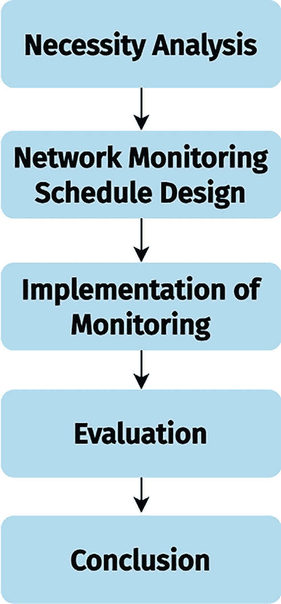

一个流程图展示了网络监控计划设计需要必要性分析，随后是监控的实施、评估和结论。

**图 2-1** NTMA 研究方法

2020 年底，数字宇宙由总计 44 泽字节组成，分布在五十万个网络中 [4]。NTMA 的核心原则之一涉及进行广泛研究并使用有效策略，首先检查然后量化这些通信系统内的交互。此过程需要快速获取数据、随后进行适配和数据分析，同时确保对原始数据的完整性影响最小 [5]。

根据思科的说法，数据收集方法通常分为两大类，即主动测量和被动测量，其中 90% 的现有技术是基于流的 [5]。这指的是对穿越已建立框架的指标进行持续监控，包括每秒发送和接收的数据包频率，以及带宽波动的速率。相反，主动测量被称为基于数据包的方法，包括检查和提取数据包信息，包括头部和有效载荷。这种方法使用商用硬件实现 [6]，以解决深度数据包检测（DPI）速率与将数据写入磁盘速率之间的差异，该差异可能达到每秒几千兆比特（Gb）。

### 2.1.1 数据源与采集

在数字领域，数据源呈现出广泛的多样性，反映了网络的广阔特性。这些数据源在提供有关网络行为、性能和安全的宝贵信息方面发挥着关键作用。因此，通常需要一个健壮的框架来处理这种海量数据涌入。然而，现有大数据技术的一个突出缺点是它们倾向于围绕离线模型构建，通常不适用于实时流量分析，而实时流量分析正是 NTMA 的基础之一 [7]。NTMA 中的数据收集通常集中在三个主要来源，即数据包捕获、流数据和日志文件 [8]，具体如下：

- **数据包捕获**：数据包捕获被认为是最详细的方法，因为它涉及记录数据在网络中传输时的单个数据单元。其输出是对网络流量的全面检查，包括各种元素，如有效载荷内容、报头和通信模式。数据包级分析是检查复杂网络问题或执行取证调查的重要组成部分。然而，它可能会产生大量数据，需要强大的存储和处理能力。
- **流数据**：相比之下，流数据将网络活动整合为流统计信息。流表示在单一方向上发生的通信会话，通常基于共享特征（如源和目标 IP 地址、端口和协议）进行结构化。数据聚合过程显著减少了需要处理的数据总量，同时保留了 NTMA 所需的关键信息。这在流量分析、带宽监控和异常识别领域非常有益。流数据通常通过 `NetFlow`、`sFlow` 和 `IPFIX` 等协议生成。
- **日志文件**：日志文件是 NTMA 背景下的另一个数据来源。在计算机网络中，网络设备、服务器和应用程序等组件通常会生成日志，目的是记录值得注意的事件和操作。这些日志在理解网络活动和识别安全问题方面具有重要价值。上下文信息在分析单个事件时起着至关重要的作用，因为它能够追踪导致网络异常的事件序列。

NTMA 的有效性取决于能否从上述来源高效、可靠地获取数据。网络管理员和分析师在需要即时洞察单个数据包时，通常会使用 `Wireshark` 和 `tcpdump` 等数据包捕获工具 [9]。这两种工具的使用频率取决于电池、处理器和内存使用等功能特性。流数据收集通过 `NetFlow` 等协议得以实现，这些协议能够在最小化计算负载的同时进行有效分析 [10]。由各种网络设备和系统生成的日志文件，对于监控事件和解决问题至关重要 [11]。在这个动态领域，企业越来越倾向于使用提供集中式数据存储和处理能力的软件解决方案。上述解决方案优化了数据收集过程，使网络专业人员能够配备多样化的数据，以维护网络完整性并防范潜在的安全漏洞。

### 2.1.2 关键指标

服务提供商和网络管理员通常需要关键绩效指标（KPI）或关键质量指标（KQI），这些指标乍看之下代表了网络的整体性能，并且也可以进一步深入分析。这些指标通常显示在网络运营中心（NOC）和服务运营中心（SOC）的告警仪表板上，因此必须可靠，因为它们肩负着作为检测网络问题（如速度慢、饱和和服务中断）第一接触点的责任。这些关键指标在表 2-1 中进行了讨论 [8, 12]。

**表 2-1** NTMA 的关键指标

| 关键指标 | 描述 |
| :--- | :--- |
| **带宽利用率** | 它衡量在特定时间点正在使用的可用网络带宽的百分比。因此，它是反映网络资源分配情况以及数据传输是否因拥塞而受阻的重要指标。过高的带宽使用率可能表明需要进行优化或容量规划和扩展。 |
| **丢包率** | 作为用户体验的直接指标，丢包率表示未能到达预期接收者的数据包数量。对于网络会议或视频通话等实时应用，低丢包率至关重要。相反，高丢包率则表明流媒体和社交媒体等应用性能不佳。 |
| **延迟** | 同理，延迟是数据包从源端传输到目标端所花费的时间。视频会议和在线游戏等应用是典型的需要低延迟的服务。过度的延迟会导致这些程序无法使用。 |
| **抖动** | 数据包到达时间的差异称为抖动，可用于指示网络拥塞或数据包路由异常。对于网络电话（VoIP）等实时应用，稳定的抖动率对于保持通话质量和实现无缝数据流至关重要。 |
| **吞吐量** | 作为衡量在给定时间内通过网络传输到目标的数据量的指标，吞吐量代表了网络有效传输数据的能力。对其的监控有助于检测数据传输速度的意外变化，这可能表明网络故障或攻击。 |

网络专业人员理解和监控这些关键指标至关重要，因为它们能够快速处理异常、改善用户体验并加强网络安全 [13]。这满足了企业在服务等级协议（SLA）范围内诊断问题以及维护安全稳定数字环境的需求。NTMA 依赖于精确的测量和解读，以及适当的告警方法，才能以最佳状态运行并维持最高级别的安全性。

### 2.1.3 数据预处理与清洗

在广阔且动态的数字生态系统中，网络数据流多种多样且常常充满噪声。数据预处理与清洗是确保分析前获取的数据正确、相关且无错误的关键步骤。以下解释了一些关键流程 [14, 15]：

- **数据收集与聚合**：从多个来源（包括数据包捕获、流数据和日志文件）收集数据是数据准备的初始阶段。为了减少数据涌入量并加快计算速度，收集到的数据通常会被合并成易于处理的部分。基于时间的采样是一种聚合技术，用于将数据合并到相关的时间段内进行研究。简而言之，数据通常按预设的时间间隔进行收集。
- **数据标准化**：由于网络数据具有多种格式和单位类型，数据标准化通过允许直接比较来自不同来源和设备的数据来确保一致性。这为有意义地分析数据提供了可能性。
- **缺失数据处理**：数据源中偶尔会出现数据缺口，导致分析出现偏差。这通过诸如数据插补等方法进行处理，该方法利用现有数据估算缺失值。
- **噪声降低**：噪声和异常通常是设备故障或传输错误的结果。通过滤波和平滑等技术，可以去除异常值和离群点，以确保正确反映网络活动。
- **数据转换**：缩放和对数变换等技术用于确保数据符合分析方法的假设，并能够进行有洞察力的解读。
- **数据清洗**：这包括通过处理离群点和消除重复项来发现并修正数据集中的错误和不一致之处。

数据集与实际网络行为和表示的一致性，是影响 NTMA 准确性的最关键因素之一，因此其重要性怎么强调都不为过。

### 2.1.4 网络拓扑与架构

网络拓扑与设计是 NTMA 领域任何研究的基础。本节探讨网络的关键组成部分。

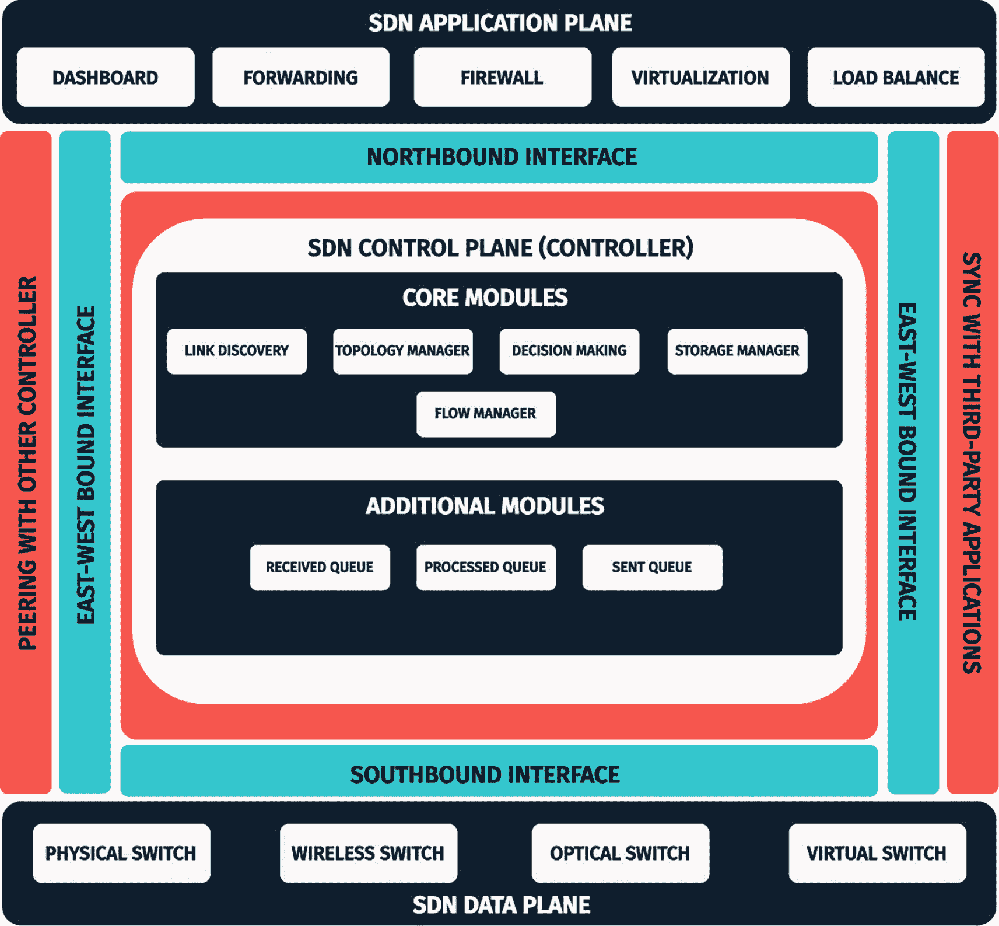

一个 SDN 控制平面的结构，包含一个核心模块和附加模块，周围环绕着四个接口：东西向接口、南向接口、东西向接口和北向接口。SDN 应用平面和 SDN 数据平面分别位于顶部和底部。

**图 2-2** SDN 控制器概览 [18]

## 网络拓扑
`拓扑`指的是网络中设备及其互连的配置。这些配置包括星型、总线型、环型和网状型，它们对数据收集、流量管理和安全监控有显著影响。为了有效获取网络流量，需要战略性地部署监控设备。流量流的研究也受拓扑影响，数据包的传输会受到延迟、抖动和丢包的影响。`拓扑感知分析`是一种旨在确保网络性能及其对 QoS 标准的遵守符合预定预期的方法 [16]。同样，通过了解网络的脆弱性，管理人员能够增强安全程序，并将监控工作集中在最重要的点上。

## 网络架构
架构涵盖了共同构成网络的设备、协议和服务的布局。这种架构框架可以是传统的分层设计，也可以是现代的软件定义网络（`SDN`）[17]。这一选择直接影响 `NTMA`。传统系统有时需要从多个来源检索数据，而 `SDN` 架构通常整合数据收集，从而简化 `NTMA` 活动。安全问题与架构高度相关。复杂网络拓扑的引入可能会产生安全漏洞，但 `SDN` 系统能够通过集中式策略执行提供改进的安全控制 [18]。同样，`SDN` 提供了动态且可定制的功能，以适应网络不断变化的需求。图 2-2 展示了一个 `SDN` 控制器的概览。

主要组成部分的分解如下 [17, 18]：

*   **数据平面**：数据平面负责处理网络数据包的转发，由包括路由器、交换机和转发单元在内的网络设备组成。在 `SDN` 中，由于该平面是可编程的并能从控制器接收信号，因此可以实现对数据转发的动态控制。
*   **控制平面**：控制平面掌握着网络流量路由决策的权力，它控制着流向数据平面交换机的数据流。
*   **`SDN` 控制器**：在 `SDN` 中，控制器位于控制平面的核心。它充当应用层与网络设备之间的桥梁，从应用程序接收高级网络策略和设置，然后将其转换为数据平面设备的低级命令。
*   **南向接口**：这是 `SDN` 控制器与数据平面设备之间的通路。使用诸如 `OpenFlow` 等协议来传达命令。
*   **北向接口**：这是 `SDN` 控制器与 `SDN` 应用程序之间的通路，允许它们传达需求并获取关键的网络状态信息。
*   **东西向接口**：它使控制器能够同步其视图并交换信息，以保持一致性。
*   **`SDN` 应用平面**：`SDN` 应用程序运行在 `SDN` 控制器之上，利用全局视图的优势，从而实现多种服务和策略。例如负载均衡和流量工程。
*   **核心模块**：网络发现、拓扑管理和路由命令等功能由核心模块处理，从而确保正确的网络视图。
*   **附加模块**：`SDN` 控制器的功能可以扩展，以支持定制化的用例，例如提高安全性和 `QoS`。
*   **与第三方应用的同步**：第三方应用允许与其他网络服务和业务应用集成，提供了一个灵活的网络管理绿洲。
*   **与其他控制器的对等互联**：为了创建分布式 `SDN` 环境，控制器可以相互配对，以实现信息交换并维护准确的网络视图。

### 数据驱动分析
数据驱动分析结合 `NTMA`，代表了对传统基于规则方法的转变，因为它强调直接从记录的网络数据中提取洞察。该方法利用设备、流量和通信模式产生的大数据，结合复杂的分析方法，来识别威胁、异常和安全风险，进而实现以下目标：

*   **数据驱动洞察**：网络专家能够从网络设备产生的大量数据中提取有价值的洞察。通过机器学习、统计模型和数据挖掘方法，可以识别模式并检测异常。数据驱动分析的主要优势在于其预测网络活动的能力，包括流量趋势、带宽使用和潜在的性能挑战，并且它不仅考虑流量和拥塞参数，还考虑应用程序的个体属性，同时将用户行为纳入考量[19]。
*   **安全威胁检测**：通过对网络数据的持续分析，可以快速检测可能表明安全漏洞、攻击或非法访问的异常情况。机器学习模型能够学习网络流量呈现的典型模式，使其能够在遇到偏离常态的情况时检测并发出异常信号。在某些情况下，与典型的 `Apache Spark` 集群相比，`Big-DAMA` 可以将分析和检测速度提升 10 倍[20]。
*   **资源优化**：企业能够优化资源分配，以确保关键任务应用获得所需的带宽，最终提升用户体验和运营效率[21]。
*   **网络性能提升**：通过实时参数监控准确检测性能瓶颈和延迟问题，随后实施适当的补救措施。例如，在 `6G` 网络中，以数据为应用 `AI` 的前沿，人们设想了描述性、诊断性、预测性和规范性分析。这意味着能够深入了解信道条件、流量概况、资源可用性、用户未来位置、网络切片决策和资源分配[22]。
*   **运营效率**：网络工程师能够做出明智的决策、自动化日常操作并快速解决问题，从而最大限度地减少停机时间并降低网络中断的可能性。

从网络数据中获得的知识已超越单纯的观察，现在作为可操作的信息，使网络专家能够做出训练有素的决策、高效管理网络资源，并确保其数字服务的安全性和可靠性。

### 用于流量分类的监督学习
将网络流量分类为离散类别是 `NTMA` 的一项基本任务，因为它有助于理解穿越网络的众多数据流。本节探讨了监督学习在流量分类背景下的重要性，研究了机器学习算法在识别和标记网络活动过程中的变革性影响。传统方法依赖于端口或协议数据，这些数据通常不足以准确识别动态使用这些方法的应用程序。监督学习是机器学习的一个分支，它在标记数据集（即预定义的类别或标签，如视频流、文件传输或网页浏览）上进行训练。分类过程可以总结为以下几点：

*   **数据收集**：捕获数据包级或流级信息。
*   **数据标记**：将流量手动分类为不同的标签。
*   **特征提取**：识别和提取相关的特征和特性。
*   **模型训练**：使用标记数据集训练各种模型。
*   **流量分类**：使用训练好的模型对未知网络流量进行分类。

监督学习在流量分类中的优势是多方面的。它能够识别广泛的应用程序，即使它们使用非标准端口或加密。此外，它可以适应新兴应用程序，而无需手动更新规则，使其适用于不断变化的网络环境。文献[23]中展示了一个这样的例子，其中使用了一种主动形式的机器学习来减少模型训练前对标记值集的需求。该算法主动选择需要标记的实例，并在小数据集上实现了高精度。

因此，凭借强大的数据集，这些数据集在分配标签（无论是预先分配还是主动分配）方面具有可区分的特征，分类系统能够适应不断发展的应用程序而无需人工干预，进而使实时网络环境能够持续演进。这催生了动态流量管理和即时响应攻击的能力。同样，与安全问题相关的模式有助于及时识别入侵、数据泄露和其他未经授权的活动。一个例子是基于多特征融合的增量技术用于检测未知流量，如文献[24]所示。类似地，网络流量的精确分类使企业能够根据应用优先级有效管理网络资源，确保关键应用获得必要的带宽，并优先交付基本服务。

### 用于异常检测的无监督学习
网络的特点是动态和复杂，通常会观察到大量的信息交换。异常的存在可能表明安全漏洞、网络问题或正在发展的危险，及时识别它们至关重要[25]。无监督学习算法用于在没有预先建立的类别或标签的情况下检查网络流量，通过以下步骤进行：

*   **数据收集**：捕获数据包级或流级信息。
*   **特征提取**：识别和提取相关的特征和特性。
*   **模型训练**：使用聚类或降维方法来识别数据中固有的模式或结构。
*   **异常检测**：识别与已建立模式的偏差，以指示可能的异常。

无监督学习模型能够调整和适应网络条件的变化，使其适用于动态环境，这些环境的特点是可能存在不遵循预定义趋势的新兴威胁或异常。通过分析最新的数据集和流数据，发现可疑行为可用于早期预警系统。潜在的应用领域包括入侵检测、支付欺诈检测、公共安全、复杂系统监控和医疗数据分析。最后，通过无监督学习，异常识别无需预先训练，数据完全基于其内在结构进行评估，而异常通常根据其可疑程度进行分级[26]。

### 预测性分析
随着物联网（`IoT`）、车联网（`IoV`）和 `6G` 等新框架的兴起，预测网络行为的能力已成为主动网络管理的基本要素。预测性分析通常指网络流量预测（`NTP`），它是 `NTMA` 的一个子集，传统上依赖于时间序列预测（`TSF`），即通过识别过去与未来数据之间的现有依赖关系，创建能够估算未来流量规模的模型[27]。`TSF` 方法的优势在于其低复杂度，但网络流量的激增也催生了非 `TSF` 框架的需求，这些框架基于流和报文头部数据进行操作，以预测未来流而非网络参数。因此，根据具体用例的不同，预测流与预测网络流量之间存在来回切换。用于创建 `NTP` 训练模型的一些常用数据收集方法和模型如图 2-3 所示。

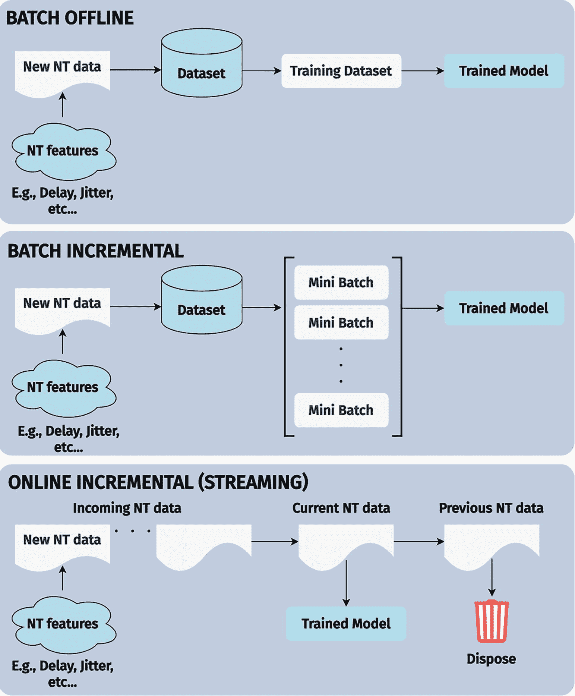

一个页面包含三种框架：批量离线、批量增量和在线增量。每种框架都展示了如何将带有特征的新 `NT` 数据通过数据集进行处理，以获得训练好的模型。在在线增量框架中，`NT` 数据被分为当前数据和历史数据。

图 2-3 现有的 `NTP` 框架 [27]

创建 `NTP` 框架涉及以下步骤：

*   **数据收集**：收集与性能、事件和资源利用相关的时间序列格式数据。
*   **数据预处理**：对数据集进行清洗、归一化和准备工作，以提高其质量和分析相关性。
*   **特征选择**：选择相关特征来描述网络行为。
*   **模型开发**：利用历史数据和一种追踪时间概念的概念来开发机器学习模型。
*   **预测**：使用训练好的模型对未来趋势进行预测；这些预测通常基于最新的可用数据。

总体而言，对于服务提供商来说，预测性分析在主动分配资源、优化服务质量（`QoS`）以及维持最佳网络性能方面至关重要[28]。通过预测洞察，可以根据客户对关键应用的优先级使用情况，为其分配适当的带宽。

### 2.1.9 基于 AI 的实时决策支持

随着互联设备数量的不断增加，全球网络在新颖性、规模和复杂性方面正以惊人的速度发展。随着诸如自主感知、计算、学习、分析乃至无需人工监督的商业决策等新型应用的出现，人工智能与网络的结合对于数字化、精细化以及服务的持续演进至关重要[2]。传统上，电信专家构建和管理无线网络，他们大量运用其在网络设计、用户移动性、流量模式以及波传输框架方面的广泛知识，来设计和执行策略与流程，从而基本保证大规模系统的不间断运行。随着小基站和尖端无线电技术的引入，网络结构变得复杂得多。除了更难以预测之外，考虑到新可用的频谱频率和高度密集的网络，流量模式和无线电传输模型的评估也变得更加困难。因此，在帮助运营商促进无线和移动网络的部署与维护方面，人工智能处于主导地位[29]。此外，人工智能已被赋予自主决策和分析能力的信心，并被视为确保这些复杂网络实现零接触配置的关键。

随着高级智能被整合到应用、网络和组织结构中，一种以数据为核心的策略将逐渐占据主导地位。这种方法将把自动化、可靠性和效率提升到前所未有的水平。电信公司将拥有更多控制权，并能够利用对收集数据的分析来更有效地管理其网络基础设施。通过定制并最终将特定功能映射到网络行为模式，可以使每项服务更加安全、可靠和稳健[30]。这将进一步推动 Wi-Fi 和移动服务在社会和工业层面的演进。在高度分布式的架构内部，决策过程涉及多个地点和阶段。某些行动涉及经过深思熟虑的、能够改变整个网络行为的判断，因此由从多个地点收集的数据驱动；而另一些行动则由基于本地数据、具有极低延迟的严格控制机制决定[31]。这些选择通常属于关键类别，需要及时处理。拓扑结构的分布式特性应作为管理智能的基础，以便持续、精确地服务于这个庞大的通用结构。

对于用于自动驾驶汽车、工业 4.0 和制造运营、智慧城市以及医疗保健的物联网传感器而言，在边缘附近或设备接口处产生的数据通常需要即时处理。由于存在限制数据存储位置的政策，将此类数据迁移到集中式云可能并非最佳选择。这表明在某些情况下，数据甚至可能不会被发送。这些正是需要实时 NTMA 具备敏锐、直接、可靠和轻量级特性的场景，同时它应驻留在本地站点本身，而无需客户端-服务器模式。直接从众多网络节点学习全局数据模式，而无需将其传输到集中式系统，是解决这一挑战的一种潜在方案。很快，还需要找到合适的方法来共享新学到的信息，同时确保在设备间进行及时传输。`AI` 算法、机器学习以及无线生态系统中的其他基础技术的协作，可以开启包括自我管理、自我优化和自我演进在内的突破性进展之门。

## 2.2 现有的 NTMA 应用

在当今快节奏的数字环境中，企业主要依赖 `NTMA` 解决方案来有效维护其网络基础设施的完整性和最佳功能。网络管理和监控工具对于企业的成功至关重要，它们帮助 IT 团队减少停机时间、识别瓶颈，从而提高故障排除效率，并找到关键绩效指标（`KPI`）以改善其服务质量和体验质量。由于重点不仅仅是监控，安全专业人员和管理员的目标是做出数据驱动的决策、建立弹性的安全措施，并为最终用户提供不间断的数字体验。以下是全球企业常用于 `NTMA` 的现有软件简要描述[32]。

### 2.2.1 SolarWinds NetFlow Traffic Analyzer

作为网络监控领域的知名企业，`SolarWinds` [33] 提供了一套全面的 `NTMA` 软件包，其中包括自动编译高度可定制且详细的报告。可以实施高效的排序特性，例如评估应用程序在特定时间段内使用的带宽比例，来对基于网络的应用程序进行列表和分类。简而言之，实时流量数据从持续的数据流中收集，并转化为可视化表示形式，例如表格和图表，以描绘业务基础设施的运行动态。该软件提供多种版本，包含流量分析和带宽监控等功能。它还支持 `VMware vSphere` 分布式交换机，并能够根据特定类型的网络流量生成警告。它通常用于收集数据流和识别复杂的应用程序 [34]。然而，它缺少诸如流量预测和网络消耗分类等功能。该框架主要关注观察属性，包括跨堆栈 IT 数据的关联以及并排比较数据。

### 2.2.2 Paessler PRTG Network Monitor

为了让 IT 专业人员的工作更轻松，`Paessler Router Traffic Grapher (PRTG)` [35] 提供了关于网络、系统和应用程序的描述性且信息丰富的概览。通过适用于移动监控的 `Android` 和 `iOS` 应用程序，可以在手机上轻松接收和处理警报。其显著特性包括可定制的仪表板，客户可以创建这些仪表板，也可以从各种适合当下需求的模板中进行选择，例如在办公室与管理团队进行演示。这涵盖了从创建带有集成动态地图的完全可操作仪表板，到添加自定义 `HTML` 元素。这些功能可以组合在一起，创建一个全面的、实时的网络管理工具，适用于不同地点，从而提供对整个区域的全局视图。远程站点监控和带宽分析功能也可用于识别瓶颈源。该软件包还提供自动化浏览测试，可以在任何网站上执行，以获取诸如加载时间、响应时间以及网站是否正常运行等参数。同样，域名系统（`DNS`）服务器的状态也可以被检查。图 2-4 展示了一个示例，其中测量并绘制了 `Facebook` 的 `HTTP` 加载时间。凭借云支持以及与数百家公司（如 `IBM Cloud` 和 `Citrix Systems`）的合作，自动发现模式允许通过预配置的传感器即时进行配置。此外，数据收集过程使用了 `ICMP`、`SNMP`、`WMI` 和 `HTTPS` 等协议。这可以应用于多种场景，例如医疗保健系统和智慧城市 [36]。作为一个独立的应用程序，`PRTG` 并未实现机器学习算法。通过使用其合作伙伴之一 `Crosser` 平台的预构建模块，可以将分析功能集成到该软件中。

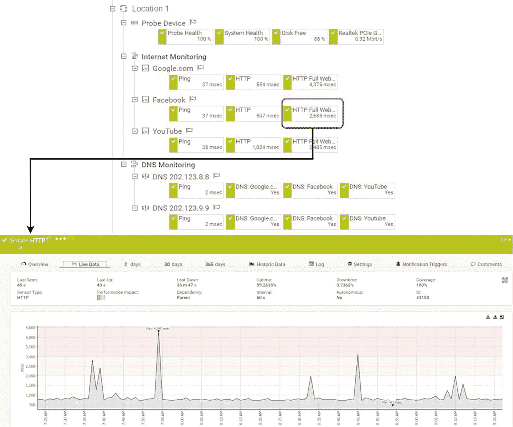

一张显示多个监控设备及其位置的截图。传感器 `HTTP` 窗口有一个以米/秒为单位的随时间变化的图表。它绘制了一条具有多个峰值的波动趋势线。页面顶部有几个参数。

**图 2-4** 用于监控 `Facebook HTTP` 加载时间的 `Paessler PRTG` 网络监控器示例

### 2.2.3 Wireshark

`Wireshark` [37] 被广泛认为是一款著名的开源网络数据包分析工具。这意味着它允许检查网络数据包数据。虽然它不是一个功能完备的 `NTMA` 工具，但它作为一块垫脚石，为网络流量研究做出了重要贡献，能够及时捕获数据包信息，并且对于解决网络相关问题以及检查流量模式至关重要。它支持多种网络协议，并具有内置功能，能够以易于人类理解的格式解释和呈现数据包内容。一些示例包括 `IP`、`TCP`、`HTTP` 和 `SNMP` [38]。这有助于管理网络数据流并发现阻塞和问题。因此，实时数据包捕获是 `Wireshark` 的亮点，而后续分析则需要第三方插件或整个框架。因此，`Wireshark` 仅涵盖监控方面，并且对于网络管理员、安全专家以及从事 `NTMA` 复杂方面学习的学生来说，它是一个极好的资源，因为它是开源的。图 2-5 展示了通过 `Wireshark` 进行 `UDP` 数据包过滤的示例。

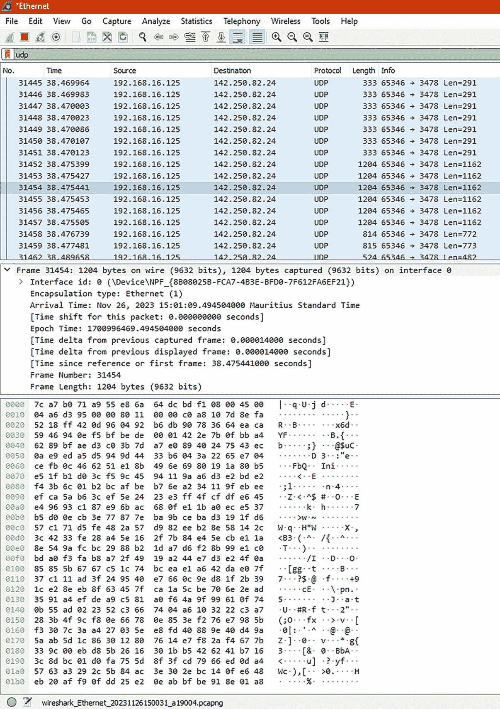

以太网窗口的截图。它包含一个七列的表格，标题分别为编号、时间、源地址、目标地址、协议、长度和信息。页面底部包括帧、接口 ID、封装类型、到达时间、纪元时间、帧编号和长度。

**图 2-5** `Wireshark UDP` 数据包过滤示例

### 2.2.4 ManageEngine NetFlow Analyzer

`NetFlow Analyzer` [39] 是一个完整的流量分析工具，专注于流技术以展示网络带宽的实时表现，其主要目标是通过容量规划和安全监控来优化网络。它有助于收集、分析和生成关于带宽利用率的报告，并通过深入到接口级别的细节，成为提高全球网络效率的可靠合作伙伴。`NetFlow` 使用连续流挖掘（`CSM`）引擎技术，支持网络取证和安全分析，以应对绕过防火墙的异常情况。此外，可以通过恶意网络行为识别上下文相关的异常值，以确保 `QoS` 标准。该应用程序还能够通过实施访问控制列表（`ACL`）或基于类的策略，来识别和分类过度消耗网络带宽的非标准应用程序。这可以与 `Cisco NBAR` 配合使用，以获得对第 7 层流量的全面洞察，从而便于识别使用动态端口号或隐藏于常见端口中的应用程序。它兼容主要的流格式，例如 `NetFlow`、`sFlow`、`cFlow` 和 `J-Flow`。`NetFlow Analyzer` 提供 `IP SLA` 监控、深度数据包检测功能、警报和通知以及分布式监控能力 [40]。图 2-6 展示了该应用程序在 `Windows` 设备上运行的一个片段，包括安装在另一台设备上执行持续速度测试的“网络数据包传感器”。

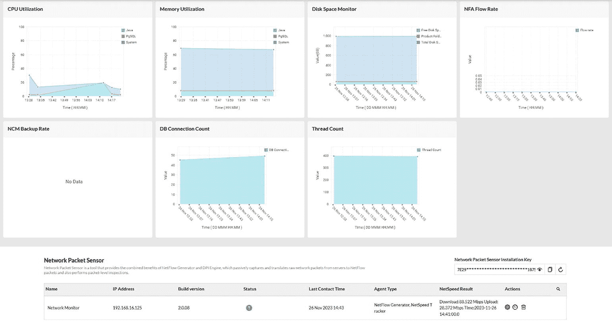

一个窗口的截图。它包括七个图表，分别显示 `CPU` 利用率、内存利用率、磁盘空间监控、`NFA` 流量速率、数据库连接数和线程数。网络数据包传感器包括几个参数，其中一些是名称、`IP` 地址和构建版本。

**图 2-6** `NetFlow Analyzer` 系统性能仪表板和网络数据包传感器示例

### 2.2.5 Site24x7 网络监控

Site24x7 网络监控 [41] 是一个基于云的网络监控平台，涵盖 IT 系统、程序和用户活动。该工具的网络监控部分可以自动识别所有联网设备。Site24x7 会根据搜索结果创建设备清单，并随后动态生成网络拓扑图。当引入、迁移或淘汰新设备时，设备清单和拓扑图会即时更新。该软件的功能不仅限于简单的连接和可用性检查，它还会验证与连接相关的指标，例如停机时长、上次停机时间、响应时间以及网站的下载时间。图 2-7 展示了一个典型场景，其中这些指标是针对用户输入的网页进行实时测量的。

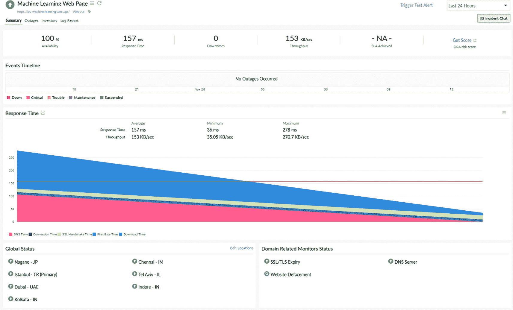
*图 2-7 Site24x7 网页监控示例*
一张机器学习网页的截图。它列出了摘要下的选项，包括事件时间线，以及一个响应时间图表，显示了 DNS、连接、SSL 握手、首字节和下载时间的下降趋势，以及全局状态。

用户能够选择他们想要监控的特定服务，并建立将触发警报通知的性能标准。Site24x7 的自动发现功能是通过使用简单网络管理协议（SNMP）实现的。为了从配置为通过 SNMP 路由数据的网络设备获取实时信息，Site24x7 充当着关键的 SNMP 管理器角色。简单网络管理协议（SNMP）具有一种机制，设备代理在检测到被监控设备上出现严重情况时，能够向管理器发送通知。根据代理分配给消息的严重程度，该通信会在 Site24x7 仪表板内转换为警告或警报。Site24x7 的方案显著侧重于 Web 应用程序的监控，有效地将这些服务与网络和连接评估能力相结合。因此，从事 Web 开发和运维的企业广泛使用 Site24x7 作为其网络管理工具。

### 2.2.6 Prometheus

除了提供与前述软件相同的功能外，Prometheus [42] 还配备了交互式 Web 界面，可以单独监控网络接口，并在检测到用户设定的不良流量后触发警报。由于该软件是开源的，社区能够创建符合特定用户需求的导出器，并定期改进先前的部署。Prometheus 与其他专门设计的 NTMA 软件不同，它专为动态和云原生系统而设计。它通过从设定的端点提取指标并将其存储在时间序列数据库中，专注于监控和告警功能。一个无需安装外部插件即可使用的示例是测量 HTTP 请求总数，该数据可以在典型的 Web 浏览器中绘制成图表，如图 2-8 所示。

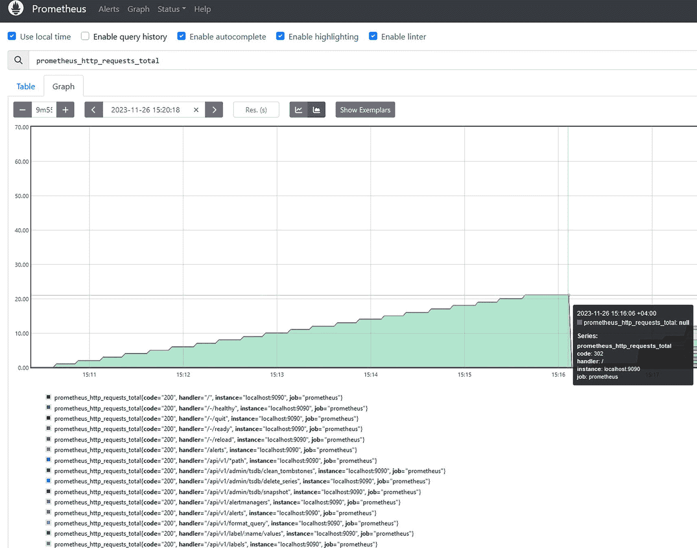
*图 2-8 用于监控 HTTP 请求的 Prometheus 图表工具示例*
一张 Prometheus 窗口的截图。它展示了一个 HTTP 请求总数与时间的图表。图表绘制了一簇呈上升趋势的阴影区域，对应不同类型的 Prometheus HTTP 请求总数（`code 200 handler`）。

凭借强大的查询语言，它有助于从累积的数据中获取深刻见解，使其成为使用微服务和容器化应用程序的实体的合适选择。Prometheus 拥有一个完善的生态系统，包含为各种服务和组件设计的导出器。此功能极大地简化了将该工具集成到现有环境中的过程，确保了平滑高效的过渡。此外，它还提供与 Grafana 的连接，允许用户创建个性化仪表板，以查看已收集的指标。这项技术使 DevOps 团队、系统管理员和程序员能够全面了解其系统的行为，及时解决问题，并保持高水平的服务可靠性。Prometheus 的一些用户包括 Docker、Soundcloud、Showmax 和 Amadeus。与前述产品一样，流量预测服务需要作为像 Locust 这样的定制模块添加。

### 2.2.7 商业解决方案与开源解决方案

组织在决定采用开源还是商业 NTMA 解决方案时，必须仔细权衡。每种方案都有其自身的优缺点，决策应根据个体需求、财务限制和资源可用性来做出。商业解决方案通常会产生财务成本，尽管它们提供广泛的帮助、丰富的功能和可靠的性能。通常，这些系统与拥有复杂网络架构、需要广泛功能、可扩展性和专家支持的大型公司高度兼容。诸如 SolarWinds NetFlow Traffic Analyzer 和 Paessler PRTG Network Monitor 等商业解决方案提供了易于使用的界面、专门的客户支持和全面的功能，使其对有大量监控需求的企业具有吸引力 [43]。相比之下，像 Wireshark 和 Prometheus 这样的开源替代方案，由于其软件免费，在灵活性、可定制性和成本效益方面具有优势。规模较小的企业、教育机构以及拥有设置和维护这些技术所需技能的技术娴熟的个人更倾向于选择它们。开源解决方案促进了协作社区的形成，使用户能够积极参与其发展，并根据特定需求对其进行定制。

### 2.2.8 挑战与考量

实施 NTMA 解决方案，无论是商业版还是开源版，都可能遇到一系列挫折，涵盖从数据收集到数据隐私的各个方面。其中一些困难详述如下 [44, 45, 46]：

*   **数据量**：使用 NTMA 工具会产生大量数据，类似于大数据立方体，需要强大的存储和处理能力。组织必须适当考虑制定数据保留规定和实施数据最小化方法。

*   **加密流量**：随着加密流量（即 HTTPS）的日益普及，企业面临着在安全需求与隐私关切之间寻找微妙平衡的多方面任务。

*   **网络可扩展性**：对于希望有效满足监控需求的企业来说，持续扩展和适应的能力是一个关键考量。当网络进行扩展或遇到更高负载水平时，这一点变得至关重要。

*   **隐私与合规**：组织需要遵守法规并建立旨在保护用户信息的协议，同时也要遵守数据保护法律。

*   **与现有基础设施集成**：高效的监控最终意味着与各种设备、协议和服务，以及现有和新的网络基础设施的兼容性。

*   **告警与报告**：NTMA 的成功实施需要适当的告警系统和生成信息丰富的报告。企业必须决定合适的告警阈值，并确保其报告流程能提供及时且相关的信息。

*   **资源分配**：在 CPU 和内存利用率方面，执行实时 NTMA 的系统需要提供最佳性能，以产生最佳结果并提供可靠的性能。

*   **培训与专业知识**：建议组织为其人员分配培训机会的资源。

然而，主要的挑战在于网络流量的不稳定性，这使得它在机器学习方面勉强逃脱了高精度预测和分类算法的掌控。本书在进展较为缓慢的领域探讨了这一困境。通过预测性特征，诸如预测网络相关问题等能力得以解锁，从而能够识别某些行为。因此，近年来，焦点一直放在对网络活动的主动洞察、预测异常以及自动解决已检测到的问题上。

## 2.3 NTMA 的最新研究综述

根据 2022 年 1 月的最新数据，全球互联网用户数量达到了 49.5 亿人的最高点，约占全球总人口的 62.5% [47]。这一数据表明用户数量大幅激增，在一年内增加了约 1.92 亿用户。COVID-19 疫情促使企业大规模转向使用基于网络的应用程序和服务。这一转变给有效管理与服务质量（QoS）、体验质量（QoE）、可扩展性和性能相关的困难带来了额外的复杂性 [48]。根据思科的调查结果，2021 年 IP 视频流量占 IP 总流量的很大一部分，约为 82% [49]。预计这一显著的增长趋势将在可预见的未来持续下去。

### 2.3.1 NTMA 的背景

网络流量监控与分析（NTMA）的概念涉及检查与数据消息流相关的指标，以检测有意义且可利用的行为趋势，从而实现对网络状态和功能的实时评估。作为背景，如果网页应用的加载时间不超过两秒，用户访问该应用的可能性会显著增加 53%，这在浏览器扩展中更为知名，它们只需点击几下即可提供更快捷方便的访问方式 [50]。因此，跟踪和评估网络流量指标是服务提供商和网络管理员的一项重要职责。这种做法对于有效管理带宽需求和减轻网络攻击带来的风险至关重要。

### 2.3.2 机器学习的兴起

最近的研究围绕使用基于机器学习的 NTMA 方法展开，特别是在那些侧重于基于端口和基于负载的方法论中，这些方法通过准确性评估来衡量性能。机器学习和 NTMA 的结合带来了对网络流量的系统性检查，从而能够对模式、特征和参数做出有依据的预测。这在评估网络的服务质量（QoS）以及评估其准确性和精确度水平，以及误报率和漏报率时至关重要。随着机器学习的出现，预测和准确性检测都变得更加容易 [51]。相应地，云平台使用量和灵活性的激增极大地放大了存储和计算需求。根据 Medium [52]的数据，全球绝大多数企业（约 81%）已经实施了多云策略。在此背景下，诸如决策树（DT）和多层感知器（MLP）算法等高级分析技术可以集成到云计算平台中。通过利用这些平台，可以收集和分析实时网络数据，从而生成信息丰富且具有预测性的结果。这消除了对本地处理能力的需求。将机器学习融入分析在将数据分类为监督学习或非监督学习集方面发挥了关键作用。

目前，在分析方面，网络流量既可以分类也可以预测。前者可以关联到识别网络流量性质的不同层次，从用户正在执行的活动类型，到更高级、计算密集型的分类，例如识别正在使用的确切应用程序。然而，诸如带宽、延迟、抖动和网站响应时间等网络参数可以通过回归算法进行处理，这些算法旨在预测给定时间点的这些变量 [2]。接下来将介绍研究人员在这两个领域所开展相关工作的最新研究综述。

### 2.3.3 用于网络流量分类的机器学习算法

### 2.3.4 用于预测网络流量的机器学习算法

近年来，多位研究人员积极致力于将机器学习算法应用于网络流量管理与分析（NTMA），旨在寻找能提供最佳准确率的方法。在文献[53]中，Pradhan 为了对网络流量进行分类，旨在通过使用多个流特征作为输入变量来提升服务质量（QoS）。数据准备阶段使用 Perl 脚本结合 Wireshark 进行，生成了包含十三个属性的集合。分类任务分配的标签为 FTP、WWW 和 P2P。训练的模型包括人工神经网络（ANN）、支持向量机（SVM）、多层感知机（MLP）和序列最小优化（SMO），实验使用 Weka 框架进行，如图 2-9 所示。提取的特征包括数据包到达时间、数据包长度、协议和目的端口号等。仿真模型以逗号分隔值（CSV）文件格式作为输入，结果发现，当两种算法采用不同的训练百分比时，ANN 的准确率达到 85.443%，而 SVM 的精确率达到 91.1392%。研究得出结论，在分类网络流量时，SVM 的性能远优于 ANN。

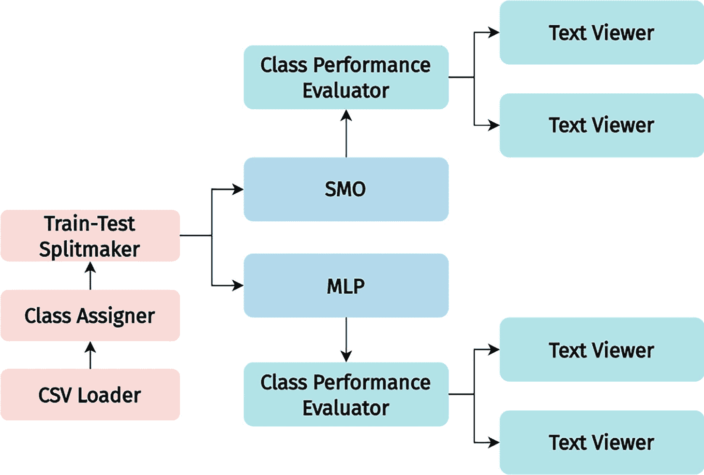

图表展示了包含类别分配器和 CSV 加载器的训练测试分割器。该分割器分为 SMO 和 MLP 两部分，每部分都带有一个类别性能评估器。每个性能评估器都包含文本查看器。

图 2-9 Pradhan 提出的 SVM 和 ANN 模型工作流程 [53]

#### Shafiq 等人的研究

在 Shafiq 等人的研究中，他们分析了一系列旨在对网络周围应用类型进行分类的机器学习技术的性能 [54]。该研究对 SVM、C4.5 决策树、朴素贝叶斯和贝叶斯网络进行了比较分析。首先使用 Wireshark 捕获一分钟间隔内的网络流量。研究的应用包括 DNS、WWW、FTP、P2P 和 Telnet，并使用 Netmate 工具总共提取了二十三个特征。实验中表现最佳的是 C4.5 算法，其分类准确率达到 79%，并且训练时间最短。

#### Dixit 等人的研究

在 Dixit 等人的研究中 [55]，他们对常见的互联网流量形式进行了分析，主要涉及 K 近邻（KNN）和朴素贝叶斯算法，并结合了诸如数据包到达间隔时间、生存时间（TTL）和数据包计数等统计网络指标。该研究侧重于保护用户机密性，在使用 70:30 的训练-测试分割比例下，KNN 获得了 85.3% 的精确率，而朴素贝叶斯达到了 54.2%。KNN 在邻居数为 8 时取得了最高准确率。该方法被推广用于基于具有相似特征的标准对网络属性进行分类。

#### Guezzaz 与 Abassi 等人的研究

在 Guezzaz 等人的研究中 [56]，他们使用三层架构对网络监控背景下的 MLP 分类器进行了分析。他们概述了一种在确定最优权重方面非常高效的训练方法，并采用了一种检测技术来验证模型。大多数分类器的性能会受到大数据集的不利影响，从而影响排序过程的效率。然而，MLP 展示了其作为感知分析层的能力，可用于网络监控系统以增强数据传输的可靠性。类似地，在 Abassi 等人的研究 [8] 中，使用了深度学习（DL）技术来构建网络流量管理模型。该研究包括了针对时间序列数据设计的 MLP、CNN 和 RNN 等算法。鉴于深度学习方法历来侧重于利用基于端口、基于数据包和基于流的指标，作者们提出并描述了更新的流量分类技术。

#### Bayat 等人的研究

考虑到企业数据的隐私性，Bayat 等人 [57] 融合了一系列深度学习技术，创建了一个复杂的分类模型，用于分析数据包流和负载信息，以及数据包到达之间的时间差。该过程旨在解决传输层安全（TLS）握手期间的服务器名称指示（SNI）分类问题，目标是在不检查加密数据包内容的情况下识别应用。该过程首先收集了约 500,000 个指向不同网站的 HTTP 请求，然后通过 Wireshark 和 SSL 过滤器属性存储数据包捕获文件。提取了诸如累积字节数和到达时间等特征来准备训练数据集。使用的主要算法包括 CNN 和门控循环单元（GRU），它们通过允许序列长度变化来扩展前馈神经网络。设计了一个隐藏状态，在每个先前状态之后激活，从而产生了算法的自适应特性。对于 Google Chrome 数据，实验使用 CNN-RNN 组合模型达到了 82.3% 的准确率。所使用的架构如图 2-10 所示。

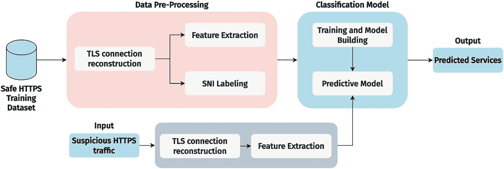

流程图展示了安全的 HTTPS 训练数据集如何通过数据预处理和分类模型进行处理，该模型还有另一个输入为可疑的 HTTPS 流量，最终输出预测的服务。

图 2-10 Bayat 等人提出的 HTTPS 识别框架工作流程 [57]

#### Wu 等人的研究

为了提供一个快速且自动化的多媒体流量管理框架，Wu 等人提出了一种 CNN 模型，该模型通过渐进式学习实现自我改进 [58]。该实验旨在通过深度学习，根据服务质量（QoS）对网络流量进行即时分类。配备了滑动窗口模型后，基于数据流提取参数，然后绘制出每个流的三维表示。随后对 CNN 模型进行定制，以匹配所选特征的变化。此外，架构中还加入了知识蒸馏和偏差校正等技术，以支持自学习特性，而无需停止模型训练过程来适应新模式。与先前的研究相比，这导致了分类速度的提升，并且尽管增加了新的网络流量类别，内存使用量仍减少了 50%。

#### TensorFlow 框架与混合系统的应用

关于使用深度学习进行网络流量分类，在文献[59]中，作者开发了朴素贝叶斯和 C4.5 决策树方法。该论文强调了在流媒体、游戏和 P2P 应用中使用机器学习的重要性，因为这些场景下无法依赖基于端口的协议识别方法。传统方法无法处理加密流量，这进一步增加了问题的复杂性，因此研究转向使用统计方法或机器学习方法。在实施特征选择步骤并结合多层神经网络后，实验的分类准确率达到了约 95%。算法在十个不同的数据类别上运行，每个类别均源自包含 249 个网络流量参数的广泛 TCP 双向流。由于某些应用（如游戏）的可用样本数量有限，这些数据被归类为八种广泛的流量类型进行分析。本研究中使用的深度学习框架，即谷歌的 TensorFlow，在样本量从 0 到 10,000 的范围内达到了 98.5%的稳定准确率，而朴素贝叶斯和随机森林在准确率方面均有所不足，仅在小样本量下表现良好。因此，深度学习算法展现出了稳定性和可靠性。

Labayen 等人引入了一种混合系统，旨在通过分析流量趋势，将网络流量分类为不同的网络状态，例如在线浏览、流媒体和空闲行为[60]。首先使用 Tshark 将数据捕获为 pcap 和 CSV 格式，然后预先标记为不同的类别，包括 p2p、视频、网页、批量、聊天、电子邮件和 voip。所提出的系统（如图 2-11 所示）以包含从 IP 和 TCP/UDP 头部提取的字段的连续数据包流作为输入，然后将其预处理为合适的特征集合。系统形成了一个三层分层窗口数据结构，数据在其中被划分为时间窗口。这消除了特征之间的任何依赖性。接下来，执行一个三层分类过程，以获取与所生成的分类窗口相关联的用户活动。所使用的窗口被称为分类窗口、流窗口和行为窗口。该研究使用分层多层结构实现了 97%的全局准确率，其中嵌入前两层的 K-means 算法和最后一层的随机森林算法取得了最佳性能。

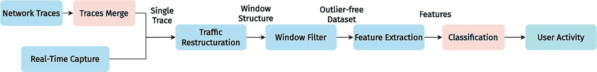

该流程图描述了如何通过流量重构、窗口过滤、特征提取和分类来处理单个实时捕获的轨迹，以获取用户活动。

图 2-11 Labayen 等人提出的用户活动分类框架的工作流程[60]

#### Bakker 等人的研究

Bakker 等人提出了一系列旨在检测分布式拒绝服务（DDoS）攻击的分类器[61]。他们使用了公开可访问的数据集来构建一个普遍接受的基准，用于评估各个分类器的性能，特别是在精确率和检测率方面。该实验在一个实时 SDN 中实施，对数据包和字节进行了数据捕获。所使用的算法包括随机森林、KNN、二次判别分析（QDA）、朴素贝叶斯和支持向量机（SVM）。这些算法在参考标准和实时网络中均进行了比较。在参考标准中，随机森林算法的准确率最高，而 SVM 的性能最差。与此同时，在实时网络环境中，无论是被动模式还是主动模式，SVM 都表现出最高的准确率，这使得难以得出最终结论。

## 2.4 本章小结

第 2 章深入探讨了网络流量监控与分析（NTMA），涵盖了其基本原理、现有应用以及前沿技术。本章详细阐述了 NTMA 面临的难点和需考虑的因素，阐明了网络流量预测与分类算法的必要性。以下是一些关键要点：

*   NTMA 主要应用于网络设备的实时监控与管理，以洞察并控制网络性能。
*   一些现有的 NTMA 应用包括 Paessler PRTG Network Monitor 和 SolarWinds NetFlow Traffic Analyzer。
*   NTMA 面临的挑战包括缺乏针对网络流量的预测和分类算法。
*   NTMA 能有效管理带宽需求并检测网络威胁。
*   机器学习算法在 NTMA 中日益普及，因此正被集成进来，以提供对网络数据更强的预测能力和异常检测能力。

下一章将通过其基本原理和实际应用，对视频质量评估（VQA）进行深入剖析。