# 3. 视频质量评估

本章将揭示视频质量评估（VQA）的原理及其在常见流媒体平台上的应用。本章阐述了 VQA 的基本原理和要点，旨在维护无缝的多媒体体验。剖析内容包括深入探讨算法所使用的各种伪影，例如振铃效应、块效应和噪声。通过使用无参考（NR）指标技术，生成平均意见得分（MOS），该得分被解释为服务质量（QoS）评级。本章重点介绍了构建 VQA 算法所用的基础模块，并回顾了电信公司和运营商当前使用的应用。此外，还对当前基于 VQA 的研究进行了深入回顾。

## 3.1 VQA 基本原理

在过去十年中，只需轻轻滑动指尖就能召唤出各种多媒体内容的能力，导致了对 YouTube、Netflix、Amazon Prime、Twitch 和 Vimeo 等流媒体服务需求的持续增长[1]。随着智能手机无缝融入日常生活，推动了 OTT 流媒体平台的出现，这产生了评估这些大型科技公司所提供的 QoS 以及最终用户体验质量（QoE）的日益增长的需求。因此，由于互联网应用数量的即将激增，围绕 QoS、QoE、扩展和运营效率的管理变得日益复杂[2]。

干扰通过互联网进行多媒体通信有效性的因素包括延迟、传输错误、数据包故障、带宽限制和抖动。这些因素会显著影响信号接收质量，导致消费者获得不满意的观看体验[3]。目标是评估网络需求，以确保多媒体应用、会话和网络环境无论遇到何种障碍都能保持一致的性能。鉴于流媒体视频流量构成了当前网络流量的重要部分，互联网提供商正将重心转向开发由机器学习（ML）驱动的 VQA 算法，以准确评估和复制最终用户的行为[4]。

将网络流量监控与分析（NTMA）和 VQA 结合起来用于网络管理，为服务运营中心（SOC）和网络运营中心（NOC）团队的工作方式带来了革命性的变化。这使他们能够全面了解其网络状况并迅速做出响应[5]。通过集成深度神经网络、支持向量机、多层感知器和卷积神经网络等机器学习技术，尽管存在各种用于网络流量管理和 VQA 的软件和方法，但针对实时多媒体流量的 QoS 分析仍可得到显著改善，超越当前所能达到的水平。考虑到实时多媒体应用在包括计算机和手机在内的许多平台上的广泛使用，VQA 应用的广泛可用性至关重要。这是为了确保灵活性并满足实时分析的要求。这突显了分析和预测方法必须在通常的在线视频流媒体情境中评估视频质量和网络 QoS。图 3-1 展示了一个流行的架构，VQA 研究通常基于此架构[6]。

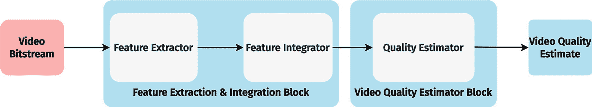

VQA 研究方法流程图。流程顺序为：视频比特流、特征提取与集成模块、视频质量估计器模块、视频质量估计。

图 3-1

VQA 研究方法[6]

在多媒体消费的广阔领域中，视频质量是决定消费者体验和满意度的最强因素之一[7]。VQA 是一种开创性的方法，确保我们交互的视觉内容满足受众的标准和期望。它是追求最佳视觉保真度的基础，其主要目标是解决一个基本问题：什么构成了视觉上令人愉悦且引人入胜的视频？它探讨了定义在线视频的客观属性与人类感知的主观细微差别之间的复杂关系。VQA 并非独立存在；它的成功依赖于基准、统计数据和定义明确的技术。对这些方面的审视旨在理解测试和验证视频内容质量的细致过程[8]。本节探讨了 VQA 的基本特征，审视了构成我们理解和评估视频质量的复杂框架。了解影响视频质量的因素、人类感知的复杂性以及客观和主观评估中使用的技术，构成了深入调查的基础。

### 3.1.1 视频质量指标

视频质量评估（VQA）围绕一系列专门为衡量数字视频视觉准确性而开发的测量方法和评估手段展开。这些指标旨在为量化视频质量的各个组成部分提供一套规范标准，从而促进公正的比较与评估。作为计算机视觉领域的一个分支，VQA 试图复现人类在观看视频时的主观体验，以期获得一个代表感知质量的评分 [9]。现代一些流行的基准测试包括：实时视频质量挑战（LIVE-VQC）、YouTube 用户生成内容（YouTube-UGC）、康斯坦茨自然视频数据库（KoNViD-1k）以及大规模社交视频质量（LSVQ）[10]。同样地，严格遵守全球基准，特别是国际电信联盟（ITU）制定的标准，能够提升评估流程的规范性 [11, 12]。表 3-1 概述了多年来常用的 VQA 指标、评分系统及标准 [13, 14, 15]。

表 3-1

视频质量指标、评分系统及标准

| VQA 指标 | 评分系统 | 描述 |
| --- | --- | --- |
| **客观视频质量指标** | 峰值信噪比（PSNR） | 量化信号可达到的最大功率与干扰噪声功率之间的比率。 |
| 结构相似性指数（SSIM） | 评估原始图像与失真图像在结构上的相似程度，综合考虑亮度、对比度和整体结构等因素。 |
| 多尺度结构相似性指数（MS-SSIM） | 通过优于 SSIM 模型的表现来取代它。该方法对亮度分量逐帧应用，然后计算平均指数。 |
| 平均意见得分（MOS） | 一种转化为客观数值的主观指标，通常基于人类对视频质量的评估。 |
| **主观视频质量指标** | 单刺激连续质量评估（SSCQE） | 要求观看者在视频播放过程中持续对视频质量进行评分。 |
| 双刺激连续质量评估（DSCQE） | 使观看者能够将参考视频的质量与正在评估的视频进行持续比较评分。 |
| **混合指标与评分系统** | 视频质量专家组（VQEG） | 结合主观和客观参数，对视频质量进行全面评估。 |
| 混合视频质量指标（HVQM） | 整合主观和客观指标，提供对视频质量的综合评估。 |
| **ITU 视频质量标准** | ITU-R BT.500 系列 | 描述了评估电视图像主观质量的技术。 |
| ITU-T Rec. P.910 | 探讨了在多媒体应用中使用主观分析评估视频质量的方法 [16]。 |
| ITU-T Rec. P.913 | 详细说明了在任何条件下评估互联网视频和电视广播质量的视频、音频及视听性能主观感知的方法 [17]。 |
| ITU-T Rec. P.1204 | 针对可靠传输下分辨率高达 4K 的流媒体服务，处理其主观视频质量评估问题 [18]。 |

在探究这些测量方法时，可以清楚地看到，通过在像素层面并兼顾人类感知，结合客观、主观和混合方法，能够实现对视频质量的全面评估。此外，遵循 ITU 标准可确保采用一种普遍认可且统一的方法，这些标准是为研究人员、工程师和行业专家制定的。根据 ITU 的观点，尽管上述每种方法都有其优势和局限性，但明确推崇其中任何一种方法都是不切实际的。选择最适合特定条件的评估流程，取决于研究人员自身 [12]。

### 3.1.2 视频质量中的人类感知

视频质量的评估超越了像素和帧的单纯技术特性，转而需要探索人类感知这一复杂领域。本节旨在审视人类认知与视觉内容之间错综复杂的相互作用，以深入了解人类如何感知和解读视觉刺激。以下是一些心理和生理变量 [19, 20, 21]：

*   **认知负荷**：指信息处理所需的心智努力。高认知负荷可能会影响对视频质量的感受，因为观看者可能难以处理复杂的视觉场景。

*   **注意力与专注度**：干扰或视觉混乱会直接影响感知质量，以及观看者专注于画面中相关元素的能力。

*   **色彩视觉**：人类视觉系统能够感知广泛的色彩，因此如果观察到色彩准确度有任何偏差，感知质量就会受到影响。

*   **时间敏感性**：感知随时间变化的能力。更高的帧率有助于实现更流畅的运动，更贴近人类视觉系统固有的时间敏感性。

*   **空间一致性**：空间关系中的不一致或失真会破坏视频内容的感知质量。

*   **时间一致性**：指检测和解释随时间推移发生的变化的能力。提高帧率可增强运动的流畅性，精确匹配人类视觉系统固有的时间敏感性。

*   **长时间观看**：长时间接触多媒体材料可能导致眼睛疲劳，这会削弱观看者理解高质量视觉内容的能力。

*   **参与感与沉浸感**：引人入胜且身临其境的视觉体验会提升对卓越水平的感知，培养一种参与感和愉悦感。

### 3.1.3 视频质量属性

随着世界对多媒体的依赖日益加深，确保服务提供商满足用户期望的质量标准，已成为决定其成败的直接因素。中国和印度等国家互联网接入率较低，但移动设备用于在线视频流媒体的使用率却很高。相比之下，美国等西方国家以及西欧部分地区，为电视网络设定了高标准。同样，由于选择更多，且只需点击一下按钮即可轻松便捷地更换服务，观众越来越倾向于选择视频流媒体提供商。全球流媒体市场增长率高达 55%的数据也印证了这一点[22]。世界各地的最终用户都渴望获得顶级体验。根据普华永道（PwC）于 2019 年 10 月进行的一项涵盖美国 1000 多名 18 至 64 岁人群的民意调查，简化流媒体内容播放流程的重要性日益凸显[23]。用户友好性与可靠性之间的关联，直接关系到用户参与度，对于促进用户长期使用并偏爱某项视频服务至关重要。图 3-2 展示了 Akamai 内容分发网络（CDN）在视频分发过程中所体验到的视频流质量属性的重要性[24]。

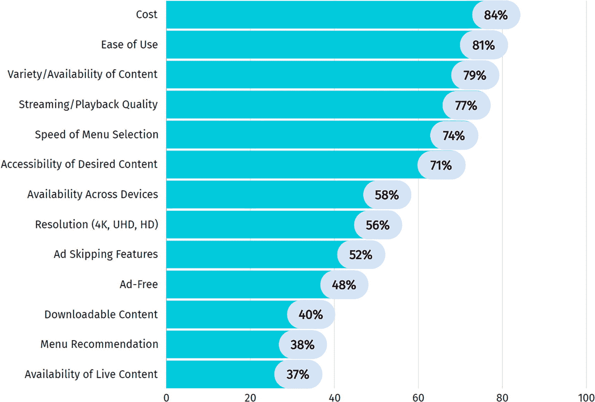

一张水平条形图，展示了重要性评分与属性的关系。成本的重要性评分最高，达到 84%。直播内容的可用性评分最低，为 37%。

图 3-2

Akamai CDN 视频流属性重要性评分[24]

### 3.1.4 最优 VQA 策略

随着观众越来越多地消费基于 IP 的剧集式长视频内容，他们对优质视频内容的期望也更高。无论使用何种设备或方法，内容的卓越水平都应保持一致。当移动设备观看视频的普及与发达国家观众更倾向于在电视屏幕上观看长篇连续剧和电影这一事实相矛盾时，情况就变得复杂了。据 Vox 报道，Netflix 声称其流媒体内容中有高达 70%是在智能电视上消费的，而非手机、平板电脑或个人电脑[25]。观众期望广播电视和 OTT 视频在所有设备上都能提供一致的质量水平[26]。

关键在于，目前尚无行业标准来定义理想视频的外观。尽管 VQA 已有既定标准，但互联网视频传输方面缺乏实践规范，导致业界无法达成共识。因此，视频服务提供商关注一系列基本的 KPI，例如：重新缓冲率、视频启动时间（即用户请求视频到视频实际播放之间的时间）以及比特率（通常以 Kbps 或 Mbps 为单位）[27]。图 3-3 展示了视频服务提供商通常分析的视频质量与用户留存率之间的关系。

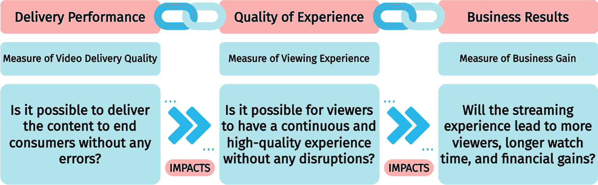

视频质量与用户留存率关系的示意图。相互关联的组件包括：交付性能、体验质量和业务成果，它们分别影响视频交付质量、观看体验和业务收益的衡量。

图 3-3

视频服务提供中视频质量与用户留存率的关系

标准化之路首先在于确定指标、方法和测量工具，以保持评估的准确性和一致性。图 3-4 展示了通过添加两类指标来得出观众体验的过程[24]。

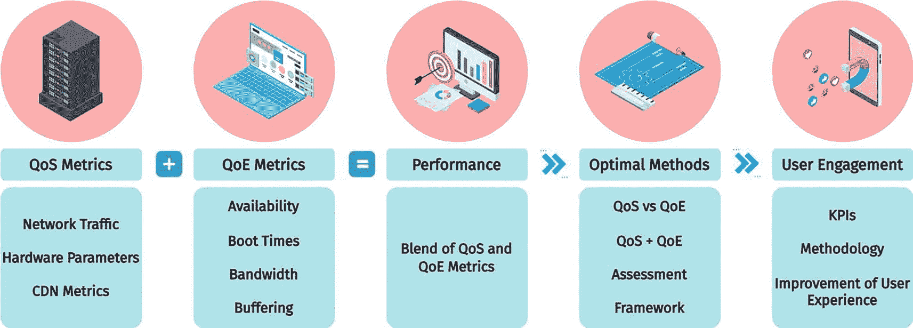

用户参与旅程流程图。QoS 指标与 QoE 指标之和构成性能，性能进而转化为最优方法和用户参与度。性能包含 QoS 和 QoE 指标的混合。

图 3-4

用户参与旅程

如图 3-2 所示，流媒体和视频质量是决定视频服务提供商成功与否的关键指标，因此，必须定制并持续更新 VQA 算法的设计，以跟上最终用户的步伐。一个稳健的 VQA 策略甚至会考虑客户旅程，以融合 QoS 和 QoE 指标。

### 3.1.5 体验质量（QoE）指标

为了进一步理解 VQA 在数字环境中的必要性，审视那些可以在用户端测量的指标至关重要。正如消费者技术协会（CTA）所描述的，*QoE*指的是用户在观看应用或服务时所体验到的满意或不满意程度[28]。感知参与度是根据观众因消费媒体内容而产生的满意度来衡量的，这在很大程度上取决于用户的设备。QoE 指标可以是客观的，也可以是主观的。表 3-2 列出了视频分析供应商通常处理的一些常见客观 QoE 指标[29, 30]。

表 3-2

用于衡量用户参与度的 QoE 指标

| QoE 指标 | 描述 | 网络状况不佳的后果 |
| --- | --- | --- |
| **可用性** | 最终用户请求时内容的可用性。 | 观看流媒体时出现播放困难或中断。 |
| **比特率** | 表示在特定时间范围内发送的比特数。 | 质量较低的流媒体通常会导致视频模糊、分辨率较差。 |
| **播放失败** | 在初始重新缓冲过程完成后，因播放错误而终止的播放次数。 | 视频可能提前终止，或播放器/浏览器可能崩溃。 |
| **重新缓冲** | 当视频片段下载速度慢于播放速度时发生的视频传输延迟。 | 视频卡顿、冻结、黑屏，以及可能出现的“死亡之轮”现象。 |
| **启动时间** | 从启动播放到视频开始播放之间的持续时间。 | 视频启动延迟过长，或在实时流和线性流之间切换时延迟过长。 |
| **视频启动错误** | 在显示第一帧视频之前，视频初始化期间播放尝试被中止的频率。 | 视频流缺失。 |
| **滞后比** | 计算方式为等待时间除以观看时间。 | 流媒体缓冲，若比率过高可能导致用户离开。 |

尽管大多数平台都试图囊括这些指标中的大部分，但用于获取最终指标的框架通常各不相同，导致测量和报告缺乏一致性。例如，不同的工具使用不同的公式来量化重新缓冲，通过平均值或百分比等计算方式，将其表示为次数、持续时间或频率。这取决于事件发生的方式和时间。

### 3.1.6 服务质量（QoS）指标

QoS 指标围绕交付链中构成服务和性能质量的组件展开。这涵盖了从内容生成和处理，到分发以及最后一公里交付的各个环节。为了处理体验质量（QoE）差异并精确定位服务降级的原因，需要为视频分发过程中的每一个环节（例如观众的互联网服务提供商、CDN 以及内容准备设施）建立 QoS 指标。其他相互关联的要素包括可用性、吞吐量、传输时间和抖动 [31]。从 CDN 的角度来看，视频分发依赖于几个相互关联的要素，如表 3-3 所述 [24]。

表 3-3

从 CDN 角度进行性能测量的 QoS 指标

| QoS 指标 | 描述 | 影响因素 |
| --- | --- | --- |
| 流量/点击量 | 通过 CDN 传输的数据量，以访问次数或字节数衡量 | 源站、中间层、边缘节点点击量 |
| 吞吐量 | CDN 可用于数据传输的容量 | 以 Mbps 表示 |
| 卸载量 | 未回源的总请求数 | 点击次数和流量 |
| 可用性 | 计算为成功点击次数占总点击次数的比率 | 边缘节点和源站响应 |

### 3.1.7 性能质量（QoP）指标

为了对观众的体验达成一致的理解，有必要使用特定的指标来评估视频分发过程中每个组件的 QoS。这些指标应与评估体验质量的行业标准紧密对齐。QoP 指标是描述运营数据以增强系统性能的特征，并通过充当代理 QoE 度量来提供对业务要素的洞察。如果客户正在观看时长为六秒的视频片段，而 CDN 在交付该片段时超过了六秒，那么客户端播放器将会经历重新缓冲。这可以使用 QoP 指标来衡量，该指标也充当客户端重新缓冲的代理参数 [24]。

### 3.1.8 主观视频质量评估（VQA）

作为最终消费者的**人类**是视觉质量的最终评判者，其判断可以通过主观实验获得。这需要一组人（通常是非专家，通常被称为测试对象）参与，其角色是评估特定测试材料（例如一系列电影）的感知质量 [32]。主观实验通常在受控的实验室环境中进行，详见 ITU-R BT.500 建议书 [12]：

*   观看距离。
*   室内照明。
*   标准化协议。
*   测试时长。
*   观察者招募。
*   检测不一致观察者并拒绝其评分的方法。
*   计算 MOS 精度的方法。

在受控环境中进行主观实验之前，需要进行细致的规划，并考虑评估方法、测试内容选择、观看环境、评分量表和呈现时间。主观 VQA 的不同类型方法如下 [33]：

*   **单刺激**：向参与者呈现测试内容的不同版本，没有任何用于比较的参考。一个例子是绝对类别评分（ACR）方法。
*   **双刺激**：通过向参与者展示包含参考视频和降质视频的两个视频，参与者对两个视频之间的质量变化进行评分。这被称为降质类别评分（DCR）。
*   **多刺激**：参与者根据参考视频判断多个视频内容样本的质量，并能够多次回看素材。一个例子是多媒体视频质量主观评估（SAMVIQ）。

这些方法会产生参与者给出的个人评分，例如 MOS 或差分平均意见得分（DMOS），具体取决于实验的设置。

### 3.1.9 客观视频质量评估（VQA）

鉴于主观实验需要密集的规划、物理空间和时间，研究人员和工程师转向了客观质量测量，其目标是准确地产生相同的 MOS。下面解释两种不同的方法 [34]：

*   **心理度量**：这些参数试图通过纳入对比度和运动感知、频率选择、时空模式、掩蔽和颜色判断等因素来表征人类视觉系统。这些度量适用于广泛的视频降质类型，尽管它们的计算通常资源密集，并且不常用于流媒体应用。
*   **工程度量**：通过首先从视频中提取特定元素或伪影，这些参数不会忽视人类视觉系统的特性。然而，其设计背后的基本理念是分析视频内容，而不是专注于基础的视觉建模。然后将一组特征塑造成一种评估质量的客观方法，进而关联起来以预测 MOS。

根据进行评估的环境，客观方法可以分为以下几种 [35, 36]：

*   **全参考（FR）**：此方法允许访问完整的原始视频作为参考。FR 方法依赖于将修改后的视频与原始素材进行比较。
*   **降参考（RR）**：在此方法中，将原始视频的代表性特征提供给算法，并将测试视频的分析结果与此匹配信息进行比较。
*   **无参考（NR）**：在无法访问原始视频的情况下，此方法使用多种技术，例如考虑测试视频像素域内的伪影、使用源自其码流的细节，或设计一种基于像素和基于码流的混合模型。

### 3.1.10 网络、视频和流媒体的质量指标

在分析了客观性质的 QoE、QoS 和 QoP 指标之后，本节详细阐述了最终用户在视频质量方面的主观概念。这些指标的汇总版本见图 3-5 [37]。

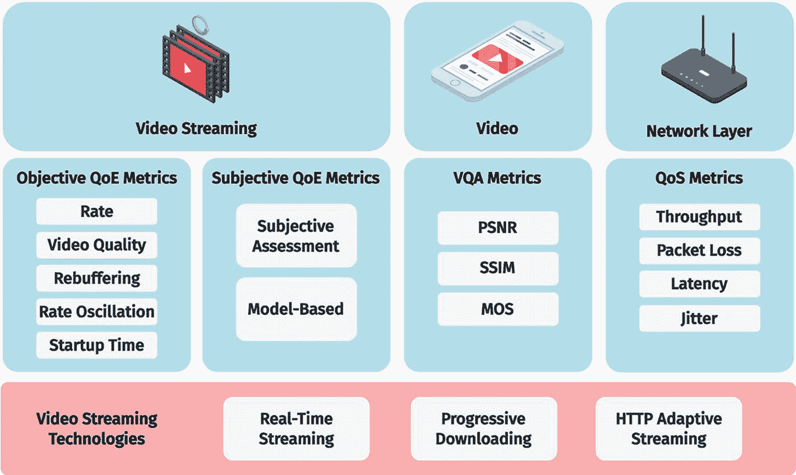

VQA 质量指标的示意图。视频流包括客观和主观的 QoE 指标。视频包括 VQA 指标。网络层包括 QoS 指标。视频流技术包括实时流媒体、渐进式下载和 HTTP 自适应流媒体。

图 3-5

网络、视频和流媒体的质量指标 [37]

### 3.1.11 视频质量数据库与基准测试

视频质量数据库和基准测试对于 VQA 的进步至关重要，因为它们充当了计算评估的持续测试平台和数据集。以下是一些视频质量数据库：

*   **LIVE 视频质量挑战数据库 (LIVE-VQC)**：包含一个庞大的视频库，涵盖了广泛的分辨率和内容类别 [38]。

*   **TID2013**：旨在处理失真的照片和视频，为算法评估提供了广泛的难度。其内容包含了刻意引入的退化，模拟了现实中质量下降的情况 [39]。

*   **YouTube UGC 数据集 (YouTube-UGC)**：旨在协助推进用户生成内容（UGC）视频质量评估和视频压缩的研究 [40]。

*   **Netflix 视频多方法评估融合 (VMAF) 数据集**：由 Netflix 创建，该数据集涵盖了广泛的素材，包括不同复杂程度的视频。它对于评估专为流媒体服务定制的 VQA 算法高度相关 [41]。

同样地，接下来介绍一些基准测试方法 [42]：

*   **标准化测试协议**：基准测试方法用于构建统一的评估协议，以保证一致性和可重复性。这些指南确立了测试算法的标准，确保评估的公正性和可比性。

*   **作为参考点的客观指标**：通过诸如 PSNR 和 SSIM 等方法，这些指标为评估 VQA 模型的精度提供了可衡量的标准。

同样，这里列出了关于 VQA 数据集的主要挑战和考量因素：

*   **可扩展性**：每年都有采用突破性进步和新视频分辨率的新显示器进入市场，这要求 VQA 模型在性能上始终保持同步。

*   **真实性与多样性**：所有测试环境中的观看条件必须保持一致，以消除偏差。

*   **时间与空间可变性**：视频内容包含时间模式的变化和空间复杂度的差异，这对 VQA 算法构成了障碍，要求模型更加复杂并能有效适应各种情况。

### 3.1.12 VQA 中的时间与空间考量

VQA 中的时间因素涉及内容随时间的变化及其对观众感知的影响。而空间问题则适用于特定帧的静态特征。表 3-4 讨论了在 VQA 领域中需要考虑的属性类型 [43, 44]。

表 3-4

VQA 领域中需要考虑的属性类型

| 考量维度 | 属性 | 描述 |
| --- | --- | --- |
| **时间** | 帧率与运动 | 帧率的提高有助于运动平滑度，减少运动模糊的发生，并提升视觉清晰度。 |
| 时间一致性 | 帧率的波动或不规则会干扰观众的沉浸感，导致明显的质量下降。 |
| 动态场景变化 | 频繁且突然的场景转换要求算法能够灵活应对内容的突变。 |
| **空间** | 分辨率与细节 | 更高的分辨率意味着更丰富的细节，提升了可视化的水平和感知质量。 |
| 压缩伪影 | 识别诸如模糊和块效应等伪影对于 VQA 模型至关重要。 |
| 宽高比与构图 | 将空间特征与美学规范对齐可以增强观看体验。 |
| **演进** | 自适应比特率流媒体 (ABS) | 网络状况与流媒体服务的性能密切相关，而 ABS 已经在可用带宽和流媒体质量之间架起了桥梁。 |
| 用于时间分析的机器学习 | 寻找运动模式、场景变化和帧率波动。 |
| 空间压缩技术 | 可以使用诸如高效视频编码 (HEVC) 之类的方法来提高空间压缩效率。 |

### 3.1.13 面向不断演进的视频内容的 VQA

视频内容行业在不断发展，新的格式、平台、功能层出不穷，用户生成内容（UGC）也越来越受欢迎 [45]。传统的 VQA 方法可能并不总能轻易适应这些新的内容格式，例如在 UGC 的情况下，用户使用来自极其庞大设备池的智能手机，这增加了评估视频质量的复杂性 [46]。本节探讨了新 VQA 模型的方法和要求，具体如下：

*   **短视频**：作为当今最具吸引力的多媒体内容类型之一，像 TikTok 这样的平台引入了能够吸引用户注意力的短视频，并拥有基于观看历史推荐视频的独特算法。强大的 VQA 算法需要彻底解决内容类型、编辑风格和用于录制视频的设备种类繁多的问题 [47]。

*   **交互式与沉浸式内容**：超越标准的线性格式，虚拟现实（VR）和增强现实（AR）融入了空间和交互组件，这要求 VQA 考虑这些因素如何影响用户体验。一些特性包括 360 度视频特性、投影、编码压力、缓存压力、带宽压力以及停顿模式和编码质量的变化 [48]。

*   **UGC 中的质量可变性**：视频充满了质量差异，从专业制作的视频到业余录制的视频，不一而足。

*   **主观偏好**：不同类型的内容对最终用户的吸引力不同，例如体育、电影、喜剧、舞蹈、学习、健身、美食和潮流等类型。

*   **使用人工智能进行 IPTV**：通过自动化分析、优化编码和增强反馈，人工智能可以利用机器学习和计算机视觉技术来识别和分类视频质量问题，例如模糊、块效应或卡顿。然后，它可以提供改进视频传输的实用建议 [49]。同样，可以优化编码参数和压缩方案，从而在保持视频质量的同时，最大限度地减少带宽和存储需求。此外，自然语言处理（NLP）和情感分析可用于收集和动态分析观众的评论，作为满意度和偏好水平的反馈。

*   **用于 IPTV 的区块链**：区块链中的智能合约和代币可以作为 VQA 过程的激励措施，允许参与者因其输入和反馈而获得奖励 [49]。点对点（P2P）网络可用于视频内容的分发和流式传输，从而减少对中央服务器和网络的依赖，并缓解拥塞。这将有助于提高网络的服务质量（QoS）。

## 3.2 现有的 VQA 应用

多媒体领域以其不断变化的特性和日益增长的复杂性而闻名，即使在全球连接性不断增强的情况下，也需要持续努力来改善观众体验。当前的 VQA 应用提供了涵盖广播、流媒体、电信、视频会议和 IPTV 等一系列服务的解决方案，使用定制化的先进算法来测量并保证最佳的视频质量 [50]。本节将深入探讨一些主流的现成软件选项，并分析它们的特点、影响力以及对 VQA 社区的贡献。

### 3.2.1 Telestream 公司的 Sentry

Sentry 是一款基于软件的质量监控产品，拥有显示被监控频道特性的高质量图形用户界面（GUI），可用于有线电视、广播和 OTT 流媒体服务（即通过互联网的流媒体服务）[51]。该框架的目标是监控所部署内容的质量，以便检测并解决任何影响视频质量的因素。其主要亮点之一包括在客户察觉之前对内容交付质量做出反应，以避免不满和投诉。该软件同时服务于广播和流媒体服务，此外还提供图像质量评估功能，可分析诸如块效应、噪声和模糊等参数，并生成信息丰富的图形化结果。根据用户需求，该软件提供不同版本，并可配置在云端、虚拟专用网络以及数据中心运行。该公司使用定制的 TekMOS 机器学习算法，该算法基于亮度进行逐帧分析，以确定视频质量特性，然后生成 QOS 分数以及 TekMOS 图表。

### 3.2.2 ThinkTel 公司的实时媒体评估（RTMA）

RTMA 首先对企业网络进行评估，收集有关网络容量和高峰时段的信息，以生成一份完整的报告。其考虑的指标包括延迟、抖动以及音频和视频服务的容量 [52]。其目标是为客户提供关于如何进一步优化其网络的建议，这些建议基于来自众多商业通信软件（如 Microsoft Teams）的数据。后者在高峰时段可能会给网络资源带来压力，从而影响员工的 QoS。因此，RTMA 提供了容量规划，节省了成本和时间，并保证了改善的用户体验。该软件不包含机器学习功能，因为它主要侧重于数据收集。

### 3.2.3 Witbe

作为全球 IPTV 领域领先的 QoE 监控工具之一，Witbe 通过部署配备 VQA 功能的机器人，掌握了机顶盒（STB）、移动设备和网络浏览器的自动化测试概念 [53]。其强大的云模型允许进行视频捕获，并支持远程实时控制设备 [54]。个性化的脚本编写功能允许即时编写和部署场景。例如，可以通过配备特殊优化摄像头以执行 VQA 的机器人来监控 Netflix 和 YouTube 等流媒体服务，从而生成专有的主观 MOS 分数，以及模糊和块效应等指标。Witbe 还涉足游戏领域，在谷歌的云游戏平台 Stadia 上进行了测试 [55]。可用性、登录、登录时间、游戏可用性、游戏启动时间、可玩性以及 Witbe 的 VQ-MOS 分数等 KPI 是生成的部分指标，这些指标随后可在 Witbe Datalab 上查看，该平台提供可定制的仪表板用于分析。订阅者还可以选择接收视频和音频问题的即时通知。这些警报随后会实时显示在 Witbe Remote Eye Controller 上，使 NOC 团队能够快速响应发现的任何问题。Witbe 的最新算法 Witbe VQ-ID [56]，还能计算视频无任何问题的持续时间，以及识别出严重视频和音频劣化（如宏块效应、模糊和饱和度）的时间。这些指标为营销团队和管理人员提供了高层次的 KPI。图 3-6 展示了 Witbe 的架构 [57]。

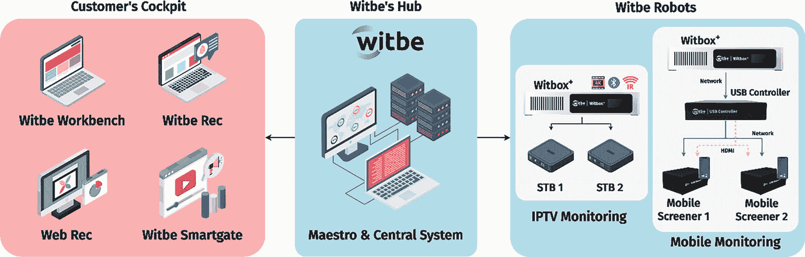

Witbe 架构示意图。Witbe 中心的指挥与中央系统包括客户驾驶舱和 Witbe 机器人。驾驶舱由 Witbe 工作台、Witbe 录制器、Web 录制器和 Witbe 智能网关组成。Witbe 机器人包括 IPTV 监控和移动监控。

图 3-6

Witbe 的架构 [57]

### 3.2.4 ViCue Soft

ViCue Soft 的产品之一 VQ Probe 的核心功能是支持客观和主观指标，以及比较两个视频 [58]。它支持最知名的指标，如 PSNR、SSIM 和 VMAF，包括热力图差异、场景变化检测，并可放大到像素值。支持现代标准，如 AVC/H.264、HEVC/H.265、VVC/H.266、AV1、AV2、AVS3 和 MJPEG。该工具使用户能够调查和评估各种编解码器标准，生成率失真曲线，并计算比特率降低。在软件的层级视图中，显示的信息包括 B 帧引用的互易程度、解码和显示序列中的帧号、颜色编码的帧类型以及帧引用。在指标视图中，分析器展示了每个分量（即一个亮度分量 Y 和两个色度分量 U 和 V）的 PSNR 和 SSIM 表示。为了输出图表，可以对整个流进行分析，支持基于文件和实时分析。同样，VQ Analyzer 面向 QA 工程师、技术支持工程师、广播公司以及非专业人士，适用于广播、电子竞技、流媒体和社交网络等多种服务。图 3-7 展示了一个轻微劣化的视频与其参考视频进行比较以生成 VMAF 分数的示例。

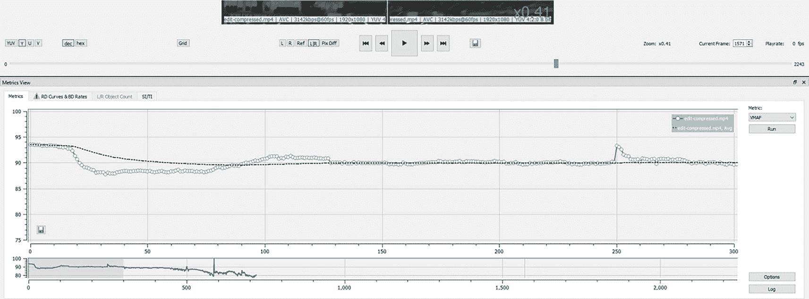

VQ Probe 的截图。显示的结果包括代表 VMAF 信号的折线图。屏幕右下角显示选项和日志的链接。

图 3-7

使用 VQ Probe 为视频生成 VMAF 分数的示例

### 3.2.5 AccepTV 视频质量监测器

AccepTV 的适应性体现在其与多种视频格式的兼容性上，使其能够无缝集成到不同的内容制作和流媒体工作流程中 [59]。其主要产品，即视频质量监测器，擅长测量视频和音频质量，并同步检测音视频文件的口型同步情况。它通过 HDMI 线缆服务于机顶盒；支持 UDP、RTP、HTTP、HTTPS 和 RTMP 等 IP 流媒体协议；以及桌面采集。可测量的指标包括：音频质量和音量、缺乏景深感、画面卡顿、缓冲中断、黑帧出现、频道切换时间、视频启动时间、噪声存在、亮度过高、无声、色彩强度以及视频稳定性。作为一种无参考方法，其平均意见得分范围为 0 到 100，支持离线（即基于文件）和在线两种使用模式。它通过分析解码帧的单个像素，并结合从编码比特流中提取参数，从而形成一种混合模型。其突出特性之一是能够关联 GPS 坐标，将位置与 5G、4G 和 Wi-Fi 网络的现场测试相匹配 [60]。

### 3.2.6 VQEG 图像质量评估工具 (VIQET)

视频质量专家组 (VQEG) 成立于 1997 年，旨在推动视频质量评估领域的发展，其成员涵盖 ITU-T 和 ITU-R 研究组 [61]。近年来，该组织将目光投向游戏和 AR/VR 等新应用领域，并开发了一款图像质量评估工具，命名为 VIQET [62]。作为一款开源工具，它专门用于评估不同设备拍摄照片的质量，并为每张照片生成 1 到 5 分的平均意见得分。该软件建议用户在多种测试设备上，以相似的视野拍摄同一场景。它还包含四大类图片，例如户外场景、室内挂画、室内布置与物品以及室外环境。用户可以选择将照片输入预设类别，以提高算法准确性。VIQET 程序可在其 GitHub 仓库 [63] 获取，图 3-8 展示了其针对户外场景的测试情况，该图也给出了测试后可下载的 PDF 报告截图。

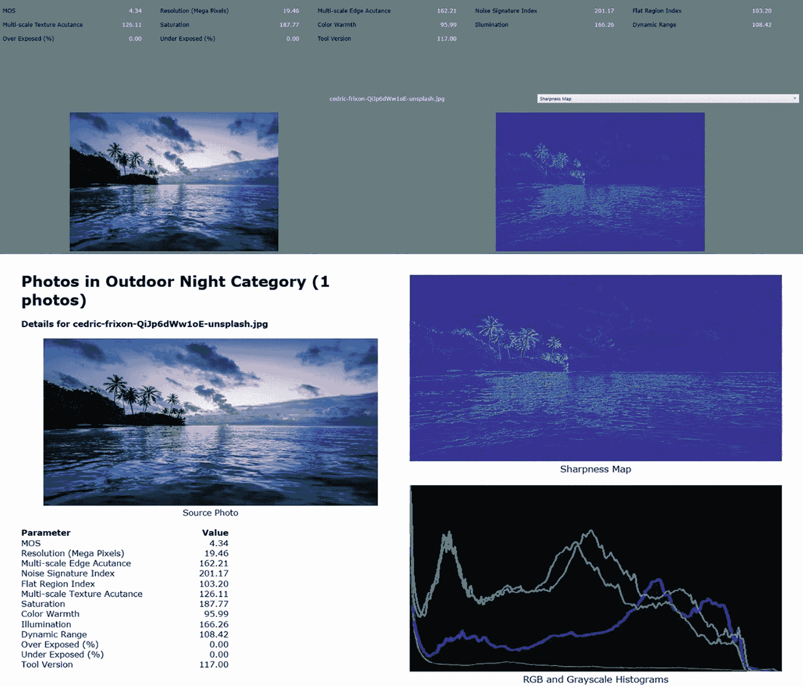

4 张在“夜间”类别下编辑的户外源照片及清晰度地图截图。软件生成的信号总体呈负相关趋势。表格中的列标题为“参数”和“值”。

图 3-8
VIQET 用于测量户外夜间场景拍摄图像 MOS 的示例

## 3.3 视频质量评估前沿综述

2023 年，普通人每周大约消费十七小时的互联网视频内容，较 2022 年的十九小时有所下降 [64]。这种观看模式的变化凸显了视频质量评估在满足观众不断变化的期望以及内容消费动态转变方面的重要性。为了理解定义当前视频质量环境的各种进步和发展，考虑到数字领域的持续变化，对视频质量评估进行全面审视至关重要。本节将深入阐述定义当前多媒体通信时代的前沿方法，目前有 75% 的人在移动设备上消费短视频内容 [65]。

### 3.3.1 视频质量评估背景

视频质量评估的发展源于将多媒体内容分发与用户对卓越视觉体验的需求同步起来的必要性。移动技术的最新进展赋予了世界一项不可思议的超能力：随时随地录制电影级画质的视频，让人们能够记录日常经历。Instagram Reels 和 TikTok 就是如此，视频在制作阶段就添加了字幕，以提高可访问性 [66]。尽管视频流量占互联网总流量的绝大部分，但它在到达最终接收者之前会经历多个处理步骤，在此过程中，感知到的视频质量可能会下降或提升。视频质量评估处于整个操作的核心，因此具有多种实际应用，例如实时质量监控、视频架构（如视频采集和传输）的性能评估，以及多媒体框架的感知优化。传统的视频质量评估方法主要依赖于生成技术信息，但未能完全捕捉人类感知的细微差别。视频质量评估研究的主要目标是创建与主观方法高度相关的客观方法 [67]。根据 Brightcove 的数据，62% 的观众在遇到质量较差的视频内容时，容易对品牌产生负面看法 [68]。这一数字凸显了视频质量评估在影响消费者看法以及进而影响数字内容提供商成功方面的关键重要性。视频质量评估不仅是技术需求，更是那些力求在竞争激烈的多媒体通信领域取得成功的组织的战略必需品。

### 3.3.2 机器学习在视频质量评估中的应用

视频质量的主观因素随着其在视频质量评估中的应用，已逐渐渗透到最强大的机器学习算法中。尽管在感知质量评估方面面临若干障碍，机器学习如今仍被广泛用于提升视频编解码器的编码效率 [69]。机器学习还被全球最大的科技巨头之一 Netflix 所采用。其机器学习解决方案 VMAF 结合了视觉信息保真度（VIF）[70] 和细节丢失度量（DLM）[71]，通过逐像素计算连续帧之间亮度分量的时间差异来衡量图像质量。随后使用支持向量回归（SVR）计算加权平均值，量化最终的感知质量分数。由于依赖于帧级特征，VMAF 并未考虑视频复杂的运动复杂度，这种复杂度超越了后续帧中单纯的逐像素变化。多年来，针对视频质量评估，人们提出了多种显著的端到端机器学习和深度学习方法，包括 Xu 等人提出的 C3DVQA [72]，以及 Sun 等人提出的 CompressedVQA [73]。例如，后者通过使用一个简单的 MLP 网络来预测块级质量分数，其中多尺度权重源自人类视觉系统的对比度敏感函数，展示了机器学习模型在利用质量感知特征方面的卓越性能。

尽管由机器学习驱动的模型性能卓越，但增强的流媒体方法却加大了对更大带宽容量的需求，并在传输过程中引入了额外的复杂性，这两者对于服务提供商和互联网服务提供商而言都是关键因素。历史上，这个问题是在管理网络服务质量的框架内进行研究的。然而，通过无线网络进行流媒体传输时，即使名义上的容量足够，由于信道条件的波动，质量也会下降 [74]。这种劣化无法简单地通过纳入服务质量因素来准确评估。这些变量仅能提供特定网络状况的洞察，并未完全包含影响用户整体体验的端到端特性。为了解决这些组成部分，体验质量的管理已被公认为一种更有效的方法 [75]。因此，更新的趋势集中在通过机器学习进行预测性体验质量管理，如图 3-9 [76] 所示。

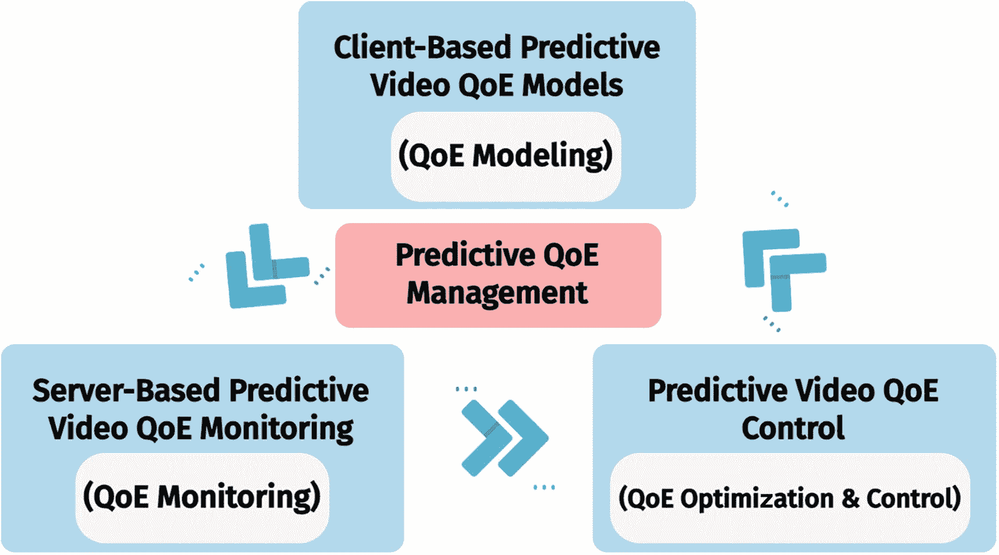

预测性体验质量管理周期的示意图。步骤包括：基于客户端的预测性视频体验质量模型、基于服务器的预测性体验质量监控，以及预测性视频体验质量控制。

图 3-9

预测模型在体验质量管理中的集成 [76]

### 3.3.3 用于分析多媒体通信中视频质量的机器学习算法

以往的研究主要集中在发现那些非常适合检测和响应多媒体通信系统（尤其是在基于互联网的通信中）控制特征的机器学习算法。Mohamed 等人使用人工神经网络复制并建模了一组样本个体对视频质量变化的反应 [77]。考虑的因素包括丢包率、丢包分布、比特率和帧率。鉴于质量评估包含客观和主观两种视角，该研究旨在通过强调准确性来减轻围绕主观性的偏差。这些系统被部署在需要通过分组网络传输视频的场景中。然而，该评估并未考虑诸如音频与视频一同传输等特征，因此忽略了唇形同步等方面。人工神经网络模型使用来自人类测试小组的主观数据度量进行训练，从而充当一个模拟器。此外，作者重复了训练过程以改进算法。在二十名参与者进行主观评估后，具有预定失真参数的人工神经网络模型随后被部署在基于分组网络的实时视频架构上。该方法产生了 0.9907 的相关系数和 0.253 的平均误差，从而证明了模拟人类视频质量评估的有效性。所用方法的总结如图 3-10 所示。

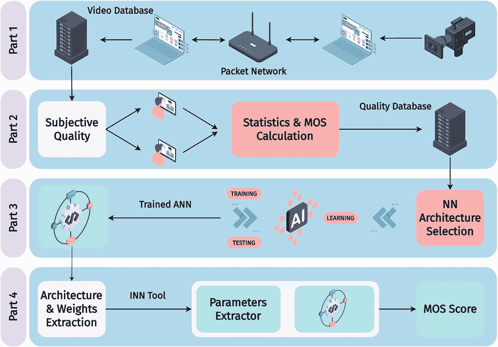

平均意见分数生成的流程图。流程的第 1 部分包括生成视频数据库。第 2 部分包括视频数据库主观质量的统计和平均意见分数计算。第 3 部分包括神经网络架构选择。第 4 部分是生成平均意见分数。

图 3-10

Mohamed 等人提出的平均意见分数生成方法的工作流程 [77]

Ruiz 等人引入了一种新方法，用于有效优化实时多媒体应用所提供的服务质量 [78]。图 3-11 展示了论文中提出的多媒体应用通用自适应架构。该方法包括调整由机器学习算法选择的合适参数，以根据网络可用资源优化其性能。参数的修改在服务器端执行，即在自适应应用程序内部。简而言之，这些应用程序被配置为实时微调其设置，以满足最终用户的需求并满足用户感知的服务质量要求。为了考虑移动自组织网络原型中包括视频和音频丢失在内的情况，作者认为这些测试需要在网络层的分组化生态系统中运行。使用 Slipper 规则归纳算法，基于从真实用户提取的分数来学习最终用户会偏好哪些设置。遗传算法确定自适应程序启动设置修改的时机。作者声称，即使在持续失真变化的情况下，他们的方法也能可靠地工作。

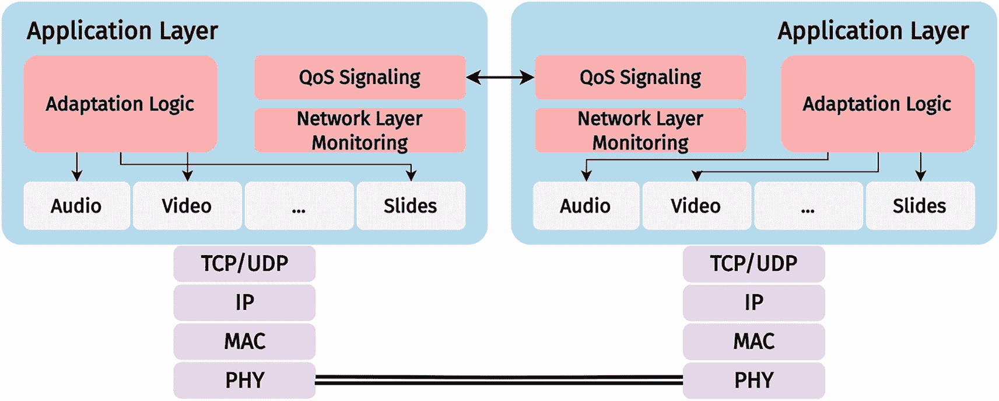

机器学习架构示意图。两个应用层各包含服务质量信令、网络层监控和自适应逻辑，它们双向连接。每一层由 TCP 或 UDP、IP、MAC 和 PHY 组成。

图 3-11

Ruiz 等人提出的多媒体应用自适应架构 [78]

Jagadessan 等人旨在利用软件定义网络（SDN）保障实时闭路电视摄像机（CCTV）画面的充分传输，该网络用于将源端捕获的数据传输至最终用户的显示器 [79]。将剑桥大学于 2010 年开发的 BAT 算法与位于控制交换机中的 AI 模块相结合，旨在对数据包进行优先级排序。实验采用物联网云作为数据库。结果表明，与未使用 SDN 的网络相比，该网络在抖动特性方面的性能提升了 70%。

Thomos 等人对近年来利用机器学习技术提升多媒体内容质量的最新进展进行了全面分析 [80]。该论文深入探讨了机器学习在多个领域的应用，例如 AR/VR/XR 和 360 度视频、视频流系统、缓存以及 QoE 评估。例如，在自动驾驶汽车中，智能汽车需要以每秒 750 MB 的速度、超低延迟传输视频素材。为实现这一目标，基于先前研究创建了机器学习模型。从另一个角度来看，使用 SVM 回归器将多个特征合并并处理成最终评分。此外，还探索了 CNN 用于整合多模态输入，并通过融入 HVS 的概念（如显著性）来增强图像质量评估（IQA）。显著性特征并非以图谱形式，而是以分层方式与 IQA 属性相结合，随着网络深度的增加，后者得以逐步改善 [81]。反过来，这些组合特征被用于估计客观图像质量。这类模型还能实现资源的有效管理、数据预取、缓存服务以及安全措施的改进。

Fu 等人提出了一种顺序强化学习（RL）方法，该方法配备动态分块机制，以应对 360 度视频流搜索空间的高维问题 [82]。典型的基于分块的视频流布局如图 3-12 所示。与此同时，Kan 等人通过概率框架对前述分块方法进行了升级，为每个分块分配比特率 [83]。通过整合来自 RL 代理的反馈，该模型得到进一步加强，提升了该方法的有效性。这项研究在最终用户的 QoE 方面，显著改善了 360 度视频流的体验。

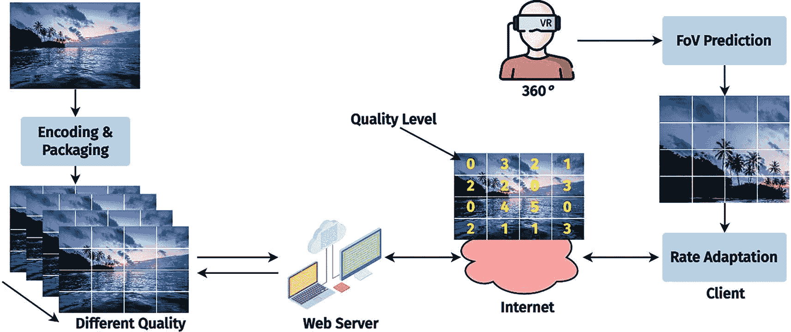

通用布局工作流程的流程图。步骤包括：对照片进行编码和打包以生成不同质量的照片，通过 Web 服务器上传至互联网，更改质量级别，F o V 预测，以及由客户端进行码率自适应。

图 3-12

Fu 等人提出的基于分块流式传输的通用布局工作流程 [82]

同样，Vega 等人强调了即使在具有挑战性的网络条件下，也能够生成实时 QoE 分析和测量的重要性 [84]。因此，他们选择了一种轻量级的 NR 策略，该策略利用客户端变量作为机器学习方法的输入。该策略旨在使用玻尔兹曼机（其中每个节点都与其他所有节点相连）实现高精度、高适应性和可持续性。输入包括从受影响的视频源中检索到的视频特征。该方法使用 FR 技术，与 LIMP 和 ReTRiEVED 视频质量统计数据进行了基准测试。图 3-13 展示了受限玻尔兹曼机（RBM）如何与基于实时无监督和深度学习（UDL）的 VQA 相结合。在考虑所有可用实例时，该模型达到了至少 85% 的精度。

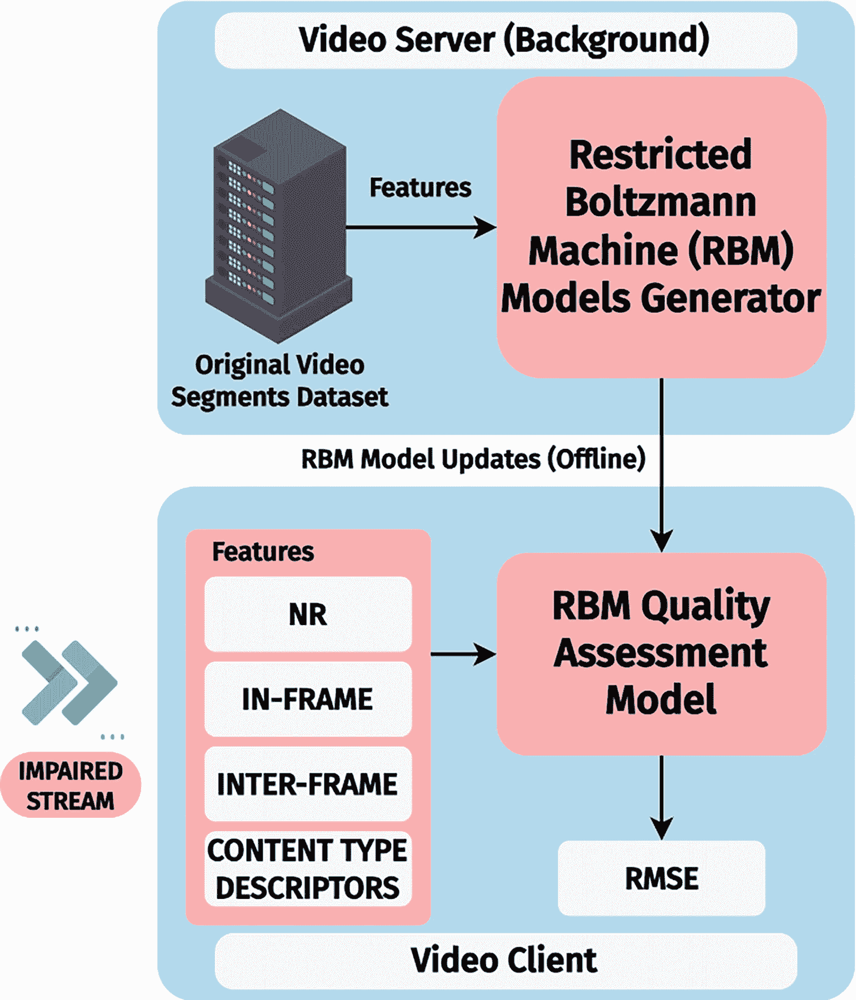

基于 U D L 的 V Q A 方法流程图。该过程包括一个视频服务器，用于将原始视频片段数据集转换为受限玻尔兹曼机模型生成器。数据被传输至 R B M 质量评估模型，并输出 R M S E。

图 3-13

Vega 等人提出的基于 UDL 的实时 VQA 方法工作流程 [84]

Vega 等人对视频流服务中用于测量 QoE 的技术进行了深入回顾 [76]。所涉及的框架包括用于评估 QoE 的预测方法，以期突出最适合此目的的机器学习算法。对于以 MOS 为中心的 QoE 系统的客户端预测，已注意到 RR 和 NR 设计优于 FR 平台。这是因为 FR 框架需要访问源素材，导致算法耗时且复杂。然而，独立的 RR 和 NR 模型在精确预测人类对视频素材的感知方面被证明是不足的。论文指出，机器学习通过实施主动式体验质量循环进行调节，显著提高了准确性。本文展示的众多预测框架之一如图 3-14 所示。这些循环涉及消费者端和服务器端的监控工具，以便进行即时调整。Konuk 等人 [85] 展示了一个示例，其中使用 K-means 基于比特流和时空内容描述符对视频素材进行空间聚类。

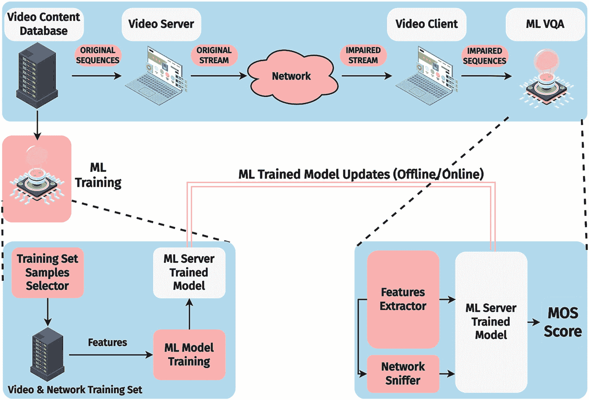

V Q A 方法流程图。步骤顺序为：视频内容数据库的原始序列、视频服务器的原始流、来自网络的受损流、来自视频客户端的受损序列，以及 M L V Q A。视频内容数据库包含 M L 训练。

图 3-14

Vega 等人提出的通用预测性 VQA 方法工作流程 [76]

与此同时，Raca 等人专注于研究机器学习和深度学习方法如何为蜂窝网络上的视频流服务生成精确预测 [86]。作者采用支持向量机（SVM）和随机森林（RF）作为吞吐量预测的训练算法。随后，在各自的能力、训练要求和数据需求方面，与长短期记忆（LSTM）框架进行了比较。通过考虑连接设备数量和平均吞吐量等参数，确定了单小区内的 QoS 指标。推导出的特征包括比特率、切换次数、平均切换次数以及特定视频片段的平均比特率。然后，该预测器与一个基于 4G 的 HTTP 自适应流媒体（HAS）视频播放器相结合，与传统视频播放器的被动反应特性相比，实现了出色且具有前瞻性的评估。这带来了显著的改进，体现在不同质量级别之间的无缝切换以及对可用网络容量意外下降的快速适应方面。

与这项研究一致，Mao 等人开发了 Pensieve，这是一个深度强化学习（DRL）系统，它整合了从客户端视频观众收集的数据，以确定未来的比特率 [87]。Pensieve 利用先前案例的视频质量度量来改进过去的 ABR 决策。它能够通过试错动态地开发一种用于比特率自适应的控制方法。图 3-15 给出了一个包含 ABR 控制器的 HTTP 自适应视频流概述。学习代理接收的输入除了带宽因素外，还包括检索视频部分所需的持续时间。因此，ABR RL 代理能够区分哪些策略由于有缺陷的建模技术而优于传统方法。通过使用神经网络将 RL 应用于比特率自适应的 Pensieve 整体架构如图 3-16 所示。据作者称，该技术通过根据实际试验结果不断修改其控制策略来提高性能，与最先进的平台相比，性能提升了约 12% 到 25%。

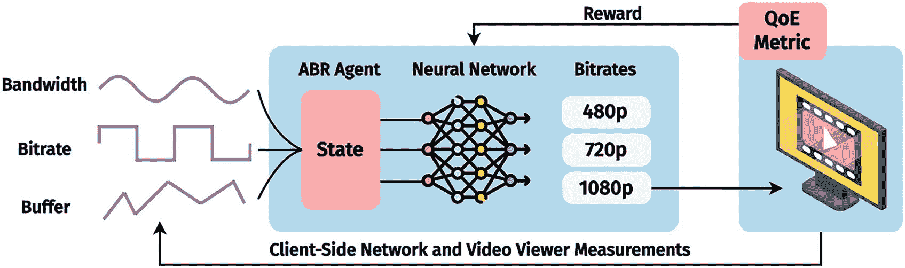

RL 工作流程示意图。带宽、比特率和缓冲区的输入被传递到客户端网络和视频观众测量中，包括 ABR 代理、神经网络和比特率。输出显示为 QoE 指标。

图 3-16

Mao 等人将 RL 应用于比特率自适应的工作流程 [87]

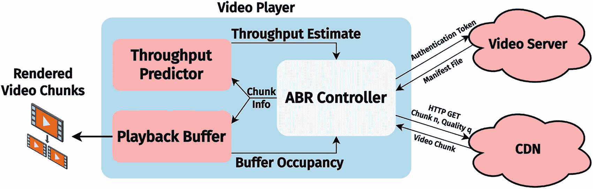

HTTP 自适应流媒体流程图。视频播放器与视频服务器和 CDN 双向连接。视频播放器组件包括一个 ABR 控制器、一个吞吐量预测器和一个播放缓冲区。播放缓冲区生成渲染后的视频块。

图 3-15

Mao 等人的 HTTP 自适应视频流概述 [87]

在类似的研究中，Yousef 等人使用监督分类，通过基于平均杂质减少量预测 ABR 的显著属性来估计其类别 [88]。作者声称，该方法可以通过提供一组可在应用层使用的输入属性来预测任何 ABR 方法的比特率选择。通过将其重构为一个多类分类问题，解决了预测难题，该问题包括交付质量（QoD）指标，例如过去和当前阶段的缓冲区大小、速度水平和下载时间。比较了多种机器学习方法的预测能力，包括逻辑回归、SVM、RF、DT、梯度提升（GB）和朴素贝叶斯（NB）。实验得出结论，RF 和 GB 模型在性能上最为有效。

该研究领域的其他值得注意的出版物包括 Bentaleb 等人提出的 ACTE 方法 [89]，这是一种基于片段下载调整比特率的独特方法。该策略改善了带宽，并减少了卡顿和延迟的发生。Zhao 等人 [90] 使用两个神经网络，通过控制网络延迟并在 ABR 和延迟自适应方面做出更准确的决策来增强观看体验。根据 Sani 等人 [91] 的研究，RF 被证明是开发基于 HTTP 的 ABR 视频流基础设施最有效的算法。评估是通过考虑视频片段的下载和到达时间、编解码器类型、片段长度和带宽等因素进行的。Da Hora 等人 [92] 在使用支持向量回归（SVR）计算 YouTube 视频的 MOS 时，实现了 0.60 到 0.79 的 RMSE。研究人员纳入了上行链路和下行链路时间、帧数以及接收信号强度指示（RSSI）等特征。Ligata 等人 [93] 成功使用 RF 对流媒体与缓冲比率、缓冲延迟、频率和持续时间进行了精确预测。本文使用的概念框架如图 3-17 所示。因此，他们的准确预测率在 85% 到 95% 之间。

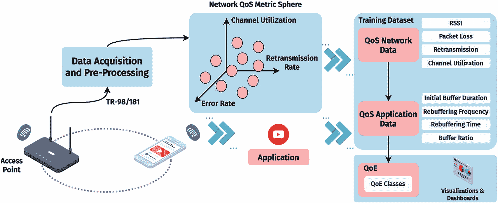

概念框架示意图。组件序列为接入点、数据采集与预处理、网络 QoS 指标领域、包含 QoS 网络和应用数据的训练数据集，以及 QoE。

图 3-17

Ligata 等人提出的概念框架工作流程 [93]

## 3.4 总结

第 3 章对视频质量评估（VQA）进行了深入分析，涵盖了其核心原理、全球行业专业人士当前使用的应用以及前沿方法。它还引导用户了解主观和客观分析的概念，然后强调了在不断发展的视频内容中进行质量评估的必要性。随后是对研究界当前 VQA 趋势的最新回顾。一些关键要点如下：

*   VQA 通过评估跨平台的视频质量，对于确保观众满意度至关重要。

*   一些体验质量（QoE）指标包括可用性、比特率、播放失败、重新缓冲启动时间、视频启动错误和延迟比率。

*   一些服务质量（QoS）指标包括流量/点击量、吞吐量、卸载和可用性。

*   目前可用的 VQA 软件示例包括 Witbe 和 ViCue Soft。

*   在 VQA 中整合主观和客观指标是主要挑战之一。

*   机器学习算法的集成正在彻底改变 VQA，使得对视频质量的评估更加准确且具有上下文感知能力。

在下一章中，将用数学方法详细分解用于构建本书中应用程序的、围绕 NTMA 和 VQA 的机器学习技术。

