# 4. 用于 NTMA 和 VQA 的机器学习技术

本章深入探讨了支持并实现网络流量监控与分析（NTMA）和视频质量评估（VQA）的机器学习（ML）技术。通过被动监听网络接口上报的网络参数，Node.js 服务器构建了一系列数组，用于追踪随时间收集的网络流量。同样的方法也适用于通过视频流获取基于机器学习的平均意见得分（MOS）值。诸如多层感知器（MLP）之类的技术被用于回归——即预测网络流量和视频 QoS 分数——而分类则使用了 K 近邻（KNN）模型。本章对本书中用于网络流量指标分类和预测的所有算法，以及视频质量 MOS 分数的生成，进行了详尽的数学分解。

## 4.1 用于 NTMA 的分类模型

在本书中，针对网络流量的两种机器学习方法是分类和预测，其中分类使用 K 近邻（KNN）模型实现。本节将详细阐述该算法，它允许最终用户获取设备在网络上的实时活动状态，该状态分为三大类。

### 4.1.1 分类的数据收集

分类的第一步包括对收集到的数据进行预分类，因为目标是预测通常属于不同组别或类别的结果。具体来说，不同的用户活动，如“空闲”、“浏览”和“流媒体”，是基于实时网络流量来确定的。因此，会捕获这些预定义网络上下文中的参数，以构建训练数据集。在这种情况下，记录的值会根据以下状态，按照最可能的流量类型进行分类：

*   **空闲**：数据收集设备未主动向其网络接口发送或从网络接口接收任何与网络相关的指标，但通过社交媒体应用的通知或消息观察到的一些峰值除外。否则，网络特征保持相当稳定且接近于零。
*   **浏览**：包括网页浏览以及在 Facebook 和 Google News 等社交媒体应用上滚动浏览，通常观察到网络流量具有不稳定的特性，并伴有频繁的峰值。浏览可被视为中等使用强度。
*   **流媒体**：设备用于在 Twitch 或 YouTube 等平台上流式传输视频，同时收集网络流量。这通常会导致高带宽使用，具体取决于平台和所观看视频的质量。

在三维空间中，此类网络流量分类数据集的一部分（包含另一个参数，即“接收的数据包”）如图 4-1 所示。

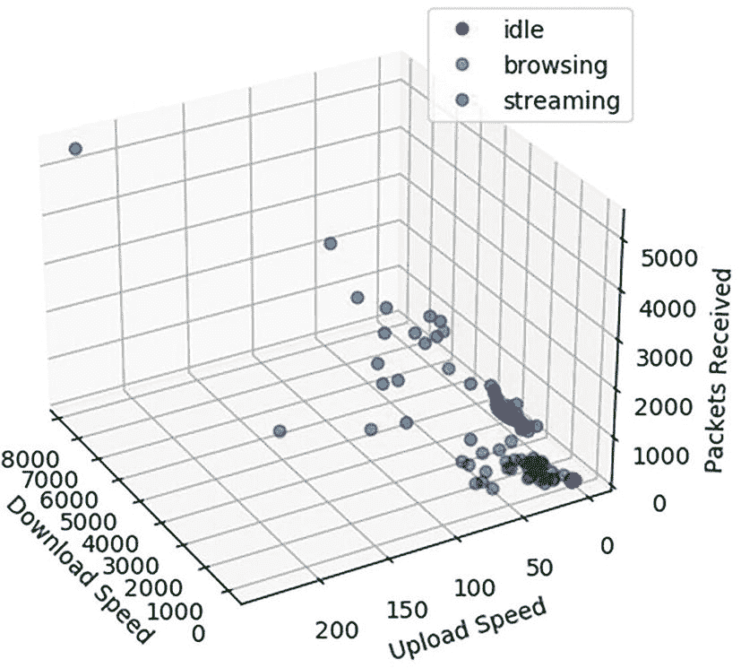

一个下载速度与上传速度与接收数据包的三维散点图，绘制了空闲、浏览和流媒体三种状态的三个散点数据点。

图 4-1 设备活动状态的三维表示

每隔一秒，网络的运行状态被用来手动为每一行分配一个标签，然后将其保存在监控设备本地。下面给出了该数据集中一些值的示例，其中最后一位数字表示分配的类别，即 0、1 和 2，分别对应三种设备活动：

*   **空闲**：1, 1, 0
*   **空闲**：1, 2, 0
*   **浏览**：210, 31, 1
*   **浏览**：462, 44, 1
*   **流媒体**：1049, 20, 2
*   **流媒体**：1190, 21, 2

此类数据集可以围绕更多设备状态构建，例如游戏、视频会议、社交媒体使用和在线购物。分类数据集的样本随本书代码一起提供。但是，建议每个用户根据自己的设备和互联网连接套餐规格执行自己的数据收集，以便在分类过程中达到最佳精度。

### 4.1.2 K 近邻（KNN）算法

KNN 是一种用于回归和分类问题的监督学习技术。其目的是找到并分组彼此相似的对象[1]。该方法迭代地搜索数据集，使用闵可夫斯基距离、曼哈顿距离或欧几里得距离等度量标准计算测试实例与每个其他数据点之间的距离。在特征空间中对数据点进行分类时，它使用投票方法，将数据点分配为其 k 个最近邻居中最常见的类别。在本书中，选择欧几里得距离作为测量技术，两个特定记录之间的距离*d*的计算公式如公式 4-1 所示[2]：

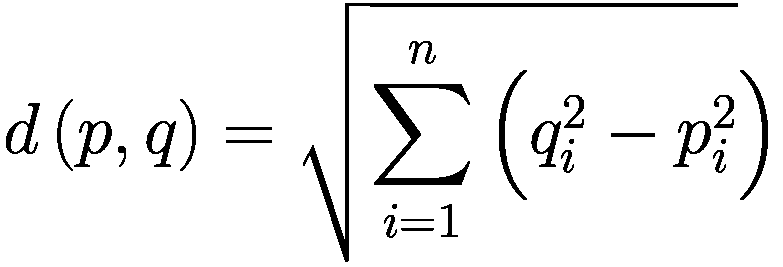

(4-1)

其中：

*   *p*, *q*：欧几里得*n*维空间中的两个点
*   *qi*, *pi*：从空间原点开始的欧几里得向量
*   *n*：构成平面的轴的数量

### 4.1.3 分类的数据准备

在将数据输入 KNN 模型之前，需要将其处理成合适的格式。图 4-2 显示了作为训练数据的三种活动状态的一个片段以及一个样本测试数据。此时，一个大型数据集在输入模型之前需要进行打乱。

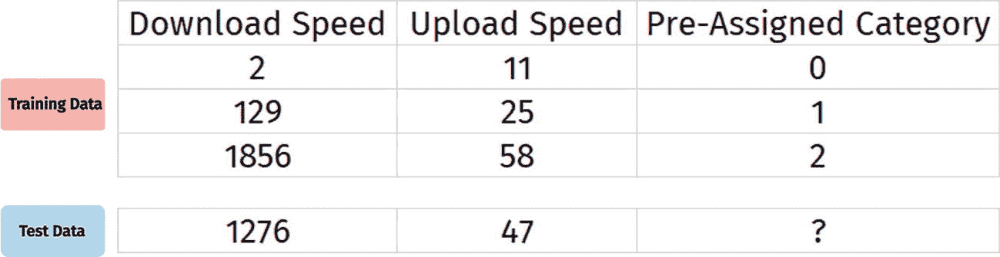

一个 3 列 2 行的表格。列标题是下载速度、上传速度和预分配类别。行标题是训练数据和测试数据。训练数据有 3 个子行。条目如下：1. 2, 11, 0。2. 129, 25, 1。3. 1856, 58, 2。测试数据：1276, 47, 问号。

图 4-2 分类的数据准备

### 4.1.4 KNN 的简化示例

以下步骤是一个数值示例，用于根据本书中编码的模型对网络数据进行 KNN 分类。

1.  考虑表 4-1 中给出的值集及其预标记的类别。待分类的度量集也已给出。

    表 4-1 KNN 分类的样本数据

    | 下载速度 | 上传速度 | 设备活动 | 数值类别 |
    | --- | --- | --- | --- |
    | 2 | 11 | 空闲 | 0 |
    | 129 | 25 | 浏览 | 1 |
    | 1856 | 58 | 流媒体 | 2 |
    | 1276 | 47 | 未定义 | 未定义 |

2.  因此，一次比较的欧几里得距离可以计算如下：

    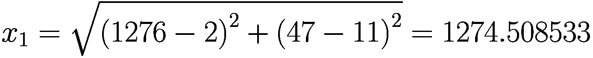

3.  对数据库中存在的所有记录重复此过程，将表 4-1 中的“未定义”记录与所有记录进行比较，从而构建一个包含每次记录比较距离的逻辑表。

4.  因此，表 4-2 显示了从被分类记录到其他每组值的欧几里得距离。这主要是为了进行投票。

    表 4-2 计算出的欧几里得距离

    | 欧几里得距离 | 类别 |
    | --- | --- |
    | 1274.508533 | 0 |
    | 1147.210966 | 1 |
    | 580.104301 | 2 |

5.  然而，定义的邻居数量对记录被分配到的类别有影响。例如，如果此处的 *k* = 1，则意味着选择 k 个最近邻居的类别。从表 4-2 中，该记录因此被归类为“流媒体”，其最近类别为“2”，因为其欧几里得距离最短。

## 4.2 NTMA 的预测模型

本节描述了多层感知器（MLP）回归模型。它与滑动或滚动窗口方法结合使用，以创建输入模型进行训练的数据元组。结合超参数优化过程，MLP 模型用于创建一个时间序列预测框架，允许用户使用“窗口大小”和“预测时间”变量来预测任何时间戳的网络流量。

### 4.2.1 多层感知器（MLP）算法

MLP 算法属于神经网络领域，并在训练过程中使用反向传播方法 [3]。这包括前向和后向传递，其中调整称为权重的参数，使其针对特定数据集进行定制。在模型旨在减少预测值与数据点输入之间的误差之前，权重最初是随机分配的。这创建了一个连续循环，其中误差不断减小，直到满足用户设定的特定要求 [4]。MLP 是分类和回归问题的流行模型 [5]，因为它从一个接收预处理数据的输入层开始，然后是若干前馈计算单元的隐藏层。然后，输出层连接到这些隐藏层以生成预测。图 4-3 给出了一个具有两个隐藏层的 MLP 模型的基本表示。

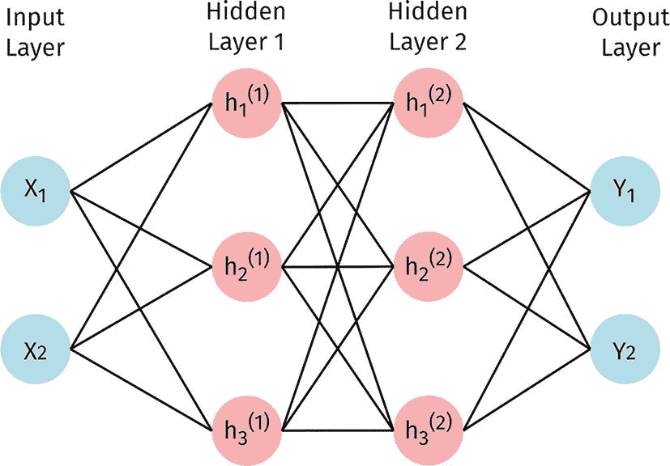

MLP 架构的网络图。它包括输入层中 2 个节点之间的连接，然后是 2 个隐藏层中各 3 个节点，以及输出层中的 2 个节点。

图 4-3 MLP 架构

一个简单的 MLP 可以用公式 4-2 来概括 [6]：

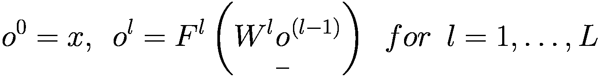

(4-2)

其中：

*   *x*：输入向量，设置为“第零层的输出”
*   *l*：所讨论的层
*   *o*^(*l*)：输出向量
*   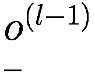：通过在向量前添加数字 1 来增加向量的维度
*   *W*^(*l*)：特定层的偏置项
*   *F*^(*l*)：应用于参数所有分量的激活函数

### 4.2.2 超参数

# MLP 模型与时间序列预测

MLP 模型通常由超参数控制，这些超参数决定了网络结构，并最终为网络的训练方式定下基调。它们在训练过程之前设置。理想值可能因数据集的独特属性而异，包括其规模、复杂性和数据分布。鉴于网络流量数据依赖于底层因素，如网络带宽、网络设备和用于收集数据的设备，产生最佳性能准确性的超参数可能因用户和场景而异。因此，建议通过实验进行超参数调整，以确定特定用户或网络环境的最佳值组合。这里列出了一些典型的超参数 [7, 8]：
*   **学习率**：学习率控制模型适应问题的速度。低学习率会减慢学习过程，但收敛平稳，而较大的值可能导致更快的训练过程，但收敛性较差。为了在分析过程中达到准确性，建议选择较小的学习率，以便在每次更新时进行微小的更改，但这会以花费更多预测时间为代价。
*   **周期数**：这是训练过程中一个周期内所有训练数据的总迭代/传递次数。
*   **隐藏层数量**：适当数量的隐藏层可以产生高精度的值，同时降低时间复杂度。然而，过多的层数会使神经网络变得更加复杂 [9]。

## 4.2.3 时间序列预测的数据准备

MLP 回归要求在数据输入神经网络之前对其进行归一化。这通常会加速训练过程，从而减少收敛时间 [10]。根据公式 4-3，使用最小-最大归一化方法将数据拟合到 `0` 和 `1` 之间 [11]：

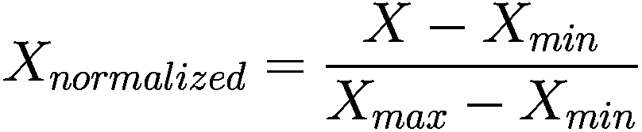

(4-3)

其中：
*   `X`：进行归一化的参数
*   `X_max`：`X` 的最大值
*   `X_min`：`X` 的最小值

同样，在预测之后，需要对输出进行反归一化，以便按相同比例放大数值。然后执行公式 4-4：

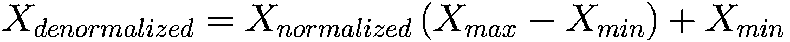

(4-4)

接下来，在将每个窗口输入算法进行训练之前，将滑动窗口原理应用于归一化后的数据集。输入到 MLP 神经网络的单变量模型的预处理改编自 Neuroph 的神经网络文档 [12, 13, 14]。这将在下一节中描述。

## 4.2.4 滑动窗口概念

滑动窗口（也称为滚动窗口）概念对于短期时间序列预测模型非常高效 [15, 16]。由于该应用以用户定义的特定预测时间作为输入，因此它非常适合本书中的回归方法。考虑下面给出的场景，该场景包含从数据集中获取的“下载速度”值，并具有以下回归模型参数：
*   **窗口大小**：5 秒
*   **预测时间**：2 秒

为便于说明，图 4-4 中给出的值直接来自数据集。在构建滑动窗口之前，这些值会被归一化，如下所示。

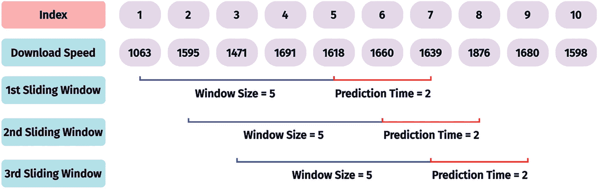

一张图表展示了下载速度的滑动窗口。它有 5 个阶段：索引、下载速度、第一个滑动窗口、第二个滑动窗口和第三个滑动窗口。索引包含从 1 到 10 的 10 个值。下载速度包含 10 个值，例如 1063、1595、1471、1691、1618、1660、1639、1876、1680 和 1598。滑动窗口的窗口大小为 5，预测时间为 2。

**图 4-4**
下载速度的滑动窗口示例

这意味着，对于第一个滑动窗口，前五个实例被作为输入数据，而第（窗口大小 + 预测时间）个值（在此例中为第七个值）被作为输出数据。索引递增 1，循环持续进行直到数据集结束。此概念训练 MLP 模型，使其理解必须使用最后一个滑动窗口来预测由预测时间决定的期望值。

## 4.2.5 用于时间序列网络流量预测的 MLP

在本书中，滑动窗口方法与独立的数据集合一起使用，具体由最终用户输入的窗口大小和预测时间因素决定。因此，在数据处理阶段，对三个变量中的每一个都采用单变量方法。公式 4-5 至 4-7 用于计算隐藏层中每个神经元关于下载速度、上传速度和延迟的加权和：

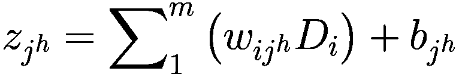

(4-5)

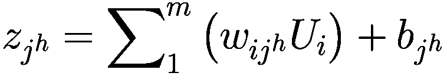

(4-6)

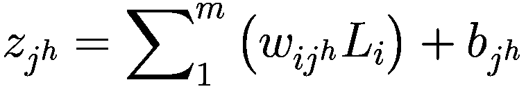

(4-7)

其中：
*   `z_{j^h}`：当前隐藏层 `h` 中神经元 `j` 处的加权和
*   `m`：前一层中的神经元数量
*   `w_{ij^h}`：前一层神经元 `i` 与当前隐藏层神经元 `j` 之间连接的权重
*   `D[i]`：前一层神经元 `i` 处关于下载速度的输入值
*   `U[i]`：前一层神经元 `i` 处关于上传速度的输入值
*   `L[i]`：前一层神经元 `i` 处关于延迟的输入值
*   `i`：每个滑动窗口的时间步长，也表示前一层中的实际神经元
*   `b_{j^h}`：当前隐藏层中神经元 `j` 的随机偏置表示

公式 4-8 展示了在应用激活函数 `F^l` 后，输出神经元处加权和的计算。该公式表示该参数的预测输出：

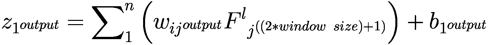

(4-8)

其中：
*   `z_{1^{output}}`：输出神经元处的加权和
*   `1`：表示单个输出层
*   `n`：最后一个隐藏层中的神经元数量

## 4.2.6 MLP 的简写示例

在表 4-3 所示的示例中，使用 MLP 分解了一种用于预测延迟值的单变量方法。其目标是利用前两个值来预测第三个时间步的延迟。因此，这代表了训练过程中的一个典型示例。

**表 4-3**
使用 MLP 预测延迟值的示例
| 时间步 | 延迟 (ms) |
| --- | --- |
| 1 | 29.2 |
| 2 | 35.8 |
| 3 | 31.0 |
| 4 | 37.0 |
| 5 | 26.8 |
| 6 | 25.0 |

接下来遵循以下步骤：

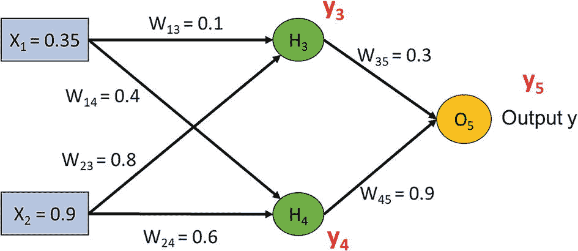
神经网络网络图。`x_1 = 0.35` 通过 `w_13 = 0.1` 指向 `H_3`，然后通过 `w_35 = 0.3` 指向 `O_s`。`x_2 = 0.9` 通过 `w_24 = 0.6` 指向 `H_4`，然后通过 `w_45 = 0.9` 指向 `O_s`。`x_1 = 0.35` 通过 `w_14 = 0.4` 指向 `H_4`，然后通过 `w_45 = 0.9` 指向 `O_s`。`x_2 = 0.9` 通过 `w_23 = 0.8` 指向 `H_3`，然后通过 `w_35 = 0.3` 指向 `O_s`。
**图 4-5**
用于延迟预测的神经网络

1.  鉴于数据集中的最大值为 `37.0`，最小值为 `25.0`，根据公式 4-3 对这些值进行归一化处理。得到表 4-4。

**表 4-4**
延迟值的归一化过程
| 时间步 | 延迟 | 归一化值 |
| --- | --- | --- |
| 1 | 29.2 | 0.35 |
| 2 | 35.8 | 0.90 |
| 3 | 31.0 | 0.50 |
| 4 | 37.0 | 1.00 |
| 5 | 26.8 | 0.15 |
| 6 | 25.0 | 0.00 |

2.  由于只考虑前三个值，因此使用 `0.35` 和 `0.90` 作为输入值，`0.50` 作为期望输出值。图 4-5 展示了使用前两个归一化值并随机分配权重构建的神经网络。

3.  现在可以利用这个误差来验证模型是否满足要求。通过反向传播方法更新权重以减小此误差。为了确定每个权重的变化量，使用以下公式：

# 反向传播计算示例

## 公式定义

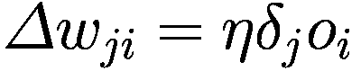

(4-11)

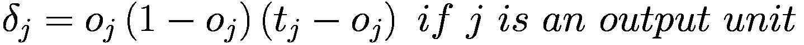

(4-12)

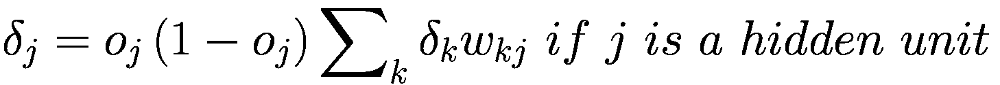

(4-13)

## 初始前向传播与误差计算

1.  由于实际目标输出值为 0.5，使用公式 4-10 计算误差。

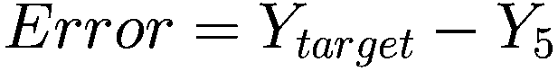

(4-10) 因此，

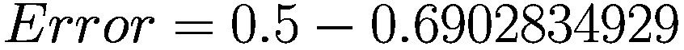

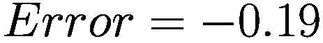

2.  对于前向传播，计算 `Y[3]`、`Y[4]` 和 `Y[5]` 的输出：
    1.  在 `H[3]` 处：

        `a[1] = (W[13] * X[1]) + (W[23] * X[2])`
        `= (0.1 * 0.35) + (0.8 * 0.9)`
        `= 0.755`

        因此，`Y[3] = f (a[1]) = f (1 / (1 + e^(-0.755))) = 0.6802671967`

    2.  在 `H[4]` 处：

        `a[2] = (W[14] * X[1]) + (W[24] * X[2])`
        `= (0.4 * 0.35) + (0.6 * 0.9)`
        `= 0.68`

        因此，`Y[4] = f (a[2]) = f (1 / (1 + e^(-0.68))) = 0.6637386974`

    3.  在 `O[5]` 处：

        `a[3] = (W[35] * Y[3]) + (W[45] * Y[4])`
        `= (0.3 * 0.6802671967) + (0.9 * 0.6637386974)`
        `= 0.8014449867`

        因此，`Y[5] = f (a[3]) = f (1 / (1 + e^(-0.8014449867))) = 0.6902834929`

因此，第一次前向传播的网络输出为 0.6902834929。

## 反向传播与权重更新

1.  在本示例中，前向传播之后是反向传播，然后再进行一次前向传播。假设实际输出为 0.5，学习率为 1。公式 4-8 给出了 Sigmoid 激活函数，公式 4-9 给出了前向传播公式：

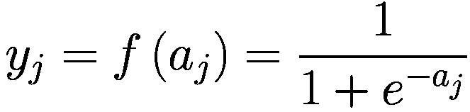

(4-8)

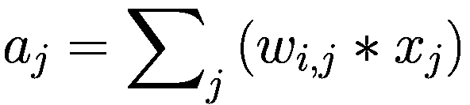

(4-9)

其中：
*   `η`：是一个称为学习率的常数
*   `t[j]`：是单元 `j` 的正确教师输出
*   `δ[j]`：是单元 `j` 的误差度量

这意味着所有单元都需要 `δ[j]`。

2.  反向传播现在包括在每个单元计算最终的 `Δw` 项，即修改后的权重。例如，`Δw[45]` 的计算如下：

    `ΔW[45] = n 𝛿[j] O[i]`
    `= n 𝛿[5] Y[4]`
    `= (1) (-0.04068112511) (0.6637)`
    `= -0.02700163699`

    因此，`Δw[45 (新)] = Δw[45] + Δw[45 (旧)]`
    `= -0.02700163699 + 0.9`
    `= 0.872998363`

    对所有其他权重重复此过程，得到表 4-5。

**表 4-5 权重更新过程**

| `i` | `j` | `w[ij]` | `δ[j]` | `x[i]` | `n` | 更新后的 `w[ij]` |
| :---: | :---: | :---: | :---: | :---: | :---: | :---: |
| 1 | 3 | 0.1 | -0.00265 | 0.35 | 1 | 0.0991 |
| 2 | 3 | 0.8 | -0.00265 | 0.9 | 1 | 0.7976 |
| 1 | 4 | 0.4 | -0.0082 | 0.35 | 1 | 0.3971 |
| 2 | 4 | 0.6 | -0.0082 | 0.9 | 1 | 0.5926 |
| 3 | 5 | 0.3 | -0.0406 | 0.6803 | 1 | 0.2724 |
| 4 | 5 | 0.9 | -0.0406 | 0.6637 | 1 | 0.8731 |

## 第二次前向传播与误差分析

1.  现在，再次对 `Y[3]`、`Y[4]` 和 `Y[5]` 进行前向传播计算：
    1.  在 `H[3]` 处：

        `a[1] = (W[13] * X[1]) + (W[23] * X[2])`
        `= (0.0991 * 0.35) + (0.7976 * 0.9)`
        `= 0.7525`

        因此，`Y[3] = f (a[1]) = f (1 / (1 + e^(-0.7525))) = 0.6797`

    2.  在 `H[4]` 处：

        `a[2] = (W[14] * X[1]) + (W[24] * X[2])`
        `= (0.3971 * 0.35) + (0.5926 * 0.9)`
        `= 0.6723`

        因此，`Y[4] = f (a[2]) = f (1 / (1 + e^(-0.6723))) = 0.6620`

    3.  在 `O[5]` 处：

        `a[3] = (W[35] * Y[3]) + (W[45] * Y[4])`
        `= (0.2724 * 0.6797) + (0.8731 * 0.6620)`
        `= 0.7631`

        因此，`Y[5] = f (a[3]) = f (1 / (1 + e^(-0.7631))) = 0.6820`

因此，第二次前向传播的网络输出为 0.6820。

2.  权重更新并计算出网络输出后，误差计算如下：

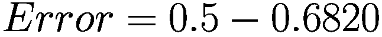

3.  对于输出单元：

    `𝛿[5] = Y[5] (1 – Y[5]) (Y[target] – Y[5])`
    `= 0.6903 (1 - 0.6903) (0.5 - 0.6903)`
    `= -0.04068112511`

4.  对于隐藏单元 `H[3]`：

    `𝛿[3] = Y[3] (1 – Y[3]) (𝛿[5] * W[35])`
    `= 0.6803 (1 - 0.6803) (-0.04068112511 * 0.3)`
    `= -0.00265448903`

5.  对于隐藏单元 `H[4]`：

    `𝛿[4] = Y[4] (1 – Y[4]) (𝛿[5] * W[45])`
    `= 0.6637 (1 - 0.6637) (-0.04068112511 * 0.9)`
    `= -0.008171645064`

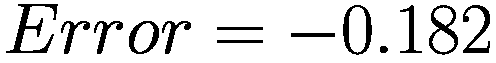

这意味着误差已从 -0.19 减小到 -0.182。此时，最大误差率超参数决定模型是否执行更多次传播。

## 准确率计算

1.  此特定预测的百分比准确率可以如下计算：

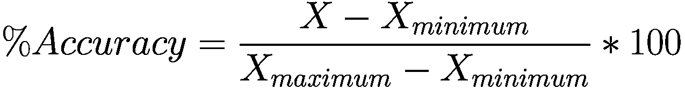

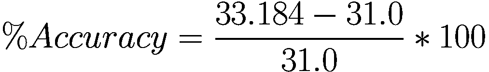

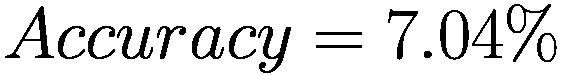

2.  最后，使用公式 4-4 对网络输出进行反归一化，得到以下结果：

![$$ {X}_{denormalized}=\left[{X}_{normalised}\left({X}_{max}-{X}_{min}\right)\right]+{X}_{min} $$](images/612428_1_En_4_Chapter/612428_1_En_4_Chapter_TeX_Equf.png)

![$$ {X}_{denormalized}=\left[0.6820\left(37-25\right)\right]+25 $$](images/612428_1_En_4_Chapter/612428_1_En_4_Chapter_TeX_Equg.png)

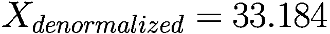

这意味着预测值为 33.184 ms。

## 4.3 用于 VQA 的 SVM

在本书中，实时的客观平均意见得分（MOS）是通过将连续截图输入到托管 Java servlet 中生成的，该 servlet 使用无参考（NR）方法，基于盲/无参考图像空间质量评估器（BRISQUE）原理进行图像质量评估（IQA）[17, 18]。一旦获得前一帧的视频质量得分，就会立即截取并处理新的截图，从而形成一个连续循环。

因此，通过应用本节详述的一系列步骤，图像失真程度可通过块效应、振铃效应、模糊和噪声等伪影来确定。对于此方法，得分越小表示视频质量越好。鉴于该指标在行业 VQA 供应商中的广泛使用和认可，它被标记为客观 MOS [19]。因此，本节将详细说明支持向量机（SVM）算法如何作为机器学习算法用于回归，从而根据实时视频（预处理为图像）生成视频质量得分。如 Min 等人 [20] 所述的工作所示，本书中的 VQA 模块使用了基于失真加剧的盲图像质量评估技术。

### 4.3.1 基于失真加剧的盲图像质量评估

本书提出的 VQA 方法可分为以下三个主要步骤 [20]：

1.  在生成多个伪参考图像（MPRI）的过程中，引入不同类型的退化加剧，以估计图像中最可能的失真类型。MPRI 是通过添加不同比例的以下退化类型生成的 [21]：

    1.  JPEG 压缩

    2.  JPEG2000 压缩

    3.  高斯模糊

    4.  白噪声

2.  然后，从每张图像中提取局部二值模式（LBP）特征，再评估该图像与每个生成的 MPRI 之间的相似性 [22]。

3.  将相似性得分输入到 SVM 回归模型中，用于缩放和最终预测视频质量得分 [23]。

### 4.3.2 初步步骤

图 4-6 展示了 BRISQUE 方法所基于的系统模型。

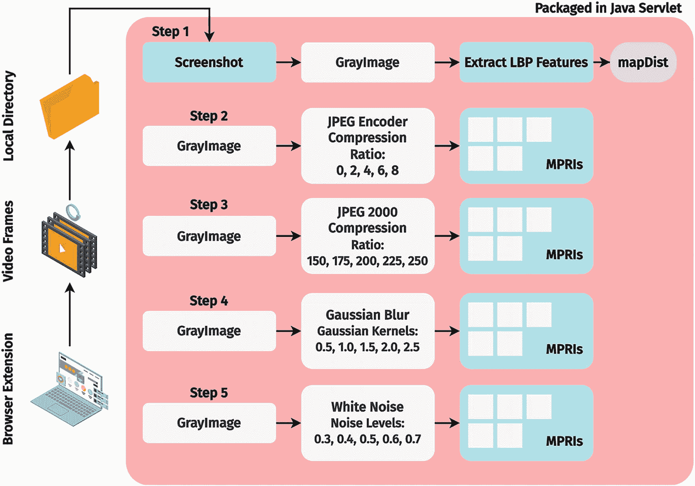

BRISQUE 方法初步步骤的图表。它始于一个浏览器扩展，然后是视频帧、本地目录以及 5 个步骤。这 5 个步骤分别是：截图、JPEG 编码器压缩比的灰度图像、JPEG2000 压缩比的灰度图像、高斯模糊高斯核的灰度图像以及白噪声的灰度图像。

Java servlet 负责接收一个“数字”标签，该标签指示它应从代码中用户指定的本地目录中获取哪张截图。一旦接收到，它会读取裁剪后的截图，然后将其转换为灰度图，如图 4-6 中的 `GrayImage` 对象所示。

### 4.3.3 LBP 特征的提取

在本节中，将结合数学公式和代码中执行的图示来解释 LBP 特征的提取。

#### 过程与公式

获取灰度图像后，从 `grayImage` 对象中提取 LBP 特征，结果存储在 `mapDist` 数组中。二值化过程根据公式 4-14 [22]，通过后续的亮度对比进行：

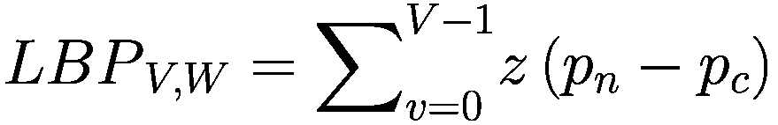

其中：

*   `p[c]`：中心像素

*   `p[n]`：圆形对称邻域像素

*   `V`：邻域值

*   `W`：LBP 特征的半径

*   `z(∗)`：单位阶跃函数，表示为

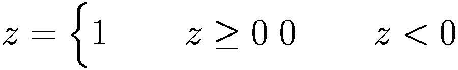

(4-15)

为简化过程，将 `V` 和 `W` 设置为 `p = 4` 和 `r = 1`，得到以下 LBP 特征图：

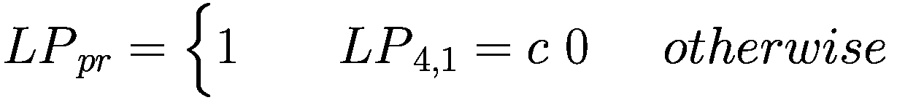

其中：

*   `p` 和 `r`：像素索引

*   `c`：表示 0 ≤ `c` ≤ 5 范围内的五个 LBP

LBP 提取过程首先对原始图像执行，然后对退化图像和 MPRI 执行相同的方法。这会产生标记为 `LP[d]` 和 `LP[m]` 的特征图。

#### 图解与编码步骤

此过程通过 `LBP41()` 方法执行。以图 4-7 中给出的像素矩阵为例，其值存储在 `img1[][]` 数组中。

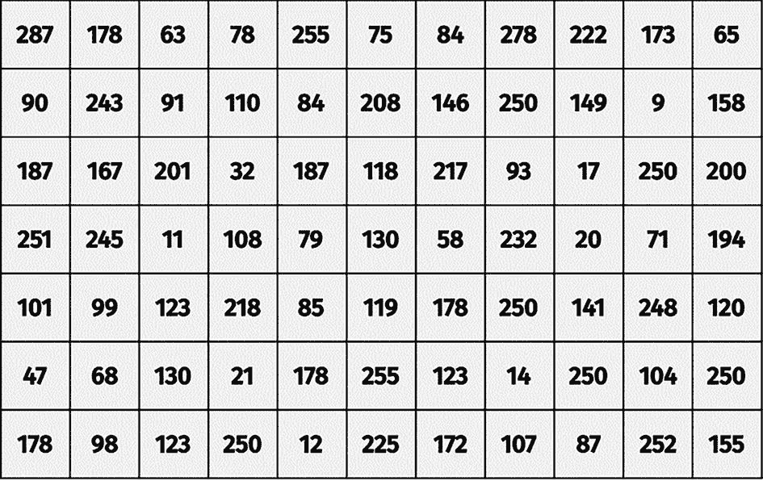

一个 11x7 的灰度图像像素值网格。数值如下：1. 287, 178, 63, 78, 255, 75, 84, 278, 173, 65。2. 90, 243, 91, 110, 84, 208, 146, 250, 149, 9, 158。3. 187, 167, 201, 32, 187, 118, 217, 93, 17, 250, 200。4. 251, 245, 11, 108, 79, 130, 58, 232, 20, 71, 194。5. 101, 99, 123, 218, 85, 119, 178, 250, 141, 248, 120。6. 47, 68, 130, 21, 178, 255, 123, 14, 250, 104, 250。7. 178, 98, 123, 250, 12, 225, 172, 107, 87, 252, 155。

随后执行以下步骤：

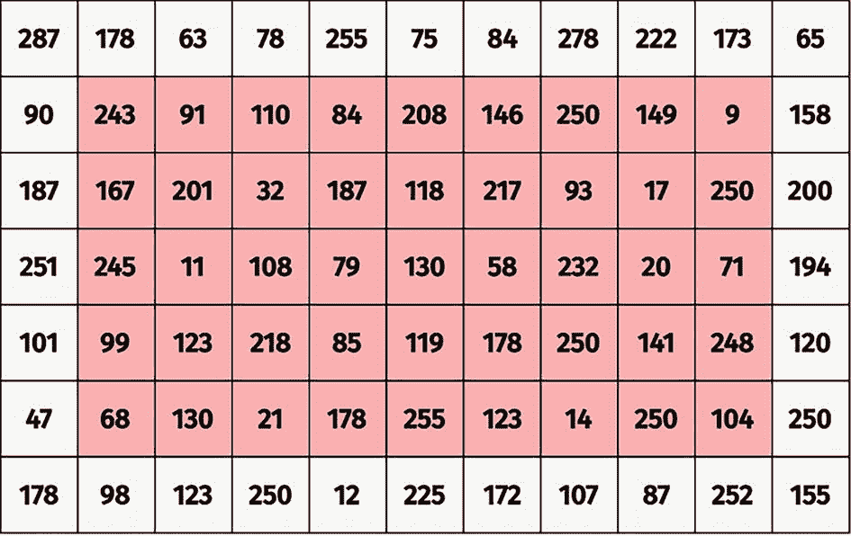

一个用于提取中心像素值的 11x7 网格。高亮数值如下：2. 243, 91, 110, 84, 208, 146, 250, 149, 9。3. 167, 201, 32, 187, 118, 217, 93, 17, 250。4. 245, 11, 108, 79, 130, 58, 232, 20, 71。5. 99, 123, 218, 85, 119, 178, 250, 141, 248。6. 68, 130, 21, 178, 255, 123, 14, 250, 104。

1.  从 `img1[][]` 中提取中心像素，并存储在 `center[][]` 数组中，如图 4-8 中阴影区域所示。

1.  然后，从 `img1[][]` 中提取四个不同相邻偏移处的像素，并将其存储在三维 `cell[][][]` 数组中，具体步骤如下所示。

    1.  首先考虑偏移量 (0, 1)，如图 4-9 所示。

        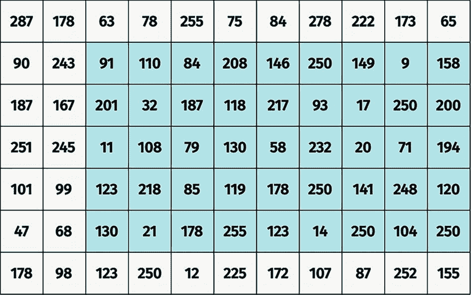

        一个用于提取偏移量 (0, 1) 处像素值的 11x7 网格。高亮数值如下：第 2 行：91, 110, 84, 208, 146, 250, 149, 9, 158。第 3 行：201, 32, 187, 118, 217, 93, 17, 250, 200。第 4 行：11, 108, 79, 130, 58, 232, 20, 71, 194。第 5 行：123, 218, 85, 119, 178, 250, 141, 248, 120。第 6 行：130, 21, 178, 255, 123, 14, 250, 104, 250。

    2.  接着考虑偏移量 (-1, 0)，如图 4-10 所示。

        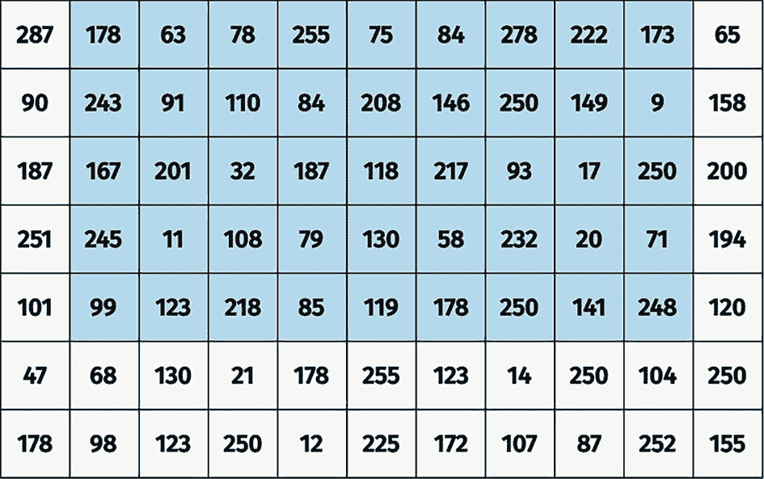

### 4.3.3 LBP 特征提取

一个用于提取偏移量 `(-1, 0)` 处像素值的 11x7 网格。数值如下：第 1 行：178, 63, 78, 255, 75, 84, 278, 173。第 2 行：243, 91, 110, 84, 208, 146, 250, 149, 9。第 3 行：167, 201, 32, 187, 118, 217, 93, 17, 250。第 4 行：245, 11, 108, 79, 130, 58, 232, 20, 71。第 5 行：99, 123, 218, 85, 119, 178, 250, 141, 248。

图 4-10 提取偏移量 `(-1, 0)` 处的像素值

3.  类似地，图 4-11 展示了在偏移量 `(0, -1)` 处的提取。

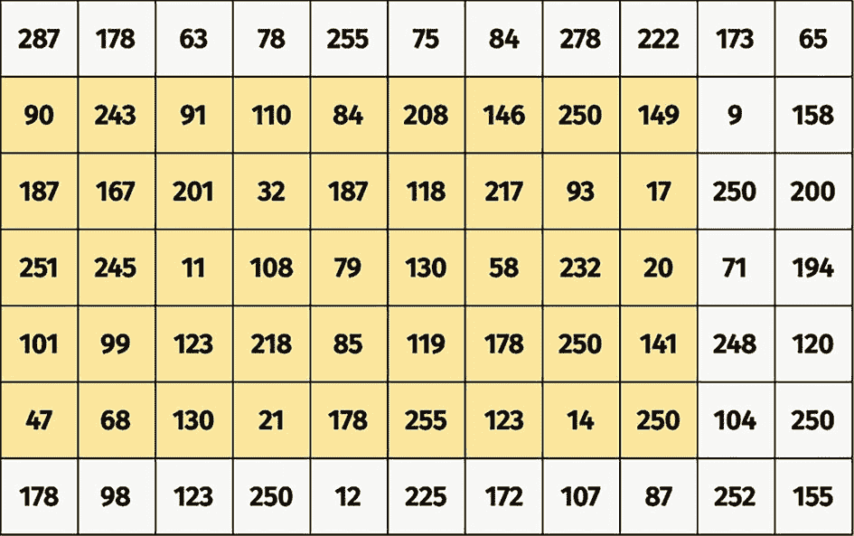

一个用于提取偏移量 `(0, -1)` 处像素值的 11x7 网格。高亮数值如下：第 2 行：90, 243, 91, 110, 84, 208, 146, 250, 149。第 3 行：187, 167, 201, 32, 187, 118, 217, 93, 17。第 4 行：251, 245, 11, 108, 79, 130, 58, 232, 20。第 5 行：101, 99, 123, 218, 85, 119, 178, 250, 141。第 6 行：47, 68, 130, 21, 178, 255, 123, 14, 250。

图 4-11 提取偏移量 `(0, -1)` 处的像素值

4.  最后，采用偏移量 `(1, 0)`，如图 4-12 所示。

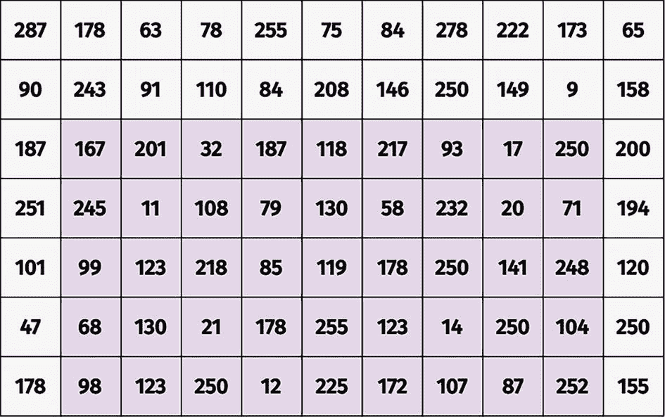

一个用于提取偏移量 `(1, 0)` 处像素值的 11x7 网格。高亮数值如下：第 3 行：167, 201, 32, 187, 118, 217, 93, 17, 250。第 4 行：245, 11, 108, 79, 130, 58, 232, 20, 71。第 5 行：99, 123, 218, 85, 119, 178, 250, 141, 248。第 6 行：68, 130, 21, 178, 255, 123, 14, 250, 104。第 7 行：98, 123, 250, 12, 225, 172, 107, 87, 252。

图 4-12 提取偏移量 `(1, 0)` 处的像素值

2.  接下来，将中心矩阵中的每个像素与四个相邻矩阵中的每个像素进行比较。如果 `cell[][][]` 数组中的像素值大于 `center[][]` 数组中的像素值，则 `cell[][][]` 中的结果像素值为 1。否则为 0。如图 4-13 所示。

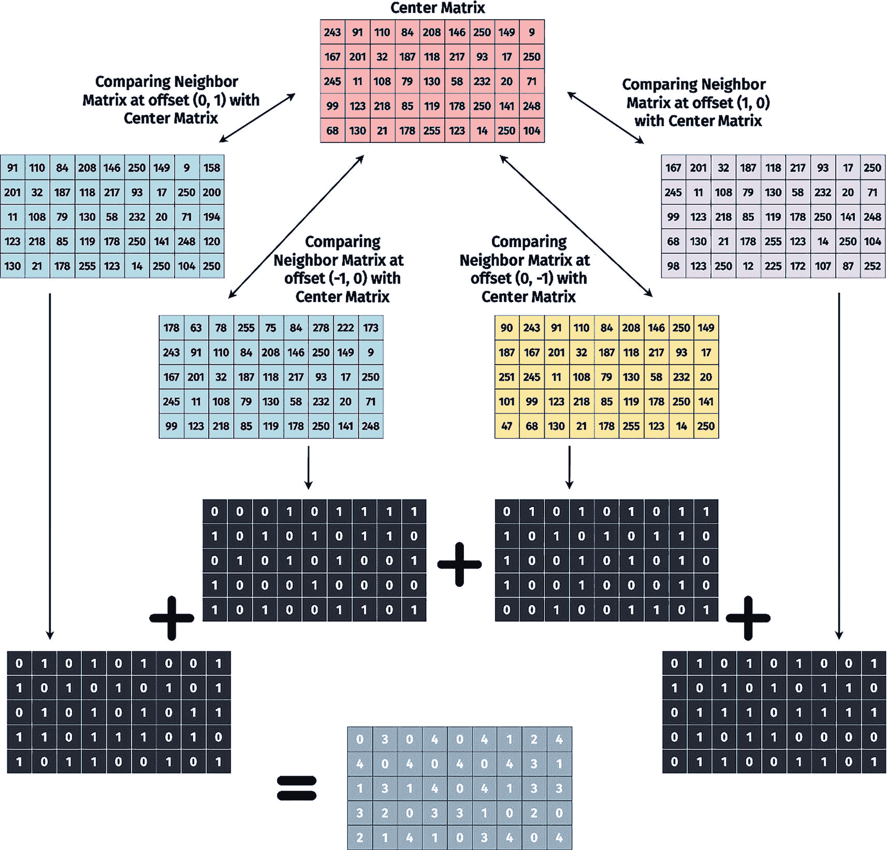

中心矩阵与其 4 个相邻矩阵比较结果之和的图表。这些矩阵分别是偏移量 `(0, 1)` 处的矩阵、偏移量 `(-1, 0)` 处的矩阵、偏移量 `(0, -1)` 处的矩阵以及偏移量 `(1, 0)` 处的矩阵。

图 4-13 中心矩阵与相邻矩阵比较结果之和

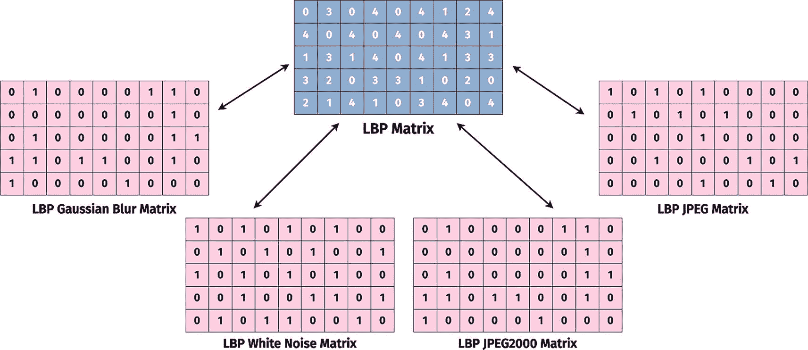

二值化过程图表。`LBP` 高斯模糊矩阵、`LBP` 白噪声矩阵、`LBP` JPEG2000 矩阵和 `LBP` JPEG 矩阵通过双向箭头指向 `LBP` 矩阵。每种方法都有一个 9x5 的网格，数值各不相同。

图 4-14 基于相应失真类型的二值化过程

1.  最后，在 `LBP41jpeg()`、`LBP41jpeg2k()`、`LBP41gblur()` 和 `LBP41wnoise()` 方法中，根据其失真类型对每个 `LBP[][]` 矩阵进行二值化。如图 4-14 所示。

### 4.3.4 失真加剧

对灰度图像施加四种不同类型的压缩和失真，以生成 MPRI。

#### JPEG 压缩

图像以 0 到 8 的压缩比进行压缩，步长为 2。图像所测试的伪影类型是块效应。在此过程结束时，会输出一组五张图像，称为 MPRI，如图 4-6 所示。JPEG 压缩由公式 4-17 概述，其中 `I` 表示原始图像。

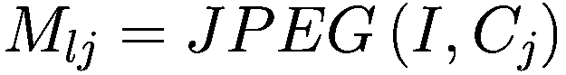

(4-17)

其中：

*   `M[lj]`：在 JPEG 压缩的第 `j` 个程度（0 ≤ `j` ≤ 5）下压缩的 MPRI
*   `l`：块效应伪影
*   `JPEG`：JPEG 编码器
*   `C[j]`：压缩比

#### JPEG2000 压缩

类似地，使用 JPEG2000 编码器以 150 到 250 的比率（步长为 25）对图像引入 JPEG2000 压缩，从而生成其 MPRI。这种压缩类型检测振铃伪影，如公式 4-18 所示：

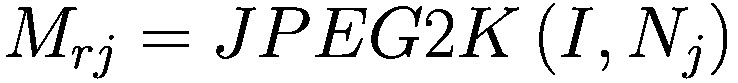

(4-18)

其中：

*   `M[rj]`：在 JPEG2K 压缩的第 `j` 个程度（0 ≤ `j` ≤ 5）下压缩的 MPRI
*   `r`：振铃伪影
*   `JPEG2K`：JPEG2K 编码器
*   `N[j]`：压缩比

#### 高斯模糊

类似地，对灰度图像添加高斯模糊，退化程度从 0.5 到 2.5，步长为 0.5，以检测模糊伪影。如公式 4-19 所示：

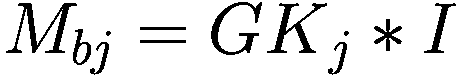

(4-19)

其中：

*   `M[bj]`：在第 `j` 个模糊程度（0 ≤ `j` ≤ 5）下模糊的 MPRI
*   `b`：模糊伪影
*   `GK[j]`：高斯核

#### 白噪声

最后，添加的失真类型是白噪声，其强度范围从 0.3 到 0.7，步长为 0.1。这用于检测加噪，并由公式 4-20 给出：

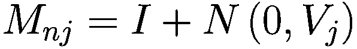

(4-20)

其中：

*   `M[nj]`：在第 `j` 级白噪声（0 ≤ `j` ≤ 5）下的含噪 MPRI
*   `n`：加噪伪影
*   `N(0, V[j])`：生成均值为 0、方差为 `V[j]` 的正态分布随机值

### 4.3.5 相似度指数

在应用不同类型的压缩和失真后，会生成一组二十个 MPRI。从每个 MPRI 中再次提取 LBP 特征，然后将结果数组存储在一个名为 `mapPRI` 的数组中。如图 4-15 [23, 24]所示。

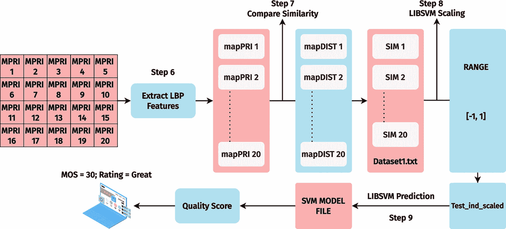

图表以一个 5x4 的网格开始，随后是提取 LBP 特征、`mapPRI` 1 至 20、比较相似度、`dataset1.txt`、LIBSVM 缩放、范围、LIBSVM 预测、SVM 模型文件、质量分数、MOS 30，评级为优秀。

图 4-15 相似度指数与视频质量分数预测模型

`LP[d]` 和 `LP[m]` 特征图之间的重叠度使用公式 4-21 计算：

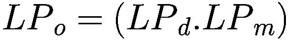

(4-21)

其中：

*   `LP[o]`：`LP[d]` 和 `LP[m]` 之间的重叠度
*   `LP[d]`：退化图像的特征图
*   `LP[m]`：MPRI 的特征图

相似度 `sim` 由公式 4-22 定义，其中分子和分母指示了特征图中非零元素的数量：

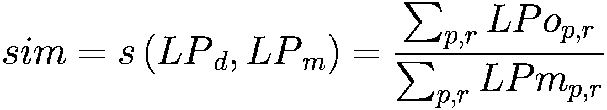

(4-22)

在代码实现中，先前生成的 `mapPRI` 数组值与 `mapDIST` 数组值之间的相似度分数使用公式 4-23 计算，进而生成一个二十维的特征向量。该向量包含了该特定图像所有 MPRI 的相似度分数。然后，这些值被存储在一个名为 `dataset1.txt` 的 `.txt` 文件中。

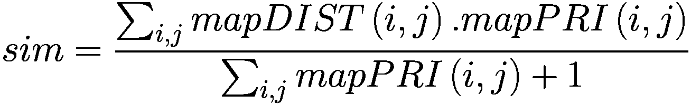

(4-23)

其中：

*   `sim`：表示平均相似度分数
*   `mapDIST`：从灰度图像中提取 LBP 特征后得到的像素结果数组
*   `mapPRI`：从每个 MPRI 中提取 LBP 特征后得到的像素数组
*   `i` 和 `j`：`mapDIST` 和 `mapPRI` 数组中值的索引

二十维特征向量的表示法如公式 4-24 所示：

![$$ sim=\left[{sim}_{l1},..,{sim}_{l5,}\ {sim}_{r1},..,{sim}_{r5,\kern0.5em }{sim}_{b1},..,{sim}_{b5,}{sim}_{n1},..,{sim}_{n5}\right] $$](images/612428_1_En_4_Chapter/612428_1_En_4_Chapter_TeX_Equ25.png)

(4-24)

其中：

*   `sim[l1]` 至 `sim[l5]`：受块效应影响的特征向量的相似度分数
*   `sim[r1]` 至 `sim[r5]`：受振铃效应影响的特征向量的相似度分数
*   `sim[b1]` 至 `sim[b5]`：受模糊效应影响的特征向量的相似度分数
*   `sim[n1]` 至 `sim[n5]`：受加噪影响的特征向量的相似度分数

### 4.3.6 缩放

在此步骤中，使用`range`文件，因为它包含了每个索引的最小和最大缩放因子，其中最小值列在-1 以下，最大值列在 1 以下。用于缩放过程的代码片段使用了以下文件：

*   `dataset1.txt`：包含测试数据
*   `range`：包含用于将二十维特征向量缩放到[-1.0, +1.0]范围的值
*   `test_ind_scaled`：包含缩放后的值

`range`文件如图 4-16 所示。

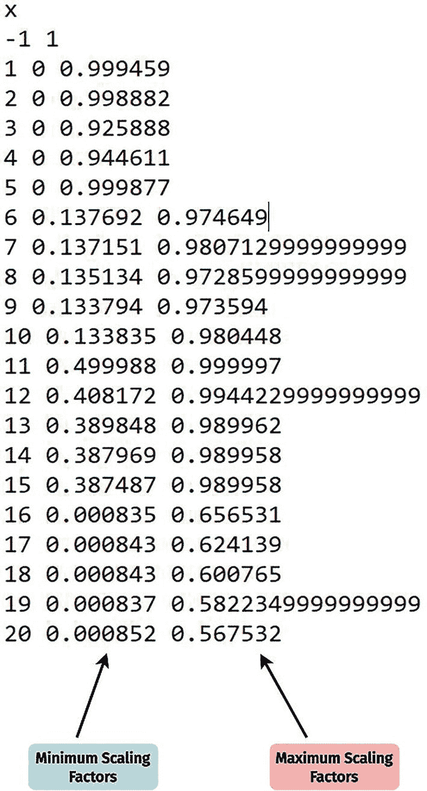

20 个索引的最小和最大缩放范围图表。部分数值如下：1. 0, 0.999459。2. 0, 0.998882。3. 0, 0.925888。4. 0, 0.944611。5. 0, 0.999877。6. 0.137692, 0.974649。7. 0.137151, 0.980712999

图 4-16

range 文件中的缩放因子

最小和最大缩放因子取自该文件，并分别用作缩放`dataset1.txt`文件中特征向量的下限和上限。公式 4-25 总结了缩放过程：

(4-25)

其中：

*   `scale[ind]`：索引 `ind` 处的缩放值
*   `value[ind]`：索引 `ind` 处来自特征向量的测试值
*   `feat_min[ind]`：索引 `ind` 处的最小缩放因子
*   `feat_max[ind]`：索引 `ind` 处的最大缩放因子

然后，每个计算出的值都会被打印到`test_ind_scaled`文件中。

### 4.3.7 使用 SVM 进行预测

为了根据获得的相似度分数预测整体图像质量分数，将二十维向量输入 SVM 进行回归。基于 LIBSVM 库[25]在解决预测问题时的简单性、高效性和可靠性，我们使用了该库。因此，MOS 分数按照公式 4-26 使用 `svm_predict()` 方法计算：

(4-26)

其中：

*   `FIN`：最终视频质量分数（MOS）
*   `regressor`：计算出的缩放特征
*   `mod`：用于近似预测的模型

用于预测方法的代码片段使用了以下文件：

*   `test_ind_scaled`：包含缩放后的值，即用于预测的测试数据
*   `model`：包含数据集模型
*   `output.txt`：包含输出结果

因此，`svm_predict()`方法根据`model`文件中的参数来近似测试数据。同时，还会给出一个质量评级以及视频质量分数。一旦确定，servlet 会以 JSON 格式将分数写回客户端。

## 4.4 本章小结

第 4 章介绍了本书中构建的 NTMA 和 VQA 模型所涉及的数学概念。NTMA 分类模型使用 KNN 算法创建，而预测模型则使用了经过超参数微调的 MLP 神经网络，以实现最佳精度和性能。针对这两个框架，均给出了简要示例，描述了用于生成任意时刻设备活动状态和预测值的概念与公式。同样，对于 VQA，使用了 SVM 算法进行 MOS 评分的缩放和预测。以下是一些关键要点：

*   机器学习概念对于增强 NTMA 和 VQA 框架的功能至关重要。
*   在 NTMA 的背景下，分类模型能够根据针对预标记数据集分类的实时网络流量，确定设备活动处于三种状态之一——即空闲、浏览和流媒体。
*   预测算法有助于预测 NTMA 的网络参数，并计算 VQA 的 MOS 评分。
*   详细描述了用于确定实时视频质量的 BRISQUE 方法。

下一章将介绍 NTMA 应用程序的开发，包括系统模型、客户端和服务器结构，以及测试和部署部分。