# 5. 基于 JavaScript 的 NTMA 应用程序

本章的重点将转向基于前几章阐述的背景进行应用程序开发。首先，将介绍一个完整的系统模型。详细阐述了包含客户端-服务器交互的架构，以及每个模块的功能和消息。简而言之，浏览器扩展与后端（即 Node.js）相结合，使用 HTML、CSS 和 JavaScript 的组合来构建客户端。通过客户端与 Node.js 服务器之间的双工通信，从设备的网络接口获取网络流量参数，然后对这些参数进行预测和分类的机器学习（ML）处理。因此，可以使用最终用户设置的预测时间和窗口大小变量的组合，实时预测延迟、抖动、上传和下载速率等参数。这也适用于分类目的，可以在几秒钟内确定设备的实时活动状态。通过在不同网络场景下对应用程序进行彻底的测试和部署，构建了一个功能完善、可靠且轻量级的网络流量监控与分析（NTMA）应用程序。

## 5.1 NTMA 系统模型

在本节中，NTMA 框架的系统模型被分解为其组成部分。其基本原理涉及客户端-服务器范式，其中客户端是一个浏览器扩展，服务器是一个运行在同一设备或另一设备上的 Node.js 服务器。因此，最终用户拥有一个具备以下功能的仪表板：

1.  通过浏览器扩展，直接在 Web 浏览器中监控实时网络参数。
2.  基于汇总为实时值的历史数据，获取回归和分类分析结果。
3.  获取网络性能的服务质量（QoS）评分。

所描述的功能被编码实现，以便在预定义且可自定义的时间段内监控网络流量。该扩展使用 JavaScript (JS) 和 Node.js 混合编码，其中 Node.js 提供服务器端功能，并包含所需的库以及访问网络接口以读取网络流量变化的权限。前端使用 HTML 和 CSS 的组合构建，而扩展和服务器之间通过以 JSON 格式发送和接收的消息实现无缝双向通信。这些属性共同构成了 NTMA 框架的一部分，该框架由服务器在与客户端的全双工通信中按需生成，利用一系列机器学习技术实现预测和分类。在监控网络趋势中的不同行为后，后端触发分析程序，这些程序作用于历史数据和实时数据的组合，其中历史数据从存储在设备上的本地数据库中获取。这有助于提高算法在分类和预测过程中的性能精度。最显著的现代特性是能够通过远程服务器在浏览器插件中使用 NTMA。整个扩展包需要四个基本文件来向服务器推送数据以及从服务器检索数据，如图 5-1 所示的完整系统模型所示。

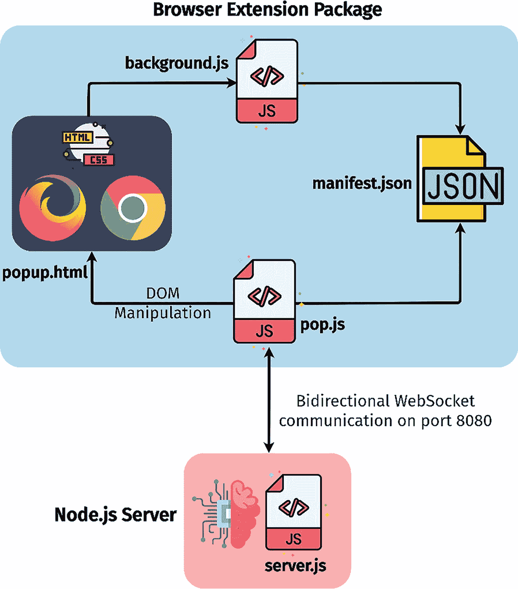

图 5-1：完整的 NTMA 系统模型

### 5.1.1 组件与功能

扩展程序与服务器之间通过持续的 JSON 格式双向信息传输进行通信。这是由 `WebSocket` 库 [1] 实现的，因为它能够通过单个持久连接双向传输微小的数据块。为了向服务器发送消息和从服务器接收消息，整个扩展程序包需要四个核心文件。这些文件汇总于表 5-1。

表 5-1：NTMA 的文件功能

| 文件 | 功能 |
| --- | --- |
| `popup.html` | 此 HTML 文件定义了扩展程序弹出窗口的结构和内容，在本例中，即用户点击浏览器工具栏中的扩展程序图标时出现的仪表板。它包含前端，即 UI 元素，例如监控图、终端以及用于联系服务器并启动 NTMA 流程的按钮。 |
| `background.js` | 作为一个在扩展程序后台运行并贯穿整个包生命周期的 JS 文件，它负责处理围绕扩展程序不同方面的事件、状态和任务。这些脚本通常用于监督长期连接、处理通信范式以及后台操作。 |
| `pop.js` | 此 JS 文件充当 `popup.html` 文件的逻辑层，包含与 UI 元素交互并触发时调用的函数。因此，它处理用户交互或弹出窗口内的任何动态内容。在此程序中，它处理与服务器的数据通信并更新 DOM。 |
| `manifest.json` | 这是一个 JSON 格式的配置文件，指定要使用的脚本以及管理标签页访问权限的权限。它还包含元数据，例如扩展程序的名称、版本、权限、操作和图标图像源。浏览器从此文件中获取有关扩展程序的信息。 |
| `server.js` | 此 JS 文件通过 Node.js 运行，并充当扩展程序的后端服务器。它处理与客户端（即浏览器扩展程序）的通信。在此应用程序中，它负责监控来自网络接口的网络流量参数，并将其组织成时间序列数组，然后执行预测和分类，同时实时更新客户端的监控图。此文件中包含多个库，以实现与客户端的无缝交互。 |

当访问任何在线页面时，流量扩展程序可用于观察并收集一分钟内的实时网络指标，包括以 Kbps 为单位的下载和上传速度以及以 ms 为单位的延迟。这是通过 `systeminformation` Node.js 包 [2] 实现的，该包直接访问设备的网络接口，记录涉及浏览器和后台活动的总带宽。用户输入一个“预测时间”参数，该参数指的是将要预测变量的时间点，以及一个“窗口大小”字段，该字段包含一个通常用于构建 ML 模型的原则，如前文第 4 章所述。客户端的动态图是使用 `Chart JS` [3] 创建的。

### 5.1.2 网络流量的预测与分类

在本研究中，收集到的流量在输入预测和分类方法之前，会经过一系列数据准备步骤。这代表了 ML 阶段，其中分类使用 `K近邻（KNN）` 算法执行，预测则使用 `多层感知器（MLP）` 框架，该框架属于神经网络类别。由于分类涉及对可转化为类别的事件进行预测，第一步是对数据集进行预标记。此处的目标是正确地将网络流量解释为“空闲”、“浏览”或“流媒体”。因此，训练数据集是通过在上述网络设置中收集数据来构建的。每个元组根据以一秒为间隔记录的当前网络行为状态被赋予一个数字标签。然后，数据集被存储在本地。总之，使用最优的五个邻居数，`KNN` 算法通过 `ml-knn` Node 模块 [4] 被用来动态确定网络的实时状态。同样地，`mlp` Node 模块 [5] 负责 MLP 预测，以预测用户指定的感兴趣时间段内被动网络特征的值。Node.js 服务器执行所有计算，然后将结果发送回客户端，并在客户端呈现给用户。

### 5.1.3 NTMA 应用程序布局

对于此应用程序，构建了一个包含多个组件的单一窗口，这些组件方便了用户的交互，而网络监控过程则在后台进行。一个实时图表描绘了网络流量，可以动态调整以仅查看所需的参数。“窗口大小”字段包含一个值，该值决定了用于预测预测值的样本数量，该预测值由“预测流量（秒）”字段表示，该字段又对应于用户希望预测值出现的时间点。然后，下载和上传速度以及延迟的预测值会连同计算出的 QoS 分数一起显示在 UI 上，该分数代表网络的实时性能。这些过程在按下“监控与分析”按钮时发生。除了预测功能外，网络活动状态的描述也通过 ML 计算得出，并连同平均延迟一起显示在用户界面上。完成的扩展程序如图 5-2 所示。

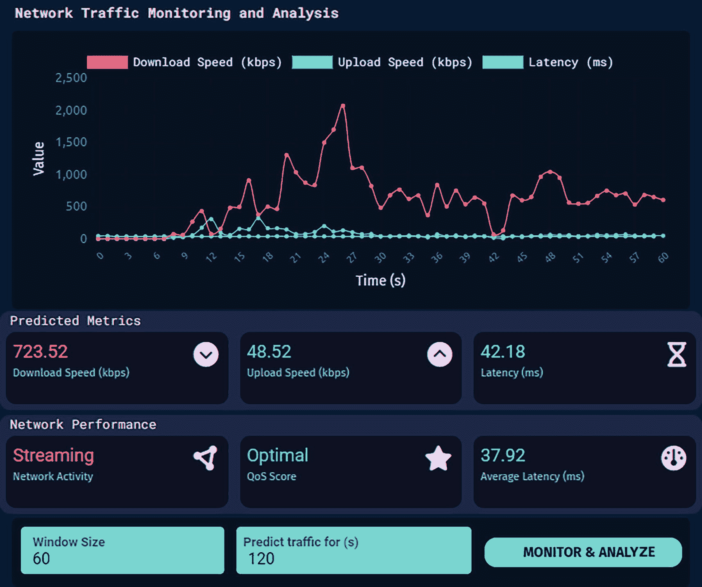

图 5-2：NTMA 应用程序布局

提取、测量和计算的参数如下：
*   下载速度（kbps）
*   上传速度（kbps）
*   延迟（ms）
*   抖动
*   网络 QoS 分数

图 5-2 展示了在 Twitch 上观看直播视频时，在流媒体场景下生成的实时网络监控、分析和 QoS 分数。生成的分数为“最优”。在预测时间为 120 秒的情况下，仪表板使用 MLP 回归显示预测变量。该程序还使用 KNN 分类和过去记录的网络流量状态自动识别当前设备活动。因此，用户可以直接从浏览器监控实时网络流量特征，只需点击一个按钮即可向 Node.js 服务器请求实时分类和回归分析。后者通过 Node.js 终端在本地托管，每次点击按钮时，都会收集一分钟的新实时参数数组。

### 5.1.4 客户端-服务器交互

图 5-3 以逐步方式展示了浏览器扩展与 Node.js 服务器之间的客户端-服务器通信。

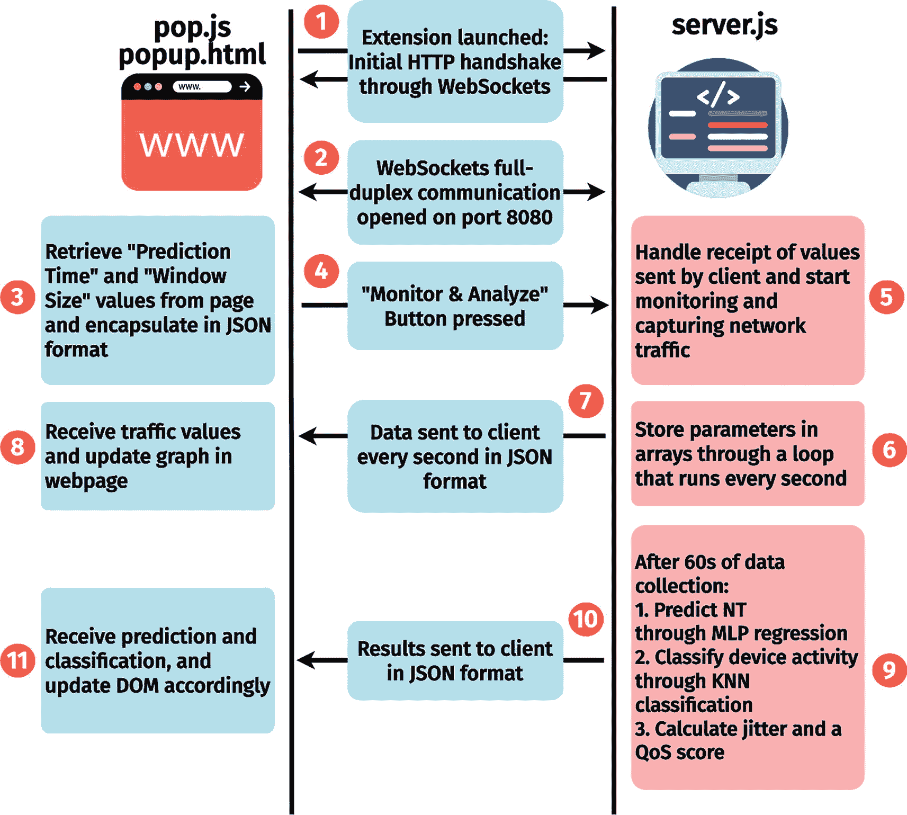

图 5-3：NTMA 的客户端-服务器交互

## 5.2 NTMA 的客户端程序结构

本节将介绍构成浏览器扩展客户端的四个文件及其各自的代码。客户端程序结构的概览如图 5-4 所示。


图 5-4：客户端程序结构

### 5.2.1 配置扩展设置与权限

如前所述，`manifest.json` 文件包含元数据，允许浏览器将其添加到“扩展程序”菜单中，从而集成到 Google Chrome 中。代码清单 5-1 包含了此文件中指定的参数，以及注释中每行代码的相应用途。对于 `"icons"` 标签，建议按照代码中给出的命名约定添加三个用户选择的图标。这些是 PNG 文件，使用户能够轻松地在浏览器扩展菜单中识别该应用程序。如果用户希望显示默认图标，也可以省略此标签。

```
{
"manifest_version": 3,  // Chrome 扩展的清单格式版本。
"name": "Network Traffic Monitoring and Analysis",  // Chrome 扩展的名称。
"version": "1.0",  // Chrome 扩展的版本号。
"icons": {
"16": "icon16.png",   // 16x16 像素大小的图标。
"48": "icon48.png",   // 48x48 像素大小的图标。
"128": "icon128.png"  // 128x128 像素大小的图标。
},
"background": {
"service_worker": "background.js"  // 后台脚本，作为 Service Worker 实现。
},
"permissions": [ // 扩展所需的权限列表。
"activeTab",  // 允许扩展与当前活动标签页交互。
"scripting",  // 允许向网页注入脚本。
"webNavigation",  // 使扩展能够接收网页导航生命周期中的事件。
"webRequest",  // 授予扩展观察和分析网络请求的权限。
"storage",  // 提供对浏览器存储 API 的访问，用于数据持久化。
"declarativeNetRequest",  // 允许扩展声明一组用于网络请求的规则。
"declarativeNetRequestFeedback",  // 允许扩展提供关于网络请求的反馈。
"tabs"  // 使扩展能够查询和操作浏览器标签页。
],
"action": {
"default_popup": "popup.html",  // 点击扩展图标时显示的默认弹出 HTML 文件。
"default_title": "Network Traffic Monitoring and Analysis"  // 扩展图标的默认标题。
}
}
```

**代码清单 5-1**
使用扩展设置和权限配置 `manifest.json`

### 5.2.2 配置后台脚本

作为静默的协调者，后台脚本在幕后处理基本功能，例如按钮点击，然后执行 Service Worker 逻辑。此应用程序所需的代码行在代码清单 5-2 中给出，并添加到 `background.js` 文件中。

```
// 记录一条消息，指示扩展已启动。
console.log("Extension launched...");
// 监听扩展操作按钮的点击事件。
chrome.action.onClicked.addListener(buttonClicked);
// 处理按钮点击事件的函数。
function buttonClicked(tab) {
// 记录一条消息，指示在点击按钮时后台脚本正在运行。
console.log("Background script running...");
}
// 可以在此处添加额外的 Service Worker 逻辑
// 此脚本独立于扩展运行，可以高效地执行后台任务
// 开发者可以扩展 Service Worker 的功能以处理各种任务，例如
// 网络请求、数据管理和后台处理。
```

**代码清单 5-2**
使用 Service Worker 逻辑配置 `background.js`

### 5.2.3 构建用户界面

前端由 HTML 和 CSS 组合构建，其中 CSS 与 HTML 代码放在同一个文件中，因此遵循内部 CSS 结构。本节中的组件作为网络监控和分析的界面，包含不同的部分，例如实时图表、预测指标、网络性能以及供最终用户输入的字段。

#### 文件功能

本节对 `popup.html` 文件进行了分解，其功能如下：

1.  指定文档结构，包括以下内容：
    1.  文档类型和语言
    2.  字符集和标题
    3.  修改内容安全策略 (CSP) 以允许特定的脚本源。

2.  添加对外部资源的引用：
    1.  从 Google Fonts [6] 导入所需的字体样式表。
    2.  从 Font Awesome 图标库 [7] 导入仪表板图标。
    3.  链接从 Bootstrap 官方网站 [8] 下载的自定义 Bootstrap 样式表。

3.  添加内部 CSS 以修改组件外观：
    1.  设置正文、背景和按钮的样式。
    2.  定义用户界面组件（如输入字段、标签和图表）的样式。

4.  显示标题和图表区域：
    1.  为弹出窗口设置标题。
    2.  创建一个用于嵌入图表区域的容器。
    3.  使用 Chart.js 嵌入图表画布。

5.  显示“预测指标”卡片：
    1.  创建一个用于预测指标的容器。
    2.  分别显示预测的下行速度、上行速度和延迟及其图标。

6.  显示“网络性能”卡片：
    1.  创建一个用于网络性能洞察的容器。
    2.  分别显示网络活动、QoS 评分和平均延迟及其图标。

7.  添加用户输入字段：
    1.  定义窗口大小和预测时间的输入字段。
    2.  定义“监控与分析”按钮。

8.  添加下载的脚本和客户端脚本：
    1.  链接下载的 Chart.js 库 [3]。
    2.  链接自定义的 `pop.js` 脚本。

#### 库与所需资源

表 5-2 总结了所提及的库和可下载脚本及其用途。

**表 5-2**
用户界面的库与资源描述

| 库/资源 | 用途 | 仓库 | 下载链接 | 位置 |
| --- | --- | --- | --- | --- |
| Google Fonts | 为网页提供自定义字体。 | [6] | `popup.html` |
| Font Awesome | 提供可缩放矢量图标。 | [7] | `popup.html` |
| bootstrap.min.css | 用于组织行和列的自定义 Bootstrap 样式表。 | [8] | [9] | 项目根文件夹内的“css”文件夹 |
| chart.js | 为实时图表提供交互式图表。 | [3] | [10] | 项目根文件夹 |
| pop.js | 用于逻辑的自定义 JS 文件。 | 不适用 | 项目根文件夹 |

#### 创建文档结构

有了必要的库和资源后，即可用清单 5-3 中的代码填充 `popup.html` 文件，该文件首先创建文档结构。文件中其余代码的放置位置也已标明。

```
清单 5-3
创建文档结构
```

#### 添加图表和仪表盘组件

放置在 `body` 标签内的应用程序组件在清单 5-5 中给出，其描述和用途在注释中说明。此处也调用了外部脚本，即 `chart.js` 和 `pop.js`。这些脚本在 `body` 末尾被引用，以确保在执行前文档对象模型（DOM）已完全加载。

```
网络流量监控与分析

预测指标

请稍候...

下载速度 (kbps)

请稍候...

上传速度 (kbps)

请稍候...

延迟 (ms)

网络性能

请稍候...

网络活动

请稍候...

服务质量评分

请稍候...

平均延迟 (ms)

窗口大小

预测流量时长 (s)

监控与分析

清单 5-5
添加图表和仪表盘组件
```

#### 通过内部 CSS 设置组件样式

为了使应用程序外观更具吸引力，并增强其用户友好性，使用清单 5-6 中的代码填充 `style` 标签。

## CSS 样式

```css
/* body 样式 */
body {
background-color: #131F33;
color: #92ABCF;
font-family: "Roboto";
font-size: 15px;
width: 710px;
}
/* body 背景样式 */
.bg-secondary {
background-color: #0F1724 !important;
}
/* 所有主要文本样式 */
.text-primary {
color: #92ABCF !important;
}
/* "监控与分析" 按钮样式 */
#monitorButton {
display: flex;
width: 200px;
height: 30px;
align-content: right;
margin-top: 10px;
margin-bottom: 10px;
margin-left: 12px;
text-transform: uppercase;
flex-direction: row;
-moz-box-align: center;
align-items: center;
gap: 0.375rem;
border: medium none;
box-shadow: rgba(0, 0, 0, 0.2) 0px 3px 1px -2px, rgba(0, 0, 0, 0.14) 0px 2px 2px 0px, rgba(0, 0, 0, 0.12) 0px 1px 5px 0px;
font-weight: bold;
font-family: Fira Sans, Arial, Helvetica, sans-serif;
cursor: pointer;
transition: background-color 250ms cubic-bezier(0.4, 0, 0.2, 1) 0ms, box-shadow 250ms cubic-bezier(0.4, 0, 0.2, 1) 0ms, border 250ms cubic-bezier(0.4, 0, 0.2, 1) 0ms;
-moz-box-pack: center;
justify-content: center;
border-radius: 12px;
padding: 0.625rem 0.75rem;
font-size: 0.875rem;
color: rgb(0, 0, 0);
background-color: rgb(17, 236, 229);
}
/* 按钮悬停时的外观样式 */
#monitorButton:hover {
background-color: #bd1515;
color: white;
transition: .5s;
}
/* "窗口大小" 字段样式 */
#floatingWindowSize {
background-color: rgb(17, 236, 229);
color: rgb(0, 0, 0);
height: 50px;
}
/* "窗口大小" 字段被点击时的外观样式 */
#floatingWindowSize:focus {
border: 3px solid rgb(17, 236, 229) !important;
box-shadow: 0 0 3px rgb(17, 236, 229) !important;
-moz-box-shadow: 0 0 3px rgb(17, 236, 229) !important;
-webkit-box-shadow: 0 0 3px rgb(17, 236, 229) !important;
}
/* "预测流量时长 (s)" 字段样式 */
#floatingPredictionTime {
background-color: rgb(17, 236, 229);
color: rgb(0, 0, 0);
height: 50px;
}
/* "预测流量时长 (s)" 字段被点击时的外观样式 */
#floatingPredictionTime:focus {
border: 3px solid rgb(17, 236, 229) !important;
box-shadow: 0 0 3px rgb(17, 236, 229) !important;
-moz-box-shadow: 0 0 3px rgb(17, 236, 229) !important;
-webkit-box-shadow: 0 0 3px rgb(17, 236, 229) !important;
}
/* "窗口大小" 和 "预测流量时长 (s)" 字段样式 */
#floatingLabels {
color: rgb(0, 0, 0);
font-weight: bold;
}
/* 所有输入字段样式 */
input:focus, textarea:focus, select:focus {
outline-offset: 0px !important;
outline: none !important;
}
/* 弹出窗口标题样式 */
#title {
padding-top: 2px;
padding-left: 15px;
text-align: left;
font-family: Roboto Mono;
font-weight: bold;
font-size: 14px;
color: #DFCCFB;
}
/* 每个仪表盘行标题样式 */
.dashboard-title {
color: #DFCCFB;
margin-left: 10px;
margin-bottom: -5px;
font-size: 13px;
font-family: 'Roboto Mono';
}
/* 仪表盘行样式 */
.dashboard-row {
display: flex;
justify-content: space-between;
}
/* 仪表盘卡片样式 */
.dashboard-card {
padding: 7px;
margin: 6px;
border-radius: 10px;
background-color: #101424;
position: relative;
width: 225px;
}
/* 仪表盘容器样式 */
.dashboard-container {
background-color: #1d243f;
margin-top: 2px;
border-radius: 10px;
position: relative;
width: 100%;
}
/* 仪表盘图标样式 */
.icon {
position: absolute;
top: 10px;
right: 10px;
font-size: 25px;
color: #DFCCFB;
}
/* 仪表盘指标样式 */
.metric {
font-size: 18px;
}
/* 仪表盘描述样式 */
.description {
font-size: 11px;
font-family: Fira Sans;
}
```

**清单 5-6** 通过内部 CSS 设置组件样式

## 将用户界面添加到 Google Chrome

现在前端已完全构建完成，按照以下步骤将其添加到 Google Chrome：

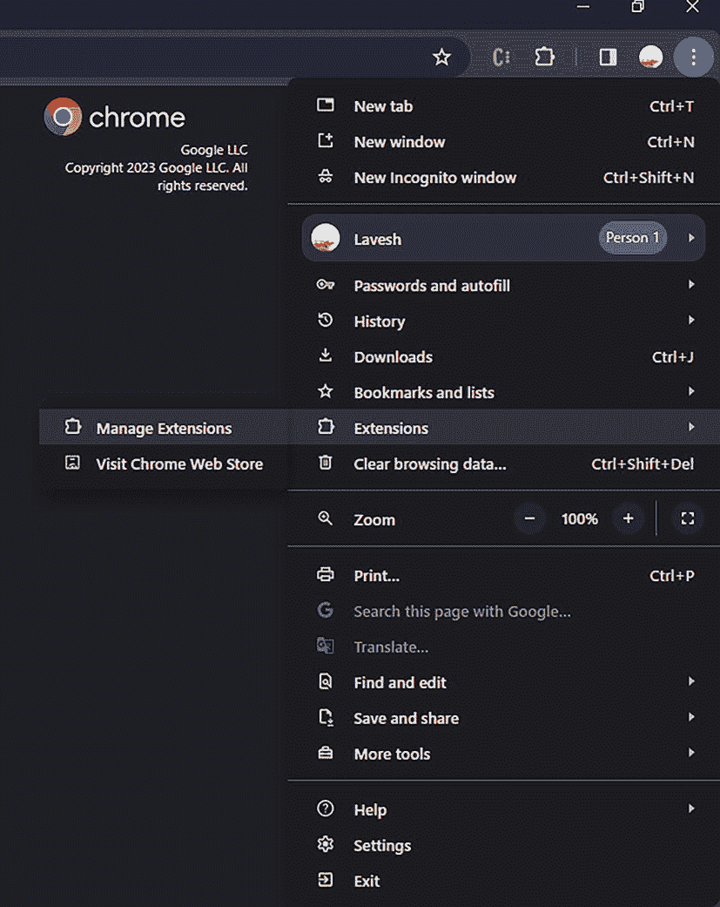

图 5-5 访问扩展程序菜单

1.  在 `Google Chrome` 的主菜单中，点击窗口右上角的三个点图标，然后选择“扩展程序”（图 5-5）。接着点击“管理扩展程序”，打开 `Google Chrome` 扩展程序页面。

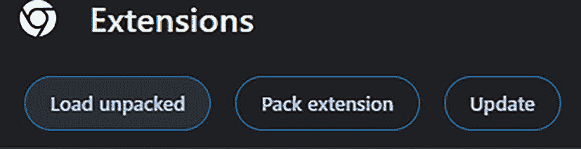

图 5-6 加载已解压的扩展程序

1.  在菜单的左上角，选择“加载已解压的扩展程序”选项，如图 5-6 所示。

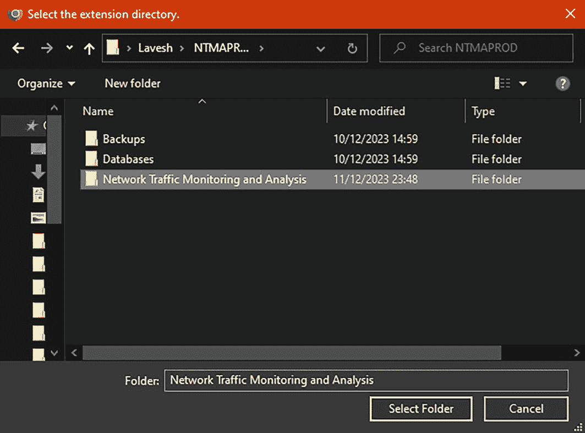

图 5-7 选择项目的根目录

1.  然后选择项目的根目录，如图 5-7 所示。

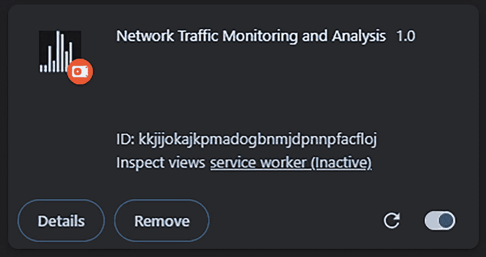

图 5-8 `NTMA` 应用程序已添加到扩展程序菜单

1.  这会将应用程序添加到扩展程序菜单中（图 5-8）。

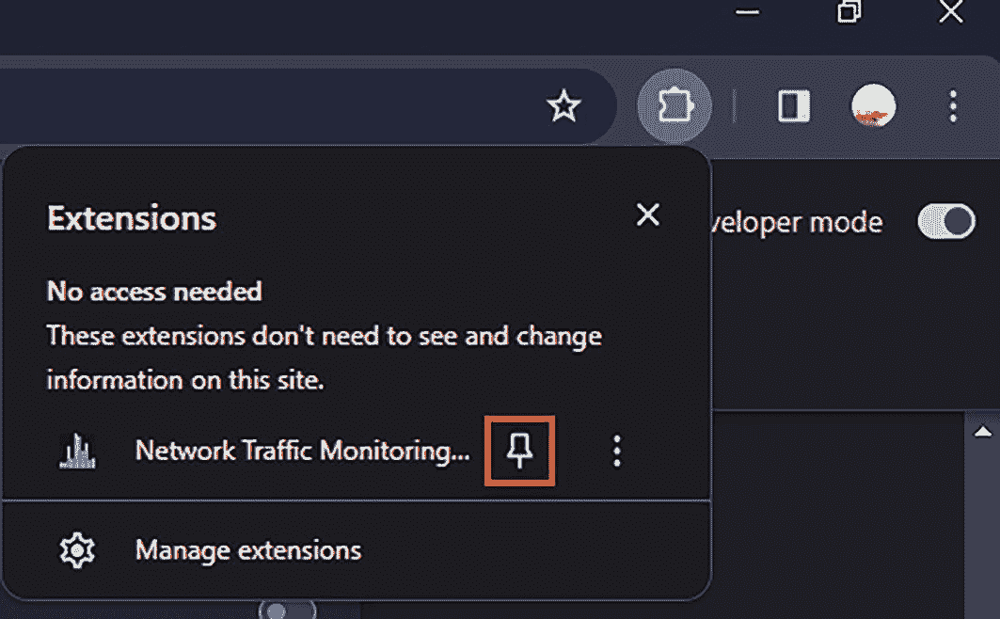

图 5-9 固定应用程序以便快速访问

1.  可以通过点击拼图图标，然后点击图钉图标，将应用程序固定在 `Google Chrome` 的右上角以便快速访问，如图 5-9 所示。

#### 可视化用户界面

将应用程序添加到快速访问栏后，即可点击它。完成的用户界面如图 5-10 所示。

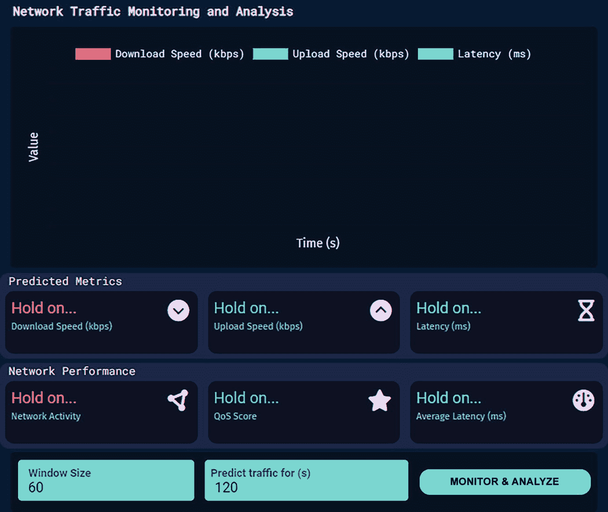

网络流量监控与分析应用程序用户界面的截图。它绘制了一个数值随时间（秒）变化的图表。预测指标和网络性能（包括预测的窗口大小和预测的流量）被监控和分析。

图 5-10 NTMA 应用程序完成的用户界面

### 5.2.4 构建客户端脚本

客户端的逻辑使用 JavaScript 构建，包含一个名为 `pop.js` 的单一文件，主要负责通过 WebSocket [11] 与服务器通信、根据接收到的信息更新用户界面，并使用 Chart.js 编排实时监控图表。

#### 文件功能

本节将对 `pop.js` 文件进行分解，其功能如下：

1. 声明在整个脚本中使用的全局变量。

2. 使用 Chrome 扩展 API 查询 Chrome 标签页：
   1. 获取关于活动标签页和最后聚焦标签页的信息。
   2. 获取活动标签页的 URL。

3. 创建到服务器的 WebSocket 连接：
   1. 实现从服务器接收消息的方法。
   2. 使用 `open` 事件处理连接。
   3. 解析并记录消息。

4. 接收并处理来自服务器的消息：
   1. 解析包含实时指标和图表更新的 JSON 消息。
   2. 使用预测指标和网络性能指标更新 HTML 元素。
   3. 使用最新指标动态更新 Chart.js 图表。

5. 为“监控与分析”按钮创建事件监听器：
   1. 为按钮添加事件监听器。
   2. 向服务器发送消息以启动监控过程。
   3. 将“窗口大小”和“预测时间”封装在发送给服务器的 `JSONObject` 中。

6. 为 DOM 创建事件监听器：
   1. 为 DOM 添加事件监听器。
   2. 为三个数据集创建配置并初始化 Chart.js 图表对象。

7. 实现一个方法，根据指定的标签每秒更新图表。

#### 创建脚本结构

由于库已在 `popup.html` 文件中被调用和引用，可以通过首先创建脚本结构来填充 `pop.js` 文件，该结构包含以下基础内容：

* 声明全局变量。
* 查询活动标签页和最后聚焦标签页以获取当前 URL。
* 在 DOM 上添加一个事件监听器，以便在页面加载后立即执行。
* 创建一个动态更新图表的方法。

这些功能的骨架如代码清单 5-7 所示，同时还包括了后续代码的放置位置。

```
// 声明在整个脚本中调用的全局对象。
var monitorButton; // 用于“监控与分析”对象的变量。
var myChart; // 用于 Chart.js 对象的变量。
// 查询活动标签页和最后聚焦标签页以检索当前 URL。
chrome.tabs.query({
active: true,
lastFocusedWindow: true,
},
function(tabs) {

}
);
// 在 DOM 上添加事件监听器，以便在页面加载后立即执行。
document.addEventListener('DOMContentLoaded', function() {

}, false);
// 每秒更新图表的方法。
function addData(chart, label, data, updateLabel) {

}
```

代码清单 5-7 创建脚本结构

#### 在页面加载时初始化并配置图表

`DOMContentLoaded` 事件负责在 HTML 文档的 DOM 完全加载后立即执行语句。通过 `popup.html` 中指定的 `myChart` 标签定义了图表区域，需要使用适当的配置对其进行初始化，以容纳三个具有不同设置的数据集。然后，通过在整个文档上添加一个事件监听器来执行以下功能，该监听器在页面加载时立即生效：

1. 获取“监控与分析”按钮的 DOM 元素，并将其分配给全局变量 `monitorButton`。

2. 创建数据集配置：
   1. 为“下载速度”、“上传速度”和“延迟”创建三个独立的数据集。

3. 对于每个数据集，指定标签、背景颜色、边框颜色、边框宽度和点半径。

4. 创建一个 `data` 对象，封装所有数据集设置，从而直接作为参数提供给 Chart.js。

5. 创建一个 `options` 对象，用于设置 Chart.js 图表的外观样式，包括响应式、宽高比、线条张力、轴配置、刻度显示设置和图例样式。

6. 为 Chart.js 图表创建一个 `config` 对象，其中封装了图表类型、要包含的数据以及指定的选项。

7. 使用 `myChart` 标识符创建一个新的 Chart.js 实例，从而将所有设置绑定到 HTML 元素。这指示了渲染折线图的对象。

代码清单 5-8 给出了上述功能的代码。

## 实时 WebSocket 通信与动态图表更新

客户端的主要功能是首先连接到指定端口上的服务器，然后打开连接以允许消息流动。它也可以在必要时发送消息，但由于在此应用中服务器负责大部分计算，客户端主要处理来自服务器的消息接收。此部分涉及的功能分解如下：

1.  获取活动标签页的 URL 并将其存储在一个变量中。
2.  初始化一个 `time` 变量，作为图表的时间计数器。
3.  创建常量以动态区分三个图表。
4.  在 `ws://localhost:8080/` 上建立 WebSocket 连接，即通过端口 8080，进行实时通信。
    1.  要发送消息，使用 `ws.open` 事件。在此情况下，之前存储的活动标签页的 URL 被发送到服务器，以测试通信路径。
5.  要接收消息，使用 `ws.onmessage` 事件。此方法在收到来自服务器的任何消息时自动触发。由于服务器被编程为每秒发送消息，此方法也每秒执行一次。收到消息后，会相应地过滤出实时值、预测指标和网络性能指标，这些值用于更新 HTML 元素和图表。
6.  检查是否收到与服务器端发生的任何错误相关的消息，如果有则生成警报。
7.  使用 `addData()` 方法触发实时图表更新，该方法接收图表对象、时间步长、实时值以及一个标签作为输入，用于指示正在填充三个数据集中的哪一个。
8.  为“监控与分析”按钮创建一个事件监听器：
    1.  使用 `ws` 对象上的 `send` 关键字向服务器发送一条“开始监控”消息。服务器被编程为在收到此特定消息后启动其进程。
9.  将从各自 HTML 元素中获取的“窗口大小”和“预测时间”变量封装到一个使用 `stringify()` 方法创建的 `JSONObject` 变量中。

简而言之，清单 5-9 协调了对象的初始化，创建了一个 WebSocket 连接，处理来自服务器的传入消息，调用实时更新图表的方法，并向服务器传递一个关键字以启动监控过程。

```
// 获取“监控与分析”按钮的 DOM 元素。
monitorButton = document.getElementById('monitorButton');
// 为“下载速度”折线图创建数据集配置。
const dataset_DS = {
label: '下载速度 (kbps)',
backgroundColor: 'rgb(255, 99, 132)',
borderColor: 'rgb(255, 99, 132)',
borderWidth: 1.2,
pointRadius: 1.6
};
// 为“上传速度”折线图创建数据集配置。
const dataset_US = {
label: '上传速度 (kbps)',
backgroundColor: 'rgb(44, 211, 225)',
borderColor: 'rgb(44, 211, 225)',
borderWidth: 1.2,
pointRadius: 1.6
};
// 为“延迟”折线图创建数据集配置。
const dataset_Lat = {
label: '延迟 (ms)',
backgroundColor: 'rgb(69, 255, 202)',
borderColor: 'rgb(69, 255, 202)',
borderWidth: 1.2,
pointRadius: 1.6
};
// 创建数据对象，将所有数据集封装为一个。
const data = {
datasets: [dataset_DS, dataset_US, dataset_Lat]
};
// 创建选项对象，负责设置图表外观的样式。
const options = {
// 设置宽度以响应分配的区域。
responsive: true,
// 不允许更改宽高比。
maintainAspectRatio: false,
elements: {
line: {
tension: 0.35, // 为折线图添加轻微曲率。
},
},
// 修改 x 轴配置。
scales: {
x: {
display: true, // 显示 x 轴。
title: {
display: true, // 显示 x 轴标题。
text: '时间 (s)', // 更改 x 轴标签。
color: '#DFCCFB', // 更改 x 轴标签颜色。
font: {
family: 'Fira Sans', // 更改 x 轴标签字体。
size: 14, // 更改 x 轴标签字体大小。
},
},
ticks: {
display: true, // 显示 x 轴刻度。
color: '#6b7e9b', // 更改 x 轴刻度标签颜色。
font: {
family: 'Ubuntu', // 更改 x 轴刻度字体。
size: 10, // 更改 x 轴刻度字体大小。
},
stepSize: 10, // 更改 x 轴刻度的步长。
},
},
y: {
display: true, // 显示 y 轴。
title: {
display: true, // 显示 y 轴标题。
text: '值', // 更改 y 轴标签。
color: '#DFCCFB', // 更改 y 轴标签颜色。
font: {
family: 'Fira Sans', // 更改 y 轴标签字体。
size: 14, // 更改 y 轴标签字体大小。
},
},
ticks: {
display: false, // 禁用 y 轴刻度。
color: '#6b7e9b', // 更改 y 轴刻度标签颜色。
font: {
family: 'Ubuntu', // 更改 y 轴刻度字体。
size: 13, // 更改 y 轴刻度字体大小。
},
},
},
},
plugins: {
legend: {
labels: {
color: '#DFCCFB', // 更改图例标签颜色。
font: {
family: 'Roboto Mono', // 更改图例标签字体。
}
}
}
}
};
// 折线图的配置对象。
const config = {
type: 'line', // 设置图表类型。
data: data, // 设置图表数据。
options: options // 设置用于样式和自定义的选项。
};
// 使用配置创建一个新的 Chart 实例，并将其附加到 id 为“myChart”的画布元素上。
myChart = new Chart(document.getElementById('myChart'), config);
```

代码清单 5-8：在页面加载时初始化并配置图表。

## 清单 5-9 实时 WebSocket 通信与动态图表更新

```javascript
// 将活动标签页的 URL 存储在一个变量中。
var tempurl = tabs[0].url;
// 用于在图表上迭代时间的变量。
var time = 0;
// 用于更新图表数据的常量。
const updateDownload = "downloadTraffic";
const updateUpload = "uploadTraffic";
const updateLatency = "latency";
// 创建一个到服务器的 WebSocket 连接。
const ws = new WebSocket('ws://localhost:8080/');
// 处理 WebSocket 连接 "open" 事件。
ws.onopen = function() {
    // 记录扩展成功连接到服务器的消息。
    console.log('WebSocket Client Connected');
    // 将活动标签页的 URL 发送到服务器，作为检查通信是否可能的测试。
    ws.send(tempurl);
};
// 处理从服务器接收到的消息。
ws.onmessage = function(e) {
    // 记录任何接收到的消息。
    console.log("Received from server: " + e.data);
    // 处理与预测指标相关的消息。
    // 以下语句检查接收到的消息是否包含预测值。
    // 这些对象名称在服务器端设置。
    if (e.data.includes("predictedDownloadSpeed") || e.data.includes("predictedUploadSpeed") || e.data.includes("predictedLatency")) {
        // 解析预测指标的 JSON 消息。
        const msg = JSON.parse(e.data);
        // 使用服务器端设置的相同表示法从消息中提取预测值。
        // 将这些值存储在其对应的变量中。
        var predRX = msg.predictedDownloadSpeed; // 预测下载速度指标的变量。
        var predTX = msg.predictedUploadSpeed; // 预测上传速度指标的变量。
        var predLat = msg.predictedLatency; // 预测延迟指标的变量。
        var scoreQoS = msg.predictedQoS; // QoS 分数的变量。
        var deviceActivity = msg.deviceActivity; // 分类结果（即设备活动）的变量。
        var averageLatency = msg.averageLatency; // 平均延迟指标的变量。
        // 使用从服务器接收的指标更新 HTML 元素。
        document.getElementById("results_downloadSpeed").innerHTML = predRX;
        document.getElementById("results_uploadSpeed").innerHTML = predTX;
        document.getElementById("results_latency").innerHTML = predLat;
        document.getElementById("results_qosScore").innerHTML = scoreQoS;
        document.getElementById("results_networkActivity").innerHTML = deviceActivity;
        // 使用 `toFixed()` 方法将平均延迟四舍五入到两位小数。
        document.getElementById("results_averageLatency").innerHTML = averageLatency.toFixed(2);
    }
    // 处理与服务器发送的任何错误相关的消息。
    // 以下语句检查接收到的消息是否包含 "error" 关键字。
    // 此关键字在服务器端设置。
    if (e.data.includes("error")) {
        // 生成一个警报，让用户知道由于没有连接而无法测量延迟值。
        alert("Unable to measure latency due to no connection.");
    }
    // 解析实时指标和图表更新的 JSON 消息。
    // 这每秒发生一次，因为服务器每秒向扩展发送一条消息。
    const msg = JSON.parse(e.data);
    var RX = msg.downloadSpeed; // 将实时下载速度指标存储在一个变量中。
    var TX = msg.uploadSpeed; // 将实时上传速度指标存储在一个变量中。
    var latency = msg.latency; // 将实时延迟指标存储在一个变量中。
    // 使用 `addData()` 方法通过解析以下参数将数据添加到图表：
    // 1. 图表对象。
    // 2. 时间步长（相对于用户点击按钮的时间 - 这表示 t = 0）。
    // 3. 实时值。
    // 4. 用于将变量引导到图表上正确值集的标签。
    addData(myChart, time, RX, updateDownload); // 使用最新的下载速度变量更新图表。
    addData(myChart, time, TX, updateUpload); // 使用最新的上传速度变量更新图表。
    addData(myChart, time, latency, updateLatency); // 使用最新的延迟变量更新图表。
    // 为下一个数据点增加时间。
    time = time + 1;
};
// 为 "Monitor & Analyze" 按钮添加一个事件监听器。
monitorButton.addEventListener('click', function() {
    // 向服务器发送一条消息以启动监控过程。
    // 这样做是为了当服务器获得此消息时，它知道客户端已准备就绪。
    ws.send("Start Monitoring");
    // 将 "Window Size" 和 "Prediction Time" 封装在一个 JSONObject 中。
    // 这些变量从 UI 获取并发送到服务器，因为分析需要它们。
    const propertiesMessage = {
        windowSize: document.getElementById('floatingWindowSize').value,
        predictionTime: document.getElementById('floatingPredictionTime').value
    };
    // 使用 `stringify()` 方法将 JSONObject 发送到服务器。
    ws.send(JSON.stringify(propertiesMessage));
}, false);
```

### 实时图表更新机制

本节介绍 `addData()` 方法，该方法旨在每隔一秒更新 Chart.js 折线图。其输入参数如下：

*   Chart.js 实例，即 `myChart`。该实例对于所有三个数据集保持不变。
*   标签，表示要添加数据点的时间点。
*   从服务器获取的实时指标。
*   标签，用于指定要更新三个数据集中的哪一个。

此外，之前通过 `options` 对象禁用的 y 轴刻度，在图表上更新第一组数值后会被启用，以实现无缝显示。`addData()` 方法的代码见代码清单 5-10。

```javascript
// 通过之前创建的标签判断该方法是为哪个数据集调用的。
// 如果标签代表下载速度。
if (updateLabel === "downloadTraffic") {
    // 推送标签，即时间点。
    chart.data.labels.push(label);
    // 推送数据，即实时指标。
    chart.data.datasets[0].data.push(data);
}
// 如果标签代表上传速度。
else if (updateLabel === "uploadTraffic") {
    // 推送数据，即实时指标。
    chart.data.datasets[1].data.push(data);
}
// 如果标签代表延迟。
else if (updateLabel === "latency") {
    // 推送数据，即实时指标。
    chart.data.datasets[2].data.push(data);
}
// 首次调用此方法时，更新图表选项以显示 y 轴刻度。
// 这样做是因为 y 轴刻度最初是禁用的。
myChart.options.scales.y.ticks.display = true;
// 更新图表。
chart.update();
```

## 5.3 NTMA 服务器程序结构

本节详细阐述负责以下主要操作的 Node.js 服务器：

1. **导入模块**：文件开头使用 `require` 关键字添加模块。添加的库用于创建 HTTP 服务器、建立 WebSocket 连接、读取系统信息、读取本地数据库以及实现机器学习算法。

2. **初始化全局变量**：声明并初始化将在整个脚本中使用的对象。

3. **读取本地存储的数据库**：服务器负责从本地数据库读取先前存储的值。这些值存储在数组中供后续使用。

4. **创建 HTTP 服务器**：在端口 8080 上托管一个 HTTP 服务器，监听来自请求连接的客户端的传入请求。该服务器托管 WebSocket 连接。

5. **处理 WebSocket 连接**：创建 WebSocket 服务器并将其绑定到 HTTP 服务器。然后监听来自连接客户端的连接，获取发送的参数，并触发监控和分析进程。

6. **网络监控**：`systeminformation` 库帮助每隔一秒收集网络数据，如下载速度、上传速度和延迟值。还会计算其他指标。这些值通过 `WebSocket` 连接实时发送到客户端。一旦网络流量记录持续一分钟，监控进程停止，并触发预测和分类算法，以及计算 QoS 分数的方法。

7. **MLP 预测方法**：`predictMLP` 方法用于使用 MLP 算法进行时间序列预测，这涉及在实时值（这些值被添加到先前收集的另一组时间序列数据数组中）上训练模型。此过程还会计算算法的百分比准确率，并使用滑动窗口进行预测。

8. **QoS 分数计算方法**：`calculateQoS` 方法用于根据抖动和延迟值计算 QoS 分数。该分数范围从“最佳”到“中等”再到“较差”。

9. **KNN 分类方法**：`calculateKNN` 方法用于使用 KNN 算法对设备活动进行分类。它读取分类数据库，打乱数据，训练 KNN 模型，并根据通过网络监控测量的最后一个数据点预测当前设备活动。

同样，脚本还会记录语句，以提供有关服务器当前操作、来自客户端的消息、实时测量的指标以及从机器学习算法获得的结果的信息。服务器端程序结构的概览如图 5-11 所示。

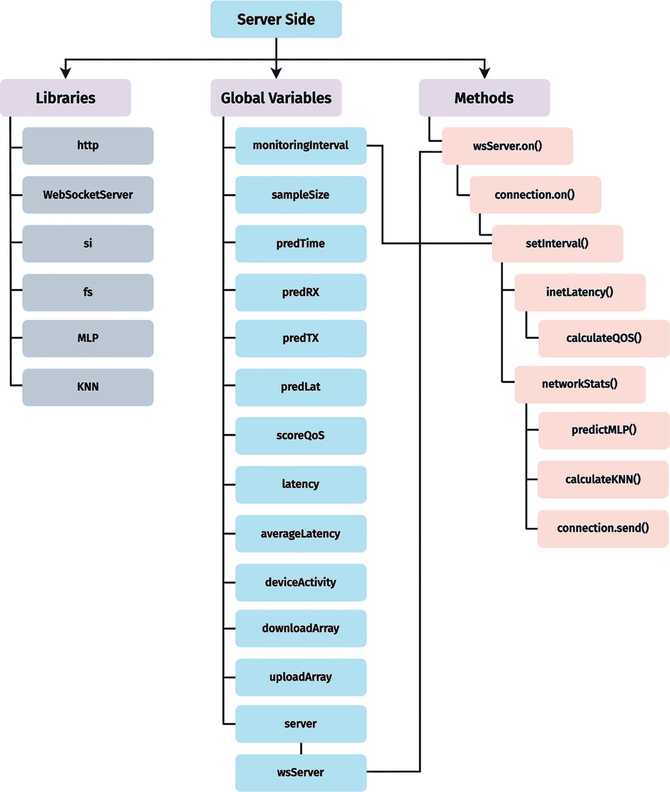

服务器端程序的分类图包括库、全局变量和方法。库包括 `http`、`si`、`fs` 和 `KNN`。全局变量是样本大小、延迟、设备活动和服务器。方法包括 `ws.server.on`、`intel latency` 和 `predictMLP` 等函数。

### 5.3.1 库和所需资源

在编写服务器脚本之前，首先通过 Node.js 的控制台使用 `npm install` 关键字在本地下载所使用的库。每个特定模块的安装说明见表 5-3 中的下载链接。

**表 5-3**

服务器库和资源说明

| 库/资源 | 用途 | 下载链接 |
| --- | --- | --- |
| `http` | 创建 HTTP 服务器。 | [12] |
| `websocket` | 绑定到 HTTP 服务器以建立 WebSocket 连接。 | [1] |
| `systeminformation` | 提供对设备上网络接口的访问以读取网络流量。 | [2] |
| `fs` | 作为文件系统，允许访问设备上的文件。 | [13] |
| `mlp` | 创建感知器以预测网络流量参数。 | [5] |
| `ml-knn` | 创建 KNN 模型以对设备活动进行分类。 | [4] |

### 5.3.2 添加库

为了开始编写此应用程序的引擎，在 `server.js` 文件顶部使用 `require` 关键字一个接一个地将上述库添加到服务器脚本中。如代码清单 5-11 所示。

```
//指定与服务器和监控过程相关的导入。
const http = require("http"); // 导入 'http' 模块以创建 HTTP 服务器。
const WebSocketServer = require("websocket").server; // 导入 WebSocket 服务器模块。
const si = require('systeminformation'); // 导入 'systeminformation' 库以获取设备的系统信息。
const fs = require('fs'); // 导入 'fs' 模块以处理文件系统。
// 与机器学习相关的导入。
var MLP = require('mlp'); // 导入 'mlp' 库，用于多层感知器预测。
var KNN = require('ml-knn'); // 导入 'ml-knn' 库，用于 K-最近邻分类。
```
代码清单 5-11 添加库

### 5.3.3 声明全局变量

全局变量在整个脚本中被引用，并在某些方法中使用，对于维护状态和在脚本不同部分之间共享数据至关重要。因此，它们会在导入库之后立即进行声明和初始化，如代码清单 5-12 所示。

```
// 声明并初始化将在服务器脚本中使用的全局变量。
var monitoringInterval; // 声明一个用于监控间隔的变量。
var sampleSize = 0; // 初始化一个用于样本大小的变量，在数据收集阶段使用。
var predTime = 0; // 初始化一个用于用户期望预测时间的变量。
var predRX = 0; // 初始化一个用于预测下载速度（Kb/s）的变量。
var predTX = 0; // 初始化一个用于预测上传速度（Kb/s）的变量。
var predLat = 0; // 初始化一个用于预测延迟（ms）的变量。
var scoreQoS = ""; // 初始化一个用于 QoS 分数（服务质量）的变量。
var latency = 0; // 初始化一个用于延迟测量（ms）的变量。
var averageLatency = 0; // 初始化一个用于计算平均延迟（ms）的变量。
var deviceActivity = ""; // 初始化一个用于确定设备活动状态的变量，可选值为 "idle"、"browsing" 或 "streaming"。
```
代码清单 5-12 声明全局变量

### 5.3.4 获取本地数据库

为了提高算法效率，考虑到网络流量仅收集一分钟，来自同一网络环境的先前收集的值会被加载到两个不同的数组中，分别用于下载速度和上传速度。这意味着这些值将与按下“监控与分析”按钮时记录的流量进行核对。因此，MLP 回归算法将拥有一个足够大的数据集，以产生准确的预测。在此情况下，`downloadSpeed.txt` 和 `uploadSpeed.txt` 文件存储在 `Databases` 文件夹中，而该文件夹位于项目的根目录下。

该过程进一步说明如下：

* 使用 `fs.readFileSync` 方法同步读取指定文件的内容。
* 这些文件是 .txt 文件，其中包含的元素由换行符分隔。
* 使用正则表达式将文件内容分割成值，并输入到数组中。
* 生成的数组 `downloadArray` 和 `uploadArray` 用于初始化 ML 模型的历史网络速度数据。

如代码清单 5-13 所示。

```
// 从本地存储的数据库中获取一些先前存储的下载速度值。
const contents1 = fs.readFileSync("./Databases/downloadSpeed.txt", 'utf-8'); // 读取 'downloadSpeed.txt' 文件的内容。
var downloadArray = contents1.split(/\r?\n/); // 将内容分割成一个数组，假设每行代表一个值。
// 从本地存储的数据库中获取一些先前存储的上传速度值。
const contents2 = fs.readFileSync("./Databases/uploadSpeed.txt", 'utf-8'); // 读取 'uploadSpeed.txt' 文件的内容。
var uploadArray = contents2.split(/\r?\n/); // 将内容分割成一个数组，假设每行代表一个值。
```
代码清单 5-13 获取本地数据库

### 5.3.5 创建 WebSocket 服务器

WebSocket 服务器常用于实时应用，例如在线游戏、金融平台和监控工具，这些场景中低延迟至关重要。WebSocket 越来越多地用于当今的 Web 应用程序，因为它们能够在客户端和服务器之间实现无缝通信，而无需不断地发送和接收 HTTP 请求和响应。这对于需要从服务器持续轮询的数据可视化仪表板来说非常重要，可以实现更快、更稳定的响应时间，并提高性能和响应能力。这转化为通过单个长期存在的连接实现的全双工通信通道。双向路径通过以下步骤创建：

* 使用 `http.createServer` 方法创建一个 HTTP 服务器，同时指定服务器监听传入请求的端口号。
* 通过引用用于导入其模块的变量来创建 WebSocket 服务器的实例，然后将其附加到 HTTP 服务器。
* 记录有关服务器状态的消息。

这些过程在代码清单 5-14 中有详细说明。

### 5.3.6 监听客户端连接请求

本节涉及与客户端和服务器之间交互相关的几个过程，如图 5-3 所示。这些过程详述如下：
*   监听客户端发出的连接请求。
*   接受连接。
*   获取客户端通过 JSON 格式字符串发送的“窗口大小”和“预测时间”变量。
*   从设备的网络接口读取网络数据。
*   填充用于下载速度、上传速度和延迟的数组。
*   在收集到一分钟的网络流量时，调用预测和分类方法。
*   在收集到一分钟的网络流量时，调用 QoS 计算方法。
*   通过 WebSocket 将结果发送回客户端。

代码清单 5-14 给出了创建 WebSocket 服务器并附加到 HTTP 服务器的示例代码。

```javascript
// 在端口 8080 上托管服务器连接。
const server = http.createServer(); // 创建一个 HTTP 服务器实例。
server.listen(8080); // 监听端口 8080 上的传入 HTTP 请求。
console.log("服务器已在端口 8080 上启动..."); // 记录一条指示服务器已启动的消息。
console.log("正在等待连接..."); // 记录一条指示服务器正在等待连接的消息。
// 创建一个 WebSocket 服务器实例，并将其附加到先前创建的 HTTP 服务器。
const wsServer = new WebSocketServer({
  httpServer: server,
});
```

代码清单 5-15 给出了监听和接受客户端请求所涉及过程的结构。`connection.on` 代码块暂时留空，将在下一节中详细说明。

```javascript
// 通过 WebSocket 服务器监听客户端的连接请求。
wsServer.on("request", function (request) {
  // 接受来自客户端的连接。
  const connection = request.accept(null, request.origin);
  // 使用 "message" 关键字接受来自客户端的传入消息。
  connection.on("message", function (message) {

  });
  // 使用 "close" 关键字处理客户端断开连接。
  connection.on("close", function (reasonCode, description) {
    // 记录一条消息以指示客户端已断开连接。
    console.log("客户端已断开连接。");
    // 当客户端断开连接时，停止监控过程。
    clearInterval(monitoringInterval);
  });
});
```

#### 从客户端获取消息

当服务器收到任何消息时，会触发 `connection.on` 代码块。该消息首先被记录到控制台，然后存储到一个变量中。由于客户端被编程为在按下“监控与分析”按钮时发送窗口大小和预测时间变量的值，因此通过 `if` 语句进行检查，以检测接收到的消息中是否包含 `windowSize` 关键字。一旦获取到该关键字，监控过程便会启动，并创建一个函数，使用 `setInterval` 关键字使其每秒触发一次。这里指定了 1000 毫秒的时间间隔。如清单 5-16 所示，该代码块应放置在清单 5-15 所指示的位置。

```javascript
// 获取从客户端获得的消息。
// 在此情况下，接收到的第一条消息是客户端发送过来的 URL。
// 这确保了通信已建立。
console.log("来自客户端的消息:", message.utf8Data);
// 初始化一个变量，用于存储客户端发送过来的消息。
var clientMessage = message.utf8Data;
// 检查客户端发送的消息是否包含 JSONObject 中的变量 "windowSize"。
// 这作为触发监控过程的判定条件。
// 接收到 "windowSize" 变量意味着客户端运行正常。
if(clientMessage.includes("windowSize")) {
  const msg = JSON.parse(clientMessage); // 初始化一个常量来解析消息。
  // 从 JSONObject 中获取 "windowSize" 和 "predictionTime" 的值。
  sampleSize = msg.windowSize; // "windowSize" 的值。
  predTime = msg.predictionTime; // "predictionTime" 的值。
  // 初始化一个计数器，用于了解何时收集了足够的网络流量。
  var counter = 0;
  // 初始化一个数组，用于存储延迟项。
  var latencyArray = [];
  // 初始化一个计数器，用于了解何时收集了足够的延迟值。
  var counterLatency = 0;
  // 使用 setInterval 方法创建一个每秒运行一次的函数。
  // 该方法接受一个函数和时间间隔（毫秒）作为输入。
  monitoringInterval = setInterval(function() {

  }, 1000) // 为监控过程指定 1000 毫秒的间隔。
}
```

#### 测量延迟

通过添加库时创建的变量来访问 `systeminformation` 库。涉及以下 `if` 语句：
*   首先进行检查，以确定库返回的延迟值是否为 `null`。如果缺少该指标，则表示没有互联网连接。因此，将包含错误信息的消息封装成 JSON 格式的变量，并使用 `connection.send()` 方法发送给客户端。这用于在前端向用户生成警报。
*   如果获取到了指标，则填充相应的数组。
*   一旦收集到六十个值，就调用 `calculateQoS()` 方法来计算 QoS 分数。

如清单 5-17 所示。

```javascript
// 使用内置的 inetLatency() 方法读取延迟值。
si.inetLatency().then(data => {
  // 检查是否无法读取延迟，这意味着没有互联网连接。
  if (data == null) {
    // 创建一条要发送给客户端的错误消息。
    const errorMessage = {
      error: "无连接"
    };
    // 将错误消息封装成 JSON 格式的字符串，并通过 WebSocket 连接发送。
    connection.send(JSON.stringify(errorMessage));
    // 停止监控过程。
    clearInterval(monitoringInterval);
    // 如果连接正常。
  } else {
    // 使用 counterLatency 计数器将延迟值填充到 latencyArray 对象中。
    latencyArray[counterLatency] = data;
    // 指定延迟等于从 Wi-Fi 接口读取的数据。
    latency = data;
  }
  // 当总共记录了 60 个值时，表示已收集了一分钟的流量。
  if (counterLatency == 59) {
    // 调用基于记录的延迟值计算 QoS 的方法。
    scoreQoS = calculateQOS(latencyArray);
  }
  // 递增 counterLatency 对象。
  counterLatency++;
})
```

#### 测量网络流量并向客户端发送实时指标

与上一节类似，再次使用 `systeminformation` 库来读取每秒接收和发送的数据包数量，并将此信息分别存储在 `RX` 和 `TX` 变量中。一旦收集到六十个值，就会触发以下过程：
*   停止监控过程。
*   调用预测方法，对下载速度、上传速度和延迟进行时间序列预测，同时处理返回 `NaN` 结果的情况。如果算法未返回指标，则通过 `while` 循环再次调用该方法。一旦获得指标，就跳出循环。
*   调用分类方法，通过解析下载速度和上传速度作为输入参数来获取设备活动。
*   创建一个变量来存储获得的指标和结果。
*   使用 `connection.send()` 方法将此变量以 JSON 格式的消息发送出去。

现在，如果尚未收集到六十个值，也会使用 `connection.send()` 方法将实时指标发送给客户端。随后递增一个计数器，并基于该计数器检查是否达到六十个值。清单 5-18 演示了这些过程。

```
// 从 Wi-Fi 接口获取网络数据。
si.networkStats().then(data => {
  // 计算每秒接收的数据包数量，相当于下载速度。
  var RX = Math.round((((data[0].rx_sec)/1000) + Number.EPSILON) * 100) / 100;
  // 计算每秒发送的数据包数量，相当于上传速度。
  var TX = Math.round((((data[0].tx_sec)/1000) + Number.EPSILON) * 100) / 100;
  // 使用 push() 方法将新读取的流量数据添加到预加载数组中。
  // 预加载数组包含按时间序列存储的参数。
  // 根据设备活动情况，这可能会提高算法的性能。
  downloadArray.push(RX); // 将下载速度值添加到其预加载数组中。
  uploadArray.push(TX); // 将上传速度值添加到其预加载数组中。
  // 将数值记录到控制台。
  console.log("下载速度: " + RX + " KB/s");
  console.log("上传速度: " + TX + " KB/s");
  console.log("-----------------------------");
  // 当总共记录了 60 个值时，停止监控过程并触发机器学习算法。
  if (counter == 60) {
    // 使用 clearInterval() 方法停止监控过程。
    clearInterval(monitoringInterval);
    // 调用预测方法对下载速度进行时间序列预测。
    // 确保在算法失败并返回 NaN 时再次调用该方法。
    while (true) {
      predRX = predictMLP(downloadArray, parseInt(sampleSize), parseInt(predTime), 0.1, 0.01);
      if (!isNaN(predRX)) {
        // 如果获得实际数值，则跳出循环。
        break;
      }
    }
    // 调用预测方法对上传速度进行时间序列预测。
    // 确保在算法失败并返回 NaN 时再次调用该方法。
    while (true) {
      predTX = predictMLP(uploadArray, parseInt(sampleSize), parseInt(predTime), 0.1, 0.01);
      if (!isNaN(predTX)) {
        // 如果获得实际数值，则跳出循环。
        break;
      }
    }
    // 调用预测方法对延迟进行时间序列预测。
    // 确保在算法失败并返回 NaN 时再次调用该方法。
    while (true) {
      predLat = predictMLP(latencyArray, parseInt(sampleSize), parseInt(predTime), 0.1, 0.01);
      if (!isNaN(predLat)) {
        // 如果获得实际数值，则跳出循环。
        break;
      }
    }
    // 通过调用分类方法对设备活动进行分类。
    deviceActivity = calculateKNN(RX, TX);
    // 创建一个包含预测和分类结果的常量变量。
    const predictionMessage = {
      downloadSpeed: RX,
      uploadSpeed: TX,
      predictedDownloadSpeed: predRX,
      predictedUploadSpeed: predTX,
      predictedLatency: predLat,
      predictedQoS: scoreQoS,
      deviceActivity: deviceActivity,
      averageLatency: averageLatency
    };
    // 将指标消息封装成 JSON 格式的字符串，并通过 WebSocket 连接发送。
    connection.send(JSON.stringify(predictionMessage));
  }
  // 如果收集的数值数量尚未达到 60。
  else {
    // 创建一个包含每秒发送给客户端的网络流量值的常量变量。
    // 添加所有 3 个实时值。
    const jsonMessage = {
      downloadSpeed: RX,
      uploadSpeed: TX,
      latency: latency
    };
    // 将实时消息封装成 JSON 格式的字符串，并通过 WebSocket 连接发送。
    connection.send(JSON.stringify(jsonMessage));
  }
  // 增加网络流量计数器。
  counter = counter + 1;
})
```

清单 5-18 测量网络流量并将实时指标发送给客户端

### 5.3.7 使用 MLP 回归进行时间序列预测的方法

如清单 5-18 所示，`predictMLP()` 方法被依次调用以处理三个数据流。所有数据流都应用相同的逻辑，如图 5-12 所示。

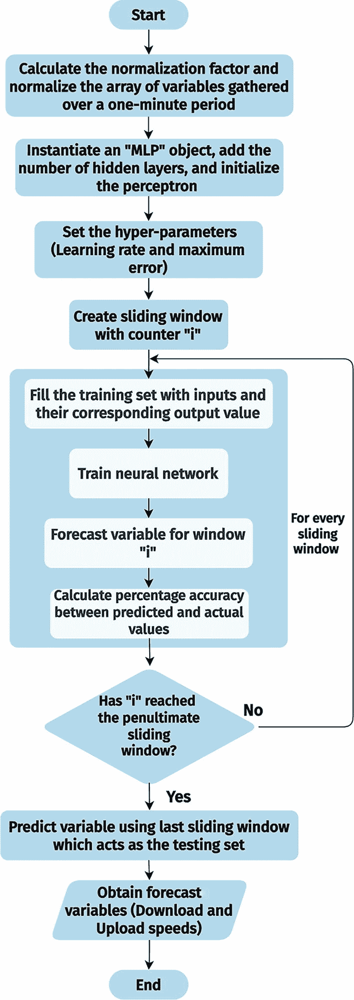

时间序列预测的流程图。它计算归一化因子，实例化 MLP 对象，设置超参数，创建滑动窗口，训练神经网络，预测变量，并在检查是否达到 i 后计算百分比精度和数值，以获得预测变量。

图 5-12 使用 MLP 进行时间序列预测的流程图

清单 5-19 给出了 `predictMLP()` 方法的完整代码。

# 代码清单 5-19 使用 MLP 回归进行时间序列预测的方法

```javascript
// 创建一个使用多层感知机（MLP）进行时间序列预测的方法。
// 输入参数：
// - `array`: 待预测的时间序列数组。
// - `batchSize`: 用户在界面上指定的窗口大小。
// - `pTime`: 用户在界面上指定的预测时间。
// - `learningRate`: MLP 的学习率。
// - `maximumError`: 训练过程中允许的最大误差。
function `predictMLP`(`array`, `batchSize`, `pTime`, `learningRate`, `maximumError`) {
    // 查找单变量数据流中的最大值和最小值。
    var min = `Math.min.apply`(Math, `array`); // 将最小值存储在一个变量中。
    var max = `Math.max.apply`(Math, `array`); // 将最大值存储在一个变量中。
    // 将窗口大小和预测时间的值存储在新变量中。
    var windowSize = `batchSize`;
    var pvalue = `pTime`;
    // 使用 "MLP" 关键字和 1 个输入层创建感知机。
    var mlp = new `MLP`(`windowSize`, 1);
    // 添加隐藏层的数量。
    `mlp.addHiddenLayer`((2 * `windowSize`) + 1);
    // 初始化感知机。
    `mlp.init`();
    // 创建具有一组输入和相应输出的滑动窗口。
    // 声明一个用于输入的变量。
    var `inputs` = [];
    // 声明一个用于输出的变量。
    var `outputs` = [];
    // 声明用于填充 `inputs` 和 `outputs` 数组的索引。
    var `inputValue`, `outputValue`;
    // 初始化一个计数器，用于获取实际值。
    var counter = `windowSize` + `pvalue` - 1;
    // 初始化一个窗口索引。范围从 0 到 `windowSize-1`。
    var index = 0;
    // 初始化一个通用索引，用于移动窗口。
    var `valueFill` = 0;
    // 创建用于窗口大小步长预测的滑动窗口。
    for (let a = 0; a < (`array.length` - `windowSize` - `pvalue` + 1); a++) {
        // 用 1 个窗口大小的元素数量填充 `inputs` 数组。
        for (let i = `valueFill`; i < (`valueFill` + `windowSize`); i++) {
            // 对每个输入进行归一化，使其范围在 0 到 1 之间。
            `inputValue` = (`array`[i] - min) / (max - min);
            // 根据索引用归一化后的值填充 `inputs` 数组。
            `inputs`[index] = `inputValue`;
            // 递增索引。
            index = index + 1;
        }
        // 将索引重置为 0，以便在下一个滑动窗口时可以从 "0 到 window" 进行迭代。
        index = 0;
        // 将通用索引移动到下一个相邻的值。
        `valueFill` = `valueFill` + 1;
        // 获取实际输出值。
        `outputValue` = `array`[counter];
        // 将实际输出值添加到 `outputs` 数组中。
        `outputs`[a] = `outputValue`;
        // 递增计数器。
        counter = counter + 1;
    }
    // 将输入和输出添加到训练数据集中。
    for (let i = 0; i < (`array.length` - `windowSize` - `pvalue` + 1); i++) {
        // 将输入和输出添加到 MLP 的训练数据集中。
        `mlp.addTrainingSet`(`inputs`[i], `outputs`[i]);
    }
    // 初始化一个变量来存储误差。
    var error = 0;
    // 初始化学习率。
    var `learnRate` = `learningRate`;
    // 训练 MLP，直到误差小于或等于最大误差。
    while (error > `maximumError`) {
        // 使用指定的学习率训练 MLP。
        error = `mlp.train`(`learnRate`);
    }
    // 算法现在已经在实时值上完成了训练。
    // 再次使用滑动窗口来测量百分比准确率。
    // 为每个窗口生成一个预测值。
    // 重新初始化之前的变量，以便它们可以被重用。
    var `inputs` = [];
    var `inputValue`;
    var index = 0;
    var `valueFill` = 0;
    // 创建一个计数器来测量算法的准确率。
    var `accCounter` = `windowSize` + `pvalue` - 1;
    // 初始化一个变量来计算平均误差。
    var `averageError` = 0;
    // 创建用于窗口大小步长预测的滑动窗口。
    for (let a = 0; a < (`array.length` - `windowSize` - `pvalue` + 1); a++) {
        // 用 1 个窗口大小的元素数量填充 `inputs` 数组。
        for (let i = `valueFill`; i < (`valueFill` + `windowSize`); i++) {
            // 对每个输入进行归一化，使其范围在 0 到 1 之间。
            `inputValue` = (`array`[i] - min) / (max - min);
            // 根据索引用归一化后的值填充 `inputs` 数组。
            `inputs`[index] = `inputValue`;
            // 递增索引。
            index = index + 1;
        }
        // 将索引重置为 0，以便在下一个滑动窗口时可以从 "0 到 window" 进行迭代。
        index = 0;
        // 将通用索引移动到下一个相邻的值。
        `valueFill` = `valueFill` + 1;
        // 使用 `classify` 方法计算此特定窗口的预测值。
        var `windowPrediction` = `mlp.classify`(`inputs`);
        // 对预测值进行反归一化。
        `windowPrediction` = `windowPrediction` * (max - min) + min;
        // 初始化一个变量来存储每个窗口的百分比误差。
        var `individualError` = 0;
        // 通过与实际值比较来计算每个单独的误差。
        if (`array`[`accCounter`] != 0) {
            `individualError` = ((Math.abs(`windowPrediction` - `array`[`accCounter`])) / (`array`[`accCounter`])) * 100;
        } else {
            // 如果实际值为 0；为防止除以 0
            `individualError` = ((Math.abs(`windowPrediction` - `array`[`accCounter`])) / (1)) * 100;
        }
        // 将准确率计数器递增 1。
        `accCounter` = `accCounter` + 1;
        // 将单个误差加到误差总和中。
        `averageError` = `averageError` + `individualError`;
    }
    // 通过将误差总和除以预测次数来计算平均误差。
    `averageError` = `averageError` / (`array.length` - `windowSize` - 1);
    // 记录总平均误差的消息。
    console.log("总平均误差: " + `averageError` + " %");
    // 计算百分比准确率。
    var `percentageAccuracy` = 100 - `averageError`;
    // 记录百分比准确率。
    console.log("百分比准确率: " + `percentageAccuracy`  + " %");
    // 为最后的 `windowSize` 个值创建一个数组。
    var pred = [];
    // 为数据集中最后一个滑动窗口创建一个起始索引。
    var `arrayIndex` = 0;
    // 为数据集中最后一个滑动窗口创建一个结束索引。
    var `lastWindowIndex` = `array.length` - `windowSize`;
    // 对于最后一个可能的滑动窗口。
    for (let i = `lastWindowIndex`; i < `array.length`; i++) {
        // 用相应的归一化值填充最后一个滑动窗口数组。
        pred[`arrayIndex`] = (`array`[i] - min) / (max - min);
        // 将计数器递增 1。
        `arrayIndex` = `arrayIndex` + 1;
    }
    // 使用 `classify` 方法计算此特定窗口的预测值。
    var `mlpPrediction` = `mlp.classify`(pred);
    // 对预测值进行反归一化。
    `mlpPrediction` = (`mlpPrediction` * (max - min) + min);
    // 将预测值格式化为保留两位小数。
    var `predictedValue` = Math.round((`mlpPrediction` + Number.EPSILON) * 100) / 100;
    // 记录格式化后的预测值。
    console.log(`pvalue` + " 秒后的预测值: " + `predictedValue`);
    console.log("-----------------------------");
    // 清除训练数据集。
    `mlp.clearTrainingSet`();
    // 重置学习到的权重。
    `mlp.resetWeights`();
    // 返回最终的预测值。
    return `predictedValue`;
}
```

### 5.3.8 计算 QoS 分数的方法

本节涉及在代码清单 5-17 中调用的 `calculateQOS()` 方法。为了衡量 QoS 分数，首先根据记录的延迟样本计算抖动，如公式 5-1 所示，其中 `n` 代表样本数量，`x` 是样本值，`i` 是采集值的顺序，从零开始。

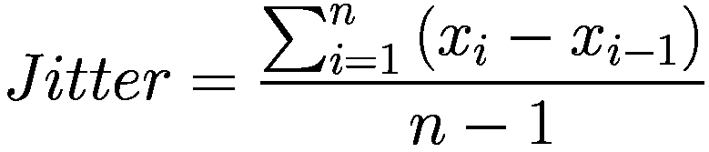
(5-1)

随后，计算在六十秒持续时间内观察到的平均延迟。QoS 分数通过三个阈值来确定，并通过比较平均延迟与抖动来计算。如果抖动大于平均延迟的 50%，则认为设备显示“差”的 QoS。当相同结果介于 30% 和 50% 之间时，则分配“中等”QoS。最终，如果抖动小于平均延迟的 30%，则认为设备以“最佳”QoS 运行。这些标准旨在根据应用程序使用位置特定服务器的平均延迟，来定义不同程度的服务质量。这因国家和网络而异。此类阈值通常通过基于用户反馈、行业标准和服务级别协议等因素的迭代测试和验证进行微调。例如，电信运营商可能会根据通过不同网络路径到达特定国家/地区的最佳可能延迟来设定 QoS 标准。QoS 分数确定过程总结在图 5-13 中。

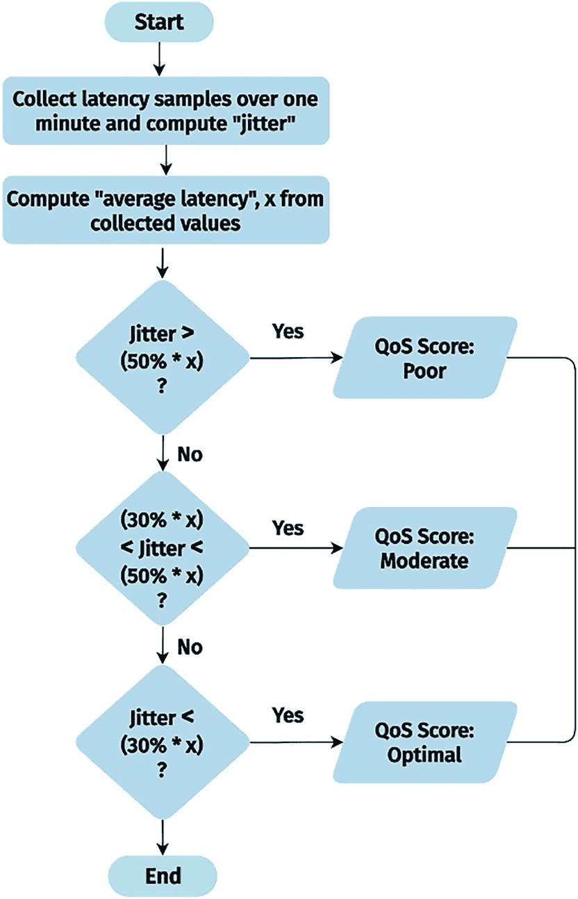
QoS 分数计算的流程图。它收集延迟样本，计算平均延迟，并根据抖动对 QoS 分数进行分类。抖动小于 30% 为最佳分数，小于 50% 为中等，大于 50% 为差。
图 5-13 QoS 分数计算流程图

此过程的代码在代码清单 5-20 中给出。

```
// 创建一个根据抖动和延迟值计算 QoS 分数的方法。
// 输入参数：
// - array: 要解析的时间序列数组。
function calculateQOS(array) {
// 初始化一个变量来存储最终分数。
// 分数范围从“差”到“中等”再到“最佳”。
var score = "";
// 初始化一个变量来计算所有延迟值的总和。
var sumLatency = 0;
// 初始化一个变量来计算连续延迟值之间的差值总和。
var sumDifference = 0;
// 遍历数组。
for(let i = 0; i < array.length; i++) {
// 将当前值加到延迟总和上。
sumLatency = sumLatency + parseFloat(array[i]);
// 检查当前索引是否大于 0。
if(i > 0) {
// 通过减法计算当前值与上一个值之间的差值，并累加。
sumDifference = sumDifference + Math.abs(parseFloat(array[i]) - parseFloat(array[i-1]));
}
}
// 通过将总和除以数值个数来计算平均延迟。
averageLatency = sumLatency / array.length;
// 通过将差值总和除以数值个数来计算抖动。
var jitter = sumDifference / array.length;
// 记录平均延迟。
console.log("平均延迟: " + averageLatency + " ms");
// 记录抖动。
console.log("抖动: " + jitter + " ms");
// 如果抖动大于平均延迟的 50%。
if (jitter > (0.5 * averageLatency)) {
// 将“差”赋值给 QoS 分数。
score = score + "差";
// 记录 QoS 分数。
console.log(score);
}
// 如果抖动在平均延迟的 30% 到 50% 之间。
else if ((jitter > (0.3 * averageLatency)) && (jitter < (0.5 * averageLatency))) {
// 将“中等”赋值给 QoS 分数。
score = score + "中等";
console.log(score);
// 如果抖动小于平均延迟的 30%。
} else {
// 将“最佳”赋值给 QoS 分数。
score = score + "最佳";
// 记录 QoS 分数。
console.log(score);
}
// 返回最终的 QoS 分数。
return score;
}
```
代码清单 5-20 计算 QoS 分数的方法

### 5.3.9 设备活动分类方法

关于识别设备所表现的活动类型，需要一个预先分类的数据集，其中包含下载速度、上传速度以及相应的活动类别，如第 4 章所述。本书附带了一个示例数据集。然而，为了提高分类方法对各种网络活动形式的可靠性，建议在更大的数据集上进行补充测试，该数据集可以使用相同的应用程序收集。通过向数据集提供反映不同类型活动的广泛网络流量样本，算法可以增强其泛化能力，并准确区分不同形式的网络行为。该过程需要获取和分类多样化的网络流量数据，以保证对现实网络中可能遇到的各种场景进行全面的表示。涉及使用 KNN 算法进行数据准备和分类的技术流程总结在图 5-14 中。

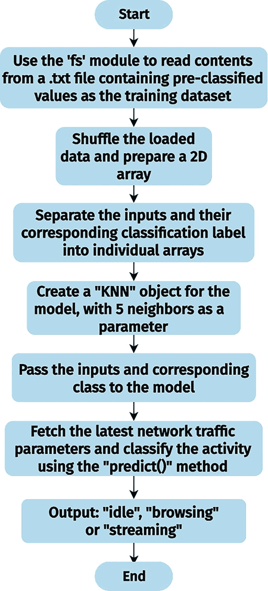
用于分类设备活动的流程图。它使用 `fs` 模块从文件中读取内容，然后打乱加载的数据，分离输入，创建一个 KNN 对象，传递输入，获取参数，并生成输出，如空闲、浏览或流媒体。
图 5-14 设备活动分类流程图

此过程的代码在代码清单 5-21 中给出。

```
// 创建一个通过分类计算设备活动的方法。
// 输入参数：
// - dspeed: 下载速度数组。
// - uspeed: 上传速度数组。
function calculateKNN(dspeed, uspeed) {
// 创建一个临时数组来存储来自分类数据库的数据。
let temp = [];
// 通过指定文件位置读取分类数据库文件的内容。
const contents0 = fs.readFileSync("./Databases/classification.txt", 'utf-8');
// 根据换行符将内容分割成一个数组。
var classificationDatabase = contents0.split(/\r?\n/);
// 遍历分类数据库并填充临时数组。
for (let i = 0; i < classificationDatabase.length; i++) {
// 将当前行按逗号分割，并将结果推入临时数组。
temp.push(classificationDatabase[i].split(","));
}
// 创建一个数据数组，其元素来自临时数组。
var data_array = temp;
// 使用 Fisher-Yates 算法打乱数据数组。
data_array.sort(() => Math.random() - 0.5);
// 用原始数组初始化打乱后的数组。
let shuffledArray = data_array;
// 初始化一个空数组来存储输入数据。
let input = [];
// 初始化一个空数组来存储输出数据。
let output = [];
// 遍历打乱后数组中的每个元素。
for (let i = 0; i < shuffledArray.length; i++) {
// 检查当前元素是否不包含未定义的值。
if (!shuffledArray[i].includes(undefined)) {
// 遍历打乱后数组第一行中的每个属性（列）。
for (let j = 0; j < shuffledArray[0].length; j++) {
// 检查当前属性是否在索引 2 处。
if (j === 2) {
// 将索引 2 处的值赋值给输出数组。
output[i] = shuffledArray[i][2];
} else {
// 如果输入数组中尚不存在，则创建一个新数组。
input.push([]);
// 将当前属性索引处的值赋值给输入数组。
input[i][j] = shuffledArray[i][j];
}
}
}
}
// 初始化一个新数组来存储输入数组的值。
var newInputs = [];
// 遍历打乱后数组中的每个元素。
for(let a = 0; a < shuffledArray.length; a++) {
// 将输入数组中的值赋值给 newInputs 数组。
newInputs[a] = input[a];
}
// 使用指定的参数创建一个新的 KNN（K-最近邻）模型：
// - newInputs: 用于训练模型的输入数据。
// - output: 训练数据对应的输出类别。
// - { k: 5 }: 一个选项对象，设置分类时要考虑的邻居数量（k）。
var knn = new KNN(newInputs, output, { k: 5 });
// 初始化一个变量来统计分类错误的数量。
var errorCount = 0;
// 遍历训练集中的每个数据点。
for (let i = 0; i < newInputs.length; i++) {
// 使用 KNN 模型预测当前输入的类别。
let predictedValue = knn.predict(newInputs[i]);
// 从训练集中获取实际类别。
let actualValue = output[i];
// 检查预测类别是否与实际类别不同。
if(predictedValue !== actualValue) {
// 如果分类错误，则增加错误计数。
errorCount++;
}
}
// 通过计算错误数占输入数量的比例来计算 KNN 分类准确率。
var knnAccuracy = 100 - ((errorCount / newInputs.length) * 100);
// 记录 KNN 分类准确率。
console.log("KNN 分类准确率: " + knnAccuracy + " %");
// 待分类的用户输入数据（在此上下文中来自浏览器）。
let feed = [dspeed, uspeed];
// 使用训练好的 KNN 模型预测输入数据对应的类别。
let result = knn.predict([feed]);
// 初始化一个变量用于存储分类结果。
var classification = "";
// 将输入数据和预测类别记录到控制台。
console.log("输入: " + feed.toString() + "  类别: " + result.toString());
// 使用 switch 语句将预测的类别映射为人类可读的标签。
// 如果结果为 0，标签设置为“空闲”。
// 如果结果为 1，标签设置为“浏览”。
// 如果结果为 2，标签设置为“流媒体”。
switch (parseInt(result)) {
case 0:
classification = classification + "空闲";
break;
case 1:
classification = classification + "浏览";
break;
case 2:
classification = classification + "流媒体";
break;
}
// 记录人类可读的分类结果标签。
console.log("值的分类: " + classification);
// 返回人类可读的分类结果标签。
return classification;
}
```
代码清单 5-21 使用 KNN 分类设备活动的方法

## 5.4 NTMA 应用测试与部署

客户端和服务器端构建完成后，NTMA 应用即可运行。本节将在标准家庭环境中，通过若干场景对其进行测试。为模拟较差的网络条件，我们特意对设备设置了带宽分配上限，从而产生高延迟和抖动。图 5-15 至 5-19 展示了 NTMA 应用在上述场景中的表现。

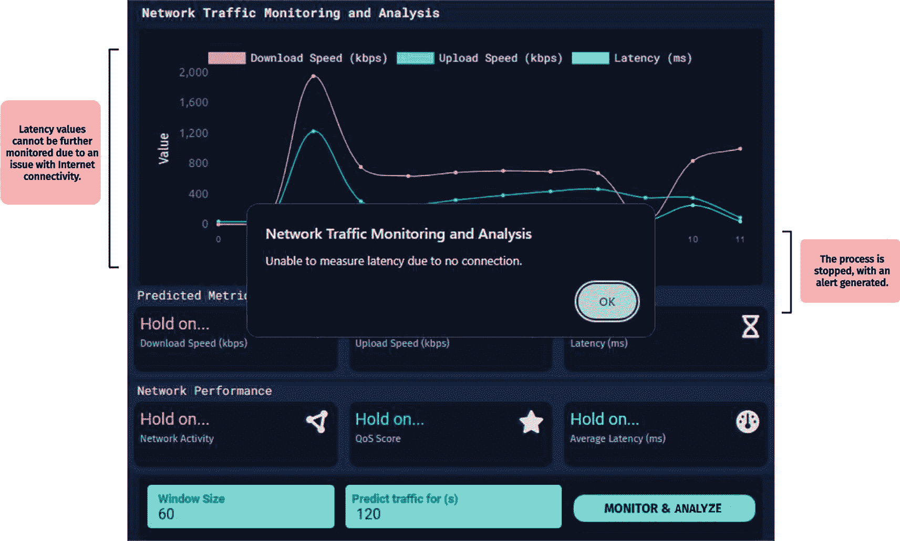
图 5-19 连接不可用时生成告警

网络连接不可用时，网络流量监控分析告警的截图。折线图绘制了数值随时间（秒）的变化。预测指标、网络性能、窗口大小和流量预测均被监控和分析。由于网络问题，延迟无法被监控。

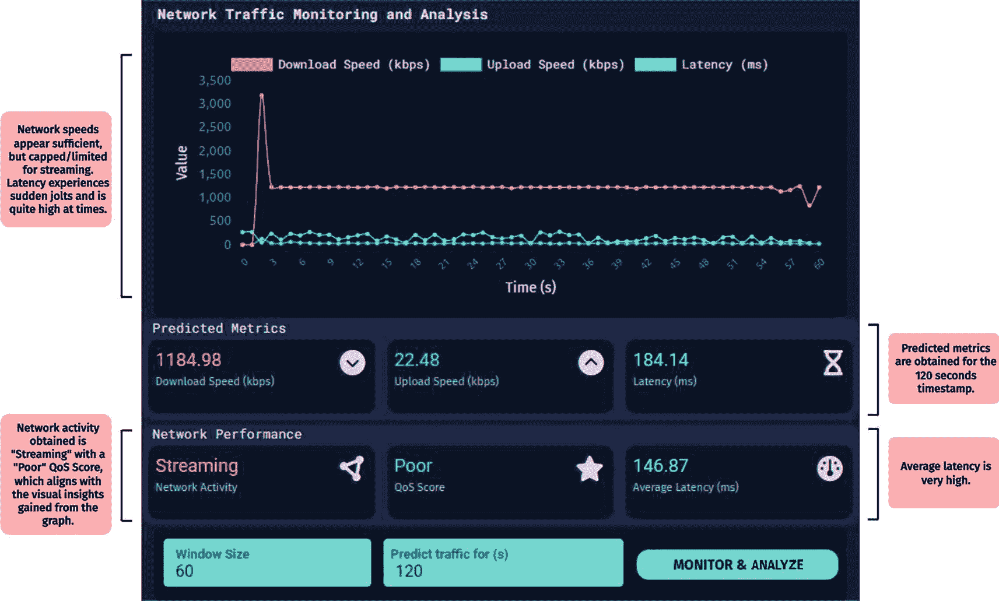
图 5-18 在较差网络环境下于 Twitch 直播

在 Twitch 上直播时，较差网络环境下的网络流量监控分析截图。折线图绘制了数值随时间（秒）的变化。预测指标、网络性能、窗口大小和流量预测均被监控和分析。网络速度足够，但延迟存在波动。

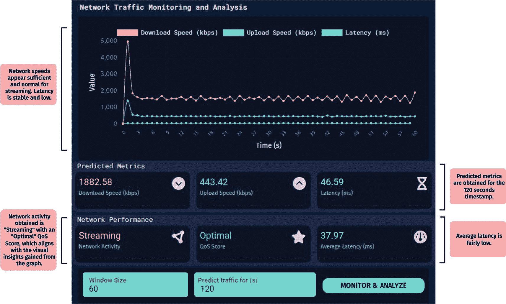
图 5-17 在最佳网络环境下于 Twitch 直播

在 Twitch 上直播时，最佳网络环境下的网络流量监控分析截图。折线图绘制了数值随时间（秒）的变化。预测指标、网络性能、窗口大小和流量预测均被监控和分析。网络速度正常。

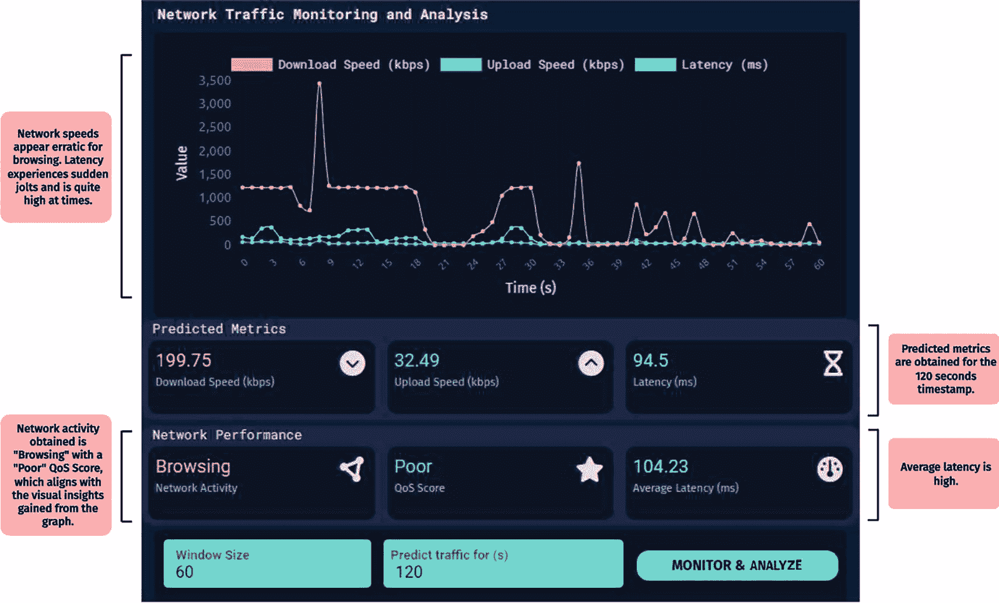
图 5-16 在较差网络环境下浏览 Facebook 和 Google 新闻

浏览 Facebook 和 Google 新闻时，较差网络环境下的网络流量监控分析截图。折线图绘制了数值随时间（秒）的变化。预测指标、网络性能、窗口大小和流量预测均被监控和分析。网络速度不稳定。

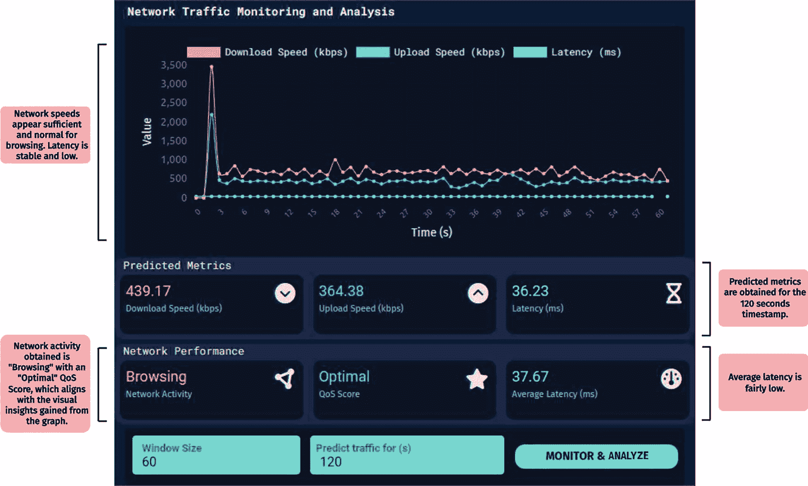
图 5-15 在最佳网络环境下浏览 Facebook 和 Google 新闻

浏览 Facebook 和 Google 新闻时，最佳网络环境下的网络流量监控分析截图。折线图绘制了数值随时间（秒）的变化。预测指标、网络性能、窗口大小和流量预测均被监控和分析。

## 5.5 本章小结

第 5 章致力于基于前几章学到的概念，使用 JavaScript 开发 NTMA 框架的应用。首先描述了系统模型，接着介绍了客户端和服务器端文件的组成及其相互连接，并特别强调了它们各自的特性与协议。用户界面以用户友好为基础，结合 HTML 和 CSS 构建。本章还通过代码详细阐述了该应用中涉及的两个机器学习模型，并给出了时间序列预测、设备活动分类以及 QoS 评分计算的方法。关键要点如下：
- 使用 JavaScript 开发 NTMA 应用的过程，涉及创建并执行负责监控和分析网络流量的客户端与服务器端范式。
- NTMA 系统模型包括在 Google Chrome 中作为浏览器扩展执行的客户端文件，以及在 Node.js 服务器上执行的服务器程序。
```


*   网络监控过程由应用的客户端通过一个按钮触发，随后无缝地与服务器端通信以接收网络流量数据。服务器还负责处理这些数据，并通过机器学习算法进行分类和预测分析。
*   该应用旨在通过将实时收集的数据与先前存储的数据相结合，以适应预测分析中不断变化的场景。由于计算是在一分钟（该时间也可相应调整）后执行，因此可获得该时间点特定网络场景的结果。不过，建议使用与被分析网络环境相关的合适数据集。此外，MLP 的超参数需要微调，以确保在不断变化的生态系统中获得最佳性能，这反过来也要求进行全面的测试。
*   在此应用中，内置了多种机制以确保其在大规模网络中的可扩展性。首先，它被设计为模块化和分布式的，允许通过随着网络规模增大而增加更多 Node.js 服务器来实现水平扩展。
*   端口号的使用支持并行化和流处理等高效数据处理技术，从而能够实时处理大量网络流量，每个客户端都被独立处理。
*   可以利用基于云的基础设施来动态分配资源，并确保最佳性能和效率。
下一章将分解介绍视频质量评估（VQA）应用的功能和代码。
