# 6. 使用 JavaScript 开发视频质量评估应用

本章延续实践之旅，介绍使用 JavaScript 开发视频质量评估（VQA）模型的应用层面。为了获得视频流质量的实时平均意见得分（MOS），采用了无参考（NR）图像质量评估（IQA）指标。在内容以秒级速度被大量消费的时代，通常无法获得原始视频源。本书提出的算法以实时视频为输入，连续截取屏幕截图，并将其顺序输入算法。阻塞、振铃、模糊和噪声是应用盲/无参考图像空间质量评估器（BRISQUE）所针对的伪影示例。因此，本章详细阐述了如何使用 JavaScript 构建一个健壮、可靠且实时的 VQA 框架。

## 6.1 VQA 系统模型

本节将详细阐述 VQA 框架的系统模型。该模型采用三层架构，包括客户端、基于 `Node.js` 的后端服务器以及使用 `Apache Tomcat` 托管的本地 `Java Servlet`。出于测试目的，这三个系统运行在同一设备上。因此，最终用户将看到一个具有以下功能的面板：

1.  通过浏览器扩展，直接在网页浏览器中监控实时视频质量指标。

2.  获取正在观看的视频流的实时视频质量评分，评分范围为 1 到 100。根据 VQA 领域多家供应商使用的术语 [1]，该评分被称为实时平均意见得分（MOS），其中`较低的值`代表更好的客观质量。同样，`较高的值`则表示失真程度更高。

3.  获取一个主导质量评级，该评级总结了所分析帧的视频质量表现。

这些功能的编码方式是，向服务器（进而向 Servlet）请求预设数量帧的视频指标。浏览器扩展由 `JavaScript (JS)` 驱动，后端为 `Node.js` 服务器。在这种情况下，后端仅负责充当客户端和 `Servlet` 之间的中介。`Servlet` 作为主要的 VQA 模块，其输入是网页浏览器截取的图像截图，该截图通过 `Node.js` 服务器传递，最终由 `Servlet` 接收。前端由 `HTML` 和 `CSS` 构成，而扩展和服务器之间以 `JSON` 格式来回发送消息。为了触发 `Servlet`，通过指定所截取截图的索引来发起一个 `HTTP POST` 请求。在 `Node.js` 服务器请求后，`Servlet` 经过几秒钟的处理，会返回一个包含 MOS 评分的 `JSON` 响应。然后，服务器将此信息中继给客户端，客户端据此更新图形用户界面（GUI）。客户端接收到的信息还包括不同分析帧的 MOS 评分平均值，以及一个主导质量评级，该评级表示在特定会话期间哪个评级出现次数最多。能够在几秒钟内快速监控视频质量并生成多个指标，是此 VQA 应用程序的显著特点之一，该应用程序也被打包成一个简单的浏览器扩展。浏览器扩展需要四个文件来持续截取截图并与 `Node.js` 服务器通信，如完整的系统模型图 6-1 所示。

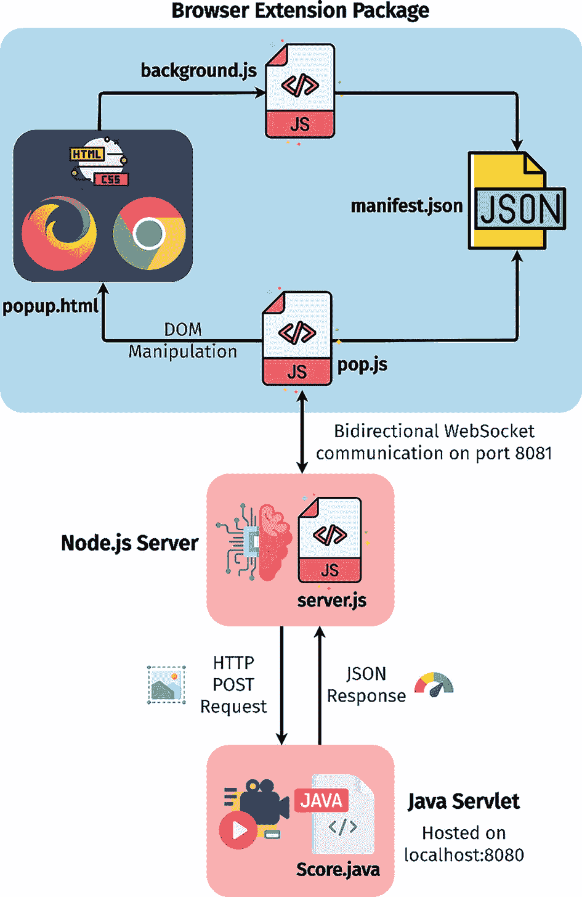
一个 VQA 系统模型从浏览器扩展包开始，接着是 `Node.js` 服务器，最后以 `Java Servlet` 结束。然后，该过程重复进行。
图 6-1

完整的 VQA 系统模型

### 6.1.1 组件与功能

`WebSocket` [2] 库使用 `JSON` 格式封装的消息，为 `Node.js` 服务器和浏览器扩展之间的双向通信框架提供支持。四个客户端文件、`Node.js` 服务器以及 `Servlet` 的功能总结于表 6-1 中。

表 6-1

VQA 的文件功能

| 文件 | 功能 |
| --- | --- |
| `popup.html` | 当用户在网页浏览器的工具栏中点击扩展图标时，此文件决定了所出现面板的结构、内容和组件。因此，它被称为前端，包含构成监控图表、面板卡片以及用于触发服务器并启动 VQA 流程的按钮的用户界面（UI）元素。 |
| `background.js` | 它负责管理与扩展各个部分相关的事件、状态和活动。通常，此类脚本用于监督持久性交互、管理通信模式以及执行后台任务。 |
| `pop.js` | 它提供了当 UI 组件被交互和激活时调用的例程。因此，它管理用户交互和弹出窗口内的任何动态信息，以及向服务器发送数据和从服务器接收数据。在接收到来自服务器的输出消息后，它会更新文档对象模型（DOM）。 |
| `manifest.json` | 作为一个 `JSON` 格式的文件，它提供了有关要使用的脚本以及控制标签页使用权限的信息。`manifest.json` 文件还包括扩展的名称、版本、权限、操作和图标图像源。因此，它向浏览器提供了有关该扩展的信息。 |
| `server.js` | 用 JS 编写的 `server.js` 文件充当后端服务器，负责作为客户端和 `Java Servlet` 之间的中间人。在此应用程序中，与扩展客户端成功连接后，它首先接收客户端截取的截图数据块，并将其编译成 `PNG` 图像。然后，根据正在访问的网站，它使用 `Sharp` 库 [3] 裁剪图像，使其仅包含正在观看的视频帧。此帧随后也以 `PNG` 文件形式存储在本地。接着，它向 `Servlet` 发出 `HTTP POST` 请求，并等待包含 MOS 评分的响应，然后将该评分中继回客户端。`server.js` 文件包含多个库，以实现这种无缝交互。 |
| `Servlet` 包 (`VQA` 模块) | `Servlet` 包使用 `Java` 在 `Eclipse IDE` 中编码。它使用下载的 `Apache Tomcat` 服务器托管在本地主机上，并被编程为接收 `HTTP POST` 请求。当被触发时，`Servlet` 检索先前由 `Node.js` 服务器存储的图像，并将其通过一系列处理步骤，即 VQA 模块。输出是一个 MOS 评分，范围从 1 到 100，`Servlet` 以 `JSON` 格式将该评分输出到服务器。 |

简而言之，当用户访问视频流媒体网站（如 `YouTube` 或 `Twitch`）时，可以使用该扩展通过 MOS 评分来监控正在观看视频的实时视频质量。这是通过在前一个截图处理完毕后立即截取一系列截图来实现的。用户只需点击“监控”按钮，即可分析使用 `Chart.js` [4] 创建的动态图表。

### 6.1.2 视频质量 MOS 评分预测

在此框架中，客户端截取的截图在生成 MOS 评分之前会经过一系列处理步骤。该评分代表了正在流式传输的视频的质量。该应用程序适用于具有自适应比特率（ABR）流式传输的视频播放器。此处的目标是获得一个普通用户能够理解的评分和评级。每张截取的截图都会在服务器端被标记，因为本地 `Servlet` 通过指定其文件路径来裁剪和获取同一图像。通过 `HTTP POST` 请求发送的参数决定了截取哪张截图。`Node.js` 服务器被编程为在从 `Servlet` 获得响应后立即请求客户端截取另一张截图。在此过程中，它也会发送结果。因此，`Node.js` 服务器充当客户端和 `Servlet` 之间的中介，执行诸如裁剪图像和处理 `HTTP` 调用等操作。这消除了客户端的任何处理负载，从而防止了客户端在观看视频时出现延迟和卡顿。

### 6.1.3 VQA 应用布局

在此应用中，弹出窗口使用户能够直接在网页浏览器中监控实时视频质量指标。实时图表会显示这些指标，并且可以动态调整，仅查看所需的参数。扩展程序打开后，会自动搜索要连接的 `Node.js` 服务器。“监控”按钮作为启动 VQA 过程的触发器。MOS 分数代表 `servlet` 针对某一特定帧生成的质量分数。点击此按钮时，会截取网页浏览器的屏幕截图并发送至 `Node.js` 服务器，在那里进行处理并馈送给 `servlet`。最终用户可以使用实时和主导两种质量指标。前者代表 `servlet` 实时输出的每一帧的质量评级，而后者则指示在特定会话期间获得最多的质量。图 6-2 展示了完整的浏览器扩展程序。

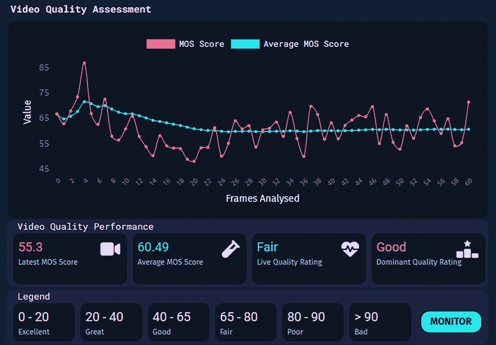
截图包含 VQA 布局。它包括一个数值与已分析帧数的关系图、视频质量性能以及图例。
图 6-2

VQA 应用布局

### 6.1.4 客户端–服务器–Servlet 交互

图 6-3 展示了浏览器扩展程序、`Node.js` 服务器和托管的 `Apache Tomcat Java servlet` 之间的逐步三方通信框架。

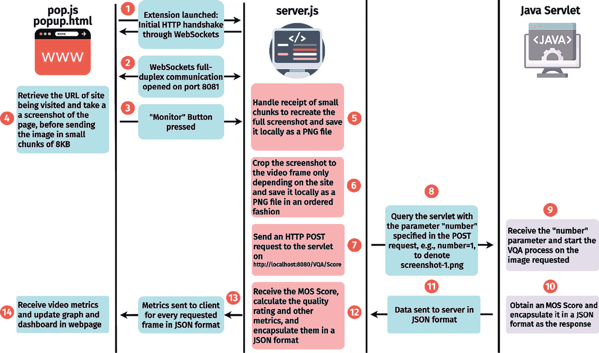
VQA 系统模型的交互过程始于扩展程序启动、`WebSocket` 全双工通信、监控按钮、检索 `URL` 站点、处理接收、裁剪屏幕截图、发送 `HTTP POST`，然后继续查询和指标。
图 6-3

VQA 的客户端–服务器–Servlet 交互

## 6.2 VQA 的客户端程序结构

在本节中，客户端（即前端）通过四个基本文件进行描述。图 6-4 概述了客户端的程序结构。

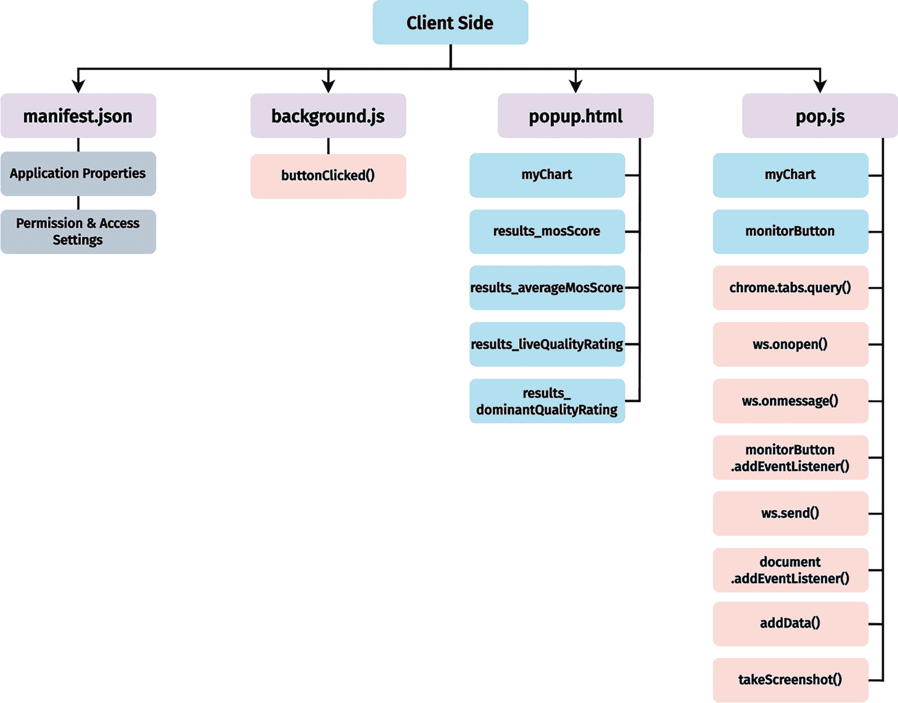
客户端程序结构包括以下组件：`manifest.json`、`background.js`、`popup.html`、`pop.js`。
图 6-4

客户端程序结构

### 6.2.1 配置扩展程序设置和权限

# Chrome 扩展程序文档

本节涉及包含元数据的 `manifest.json` 文件，该文件允许 Google Chrome 将浏览器扩展程序添加到其列表中。此文件的代码见代码清单 6-1。图标可以添加到与 `manifest.json` 文件相同的目录中，如果用户希望使用默认图标，也可以省略。

```json
{
  "manifest_version": 3,  // Chrome 扩展程序的清单格式版本。
  "name": "Video Quality Assessment",  // Chrome 扩展程序的名称。
  "version": "1.0",  // Chrome 扩展程序的版本号。
  "icons": {
    "16": "icon16.png",   // 16x16 像素大小的图标。
    "48": "icon48.png",   // 48x48 像素大小的图标。
    "128": "icon128.png"  // 128x128 像素大小的图标。
  },
  "background": {
    "service_worker": "background.js"  // 后台脚本，作为 Service Worker 实现。
  },
  "permissions": [ // 扩展程序所需的权限列表。
    "activeTab",  // 允许扩展程序与当前活动标签页交互。
    "scripting",  // 允许向网页注入脚本。
    "webNavigation",  // 使扩展程序能够接收网页导航生命周期中的事件。
    "webRequest",  // 授予扩展程序访问以观察和分析网络请求的权限。
    "storage",  // 提供对浏览器存储 API 的访问以实现数据持久化。
    "declarativeNetRequest",  // 允许扩展程序声明一组用于网络请求的规则。
    "declarativeNetRequestFeedback",  // 允许扩展程序提供关于网络请求的反馈。
    "tabs"  // 使扩展程序能够查询和操作浏览器标签页。
  ],
  "action": {
    "default_popup": "popup.html",  // 点击扩展程序图标时的默认弹出 HTML 文件。
    "default_title": "Video Quality Assessment"  // 扩展程序图标的默认标题。
  }
}
```

代码清单 6-1 使用扩展程序设置和权限配置 `manifest.json`

### 6.2.2 配置后台脚本

后台脚本充当一个被忽视的编排者，负责管理后台的关键操作，包括处理触发 Service Worker 逻辑的按钮按下事件。此文件的代码包含在 `background.js` 文件中，详见代码清单 6-2。

```javascript
// 记录一条消息，指示扩展程序已启动。
console.log("Extension launched...");
// 监听扩展程序操作按钮的点击事件。
chrome.action.onClicked.addListener(buttonClicked);
// 处理按钮点击事件的函数。
function buttonClicked(tab) {
  // 记录一条消息，指示在点击按钮时后台脚本正在运行。
  console.log("Background script running...");
}
// 可以在此处添加额外的 Service Worker 逻辑
// 此脚本独立于扩展程序运行，可以高效地执行后台任务
// 开发者可以扩展 Service Worker 的功能以处理各种任务，例如
// 网络请求、数据管理和后台处理。
```

代码清单 6-2 使用 Service Worker 逻辑配置 `background.js`

### 6.2.3 构建用户界面

用户界面通过结合 HTML 和 CSS 构建，创建一个包含实时图表、视频质量指标、图例和一个按钮的弹出窗口。这些组件在同一个 HTML 文件（即 `popup.html`）中设置样式。程序的这一部分负责向最终用户直观地显示用于视频质量监控的相关指标。

#### 文件功能

本节提供对 `popup.html` 文件的详细分析，概述其具体功能如下：

1.  指定文档结构，包括以下内容：
    1.  文档类型和语言。
    2.  字符集和标题。
    3.  修改内容安全策略（CSP）以允许特定的脚本源。
2.  添加对外部资源的引用：
    1.  从 Google Fonts [5] 导入所需的字体样式表。
    2.  从 Font Awesome 图标库 [6] 导入仪表板的图标。
    3.  链接从 Bootstrap 官方网站 [7] 下载的自定义 Bootstrap 样式表。
3.  添加内部 CSS 以修改组件外观：
    1.  设置主体、背景和按钮的样式。
    2.  定义用户界面组件（如按钮、标签和图表）的样式。
4.  显示标题和图表区域：
    1.  为弹出窗口设置标题。
    2.  创建一个用于嵌入图表区域的容器。
    3.  使用 Chart.js 嵌入图表画布。
5.  显示“视频质量性能”卡片：
    1.  创建一个用于视频质量指标的容器。
    2.  分别显示最新的 MOS 分数、平均 MOS 分数、实时质量评级和主导质量评级及其图标。
6.  显示“图例”卡片：
    1.  创建一个用于质量评级的容器。
    2.  定义“监控”按钮。
7.  添加下载的脚本和客户端脚本：
    1.  链接下载的 Chart.js 库 [4]。
    2.  链接自定义的 `pop.js` 脚本。

#### 库与所需资源

表 6-2 简要概述了所列出的库和可下载脚本及其各自的用途。

表 6-2 用户界面库与资源说明

| 库/资源 | 用途 | 仓库 | 下载链接 | 位置 |
| --- | --- | --- | --- | --- |
| Google Fonts | 为网页提供自定义字体 | [5] | - | `popup.html` |
| Font Awesome | 提供可缩放矢量图标 | [6] | - | `popup.html` |
| bootstrap.min.css | 用于组织行列的自定义 Bootstrap 样式表 | [7] | [8] | 项目根目录下的“css”文件夹 |
| chart.js | 为实时图表提供交互式图表 | [4] | [9] | 项目根目录 |
| pop.js | 用于逻辑的自定义 JS 文件 | 无 | 无 | 项目根目录 |

#### 创建文档结构

使用适当的库和资源，`pop.html` 文件中填充了清单 6-3 中提供的代码。此代码开始创建页面结构。文件中其余代码的位置已指定。

（此处应包含清单 6-3 的具体代码）

清单 6-3 创建文档结构

#### 添加图表和仪表盘组件

`body` 标签包含了用户可见的组件。这些元素按照清单 6-5 中的代码进行编码，其各自的描述和用途在注释中说明。在 `body` 内部，引用了外部脚本，即 `chart.js` 和 `pop.js`。它们被放置在末尾，以便在执行之前完全加载文档对象模型（DOM）。

（此处应包含清单 6-5 的具体 HTML 代码，例如：）
```html
<h1>视频质量评估</h1>
<!-- 图表区域 -->
<div id="chart-container">
  <canvas id="qualityChart"></canvas>
</div>
<!-- 视频质量性能卡片 -->
<div id="performance-card">
  <h3>视频质量性能</h3>
  <div>最新 MOS 分数: <span id="latestMOS">请稍候...</span></div>
  <!-- 其他指标 -->
</div>
<!-- 图例卡片 -->
<div id="legend-card">
  <h3>图例</h3>
  <!-- 图例项 -->
  <button id="monitorBtn">监控</button>
</div>
<script src="chart.js"></script>
<script src="pop.js"></script>
```

清单 6-5 添加图表和仪表盘组件

#### 通过内部 CSS 为组件设置样式

清单 6-6 提供了在 `style` 标签内为 HTML 组件添加样式所需的代码，以提高应用程序的可用性。

（此处应包含清单 6-6 的具体 CSS 代码）

## 清单 6-6 通过内部 CSS 为组件设置样式

```css
/* body 样式 */
body {
background-color: #131F33;
color: #92ABCF;
font-family: "Roboto";
font-size: 15px;
width: 710px;
}
/* body 背景样式 */
.bg-secondary {
background-color: #0F1724 !important;
}
/* 所有主要文本样式 */
.text-primary {
color: #92ABCF !important;
}
/* “监控”按钮样式 */
#monitorButton {
display: flex;
width: 200px;
height: 30px;
align-content: right;
margin-top: 16px;
margin-bottom: 10px;
margin-left: 10px;
margin-right: 10px;
text-transform: uppercase;
flex-direction: row;
-moz-box-align: center;
align-items: center;
gap: 0.375rem;
border: medium none;
box-shadow: rgba(0, 0, 0, 0.2) 0px 3px 1px -2px, rgba(0, 0, 0, 0.14) 0px 2px 2px 0px, rgba(0, 0, 0, 0.12) 0px 1px 5px 0px;
font-weight: bold;
font-family: Fira Sans, Arial, Helvetica, sans-serif;
cursor: pointer;
transition: background-color 250ms cubic-bezier(0.4, 0, 0.2, 1) 0ms, box-shadow 250ms cubic-bezier(0.4, 0, 0.2, 1) 0ms, border 250ms cubic-bezier(0.4, 0, 0.2, 1) 0ms;
-moz-box-pack: center;
justify-content: center;
border-radius: 12px;
padding: 0.625rem 0.75rem;
font-size: 0.875rem;
color: rgb(0, 0, 0);
background-color: rgb(17, 236, 229);
}
/* 按钮悬停时外观样式 */
#monitorButton:hover {
background-color: #bd1515;
color: white;
transition: .5s;
}
/* 弹出窗口标题样式 */
#title {
padding-top: 2px;
padding-left: 15px;
text-align: left;
font-family: Roboto Mono;
font-weight: bold;
font-size: 14px;
color: #DFCCFB;
}
/* 每个仪表盘行标题样式 */
.dashboard-title {
color: #DFCCFB;
margin-left: 10px;
margin-bottom: -5px;
font-size: 13px;
font-family: 'Roboto Mono';
}
/* 仪表盘行样式 */
.dashboard-row {
display: flex;
justify-content: space-between;
}
/* 仪表盘卡片样式 */
.dashboard-card {
padding: 7px;
margin: 4px;
border-radius: 10px;
background-color: #101424;
position: relative;
width: 225px;
}
/* 仪表盘容器样式 */
.dashboard-container {
background-color: #1d243f;
margin-top: 2px;
margin-left: 10px;
padding-left: 5px;
border-radius: 10px;
position: relative;
width: 97%;
}
/* 仪表盘图标样式 */
.icon {
position: absolute;
top: 10px;
right: 10px;
font-size: 25px;
color: #DFCCFB;
}
/* 仪表盘指标样式 */
.metric {
font-size: 18px;
}
/* 仪表盘描述样式 */
.description {
font-size: 11px;
font-family: Fira Sans;
}
```

## 将用户界面添加到 Google Chrome

按照以下步骤将浏览器扩展前端添加到 Google Chrome：

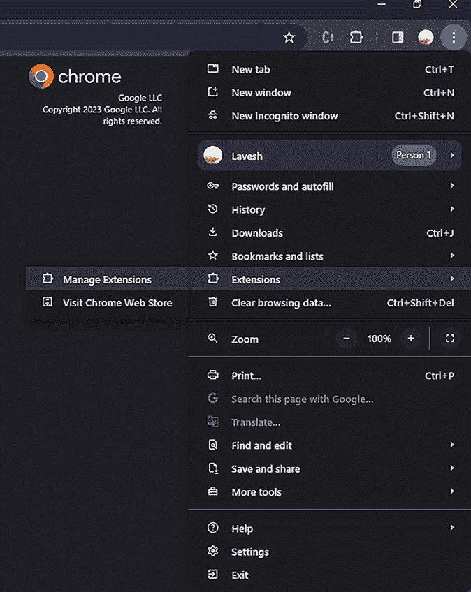
Google Chrome 扩展程序菜单的截图。已选中“管理扩展程序”选项。
图 6-5

访问扩展程序菜单

1.  在 Google Chrome 的主菜单中，点击三点图标，然后选择“扩展程序”。接着，找到并点击“管理扩展程序”（图 6-5）。这将打开 Google Chrome 扩展程序页面。

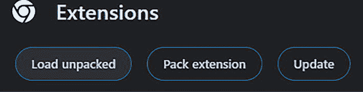
截图包含以下扩展程序：加载已解压的扩展程序、打包扩展程序、更新。其中“加载已解压的扩展程序”被高亮显示。
图 6-6

加载已解压的扩展程序

1.  如图 6-6 所示，选择“加载已解压的扩展程序”选项。

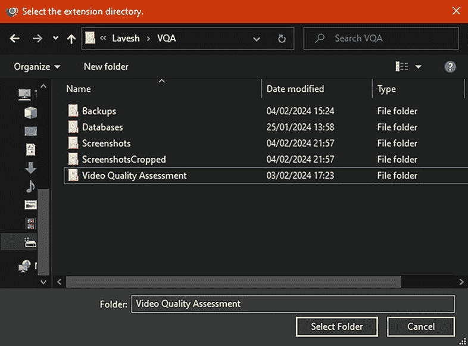
截图包含以下文件夹：备份、数据库、截图、裁剪后的截图、视频质量评估。
图 6-7

选择项目的根目录

1.  然后选择项目的根目录，如图 6-7 所示。

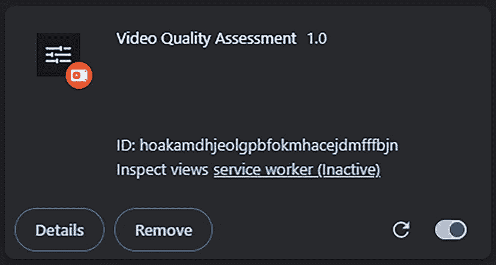
VQA 文件夹的截图。包含以下选项：删除、移除。
图 6-8

VQA 应用程序已添加到扩展程序菜单

1.  此时，应用程序已添加到扩展程序菜单中（图 6-8）。

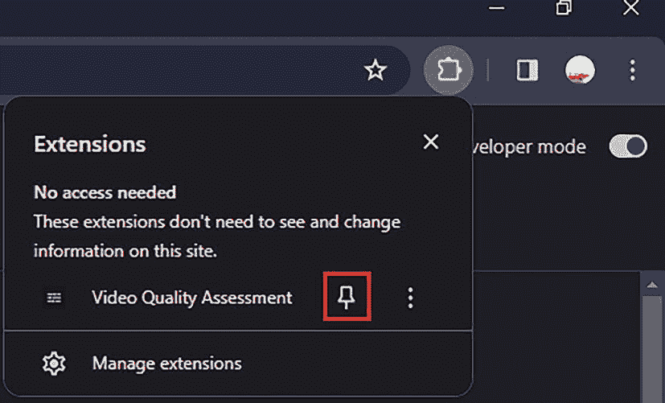
扩展程序菜单的截图。“视频质量评估”选项被高亮显示。
图 6-9

固定应用程序以便快速访问

1.  然后，通过点击拼图图标和固定图标，将 VQA 应用程序固定在浏览器右上角以便快速访问，如图 6-9 所示。

## 可视化用户界面

图 6-10 显示了在快速访问栏中点击应用程序后完成的用户界面。

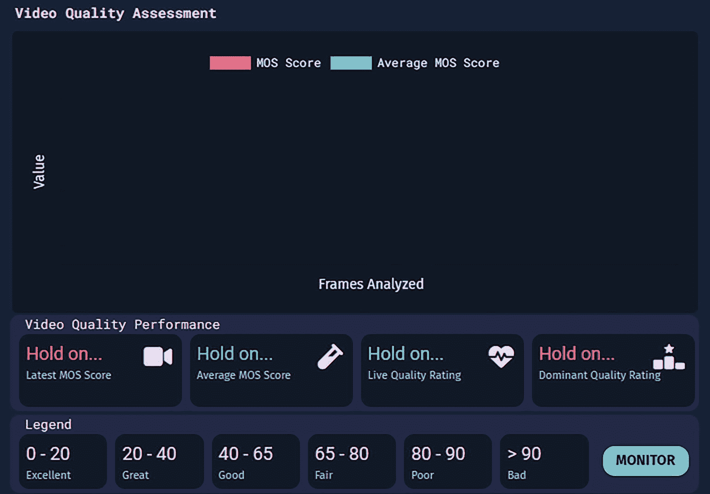
VQA 应用程序完成后的用户界面截图。
图 6-10

VQA 应用程序完成的用户界面

### 6.2.4 构建客户端脚本

客户端功能使用 JavaScript 实现，并包含在一个名为 `pop.js` 的单一文件中。该文件主要管理使用 WebSockets 与服务器的通信 [2]，使用接收到的指标刷新 UI，并使用 Chart.js 协调实时监控图表。

#### 文件功能

以下是 `pop.js` 文件的功能分解：

1.  声明全局变量，供整个脚本使用。

2.  使用 Chrome 扩展 API 查询 Chrome 标签页：

    1.  获取当前活动且最后聚焦的标签页信息。

    2.  获取活动标签页的 URL。

3.  创建到服务器的 WebSocket 连接：

    1.  实现从服务器接收消息的方法。

    2.  使用 `open` 事件处理连接。

    3.  解析并记录消息。

4.  接收并处理来自服务器的消息：

    1.  解析包含实时视频指标和图表更新的 JSON 消息。

    2.  使用视频质量性能参数更新 HTML 元素。

    3.  使用最新指标动态更新 Chart.js 图表。

5.  为“监控”按钮创建事件监听器：

    1.  为按钮添加事件监听器。

    2.  调用一个方法，使用 Chrome 扩展 API 截取当前页面视图的屏幕截图。

    3.  计算将图像发送到服务器所需的 8 KB 数据块数量。

    4.  发送服务器应预期的数据块数量，作为元数据。

    5.  将每个数据块发送到服务器。

6.  为 DOM 创建事件监听器：

    1.  为 DOM 添加事件监听器。

    2.  为两个数据集创建配置，并初始化 Chart.js 图表对象。

7.  实现一个方法，根据指定的标签每秒更新图表。

8.  实现一个方法，在收到 Node.js 服务器的请求时截取当前页面的屏幕截图。

#### 创建脚本结构

在 `popup.html` 文件中导入并引用必要的库之后，通过首先定义结构来填充 `pop.js` 脚本，其中包括以下基本步骤：

*   初始化全局变量

## 脚本功能与结构

*   获取当前活动且先前聚焦的标签页的 URL
*   为 DOM 附加一个事件监听器，以便在页面加载时立即触发执行
*   开发一个动态修改图表的程序

清单 6-7 定义了脚本结构，以及其他功能的代码放置位置。

```javascript
// 声明在整个脚本中调用的全局对象。
var monitorButton; // “监控”对象的变量。
var myChart; // Chart.js 对象的变量。
// 查询活动且最后聚焦的标签页以获取当前 URL。
chrome.tabs.query({
active: true,
lastFocusedWindow: true,
},
function(tabs) {

}
);
// 在 DOM 上添加事件监听器，以便在页面加载时立即执行。
document.addEventListener('DOMContentLoaded', function() {

}, false);
// 在 servlet 分析每一帧后更新图表的方法。
function addData(chart, label, data, updateLabel) {

}
// 清单 6-7
// 创建脚本结构
```

### 页面加载时初始化并配置图表

`DOMContentLoaded` 事件在 HTML 文档的 DOM 完全加载后立即触发语句的执行。图表区域使用 `myChart` 变量引用，如 `popup.html` 中所示。为了接受图表上设想的两个独立数据集，图表使用适当的规格进行初始化。通过为整个文档附加一个事件监听器来执行以下操作，该监听器在页面加载时立即触发：

1.  获取“监控”按钮的 DOM 元素，并将其分配给全局变量 `monitorButton`。

2.  创建数据集配置：
    1.  为“MOS 分数”和“平均 MOS 分数”创建两个独立的数据集。
    2.  对于每个数据集，指定标签、背景颜色、边框颜色、边框宽度和点半径。

3.  创建一个 `data` 对象，封装所有数据集设置，然后直接作为参数提供给 Chart.js。

4.  创建一个 `options` 对象，用于设置 Chart.js 图表的外观样式，设置包括响应性、宽高比、线条张力、轴配置、刻度显示设置和图例样式。

5.  为 Chart.js 图表创建一个 `config` 对象，其中封装了图表类型、要包含的数据以及指定的选项。

6.  使用 `myChart` 标识符创建一个新的 Chart.js 实例，从而将所有设置绑定到 HTML 元素。这表示渲染折线图的对象。

指定功能的代码片段见清单 6-8。

```javascript
// 获取“监控”按钮的 DOM 元素。
monitorButton = document.getElementById('monitorButton');
// 为“MOS 分数”折线图创建数据集配置。
const dataset_MOS = {
label: 'MOS 分数',
backgroundColor: 'rgb(255, 99, 132)',
borderColor: 'rgb(255, 99, 132)',
borderWidth: 1.2,
pointRadius: 1.6
};
// 为“平均 MOS 分数”折线图创建数据集配置。
const dataset_AvgMOS = {
label: '平均 MOS 分数',
backgroundColor: 'rgb(44, 211, 225)',
borderColor: 'rgb(44, 211, 225)',
borderWidth: 1.2,
pointRadius: 1.6
};
// 创建数据对象，将所有数据集封装为一个。
const data = {
datasets: [dataset_MOS, dataset_AvgMOS]
};
// 创建选项对象，负责设置图表外观的样式。
const options = {
// 设置宽度以适应分配的区域。
responsive: true,
// 不允许更改宽高比。
maintainAspectRatio: false,
elements: {
line: {
tension: 0.35, // 为折线图添加轻微曲率。
},
},
// 修改 x 轴配置。
scales: {
x: {
display: true, // 显示 x 轴。
title: {
display: true, // 显示 x 轴标题。
text: '已分析帧数', // 更改 x 轴标签。
color: '#DFCCFB', // 更改 x 轴标签颜色。
font: {
family: 'Fira Sans', // 更改 x 轴标签字体。
size: 14, // 更改 x 轴标签字体大小。
},
},
ticks: {
display: true, // 显示 x 轴刻度。
color: '#6b7e9b', // 更改 x 轴刻度标签颜色。
font: {
family: 'Ubuntu', // 更改 x 轴刻度字体。
size: 10, // 更改 x 轴刻度字体大小。
},
stepSize: 10, // 更改 x 轴刻度步长。
},
},
y: {
display: true, // 显示 y 轴。
title: {
display: true, // 显示 y 轴标题。
text: '数值', // 更改 y 轴标签。
color: '#DFCCFB', // 更改 y 轴标签颜色。
font: {
family: 'Fira Sans', // 更改 y 轴标签字体。
size: 14, // 更改 y 轴标签字体大小。
},
},
ticks: {
display: false, // 禁用 y 轴刻度。
color: '#6b7e9b', // 更改 y 轴刻度标签颜色。
font: {
family: 'Ubuntu', // 更改 y 轴刻度字体。
size: 13, // 更改 y 轴刻度字体大小。
},
},
},
},
plugins: {
legend: {
labels: {
color: '#DFCCFB', // 更改图例标签颜色。
font: {
family: 'Roboto Mono', // 更改图例标签字体。
}
}
}
}
};
// 折线图的配置对象。
const config = {
type: 'line', // 设置图表类型。
data: data, // 设置图表数据。
options: options // 设置样式和自定义选项。
};
// 使用配置创建新的 Chart 实例，并将其附加到 id 为“myChart”的画布元素上。
myChart = new Chart(document.getElementById('myChart'), config);
// 清单 6-8
// 页面加载时初始化并配置图表
```

### 实时 WebSocket 通信与动态图表更新

客户端的主要任务包括：在启用通过已建立连接传输消息之前，先在指定端口上与服务器建立连接。此外，它还能按需传输消息。然而，由于在此应用中服务器主要负责执行大部分计算任务，客户端主要专注于接收来自服务器的消息，并同时进行连续的屏幕截图。具体阐述如下：

1.  获取活动标签页的 URL 并将其存储在一个变量中。

2.  初始化一个 `time` 变量，用于跟踪正在分析的帧数。

3.  创建常量以动态区分两个图表。

4.  在 `ws://localhost:8081/` 上建立 WebSocket 连接，即通过端口 8081，进行实时通信。
    1.  要发送消息，使用 `ws.open` 事件。在此情况下，将之前存储的活动标签页的 URL 发送给服务器，以便服务器知道正在访问哪个站点。这对于处理所截取的屏幕截图至关重要，因为可以根据视频帧的坐标进行裁剪。在此应用中，目前支持 YouTube 和 Twitch。但是，可以获取任何视频流媒体网站的裁剪坐标，并相应修改代码。
    2.  要接收消息，使用 `ws.onmessage` 事件。此方法在收到来自服务器的任何消息时自动触发。服务器被编程为在收到来自 servlet 的结果后请求另一张屏幕截图，并将该结果中继给客户端。因此，客户端被编码为验证来自服务器的消息是否包含 “screenshot” 关键字，以及分析的帧数是否为六十。
    3.  来自服务器的消息还包含由 servlet 生成的视频质量指标。这些值用于更新 HTML 元素和图表。

5.  检查是否收到与服务器端发生的任何错误相关的消息，如果收到则生成警报。

6.  使用 `addData()` 方法触发实时图表更新，该方法接收图表对象、时间步长、实时值以及一个标签作为输入，用于指示正在填充两个数据集中的哪一个。

7.  为 “Monitor” 按钮创建一个事件监听器：
    1.  调用一个方法，使用 Chrome 扩展 API 截取当前页面视图的屏幕截图。
    2.  在 “Monitor” 按钮的事件监听器外部实现 `takeScreenshot()` 方法。

清单 6-9 给出了协调与服务器的双工通信、包含截屏机制以及实时更新图表的代码。

## Real-time WebSocket communication and dynamic graph updates

```javascript
// Store the URL of the active tab in a variable.
var tempurl = tabs[0].url;
// Variable for iterating time on the graph.
// It is used to keep track of the frames being analyzed.
var time = 0;
// Constants for updating graph data.
const updateMOS = "MOS";
const updateAverageMOS = "AverageMOS";
// Create a WebSocket connection to the server.
const ws = new WebSocket('ws://localhost:8081/');
// Handle the WebSocket connection "open" event.
ws.onopen = function() {
  // Log a message for when the extension has successfully connected to the server.
  console.log('WebSocket Client Connected');
  // Send the URL of the active tab to the server for it to know which site is being visited.
  // Specify the type as "sitedata" and send the message in a JSON format.
  ws.send(JSON.stringify({type:'sitedata', value:tempurl}));
};
// Handle received messages from the server.
ws.onmessage = function(e) {
  // Log any received message.
  console.log("Received from server: " + e.data);
  // Parse the JSON message for real-time metrics and graph updates.
  // This occurs as soon as the NodeJS server receives a processed reply from the Java Servlet.
  const msg = JSON.parse(e.data);
  // Extract the message from the server requesting another screenshot.
  var screenshotMessage = msg.screenshot;
  // Extract the message from the server containing the MOS score.
  var mosScore = parseFloat(msg.videoScore);
  // Extract the message from the server containing the Average MOS score.
  var averageMosScore = parseFloat(msg.averageVideoScore);
  // Extract the message from the server containing the Video Quality Rating.
  var liveQualityRating = msg.videoRating;
  // Since this rating is live, update the HTML element with the received metrics from the server.
  document.getElementById("results_liveQualityRating").innerHTML = liveQualityRating;
  // Extract the message from the server containing the Video Quality Rating.
  var dominantQualityRating = msg.dominantRating;
  // Since this rating is live, update the HTML element with the received metrics from the server.
  document.getElementById("results_dominantQualityRating").innerHTML = dominantQualityRating;
  // Add data to the chart using the addData() method by parsing the following parameters:
  // 1. Chart object.
  // 2. Timestep (relative to when the result for a frame is being received from the Java Servlet).
  // 3. Real-time value.
  // 4. Tag for guiding the variable to the right set of values on the chart.
  // Update the MOS graph with the information from the server.
  addData(myChart, time, parseFloat(mosScore), updateMOS);
  // Update the Average MOS graph with the information from the server.
  addData(myChart, time, parseFloat(averageMosScore), updateAverageMOS);
  // Handle messages related to any error sent by the server.
  // The following statement checks whether the message received contains the "error" keyword.
  // This keyword is set at the server side.
  if (e.data.includes("error")) {
    // Generate an alert to let the user know that video quality cannot be measured, along with the reason.
    alert("Unable to measure video quality. Reason: " + msg.error);
  }
  // Increment time for the next data point.
  time = time + 1;
  // If the number of frames analyzed is under 61.
  if (e.data.includes("screenshot") && time < 61) {
    // Request another screenshot to keep the analysis going.
    // This will trigger the `onmessage` event again with the next processed result.
    fetch('http://localhost:8080/screenshot', { method: 'GET' })
      .then((response) => {
        // Convert the response to a Blob.
        return response.blob();
      })
      .then((blob) => {
        // Create a Promise to handle the conversion of Blob to ArrayBuffer.
        return new Promise((resolve) => {
          // Create a FileReader instance.
          const reader = new FileReader();
          // Resolve with the result when the reader finishes loading.
          reader.onloadend = () => resolve(reader.result);
          // Read the Blob as ArrayBuffer.
          reader.readAsArrayBuffer(blob);
        });
      })
      .then((arrayBuffer) => {
        // Specify a chunk size in which the image is broken down to be sent to the server.
        const chunkSize = 8192; // e.g., 8 KB chunks
        // Calculate the number of chunks needed.
        const totalChunks = Math.ceil(arrayBuffer.byteLength / chunkSize);
        // Send metadata first (total number of chunks).
        ws.send(JSON.stringify({type: "metadata", totalChunks}));
        // Chunk and send the data into as many chunks required.
        // Iterate through the chunks and send them over the WebSocket connection.
        for (let i = 0; i < totalChunks; i++) {
          // Calculate the start and end of the current chunk.
          const start = i * chunkSize;
          const end = Math.min(start + chunkSize, arrayBuffer.byteLength);
          // Extract the chunk.
          const chunk = arrayBuffer.slice(start, end);
          // Send the chunk to the server.
          ws.send(chunk);
        }
      })
      .catch((error) => {
        // Log any errors in capturing the screenshot.
        console.error("Error capturing screenshot:", error);
      });
  }
};
```

#### 实时图表更新机制

本节涉及 `addData()` 方法，该方法用于按照 VQA 模块设定的时间间隔刷新 Chart.js 折线图。如上一段代码所示，一旦客户端获取到结果，就会调用此方法。该方法的输入参数如下：

*   Chart.js 对象，即 `myChart`，它在两个数据集中保持一致。
*   表示已获取结果的帧索引的标签。
*   从服务器获取的实时视频指标。
*   先前定义的标签，用于指定要更新两个数据集中的哪一个。

此外，当图表上更新了初始数据组后，之前通过 `options` 对象禁用的 y 轴刻度线将被启用，以提供平滑且不间断的显示效果。`addData()` 函数的代码见代码清单 6-10。

```
// 通过先前创建的标签判断该方法是为哪个数据集调用的。
// 如果标签代表 MOS。
if (updateLabel === "MOS") {
    // 推送标签，即帧时刻。
    chart.data.labels.push(label);
    // 推送数据，即实时指标。
    chart.data.datasets[0].data.push(data);
}
// 如果标签代表平均 MOS。
else if (updateLabel === "AverageMOS") {
    // 推送数据，即实时指标。
    chart.data.datasets[1].data.push(data);
}
// 首次调用此方法时，更新图表选项以显示 y 轴刻度线。
// 这样做是因为 y 轴刻度线最初是禁用的。
myChart.options.scales.y.ticks.display = true;
// 更新图表。
chart.update();
```

代码清单 6-10 实时图表更新机制

## 6.3 VQA 的服务器程序结构

此应用的 Node.js 服务器的主要职责如下：

1.  **导入模块**：文件开头使用 `require` 关键字添加模块。添加的库有助于创建 HTTP 服务器、建立 WebSocket 连接、执行带权限的文件系统操作、处理屏幕截图，以及处理与 servlet 之间的请求-响应机制。
2.  **初始化全局变量**：声明并初始化将在整个脚本中使用的对象。
3.  **创建 HTTP 服务器**：在端口 8081 上托管一个 HTTP 服务器，监听来自请求连接的客户端的传入请求。此服务器托管 WebSocket 连接。
4.  **处理 WebSocket 连接**：创建 WebSocket 服务器并将其绑定到 HTTP 服务器。然后，它监听来自连接客户端的连接，获取站点名称、数据块数量和二进制数据等信息，然后触发 VQA 流程。
5.  **处理屏幕截图**：通过附加从客户端接收到的 8 KB 数据块来重建图像，并使用 `sharp` 库进行裁剪，使其仅包含视频帧。
6.  **与 Java servlet 通信**：使用 `axios` 库，向本地主机上托管的 Java servlet 发送 HTTP POST 请求，以根据裁剪并存储的图像计算 MOS。处理响应并将其映射为可解释的视频质量评级。
7.  **监控视频质量**：通过 WebSocket 连接将指标更新发送到客户端，包括 MOS 分数、质量评级和平均分数。

在每个检查点，脚本都会记录语句，以提供对监控过程的洞察。这包括服务器的当前状态、发送和接收的消息，以及从 servlet 获得的响应。图 6-11 概述了服务器端的组件。

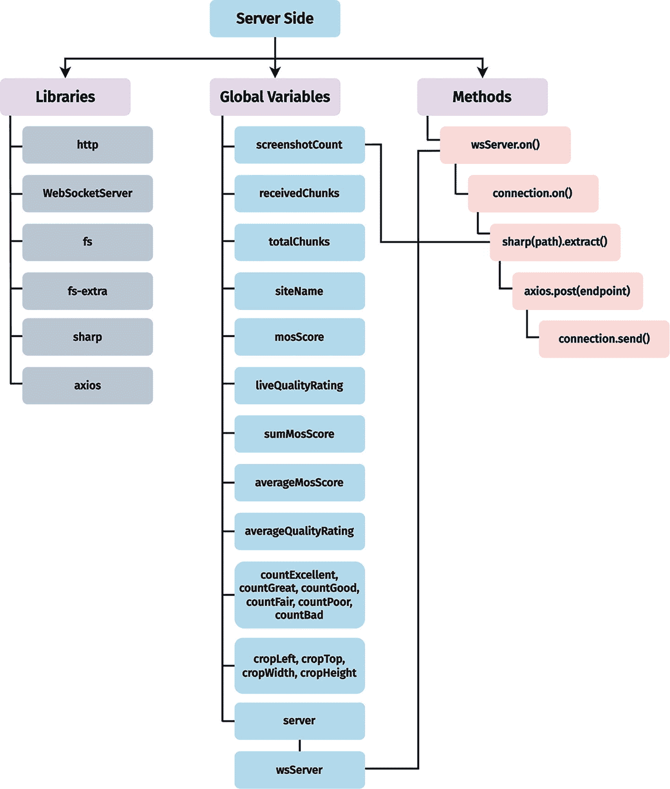

图 6-11 服务器端程序结构。服务器端分为库、全局变量和方法。进一步地，它们被细分为子组件。

### 6.3.1 库和所需资源

首先在命令提示符中使用 `npm install` 关键字在本地安装这些库。每个特定模块的安装说明可在表 6-3 的下载链接中找到。

表 6-3 服务器库和资源说明

| 库/资源 | 用途 | 下载链接 |
| --- | --- | --- |
| http | 创建 HTTP 服务器 | [10] |
| websocket | 绑定到 HTTP 服务器以建立 WebSocket 连接 | [2] |
| fs | 作为文件系统工作，允许访问设备上的文件 | [11] |
| fs-extra | 作为文件系统工作，允许额外的文件系统操作 | [12] |
| sharp | 通过提供一种方法，可以根据访问网站确定的预设坐标裁剪接收到的图像，从而轻松处理图像 | [3] |
| axios | 处理与 Java servlet 通信的请求-响应架构 | [13] |

### 6.3.2 添加库

在 `server.js` 文件的开头使用 `require` 关键字将指定的库添加到服务器的脚本中。代码清单 6-11 展示了此过程。

```
//指定与服务器和监控过程相关的导入。
const http = require('http'); // 导入 'http' 模块以创建 HTTP 服务器。
const WebSocketServer = require('websocket').server; // 导入 WebSocket 服务器模块。
const fs = require('fs'); // 导入 'fs' 模块以处理文件系统。
const fsExtra = require('fs-extra'); // 导入 'fs-extra' 模块以进行额外的文件系统操作。
const sharp = require('sharp'); // 导入 'sharp' 模块以进行图像处理。
const axios = require('axios'); // 导入 'axios' 模块以发起 HTTP 请求。
```

代码清单 6-11 添加库

### 6.3.3 声明全局变量

全局变量在保持状态和促进脚本各部分之间的数据共享方面起着至关重要的作用。因此，它们会在导入库之后立即被定义和初始化，如代码清单 6-12 所示。

```
// 声明并初始化用于服务器脚本的全局变量。
// 与图像处理相关的变量。
var screenshotCount = 1; // 用于按顺序在本地保存截图的计数器。
var receivedChunks = 0; // 用于跟踪已接收数据块的计数器。
var totalChunks; // 用于存储预期数据块总数的变量。
var siteName = ""; // 用于存储网站名称的变量。
// 与 VQA 相关的变量。
var mosScore = 0; // 用于存储平均意见得分 (MOS) 的变量。
var liveQualityRating = ""; // 用于存储实时质量评级的变量。
var sumMosScore = 0; // 用于累加 MOS 分数总和的变量。
var averageMosScore = 0; // 用于存储平均 MOS 分数的变量。
var averageQualityRating = ""; // 用于存储平均质量评级的变量。
// 与查找主要视频质量评级相关的变量。
var countExcellent = 0; // 用于统计“优秀”评级出现次数的计数器。
var countGreat = 0; // 用于统计“很好”评级出现次数的计数器。
var countGood = 0; // 用于统计“好”评级出现次数的计数器。
var countFair = 0; // 用于统计“一般”评级出现次数的计数器。
var countPoor = 0; // 用于统计“差”评级出现次数的计数器。
var countBad = 0; // 用于统计“很差”评级出现次数的计数器。
// 根据访问的网站决定屏幕裁剪区域的变量。
var cropLeft = 0; // 用于存储图像裁剪左侧坐标的变量。
var cropTop = 0; // 用于存储图像裁剪顶部坐标的变量。
var cropWidth = 0; // 用于存储图像裁剪宽度的变量。
var cropHeight = 0; // 用于存储图像裁剪高度的变量。
```

代码清单 6-12 声明全局变量

### 6.3.4 清空截图文件夹

本节涉及清空存储截图的文件夹。它确保在服务器开始监听连接之前，文件夹是干净的，并准备好存储新的截图。首先在项目的根目录下创建两个文件夹，即“Screenshots”和“ScreenshotsCropped”。前者用于存储网络浏览器的原始截图，后者用于存储裁剪后的截图。由于 `fs-extra` 库可以执行高级文件系统操作，因此在插入要清空的文件夹路径时务必格外小心。此部分的代码如代码清单 6-13 所示。

```
// 清空 "Screenshots" 和 "Screenshots-Cropped" 文件夹。
// 请小心此处插入的是哪个目录！
fsExtra.emptyDirSync("C://Users//Lavesh//VQA//Screenshots");
fsExtra.emptyDirSync("C://Users//Lavesh//VQA//ScreenshotsCropped");
```

代码清单 6-13 清空截图文件夹

## 6.3.5 创建 WebSocket 服务器

如第 5.3.5 节所述，在需要实现最小延迟的情况下会使用 WebSocket 服务器。它能提升性能和响应速度，使仪表板能够实时填充数据。代码清单 6-14 给出了创建 HTTP 服务器并将 WebSocket 服务器绑定到其上的代码。

```
// 在端口 8081 上托管服务器连接。
const server = http.createServer(); // 创建一个 HTTP 服务器实例。
server.listen(8081); // 监听端口 8081 上的传入 HTTP 请求。
console.log("Server started on port 8081..."); // 记录一条消息，指示服务器已启动。
console.log("Waiting for connection..."); // 记录一条消息，指示服务器正在等待连接。
// 创建一个 WebSocket 服务器实例，并将其附加到先前创建的 HTTP 服务器上。
const wsServer = new WebSocketServer({
  httpServer: server,
});
```
代码清单 6-14 创建 WebSocket 服务器

## 6.3.6 监听客户端连接请求

本节包含与客户端和服务器之间关系相关的几个过程，如图 6-3 所示。提供以下说明：

*   监听客户端发出的连接请求。
*   接受连接。
*   获取包含服务器应接收的数据块数量的元数据，以及包含正在访问的网站 URL 的站点数据变量。这些变量由客户端通过 JSON 格式的字符串发送。
*   接收二进制图像数据。
*   追加接收到的图像块以重建完整的图像。
*   将原始截图以 PNG 格式存储在“Screenshots”文件夹中。
*   根据获取的站点名称确定的预设坐标，裁剪原始截图以仅获取视频帧。
*   将裁剪后的截图以 PNG 格式存储在“ScreenshotsCropped”文件夹中。
*   向 Java Servlet 发出 HTTP POST 请求。
*   获取 MOS 分数响应。
*   将 MOS 分数转换为可解释的视频质量评级。
*   根据分析的帧数计算平均 MOS 分数。
*   计算主要的视频质量评级，即出现次数最多的评级。
*   通过 WebSocket 将结果发送回客户端。

代码清单 6-15 提供了与等待和批准客户端请求活动相关的过程框架。`connection.on` 代码块目前为空，将在后续章节中填充。

```
// 通过 WebSocket 服务器监听客户端的连接请求。
wsServer.on("request", function (request) {
  // 接受来自客户端的连接。
  const connection = request.accept(null, request.origin);
  // 使用 "message" 关键字接受来自客户端的传入消息。
  connection.on("message", function (message) {

  });
  // 使用 "close" 关键字处理客户端断开连接。
  connection.on("close", function (reasonCode, description) {
    // 记录一条消息以指示客户端已断开连接。
    console.log("Client has disconnected.");
  });
});
```
代码清单 6-15 监听客户端连接请求

### 接收元数据和站点数据

当服务器收到任何消息时，会触发 `connection.on` 代码块，首先在控制台记录该消息。`metadata` 和 `sitedata` 变量分别包含客户端拼接图像所需的数据块数量以及正在浏览的网站 URL。这些对象特意以 UTF-8 格式封装。这与客户端发送的实际图像（二进制格式）形成对比。这种机制使 WebSocket 连接能够区分 `metadata` 和 `sitedata` 变量与实际的截图数据块。这些检查通过一系列 `if` 语句执行，用于识别当前接收的是哪种数据，然后将其存储到各自的全局变量中。此外，一旦获取到 `sitedata` 变量，就会根据网站设置裁剪坐标。这些功能如代码清单 6-16 所示。

```
// 检查接收到的消息类型是否为 UTF-8 格式。
if (message.type === "utf8") {
  // 从接收到的消息中解析 UTF-8 数据。
  const messageReceived = JSON.parse(message.utf8Data);
  // 检查接收到的消息类型（metadata 或 sitedata）。
  if (messageReceived.type === 'metadata') {
    // 使用接收到的元数据更新 totalChunks 变量。
    totalChunks = messageReceived.totalChunks;
    // 记录接收到的元数据信息。
    console.log('Received metadata:', totalChunks, 'chunks expected.');
  } else if (messageReceived.type === 'sitedata') {
    // 使用接收到的值更新 siteName 变量。
    siteName = messageReceived.value;
    // 记录接收到的站点数据信息。
    console.log('Received sitedata:', siteName, 'is the link.');
    // 检查网站链接以相应地设置裁剪坐标。
    // 对于 YouTube 和 Twitch，坐标已设置。
    // 对于其他网站，截取整个页面作为 VQA 块的截图。
    if (siteName.includes("youtube")){
      // 针对 https://www.youtube.com/ 上的视频
      cropLeft = 98;
      cropTop = 80;
      cropWidth = 1280;
      cropHeight = 720;
    } else if (siteName.includes("twitch")) {
      // 针对 https://www.twitch.tv/ 上的视频
      cropLeft = 239;
      cropTop = 52;
      cropWidth = 1340;
      cropHeight = 752;
    } else {
      // 针对任何其他网站上的视频（不裁剪）。
      cropLeft = 0;
      cropTop = 0;
      cropWidth = 1920;
      cropHeight = 953;
    }
  }
} else if (message.type === "binary") {

}
```
代码清单 6-16 从客户端获取消息并创建重复函数

### 重建和裁剪图像

本节详细介绍了从客户端接收二进制图像数据、重建完整图像，然后裁剪图像以聚焦于相关内容的过程。主要操作如下，并在代码清单 6-17 中给出。

*   获取单个数据块中的二进制数据。
*   将接收到的数据转换为缓冲区。
*   将数据块追加到一个文件中，并通过指定路径和文件扩展名（即“.png”）将其本地存储。
*   记录当前已接收的数据块数量（相对于总数）。
*   通过比较已接收的数量与之前通过 `metadata` 对象获取的总数，检查是否已接收所有数据块。
*   如果是，则指定要裁剪的图像的路径以及目标路径（即裁剪后的图像）。
*   使用 `sharp` 库，根据从 `sitedata` 对象获取的预设坐标裁剪原始截图。
*   将获取到的任何错误发送给客户端，或记录一条消息以指示操作成功。

```
// 如果接收到的消息是二进制类型。
// 增加已接收数据块的计数器。
receivedChunks++;
// 处理接收到的二进制数据。
const arrayBuffer = message.binaryData;
// 将 `arrayBuffer` 转换为 `Buffer`。
const buffer = Buffer.from(arrayBuffer);
// 将数据块追加到一个文件中（例如，`screenshot-1.png`）。
// 对于一个截图，其每个数据块都被追加到同一个文件中，以创建最终的截图。
fs.appendFileSync("C://Users//Lavesh//VQA//Screenshots//screenshot-" + screenshotCount + ".png", buffer);
// 记录一条消息以指示已接收数据块的索引。
console.log('Received chunk:', receivedChunks, 'of', totalChunks);
// 如果所有数据块都已接收，则完成并保存图像文件。
if (receivedChunks === totalChunks) {
    // 这表示已从客户端接收到完整的截图。
    console.log("All chunks received. Screenshot saved.");
    // 指定裁剪前后的文件路径。
    var pathBeforeCropping = "C://Users//Lavesh//VQA//Screenshots//screenshot-" + screenshotCount + ".png";
    var pathAfterCropping = "C://Users//Lavesh//VQA//ScreenshotsCropped//screenshot-" + screenshotCount + ".png";
    // 使用 "Sharp" 库根据预设坐标裁剪图像。
    sharp(pathBeforeCropping)
        .extract({ left: cropLeft, top: cropTop, width: cropWidth, height: cropHeight })
        .toFile(pathAfterCropping, (err, info) => {
            if (err) {
                // 记录一条错误消息以指示无法执行裁剪。
                console.error('Error cropping image:', err);
                // 创建一条要发送给客户端的错误消息。
                const errorMessage = {
                    error: "Error cropping image."
                };
                // 将错误消息封装为 JSON 格式的字符串，并通过 WebSocket 连接发送。
                connection.send(JSON.stringify(errorMessage));
            } else {
                // 记录一条消息以指示图像已成功裁剪。
                console.log('Image cropped successfully:', info);
            }
        });
    // 将已接收的数据块数量设置为零，作为下一个截图的复位。
    receivedChunks = 0;
}
```

### 代码清单 6-17 重建和裁剪图像

#### 查询 Servlet 并处理响应

本节详细介绍了服务器联系 Java servlet 以获取视频质量 MOS 信息的过程。它涵盖了发起 HTTP POST 请求、处理响应、将 MOS 分数映射到质量等级以及计算平均分数，具体如下：

* 使用 `axios` 库向 servlet 的端点发起 HTTP POST 请求。
* 将截图的索引指定为参数。
* 通过接收 JSON 响应并将其存储到变量中来处理响应。
* 将获取的 MOS 分数映射到其质量等级，以便于理解。
* 增加不同的计数器以识别出现频率最高的质量等级。
* 计算平均 MOS 分数。
* 将 MOS 分数、平均 MOS 分数、视频质量等级、主导视频质量等级以及一个请求客户端提供另一张截图的标签封装成 JSON 格式的字符串。
* 使用 `connection.send()` 方法通过 WebSocket 连接将此变量发送给客户端。
* 记录任何获取到的错误并发送给客户端。

这些过程在代码清单 6-18 中进行了演示。

```
// 此时，包含 VQA 模块所需视频源的裁剪图像已就绪。
// 记录一条消息，表示正在向 Java HTTP Apache 服务器（servlet）发送请求以获取 MOS 分数。
console.log("Making request to servlet.")
// 使用 "Axios" 库向该 servlet 发起 HTTP POST 请求。
axios.post("http://localhost:8080/VQA/Score", null, {
// 指定 servlet 所需的参数，此处为截图计数。
params: {
number: screenshotCount,
},
})
.then((response) => {
// 处理来自 servlet 的响应。
// 从 JSON 响应中获取 MOS 分数。
mosScore = response.data.score;
mosScore = parseFloat(mosScore);
// 记录一条消息以指示获取到的 MOS 分数。
console.log("Score obtained from servlet: " + mosScore);
// 针对极差质量情况处理异常值。
if (mosScore > 100) {
mosScore = 100;
}
// 将获取到的 MOS 分数映射到其质量等级，以便于理解。
// 根据分配的质量等级递增相应的计数器。
// 这是为了识别出现频率最高的视频质量，即“主导质量等级”。
if (mosScore >= 0 && mosScore < 20) {
liveQualityRating = "Excellent";
countExcellent = countExcellent + 1;
} else if (mosScore >= 20 && mosScore < 40) {
liveQualityRating = "Great";
countGreat = countGreat + 1;
} else if (mosScore >= 40 && mosScore < 65) {
liveQualityRating = "Good";
countGood = countGood + 1;
} else if (mosScore >= 65 && mosScore < 80) {
liveQualityRating = "Fair";
countFair = countFair + 1;
} else if (mosScore >= 80 && mosScore < 90) {
liveQualityRating = "Poor";
countPoor = countPoor + 1;
} else if (mosScore >= 90) {
liveQualityRating = "Bad";
countBad = countBad + 1;
}
// 记录一条消息以指示实时质量等级。
console.log("Video Quality Rating: " + liveQualityRating);
// 创建一个数组来存储每个质量等级的计数。
var countQuality = [countExcellent, countGreat, countGood, countFair, countPoor, countBad];
// 初始化变量以查找最大计数及其索引。
var maxCount = countQuality[0]; // 假设第一个是最大值。
var maxIndex = 0;
// 遍历 `countQuality` 数组以查找最大计数及其索引。
for (var i = 1; i < countQuality.length; i++) {
if (countQuality[i] > maxCount) {
// 更新最大计数及其索引。
maxCount = countQuality[i];
maxIndex = i;
}
}
// 创建一个表示质量等级的标签数组。
var labels = ['Excellent', 'Great', 'Good', 'Fair', 'Poor', 'Bad'];
// 根据最大索引确定主导质量等级。
var dominantQualityRating = labels[maxIndex];
// 将主导质量等级及其计数记录到控制台。
console.log('The highest count label is:', dominantQualityRating);
console.log('The highest count value is:', maxCount);
// 计算并记录平均 MOS 分数。
sumMosScore = sumMosScore + mosScore;
averageMosScore = sumMosScore / screenshotCount;
console.log("Average MOS Score: " + averageMosScore);
// 向客户端发送消息以请求另一张截图。
// 创建一个常量变量，保存测量/计算得到的分数和等级。
const screenshotUpdate = {
screenshot: "sendScreenshot",
videoScore: mosScore,
averageVideoScore: averageMosScore,
videoRating: liveQualityRating,
dominantRating: dominantQualityRating
};
// 将指标消息封装为 JSON 格式字符串，并通过 WebSocket 连接发送。
connection.send(JSON.stringify(screenshotUpdate));
// 递增截图计数以处理下一张截图。
screenshotCount = screenshotCount + 1;
})
.catch((error) => {
// 记录一条错误消息，指示无法将截图发送到 `servlet`。
console.error('Error sending screenshot to servlet:', error);
// 创建一条要发送给客户端的错误消息。
const errorMessage = {
error: "Error sending screenshot to servlet."
};
// 将错误消息封装为 JSON 格式字符串，并通过 WebSocket 连接发送。
connection.send(JSON.stringify(errorMessage));
});
```

代码清单 6-18 查询 `servlet` 并处理响应

## 6.4 VQA 的 Servlet 程序结构

本节将详细介绍在 `Eclipse` IDE 中构建并使用 `Apache Tomcat` 在本地托管的 `Java servlet`。该 `servlet` 的主要功能如下：

1.  **处理 `HTTP POST` 请求**：通过 `HTTP POST` 请求与 `servlet` 建立联系。创建时，`Java` 文件已包含用于接收客户端请求的实现。然后，`servlet` 负责在启动其他任务之前成功接收请求中发送的参数。

2.  **定位图像**：在接收到待评估质量图像的截图编号后，`servlet` 通过其路径动态查找该文件。

3.  **对图像引入失真**：通过将原始图像与其多个伪参考图像（`MPRI`）进行比较，生成一个相似度分数数组。

4.  **提取局部二值模式（`LBP`）特征**：在获取失真图像后，利用产生的亮度差异执行二值化过程。

5.  **预测相似度指数和 `MOS` 质量分数**：在缩放回归器之前，将阻塞、振铃、模糊和噪声伪影的分数存储在一个二十维特征向量中。此步骤使用了 `LIBSVM` 库。

图 6-12 展示了该 `servlet` 的通用程序结构。

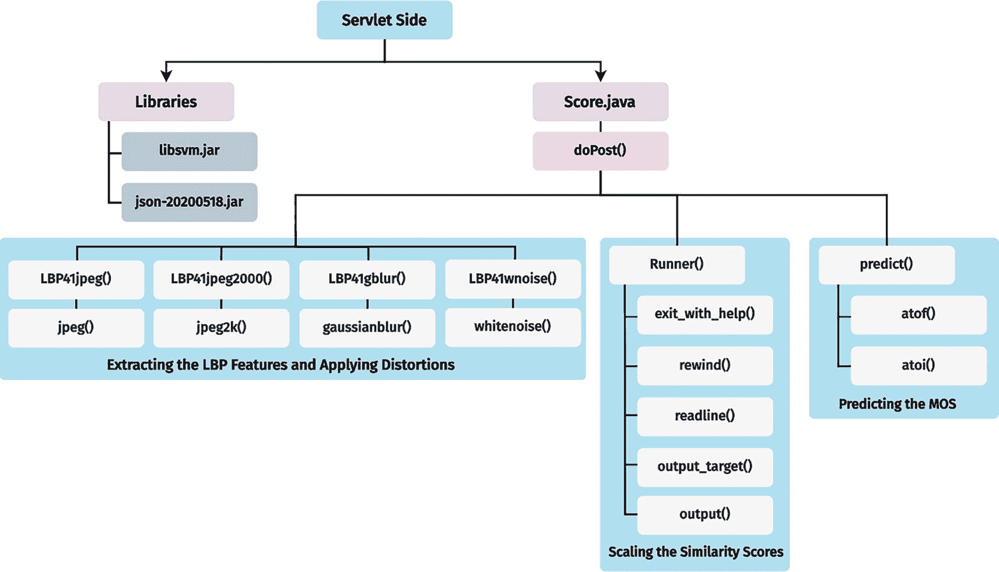

服务器端通用程序结构包括以下组件：库、`Score.java`。

图 6-12 Servlet 端程序结构

此外，图 6-13 给出了由 `Eclipse` 生成的、包含全局变量和方法的统一建模语言（`UML`）图。

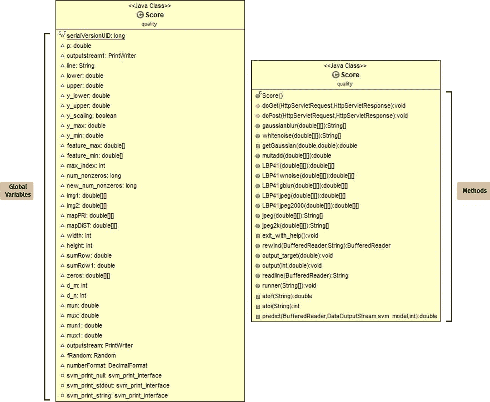

Servlet 端程序的 `UML` 图。两个区块分别代表全局变量和方法。

图 6-13 Java Servlet 的 UML 图

### 6.4.1 在 `Eclipse` 中创建 `Java Servlet`

首先在 `Eclipse` 中创建项目，步骤如下：

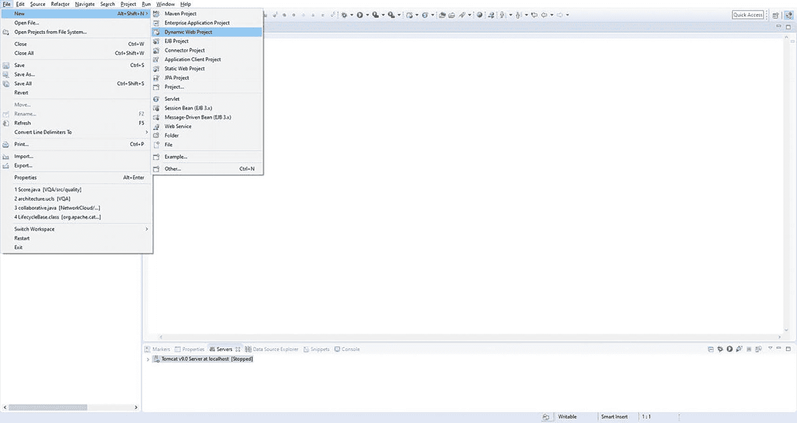

截图展示了在 `Eclipse` 中创建项目的步骤。步骤如下：`文件` ➤ `新建` ➤ `动态 Web 项目`。

图 6-14 创建动态 Web 项目

1.  启动 `Eclipse`，然后依次点击“`文件`” ➤ “`新建`” ➤ “`动态 Web 项目`”（图 6-14）。

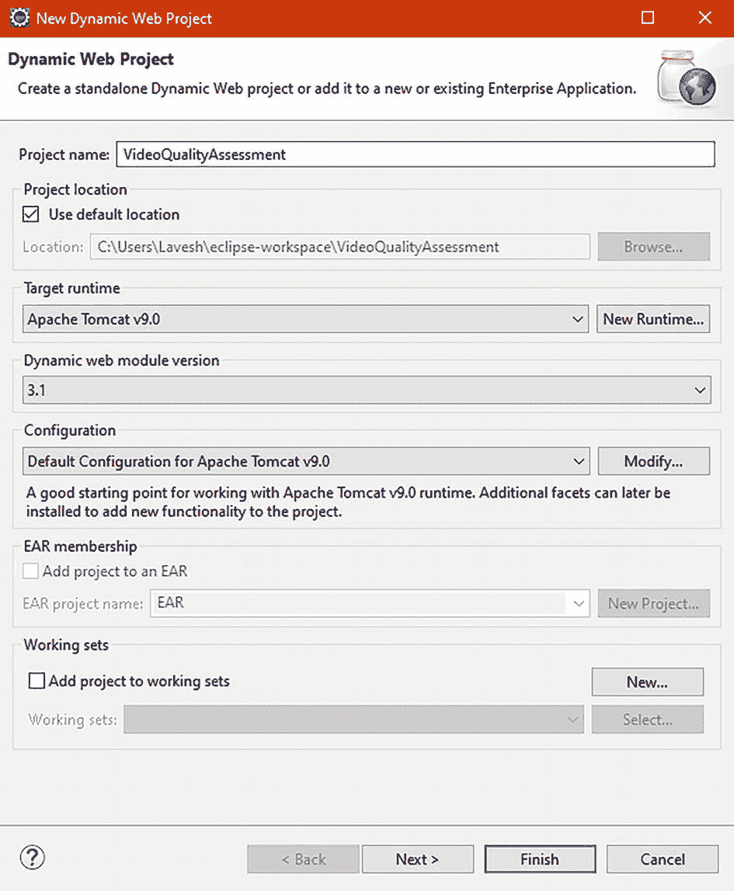

标题为“新建动态 Web 项目”的截图包含以下字段：`项目名称`、`目标运行时`、`动态 Web 模块版本`、`配置`、`EAR 成员资格`、`工作集`。

图 6-15

### 输入项目详细信息

1.  在出现的菜单中，输入新项目的详细信息，然后点击“完成”，如图 6-15 所示。应确保在“目标运行时”字段下已选择 Apache Tomcat 服务器，这样 Eclipse 在创建项目时会自动将 `@WebServlet("/Score")` 标签附加到 Java 文件中。

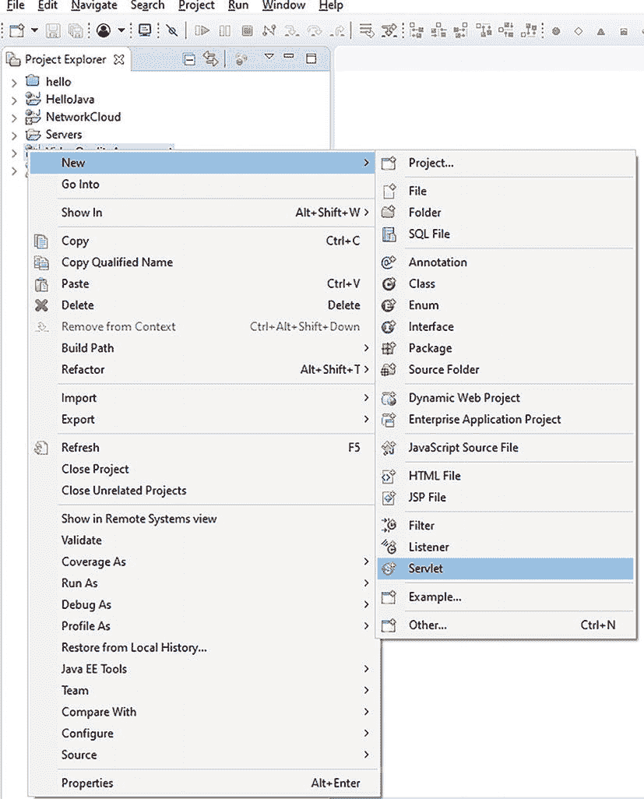
项目资源管理器窗口截图。创建 Servlet 文件的步骤如下：新建 → Servlet。
图 6-16

#### 创建 Servlet 文件

1.  要创建 Servlet 文件（即 Java 文件），右键单击左侧面板中已创建的项目，然后依次选择“新建”和“Servlet”。如图 6-16 所示。

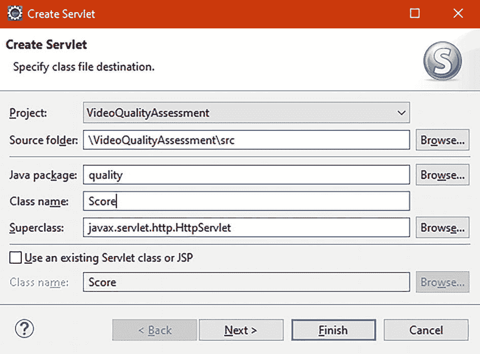
标题为“创建 Servlet”的截图包含以下字段：项目、源文件夹、Java 包、类名、超类。
图 6-17

#### 输入文件详细信息

1.  文件命名为 `Score.java`，如“类名”标签所示，并位于“quality”包下，如图 6-17 所示。

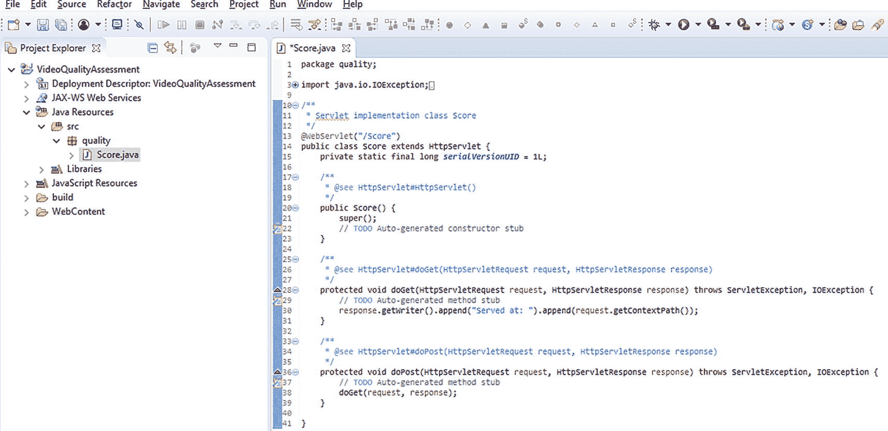
`Score.java` 窗口截图。其中包含带有 `doGet` 和 `doPost` 方法的代码片段。
图 6-18

#### Servlet 文件中方法的自动生成

1.  创建完成后，构造函数、`doGet()` 和 `doPost()` 方法会自动生成，如图 6-18 所示。
至此，Servlet 及其在本地运行所需的 Java 文件创建完成。

### 6.4.2 库与所需资源

本项目所需的库以“.jar”文件形式提供，汇总于表 6-4。

**表 6-4 Servlet 库与资源说明**

| 库/资源 | 用途 | 下载链接 |
| :--- | :--- | :--- |
| `libsvm.jar` | 提供训练 SVM 模型、进行预测以及处理与 SVM 算法相关的多个参数的功能 | [14] |
| `json-20200518.jar` | 为 Java 中的 JSON（JavaScript 对象表示法）数据交换格式提供支持。由于其轻量级特性，这种表示法通常用于服务器与 Web 应用程序之间的数据交换。 | [15] |

### 6.4.3 添加库

通过以下步骤将下载的“.jar”文件添加到项目中：

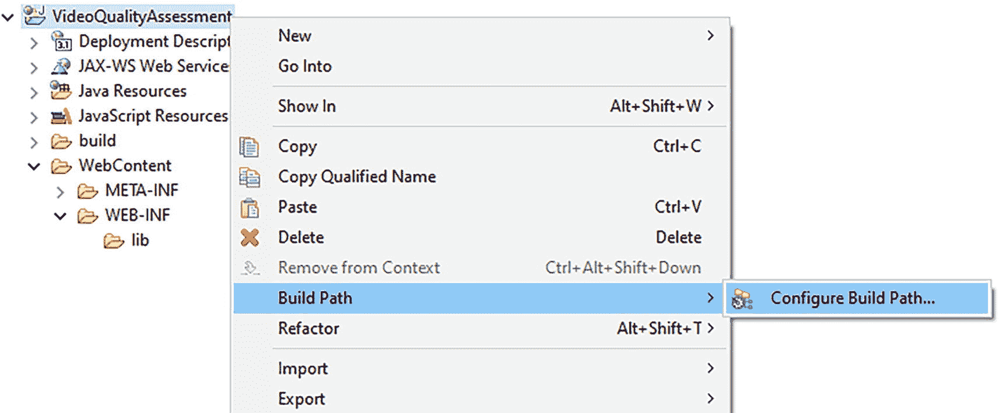
视频质量评估文件夹截图，其中包含以下选中选项：构建路径 → 配置构建路径。
图 6-19

#### 配置构建路径

1.  右键单击项目，然后依次选择“构建路径”和“配置构建路径…”（图 6-19）。

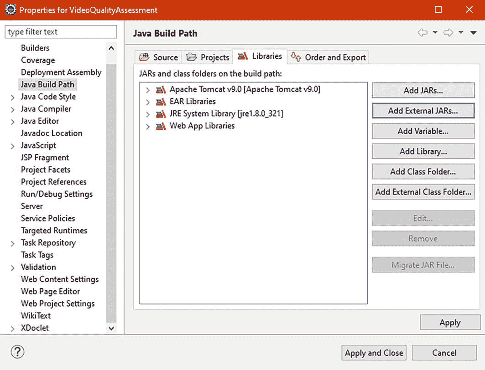
标题为“视频质量评估属性”的截图包含以下文件夹：Java 构建路径。在 Java 构建路径部分中，“库”部分被高亮显示。
图 6-20

#### 添加外部 JAR 包

1.  接下来，选择“添加外部 JAR 包…”选项，如图 6-20 所示。

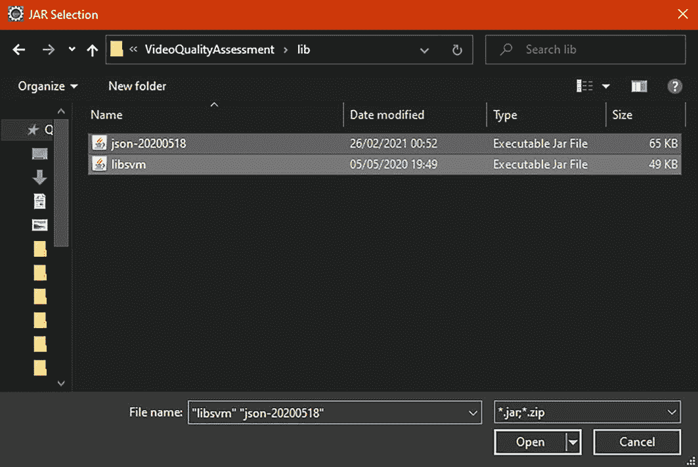
标题为“JAR 选择”的截图包含以下可执行 jar 文件：json、libsvm。
图 6-21

#### 选择外部 JAR 包

1.  浏览文件所在位置，然后逐一选择每个文件（图 6-21）。

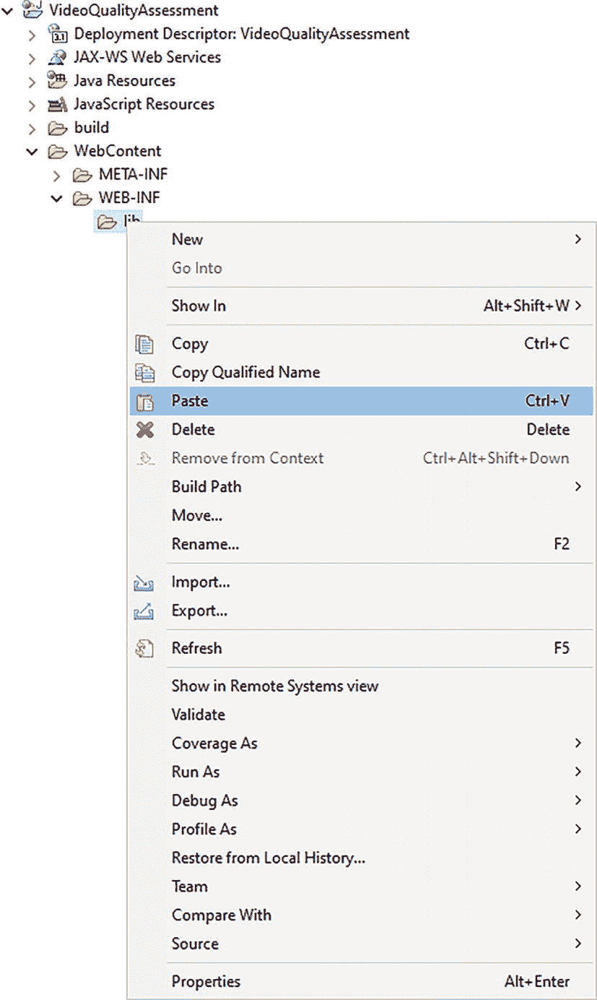
截图高亮显示了以下文件夹：lib → 粘贴。
图 6-22

#### 将 JAR 包粘贴到 lib 文件夹中

1.  此外，在项目目录中找到“WEB-INF”文件夹。该文件夹包含“lib”文件夹，也需要将“.jar”文件粘贴到其中，如图 6-22 所示。

### 6.4.4 添加导入语句

首先将与本项目相关的导入语句添加到 `Score.java` 文件中，如代码清单 6-19 所示。

```
// 输入/输出处理相关的导入。
import java.awt.image.BufferedImage;
import java.io.BufferedReader;
import java.io.File;
import java.io.IOException;
import java.io.PrintWriter;
import java.io.BufferedOutputStream;
import java.io.DataOutputStream;
import java.io.FileNotFoundException;
import java.io.FileOutputStream;
import java.io.FileReader;
// 处理 Servlet 相关的导入。
import javax.imageio.ImageIO;
import javax.servlet.Servlet;
import javax.servlet.ServletException;
import javax.servlet.annotation.WebServlet;
import javax.servlet.http.HttpServlet;
import javax.servlet.http.HttpServletRequest;
import javax.servlet.http.HttpServletResponse;
// JSON 格式化相关的导入。
import org.json.JSONObject;
// LIBSVM 相关的导入。
import libsvm.svm;
import libsvm.svm_model;
import libsvm.svm_node;
import libsvm.svm_parameter;
import libsvm.svm_print_interface;
// 其他导入。
import java.util.Arrays;
import java.util.StringTokenizer;
import java.text.DecimalFormat;
import java.util.Random;
```

### 6.4.5 声明全局变量

在整个 Servlet 中使用的变量在公共 `Score` 类内部声明并初始化，如代码清单 6-20 所示。

```
// 声明并初始化将在整个 Servlet 中使用的全局变量。
double p = 0; // 预测值，即 MOS 分数。
PrintWriter outputstream1; // 用于写入结果的输出流。
String line = null; // 当前正在处理的行。
// 缩放参数。
double lower = 0.0; // 缩放的下界。
double upper = 1.0; // 缩放的上界。
double y_lower; // y 缩放的下界。
double y_upper; // y 缩放的上界。
boolean y_scaling = false; // 指示是否应用 y 缩放的标志。
double y_max = -Double.MAX_VALUE; // y 缩放的最大目标值。
double y_min = Double.MAX_VALUE; // y 缩放的最小目标值。
double[] feature_max; // 每个特征的最大值。
double[] feature_min; // 每个特征的最小值。
int max_index; // 属性的最大索引。
long num_nonzeros = 0; // 非零元素的数量。
long new_num_nonzeros = 0; // 新的非零元素数量。
// 图像数据数组。
double[][] img1;
double[][] img2;
// PRI 和 DIST 的映射。
double[][] mapPRI;
double[][] mapDIST;
// 图像的宽度和高度。
int width, height;
// 图像处理的行和。
double sumRow, sumRow1;
// 用于零值的二维数组。
double[][] zeros;
// 矩阵的维度（d_m 行，d_n 列）。
int d_m, d_n;
// 图像值归一化参数。
double mun = 0.4305;
double mux = 0.7500;
double mun1 = 0.3350;
double mux1 = 0.3410;
// 通用结果的输出流。
PrintWriter outputstream;
// 随机数生成器。
Random fRandom = new Random();
// 输出的小数格式（保留两位小数）。
DecimalFormat numberFormat = new DecimalFormat("#0.00");
```

### 6.4.6 处理来自客户端的 HTTP POST 请求

本节涉及 `doPost()` 方法的开发，当 Servlet 收到来自客户端的请求时，该方法被触发。因此，它协调了图 6-23 中所示的一系列处理步骤。

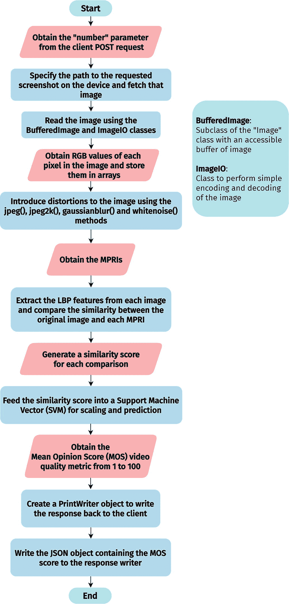

流程图从获取编号参数开始，接着是指定请求截图路径、读取图像、获取 RGB 值、引入失真、获取 MPRI、提取 LBP 特征以及写入 JSON 对象。

图 6-23

Servlet 的功能

以下是 `doPost()` 方法功能的详细分解：

1.  从客户端发送的 HTTP 请求中获取“number”参数。
2.  处理读取的图像：
    1.  使用 `read()` 方法根据“number”参数读取图像文件。
    2.  使用 `getRGB()` 方法提取截图中每个像素的 RGB 值，该方法将图像转换为灰度图。每个红色、绿色和蓝色像素值在 0–255 范围内取平均值，并存储在 `img1` 数组中。
    3.  从灰度截图中提取 LBP 特征。
    4.  通过 `jpeg()`、`jpeg2000()`、`gblur()` 和 `wnoise()` 方法应用压缩和失真技术。
3.  创建用于 SVM 输入数据的“dataset1.txt”和“dataset.txt”文件，并将处理后的图像数据写入这些文件。
4.  调用图像处理运行器：
    1.  定义图像处理的命令行参数。
    2.  使用 `runner()` 方法运行该进程。
5.  定义用于 SVM 缩放和预测的命令行参数。
6.  设置预测概率和输出流等选项。
7.  从指定文件加载 SVM 模型，并使用它来预测处理后的图像数据的 MOS。
8.  获取 MOS 分数作为预测结果。
9.  创建一个 JSON 对象来存储 MOS 分数，并将响应的内容类型设置为 JSON。
10. 使用 `PrintWriter` 对象将响应写回客户端。

`doPost()` 方法因此被填充，如代码清单 6-21 所示。相应文件的路径应根据实际情况进行更改。

```java
// 定义 doPost 方法以处理 HTTP POST 请求。
protected void doPost(HttpServletRequest request, HttpServletResponse response) throws ServletException, IOException {
// 从客户端发起的请求中获取参数。
// 使用 "request" 对象获取 "number" 参数。
String number = request.getParameter("number");
// 使用 "request" 对象创建用于向客户端写入响应的对象。
PrintWriter writer = response.getWriter();
// 创建一个 try-catch 块。
try {
try {
// 通过接收到的 "number" 参数读取客户端指定的图像文件。
BufferedImage image = ImageIO.read(new File("C:\\Users\\Lavesh\\VQA\\ScreenshotsCropped\\screenshot-" + number + ".png"));
// 记录正在分析的图像。
System.out.println("正在分析的图像: screenshot-" + number + ".png");
// 获取图像的宽度。
int width = image.getWidth();
// 获取图像的高度。
int height = image.getHeight();
// 记录图像的分辨率。
System.out.println("截图分辨率: " + width + " x " + height);
int r; // 红色变量。
int g; // 绿色变量。
int b; // 蓝色变量。
// 初始化一个数组，用于提取每个像素的值。
img1 = new double[width][height];
// 提取图像中每个像素的 RGB 值。
for (int i = 0; i = argv2.length - 2) {
// 显示帮助信息并退出程序。
exit_with_help();
}
// // 创建一个 try-catch 块以处理潜在的异常。
try {
// 打开一个 BufferedReader 以读取命令行参数中指定的文件。
BufferedReader input = new BufferedReader(new FileReader(argv2[i]));
// 打开一个 DataOutputStream 以写入命令行参数中指定的文件 (i + 2)。
DataOutputStream output = new DataOutputStream(new BufferedOutputStream(new FileOutputStream(argv2[i + 2])));
// 从命令行参数中指定的文件 (i + 1) 加载 SVM 模型。
svm_model model = svm.svm_load_model(argv2[i + 1]);
// 检查 predict_probability 是否设置为 1。
if (predict_probability == 1) {
// 检查加载的模型是否支持概率估计。
if (svm.svm_check_probability_model(model) == 0) {
// 如果不支持概率估计，则打印错误信息并退出。
System.err.print("模型不支持概率估计\n");
System.exit(1);
}
} else {
if (svm.svm_check_probability_model(model) != 0) {
// 检查加载的模型是否支持概率估计（即使已禁用）。
// 模型支持概率估计，但在预测中已禁用。
}
}
// 调用 predict 方法获取 MOS 分数。
double mosScore = predict(input, output, model, 1);
// 创建一个 JSON 对象来存储结果。
JSONObject json = new JSONObject();
// 将 MOS 分数放入 JSON 对象。
json.put("score", mosScore);
// 从 HttpServletResponse 获取一个 PrintWriter 对象。
PrintWriter out = response.getWriter();
// 将内容类型设置为 JSON。
response.setContentType("application/json");
// 将字符编码设置为 UTF-8。
response.setCharacterEncoding("UTF-8");
// 允许跨域请求（允许 CORS 策略）。
response.setHeader("Access-Control-Allow-Origin", "*");
// 使用该对象将创建的 JSON 对象打印到网页上。
out.print(json.toString());
// 刷新 PrintWriter 对象。
out.flush();
// 关闭 BufferedReader 和 DataOutputStream。
input.close();
output.close();
} catch (FileNotFoundException | ArrayIndexOutOfBoundsException e) {
// 通过调用 exit_with_help 方法处理 FileNotFound 和 ArrayIndexOutOfBoundsException 异常。
exit_with_help();
} catch (IOException ex) {
// 如果文件无法读取，则打印一条消息。
System.out.println("IO 异常。");
}
} catch (FileNotFoundException ex) {
// 如果发生文件未找到的情况，则打印一条消息。
System.out.println("文件未找到异常。");
}
}
```

清单 6-21

处理来自客户端的 HTTP POST 请求

### 6.4.7 提取 LBP 特征

提取 LBP 特征需要将图像转换为灰度图，并添加若干种失真，例如 JPEG 压缩、JPEG2000 压缩、白噪声和高斯模糊。这些失真被应用于截图，以模拟可能影响视频质量感知的各种质量等级和波动。LBP 是一种纹理描述符，通过将像素与其相邻像素进行逐像素比较来量化图像中的局部模式。在经历失真后，这些属性将从变形后的图像中计算得出。完整过程详见第 4.3 章。

#### 原始图像的 LBP 模式

`LBP41()` 方法计算未应用任何特定噪声或失真的 LBP 模式。如清单 6-22 所示。

### 计算原始图像的 LBP 模式

```java
// 计算原始图像的 LBP 模式。
public double[][] LBP41(double[][] img) {
    // LBP 模式中的邻居数量。
    int Neighb = 4;
    // 输入图像的尺寸。
    int M = img.length;
    int N = img[1].length;
    // 用于提取中心值的块大小。
    int bsize_M = 3;
    int bsize_N = 3;
    // 用于提取中心值的原始索引。
    int orig_m = 2;
    int orig_n = 2;
    // 计算 LBP 模式的尺寸。
    d_m = M - bsize_M; // 8
    d_n = N - bsize_N; // 5
    // 从图像中提取中心值。
    double[][] center = new double[orig_m + d_m][orig_n + d_n];// [10][7]
    for (int i = orig_m - 1; i = center[w][x]) {
        cell[m][q][r] = 1;
    } else {
        cell[m][q][r] = 0;
    }
    x++;
}
w++;
}
}
// 对每个位置的值求和，得到最终的 LBP 模式。
for (int s = 0; s < Neighb; s++) {
    for (int t = 0; t < d_m + 1; t++) { // 1;9 0;8 1;9 2;10
        for (int u = 0; u < d_n + 1; u++) { // 2;7 1;6 0;5 1;6
            zeros[t][u] = zeros[t][u] + cell[s][t][u];
        }
    }
}
// 返回计算出的 LBP 模式。
return zeros;
}
```
清单 6-22
计算原始图像的 LBP 模式

#### 高斯模糊的二值化过程

清单 6-23 给出了在高斯模糊的二值化过程中获取 LBP 模式的代码。

```java
// 计算模糊伪影的 LBP 模式。
public double[][] LBP41gblur(double[][] img1) {
    // 计算 LBP 模式。
    LBP41(img1);
    // 遍历 'zeros' 数组的行。
    for (int v = 0; v < d_m + 1; v++) {// 1;9 0;8 1;9 2;10
        // 遍历 'zeros' 数组的列。
        for (int w = 0; w < d_n + 1; w++) {// 2;7 1;6 0;5 1;6
            // 检查 'zeros' 数组中位置 [v][w] 的值是否为 2 或 3。
            if (zeros[v][w] == 2 || zeros[v][w] == 3) {
                // 如果是 2 或 3，则将该值设置为 1。
                zeros[v][w] = 1;
            } else {
                // 如果不是 2 或 3，则将该值设置为 0。
                zeros[v][w] = 0;
            }
        }
    }
    return zeros;
}
```
清单 6-23
计算高斯模糊的 LBP 模式

#### 白噪声的二值化过程

清单 6-24 给出了在白噪声的二值化过程中获取 LBP 模式的代码。

```java
// 计算噪声伪影的 LBP 模式。
public double[][] LBP41wnoise(double[][] img1) {
    // 计算 LBP 模式。
    LBP41(img1);
    // 遍历 'zeros' 数组的行。
    for (int v = 0; v < d_m + 1; v++) {// 1;9 0;8 1;9 2;10
        // 遍历 'zeros' 数组的列。
        for (int w = 0; w < d_n + 1; w++) {// 2;7 1;6 0;5 1;6
            // 检查 'zeros' 数组中位置 [v][w] 的值是否为 0 或 1。
            if (zeros[v][w] == 0 || zeros[v][w] == 1) {
                // 如果是 0 或 1，则将该值设置为 1。
                zeros[v][w] = 1;
            } else {
                // 如果不是 0 或 1，则将该值设置为 0。
                zeros[v][w] = 0;
            }
        }
    }
    // 返回修改后的 'zeros' 数组。
    return zeros;
}
```
清单 6-24
计算白噪声的 LBP 模式

#### JPEG 压缩的二值化过程

清单 6-25 给出了在 JPEG 压缩的二值化过程中获取 LBP 模式的代码。

```java
// 计算用于块效应的 LBP 模式。
public double[][] LBP41jpeg(double[][] img1) {
    // 计算 LBP 模式。
    LBP41(img1);
    // 遍历'zeros'数组的行。
    for (int v = 0; v < d_m + 1; v++) {// 1;9 0;8 1;9 2;10
        // 遍历'zeros'数组的列。
        for (int w = 0; w < d_n + 1; w++) {// 2;7 1;6 0;5 1;6
            // 检查'zeros'数组中位置[v][w]的值是否为 0 或 1。
            if (zeros[v][w] == 0 || zeros[v][w] == 1) {
                // 如果是 0 或 1，将该值设为 1。
                zeros[v][w] = 1;
            } else {
                // 如果不是 0 或 1，将该值设为 0。
                zeros[v][w] = 0;
            }
        }
    }
    // 返回修改后的'zeros'数组。
    return zeros;
}
```
清单 6-25
计算用于 JPEG 压缩的 LBP 模式

#### JPEG2000 压缩的二值化过程

清单 6-26 给出了在 JPEG2000 压缩的二值化过程中获取 LBP 模式的代码。

```java
// 计算用于振铃效应的 LBP 模式。
public double[][] LBP41jpeg2000(double[][] img1) {
    // 根据给定图像计算 LBP 模式。
    LBP41(img1);
    // 遍历 LBP41 模式矩阵。
    for (int v = 0; v < d_m + 1; v++) {// 1;9 0;8 1;9 2;10
        for (int w = 0; w < d_n + 1; w++) {// 2;7 1;6 0;5 1;6
            // 检查 LBP41 模式值是否为 2 或 3。
            if (zeros[v][w] == 2 || zeros[v][w] == 3) {
                // 将该值设为 1。
                zeros[v][w] = 1;
            } else {
                // 否则，将该值设为 0。
                zeros[v][w] = 0;
            }
        }
    }
    // 返回修改后的 LBP 模式矩阵。
    return zeros;
}
```
清单 6-26
计算用于 JPEG2000 压缩的 LBP 模式

### 6.4.8 应用失真

本节详细阐述`gaussianblur()`、`whitenoise()`、`jpeg()`和`jpeg2k()`方法，这些方法首先通过调用各自的方法（如图 6-12 所示）执行前述的二值化过程。这些方法首先在二维`mapDIST`数组对象中获取应用退化之前的 LBP 矩阵。然后，通过应用特定的失真生成二维`mapPRI`数组对象。在每个方法的末尾，调用`multadd()`方法，将针对四个偏移量生成的邻域矩阵相加，以生成该特定失真的最终 LBP 矩阵。完整的说明过程见第 4.3 节。

#### 应用高斯模糊实现模糊效果

高斯模糊的应用过程通过`gaussianblur()`方法执行，该方法遵循以下步骤。代码见清单 6-27。

1.  使用`LBP41gblur()`方法创建`mapDIST`对象。

2.  定义一个 sigma 值数组，分别为 0.5、1、1.5、2 和 2.5。

3.  定义卷积核的大小。

4.  计算高斯模糊：

    1.  遍历定义的 sigma 值。

2.  根据每个值计算卷积核。

3.  为模糊图像初始化一个输出数组。

4.  在输入图像周围添加填充以处理边缘情况。

5.  使用高斯核和输入图像执行卷积操作。

6.  对卷积结果求和，得到模糊后的像素值。

5.  提取特征：

    1.  将模糊后的像素值四舍五入为整数。

2.  对模糊图像应用`LBP41gblur()`方法。

3.  使用`mapPRI`调用`multadd()`方法。

4.  计算并分配当前模糊迭代的特征值。

6.  创建由特征标签和值组成的字符串，并通过`outputstream`对象将其写入“dataset1.txt”文件。这些标签从“11”开始，对于每个后续的 sigma 值，依次递增到“15”。

```
// 对给定的二维数组应用高斯模糊。
public String[] gaussianblur(double[][] img1) {
    // 使用 LBP41gblur 方法初始化距离图。
    mapDIST = LBP41gblur(img1);
    // 定义用于高斯模糊的 sigma 值数组。
    double[] sigma = {0.5, 1, 1.5, 2, 2.5};
    double feat[] = new double[sigma.length];
    // 定义卷积核的大小。
    int[][][] size = {{{-1, 0, 1}, {-1, 0, 1}, {-1, 0, 1},}, {{-1, -1, -1}, {0, 0, 0}, {1, 1, 1},}};
    int len = 2;
    int wid = 2;
    double kernel[][] = new double[3][3];
    // 遍历 sigma 值进行高斯模糊。
    for (int blur = 0; blur < sigma.length; blur++) {
        // 遍历卷积核的维度。
        for (int B = 0; B < 3; B++) { // 1;9 0;8 1;9 2;10
            for (int C = 0; C < 3; C++) { // 2;7 1;6 0;5 1;6
                // 计算高斯核的指数项。
                double exp_conp = -(Math.pow(size[0][B][C], 2) + Math.pow(size[1][B][C], 2)) / (2 * sigma[blur] * sigma[blur]);
                // 计算高斯核值并存储到 kernel 数组中。
                kernel[B][C] = (Math.exp(exp_conp)) / (2 * Math.PI * sigma[blur] * sigma[blur]);
            }
        }
        // 初始化一个二维数组来存储高斯模糊的输出。
        double[][] out = new double[img1.length][img1[0].length];
        // 用零填充 out 数组。
        for (double[] array : out) {
            Arrays.fill(array, 0);
        }
        // 定义输入图像周围的填充像素数。
        int numOfPads = 1;
        // 创建一个带填充的临时二维数组。
        double[][] temp = new double[img1.length + numOfPads * 2][img1[0].length + numOfPads * 2];
        // 用零初始化 temp 数组。
        for (int i = 0; i < temp.length; i++) {
            for (int j = 0; j < temp[i].length; j++) {
                temp[i][j] = 0;
            }
        }
        // 将输入图像复制到 temp 数组的中心。
        for (int i = 0; i < img1.length; i++) {
            for (int j = 0; j < img1[i].length; j++) {
                temp[i + numOfPads][j + numOfPads] = img1[i][j];
            }
        }
        // 初始化用于计算的变量。
        int S = 0;
        double calc[][][] = new double[out.length * out[1].length][3][3];
        // 嵌套循环执行卷积操作。
        for (int i = 0; i < temp.length - len; i++) {
            for (int j = 0; j < temp[i].length - wid; j++) {
                int Q = 0;
                for (int k = i; k < i + len + 1; k++) {
                    int R = 0;
                    // 嵌套循环计算卷积。
                    while (Q < 3 && R < 3) {
                        for (int l = j; l < j + len + 1; l++) {
                            calc[S][Q][R] = temp[k][l] * kernel[Q][R];
                            R++;
                        }
                        Q++;
                    }
                }
                S++;
            }
        }
        // 初始化一个数组来存储卷积结果的总和。
        double[] sum = new double[calc.length];
        // 计算卷积结果的总和。
        for (int a = 0; a < calc.length; a++) {
            for (int b1 = 0; b1 < 3; b1++) {
                for (int c = 0; c < 3; c++) {
                    sum[a] = sum[a] + calc[a][b1][c];
                }
            }
        }
        // 创建一个二维数组来存储四舍五入后的最终结果。
        double array2d[][] = new double[img1.length][img1[1].length];
        // 将四舍五入后的值分配给二维数组。
        // 遍历图像数组的行。
        for (int i = 0; i < img1.length; i++) {
            for (int j = 0; j < img1[i].length; j++) {
                array2d[i][j] = sum[j % img1[1].length + i * img1[1].length];
                // 将四舍五入后的总和值分配给二维数组。
                array2d[i][j] = Math.round(array2d[i][j]);
            }
        }
        // 对二维数组应用 LBP41gblur 方法，并将结果分配给 mapPRI。
        mapPRI = LBP41gblur(array2d);
        // 使用 mapPRI 调用 multadd 方法。
        multadd(mapPRI);
        // 计算并分配当前模糊迭代的特征值。
        feat[blur] = sumRow / sumRow1;
    }
    // 初始化一个字符串数组来存储高斯模糊特征提取的结果。
    String[] sgblur = new String[5];
    // 初始化一个用于标记特征的计数器。
    int count = 11;
    // 遍历 feat 数组，创建带有标签和值的字符串，并更新 outputstream。
    for (int i = 0; i < feat.length; i++) {
        sgblur[i] = count + ":" + feat[i];
        outputstream.print("" + sgblur[i] + " ");
        count++;
    }
    // 返回包含高斯模糊特征的字符串数组。
    return sgblur;
}
清单 6-27
应用高斯模糊
```

此外，为了便于从具有指定均值和方差的高斯分布中生成随机数，使用了清单 6-28 中给出的 `getGaussian()` 方法。

```
// Generate a random number from a Gaussian distribution with a specified mean and variance.
private double getGaussian(double aMean, double aVariance) {
    return aMean + fRandom.nextGaussian() * aVariance;
}
清单 6-28
从高斯分布生成随机数
```

### 应用白噪声进行加噪

白噪声的应用过程通过 `whitenoise()` 方法执行，该方法遵循以下步骤。代码见清单 6-29。

1. 使用 `LBP41wnoise()` 方法创建 `mapDIST` 对象。

2. 设置用于生成白噪声的均值和方差。

3. 初始化一个用于存储随机数的二维数组。

4. 指定随机数生成器的种子。

5. 为图像中的每个像素生成随机数。

6. 添加噪声：
    1. 定义一个标准差数组，其值分别为 0.3、0.4、0.5、0.6 和 0.7。
    2. 创建一个数组，用于存储每个白噪声级别的特征。
    3. 创建用于存储当前噪声级别平方根的变量。
    4. 创建数组，用于存储添加白噪声后的图像以及阈值处理后的修改图像。
    5. 遍历不同的白噪声级别。
    6. 为图像中的每个像素计算添加白噪声后的新像素值。
    7. 根据特定条件将像素值阈值化为 0、1 或 2。

7. 提取特征：
    1. 对修改后的图像应用 `LBP41wnoise()` 方法。
    2. 在指定范围内生成一个随机数。
    3. 计算当前噪声级别的最终特征值。
    4. 使用 `mapPRI` 调用 `multadd()` 方法。
    5. 计算并分配当前噪声添加迭代的特征值。

8. 创建由特征标签和值组成的字符串，并通过 `outputstream` 对象将其写入“dataset1.txt”文件。对于每个后续的标准差值，这些标签从“6”开始，一直到“10”（包含）。

### 应用白噪声

以下代码展示了如何对给定的二维数组应用白噪声。

```java
// Apply a White Noise on a given 2D array.
public String[] whitenoise(double[][] img1) {
    // Initialize the LBP map for white noise.
    mapDIST = LBP41wnoise(img1);
    // Set the mean and variance for generating white noise.
    double MEAN = 0.0f;
    double VARIANCE = 1.0f;
    // Initialize a 2D array for random numbers.
    double[][] randn = new double[img1.length][img1[1].length];
    // Set the seed for the random number generator.
    long s = 1;
    fRandom.setSeed(s);
    // Generate random numbers for each pixel in the image.
    for (int idx = 0; idx < img1.length; idx++) {
        for (int idy = 0; idy < img1[idx].length; idy++) {
            randn[idx][idy] = fRandom.nextGaussian() * VARIANCE + MEAN;
        }
    }
    // Create a 2D array for the modified image.
    double[][] array2d = new double[img1.length][img1[1].length];
    // Add the white noise to the original image.
    for (int j = 0; j < img1.length; j++) {
        for (int k = 0; k < img1[j].length; k++) {
            array2d[j][k] = img1[j][k] + randn[j][k];
            // Apply thresholding to the noisy image.
            if (array2d[j][k] >= 0.5 && array2d[j][k] < 1.5) {
                array2d[j][k] = 1;
            } else {
                array2d[j][k] = 2;
            }
        }
    }
    // Calculate the LBP map for the modified image with white noise.
    mapPRI = LBP41wnoise(array2d);
    // Perform additional processing on the LBP map.
    multadd(mapPRI);
    // Generate a random number within a specified range.
    DecimalFormat df = new DecimalFormat("#.#####");
    double fin = 43 + (int) (Math.random() * ((53 - 43) + 1));
    // Calculate the final feature value for the current noise level.
    feat[noise] = (sumRow / sumRow1) + fin;
    feat[noise] = feat[noise] / 100;
}
// Initialize an array of Strings to store the results of the white noise feature extraction.
String[] swnoise = new String[5];
// Initialize a counter for labeling the features
int count = 6;
// Iterate over the feat array to create strings with labels and values, and update the outputstream.
for (int i = 0; i < feat.length; i++) {
    swnoise[i] = count + ":" + feat[i];
    outputstream.print("" + swnoise[i] + " ");
    count++;
}
// Return the array of Strings containing the white noise features.
return swnoise;
}
```

清单 6-29 展示了应用白噪声的方法。

### 应用 JPEG 压缩产生块效应

JPEG 压缩通过 `jpeg()` 方法应用，该方法遵循以下步骤。代码见清单 6-30。

1.  使用 `LBP41jpeg()` 方法创建 `mapDIST` 对象。
2.  初始化用于存储结果的变量。
3.  指定图像填充和比率的参数。为此应用设置的比率为 0、2、4、6 和 8。
4.  创建一个带填充的位图数组，并将其初始化为零。
5.  将原始图像复制到位图的中心。
6.  通过创建一个二维数组并根据 JPEG 压缩比率对元素进行四舍五入来压缩图像。
7.  基于修改后的数组计算 LBP 模式。
8.  使用 `mapPRI` 调用 `multadd()` 方法。
9.  创建由特征标签和值组成的字符串，并通过 `outputstream` 对象将其写入“dataset1.txt”文件。对于每个后续的比率，这些标签从“1”开始，一直到“5”（包含）。

```java
// Apply a JPEG compression on a given 2D array.
public String[] jpeg(double[][] img1) {
    // Calculate the LBP41jpeg pattern and store it in mapDIST.
    mapDIST = LBP41jpeg(img1);
    // Declare variables for storing the results.
    String[] sjpeg;
    double[] jpeg = new double[5];
    // Set parameters for image padding and ratios.
    int numOfPads = 2;
    double[] jpegratio = {0, 2, 4, 6, 8};
    // Create a bitmap array with padding and initialize it with zeros.
    double[][] bitmap = new double[img1.length + numOfPads * 2][img1[0].length + numOfPads * 2];
    for (int i = 0; i < bitmap.length; i++) {
        for (int j = 0; j < bitmap[i].length; j++) {
            bitmap[i][j] = 0;
        }
    }
    // Copy the original image to the center of the bitmap.
    for (int i = 0; i < img1.length; i++) {
        for (int j = 0; j < img1[i].length; j++) {
            bitmap[i + numOfPads][j + numOfPads] = img1[i][j];
        }
    }
    // Create a 2D array and round the elements based on jpegratio.
    double array2d[][] = new double[img1.length][img1[1].length];
    for (int i = 0; i < jpegratio.length; i++) {
        for (int j = 0; j < jpegratio.length; j++) {
            array2d[i][j] = jpegratio[j];
            array2d[i][j] = Math.round(array2d[i][j]);
        }
    }
    // Calculate LBP41jpeg pattern on the modified array.
    mapPRI = LBP41jpeg(array2d);
    // Perform a multiplication-adding operation using multadd.
    multadd(mapPRI);
    // Generate random values and format the results for output.
    Random rand1 = new Random();
    sjpeg = new String[5];
    int count = 1;
    for (int i = 0; i < jpeg.length; i++) {
        jpeg[i] = rand1.nextDouble() * (mux - mun) + mun;
        sjpeg[i] = count + ":" + jpeg[i];
        outputstream.append("" + sjpeg[i] + " ");
        count++;
    }
    // Return the formatted results.
    return sjpeg;
}
```

清单 6-30 展示了应用 JPEG 压缩的方法。

### 应用 JPEG2000 压缩以消除振铃效应

通过 `jpeg2K()` 方法应用 JPEG2000 压缩，该方法遵循以下步骤。代码见清单 6-31。

1.  使用 `LBP41jpeg2000()` 方法创建 `mapDIST` 对象。
2.  初始化变量以存储结果。
3.  指定图像填充和比率的参数。本应用设置的比率分别为 150、175、200、225 和 250。因此，JPEG2000 对图像的压缩率比 JPEG 高出 200%。
4.  创建一个带填充的位图数组，并用零初始化。
5.  将原始图像复制到位图的中心。

6. 通过创建一个二维数组并根据 JPEG2000 压缩比率对元素进行四舍五入来压缩图像。

7. 基于修改后的数组计算 LBP 模式。

8. 使用`mapPRI`调用`multadd()`方法。

9. 创建由特征标签和值组成的字符串，并通过`outputstream`对象将其写入`dataset1.txt`文件。对于每个后续比率，这些标签从“16”开始，一直到“20”（含首尾）。

```
// 对给定的二维数组应用 JPEG2000 压缩。
public String[] jpeg2k(double[][] img1) {
    // 计算 LBP41jpeg2000 模式并存储在 mapDIST 中。
    mapDIST = LBP41jpeg2000(img1);
    // 声明用于存储结果的变量。
    String[] sjpeg2k;
    double[] jpeg2k = new double[5];
    // 设置图像填充和比率的参数。
    int numOfPads = 4;
    double[] jpegratio = {150, 175, 200, 225, 250};
    // 创建一个带填充的位图数组，并用零初始化。
    double[][] bitmap = new double[img1.length + numOfPads * 2][img1[0].length + numOfPads * 2];
    for (int i = 0; i < bitmap.length; i++) {
        for (int j = 0; j < bitmap[i].length; j++) {
            bitmap[i][j] = 0;
        }
    }
    // 将原始图像复制到位图的中心。
    for (int i = 0; i < img1.length; i++) {
        for (int j = 0; j < img1[i].length; j++) {
            bitmap[i + numOfPads][j + numOfPads] = img1[i][j];
        }
    }
    // 创建一个二维数组并根据 jpegratio 对元素进行四舍五入。
    double array2d[][] = new double[img1.length][img1[1].length];
    for (int i = 0; i < jpegratio.length; i++) {
        for (int j = 0; j < jpegratio.length; j++) {
            array2d[i][j] = jpegratio[j];
            array2d[i][j] = Math.round(array2d[i][j]);
        }
    }
    // 在修改后的数组上计算 LBP41jpeg2000 模式。
    mapPRI = LBP41jpeg2000(array2d);
    // 使用 multadd 执行乘加操作。
    multadd(mapPRI);
    // 生成随机值并格式化结果以输出。
    Random rand2 = new Random();
    sjpeg2k = new String[5];
    int count = 16;
    for (int i = 0; i < jpeg2k.length; i++) {
        jpeg2k[i] = rand2.nextDouble() * (mux1 - mun1) + mun1;
        sjpeg2k[i] = count + ":" + jpeg2k[i];
        outputstream.append("" + sjpeg2k[i] + " ");
        count++;
    }
    // 返回格式化后的结果。
    return sjpeg2k;
}
```

## 6.4.9 计算相似度指数

第 6.4.8 节中的方法都调用了`multadd()`方法来计算图像与其对应 MPRI 之间的相似度。如前所述，这些相似度分数以特征标签格式存储，总共生成二十个特征，每种伪影五个。这些向量以二十维特征向量的形式输出到`dataset1.txt`文件中。特定分数的生成使用`multadd()`方法执行，其功能将在下文讨论，代码见清单 6-32。

1. 创建一个新的二维数组，用于存储`mapDIST`和`mapPRI`的逐元素乘法结果。

2. 将`mapDIST`和`mapPRI`的对应元素相乘，并将结果存储在`mult`数组中。

3. 计算`mult`数组中每一列的总和，并将结果存储在`store`数组中。

4. 计算`store`数组中值的总和，并将结果存储在`sumRow`中。

5. 计算`mapPRI`数组中每一列的总和，并将结果存储在`store1`中。

6. 计算`store1`数组中值的总和，并将结果存储在`sumRow1`中。

7. 将`sumRow1`的值增加 1。

8. 获取计算得到的`sumRow1`值。

```
// 将 mapDIST 和 mapPRI 数组的对应元素相乘，并计算每列的总和。
public double multadd(double[][] mapPRI) {
    // 创建一个新的二维数组，用于存储 mapDIST 和 mapPRI 的逐元素乘法结果。
    double mult[][] = new double[mapPRI.length][mapPRI[1].length];
    // 将 mapDIST 和 mapPRI 的对应元素相乘。
    for (int i = 0; i < mapPRI.length; i++) {
        for (int j = 0; j < mapPRI[i].length; j++) {
            mult[i][j] = mapDIST[i][j] * mapPRI[i][j];
        }
    }
    // 用于存储 'mult' 数组中每列总和的变量。
    double sumCol;
    // 创建一个新数组来存储每列的总和。
    double[] store = new double[mult[1].length];
    // 计算 'mult' 数组中每列的总和。
    for (int i = 0; i < mult[1].length; i++) {
        sumCol = 0;
        for (int j = 0; j < mult.length; j++) {
            sumCol = sumCol + mult[j][i];
        }
        store[i] = sumCol;
    }
    // 用于存储 'store' 数组中值总和的变量。
    sumRow = 0;
    // 计算 'store' 数组中值的总和。
    for (int i = 0; i < store.length; i++) {
        sumRow = sumRow + store[i];
    }
    // 用于存储 'mapPRI' 数组中每列总和的变量。
    double sumCol1;
    // 创建一个新数组来存储 'mapPRI' 数组中每列的总和。
    double[] store1 = new double[mapPRI[1].length];
    // 计算 'mapPRI' 数组中每列的总和。
    for (int k = 0; k < mapPRI[1].length; k++) {
        sumCol1 = 0;
        for (int l = 0; l < mapPRI.length; l++) {
            sumCol1 = sumCol1 + mapPRI[l][k];
        }
        store1[k] = sumCol1;
    }
    // 用于存储 'store1' 数组中值总和的变量。
    sumRow1 = 0;
    // 计算 'store1' 数组中值的总和。
    for (int m = 0; m < store1.length; m++) {
        sumRow1 = sumRow1 + store1[m];
    }
    // 将计算得到的 sumRow1 值加 1。
    sumRow1 = sumRow1 + 1;
    // 返回计算得到的 sumRow1 值。
    return sumRow1;
}
```

## 6.4.10 缩放相似度分数

本节详细阐述了用于确保 VQA 后获得的结果在不同上下文中既有意义又可比较的技术，从而能够更准确地解释视频质量指标。

### 实现 Runner

`runner()`方法负责缩放输入数据，并处理与缩放参数和文件输入/输出相关的几个选项，因此通常充当预处理管道。“range”文件包含用于将测试数据缩放到[-1.0, +1.0]范围的缩放因子。该函数随后会找到最大和最小属性，然后缩放先前存储在`dataset1.txt`文件中的相似度分数。最后一步是使用`PrintWriter`对象将每个计算出的缩放值打印到`test_ind_scaled`文件中。`runner()`方法在`doPost()`方法中被调用，并通过三次传递完成，详见第 4.3 节。因此，清单 6-33 给出了其代码。

```markdown
// 负责根据指定选项对输入数据进行缩放。
public void runner(String[] argv) throws IOException {
int i, index;
BufferedReader fp = null, fp_restore = null;
String save_filename = null;
String restore_filename = "C:\\Users\\Lavesh\\Desktop\\FogFiles\\range";
String data_filename = "C:\\Users\\Lavesh\\Desktop\\FogFiles\\dataset1.txt";
for (i = 0; i  lower) || (y_scaling && !(y_upper > y_lower))) {
System.err.println("inconsistent lower/upper specification");
System.exit(1);
}
// 检查是否同时提供了恢复文件名和保存文件名。
if (restore_filename != null && save_filename != null) {
System.err.println("cannot use -r and -s simultaneously");
System.exit(1);
}
// 检查命令行参数数量是否正确；否则，打印用法信息并退出。
if (argv.length != i + 1) {
exit_with_help();
}
try {
// 尝试使用 `BufferedReader` 打开数据文件进行读取。
fp = new BufferedReader(new FileReader(data_filename));
} catch (Exception e) {
// 如果无法打开文件，则打印错误信息，并以错误码退出程序。
System.err.println("can't open file data_filename" + data_filename);
System.exit(1);
}
// 假设：属性的最小索引为 1。
// 第一遍：找出属性的最大索引。
max_index = 0;
// 如果指定了恢复文件，则读取其内容以找到最大索引。
if (restore_filename != null) {
int idx, c;
try {
fp_restore = new BufferedReader(new FileReader(restore_filename));
} catch (Exception e) {
System.err.println("can't open file restore_filename" + restore_filename);
System.exit(1);
}
// 如果恢复文件中存在 y 缩放信息，则跳过对应的行。
if ((c = fp_restore.read()) == 'y') {
fp_restore.readLine();
fp_restore.readLine();
fp_restore.readLine();
}
fp_restore.readLine();
fp_restore.readLine();
// 解析每一行以提取索引值，并找到最大索引。
String restore_line = null;
while ((restore_line = fp_restore.readLine()) != null) {
StringTokenizer st2 = new StringTokenizer(restore_line);
idx = Integer.parseInt(st2.nextToken());
max_index = Math.max(max_index, idx);
}
// 将文件读取器重置到恢复文件的开头。
fp_restore = rewind(fp_restore, restore_filename);
}
// 遍历输入文件的每一行并提取索引值。
while (readline(fp) != null) {
// 使用空格、制表符、换行符、回车符和冒号作为分隔符对行进行分词。
StringTokenizer st = new StringTokenizer(line, " \t\n\r\f:");
// 跳过第一个标记，因为它通常代表目标值。
st.nextToken();
// 遍历剩余的标记以提取索引值。
while (st.hasMoreTokens()) {
// 将标记解析为整数，代表属性索引。
index = Integer.parseInt(st.nextToken());
// 如果当前索引更大，则更新最大索引。
max_index = Math.max(max_index, index);
// 跳过下一个标记，它通常代表属性值。
st.nextToken();
// 增加非零属性的计数。
num_nonzeros++;
}
}
// 尝试为每个属性的最大值和最小值分配数组。
try {
feature_max = new double[(max_index + 1)];
feature_min = new double[(max_index + 1)];
} catch (OutOfMemoryError e) {
// 处理内存不足无法分配数组的情况。
System.err.println("can't allocate enough memory");
System.exit(1);
}
// 初始化用于存储每个属性最大值和最小值的数组。
for (i = 0; i  num_nonzeros) {
System.err.print("WARNING: original #nonzeros " + num_nonzeros + "\n" + "         new      #nonzeros "
+ new_num_nonzeros + "\n" + "Use -l 0 if many original feature values are zeros\n");
}
// 关闭与数据文件关联的 `BufferedReader`。
fp.close();
}
}
清单 6-33 缩放相似度分数

#### 显示用法信息

本节详细阐述 `exit_with_help()` 方法，该方法显示 SVM 缩放方法的用法信息并处理程序终止。它由 `Runner` 调用，并在清单 6-34 中给出。

```
// 显示 svm-scale 工具的用法信息并退出程序。
private void exit_with_help() {
System.out.print("Usage: svm-scale [options] data_filename\n" + "options:\n"
+ "-l lower : x scaling lower limit (default -1)\n" + "-u upper : x scaling upper limit (default +1)\n"
+ "-y y_lower y_upper : y scaling limits (default: no y scaling)\n"
+ "-s save_filename : save scaling parameters to save_filename\n"
+ "-r restore_filename : restore scaling parameters from restore_filename\n");
System.exit(1); // 以错误码退出程序。
}
清单 6-34 显示用法信息
```

#### 文件处理与缓冲区管理

本节中，负责文件处理、缓冲区管理和流操作的方法如下所示。这些方法在清单 6-35 和 6-36 中提供：

* `rewind()`: 关闭给定的 `BufferedReader` 对象并为指定文件创建一个新对象的方法。
* `readline()`: 从提供的 `BufferedReader` 对象中读取一行的方法。

```
// 关闭给定的 `BufferedReader` 并为指定文件创建一个新的。
public BufferedReader rewind(BufferedReader fp, String filename2) throws IOException {
// 关闭提供的 `BufferedReader`。
fp.close();
return new BufferedReader(new FileReader(filename2));
}
清单 6-35 关闭给定的读取器并创建一个新的
```

```
// 从提供的 `BufferedReader` 中读取一行。
public String readline(BufferedReader fp) throws IOException {
// 从 `BufferedReader` 中读取一行。
line = fp.readLine();
// 返回读取到的行。
return line;
}
清单 6-36 使用读取器读取一行并返回
```

#### 缩放目标值与属性值
```

根据指定的限制和条件缩放目标值与属性值的方法如下：

*   `output_target()`: 根据 y 缩放限制输出缩放后的目标值。
*   `output()`: 根据指定条件输出缩放后的属性值。

这些方法分别在清单 6-37 和 6-38 中给出。

```
// 输出缩放后的属性值。
public void output(int index, double value) {
    // 跳过单值属性。
    if (feature_max[index] == feature_min[index]) {
        return;
    }
    // 根据指定条件缩放值。
    if (value == feature_min[index]) {
        value = lower;
    } else if (value == feature_max[index]) {
        value = upper;
    } else {
        value = lower + (upper - lower) * (value - feature_min[index]) / (feature_max[index] - feature_min[index]);
    }
    // 如果缩放后的值不为零，则输出。
    if (value != 0) {
        System.out.print(index + ":" + value + " ");
        outputstream1.print(index + ":" + value + " ");
        new_num_nonzeros++;
    }
}
清单 6-38
返回缩放后的属性值
```

```
// 输出缩放后的目标值。
public void output_target(double value) {
    // 检查是否启用了 y_scaling。
    if (y_scaling) {
        // 检查该值是否等于 y_min。
        if (value == y_min) {
            value = y_lower;
        // 检查该值是否等于 y_max。
        } else if (value == y_max) {
            value = y_upper;
        // 根据 y 缩放限制缩放该值。
        } else {
            value = y_lower + (y_upper - y_lower) * (value - y_min) / (y_max - y_min);
        }
    }
    // 打印缩放后的值或原始值。
    System.out.print(value + " ");
}
清单 6-37
返回缩放后的目标值
```

## 6.4.11 打印工具类

本节涉及在公共 `Score` 类中添加的代码，该类通过管理消息的打印位置来控制 SVM 实现中的打印行为，从而实现定制化。这些代码由 `doPost()` 方法使用。

```
// 定义一个 svm_print_interface 实例，其打印方法为空。
private svm_print_interface svm_print_null = new svm_print_interface() {
    public void print(String s) {
        // 该实现不执行任何操作（空方法体）。
    }
};
// 定义一个 svm_print_interface 实例，其打印方法将内容输出到标准输出。
private svm_print_interface svm_print_stdout = new svm_print_interface() {
    public void print(String s) {
        // 将字符串打印到标准输出。
        System.out.print(s);
    }
};
private svm_print_interface svm_print_string = svm_print_stdout;
清单 6-39
添加打印工具类
```

## 6.4.12 预测 MOS

为了预测图像的最终质量分数，需要以下三个文件：

*   “test_ind_scaled”文件：包含用于预测的测试数据。
*   “model”文件：包含使用 epsilon-SVR 模型训练好的 SVM 模型，能够进行回归预测。
*   “output.txt”文件：将包含 `predict()` 方法生成的输出。

因此，`predict()` 方法的功能如下，如清单 6-40 所示：

1.  从 SVM 模型中获取类型和类别数量。
2.  检查是否启用了概率预测。如果启用，则根据 SVM 类型初始化 `prob_estimates`。
3.  处理输入数据：
    1.  逐行读取输入数据。
    2.  对每一行进行分词，提取目标值和属性-值对。
    3.  用属性索引-值对填充一个 `svm_node` 数组。
4.  进行预测：
    1.  如果启用了概率预测且 SVM 类型支持，则使用 `svm.svm_predict_probability()` 预测概率，并将结果写入输出流。
    2.  如果未启用概率预测或 SVM 类型不支持，则使用 `svm.svm_predict()` 进行标准 SVM 预测。
    3.  根据存储在变量 `p` 中的预测值，对质量等级进行分类，并将其写入输出流。

```markdown
`predict()` 方法用于使用 SVM 模型预测给定输入数据的值。

```java
/** 使用 SVM 模型预测给定输入数据的值。
* @param input              用于读取输入数据的 BufferedReader。
* @param output             用于写入输出数据的 DataOutputStream。
* @param model              用于预测的 SVM 模型。
* @param predict_probability 指示是否预测概率的标志。
* @return                   预测值。
* @throws IOException       如果读取或写入数据时发生错误。
*/
private double predict(BufferedReader input, DataOutputStream output, svm_model model, int predict_probability) throws IOException {
// 从 SVM 模型中获取类型和类别数量。
int svm_type = svm.svm_get_svm_type(model);
int nr_class = svm.svm_get_nr_class(model);
double[] prob_estimates = null;
// 如果适用，输出测试数据的概率模型信息。
if (predict_probability == 1) {
if (svm_type == svm_parameter.EPSILON_SVR || svm_type == svm_parameter.NU_SVR) {
// 打印回归的概率模型信息。
System.out.print("测试数据的概率模型：目标值 = 预测值 + z，\nz：拉普拉斯分布 e^(-|z|/sigma)/(2sigma)，sigma="
+ svm.svm_get_svr_probability(model));
} else {
// 打印分类的概率模型信息。
int[] labels = new int[nr_class];
svm.svm_get_labels(model, labels);
prob_estimates = new double[nr_class];
output.writeBytes("标签");
for (int j = 0; j < nr_class; j++) {
output.writeBytes(" " + labels[j]);
}
output.writeBytes("\n");
}
}
// 逐行处理输入数据。
while (true) {
String line = input.readLine();
if (line == null) break;
StringTokenizer st = new StringTokenizer(line, " \t\n\r\f:");
// 从输入中提取目标值。
String token = st.nextToken();
try {
// 尝试将目标值解析为 double。
Double.parseDouble(token);
} catch (NumberFormatException e) {
// 如果解析失败，抛出异常。
throw new RuntimeException("输入文件中存在错误格式的数值：" + token);
}
int m = st.countTokens() / 2;
svm_node[] x = new svm_node[m];
for (int j = 0; j < m; j++) {
x[j] = new svm_node();
// 从输入中提取属性索引。
token = st.nextToken();
x[j].index = atoi(token);
// 从输入中提取属性值。
token = st.nextToken();
x[j].value = atof(token);
}
// 进行预测。
double p;
if (predict_probability == 1 && (svm_type == svm_parameter.EPSILON_SVR || svm_type == svm_parameter.NU_SVR)) {
// 使用概率预测进行回归。
p = svm.svm_predict_probability(model, x, prob_estimates);
output.writeBytes(p + "\n");
} else {
// 使用标准预测。
p = svm.svm_predict(model, x);
output.writeBytes(p + "\n");
}
// 根据预测值对质量等级进行分类。
if (p >= 0 && p < 20) {
output.writeBytes(p + " 质量等级：差 \n");
System.out.println("\nMOS: " + p + " \n 评级：差");
} else if (p >= 20 && p < 40) {
output.writeBytes(p + " 质量等级：较差 \n");
System.out.println("\nMOS: " + p + " \n 评级：较差");
} else if (p >= 40 && p < 60) {
output.writeBytes(p + " 质量等级：一般 \n");
System.out.println("\nMOS: " + p + " \n 评级：一般");
} else if (p >= 60 && p < 80) {
output.writeBytes(p + " 质量等级：良好 \n");
System.out.println("\nMOS: " + p + " \n 评级：良好");
} else if (p >= 80 && p < 90) {
output.writeBytes(p + " 质量等级：优秀 \n");
System.out.println("\nMOS: " + p + " \n 评级：优秀");
} else if (p >= 90) {
output.writeBytes(p + " 质量等级：差 \n");
System.out.println("\nMOS: " + p + " \n 评级：差");
}
}
System.out.println("-----------------------------------------------");
return p;
}
```

清单 6-40 预测 MOS

此外，`predict()` 函数使用的 `atof()` 和 `atoi()` 方法详见清单 6-41。前者负责将浮点数的 `String` 表示转换为原始的 `Double` 值，而后者则将 `Integer` 对象的 `String` 表示转换为原始的 `Int` 值。

```java
// 将 double 的字符串表示转换为 Double 对象，然后获取原始 double 值。
private double atof(String s) {
return Double.valueOf(s).doubleValue();
}
// 将整数的字符串表示转换为 int。
private int atoi(String s) {
return Integer.parseInt(s);
}
```

清单 6-41 转换工具类

## 6.5 VQA 应用测试与部署

至此，VQA 应用已开发完成；客户端、服务器和 Servlet 架构均已就绪。`server.js` 文件所在的目录需通过 Node.js 终端使用“`CD`”命令进入，然后使用“`node server.js`”命令运行。至于 Java Servlet，则通过 Apache Tomcat 在本地托管，步骤如下：

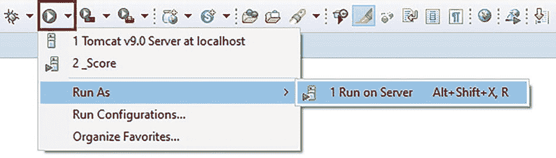

一张包含运行 Servlet 步骤的截图。运行方式：1. 在服务器上运行。

图 6-24 运行 Servlet

1. 在 Eclipse 中，选择“运行”图标的下拉菜单，然后点击“运行方式”，最后点击“在服务器上运行”，如图 6-24 所示。

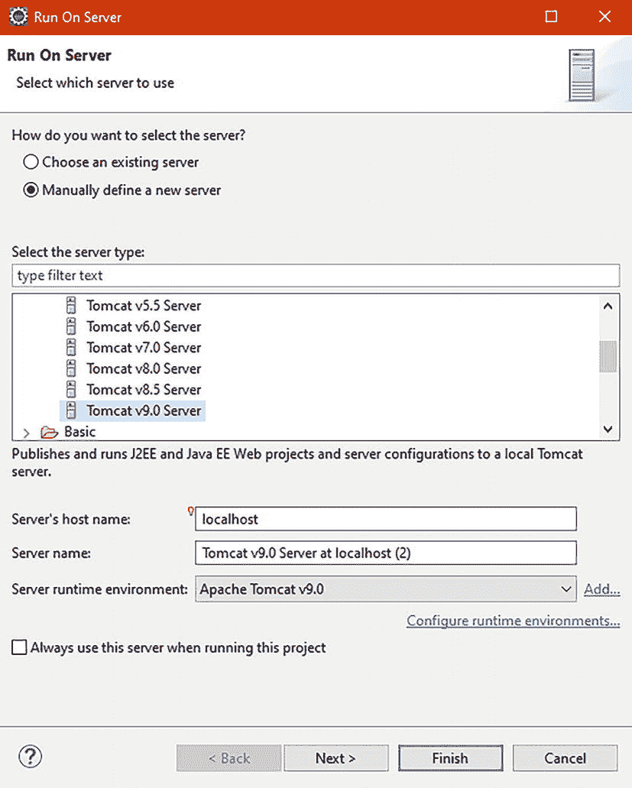

一张标题为“在服务器上运行”的截图，包含以下字段：如何选择服务器？选择服务器类型。服务器主机名。服务器名称。

图 6-25 选择服务器信息

1. 通过选择“手动定义新服务器”选项并点击“下一步”来定义一个新服务器，如图 6-25 所示。

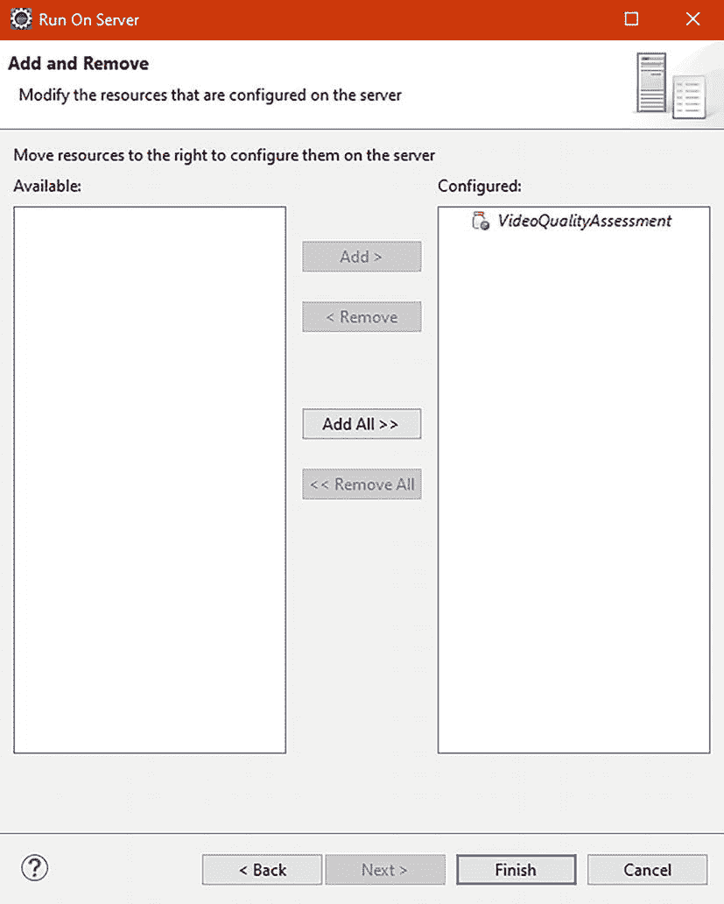

一张标题为“在服务器上运行”的截图，包含以下选项：添加和移除。左右两侧分别有两个区块，即“可用”和“已配置”。

图 6-26 将项目添加到服务器

1. 项目会自动添加到服务器，如图 6-26 所示。然后点击“完成”。


一张截图突出显示了以下选项卡：服务器。

图 6-27 Servlet 已托管
```

至此，服务器和 Servlet 程序已准备好与客户端通信。`Apache Tomcat` 会在服务器控制台打印一系列语句，并出现“服务器”选项卡，如图 6-27 所示。

图 6-28 至 6-34 展示了在典型家庭生态系统中，使用 `YouTube` 和 `Twitch` 流式传输视频时，`VQA` 应用所获得的结果。鉴于 `Servlet` 计算密集，接下来给出用于收集数据、训练模型和进行预测的设备规格。这些可视为成功运行客户端、服务器和 `Servlet` 组合的推荐基准配置：
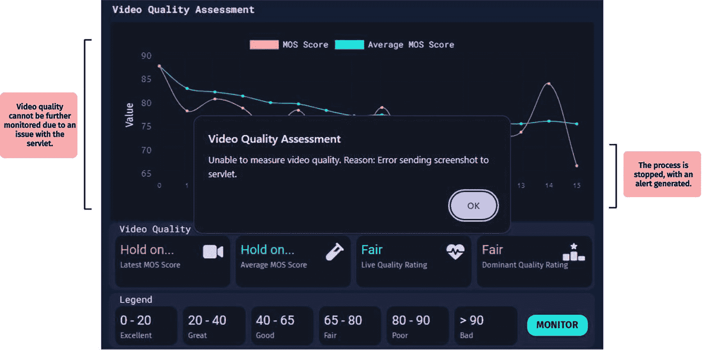
`图 6-34` 当 `Servlet` 不可用时生成警报
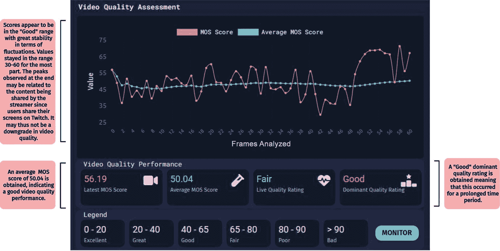
`图 6-33` 在 `Twitch` 上以 1080p 分辨率流式传输，获得“良好”评分
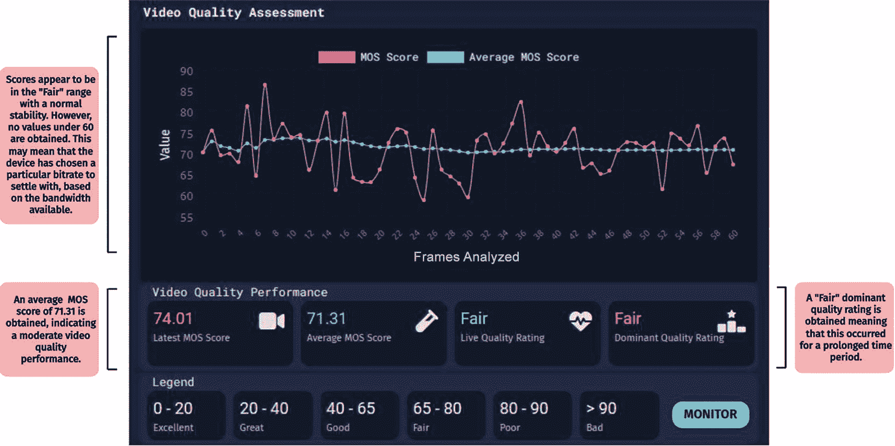
`图 6-32` 在 `Twitch` 上以 720p 分辨率流式传输，获得“一般”评分
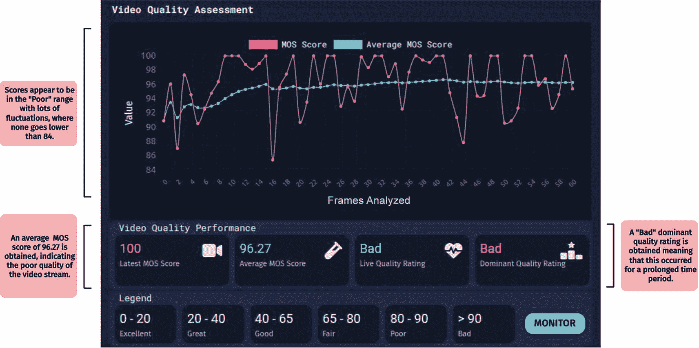
`图 6-31` 在 `Twitch` 上以 360p 分辨率流式传输，获得“差”评分
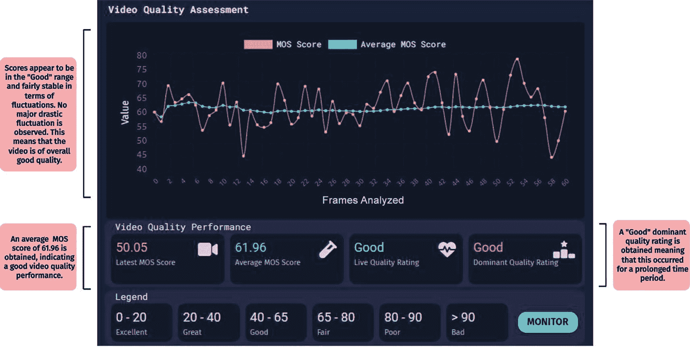
`图 6-30` 在 `YouTube` 上以 1080p 分辨率流式传输，获得“良好”评分
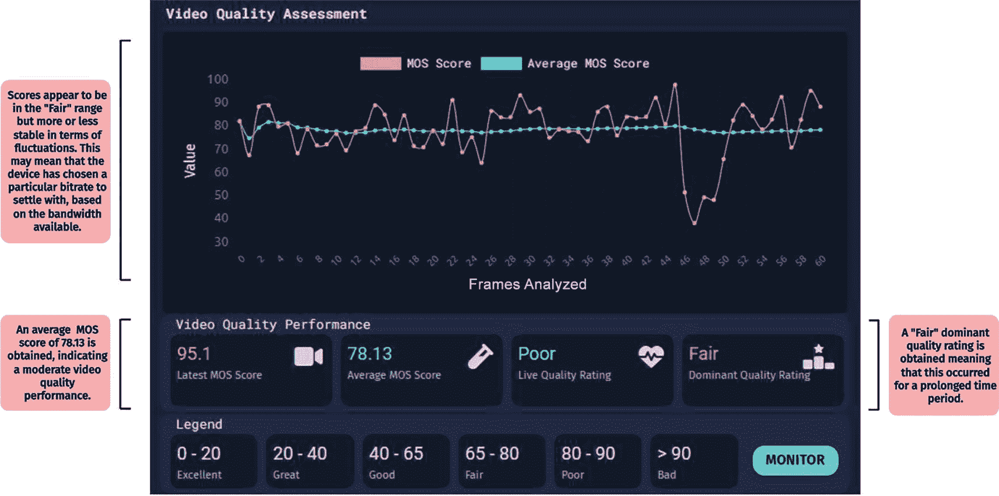
`图 6-29` 在 `YouTube` 上以 720p 分辨率流式传输，获得“一般”评分
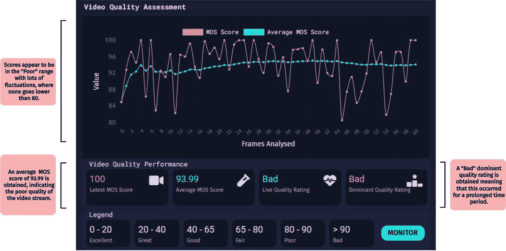
`图 6-28` 在 `YouTube` 上以 360p 分辨率流式传输，获得“差”评分

*   处理器：`Intel Core i7-8750H @2.20GHz`
*   内存：16 GB
*   显卡：`NVIDIA GeForce GTX 1050 4GB`
*   系统类型：64 位操作系统
*   `Windows` 版本：10 家庭单语言版
*   `OS` 内部版本：18363.1556

此应用可用于网页浏览器上的不同视频流媒体平台。随着用户生成内容（`UGC`）的兴起，`VQA` 应用可以优化，以便为 `YouTube Shorts`、`TikTok` 和 `Instagram Reels` 等流行服务持续截取屏幕截图。尽管本书中该应用是为网页浏览器量身定制的，但通过部署能够捕获当前流行的短视频相关屏幕截图的 `Android` 客户端，该无参考图像质量评估（盲 `IQA`）算法也可应用于移动、桌面和 `IPTV` 平台。因此，为了适应当今视频内容不断演变的特性，相同的 `VQA` 原理可以简单地应用于用户迁移进行视频消费的平台，并结合来自用户的反馈机制，这些反馈可作为与机器学习算法生成的 `MOS` 评分进行比较的基础。例如，`TikTok` 上偶尔弹出的弹窗，会向最终用户询问关于最近观看视频的反馈。通过持续监控和分析用户交互，可以进行调整，以确保应用在内容类型不断演变的情况下，仍能有效生成准确的 `MOS` 评分。

## 6.6 总结

第 5 章重点介绍了基于前几章掌握的概念，使用 `JavaScript` 进行 `VQA` 框架的应用开发。首先描述了系统模型，然后全面介绍了客户端、服务器和 `Servlet` 模块及其相应的功能。`Servlet` 使用 `Java` 语言在 `Eclipse IDE` 中编写，当被客户端和服务器组件生成的屏幕截图触发时，能够生成 `MOS` 评分。通过在网页浏览器中流式传输的视频上循环连续截取屏幕截图，用户可以获得实时的 `QoS` 指标，如测试与部署部分所示。以下是一些关键要点：

*   在 `VQA` 系统模型中，客户端在网页浏览器中执行，服务器端在 `Node.js` 上执行，`Java Servlet` 在 `Eclipse IDE` 上执行。
*   客户端程序负责捕获视频帧并将其传输到服务器进行分析。同时，服务器充当中间人，根据所截取的屏幕截图向 `Servlet` 请求 `MOS` 评分。一旦被触发，`Servlet` 使用 `BRISQUE` 方法生成评分并将其发送回服务器，然后服务器更新客户端。

在下一章中，`NTMA` 和 `VQA` 框架将被集成到一个简单的应用中，允许最终用户在同一个浏览器扩展中执行这两项功能。