# 7. NTMA 与 VQA 的集成

为了将网络流量监控与分析（NTMA）和视频质量评估（VQA）整合到一个无缝的实时应用中，以满足网络和视频质量监控的双重需求，本章提供了完整的系统模型，弥合了网络活动分析与视频质量评估之间的鸿沟。因此，本章将介绍为实现客户端与 `Node.js` 服务器之间实时通信而编写的 `JavaScript` 代码以及对 `Node.js` 服务器所做的修改，并附上完整的程序结构和实现方法。最后，本章通过一个应用测试部分，阐明了 NTMA 与 VQA 集成应用的有效性。

## 7.1 集成 NTMA 与 VQA 应用的系统模型

在本节中，网络流量监控与分析（NTMA）和视频质量评估（VQA）应用被整合到一个单一的无缝应用中。相同的代码片段被修改，以构建一个三层架构，包括客户端、基于 `Node.js` 的后端服务器以及使用 `Apache Tomcat` 托管的本地 `Java Servlet`。这三个框架运行在同一设备上，但也可以适配到不同的设备上运行。以 NTMA 和 VQA 为核心，该应用在对整体用户体验进行全面评估后，为最终用户提供以下功能：

1.  通过浏览器扩展，直接在网页浏览器中监控实时网络参数。
2.  基于整理成实时值的历史数据，获取回归和分类分析结果。
3.  获取网络性能的服务质量（QoS）评分，即网络评分。
4.  通过浏览器扩展，直接在网页浏览器中监控实时视频质量指标。
5.  获取正在观看的视频流的实时平均意见得分（MOS）。
6.  获取一个主导质量评级，总结所分析帧的视频质量表现。

构成此应用的原理分别继承自第 5 章和第 6 章的 NTMA 和 VQA 应用。因此，用户界面（UI）被设计为显示来自两个领域的混合指标以及实时图表，用户可以通过在实时 NTMA 和实时 VQA 之间切换选择来动态查看，从而让最终用户完全控制查看偏好。如前几章所述，扩展程序需要相同的四个基本文件才能运行。完整的系统模型如图 7-1 所示。

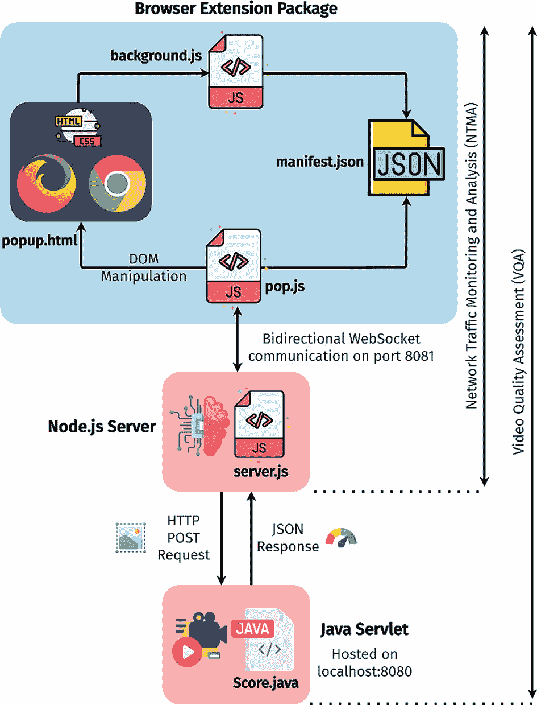
图 7-1 完整的集成 NTMA 与 VQA 系统模型

数据流图定义了视频质量评估。包含 `popup.html`、`manifest.json`、`background.js` 和 `pop.js` 文件的浏览器扩展包，通过网络流量监控与分析，经由 `Node.js` 服务器发送到 `Java Servlet`。

### 7.1.1 组件与功能

构成此应用客户端（即前端）的仍是以下四个文件：

*   `popup.html`
*   `background.js`
*   `pop.js`
*   `manifest.json`

它们的功能与 `表 5-1` 和 `表 6-1` 中描述的相同，如下所示：

*   从最终用户处获取“窗口大小”和“预测时间”参数的输入。
*   当点击“监控与分析”按钮时，向 `Node.js` 服务器发送消息以触发它。
*   接收 `JSON` 消息中的网络和视频质量指标，然后将其输出到仪表盘上。
*   更新实时图表，并通过用户可点击的切换按钮在实时 NTMA 和 VQA 图表之间切换。

同样，`server.js` 文件充当 NTMA 模块的后端和 VQA 模块的中介，因为后者从 `Java Servlet` 获取 MOS 分数。NTMA 功能通过在服务器端成功接收“窗口大小”和“预测时间”变量来触发。同样地，由连续的裁剪截图组成并进行图像质量评估（IQA）的 VQA 模块，在服务器端重建完整截图并进行裁剪后被触发。然后，托管第 6 章中介绍的同一个 Servlet，以基于失真加重方法计算 MOS 分数。一旦网络和视频质量指标都计算完毕，仪表盘就会显示最终用户所体验到的感受。因此，当用户访问 YouTube 或 Twitch 等视频流媒体网站时，可以使用集成的浏览器扩展来监控和预测实时网络指标，并观察视频质量的变化。对于此应用，NTMA 监控过程设置为六十秒，VQA 监控过程设置为六十帧。后者涉及更多的处理时间，这意味着只有在获得 VQA 结果后才能进行完整的测试。

### 7.1.2 结合视频质量指标的网络流量预测与分类

集成的 NTMA/VQA 应用包括在服务器端无缝进行的监控过程，同时向客户端报告实时指标和更新。尽管独立运行，这两个模块可以协同工作，以提高粒度和洞察力。这些指标可以作为衡量典型网络在不同类型活动下（甚至经历峰值和低谷时）性能的强有力且可靠的度量。机器学习（ML）算法训练得越多，其准确性就越高，因此算法对意外流量行为的预测和响应能力也就越强。此应用性能的关键在于数据集的选择，这取决于网络环境。该框架为构建一个可靠的集成 NTMA 和 VQA 应用提供了基础，用户只需在网页浏览器中轻轻一点即可使用。

### 7.1.3 集成 NTMA/VQA 应用布局

在此应用中，弹出窗口使用户能够直接在网页浏览器中监控实时网络和视频指标。一对实时图表描绘了指标的实时演变过程。用户可以通过一个切换按钮在 NTMA 和 VQA 图表之间进行选择。一旦打开，客户端会搜索 `Node.js` 服务器并连接到它。用户点击“监控与分析”按钮来触发后端进程。然后，第 5 章和第 6 章中看到的相同功能开始运行，使得用户界面能够通过实时指标进行更新，这些指标由仪表盘卡片承载，并分类为“网络指标”或“视频质量指标”。测试结束后，会生成一个混合了网络和视频指标的集合，这些指标是在对每个模块的六十个实例进行分析后产生的，从而构成一个特定的会话。图 7-2 展示了集成的 NTMA/VQA 浏览器扩展，其中显示了两个图表。

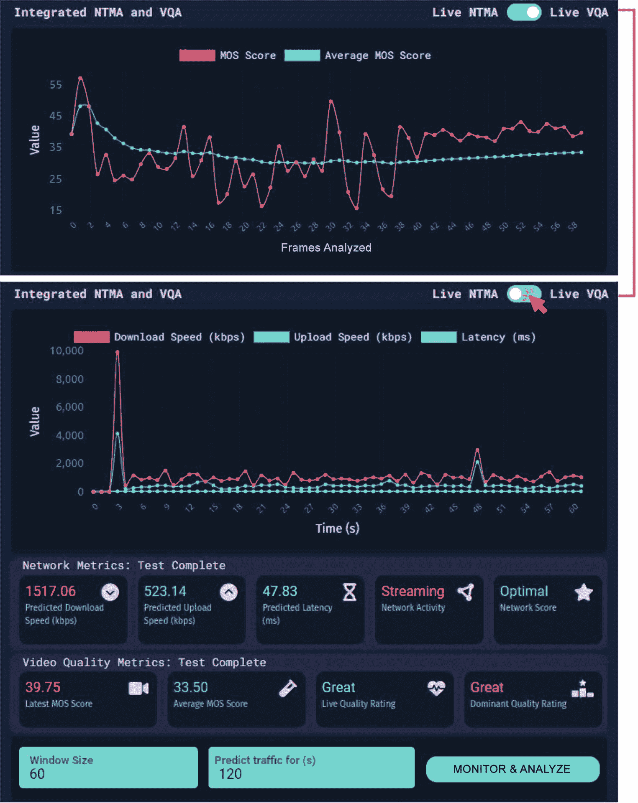
图 7-2 集成 NTMA 与 VQA 应用布局

集成 NTMA 和 VQA 窗口的两个截图。实时功能在第二页开启。每个窗口都记录了数值随帧分析和时间变化的折线图。它还列出了已完成测试的网络指标和视频质量指标。

### 7.1.4 客户端-服务器-Servlet 交互

图 7-3 展示了客户端、`Node.js` 服务器以及托管的 `Apache Tomcat Java Servlet` 之间逐步的三方通信架构。

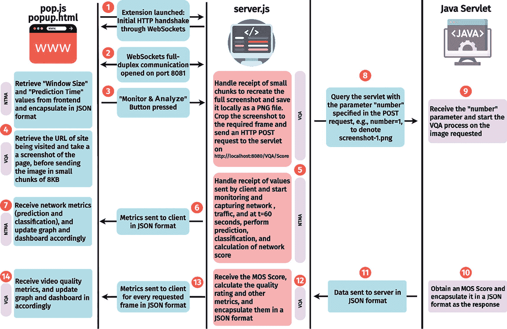
图 7-3 用于集成 NTMA 和 VQA 的客户端-服务器-Servlet 交互

数据流图定义了客户端、服务器以及托管的 `Apache Tomcat Java Servlet` 之间的三方通信。`HTML` 文件接收窗口大小和 `URL`，并通过 NTMA 和 VQA 从 `Java Servlet` 接收网络和视频质量指标。

## 7.2 集成 NTMA/VQA 应用的客户端程序结构

本节包含通过四个基本文件进行的前端开发。客户端程序结构的概要如图 7-4 所示。

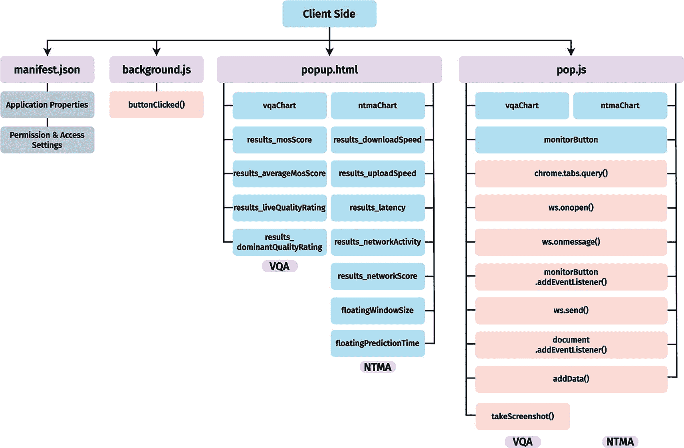
图 7-4 客户端程序结构

流程图列出了客户端程序结构。它由 `manifest.json`、`background.js`、`popup.html` 和 `pop.js` 文件组成。每个文件都有各自的属性和图表。

### 7.2.1 配置扩展设置和权限

在本节中，清单 7-1 给出了包含描述项目元数据的 `manifest.json` 文件，该文件允许 Google Chrome 将应用添加到浏览器扩展面板。“icons”标签可以通过向项目目录文件夹添加三个 `PNG` 文件类型的图标来满足，或者如果用户希望显示默认图标，则可以省略该标签。

```
{
  "manifest_version": 3,  // Chrome 扩展的清单格式版本。
  "name": "集成 NTMA 和 VQA",  // Chrome 扩展的名称。
  "version": "1.0",  // Chrome 扩展的版本号。
  "icons": {
    "16": "icon16.png",   // 16x16 像素大小的图标。
    "48": "icon48.png",   // 48x48 像素大小的图标。
    "128": "icon128.png"  // 128x128 像素大小的图标。
  },
  "background": {
    "service_worker": "background.js"  // 后台脚本，作为 Service Worker 实现。
  },
  "permissions": [ // 扩展所需的权限列表。
    "activeTab",  // 允许扩展与当前活动标签页交互。
    "scripting",  // 允许向网页注入脚本。
    "webNavigation",  // 使扩展能够接收网页导航生命周期中的事件。
    "webRequest",  // 授予扩展访问权限以观察和分析网络请求。
    "storage",  // 提供对浏览器存储 API 的访问以实现数据持久化。
    "declarativeNetRequest",  // 允许扩展声明一组用于网络请求的规则。
    "declarativeNetRequestFeedback",  // 允许扩展提供关于网络请求的反馈。
    "tabs"  // 使扩展能够查询和操作浏览器标签页。
  ],
  "action": {
    "default_popup": "popup.html",  // 点击扩展图标时显示的默认弹出 HTML 文件。
    "default_title": "集成 NTMA 和 VQA"  // 扩展图标的默认标题。
  }
}
```

清单 7-1 使用扩展设置和权限配置 `manifest.json`

### 7.2.2 配置后台脚本

与 NTMA 和 VQA 应用类似，后台脚本（即 `background.js` 文件）的代码在清单 7-2 中给出。

```
// 记录一条消息，指示扩展已启动。
console.log("扩展已启动...");
// 监听扩展操作按钮的点击事件。
chrome.action.onClicked.addListener(buttonClicked);
// 处理按钮点击事件的函数。
function buttonClicked(tab) {
  // 记录一条消息，指示点击按钮时后台脚本正在运行。
  console.log("后台脚本正在运行...");
}
// 可以在此处添加额外的 Service Worker 逻辑
// 此脚本与扩展分开运行，可以高效地执行后台任务
// 开发者可以扩展 Service Worker 的功能以处理各种任务，例如
// 网络请求、数据管理和后台处理。
```

清单 7-2 使用 Service Worker 逻辑配置 `background.js`

### 7.2.3 构建用户界面

用户界面以 HTML 和 CSS 为基础构建，创建一个包含切换开关的弹出窗口，点击该开关可在 NTMA 和 VQA 实时图表之间切换。仪表板还包含网络和视频指标行，仪表板卡片位于其中。因此，本节为用户提供了对网络和视频质量指标的深入信息。

#### 文件功能

`popup.html` 文件编码了以下功能：

1. 指定文档结构，包括以下内容：
    1. 文档类型和语言。
    2. 字符集和标题。
    3. 修改内容安全策略 (CSP) 以允许特定的脚本源。

2. 添加对外部资源的引用：
    1. 从 Google Fonts [1] 导入所需的字体样式表。
    2. 从 Font Awesome 图标库 [2] 导入仪表板图标。
    3. 链接从 Bootstrap 官方网站 [3] 下载的自定义 Bootstrap 样式表。

3. 添加内部 CSS 以修改组件外观：
    1. 设置 body、背景和按钮的样式。
    2. 为用户界面组件（如按钮、标签和图表）定义样式。

4. 显示标题和复选框：
    1. 创建一个用于嵌入标题和复选框的容器。
    2. 为弹出窗口设置标题。
    3. 创建一个复选框，通过 CSS 格式化使其看起来像一个切换开关。

5. 显示两个图表区域：
    1. 创建一个用于嵌入 NTMA 图表区域的容器。
    2. 创建一个用于嵌入 VQA 图表区域的容器。
    3. 为每个图表区域嵌入一个使用 Chart.js 的图表画布。

6. 显示“网络指标”卡片：
    1. 创建一个用于网络指标的容器。
    2. 分别显示预测下载速度、预测上传速度、预测延迟、网络活动和网络评分及其图标。

7. 显示“视频质量指标”卡片：
    1. 创建一个用于视频质量指标的容器。
    2. 分别显示最新 MOS 分数、平均 MOS 分数、实时质量评级和主导质量评级及其图标。

8. 添加用户输入字段：
    1. 定义窗口大小和预测时间的输入字段。
    2. 定义“监控与分析”按钮。

9. 添加下载的脚本和客户端脚本：
    1. 链接下载的 Chart.js 库 [4]。
    2. 链接自定义的 `pop.js` 脚本。

#### 库和所需资源

表 7-1 列出了所提及的库和可下载脚本及其各自的用途。

表 7-1 用户界面的库和资源描述

| 库/资源 | 用途 | 仓库 | 下载链接 | 位置 |
| --- | --- | --- | --- | --- |
| Google Fonts | 为网页提供自定义字体 | [1] | `popup.html` | |
| Font Awesome | 提供可缩放矢量图标 | [2] | `popup.html` | |
| bootstrap.min.css | 用于组织行和列的自定义 Bootstrap 样式表 | [3] | [5] | 项目根文件夹内的“css”文件夹 |
| chart.js | 为实时图表提供交互式图表 | [4] | [6] | 项目根文件夹 |
| pop.js | 用于逻辑的自定义 JS 文件 | 不适用 | | 项目根文件夹 |

#### 创建文档结构

首先使用清单 7-3 中的代码为 `popup.html` 创建页面结构。其余代码在此结构中的放置位置也已标明。

```
```

清单 7-3 创建文档结构

#### 添加切换开关、图表和仪表盘组件

图表和仪表盘组件，以及外部脚本（即 `chart.js` 和 `pop.js`）均添加在 `body` 标签内。这些脚本放置在末尾，以便在执行前让文档对象模型（DOM）完全加载。此代码见清单 7-5。

```
集成 NTMA 与 VQA

实时 NTMA

实时 VQA

网络指标

请稍候...

预测下载速度 (kbps)

请稍候...

预测上传速度 (kbps)

请稍候...

预测延迟 (ms)

请稍候...

网络活动

请稍候...

网络评分

视频质量指标

请稍候...

最新 MOS 评分

请稍候...

平均 MOS 评分

请稍候...

实时质量评级

请稍候...

主导质量评级

窗口大小

预测流量时长 (s)

监控与分析
```

清单 7-5 添加切换开关、图表和仪表盘组件

#### 通过内部 CSS 为组件设置样式

为提高应用程序的易用性和可读性，清单 7-6 中的代码被添加在 `style` 标签内。

# 清单 7-6：通过内部 CSS 为组件设置样式

```css
/* 主体样式 */
`body` {
  `background-color`: #131F33;
  `color`: #92ABCF;
  `font-family`: "Roboto";
  `font-size`: 15px;
  `width`: 710px;
}
/* 主体背景样式 */
`.bg-secondary` {
  `background-color`: #0F1724 !important;
}
/* 所有主要文本样式 */
`.text-primary` {
  `color`: #92ABCF !important;
}
/* “监控与分析”按钮样式 */
`#monitorButton` {
  `display`: flex;
  `width`: 200px;
  `height`: 30px;
  `align-content`: right;
  `margin-top`: 10px;
  `margin-bottom`: 10px;
  `margin-left`: 12px;
  `text-transform`: uppercase;
  `flex-direction`: row;
  `-moz-box-align`: center;
  `align-items`: center;
  `gap`: 0.375rem;
  `border`: medium none;
  `box-shadow`: rgba(0, 0, 0, 0.2) 0px 3px 1px -2px, rgba(0, 0, 0, 0.14) 0px 2px 2px 0px, rgba(0, 0, 0, 0.12) 0px 1px 5px 0px;
  `font-weight`: bold;
  `font-family`: Fira Sans, Arial, Helvetica, sans-serif;
  `cursor`: pointer;
  `transition`: background-color 250ms cubic-bezier(0.4, 0, 0.2, 1) 0ms, box-shadow 250ms cubic-bezier(0.4, 0, 0.2, 1) 0ms, border 250ms cubic-bezier(0.4, 0, 0.2, 1) 0ms;
  `-moz-box-pack`: center;
  `justify-content`: center;
  `border-radius`: 12px;
  `padding`: 0.625rem 0.75rem;
  `font-size`: 0.820rem;
  `color`: rgb(0, 0, 0);
  `background-color`: rgb(17, 236, 229);
}
/* 按钮悬停时的外观样式 */
`#monitorButton:hover` {
  `background-color`: #bd1515;
  `color`: white;
  `transition`: .5s;
}
/* “窗口大小”字段样式 */
`#floatingWindowSize` {
  `background-color`: rgb(17, 236, 229);
  `color`: rgb(0, 0, 0);
  `height`: 50px;
}
/* “窗口大小”字段被点击时的外观样式 */
`#floatingWindowSize:focus` {
  `border`: 3px solid rgb(17, 236, 229) !important;
  `box-shadow`: 0 0 3px rgb(17, 236, 229) !important;
  `-moz-box-shadow`: 0 0 3px rgb(17, 236, 229) !important;
  `-webkit-box-shadow`: 0 0 3px rgb(17, 236, 229) !important;
}
/* “预测流量时长 (s)”字段样式 */
`#floatingPredictionTime` {
  `background-color`: rgb(17, 236, 229);
  `color`: rgb(0, 0, 0);
  `height`: 50px;
}
/* “预测流量时长 (s)”字段被点击时的外观样式 */
`#floatingPredictionTime:focus` {
  `border`: 3px solid rgb(17, 236, 229) !important;
  `box-shadow`: 0 0 3px rgb(17, 236, 229) !important;
  `-moz-box-shadow`: 0 0 3px rgb(17, 236, 229) !important;
  `-webkit-box-shadow`: 0 0 3px rgb(17, 236, 229) !important;
}
/* “窗口大小”和“预测流量时长 (s)”字段样式 */
`#floatingLabels` {
  `color`: rgb(0, 0, 0);
  `font-weight`: bold;
}
/* 所有输入字段样式 */
`input:focus, textarea:focus, select:focus` {
  `outline-offset`: 0px !important;
  `outline`: none !important;
}
/* 弹出窗口标题样式 */
`#title` {
  `padding-top`: 2px;
  `padding-left`: 15px;
  `text-align`: left;
  `font-family`: Roboto Mono;
  `font-weight`: bold;
  `font-size`: 14px;
  `color`: #DFCCFB;
}
/* 每个仪表盘行标题样式 */
`.dashboard-title` {
  `color`: #DFCCFB;
  `margin-left`: 10px;
  `margin-bottom`: -5px;
  `font-size`: 13px;
  `font-family`: 'Roboto Mono';
}
/* 仪表盘行样式 */
`.dashboard-row` {
  `display`: flex;
  `justify-content`: space-between;
}
/* 仪表盘卡片样式 */
`.dashboard-card` {
  `padding`: 7px;
  `margin`: 6px;
  `border-radius`: 10px;
  `background-color`: #101424;
  `position`: relative;
  `width`: 225px;
}
/* 仪表盘容器样式 */
`.dashboard-container` {
  `background-color`: #1d243f;
  `margin-top`: 2px;
  `margin-left`: 10px;
  `padding-left`: 5px;
  `border-radius`: 10px;
  `position`: relative;
  `width`: 97%;
}
/* 仪表盘图标样式 */
`.icon` {
  `position`: absolute;
  `top`: 10px;
  `right`: 10px;
  `font-size`: 20px;
  `color`: #DFCCFB;
}
/* 仪表盘指标样式 */
`.metric` {
  `font-size`: 16px;
}
/* 仪表盘描述样式 */
`.description` {
  `font-size`: 10px;
  `font-family`: Fira Sans;
  `margin-bottom`: 12px;
  `margin-right`: 16px;
}
/* 标题和切换开关容器样式 */
`.title-toggle-container` {
  `display`: flex;
  `align-items`: center;
  `justify-content`: space-between; /* 将项目对齐到最右侧 */
  `font-family`: Roboto Mono;
  `font-weight`: bold;
  `font-size`: 14px;
  `color`: #DFCCFB;
}
/* 切换开关容器样式 */
`.toggle-container` {
  `padding-top`: 2px;
  `display`: flex;
  `align-items`: center;
}
/* 切换开关标题样式 */
`.toggle-caption` {
  `font-size`: 14px;
  `color`: #DFCCFB;
  `margin-left`: 10px;
  `margin-right`: 10px;
}
/* 切换开关样式 */
`.switch` {
  `position`: relative;
  `display`: inline-block;
  `width`: 40px;
  `height`: 20px;
}
/* 切换开关输入样式 */
`.switch input` {
  `opacity`: 0;
  `width`: 0;
  `height`: 0;
}
/* 滑块（切换按钮）样式 */
`.slider` {
  `position`: absolute;
  `cursor`: pointer;
  `top`: 0;
  `left`: 0;
  `right`: 0;
  `bottom`: 0;
  `background-color`: #5FBDFF;
  `-webkit-transition`: .4s;
  `transition`: .4s;
  `border-radius`: 34px;
}
/* 滑块拇指样式 */
`.slider:before` {
  `position`: absolute;
  `content`: "";
  `height`: 14px;
  `width`: 14px;
  `left`: 3px;
  `bottom`: 3px;
  `background-color`: white;
  `-webkit-transition`: .4s;
  `transition`: .4s;
  `border-radius`: 50%;
}
/* 输入被选中时滑块样式 */
`input:checked + .slider` {
  `background-color`: #15F5BA; /* 选中时更改背景颜色 */
}
/* 输入获得焦点时滑块样式 */
`input:focus + .slider` {
  `box-shadow`: 0 0 1px #2196F3; /* 获得焦点时添加阴影 */
}
/* 输入被选中时滑块拇指样式 */
`input:checked + .slider:before` {
  `-webkit-transform`: translateX(20px);
  `-ms-transform`: translateX(20px);
  `transform`: translateX(20px);
}
```

#### 将用户界面添加到 Google Chrome

要将 UI 添加到 Google Chrome，可以遵循第 5.2.3.7 节和第 6.2.3.7 节中给出的相同步骤。添加完成后，集成的 NTMA 和 VQA 应用程序会列在扩展程序菜单中，如图 7-5 所示。也可以按照前面讨论的相同步骤，将其固定在网页浏览器的右上角。

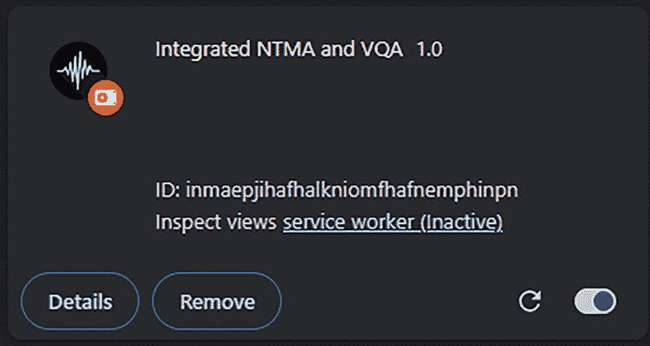

集成 NTMA 和 VQA 1.0 版弹出窗口的截图。其中显示了 ID 和用于检查视图的链接。左侧是详细信息和删除按钮。

**图 7-5** 添加到扩展程序菜单的集成 NTMA 和 VQA 应用程序

#### 用户界面可视化

图 7-6 展示了在快速访问栏中点击应用程序后完成的用户界面。对于此应用程序，由于两个图表的外观是通过 JavaScript（即在 `pop.js` 文件中）处理的，因此该用户界面是在构建客户端脚本后获得的。

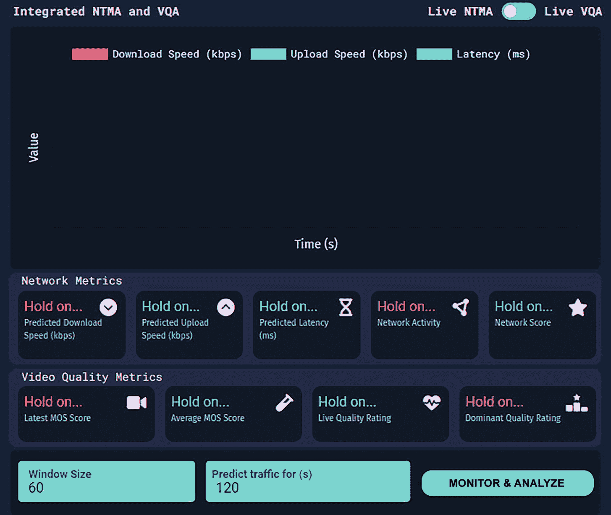

集成 NTMA 和 VQA 窗口的截图。它显示了一个数值随时间变化的图形工作区。底部显示了网络指标和视频质量指标，以及各自的窗口大小和预测流量。“监控”和“分析”按钮位于右下角。

**图 7-6** 集成 NTMA 和 VQA 应用程序的完整用户界面

### 7.2.4 构建客户端脚本

客户端功能使用 JavaScript 实现，并保存在一个名为 `pop.js` 的单一文件中。如之前的 NTMA 和 VQA 示例所示，该文件使用 WebSockets [7] 管理与 Node.js 服务器的通信，使用接收到的指标刷新用户界面，并通过跟踪 `Chart.js` 达到的索引来更新两个图表及其各自的指标。

#### 文件功能

`pop.js` 文件具有以下功能：

1.  声明在整个脚本中使用的全局变量。
2.  使用 Chrome 扩展 API 查询 Chrome 标签页：
    1.  检索有关活动标签页和最后聚焦标签页的信息。
    2.  检索活动标签页的 URL。
3.  创建到服务器的 WebSocket 连接：
    1.  实现从服务器接收消息的方法。
    2.  使用 `open` 事件处理连接。
    3.  解析并记录消息。
4.  接收并处理来自服务器的消息：
    1.  解析包含实时网络指标、视频质量指标和图表更新的 JSON 消息。
    2.  使用网络和视频质量指标更新 HTML 元素。
    3.  使用最新指标动态更新 `Chart.js` 图表。
    4.  根据服务器返回的特定错误生成信息性警报。
5.  为“监控”按钮创建事件监听器：
    1.  为按钮添加事件监听器。
    2.  从用户界面获取“窗口大小”和“预测时间”参数，并以 JSON 格式发送到服务器。
    3.  调用一个方法，使用 Chrome 扩展 API 截取当前页面视图的屏幕截图。
    4.  计算将图像发送到服务器所需的 8 KB 块的数量。
    5.  将服务器应预期的块数作为元数据发送。
    6.  将每个块发送到服务器。
6.  为 DOM 创建事件监听器：
    1.  为 DOM 添加事件监听器。
    2.  为 NTMA 和 VQA 初始化两个 `Chart.js` 图表对象。
    3.  为切换开关添加事件监听器。
    4.  当切换开关被选中时，隐藏 NTMA 图表并显示 VQA 图表。
    5.  当切换开关未被选中时，显示 NTMA 图表并隐藏 VQA 图表。
    6.  为五个数据集创建配置。
7.  实现一个方法，根据指定的标签每秒更新图表。
8.  实现一个方法，在收到 Node.js 服务器的请求时截取当前页面的屏幕截图。

#### 创建脚本结构

`pop.js` 脚本的结构在代码清单 7-7 中给出，以及其他功能的代码放置位置。

```
// 声明在整个脚本中调用的全局对象。
var monitorButton; // “监控与分析”对象的变量。
var ntmaChart; // NTMA Chart.js 对象的变量。
var vqaChart; // VQA Chart.js 对象的变量。

// 查询活动标签页和最后聚焦标签页以检索当前 URL。
chrome.tabs.query({
    active: true,
    lastFocusedWindow: true,
},
function(tabs) {

}
);

// 在 DOM 上添加事件监听器，以便在页面加载后立即执行。
document.addEventListener('DOMContentLoaded', function() {

}, false);

// 动态更新图表的方法。
function addData(chart, label, data, updateLabel) {

}
```

代码清单 7-7 创建脚本结构

#### 页面加载时初始化并配置图表

一旦 HTML 文档的 DOM 加载完成，`DOMContentLoaded` 事件就会被触发以执行其内容。因此，在执行以下操作之前，两个图表 `ntmaGraph` 和 `vqaGraph` 分别被引用到 `chart1` 和 `chart2`：

1.  获取 NTMA 和 VQA 的两个图表画布元素的引用。
2.  获取切换开关输入元素的引用。
3.  初始隐藏 VQA 图表。
4.  创建一个在两个图表之间切换的函数。
5.  获取“监控”按钮的 DOM 元素并将其分配给全局变量 `monitorButton`。
6.  创建数据集配置：
    1.  为“下载速度 (kbps)”、“上传速度 (kbps)”和“延迟 (ms)”创建三个独立的数据集。这些用于 NTMA 图表。
    2.  为“MOS 分数”和“平均 MOS 分数”创建两个独立的数据集。这些用于 VQA 图表。
    3.  对于每个数据集，指定标签、背景颜色、边框颜色、边框宽度和点半径。
7.  创建 `dataNTMA` 和 `dataVQA` 对象，它们封装了所有数据集设置，并因此直接作为参数提供给 `Chart.js`。
8.  创建 `optionsNTMA` 和 `optionsVQA` 对象，它们设置 `Chart.js` 图表的外观样式，设置包括响应式、宽高比、线条张力、轴配置、刻度显示设置和图例样式。
9.  为 `Chart.js` 图表创建 `configNTMA` 和 `configVQA` 对象，其中图表的类型、要包含的数据以及指定的选项都被封装在内。
10. 使用 `ntmaChart` 和 `vqaChart` 标识符创建新的 `Chart.js` 实例，从而将所有设置绑定到 HTML 元素。这指示了渲染折线图的对象。

上述功能的代码在代码清单 7-8 中给出。

## 清单 7-8
### 页面加载时初始化并配置图表

```javascript
// 获取 NTMA 和 VQA 两个图表的画布元素引用。
var chart1 = document.getElementById('ntmaGraph');
var chart2 = document.getElementById('vqaGraph');
// 获取切换开关输入元素的引用。
var toggleSwitch = document.querySelector('.switch input[type="checkbox"]');
// 初始隐藏 VQA 图表。
chart2.style.display = 'none';
// 在两个图表之间切换的函数。
toggleSwitch.addEventListener('change', function () {
if (toggleSwitch.checked) {
// 当开关被选中时，显示 VQA 图表。
chart1.style.display = 'none'; // 隐藏 NTMA 图表。
chart2.style.display = 'block'; // 显示 VQA 图表。
} else {
// 当开关未被选中时，显示 NTMA 图表。
chart1.style.display = 'block'; // 显示 NTMA 图表。
chart2.style.display = 'none'; // 隐藏 VQA 图表。
}
});
// 获取“监控与分析”按钮的 DOM 元素。
monitorButton = document.getElementById('monitorButton');
// 为“下载速度”折线图创建数据集配置。
const dataset_DS = {
label: '下载速度 (kbps)',
backgroundColor: 'rgb(255, 99, 132)',
borderColor: 'rgb(255, 99, 132)',
borderWidth: 1.2,
pointRadius: 1.6
};
// 为“上传速度”折线图创建数据集配置。
const dataset_US = {
label: '上传速度 (kbps)',
backgroundColor: 'rgb(44, 211, 225)',
borderColor: 'rgb(44, 211, 225)',
borderWidth: 1.2,
pointRadius: 1.6
};
// 为“延迟”折线图创建数据集配置。
const dataset_Lat = {
label: '延迟 (ms)',
backgroundColor: 'rgb(69, 255, 202)',
borderColor: 'rgb(69, 255, 202)',
borderWidth: 1.2,
pointRadius: 1.6
};
// 为“MOS 分数”折线图创建数据集配置。
const dataset_MOS = {
label: 'MOS 分数',
backgroundColor: 'rgb(255, 99, 132)',
borderColor: 'rgb(255, 99, 132)',
borderWidth: 1.2,
pointRadius: 1.6
};
// 为“平均 MOS 分数”折线图创建数据集配置。
const dataset_AvgMOS = {
label: '平均 MOS 分数',
backgroundColor: 'rgb(44, 211, 225)',
borderColor: 'rgb(44, 211, 225)',
borderWidth: 1.2,
pointRadius: 1.6
};
// 创建数据对象，将 NTMA 的所有数据集封装到一个对象中。
const dataNTMA = {
datasets: [dataset_DS, dataset_US, dataset_Lat]
};
// 创建数据对象，将 VQA 的所有数据集封装到一个对象中。
const dataVQA = {
datasets: [dataset_MOS, dataset_AvgMOS]
};
// 创建选项对象，负责设置 NTMA 图表的样式。
const optionsNTMA = {
// 设置宽度以适应分配的区域。
responsive: false,
// 不允许改变宽高比。
maintainAspectRatio: false,
elements: {
line: {
tension: 0.35, // 为折线图添加轻微曲率。
},
},
// 修改 x 轴配置。
scales: {
x: {
display: true, // 显示 x 轴。
title: {
display: true, // 显示 x 轴标题。
text: '时间 (秒)', // 更改 x 轴标签。
color: '#DFCCFB', // 更改 x 轴标签颜色。
font: {
family: 'Fira Sans', // 更改 x 轴标签字体。
size: 14, // 更改 x 轴标签字号。
},
},
ticks: {
display: true, // 显示 x 轴刻度。
color: '#6b7e9b', // 更改 x 轴刻度标签颜色。
font: {
family: 'Ubuntu', // 更改 x 轴刻度字体。
size: 10, // 更改 x 轴刻度字号。
},
stepSize: 10, // 更改 x 轴刻度步长。
},
},
y: {
display: true, // 显示 y 轴。
title: {
display: true, // 显示 y 轴标题。
text: '数值', // 更改 y 轴标签。
color: '#DFCCFB', // 更改 y 轴标签颜色。
font: {
family: 'Fira Sans', // 更改 y 轴标签字体。
size: 14, // 更改 y 轴标签字号。
},
},
ticks: {
display: false, // 禁用 y 轴刻度。
color: '#6b7e9b', // 更改 y 轴刻度标签颜色。
font: {
family: 'Ubuntu', // 更改 y 轴刻度字体。
size: 13, // 更改 y 轴刻度字号。
},
},
},
},
plugins: {
legend: {
labels: {
color: '#DFCCFB', // 更改图例标签颜色。
font: {
family: 'Roboto Mono', // 更改图例标签字体。
}
}
}
}
};
// 创建选项对象，负责设置 VQA 图表的样式。
const optionsVQA = {
// 设置宽度以适应分配的区域。
responsive: false,
// 不允许改变宽高比。
maintainAspectRatio: false,
elements: {
line: {
tension: 0.35, // 为折线图添加轻微曲率。
},
},
// 修改 x 轴配置。
scales: {
x: {
display: true, // 显示 x 轴。
title: {
display: true, // 显示 x 轴标题。
text: '已分析帧数', // 更改 x 轴标签。
color: '#DFCCFB', // 更改 x 轴标签颜色。
font: {
family: 'Fira Sans', // 更改 x 轴标签字体。
size: 14, // 更改 x 轴标签字号。
},
},
ticks: {
display: true, // 显示 x 轴刻度。
color: '#6b7e9b', // 更改 x 轴刻度标签颜色。
font: {
family: 'Ubuntu', // 更改 x 轴刻度字体。
size: 10, // 更改 x 轴刻度字号。
},
stepSize: 10, // 更改 x 轴刻度步长。
},
},
y: {
display: true, // 显示 y 轴。
title: {
display: true, // 显示 y 轴标题。
text: '数值', // 更改 y 轴标签。
color: '#DFCCFB', // 更改 y 轴标签颜色。
font: {
family: 'Fira Sans', // 更改 y 轴标签字体。
size: 14, // 更改 y 轴标签字号。
},
},
ticks: {
display: false, // 禁用 y 轴刻度。
color: '#6b7e9b', // 更改 y 轴刻度标签颜色。
font: {
family: 'Ubuntu', // 更改 y 轴刻度字体。
size: 13, // 更改 y 轴刻度字号。
},
},
},
},
plugins: {
legend: {
labels: {
color: '#DFCCFB', // 更改图例标签颜色。
font: {
family: 'Roboto Mono', // 更改图例标签字体。
}
}
}
}
};
// NTMA 折线图的配置对象。
const configNTMA = {
type: 'line', // 设置图表类型。
data: dataNTMA, // 设置图表数据。
options: optionsNTMA // 设置样式和自定义选项。
};
// VQA 折线图的配置对象。
const configVQA = {
type: 'line', // 设置图表类型。
data: dataVQA, // 设置图表数据。
options: optionsVQA // 设置样式和自定义选项。
};
// 使用配置创建一个新的 Chart 实例，并将其附加到 id 为 "ntmaChart" 的画布元素上。
ntmaChart = new Chart(document.getElementById('ntmaChart'), configNTMA);
// 使用配置创建一个新的 Chart 实例，并将其附加到 id 为 "vqaChart" 的画布元素上。
vqaChart = new Chart(document.getElementById('vqaChart'), configVQA);
```

### 实时 WebSocket 通信与动态图表更新

与 NTMA 和 VQA 模块的原理相同，客户端主要负责在预定义端口上与服务器建立连接，随后通过已建立的连接进行消息交换。涉及以下功能：

1.  获取当前活动标签页的 URL 并将其存储在一个变量中。
2.  初始化一个 `time` 变量，作为图表的时间计数器。
3.  初始化一个 `frame` 变量，用于追踪正在分析的帧数。
4.  创建常量以动态区分两个图表。
5.  在 `ws://localhost:8081/` 上建立 WebSocket 连接，即通过端口 `8081`，用于实时通信。
    1.  发送消息时，使用 `ws.open` 事件。在此情况下，将之前存储的活动标签页 URL 发送给服务器，以便其知晓正在访问哪个站点。
    2.  接收消息时，使用 `ws.onmessage` 事件。该方法在收到来自服务器的任何消息时自动触发。服务器被编程为在收到 servlet 的结果后请求另一张截图，并将该结果转发给客户端。此外，由于服务器被编程为每秒向客户端发送实时网络指标，因此该方法也会每秒触发一次。随后使用一系列 `if` 语句根据所需的更新内容对消息进行过滤。相应的 HTML 元素也会随之更新。
6.  检查是否收到与服务器端发生的任何错误相关的消息，如果收到则生成警报。
7.  使用 `addData()` 方法触发实时图表更新，该方法接收图表对象、时间步长、实时值以及一个标签作为输入，用于指示正在填充五个数据集中的哪一个。
8.  为“监控与分析”按钮创建一个事件监听器：
    1.  使用 `stringify()` 方法将从各自 HTML 元素中获取的“窗口大小”和“预测时间”变量封装成 JSON 格式。
    2.  调用一个方法，使用 Chrome 扩展 API 截取当前页面视图的屏幕截图。
    3.  在“监控与分析”按钮的事件监听器外部实现 `takeScreenshot()` 方法。

这些过程的代码见清单 7-9。

## 清单 7-9

### 实时 WebSocket 通信与动态图表更新

```javascript
// 将活动标签页的 URL 存储在一个变量中。
var tempurl = tabs[0].url;
// 用于在图表上迭代时间的变量 (NTMA)。
var time = 0;
// 用于跟踪正在分析的帧的变量 (VQA)。
var frame = 0;
// 用于更新图表数据的常量。
const updateDownload = "downloadTraffic";
const updateUpload = "uploadTraffic";
const updateLatency = "latency";
const updateMOS = "MOS";
const updateAverageMOS = "AverageMOS";
// 创建到服务器的 WebSocket 连接。
const ws = new WebSocket('ws://localhost:8081/');
// 处理 WebSocket 连接 "open" 事件。
ws.onopen = function() {
    // 记录扩展程序成功连接到服务器的消息。
    console.log('WebSocket 客户端已连接');
    // 将活动标签页的 URL 发送到服务器，以便其知道正在访问哪个站点。
    // 将类型指定为 "sitedata"，并以 JSON 格式发送消息。
    ws.send(JSON.stringify({type:'sitedata', value:tempurl}));
};
// 处理从服务器接收到的消息。
ws.onmessage = function(e) {
    // 记录任何接收到的消息。
    console.log("从服务器收到: " + e.data);
    // 处理与网络指标相关的消息。
    // 以下语句检查接收到的消息是否包含实时值或预测值。
    // 这些对象名称在服务器端设置。
    if (e.data.includes("downloadSpeed") || e.data.includes("uploadSpeed") || e.data.includes("latency") || e.data.includes("predictedDownloadSpeed") || e.data.includes("predictedUploadSpeed") || e.data.includes("predictedLatency")) {
        // 解析用于实时指标和图表更新的 JSON 消息。
        const msg = JSON.parse(e.data);
        // 使用服务器端设置的相同表示法从消息中提取预测值。
        // 将这些值存储在其对应的变量中。
        var predRX = msg.predictedDownloadSpeed; // 预测下载速度指标的变量。
        var predTX = msg.predictedUploadSpeed; // 预测上传速度指标的变量。
        var predLat = msg.predictedLatency; // 预测延迟指标的变量。
        var scoreQoS = msg.predictedQoS; // QoS 分数的变量。
        var deviceActivity = msg.deviceActivity; // 分类结果（即设备活动）的变量。
        var averageLatency = msg.averageLatency; // 平均延迟指标的变量（未在 UI 上显示，但可以作为仪表板卡片添加）。
        // 检查变量是否不为 "undefined"，因为 UI 上的值仅在获得结果后更新。
        if(typeof predRX !== "undefined" || typeof predTX !== "undefined" || typeof predLat !== "undefined" || typeof scoreQoS !== "undefined" || typeof deviceActivity !== "undefined") {
            // 使用从服务器接收到的指标更新 HTML 元素。
            document.getElementById("results_downloadSpeed").innerHTML = predRX;
            document.getElementById("results_uploadSpeed").innerHTML = predTX;
            document.getElementById("results_latency").innerHTML = predLat;
            document.getElementById("results_networkScore").innerHTML = scoreQoS;
            document.getElementById("results_networkActivity").innerHTML = deviceActivity;
            // 更新 UI 以让用户知道测试已完成。
            document.getElementById("results_network").innerHTML = "网络指标：测试完成";
        }
        // 提取实时网络指标和图表更新。
        var RX = msg.downloadSpeed; // 将实时下载速度指标存储在一个变量中。
        var TX = msg.uploadSpeed; // 将实时上传速度指标存储在一个变量中。
        var latency = msg.latency; // 将实时延迟指标存储在一个变量中。
        // 使用 addData() 方法将数据添加到 NTMA 图表，解析以下参数：
        // 1. 图表对象。
        // 2. 时间步长（相对于用户点击按钮的时间 - 这表示 t = 0）。
        // 3. 实时值。
        // 4. 用于将变量引导至图表上正确值集的标签。
        addData(ntmaChart, time, RX, updateDownload); // 使用最新的下载速度变量更新图表。
        addData(ntmaChart, time, TX, updateUpload); // 使用最新的上传速度变量更新图表。
        addData(ntmaChart, time, latency, updateLatency); // 使用最新的延迟变量更新图表。
        // 为下一个数据点增加时间。
        time = time + 1;
    }
    // 处理与视频质量指标相关的消息。
    // 以下语句检查接收到的消息是否包含实时或评估的视频质量指标。
    // 这些对象名称在服务器端设置。
    if (e.data.includes("videoScore") || e.data.includes("averageVideoScore") || e.data.includes("videoRating") || e.data.includes("dominantRating")) {
        // 解析用于实时指标和图表更新的 JSON 消息。
        const msg = JSON.parse(e.data);
        // 使用服务器端设置的相同表示法从消息中提取预测值。
        // 将这些值存储在其对应的变量中。
        var mosScore = parseFloat(msg.videoScore); // MOS 分数的变量。
        var averageMosScore = parseFloat(msg.averageVideoScore); // 平均 MOS 分数的变量。
        var liveQualityRating = msg.videoRating; // 视频质量评级的变量。
        var dominantQualityRating = msg.dominantRating; // 主导视频质量评级的变量。
        // 由于此评级是实时的，因此使用从服务器接收到的指标更新 HTML 元素。
        document.getElementById("results_liveQualityRating").innerHTML = liveQualityRating;
        document.getElementById("results_dominantQualityRating").innerHTML = dominantQualityRating;
        // 使用 addData() 方法将数据添加到 VQA 图表，解析以下参数：
        // 1. 图表对象。
        // 2. 时间步长（相对于从 Java Servlet 接收帧结果的时间）。
        // 3. 实时值。
        // 4. 用于将变量引导至图表上正确值集的标签。
        addData(vqaChart, frame, parseFloat(mosScore), updateMOS); // 使用来自服务器的信息更新 MOS 图表。
        addData(vqaChart, frame, parseFloat(averageMosScore), updateAverageMOS); // 使用来自服务器的信息更新平均 MOS 图表。
        // 为下一个要分析的帧增加帧计数。
        frame = frame + 1;
        // 如果分析的帧数少于 60（索引从 0 开始，因此为 0-59）。
        if (e.data.includes("screenshot") && frame < 60) {
            // 捕获当前标签页的屏幕截图。
            chrome.tabs.captureVisibleTab(null, {format: "png"}, (dataUrl) => {
                // 将 dataUrl 转换为 Blob。
                fetch(dataUrl)
                    .then(res => res.blob())
                    .then((blob) => {
                        // 创建一个 Promise 来处理 Blob 到 ArrayBuffer 的转换。
                        return new Promise((resolve) => {
                            // 创建一个 FileReader 实例。
                            const reader = new FileReader();
                            // 当读取器完成加载时，使用结果进行解析。
                            reader.onloadend = () => resolve(reader.result);
                            // 将 Blob 作为 ArrayBuffer 读取。
                            reader.readAsArrayBuffer(blob);
                        });
                    })
                    .then((arrayBuffer) => {
                        // 指定将图像分解并发送到服务器的块大小。
                        const chunkSize = 8192; // 例如，8 KB 块
                        // 计算所需的块数。
                        const totalChunks = Math.ceil(arrayBuffer.byteLength / chunkSize);
                        // 首先发送元数据（总块数）。
                        ws.send(JSON.stringify({type: "metadata", totalChunks}));
                        // 将数据分块并按所需块数发送。
                        // 遍历这些块并通过 WebSocket 连接发送它们。
                        for (let i = 0; i < totalChunks; i++) {
                            // 计算当前块的起始和结束字节。
                            const start = i * chunkSize;
                            const end = Math.min(start + chunkSize, arrayBuffer.byteLength);
                            // 从 ArrayBuffer 中切片出当前块。
                            const chunk = arrayBuffer.slice(start, end);
                            // 通过 WebSocket 发送当前块。
                            ws.send(chunk);
                        }
                    })
                    .catch((error) => {
                        // 记录捕获屏幕截图时的任何错误。
                        console.error("捕获屏幕截图时出错:", error);
                    });
            });
        }
    }
};
```

#### 实时图表更新机制

本节涉及 `addData()` 方法，该方法结合了 NTMA 和 VQA 模块的内容进行了轻微修改，使得两个图表都能实时填充数据。其代码见列表 7-10。

```javascript
// 通过先前创建的标签判断该方法是为哪个数据集调用的。
// 如果标签代表下载速度。
if (updateLabel === "downloadTraffic") {
    // 推送标签，即时间点。
    chart.data.labels.push(label);
    // 推送数据，即实时指标。
    chart.data.datasets[0].data.push(data);
}
// 如果标签代表上传速度。
else if (updateLabel === "uploadTraffic") {
    // 推送数据，即实时指标。
    chart.data.datasets[1].data.push(data);
}
// 如果标签代表延迟。
else if (updateLabel === "latency") {
    // 推送数据，即实时指标。
    chart.data.datasets[2].data.push(data);
}
// 如果标签代表 MOS。
if (updateLabel === "MOS") {
    // 推送标签，即帧时刻。
    chart.data.labels.push(label);
    // 推送数据，即实时指标。
    chart.data.datasets[0].data.push(data);
}
// 如果标签代表平均 MOS。
else if (updateLabel === "AverageMOS") {
    // 推送数据，即实时指标。
    chart.data.datasets[1].data.push(data);
}
// 当该方法首次被调用时，更新图表选项以显示 y 轴刻度。
// 这样做是因为 y 轴刻度最初是禁用的。
ntmaChart.options.scales.y.ticks.display = true;
vqaChart.options.scales.y.ticks.display = true;
// 更新图表。
chart.update();
```
*列表 7-10: 实时图表更新机制*

## 7.3 集成 NTMA/VQA 应用的服务器程序结构

`server.js` 文件的职责包括结合第 5.3 节和第 6.3 节详述的流程，首先导入所有模块，然后初始化全局变量并创建一个 HTTP 服务器。接着，使用相同的机制来处理 WebSocket 连接，从客户端接收“窗口大小”和“预测时间”参数，并重建 PNG 图像。这会触发 NTMA 模块（其代码相同），同时与 Java servlet 进行通信。NTMA 的结果在 Node.js 服务器端获取，封装成 JSON 格式并发送给客户端；而对于 VQA，Node.js 服务器在向客户端发送结果之前，会先等待来自 servlet 的结果。每个检查点都设有日志，用于验证服务器状态并提供对程序流程的洞察。图 7-7 概述了服务器端涉及的组件。

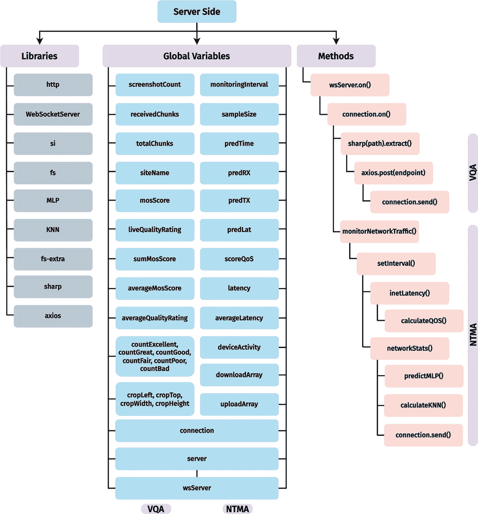

*一个流程图列出了服务器端程序结构。它由库、全局变量和方法组成。每个文件都有各自的属性和图表。这些方法包括基于 VQA 和 NTMA 的组件。*

### 7.3.1 库与所需资源

使用 `npm install` 关键字，可以安装 NTMA 和 VQA 应用程序所使用的所有库。表 7-2 总结了所需的库和资源。

*表 7-2 服务器库与资源说明*

| 库/资源 | 用途 | 下载链接 |
| :--- | :--- | :--- |
| `http` | 创建 HTTP 服务器 | [8] |
| `websocket` | 绑定到 HTTP 服务器以建立 WebSocket 连接 | [7] |
| `systeminformation` | 提供对设备网络接口的访问，以读取网络流量 | [9] |
| `fs` | 作为文件系统，允许访问设备上的文件 | [10] |
| `mlp` | 创建感知器以预测网络流量参数 | [11] |
| `ml-knn` | 创建 KNN 模型以分类设备活动 | [12] |
| `fs-extra` | 作为文件系统，允许执行额外的文件系统操作 | [13] |
| `sharp` | 通过提供一种方法，可以根据访问网站确定的预设坐标裁剪接收到的图像，从而轻松处理图像 | [14] |
| `axios` | 处理与 Java servlet 通信的请求-响应架构 | [15] |

### 7.3.2 添加库

使用 `require` 关键字将库添加到 `server.js` 文件中，如列表 7-11 所示。

```javascript
// 指定与服务器和监控过程相关的导入。
const http = require('http'); // 导入 'http' 模块以创建 HTTP 服务器。
const WebSocketServer = require('websocket').server; // 导入 WebSocket 服务器模块。
const si = require('systeminformation'); // 导入 'systeminformation' 库以获取设备的系统信息。
const fs = require('fs'); // 导入 'fs' 模块以处理文件系统。
const fsExtra = require('fs-extra'); // 导入 'fs-extra' 模块以执行额外的文件系统操作。
const sharp = require('sharp'); // 导入 'sharp' 模块以进行图像处理。
const axios = require('axios'); // 导入 'axios' 模块以发起 HTTP 请求。
// 指定与机器学习相关的导入。
var MLP = require('mlp'); // 导入 'mlp' 库，用于多层感知器预测。
var KNN = require('ml-knn'); // 导入 'ml-knn' 库，用于 K 近邻分类。
```
*列表 7-11: 添加库*

### 7.3.3 声明全局变量

来自 NTMA 和 VQA 应用的全局变量混合添加，如代码清单 7-12 所示。

```
// 指定与机器学习相关的导入。
var MLP = require('mlp'); // 导入 'mlp' 库，用于多层感知机预测。
var KNN = require('ml-knn'); // 导入 'ml-knn' 库，用于 K 近邻分类。
// 声明并初始化将在 NTMA 服务器脚本中使用的全局变量。
var monitoringInterval; // 声明监控间隔变量。
var sampleSize = 0; // 初始化样本大小变量，用于数据收集阶段。
var predTime = 0; // 初始化预测时间变量，用户希望在此时间点进行预测。
var predRX = 0; // 初始化下载速度预测变量，单位为 Kb/s。
var predTX = 0; // 初始化上传速度预测变量，单位为 Kb/s。
var predLat = 0; // 初始化延迟预测变量，单位为 ms。
var scoreQoS = ""; // 初始化 QoS 评分（服务质量）变量。
var latency = 0; // 初始化延迟测量变量，单位为 ms。
var averageLatency = 0; // 初始化平均延迟计算变量，单位为 ms。
var deviceActivity = ""; // 初始化设备活动状态变量，取值为 "idle"、"browsing" 或 "streaming"。
// 声明并初始化将在 VQA 服务器脚本中使用的全局变量。
var screenshotCount = 1; // 用于按顺序本地保存截图的计数器。
var receivedChunks = 0; // 用于跟踪已接收数据块的计数器。
var totalChunks; // 存储预期数据块总数的变量。
var siteName = ""; // 存储网站名称的变量。
var mosScore = 0; // 存储平均意见得分 (MOS) 的变量。
var liveQualityRating = ""; // 存储实时质量评级的变量。
var sumMosScore = 0; // 用于累加 MOS 分数总和的变量。
var averageMosScore = 0; // 存储平均 MOS 分数的变量。
var averageQualityRating = ""; // 存储平均质量评级的变量。
var countExcellent = 0; // 记录 "Excellent" 评级出现次数的计数器。
var countGreat = 0; // 记录 "Great" 评级出现次数的计数器。
var countGood = 0; // 记录 "Good" 评级出现次数的计数器。
var countFair = 0; // 记录 "Fair" 评级出现次数的计数器。
var countPoor = 0; // 记录 "Poor" 评级出现次数的计数器。
var countBad = 0; // 记录 "Bad" 评级出现次数的计数器。
var cropLeft = 0; // 存储裁剪图像左侧坐标的变量。
var cropTop = 0; // 存储裁剪图像顶部坐标的变量。
var cropWidth = 0; // 存储裁剪图像宽度的变量。
var cropHeight = 0; // 存储裁剪图像高度的变量。
// 定义一个变量以接受来自客户端的连接。
var connection;
代码清单 7-12
声明全局变量
```

### 7.3.4 清空截图文件夹

使用与第 6.3.4 节相同的代码来清空相应的截图文件夹，如代码清单 7-13 所示。

```
// 清空 "Screenshots" 和 "Screenshots-Cropped" 文件夹。
// 请小心此处插入的目录路径！
fsExtra.emptyDirSync("C://Users//Lavesh//Integrated//Screenshots");
fsExtra.emptyDirSync("C://Users//Lavesh//Integrated//ScreenshotsCropped");
代码清单 7-13
清空截图文件夹
```

### 7.3.5 获取本地数据库

同样地，通过代码清单 7-14 中的代码在本地获取数据库，如第 5.3.4 节所述。

```
// 从本地存储的数据库中获取一些先前存储的下载速度值。
const contents1 = fs.readFileSync("./Databases/downloadSpeed.txt", 'utf-8'); // 读取 'downloadSpeed.txt' 文件的内容。
var downloadArray = contents1.split(/\r?\n/); // 将内容分割成数组，假设每行代表一个值。
// 从本地存储的数据库中获取一些先前存储的上传速度值。
const contents2 = fs.readFileSync("./Databases/uploadSpeed.txt", 'utf-8'); // 读取 'uploadSpeed.txt' 文件的内容。
var uploadArray = contents2.split(/\r?\n/); // 将内容分割成数组，假设每行代表一个值。
代码清单 7-14
获取本地数据库
```

### 7.3.6 创建 WebSocket 服务器

WebSocket 服务器托管在端口 8081 上，使用前述相同原理。如代码清单 7-15 所示。

```
// 在端口 8081 上托管服务器连接。
const server = http.createServer(); // 创建一个 HTTP 服务器实例。
server.listen(8081); // 监听端口 8081 上的传入 HTTP 请求。
console.log("Server started on port 8081..."); // 记录一条消息，指示服务器已启动。
console.log("Waiting for connection..."); // 记录一条消息，指示服务器正在等待连接。
// 创建一个 WebSocket 服务器实例，并将其附加到先前创建的 HTTP 服务器上。
const wsServer = new WebSocketServer({
httpServer: server,
});
代码清单 7-15
创建 WebSocket 服务器
```

### 7.3.7 监听客户端连接

在本节中，接受来自请求客户端的连接，然后等待接收来自该客户端的消息。在客户端，当点击“监控与分析”按钮时，“`窗口大小`”和“`预测时间`”变量会被发送到服务器。此过程与截图过程同时发生。现在，这些消息可能以不同的顺序到达服务器端。为了能够区分它们，在客户端为每条消息分配了一个“类型”。在客户端声明的五种消息类型包括：

*   `metadata`：表示接收到预期的数据块数量。

*   `sitedata`：表示正在访问的网站 URL。

*   `windowSize`：表示“窗口大小”变量。

*   `predictionTime`：表示“预测时间”变量。

*   `binary`：表示客户端截图并发送的图像数据块。

因此，本节详细阐述了用于在服务器端执行 NTMA 和 VQA 的代码。

#### 添加 VQA 代码块

在接收并重建完整的 PNG 图像后触发 servlet 的代码块如代码清单 7-16 所示。它还会调用 `monitorNetworkTraffic()` 方法，该方法将在下一节中解释。

# 7.16 添加 VQA 模块

```javascript
// 通过 WebSocket 服务器监听客户端的连接请求。
wsServer.on("request", function (request) {
// 接受来自客户端的连接。
connection = request.accept(null, request.origin);
// 使用 "message" 关键字接收来自客户端的传入消息。
connection.on("message", function (message) {
// 检查接收到的消息类型是否为 UTF-8 格式。
if (message.type === "utf8") {
// 从接收到的消息中解析 UTF-8 数据。
const messageReceived = JSON.parse(message.utf8Data);
// 检查接收到的消息类型（元数据或站点数据）。
if (messageReceived.type === 'metadata') {
// 使用接收到的元数据更新 totalChunks 变量。
totalChunks = messageReceived.totalChunks;
// 记录接收到的元数据信息。
console.log('收到元数据：预计', totalChunks, '个数据块。');
} else if (messageReceived.type === 'sitedata') {
// 使用接收到的值更新 siteName 变量。
siteName = messageReceived.value;
// 记录接收到的站点数据信息。
console.log('收到站点数据：', siteName, '是链接。');
// 检查网站链接以设置相应的裁剪坐标。
// 对于 YouTube 和 Twitch，坐标已预设。
// 对于其他网站，则截取整个页面作为 VQA 模块的截图。
if (siteName.includes("youtube")){
// 针对 https://www.youtube.com/ 上的视频
cropLeft = 98;
cropTop = 80;
cropWidth = 1280;
cropHeight = 720;
} else if (siteName.includes("twitch")) {
// 针对 https://www.twitch.tv/ 上的视频
cropLeft = 239;
cropTop = 52;
cropWidth = 1340;
cropHeight = 752;
} else {
// 针对任何其他网站上的视频（不进行裁剪）。
cropLeft = 0;
cropTop = 0;
cropWidth = 1920;
cropHeight = 953;
}
} else if (messageReceived.type === 'windowSize') {
// 检查接收到的消息类型是否为 "windowSize"。
sampleSize = messageReceived.value; // 获取窗口大小参数。
} else if (messageReceived.type === 'predictionTime') {
// 检查接收到的消息类型是否为 "predictionTime"。
predTime = messageReceived.value; // 获取预测时间参数。
// 窗口大小和预测时间值均已获取。
// 调用方法触发 NTMA 过程。
monitorNetworkTraffic();
}
} else if (message.type === "binary") {
// 如果接收到的消息是二进制类型。
// 增加已接收数据块的计数器。
receivedChunks++;
// 处理接收到的二进制数据。
const arrayBuffer = message.binaryData;
// 将 arrayBuffer 转换为 Buffer。
const buffer = Buffer.from(arrayBuffer);
// 将数据块追加到一个文件中（例如，screenshot-1.png）。
// 对于一张截图，其每个数据块都会被追加到同一个文件中，以生成最终的截图。
fs.appendFileSync("C://Users//Lavesh//Integrated//Screenshots//screenshot-" + screenshotCount + ".png", buffer);
// 记录消息以指示已接收数据块的索引。
console.log('已接收数据块：', receivedChunks, '/', totalChunks);
// 如果所有数据块都已接收完毕，则完成并保存图像文件。
if (receivedChunks === totalChunks) {
// 这表示已从客户端接收到完整的截图。
console.log("所有数据块已接收。截图已保存。");
// 指定裁剪前后的文件路径。
var pathBeforeCropping = "C://Users//Lavesh//Integrated//Screenshots//screenshot-" + screenshotCount + ".png";
var pathAfterCropping = "C://Users//Lavesh//Integrated//ScreenshotsCropped//screenshot-" + screenshotCount + ".png";
// 使用 "Sharp" 库根据预设坐标裁剪图像。
sharp(pathBeforeCropping)
.extract({ left: cropLeft, top: cropTop, width: cropWidth, height: cropHeight })
.toFile(pathAfterCropping, (err, info) => {
if (err) {
// 记录错误消息以指示无法执行裁剪。
console.error('裁剪图像时出错：', err);
// 创建一条错误消息以发送给客户端。
const errorMessage = {
error: "裁剪图像时出错。"
};
// 将错误消息封装成 JSON 格式的字符串，并通过 WebSocket 连接发送。
connection.send(JSON.stringify(errorMessage));
} else {
// 记录消息以指示图像已成功裁剪。
console.log('图像裁剪成功：', info);
// 此时，包含 VQA 模块所需源的裁剪图像已可用。
// 记录消息，指示正在向 Java HTTP Apache 服务器（servlet）发出请求以返回 MOS 分数。
console.log("正在向 servlet 发出请求。")
// 使用 "Axios" 库向 servlet 发出 HTTP POST 请求。
axios.post("http://localhost:8080/VQA/Score", null, {
// 指定 servlet 所需的参数，此处为截图计数。
params: {
number: screenshotCount,
},
})
.then((response) => {
// 处理来自 servlet 的响应。
// 从 JSON 响应中检索 MOS 分数。
mosScore = response.data.score;
mosScore = parseFloat(mosScore);
// 记录消息以指示获取到的 MOS 分数。
console.log("从 servlet 获取的分数：" + mosScore);
// 处理超出优秀/差质量范围的异常值。
if (mosScore > 100) {
mosScore = 100;
} else if (mosScore < 0) {
mosScore = 0;
}
// 根据 MOS 分数确定直播质量等级。
if (mosScore >= 90) {
liveQualityRating = "优秀";
countExcellent = countExcellent + 1;
} else if (mosScore >= 80) {
liveQualityRating = "良好";
countGreat = countGreat + 1;
} else if (mosScore >= 65) {
liveQualityRating = "好";
countGood = countGood + 1;
} else if (mosScore >= 40) {
liveQualityRating = "一般";
countFair = countFair + 1;
} else if (mosScore >= 20) {
liveQualityRating = "差";
countPoor = countPoor + 1;
} else {
liveQualityRating = "很差";
countBad = countBad + 1;
}
// 记录消息以指示直播质量等级。
console.log("视频质量等级：" + liveQualityRating);
// 创建一个数组来存储每个质量等级的计数。
var countQuality = [countExcellent, countGreat, countGood, countFair, countPoor, countBad];
// 初始化变量以查找最大计数及其索引。
var maxCount = countQuality[0]; // 假设第一个是最大值。
var maxIndex = 0;
// 遍历 countQuality 数组以查找最大计数及其索引。
for (var i = 1; i < countQuality.length; i++) {
if (countQuality[i] > maxCount) {
// 更新最大计数及其索引。
maxCount = countQuality[i];
maxIndex = i;
}
}
// 创建一个表示质量等级的标签数组。
var labels = ['优秀', '良好', '好', '一般', '差', '很差'];
// 根据最大索引确定主导质量等级。
var dominantQualityRating = labels[maxIndex];
// 将主导质量等级及其计数记录到控制台。
console.log('计数最高的标签是：', dominantQualityRating);
console.log('最高计数值是：', maxCount);
// 计算并记录平均 MOS 分数。
sumMosScore = sumMosScore + mosScore;
averageMosScore = sumMosScore / screenshotCount;
console.log("平均 MOS 分数：" + averageMosScore);
// 向客户端发送消息以请求另一张截图。
// 创建一个常量变量，保存测量/计算出的分数和等级。
const screenshotUpdate = {
screenshot: "sendScreenshot",
videoScore: mosScore,
averageVideoScore: averageMosScore,
videoRating: liveQualityRating,
dominantRating: dominantQualityRating
};
// 将指标消息封装成 JSON 格式的字符串，并通过 WebSocket 连接发送。
connection.send(JSON.stringify(screenshotUpdate));
// 增加截图计数以移动到下一张。
screenshotCount = screenshotCount + 1;
})
.catch((error) => {
// 记录错误消息以指示无法将截图发送到 servlet。
console.error('向 servlet 发送截图时出错：', error);
// 创建一条错误消息以发送给客户端。
const errorMessage = {
error: "向 servlet 发送截图时出错。"
};
// 将错误消息封装成 JSON 格式的字符串，并通过 WebSocket 连接发送。
connection.send(JSON.stringify(errorMessage));
});
}
});
// 将已接收数据块的数量设置为零，作为下一张截图的复位。
receivedChunks = 0;
}
}
});
// 使用 "close" 关键字处理客户端断开连接。
connection.on("close", function (reasonCode, description) {
// 记录消息以指示客户端已断开连接。
console.log("客户端已断开连接。");
// 当客户端断开连接时停止监控过程。
clearInterval(monitoringInterval);
});
});
```

#### 添加 NTMA 模块

NTMA 流程的代码封装在 `monitorNetworkTraffic()` 方法中，该方法在成功接收到来自客户端的两个输入参数时被调用。此方法如代码清单 7-17 所示。

```
// 创建 NTMA 流程的方法。
function monitorNetworkTraffic() {
// 初始化一个计数器，用于判断是否已收集到足够的网络流量数据。
var counter = 0;
// 初始化一个数组，用于存储延迟项。
var latencyArray = [];
// 初始化一个计数器，用于判断是否已收集到足够的延迟值。
var counterLatency = 0;
// 使用 setInterval 方法创建一个每秒执行一次的函数。
// 该方法接收一个函数和时间间隔（毫秒）作为输入。
monitoringInterval = setInterval(function() {
// 使用内置的 inetLatency() 方法读取延迟值。
si.inetLatency().then(data => {
// 检查是否无法读取延迟，这表示没有网络连接。
if (data == null) {
// 创建一条要发送给客户端的错误消息。
const errorMessage = {
error: "No Connection"
};
// 将错误消息封装成 JSON 格式的字符串，并通过 WebSocket 连接发送。
connection.send(JSON.stringify(errorMessage));
// 停止监控进程。
clearInterval(monitoringInterval);
// 如果连接正常。
} else {
// 使用 counterLatency 计数器将延迟值填充到 latencyArray 数组中。
latencyArray[counterLatency] = data;
// 指定延迟等于从 Wi-Fi 接口读取的数据。
latency = data;
}
// 当总共记录了 60 个值时，表示已收集了一分钟的流量数据。
if (counterLatency == 59) {
// 调用基于记录的延迟值计算 QoS 的方法。
scoreQoS = calculateQOS(latencyArray);
}
// 递增 counterLatency 对象。
counterLatency++;
})
// 从 Wi-Fi 接口获取网络数据。
si.networkStats().then(data => {
// 计算每秒接收的数据包数量，相当于下载速度。
var RX = Math.round((((data[0].rx_sec)/1000) + Number.EPSILON) * 100) / 100;
// 计算每秒发送的数据包数量，相当于上传速度。
var TX = Math.round((((data[0].tx_sec)/1000) + Number.EPSILON) * 100) / 100;
// 使用 push() 方法将新读取的流量数据添加到预加载的数组中。
// 预加载的数组包含按时间序列存储的参数。
// 这可能会根据设备活动提高算法的性能。
downloadArray.push(RX); // 将下载速度值添加到其预加载数组中。
uploadArray.push(TX); // 将上传速度值添加到其预加载数组中。
// 将值记录到控制台。
console.log("Download Speed: " + RX + " KB/s");
console.log("Upload Speed: " + TX + " KB/s");
console.log("-----------------------------");
// 当总共记录了 60 个值时，停止监控进程并触发机器学习算法。
if (counter == 60) {
// 使用 clearInterval() 方法停止监控进程。
clearInterval(monitoringInterval);
// 调用预测方法对下载速度进行时间序列预测。
// 确保在算法失败并返回 NaN 时再次调用该方法。
while (true) {
predRX = predictMLP(downloadArray, parseInt(sampleSize), parseInt(predTime), 0.1, 0.01);
if (!isNaN(predRX)) {
// 如果获得实际数字，则跳出循环。
break;
}
}
// 调用预测方法对上传速度进行时间序列预测。
// 确保在算法失败并返回 NaN 时再次调用该方法。
while (true) {
predTX = predictMLP(uploadArray, parseInt(sampleSize), parseInt(predTime), 0.1, 0.01);
if (!isNaN(predTX)) {
// 如果获得实际数字，则跳出循环。
break;
}
}
// 调用预测方法对延迟进行时间序列预测。
// 确保在算法失败并返回 NaN 时再次调用该方法。
while (true) {
predLat = predictMLP(latencyArray, parseInt(sampleSize), parseInt(predTime), 0.1, 0.01);
if (!isNaN(predLat)) {
// 如果获得实际数字，则跳出循环。
break;
}
}
// 通过调用分类方法对设备活动进行分类。
deviceActivity = calculateKNN(RX, TX);
// 创建一个常量变量，保存获得的预测和分类结果。
const predictionMessage = {
downloadSpeed: RX,
uploadSpeed: TX,
predictedDownloadSpeed: predRX,
predictedUploadSpeed: predTX,
predictedLatency: predLat,
predictedQoS: scoreQoS,
deviceActivity: deviceActivity,
averageLatency: averageLatency
};
// 将指标消息封装成 JSON 格式的字符串，并通过 WebSocket 连接发送。
connection.send(JSON.stringify(predictionMessage));
}
// 如果收集到的值数量尚未达到 60。
else {
// 创建一个常量变量，包含每秒要发送给客户端的网络流量值。
// 添加所有 3 个实时值。
const jsonMessage = {
downloadSpeed: RX,
uploadSpeed: TX,
latency: latency
};
// 将实时消息封装成 JSON 格式的字符串，并通过 WebSocket 连接发送。
connection.send(JSON.stringify(jsonMessage));
}
// 递增网络流量计数器。
counter = counter + 1;
})
}, 1000) // 为监控进程指定 1000 毫秒的间隔。
}
代码清单 7-17
添加 NTMA 模块
```

### 7.3.8 预测、分类和网络评分计算方法

完成 VQA 后，预测、分类和网络评分计算方法分别由 `predictMLP()`、`calculateKNN()` 和 `calculateQOS()` 方法执行，这些方法包含的代码与第 5.3.7、5.3.8 和 5.3.9 节中给出的代码完全相同。因此，它们被添加到 `server.js` 文件中。

### 7.4 集成式 NTMA/VQA 应用测试与部署

至此，集成式 NTMA 与 VQA 应用已完成开发。用于 VQA 应用的同一 Servlet 可通过相应修改截图文件夹路径进行托管。客户端、服务器和 Servlet 框架现已准备就绪，可在不同的网络和视频流环境中进行测试。服务器和 Servlet 的启动遵循第 6.5 节所述的相同原则。因此，该集成应用在典型家庭环境的不同网络场景下进行了测试，如图 7-8 至 7-13 所示。

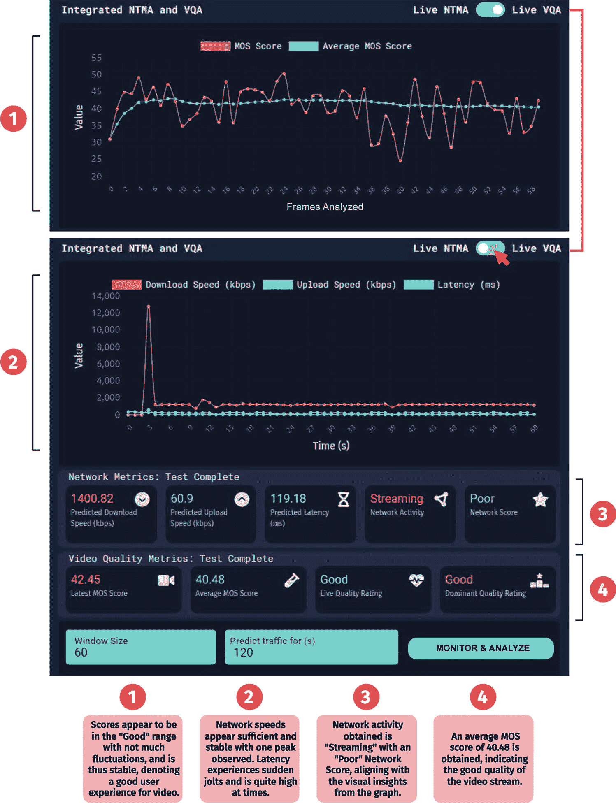

*在 Twitch 上以 1080p 分辨率直播，网络状况较差，视频质量良好*

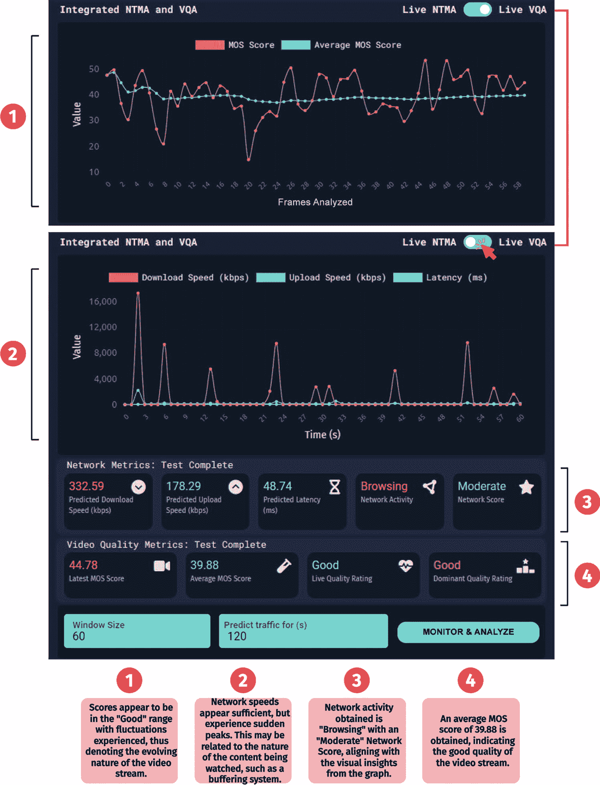

*在 TikTok 上直播，网络状况中等，视频质量良好*

在 Twitch 上以 1080p 分辨率直播，网络状况最佳，视频质量极佳  
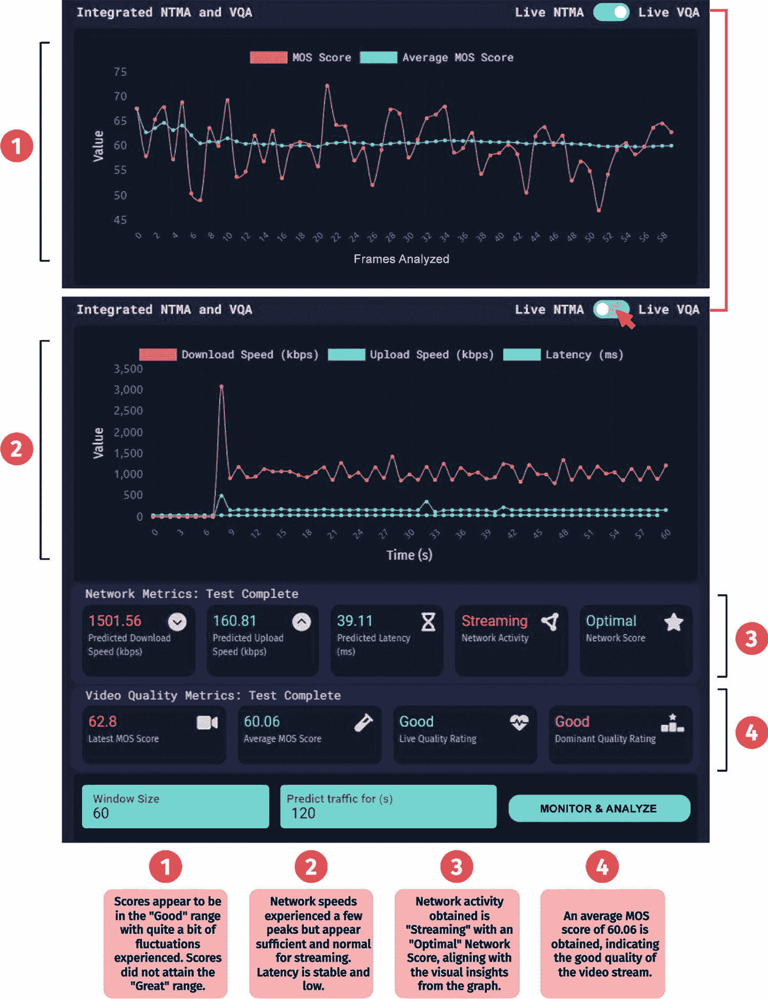

在 Twitch 上以 720p 分辨率直播，网络状况最佳，视频质量良好  
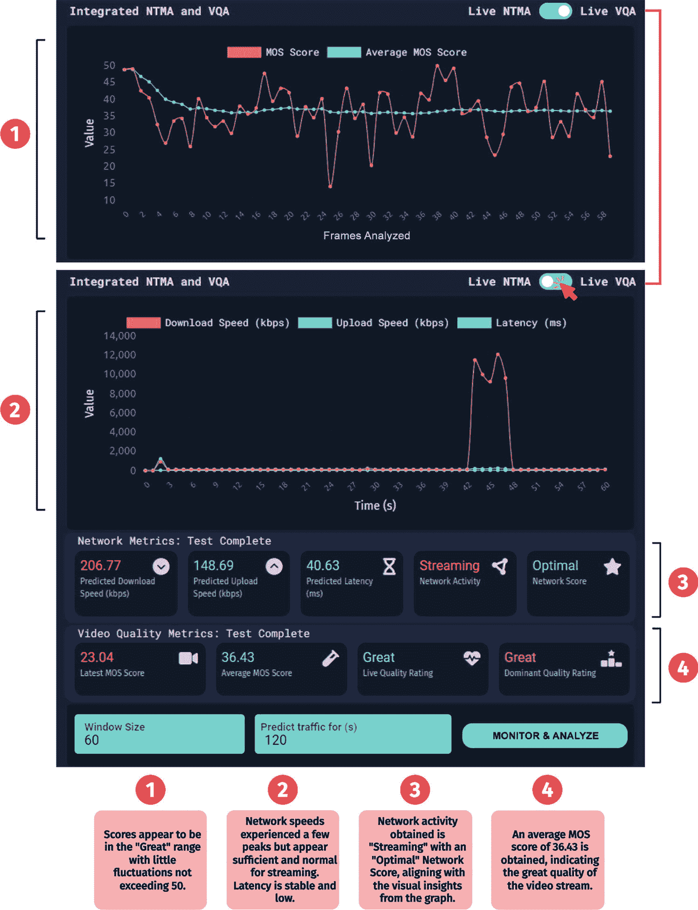

在 YouTube 上以 1440p 分辨率直播，网络状况最佳，视频质量极佳  
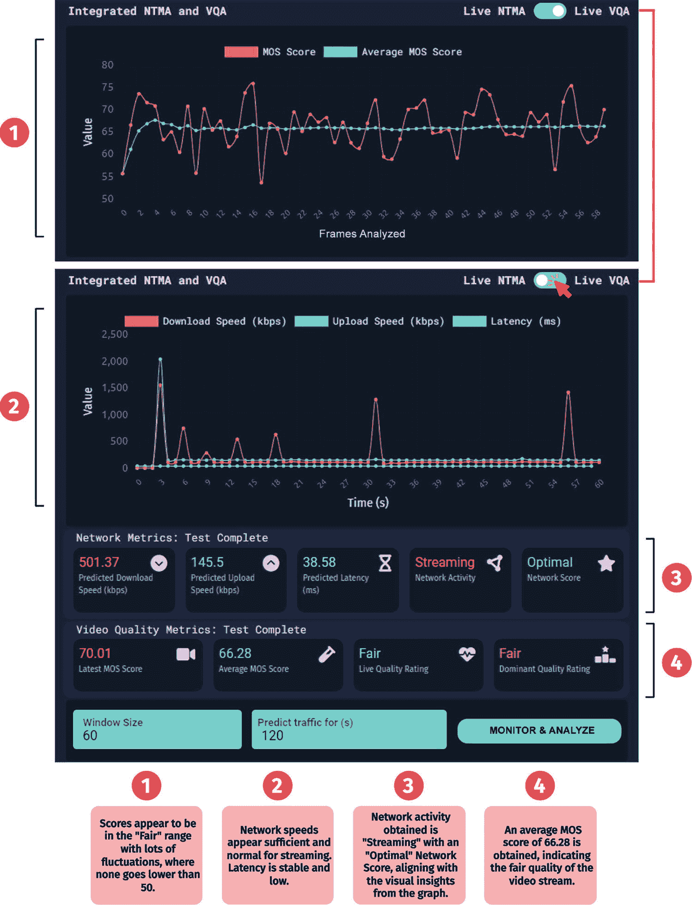

在 YouTube 上以 480p 分辨率直播，网络状况最佳，视频质量尚可

## 7.5 总结

随着 `NTMA` 和 `VQA` 应用的完成，第 7 章深入探讨了它们的集成，使得这两种功能能够在 Web 浏览器内的单个应用中同时可用。因此，对两个独立进程所使用的客户端、服务器和 Servlet 文件进行了适当修改，以适应更改后的布局以及一个可执行两种功能的按钮。本章连接了这两个领域，使最终用户能够实时获取网络性能的全局视图，包括预测分析、设备活动分类、网络 QoS 评分和视频质量评分。以下是一些关键要点：

*   一个统一的系统可用于全面监控和分析网络流量与视频质量，并具备实时能力。
*   集成式 `NTMA` 和 `VQA` 应用包含一个系统模型，具有客户端、服务器和 Servlet 范式，并遵循前几章所述的相同原则。
*   作为未来工作，可以采用其他技术对现有算法进行比较和评估。例如，可以探索支持向量机（`SVM`）、随机森林或梯度提升机（`GBM`）等其他机器学习算法，以评估它们在 `NTMA` 和 `VQA` 任务中的性能。
*   集成式 `NTMA` 和 `VQA` 应用可用于分析不同类型的网络，例如 4G（`LTE`）、5G 和 Wi-Fi 网络，其指标可作为进一步分析的统计数据。通过实时预测网络流量参数，电信运营商可以在问题实际发生之前调查下载和上传速度的突然下降。
*   在网络环境中多台 PC 上部署集成应用，使得可以通过观察网络和视频评分进行多次测试以评估其性能。
*   该应用可作为第一层诊断工具，用于识别抖动和 MOS 评分等指标与正常值的偏差，电信公司可利用此工具立即定位需要处理、调查和优先处理的指标。
*   监管机构可将该集成应用作为执行无偏 QoS 测量的手段。——第 7 章

## A
绝对类别评级 (ACR) 方法 AccepTV 视频质量监控器 访问控制列表 (ACL) 主动监控 自适应比特率 (ABR) 自适应流媒体技术 `addData()` 函数 `addData()` 方法 异常检测 Apache Tomcat Java Servlet 架构框架 人工智能 (AI) 人工神经网络 (ANN) `atof()` 和 `atoi()` 方法 注意力与专注 自动化多媒体流量管理框架 自主决策 自回归移动平均 (ARMA) 差分整合移动平均自回归 (ARIMA) 自回归移动平均 (ARMA) `axios` 库

## B
后台脚本函数 基准测试方法 客观指标作为参考点 标准化测试协议 BERT 二值化过程 基于比特流的评估 盲/无参考图像空间质量评估器 (BRISQUE) 方法 基于块的技术 模糊化

## C
`calculateKNN` 方法 `calculateQoS()` 方法 集中式云 Chart.js Chrome 扩展 API 思科的研究成果 Citrix Systems 分类模型，NTMA 浏览数据收集 数据准备 设备活动 空闲 KNN 样本数据，KNN 分类 流媒体 客户端程序结构，NTMA 客户端脚本 参见客户端脚本 配置后台脚本 配置扩展设置和权限 用户界面 参见用户界面 (UI) 客户端脚本 配置图表，页面加载 创建脚本结构 DOM 动态图表更新 文件功能 功能 Node.js 服务器 `pop.js` 文件 实时图表更新机制 实时 WebSocket 通信 脚本结构 客户端-服务器交互 客户端-服务器范式 客户端-服务器-Servlet 交互 客户端功能 客户端程序结构 闭路电视摄像机 (CCTV) 基于云的基础设施 云计算 认知负荷 色彩视觉 逗号分隔值 (CSV) 商业解决方案 商业 vs. 开源解决方案 计算密集型分类 概念框架 `connection.send()` 方法 内容分发网络 (CDN) 上下文信息 连续流挖掘 (CSM) 传统方法 卷积神经网络 (CNN) COVID-19 疫情 消费者技术协会 (CTA)

## D
数据收集设备 数据收集 数据驱动分析 传统基于规则的方法 数据驱动洞察 网络性能提升 运营效率 资源优化 安全威胁检测 数据收集方法 数据预处理与清洗 数据清洗 数据收集与聚合 数据归一化 数据转换 缺失数据处理 噪声降低 数据处理技术 `dataset1.txt` 文件 数据可视化 决策过程 决策树 (DT) 深度学习 (DL) JavaScript VQA 深度包检测 (DPI) 深度强化学习 (DRL) 质量退化加剧 退化类别评级 (DCR) 差分平均意见得分 (DMOS) 数字灯塔 降维 分布式拒绝服务 (DDoS) 文档对象模型 (DOM) `doGet()` 方法 域名系统 (DNS) `DOMContentLoaded` 事件 `doPost()` 方法 双指数平滑 (DES) 基于 HTTP 的动态自适应流媒体 (DASH) 动态窗口大小算法 (DyWiSA)

## E
电子商务 边缘计算 EfficientNet 在线学习 参与度和沉浸感 工程指标 娱乐与流媒体服务 欧几里得距离 `exit_with_help()` 方法 可解释人工智能 (XAI) 指数移动平均 (EMA) 指数平滑 (ES) 外部脚本

## F
获取本地数据库 文件功能 流量数据 `fs-extra` 库 `fs.readFileSync` 方法 全参考 (FR) 基础 KPI

## G
门控循环单元 (GRU) `gaussianblur()` 方法 高斯模糊 高斯模糊应用过程 通用预测性 VQA 方法 `getGaussian()` 方法 `getRGB()` 方法 全局变量 Google Chrome Google Chrome 扩展 Google 的 TensorFlow GPT-3

## H
层次聚类 HTML 文档的 DOM HTTP 自适应流媒体 (HAS) HTTP 自适应视频流媒体 `http.createServer` 方法 混合方法 超参数

## I
IBM Cloud 图像质量评估 (IQA) 图像识别 数据中心间网络流量预测模型 数据中心间 (inter-DC) 互联网 物联网 (IoT) 车联网 (IoV) 互联网协议 (IP) 数据包 IoT 传感器

## J
JavaScript 客户端机器学习代码 跨平台兼容性 数据准备与预处理 特性 数据可视化 深度学习 (DL) 库 ML 神经网络 Node.js 实时交互性 监督学习 无监督学习 用户体验 网络驱动集成 Java Servlet `jpeg()` 方法 `jpeg2K()` 方法 JPEG2000 压缩 JPEG 压缩 `JSONObject` 变量

## K
关键绩效指标 (KPI) 关键质量指标 (KQI) K-means 聚类 K-近邻 (KNN) 算法 KNN 分类方法 KNN 非参数回归预测算法 Konstanz 信息挖掘器 (KNIME) Konstanz 自然视频数据库 (KoNViD-1k)

## L
大规模社交视频质量 (LSVQ) `LBP41()` 方法 `LBP41gblur()` 方法 `LBP41jpeg2000()` 方法 `LBP41wnoise()` 方法 LBP 提取过程 LBP 特征提取 二值化过程 高斯模糊 JPEG2000 压缩 JPEG 压缩 白噪声 原始图像 `LIBSVM` 库 LIVE 视频质量挑战数据库 (LIVE-VQC) 局部二值模式 (LBP) 日志文件 长短期记忆网络 (LSTM)

## M
机器学习 (ML) 不稳定的网络行为 泛化与模式识别 JavaScript 参见 JavaScript 强化学习 监督学习 无监督学习 基于 Web 的应用 `manifest.json` 文件 平均绝对误差 (MAE) 平均绝对百分比误差 (MAPE) 平均意见得分 (MOS) 元数据变量 最小-最大归一化方法 基于 ML 的 NTMA 方法 基于 ML 的视频质量分析 ABR 视频流媒体基础设施 ACTE 方法 自适应架构 ANN 模型 基准测试 CCTV 和 SDN 基于客户端的预测 综合分析 缺陷建模技术 DRL 遗传算法 HAS 独立的 RR 和 NR 模型 IQA MOS 分数生成 多媒体通信系统 预测 质量评估 实时多媒体应用 实时 QoE 分析 自动驾驶车辆 序列化 RL 方法 监督分类 SVM 和 RF 视频和音频丢失 ML 在 VQA 中的应用 额外复杂性 编码效率 端到端特性 质量感知特征 SVR VMAF 基于模型的技术 `monitorNetworkTraffic()` 方法 运动卡顿 移动平均 (SMA) `multadd()` 方法 多云策略 基于多特征融合的增量技术 多层感知器 (MLP) 算法 架构 反向传播 分类与回归问题 数据准备，时间序列预测 前向传播 超参数 延迟值预测 神经网络，延迟预测 归一化过程，延迟值 滑动窗口概念 时间序列网络流量预测 权重更新过程 多媒体通信 多个伪参考图像 (MPRI) `myChart` 变量

## N
朴素贝叶斯算法 自然语言处理 (NLP) Netflix 视频多方法评估融合 (VMAF) 数据集 `NetFlow` 分析器 网络架构 网络开发生命周期 (NDLC) 网络基础设施 网络管理选项 网络指标 网络监控过程 网络运营中心 (NOC) 网络数据包传感器 网络参数 网络评分计算方法 网络的拓扑与架构 附加模块 控制平面 核心模块 数据平面 东西向接口 北向接口 与其他控制器对等 SDN 应用平面 SDN 控制器 南向接口 与第三方应用同步 网络流量分类 CNN 和 GRU CNN-RNN 模型 比较分析 DDoS 攻击 DL 技术 分层多层结构 混合系统 KNN 标签 MLP 分类器 多层神经网络 朴素贝叶斯算法 朴素贝叶斯和 C4.5 决策树方法 最优准确率 预标记类别 渐进式学习 SNI 分类问题 SVM 执行 技术 训练模型 训练-测试分割比例 网络流量组件 网络流量监控与分析 (NTMA) 异常检测 应用 应用布局 评估 后台脚本 浏览器扩展 挑战 分类模型 参见分类模型，NTMA 客户端程序结构 云计算 DDoS 数字灯塔 边缘计算 有效性 评估网络流量指标 框架，NTMA 过程 功能 目标 互联网 IP 数据包结构 指标 ML 算法 另请参见网络流量分类；网络流量预测 (NTP)；多层感知器 (MLP) 算法 监控过程 网络管理与优化 网络流量类别 网络流量组件 NOC NTMA 层，现代框架 过度拥挤，流量限制 原则 过程 QoS 实时评估 研究方法 服务器程序结构 参见服务器程序结构 服务器端 SOC 技术 电信 用例 vs. 用户体验 和 VQA 以及 VQA 系统模型 看门狗，网络生物圈 网络参数 网络流量预测 (NTP) ARIMA 和混合模型 比较分析 比较 DES 和 ARMA ES 和 TES 实现 预测模型 预测时间序列数据 创新方法 数据中心间 插值机制 KNIME 长期记录 MAE 神经网络与数据挖掘技术 参数 预测模型 真实 LTE 环境 几种回归方法 时间序列预测算法 训练-测试比率 Node.js JavaScript 网络服务器 用例 WebSocket 非 TSF 框架 无参考 (NR) 方法 无参考 (NR) 指标 `npm install` 关键字 NTMA 应用 商业 vs. 开源解决方案 `NetFlow` 分析器 网络管理与监控工具 `Paessler PRTG` 网络监控器 `Prometheus` `Site24x7` 网络监控 `SolarWinds NetFlow` 流量分析器 测试与部署场景 `Wireshark` NTMA 基础 数据驱动分析 数据预处理与清洗 数据源与收集 关键指标 网络的拓扑与架构 预测分析 基于实时 AI 的决策支持 监督学习，流量分类 无监督学习，异常检测 `ntmaGraph` 和 `vqaGraph` NTMA 解决方案 实施挑战 告警与报告 数据量 加密流量 与现有基础设施集成 网络可扩展性 隐私与合规 资源分配 培训与专业知识 NTP 框架创建 数据收集 数据预处理 特征选择 模型开发 预测

## O
客观 VQA 方法 FR NR RR 在线视频流媒体 `output()` `output_target()` 过顶 (OTT)

## P
基于数据包的方法 数据包捕获 数据包捕获工具 数据包级别分析 `Paessler PRTG` 网络监控器 被动网络监控 峰值信噪比 (PSNR) 泊松移动平均 (PMA) `pop.js` 脚本 基于端口的协议识别方法 `predict()` 函数 `predict()` 方法 预测算法 预测分析 `predictMLP()` 方法 `predictMLP` 方法 `PrintWriter` 对象 主动网络管理 长时间观看 `Prometheus` 协议 心理指标 Python

## Q
二次判别分析 (QDA) 交付质量 (QoD) 体验质量 (QoE) 性能质量 (QoP) 指标 服务质量 (QoS)

## R
无线电传输模型 随机森林 (RF) `read()` 方法 `readline()` 基于实时 AI 的决策支持 实时图表更新机制 `addData()` 方法 NTMA 和 VQA 实时媒体评估 (RTMA) 实时网络管理工具 实时流量分析 基于实时 UDL 的 VQA 实时 WebSocket 通信 循环神经网络 (RNN) 减参考 (FR) 无参考指标 强化学习 RESTful API 受限玻尔兹曼机 (RBM) `rewind()` 滚动窗口 `runner()` 方法

## S
可扩展性 缩放与对数变换技术 脚本结构 SDN 控制器 季节性差分自回归移动平均 (SARIMA) 安全问题与架构 服务器名称指示 (SNI) 服务器程序结构 添加库 分类方法，设备活动 声明全局变量 获取本地数据库 流程图，QoS 分数计算 全局变量 库 库与所需资源 监听，客户端连接请求 测量延迟，`systeminformation` 库 测量网络流量 消息 方法，QoS 分数计算 Node.js 服务器，操作 PNG 图像资源 截图文件夹 `server.js` 文件 时间序列预测，MLP WebSocket 服务器 服务器端程序结构 服务等级协议 (SLA) 服务运营中心 (SOC) Servlet 短视频 简单网络管理协议 (SNMP) `Site24x7` 网络监控 `sitedata` 变量 滑动窗口概念 智能预测流量分析工具 软件定义网络 (SDN) `SolarWinds NetFlow` 流量分析器 排序特性 空间一致性 标准化 最新综述，VQA 消费者意见 卓越视觉体验 ML 参见 ML 在 VQA 中的应用 多媒体通信系统 参见基于 ML 的视频质量分析 实际应用 视频质量环境 统计网络指标 在 TikTok 上流媒体 在 Twitch 上以 720p 流媒体 在 Twitch 上以 1080p 流媒体 在 YouTube 上以 480p 流媒体 在 YouTube 上以 1440p 流媒体 `stringify()` 方法 结构相似性指数 (SSIM) 多媒体视频质量主观评估 (SAMVIQ) 主观实验 主观 VQA 方法 双刺激 多刺激 单刺激 监督学习 (SL) JavaScript 流量分类 支持向量机 (SVM) 算法，VQA 盲图像质量评估，失真加剧 失真加剧 高斯模糊 JPEG2000 压缩 JPEG 压缩 视频质量分数预测模型 白噪声 LBP 特征提取 方程 灰度图像像素值 插图与编码过程 `LBP41()` 方法 过程 预测 初步步骤，BRISQUE 方法 缩放 缩放因子 相似性指数 支持向量回归 (SVR) `svm_predict()` 方法 `systeminformation` 库 系统模型，NTMA 分类 客户端-服务器交互 客户端-服务器范式 组件 文件功能 前端功能 NTMA 应用布局 预测

## T
`takeScreenshot()` 方法 电信 时间一致性 时间敏感性 `TensorFlow.js` 三层分层窗口数据结构 TID2013 基于瓦片的视频流媒体 基于时间的采样 时间序列预测 (TSF) 时间序列网络流量预测 时间序列预测 拓扑 拓扑感知分析 传统系统 流量 三重指数平滑 (TES) 二十维特征向量

## U
统一建模语言 (UML) 单变量方法 无监督学习 用户参与度 用户参与旅程 用户生成内容 (UGC) 用户界面 (UI) 添加文档详情与外部资源引用 添加图表与仪表盘组件 应用 创建文档结构 仪表盘 文档详情与引用 文档结构 文件功能 功能 Google Chrome 图表与仪表盘组件 HTML 和 CSS 库与所需资源 库与可下载脚本 NTMA 应用 样式组件，内部 CSS 用户友好性与可读性 用户的数字参与

## V
VGG16 ViCue Soft 视频质量 视频质量评估 (VQA) 自适应流媒体技术 广告与营销 AI 算法使用 分析与预测方法 以应用为中心的过程 应用 参见 VQA 应用 方法 基于比特流的评估 块 挑战 跨领域应用 深度学习 深度学习架构 边缘计算，实时 VQA 教育与在线学习 新兴趋势 娱乐与流媒体服务 娱乐行业 影响视频质量的因素 游戏与 VR 医疗与医学成像 混合方法 独立实体 跨学科领域 ML 基于模型的技术 多模态评估 无参考图像 无参考 (NR) 指标 客观指标 QoE 模型 实时多媒体应用 研究方法 安全与监控 意义 主观评估 SVM 算法 参见支持向量机 (SVM) 算法，VQA 电信与广播 XAI 网络流量监控与分析 (NTMA) 视频质量挑战 (LIVE-VQC) 视频质量数据库 LIVE-VQC TID2013 VMAF 数据集 YouTube-UGC 视频质量专家 (VQE) 视频质量专家组 (VQEG) 视频质量指标 视频质量模型 (VQM) 基于深度学习的视频质量测试 (VQTDL) 视频服务提供商 VIQET 程序 虚拟现实 (VR) 重要数字资产保护 VQA 应用开发，JavaScript 系统模型 测试与部署 运行 Servlet 服务器信息 Servlet 主机 视频流媒体平台，Web 浏览器 VQA 应用 AccepTV RTMA，ThinkTel sentry，telestream ViCue Soft VQEG Witbe VQA 客户端程序结构 后台脚本函数 客户端脚本 图表 配置，页面加载 创建脚本结构 动态图表更新 文件功能 实时图表更新机制 实时 WebSocket 通信 配置扩展设置与权限 用户界面 添加图表与仪表盘组件 创建文档结构 文档详情/外部资源引用 文件功能 Google Chrome 库与所需资源 样式组件，内部 CSS 可视化 VQA 数据集 挑战 真实性与多样性 可扩展性 时间与空间变异性 VQA 基础 属性 不断演变的视频内容 人类感知 客观质量测量 最优 VQA 策略 OTT 流媒体平台 QoE 指标 QoP 指标 QoS 指标 质量指标 流媒体视频流量 主观 时间因素 视频质量数据库 视频质量指标 VQA 模型，方法与要求 区块链，IPTV 交互式与沉浸式内容 质量变异性，UGC 短视频 主观偏好 使用 AI，IPTV VQA 服务器端程序结构 添加库 创建 WebSocket 服务器 全局变量 库与所需资源 监听，客户端连接请求 元数据与站点数据 过程 重建与裁剪图像 Servlet 请求与响应 职责，Node.js 服务器 截图文件夹 VQA Servlet 端程序结构 计算相似性指数 转换工具 创建 Java Servlet，Eclipse 显示使用信息 `doPost()` 方法 功能，`doPost()` 方法 功能 函数 高斯模糊，模糊化 全局变量 处理 HTTP POST 请求，`doPost` 方法 导入 JPEG2000 压缩，振铃效应 JPEG 压缩，块效应 LBP 特征提取 参见 LBP 特征提取 库 构建路径 外部 JAR 与所需资源 `multadd()` 方法 预测 MOS 打印工具 缩放 相似性分数 属性值 显示使用信息 文件处理与缓冲区管理 `runner()` 方法 缩放 目标 UML 图 白噪声，添加噪声 VQA 系统模型 应用布局 浏览器扩展 客户端-服务器-Servlet 交互 组件 功能 预测，MOS 分数 Servlet

## W, X
看门狗 `WebSocket` 加权移动平均 (WMA) `whitenoise()` 方法 白噪声 白噪声应用过程 `Wireshark` `Wireshark` UDP 数据包过滤 Witbe Witbe VQ-ID `ws.onmessage` 事件 `ws.open` 事件

## Y, Z
你只看一次 (YOLO) YouTube 用户生成内容 (YouTube-UGC)