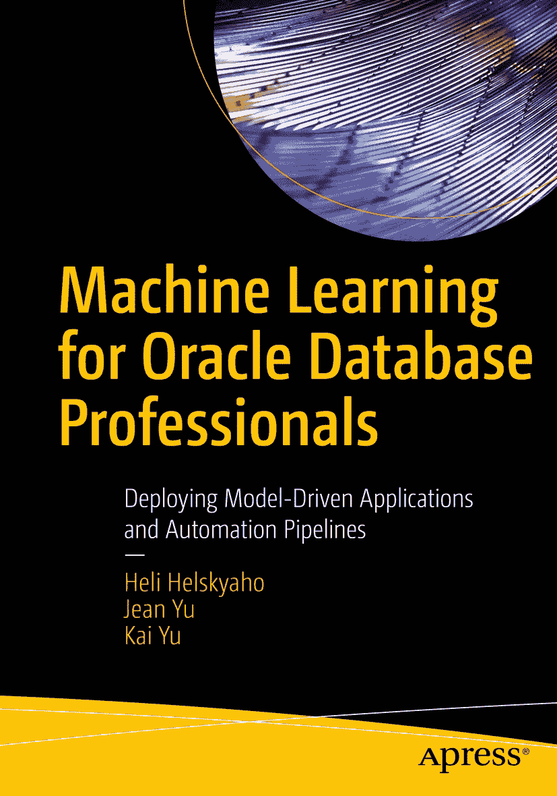

ISBN 978-1-4842-7031-8 e-ISBN 978-1-4842-7032-5 [`doi.org/10.1007/978-1-4842-7032-5`](https://doi.org/10.1007/978-1-4842-7032-5) © Heli Helskyaho, Jean Yu, Kai Yu 2021 本作品受版权保护。出版商保留所有权利，涉及材料的全部或部分内容，特别是翻译、重印、重用插图、朗诵、广播、以缩微胶片或任何其他物理方式复制，以及传输或信息存储与检索、电子改编、计算机软件，或目前已知或今后开发的类似或不同方法。在本出版物中使用通用描述性名称、注册商标名称、商标、服务标志等，即使未作明确声明，也不意味着这些名称不受相关保护法律和法规的约束，因此可自由使用。出版商、作者和编辑可以合理假定，本书中的建议和信息在出版之日是真实准确的。出版商、作者或编辑均不对本书所含材料或可能存在的任何错误或遗漏提供明示或暗示的担保。出版商对已出版地图和机构归属中的管辖权主张保持中立。

本 Apress 印记由注册公司 APress Media, LLC（Springer Nature 的一部分）出版。

注册公司地址为：1 New York Plaza, New York, NY 10004, U.S.A.

## 引言

本书帮助数据库开发人员和 DBA 从概念上理解机器学习，包括方法、算法、流程和部署。本书涵盖了支持在 Oracle 数据库中实现机器学习的 Oracle 机器学习（OML）技术，包括 OML4SQL、OML Notebooks、OML4R 和 OML4Py。*《Oracle 数据库专业人员机器学习》* 聚焦于 Oracle 自治数据库中的 Oracle 机器学习，例如作为 ADW 协作环境一部分的自治数据仓库（ADW）数据库。本书还涵盖了一些高级主题，例如机器学习中的交付和自动化流水线。

本书还通过动手示例提供了实用的实现细节，展示如何使用 OML 与 ADW 实现机器学习，以及如何自动化机器学习的部署。主要目标是通过获得机器学习的实践知识，弥合数据库开发/管理与机器学习之间的差距。作为一位擅长管理数据的资深数据库专业人员，你可以通过在同一数据管理系统中分析数据来应用这些知识。通过本书，三位在机器学习及数据库开发与管理方面经验丰富的作者将带你踏上一段从数据库开发人员或 DBA 到数据科学家的旅程。

## 读者与受众

本书面向以下读者：

*   希望了解机器学习的数据库开发人员和管理员
*   希望使用 Oracle 数据库内置机器学习功能集构建模型和应用程序的开发人员
*   负责支持 Oracle 数据库和 ADW 中使用机器学习功能集的应用程序的管理员

读者将学习如何执行以下操作：

*   构建能够检测并处理数据/模型性能变化的自动化流水线
*   在 ADW 中开发和部署机器学习项目
*   使用内置机器学习包在 Oracle 数据库中开发机器学习
*   使用 OML4R 和 OML4SQL 分析、开发、评估和部署各种机器学习模型

## 致谢

我要感谢我的家人——Marko、Patrik 和 Matias，在我撰写本书期间给予的持续支持，以及我的父母在我一生中给予的鼓励。是你们给了我撰写本书的信心。

感谢 Jean 和 Kai 与我共同撰写本书！与你们合作非常愉快。你们是出色的朋友，才华横溢。

特别感谢 Charlie Berger 和 Adrian Png 在本项目期间提供的极其宝贵的评论、指导和支持。没有你们的帮助，我们无法完成本书！

还要感谢 Jonathan、Jill 以及 Apress 团队的其他成员！

> ——Heli Helskyaho

我要感谢我的父母、祖父和初中数学老师，他们鼓励我追求工程事业。特别感谢我的丈夫 Kai，以及我在 UTSA 的研究生导师 Steve Robbins 博士和 Kay Robbins 博士，是他们在 1995 年将我引入了软件行业。

感谢 Heli 和 Kai 与我合作完成这个精彩的项目。我非常钦佩你们对 Oracle 机器学习社区的奉献和热情。

我特别要感谢我们的审稿人 Adrian Png 以及 Apress 的编辑 Jonathan Gennick 和 Jill Balzano。感谢你们极其宝贵的审阅意见。你们的指导和支持使像我这样的新手作者能够完成这个项目。我学到了很多。谢谢你们！

> ——Jean Yu

我将本书献给本书的读者。我要感谢所有为本书提供帮助的人，特别是技术审稿人 Andrew Peng、Apress 编辑 Jonathan Gennick 和 Jill Balzano，以及 Apress 团队的其他成员，感谢他们为将技术内容转化为成书所付出的巨大努力和耐心。

我感谢 Heli 和 Jean 的卓越才华、奉献精神和出色的团队合作。能成为这个优秀团队的一员，与你们共事，是我莫大的荣幸。

我还要感谢我的妻子 Jean 和女儿 Jessica 在本项目期间给予的持续支持。我想将本书献给我的父母，他们鼓励我在计算机技术领域追求学业和事业。

我感谢我的导师、戴尔资深院士 Jimmy Pike 以及戴尔技术领导力社区，他们激励我追求技术卓越，并拓展我在人工智能和机器学习方面的专业知识。我还要感谢我的经理 Ibrahim Fashho，他给予了我极大的启发和长期的支持。

> ——Kai Yu

## 关于作者 关于技术审稿人

