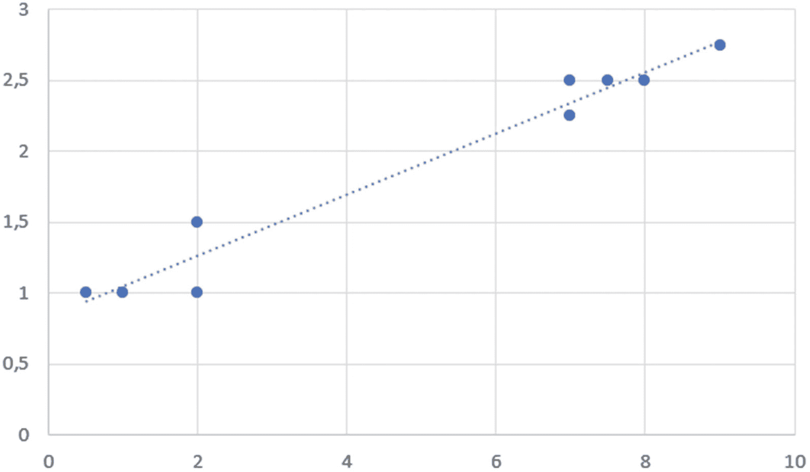
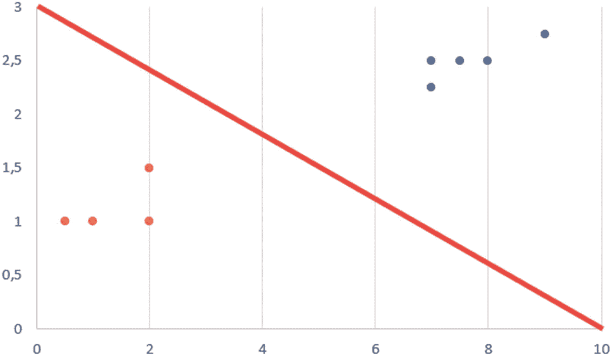
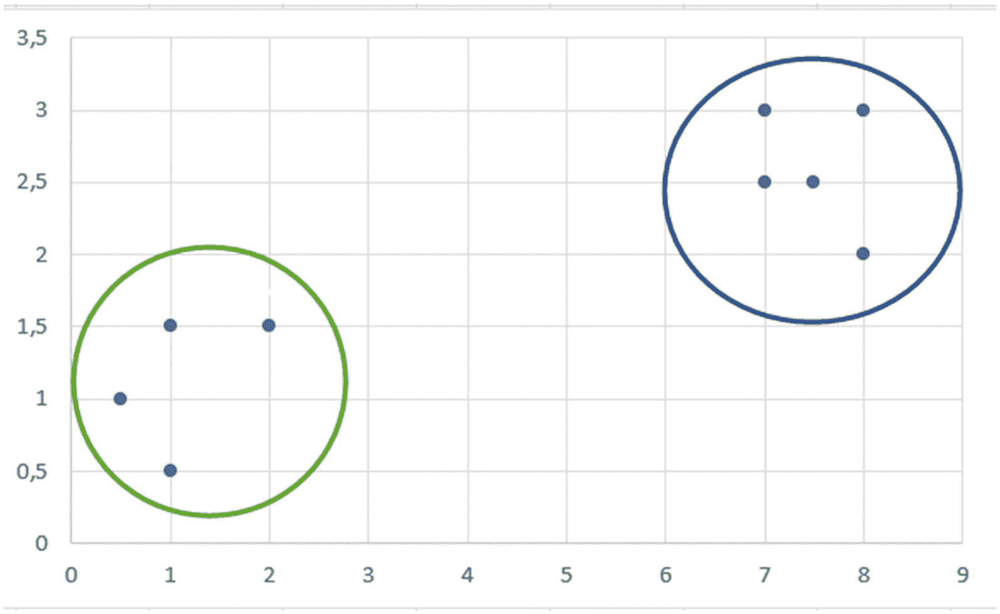
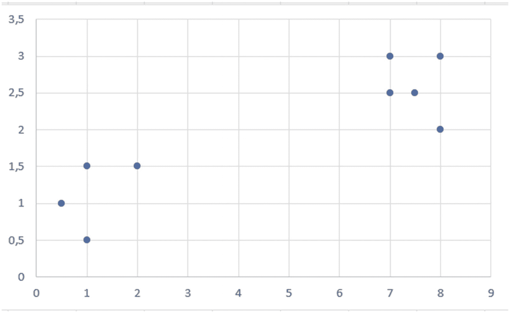
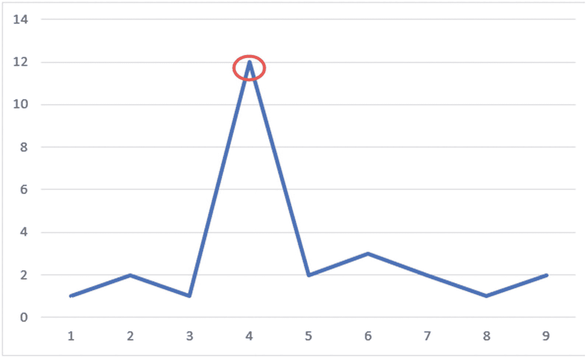
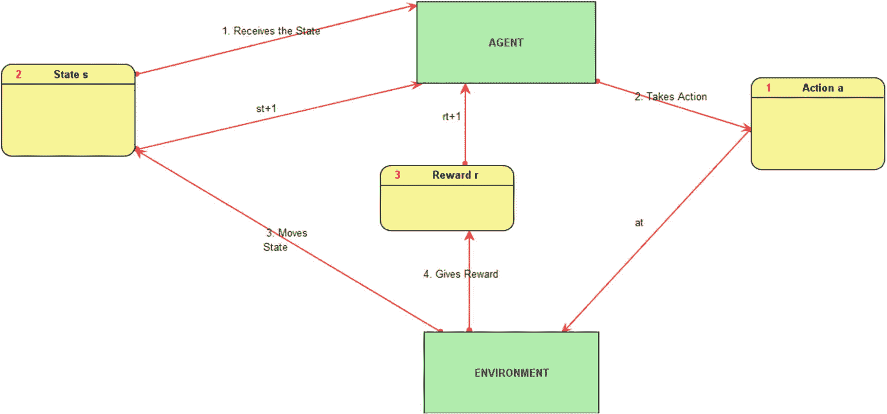

# 1. 机器学习简介

我们生活在一个激动人心的时代，智能手机和手表、智能服装、机器人、无人机、人脸识别、智能个人助理、推荐系统、自动驾驶汽车以及全天候服务聊天机器人，这些都是*人工智能*（AI）。但什么是智能？智能可能被定义为获取和应用知识和技能的能力，换句话说，就是学习和运用所学技能的能力。人工智能正是如此，但由计算机和软件来完成。在现实生活中，人们希望拥有能够完成那些人们觉得无聊、效率低下或根本无法完成的事情的智能机器。它可以是利用计算机对人类智能的延伸，这就是人工智能。人工智能的核心是学习、获取知识和技能的能力，即*机器学习*。在机器学习中，机器进行学习、推理和自我修正。阿瑟·塞缪尔在 1959 年将机器学习定义为“一个赋予计算机无需明确编程即可学习能力的研究领域”，这很好地定义了机器学习。

## 为什么需要机器学习？

当亚瑟·塞缪尔在 1959 年定义机器学习时，所需的许多数学和统计学知识早已被发明。然而，当时既没有足够的技术，也没有足够的数据将理论付诸实践。如今，我们拥有硬件解决方案，包括用于矩阵计算的 `GPU` 和 `TPU`、用于存储数据的廉价存储方案、开放数据集、用于迁移学习的预训练模型等等。这一切使得以最有趣、最有用的方式运用机器学习成为可能。但不仅仅是现在能够使用机器学习，而且使用它也是必要的。大数据以其体量、速度、多样性、真实性、可行性、价值、可变性和可视化，使得将传统数据处理转变为更高效、更快速的方式——机器学习——成为必然。

机器学习并非万能灵药，也不应被如此看待。只有在能带来价值时才应使用机器学习。典型的用例是当规则和方程复杂或不断变化时。如果规则可以理解，并且能够用 `if-else-then` 结构编程，那么机器学习可能不是最佳解决方案。

机器学习用例的经典例子包括图像识别、语音识别、欺诈检测、购物趋势预测、垃圾邮件过滤器、医疗诊断或机器人技术。一些面向企业的机器学习例子包括客户流失预测、客户行为预测、员工自愿离职预测以及交叉销售和追加销售机会。

机器学习的一个重要前提是你拥有数据；否则，它就毫无意义。数据被提供给机器，或者由机器产生，就像在强化学习中那样。数据质量越高，机器学习就能利用得越好。但即使数据质量极佳，机器学习运行得完美无缺，机器学习的预测也永远不是事实；它始终是一个复杂的猜测。有时这个猜测很好，甚至很有用，但有时则不然。

此外，如果某些情况发生了变化——比如数据中噪声增多、数据量变大或数据质量下降——一个运行良好的机器学习模型将不再有效。换句话说，重要的是要理解，机器学习模型需要监控其定义的指标，以确保它们仍按预期工作，并在必要时进行调整。

## 什么是机器学习？

机器学习可以根据训练数据的性质、问题类型以及用于解决问题的技术分为不同的类别。本书将机器学习分为三大类：监督学习、无监督学习和半监督学习。

### 监督学习

监督机器学习由人类进行监督。通常，这意味着有人已经标记了数据以显示输出或正确答案。例如，有人手动检查 1000 张图片并对其进行标记，以识别哪些图片显示的是猫、狗或马。

当有足够的高质量数据并且你知道目标（例如，数据已被标记）时，使用监督学习。模型在已知输入和已知输出数据上进行训练和测试，以预测新数据上的未来输出。在测试模型时，将预测结果与真实输出进行比较以评估模型。为了使这个过程有意义，训练数据必须与用于测试的数据分开。每个模型都使用不同的算法构建。模型将数据映射到算法并产生预测。因此，每种算法都以不同的方式处理数据。根据所选指标，评估过程会确定哪种算法表现最佳，然后使用该算法的模型可以投入生产。算法的选择取决于数据的大小、数据类型、你想从数据中获得的洞察，或者这些洞察将如何使用。这个决策是在许多因素之间进行权衡，例如对新数据的预测准确性、训练速度、内存使用、透明度（黑盒与“白盒”，决策如何做出）或可解释性（人类理解模型的能力）。

回归和分类是监督学习中最常用的方法。回归预测数值，适用于连续数据。分类适用于分类数据，并对数据点进行分类。因此，如果你想预测一个数量，应该使用回归。如果你想预测一个类别或群体，应该使用分类。回归的一个例子是房价随时间的变化。分类的一个例子是通过将啤酒与其他啤酒按 1 到 5 的等级进行评分来预测其评价，其中 1 表示质量差，5 表示质量优秀。图 1-1 是一个简单的回归示例。从图 1-1 所示的线条中，你可以看到对于值 3，目标值的预测是 1.5。

图 1-1 回归示例

图 1-2 是一个分类示例。数据点被分类为橙色和蓝色。红线显示每个数据点属于哪个类别。你可以看到点(4,1)属于橙色组，点(9,2)属于蓝色组。

图 1-2 分类示例

时间序列预测可以是一个监督学习问题。机器学习模型通过使用前一个时间步的值来预测下一个时间步的值。你需要适合此目的的数据。这种方法被称为*滑动窗口法*。例如，以下是数据集的一小部分。

| 时间 | 测量值 |
| --- | --- |
| 1 | 100 |
| 2 | 150 |
| 3 | 170 |
| 4 | 250 |
| 5 | 330 |

你可以通过将下一个值设置为预测值来重构此数据集，使其在监督学习中可用，如下所示。

| X | Y |
| --- | --- |
| ? | 100 |
| 100 | 150 |
| 150 | 170 |
| 170 | 250 |
| 250 | 330 |
| 330 | ? |

第一行和最后一行无法使用，因为缺少一些信息，所以我们删除这些行。之后，就得到了一个可以在监督机器学习中使用的可靠数据集。

时间序列预测可用于天气预报、库存规划或资源分配等领域。时间序列预测可能非常复杂，理解数据至关重要。例如，数据趋势在夏季与冬季可能不同，在工作日与周末也可能存在差异。在构建模型时（或针对不同趋势建立多个模型时），必须考虑这些因素。

深度学习已成为主要应用于监督式机器学习的热门技术。它通常用于处理文本、语音、推荐系统或图像视频等更复杂的机器学习任务。文本可通过深度学习转化为语音，语音也可转化为文本，进而作为其他机器学习任务（如将芬兰语翻译成英语）的输入。

自动语音识别或自然语言处理也可能是深度学习的应用场景。推荐系统为用户生成推荐，使其决策过程更简便流畅。推荐系统分为三类：协同过滤、基于内容的推荐和混合推荐系统。协同过滤推荐系统利用具有相似特征的其他用户的决策，作为向另一用户推荐的基础。基于内容的推荐系统则根据新项目与用户过去喜爱项目的相似性生成推荐。混合推荐系统在生成推荐时采用多种方法。视觉识别和计算机视觉是深度学习非常典型且实用的任务。图像或动作分类、目标检测或识别、图像描述或图像分割在机器学习中都有重要应用。

经典监督学习与深度学习的一个区别在于：深度学习完全无需进行特征提取，这一过程由机器在深度学习过程中自动完成。而在监督学习中，特征提取是耗时的手动工作。当然，这意味着深度学习需要更多数据来完成这一过程，并且通常需要更多资源和时间。由于不同领域的诸多改进，深度学习已变得更加流行和实用。如今有大量数字数据（照片、视频、语音等）可供使用。技术也得到了提升：现有数据集和预训练模型、迁移学习、将卷积层与神经网络结合等研究成果，以及更多可用资源。过去用深度学习难以实现或几乎无法完成的任务，如今已变得简单甚至微不足道。程序员可以利用大量示例代码，开始构建他们的第一个深度学习项目。

深度学习使用神经网络进行预测，并通过反向传播进行学习（例如，调整网络）。神经网络由神经元组成。每个输入乘以其权重，并加上偏置。当使用激活函数时，输出会传递到下一层，直至到达最后一层并得到预测结果。权重和偏置被称为*超参数*。它们的值在机器学习过程开始前就已定义。初始值是猜测值，但通过使用反向传播和优化函数，该过程会调整这些超参数，以获得性能更优的模型。

在神经网络中，有大量超参数需要在过程开始前定义，并在过程中进行调整。超参数的一些示例包括：层数、迭代次数、批次大小、每层神经元数量，以及使用何种激活函数、优化器和损失函数。反向传播会计算初始猜测的损失函数及其梯度。利用该信息，优化器会沿负梯度方向逐步调整以减少损失。这一过程会持续进行，直到权重达到尽可能最优的状态。卷积神经网络通过卷积层对神经网络进行补充。卷积神经网络在图像处理方面尤其有用。卷积神经网络由多个卷积层（滤波层、输出层、池化层）和一个展平层组成，展平层将数据传递到神经网络进行进一步处理。

#### 监督学习算法

模型通过算法进行预测。目标是找到最适合特定用例的算法。监督学习中有大量算法可供使用。

## 监督学习

对于分类问题，算法示例包括 k-近邻（kNN）、朴素贝叶斯、神经网络、决策树或支持向量机（SVM）。kNN 根据已分类的最近邻对象的类别来对对象进行分类。它假设彼此接近的对象是相似的。kNN 是一种简单的算法，但会消耗大量内存，并且如果数据量很大或使用了多个维度，预测速度可能会变慢。

朴素贝叶斯假设在类别确定的情况下，某个类别的特定特征的存在（或不存在）与任何其他特征的存在（或不存在）无关。它根据新数据属于某个特定类别的最高概率对其进行分类。例如，如果一种水果是红色的，它可能是苹果；如果一种水果是圆形的，它也可能是苹果；但如果它既是红色又是圆形，那么它是苹果的概率就更大。朴素贝叶斯适用于包含许多特征（例如，输入维度很高）的数据集。它易于实现且易于解释。

神经网络模仿生物神经系统和大脑处理信息的方式。大量高度互联的处理单元（神经元）协同工作以解决特定问题。当模型的可解释性不重要时，神经网络非常适合对高度非线性系统进行建模。当数据是增量式获取、你希望不断更新模型，并且输入数据可能发生意外变化时，它们非常有用。

决策树是非常典型的分类算法。决策树、装袋决策树或提升决策树是由分支条件构成的树状结构。它们通过从根节点沿着决策路径向下到叶节点来预测对数据的响应。

装袋决策树由多个在数据上独立训练的树组成。提升则涉及对错误分类的事件重新加权，并使用重新加权后的事件构建新的树。当需要一个易于解释、拟合速度快、且希望最小化内存使用，但对高预测精度没有要求，并且模型训练时间不太重要时，可以使用决策树。

支持向量机（SVM）通过找到线性决策边界（即超平面）来对数据进行分类，该超平面能将一个类别的所有数据点与另一个类别的数据点分开。对于 SVM 来说，当数据线性可分时，最佳超平面是使两个类别之间间隔最大的那个。如果数据不是线性可分的，则损失函数会对位于超平面错误一侧的点进行惩罚。有时 SVM 会使用核函数将非线性可分的数据转换到更高维度，以便在那里找到线性决策边界。SVM 最适合处理恰好有两个类别的高维、非线性可分数据。对于多类分类，它可以与一种称为纠错输出码的技术结合使用。它作为一种简单的分类器非常有用，易于解释且准确率高。

对于回归任务，一些算法示例包括线性回归、非线性回归、广义线性模型（GLM）、高斯过程回归（GPR）、回归树或支持向量回归（SVR）。

线性回归将一个连续响应变量描述为一个或多个预测变量的线性函数。当你需要一个易于解释且拟合速度快的算法时，可以使用线性回归。它通常是拟合到新数据集的第一个模型，并可作为评估其他更复杂回归模型的基线。

非线性回归描述数据中的非线性关系。当数据具有非线性趋势且不易转换到线性空间时，可以使用它。

GLM 是一种使用线性方法的特殊非线性模型。它将输入的线性组合拟合到输出的非线性函数上。当响应变量具有非正态分布时，可以使用它。

GPR 用于预测连续响应变量值的非参数模型；例如，用于对空间数据进行插值，作为优化复杂设计（如汽车发动机）的代理模型，或用于预测死亡率。

回归树类似于用于分类的决策树，但经过修改以预测连续响应。当预测变量是分类（离散）变量或表现出非线性行为时，可以使用它们。

SVM 回归算法（SVR）的工作原理类似于 SVM 分类算法，但经过修改以预测连续响应。SVR 算法不是寻找分隔数据的超平面，而是寻找决策边界以及边界内的数据点。SVR 对于高维数据非常有用。

### 无监督学习

无监督学习是对未标记数据进行的机器学习，其目标未知，旨在从数据中发现有用信息。无监督学习能够找出输入数据中隐藏的模式或内在结构。

聚类是无监督学习中最常用的方法之一。它用于探索性数据分析，以发现数据中隐藏的模式或分组。聚类通常有两种方式：硬聚类和软聚类。在硬聚类中，每个数据点只属于一个簇；而在软聚类中，每个数据点可以属于多个簇。

在图 1-3 中，你可以看到数据点；在图 1-4 中，你可以看到这些数据点如何被聚类成两个簇：绿色和蓝色。聚类的思想是，你告诉算法希望将数据分成两组，算法会找出数据点之间的共性和差异。利用这些信息，算法决定某个特定数据点属于哪个组（簇）。

图 1-4 数据点被聚类成两个簇：绿色和蓝色

图 1-3 用于聚类的数据点

关联规则挖掘/学习也是一种非常有用的无监督机器学习方法。它用于识别数据集中隐藏的模式。关联规则的一个典型例子是购物篮数据分析。利用关联规则，你可以发现人们通常购买商品的有趣模式。利用这些信息，你可以更好地规划商店布局、超市商品摆放，或针对不同客户群体发起更有效的营销活动。一个经典的例子是尿布和啤酒经常被同时购买。历史上的解释是，父亲们在下班回家的路上会顺便去商店买尿布，并且往往也会顺便买啤酒。

异常检测用于发现数据集中的异常值。它可以与无监督、监督或半监督机器学习一起使用。图 1-5 是一个异常示例（标记为红色）。异常检测可用于查找必须处理的异常情况，也可用于机器学习的数据准备阶段以发现离群点。例如，如果在日志文件中检测到异常，它可以提醒数据库管理员检查发生了什么。

图 1-5 一个异常示例

降维是一种无监督机器学习方法，当需要减少数据集的特征数量以作为监督学习的预处理步骤或用于调整模型时，可以使用该方法。特征选择是一种减少数据集特征数量以提高模型准确率或性能的技术。它会对数据集中现有特征的重要性进行排序，并丢弃不太重要的特征。特征提取也旨在减少数据集中的特征数量，但它会从现有特征中创建新特征，然后丢弃原始特征。这两种方法共用的术语是降维，因为它们都旨在减少数据集的维度/特征数量。

#### 无监督学习算法

无监督学习有大量算法。对于硬聚类，有几种可用的算法，包括 k-means、k-medoids 和层次聚类。K-means（劳埃德算法）将数据划分为 k 个互斥的簇（质心），并将每个观测值分配到最近的簇。然后它将质心移动到其观测值的真实均值。K-means 在已知簇的数量且需要对大型数据集进行快速聚类时效果很好。

K-medoids 与 k-means 类似，但要求簇中心与数据中的点重合。换句话说，它选择数据点作为中心（medoids）。与 k-means 相比，k-medoids 对噪声和离群点可能更稳健。它在已知簇的数量且需要对分类数据进行快速聚类时效果很好。

层次聚类在簇的数量未知和/或希望借助可视化来指导选择时使用。它可以作为分裂法或凝聚法来使用。分裂法将所有观测值分配到一个簇中，然后将该簇划分为多个簇。凝聚法将每个观测值设为一个单独的簇，然后合并相似的簇。在这两种方法中，凝聚法使用得更频繁。

对于软聚类，有诸如模糊 C 均值（FCM）或高斯混合模型等算法。FCM 与 k-means 类似，但数据点可能属于多个簇。它可以在已知簇的数量且簇之间有重叠时使用。一个典型的用例是模式识别。高斯混合模型是一种基于划分的聚类，其中数据点来自具有特定概率的不同多元正态分布，例如不同地区的房价。它可以在数据点可能属于多个簇，且这些簇具有不同大小和内部相关结构时使用。

对于异常检测，kNN 是一种简单的算法，对于每个数据点，其到 k 个最近邻的距离可以被视为离群分数。

Apriori 算法用于关联规则学习问题。它用于识别经常同时出现的项。

### 半监督学习

还有一种结合了无监督学习和监督学习的机器学习方法，称为半监督学习。在半监督学习中，一小部分数据是带有标签的监督数据，而大部分数据是没有标签的无监督数据。半监督学习的思想是，你应该找到一种方法让算法自动为数据打标签。这类算法通常基于对数据分布关系的假设。有些算法假设彼此接近的数据点很可能具有相似或相同的标签（连续性假设）。有些算法假设同一聚类中的数据很可能具有相同的标签（聚类假设）。对于高维数据，流形假设可能有助于找到标签。

有许多算法和技术可以自动为数据打标签，并且很快会有更多技术被发明出来。

一种为无标签数据打标签的简单方法称为伪标签法。伪标签法的过程很简单。

1. 使用一小部分有标签的数据训练模型。
2. 使用该模型为无标签数据打标签。将预测结果作为标签。这被称为伪标签。
3. 将有标签训练数据的标签与伪标签数据关联起来。将有标签数据的输入数据与无标签数据关联起来。
4. 使用该数据集训练模型。

经过这个过程，模型的准确率应该比仅使用有标签数据集进行训练要好。

主动学习是一种技术，其中学习算法选择一部分无标签数据，并交互式地请求用户为其打标签。由于算法选择了需要打标签的数据集，因此可以假设这个数据集在学习算法时非常有用。

机器学习研究中许多有趣且有前景的领域都与半监督学习有关。这些领域的例子包括强化学习和自监督学习（自我监督）。有些人将强化学习归入半监督学习。有些人则认为它是一个不同的概念，因为它更多是关于学习一种技能，而不是为数据打标签，因此应该有自己的类别。本书将其归入半监督学习，以保持概念的简洁性。

## 强化学习

强化学习（`RL`）采用了一种不同的机器学习方法。它的目标是获得最大奖励，而不是预测输入数据的输出。`RL` 通常用于计算机需要学习技能的用例，例如下棋或停车。`RL` 在游戏、优化或导航等问题上表现良好，因为数据可以轻松生成。计算机可以与自己或人类玩家对弈，并生成大量关于游戏策略的数据。它在游戏过程中学习，并且还可以利用迁移学习来加快学习速度。`RL` 最大的特点是它可以变得比人类更优秀，因为人类并没有用自己有限的技能来教导它。它需要经历数十万次错误才能学会，这在所有用例中并非都可行。

`马尔可夫决策过程`（`MDP`）是强化学习（`RL`）的基础，也是 `RL` 问题的数学公式。`MDP` 提供了一个数学框架（一种离散时间随机控制过程），用于在结果部分随机且部分受决策者控制的情况下（就像在 `RL` 中一样）对决策进行建模。`RL` 过程如图 1-6 所示。

图 1-6 强化学习过程

决策者/学习者被定义为智能体，而智能体之外的任何事物都被定义为环境。智能体与环境之间的交互由三个核心要素描述：状态（`s`）、动作（`a`）和奖励（`r`）。智能体接收当前环境状态作为输入。然后智能体选择一个动作。该动作会改变环境的状态。这种状态转换的价值通过一个标量强化信号（即奖励）传递给智能体。某一时刻（`t`）的环境状态记为 `s[t]`。智能体检查 `s[t]` 并执行相应的动作 `a[t]`。然后环境将其状态从 `s[t]` 改变为 `s[t+1]`，并向智能体提供一个反馈信号 `r[t+1]`。智能体在每个时间步 `t` 都会收到一个反馈信号，直到达到终止状态 `s[T]`。智能体利用这些奖励信号进行学习，其行为（`B`）旨在使奖励信号值的总和尽可能大。信号规划得越好，智能体学习得越快。这些信号被定义为奖励函数。智能体多次执行任务以构建一个策略网络，其中包括它可能采取的动作。该网络使用策略梯度和概率进行调优。主要目标是为智能体找到最优策略：一个定义智能体在每个状态下应采取何种动作以获得最大奖励总和的函数。

定义这样一个策略存在几个问题。第一个问题是定义一个能够教导智能体正确行为的奖励函数。如果奖励只在任务结束时给出，智能体就不知道是哪个动作导致了奖励。这被称为`稀疏奖励`。这个问题被称为`延迟奖励`或`信用分配问题`。此外，该算法效率低下，学习需要很长时间。可能因为任务过于复杂，智能体永远无法完成，因此它永远得不到奖励，也永远无法学习。如果在每个动作之后都给予奖励，但奖励函数定义不正确，则可能会教导智能体错误的行为。这也会将学习限制在人类水平，这不是我们想要的。与这种解决方案相关的另一个问题是`奖励塑形`，因为在每个动作之后都给予奖励意味着这是一个针对特定环境的定制过程，不具有可扩展性。定义策略可能很困难，因为你不知道是否存在无限的时间范围（平稳过程）或有限的步数。知道最大动作数量会导致不同的策略、动作集以及序列的效用。它会把 `MDP` 变成一个马尔可夫链。

多智能体强化学习（`MARL`）是一种包含多个智能体的强化系统。根据任务的不同，这些智能体可以相互独立、合作或竞争。它们可以与其他智能体共享所学内容，也可以选择不共享。`MARL` 可以解决复杂的任务。它的两个优点是具有可扩展性和可重用性。其挑战包括：从局部动作中定义并实现全局目标，在不断变化的环境中学习，以及找到奖励分配的最佳方式和时机——这是一种分层强化学习（`HRL`）方法，用于解决具有稀疏和延迟奖励的长时域问题。借助 `HRL`，子任务和抽象动作可以在同一领域的不同任务中使用（迁移学习）。

## 自监督学习

机器学习的下一个重大进步，即创造能够像人类一样学习（和思考）的机器，是自监督学习。在自监督学习中，机器通过预测其拥有的所有信息中缺失的任何部分来学习：从过去预测未来，从现在预测过去，或者从上到下预测。在自监督学习中，学习模型通过利用数据的一部分来预测另一部分，从而进行自我训练。其思想是，它能够自行准确地生成标签，而无需人工标注数据。换句话说，它将没有标签的无监督学习转换为有标签的监督学习。一张图片或一段文本可能缺少一部分，而自监督学习则用于自动填补缺失的部分。

## 机器学习流程

机器学习流程的第一步是定义你要解决的问题或任务。然后，你需要找到包含该任务答案的数据。机器学习技术和问题类型是根据任务来确定的。技术可以是无监督学习、监督学习或半监督学习。问题类型，也称为`方法`或`函数`，例如可以是分类、回归、异常检测或聚类。问题类型和所选技术决定了可用于解决此类问题的可能算法。

`超参数`是另一组依赖于方法的参数。这些参数的值是在学习过程开始之前预先设定的。无监督学习和聚类的一个典型超参数是聚类数量。模型是使用精心挑选的特征集、调整后的超参数以及针对所选问题类型的可用算法来构建的。这些模型会经过比较和评估，然后最佳模型会被部署到生产环境中。当然，可能没有一个模型足够好。其原因可能是任务定义不正确，或者数据存在问题——数据质量不够好、数据量不足，或者数据不包含业务问题的答案。又或者，该业务问题根本无法通过机器学习来解决。

如果任务是从数据中发现有用的信息，那么这可能是无监督机器学习的一个用例。定义任务可能很困难，因为它需要精确。而由于任务是用人类语言定义的，这通常不够精确，因此使得难度更大。

任务和可用的训练数据决定了使用何种方法。第一个问题是：训练数据是否带有结果标签？如果有标签，你可以使用监督学习。如果没有，则应选择无监督学习。如果数据是部分标记的，那么半监督学习可能是一个选择。下一个问题是结果的类型，即预测值。结果是离散的还是连续的？如果你选择监督学习，离散结果可以选择分类，连续数据则选择回归。对于无监督学习，离散数据可以选择聚类，连续数据则可以选择降维。如果数据是部分标记的，并且你选择了半监督学习，那么问题在于使用何种技术让机器自行标记数据。这是机器学习中最有趣且发展最快的领域之一。

数据由行组成，行代表观测值（案例）和特征，例如房屋的面积或人的年龄。特征有时被称为`属性`或`列`，因为它们是表格中的列。这些术语在语义上略有差异，但在日常用语中它们被当作同义词使用。如果你想进行预测，最重要的特征是目标——即你试图预测其值的特征。特征选择会找出对当前任务有意义的特征。所需的特征越少，学习过程就越高效。然而，如果特征不足，学习可能会导致预测不准确。

在为机器学习算法准备数据时，你应该仔细检查数据的质量。数据的质量决定了机器学习流程的成功与否。准备数据的第一步是`特征工程`。它将数据转化为机器学习算法可以使用的信息。这一步包括特征选择、特征生成、特征提取和特征变换等。

流程始于理解特征以及特征之间的相互作用。特征有三种类型：数据特征、模型特征和目标特征。我们试图预测目标特征的值，例如周一的温度，或者某位员工是否计划离职。数据特征是数据集中用于构建、测试或评分模型的那些列。换句话说，表格或视图中的列并非全部都需要或应该用于构建模型，只有那些影响预测的列才需要。

特征选择会识别出能为数据提供最佳预测模型的最相关特征。这一步很重要，因为如果模型特征太少，它将无法准确预测或预测错误；而如果特征太多，模型运行速度会太慢。你需要知道某个特征是否相关且独立于其他特征；如果不独立，则应选择其他哪些特征。例如，在尝试预测房屋售价时，房屋的面积和房间数量显然是某种程度相互依赖的特征。需要做出的决定是：你应该使用其中一个（哪一个？）、两个都用，还是舍弃两者并根据它们包含的信息创建一个新特征。

关于特征相关性的知识可用于检查数据质量。例如，一个五居室的房屋面积不可能只有 30 平方米。相关性图是一个有用的工具，可以观察不同特征之间的相关性。对于每个特征，你还应该了解该特征是否简单，以及它能否与同一特征的其他实例进行比较。例如，房屋的 `GPS` 坐标可以相互比较，但这通常没有意义。在这种情况下，也许 `GPS` 坐标可以用于某些影响房价的有用信息，例如到海滩或市中心的距离。转换通常包括转换数据类型，例如将年龄转换为儿童/成人，或将出生日期转换为年龄。有时数据需要修改，因为它过于详细。你可能希望通过离散化来去除细节；例如，某个元素的实际重量是 11.1 公斤，但 10 公斤的信息就足够了。

特征的数据类型对于算法来说是否正确非常重要。数值型意味着数据可以根据其值进行排序。如果数据类型被定义为数值型，但数据是分类型的，则可能造成混淆。例如，邮政编码可以被定义为数值型，但你不应该这样做，因为邮政编码的顺序是没有意义的。相反，邮政编码应该是分类型数据。如果将其转换为字符数据类型，模型将能更好地利用它。

通常，日期和时间的处理非常复杂，因为它们在数据源中的存储方式可能不同。在数据库中，这个问题通常较小，因为数据库设计为使用正确的数据类型。数据库还拥有许多用于转换日期/时间数据的函数。你可以将日期转换为星期几的名称，或者根据开始和结束日期定义事件的持续时间。

在处理文本数据类型时，文本会被分词；换句话说，它被分割成若干部分（词元）。一个词元可以是一个单词或单词的组合。分词非常复杂，并且与所使用的语言密切相关。文本分词后，会进行规范化处理。

如果数据包含事务型数据，你可能需要对其进行反规范化。在事务型数据中，每个案例的信息由多行组成。例如，你的通话数据与你的电话号码相关联，但关于你所有通话的记录是事务型数据。所有这些数据都必须通过反规范化通话数据，归并到案例级别（你的手机）。这意味着要创建嵌套列。

发现异常值非常重要，因为异常值可能会对数据产生偏差影响。如果某个数值与特征中的大多数其他数值存在显著偏差，则该数值被视为异常值。通常，线性图是发现异常值的非常有用的工具。决定如何处理异常值，取决于该异常值被视为有问题的数据还是完全有效的数据：保留、删除或更改。异常值可能会干扰归一化或分箱等转换技术的有效性。归一化是一种缩小数值数据范围的技术。分箱（离散化）是一种降低连续数据和离散数据基数的技术。这些技术可以通过加强属性之间的关系来提高模型质量。

数据最大的问题可能是数据缺失。当数据缺失时，你可以选择忽略并丢弃数据，或者进行插补。插补是指用合理的数值替换数据集中的缺失值。如果你选择忽略并丢弃数据，你可以对数据集中的所有缺失数据执行此操作，也可以仅对某些实例或特征执行此操作。但在决定忽略或丢弃任何数据之前，进行特征重要性分析以了解该特征与机器学习模型的相关性非常重要。如果该特征与预测无关，你可以轻松地丢弃它；否则，为缺失数据找到一个有效值就很重要了。

目标是利用在数据集有效值中可以识别出的已知关系，来帮助估算缺失值。插补旨在用估算值填充缺失值。可以通过研究缺失数据的随机性来找到插补的解决方案。当某个特征的缺失值既不依赖于已知值也不依赖于缺失数据时，缺失数据是随机的。在这种情况下，可以应用任何缺失数据处理方法，而不会引入数据偏差的风险。在许多情况下，特征之间并非相互独立，通过识别特征之间的关系，可以确定缺失值。但问题在于应该插补哪些数据。它可能是该特征的最可能值、现有值的平均值、前一个/后一个特征的值，或者其他值。

要做出这个决定，你必须充分理解数据。均值插补和众数插补是常用的插补方法。对于给定的定量特征，它用该特征所有已知值的均值替换缺失数据；对于定性特征，则用众数替换。缺失值可以使用热卡填充、冷卡填充或预测模型来估算。在热卡填充中，缺失值是根据当前数据估算的。在冷卡填充中，则是使用另一个数据集来估算。在这两种方法中，数据都被划分为多个簇。通过聚类，每个包含缺失数据的实例都与一个簇相关联。该簇中的完整案例使用该簇内特征的均值或众数来填充缺失值。

预测模型是处理缺失数据最复杂的方法。你创建一个预测模型来估算值，以替代缺失数据。这仅在特征之间存在相互关联时才有效。

当一个任务被描述和理解，并且数据被收集和准备好之后，就该使用可用的算法来为该方法构建模型了。可用的算法取决于技术和编程语言。当模型构建完成后，你需要评估模型，看它们是否足以满足目标需求。

评估取决于所选的指标。例如，指标可以是准确率或错误率。可以使用多种工具进行评估，包括混淆矩阵、ROC 曲线或覆盖率曲线。我们在本书后面会更多地讨论评估。

如果模型不够好，可以通过特征工程或超参数调优来改进。特征工程可以使用特征选择技术或特征变换/提取技术。特征选择有诸如逐步回归、序列特征选择、正则化或邻域成分分析等技术。

*逐步回归*会顺序地添加或移除特征/属性，直到预测准确率不再提高。*序列特征选择*会迭代地添加或移除预测特征，并评估每次变化对模型性能的影响。*正则化*使用收缩估计量，通过将冗余特征的权重（系数）缩减为零来移除它们。*邻域成分分析*（NCA）找出每个特征在预测输出中的权重，以便可以丢弃权重较低的特征。

*特征变换*是一种降维形式，当数据集变得更大并且需要减少特征数量或维度时使用。该技术包括主成分分析（PCA）、因子分析和非负矩阵分解（NNMF）。

PCA 将一组可能相关变量的观测值转换为一组数量更少的线性不相关变量的值，这些变量称为*主成分*。第一个主成分捕获最大的方差，其次是第二个主成分，依此类推。因子分析识别数据集中特征之间的潜在相关性，以用数量更少的未观测特征（即因子）来表示。

NNMF 也称为*非负矩阵近似*。当模型元素必须表示非负量（例如物理量）时使用。

超参数调优，也称为*超参数优化*，为学习算法选择一组最优的超参数。超参数控制机器学习算法如何将模型拟合到数据。调优超参数是一个迭代过程。它从基于最佳猜测设置参数开始，并找到能产生最佳模型的最佳可能值。当你调整超参数并且模型性能开始改善时，你会看到哪些设置是有效的并且仍然需要调优。网格搜索、贝叶斯优化、基于梯度的优化和随机搜索是优化算法的例子。总的来说，调优参数比寻找更复杂的算法要好得多。一个参数调优得当的简单算法，在很多方面通常都优于一个调优不当的复杂算法。

一段时间后，表现良好的模型可能不如以前那么好，也不如应有的那么好。也许数据比模型训练时包含了更多的噪声，也许数据以某种方式发生了变化，也许只是数据比以前更多了，或者可能是任何改变了模型性能或其他测量因素的事情。这时就需要再次进行模型改进。没有测量就无法进行模型改进。如果你没有可跟踪的度量标准，你就不知道何时需要改进，也不知道这些操作是改善了指标还是使其恶化。

一个非常典型的度量标准是准确率。一种常用的测试模型准确率的技术是*交叉验证*，有时也称为*旋转估计*。在交叉验证中，数据被分成大小相等的 *n* 份。每一份都用于训练和测试。例如，如果我们将数据分成十份，则第 1-9 份用于训练，第 10 份用于测试。然后我们进行轮换，第 2-10 份用于训练，第 1 份用于测试。我们再次轮换，第 3-10 份和第 1 份用于训练，第 2 份用于测试。我们持续轮换，直到每一份都处于过每个位置。

许多机器学习工具都具备某种 AutoML 功能，这些功能利用机器学习来选择和优化机器学习流水线。这种技术被称为*元学习*。根据工具的不同，它可能自动化特征工程、特征分析与评估、数据转换、模型评估等环节。

机器学习运维（MLOps）使数据科学团队和 IT 团队能够协作，并通过定义流程（包括机器学习模型的监控、验证和治理）为模型开发和部署增添规范性。同样重要的是，要认识到机器学习完全依赖于数据。通常，数据是敏感的，或者将不同数据组合起来会使非敏感数据变得非常敏感。安全性是机器学习中非常重要的一部分，并且应该贯穿整个过程的始终。

机器学习中数据使用的另一个方面是伦理道德。数据可以被用于善举，也可以被用于恶行。每次使用新模型时都必须做出这个决定。只有人类才能做出这些决定。例如，监控摄像头拥有被机器学习模型识别的人脸数据。这些数据可以用于善举（例如，寻找走失儿童），也可以用于恶行（例如，控制人群）。数据的另一个问题是可能存在偏差。如果模型使用有偏差的数据进行训练，那么模型也会学会带有偏差。这应该被识别出来，并且在部署模型之前修正数据。

## 总结

机器学习涉及数据、特征、算法和模型。该过程始于定义任务，即你想用机器学习解决的业务问题，并寻找数据。找到支持任务的数据可能很困难，而找到足够多的高质量数据则可能更加困难。当数据被确定后，通常需要对其进行清洗和整理，使其成为算法可用的形式。这个阶段可能包括处理空值、转换、整合、增强、标准化、过滤，或以任何其他方式将数据转换为对目标最有利的形式。这一步通常需要花费大量时间。这也是许多机器学习工具提供商提供能够自动化部分或几乎整个机器学习过程的工具的原因之一。

机器学习问题可以根据数据和待解决的问题分为不同类型。模型用于解决任务。但模型的好坏取决于其特征。这就是为什么特征工程是在训练、测试和实现模型之前的重要环节。模型将数据映射到算法。对于所有可能的机器学习问题类型，都有许多可能的算法，这很容易使过程变得复杂。因此，最好记住，一个参数调整得当的简单算法，往往比一个调整不当的复杂算法能产生更好的模型。