# 2. Oracle 与机器学习

机器学习是一个广泛的领域，有不同的用户群体。为了支持具有不同背景和偏好的用户，Oracle 提供了多种机器学习工具。这些工具中的大多数都已集成到 Oracle 数据库内核中，从而实现高效且安全的数据处理。Oracle 数据库还允许在融合数据库中使用其所有特性和所有数据模型，例如 JSON、图和空间数据。你可以混合搭配这些技术，来构建最适合你需求的机器学习工具集。本章将介绍 Oracle 为机器学习提供的一些最实用的技术。

## Oracle Machine Learning for SQL (OML4SQL)

对于熟悉 SQL 和 PL/SQL 的 Oracle 专业人员来说，Oracle Machine Learning for SQL (OML4SQL) 是一个非常不错的选择。OML4SQL 的强大之处在于，由于机器学习算法位于数据库内核中并使用其中的数据，因此无需将数据移动到任何地方。其算法是有限的，但在大多数情况下已经足够。你可以使用 OML4SQL 处理结构化数据和非结构化文本数据。如果你需要在图像和视频上构建模型，OML4SQL 不是合适的工具。而且，OML4SQL 不支持强化学习。尽管如此，它对于最常见的无监督和监督机器学习问题（包括使用文本数据进行深度学习）来说仍然很适用。

OML4SQL 随 Oracle 数据库一起提供，并且可以免费使用。它包含三个 PL/SQL 包：`DBMS_PREDICTIVE_ANALYTICS`、`DBMS_DATA_MINING_TRANSFORMING` 和 `DBMS_DATA_MINING`。OML4SQL 可以在 Oracle SQL Developer、Oracle SQL Developer Web、Oracle Autonomous Database 中的 Oracle Machine Learning Notebooks，或任何允许你调用 PL/SQL 包的界面中使用。Oracle SQL Developer 还有一个用于 OML4SQL 图形用户界面的附加组件。我们将在第 3 章中更详细地讨论 OML4SQL。

## Oracle 与其他用于机器学习的编程语言

大多数编程语言都有用于使用 Oracle 数据库数据的驱动程序/库。本节将讨论 R、Python 和 Java。

### R

R 语言在 Oracle 数据库中已存在很长时间。通过使用特殊的 Oracle 库，您可以将 Oracle 表作为 R 语言中的数据框使用。您可以将 R 语言嵌入到 SQL 和 PL/SQL 中，以构建模型或批量评分数据集等。Oracle 有一个特殊版本的 R，即 Oracle R 发行版 (ORD)，它被称为 Oracle R 企业版 (ORE)。它可以在数据库内部与 Oracle Machine Learning for R (OML4R) 一起使用，也可以在数据库外部通过 R API 使用。

Oracle Machine Learning for Spark (OML4Spark) 用于使用称为*数据湖*的数据存储技术来执行 R 语言。简而言之，它结合了 R 语言的优势以及 Oracle 数据库和数据湖环境（Apache Hive、Apache Impala、Apache Spark 或 Hadoop）的强大功能和可扩展性。OML4R 包含在 Oracle 数据库中。OML4Spark 是用于本地大数据解决方案的 Oracle Big Data Connectors 软件套件的一个组件，并且包含在 Oracle Big Data Service 中。

`ROracle` 是一个 R 语言包，可实现与 Oracle 数据库的可扩展且高性能的连接。它可以在 CRAN（综合 R 语言存档网络）中找到，并且可以与任何 R IDE 一起使用。另外两个包，`RODBC` 和 `RJDBC`，可以连接到 Oracle 数据库，但它们不提供 `ROracle` 在性能和可扩展性方面所提供的任何优势。

Oracle Machine Learning for R (OML4R) 是 Oracle 数据库内部的 R 语言。您可以使用它来构建并行和分布式机器学习算法，管理 R 脚本和 R 对象，并通过 SQL 将 R 结果集成到应用程序或仪表板中。

`ORE` 是 OML4R 的顶级包。OML4R 中所有包的名称都以 `ORE` 开头。您可以使用这些功能来删除表 (`ore.drop`) 或从数据框创建表 (`ore.create`)。您可以连接到数据库或断开与数据库的连接 (`ore.connect`/`ore.disconnect`)，检查是否已连接 (`ore.is.connected`)，或列出数据库中的所有表 (`ore.ls`)。透明层将 R 表达式透明地转换为 SQL 查询以供数据库执行。它将此操作的结果作为 OML4R 能够理解的 R 对象返回。

`OREbase` 和 `OREstats` 包位于透明层中。透明层支持数据库内的数据探索、数据准备和数据分析。它使用 `ore.frames` 而不是 `data.frames`。重载的 R 函数执行库预期的功能，并充分利用所有 Oracle 数据库功能，包括数据库并行性、查询优化、列索引和分区。`OREbase` 包括转换功能 (`as.ore*`)，用于将 R 类型转换为 OML4R 类型。它还包括用于数据类型转换的 `ore.vector`、`ore.character`、`ore.factor`、`ore.frame` 和 `ore.matrix` 函数。

`OREdplyr` 是一个用于数据操作的包。它使用 `ore.frames` 而不是 `data.frames` 在数据库内执行，以避免代价高昂的数据移动。它提供了 `dplyr` 功能的一个子集，用于数据操作、分组、聚合、采样和排序。

其他包包括用于图形的 `OREgraphics`、用于探索性数据分析的 `OREeda`、用于算法的 `OREdm`、用于模型的 `OREmodels`、用于模型评分的 `OREpredict` 以及用于统计计算的 `OREstats`。要存储 R 对象，请使用 `ore.save`。要为 R 会话加载它们，请使用 `ore.load`。

这些只是 OML4R 包的一些示例。还有很多其他的包和功能。

使用 OML4R，您可以编写自己的算法或在数据库服务器端的 R 引擎中安装现有包。

使用嵌入式 R 执行，您可以在数据库机器上而不是在您的计算机上执行 R 脚本。您可以从 SQL 或 PL/SQL 调用 R 并将结果返回到 Oracle 表中，在数据库的 R 脚本存储库中存储和管理用户定义的 R 函数，并安排用户定义的 R 函数自动执行。

### Python

Python 可以通过使用 `cx_Oracle` 库、Oracle 云基础设施 (OCI) 数据科学或 OML4Py 与 Oracle 数据库一起使用。与 OML4R 类似，OML4Py 位于 Oracle 数据库中，并在数据库上执行 Python 代码。

其余的解决方案需要从数据库导出数据才能使用。另一方面，当使用 `cx_Oracle` 或 OCI 数据科学连接数据库时，添加 Python 库更容易。

OML4Py 可以在 Oracle Machine Learning 笔记本中使用 `%python` 命令。主要可用的库有 `cx_Oracle`、`warnings`、`Pandas`、`NumPy`、`Matplotlib`、`scikit-learn`、`sklearn`、`SciPy` 及其依赖项。OML4Py 库是 `oml`。要连接到特定数据库，请使用 `oml.connect`，要指定案例表，请使用 `oml.sync` (`casetable=oml.sync(table ="`EMPLOYEE`"`)`)。您可以使用 `oml.create` 创建表。

```
oml.create(beer_df, table="BEERS")
```

您可以通过 SQL、Python 或 PL/SQL 访问此表。您可以使用 `oml.drop` 删除表。

```
oml.drop(table="BEERS")
```

OML 库还包括 AutoML 库。OML4Py AutoML 自动执行算法选择、特征选择和超参数调优。要选择最佳算法，请定义挖掘函数和使用的评分指标，以及要比较的算法数量。例如，如果您想根据准确率找到三个最佳分类算法，您可以编写如下内容。

```
%python
as= automl.AlgorithmSelection(mining_function='classification', score_metric='accuracy', parallel=2)
alg_ranking = as.select(Beer_data, Beer_rating, k=3)
print(“Algorithms:\n", alg_ranking)
Algorithms:
[('svm_gaussian', 0.9828757905208144), ('nn', 0.9710382092892445), ('svm_linear', 0.9449124812946643)]
```

这意味着支持向量机是该用例中最准确的算法。

### 自动化机器学习工具

类似地，`automl.FeatureSelection`可以找到最有意义的特征。`automl.ModelTuning`调整模型和超参数。`automl.ModelSelection`跳过这些步骤，自动选择最佳算法，然后构建、调整并返回模型。

您可以使用Python脚本存储库将您自己的Python脚本存储在数据库中，并使用`oml.grant`授予其他用户使用您脚本的权限。以下是一个示例。

```python
%python
oml.grant(name="My_function", typ="pyqscript", user="OTHERUSER")
```

您可以使用`oml.revoke`撤销权限。

```python
%python
oml.revoke(name="My_function", typ="pyqscript", user="OTHERUSER")
```

如果您想了解更多信息，Oracle Machine Learning笔记本中有大量的机器学习流程示例。

### Java

2020年9月，Oracle宣布推出Tribuo（`https://tribuo.org`），作为一个开源Java机器学习库（`https://github.com/oracle/tribuo`）。

这是一个重要的公告，因为许多企业系统都是使用Java构建的。添加使用其他编程语言的机器学习功能可能不是最佳选择。Tribuo使得使用Java构建机器学习功能成为可能。提供的算法有限，但Tribuo也提供了与ONNX Runtime、TensorFlow和XGBoost的接口。这意味着，如果模型以ONNX格式存储或使用TensorFlow或XGBoost训练，它可以像任何原生Tribuo模型一样部署。

## OCI数据科学

数据科学位于OCI主菜单中。它是Oracle Cloud中的一个付费选项，不包含在免费套餐中。

第一步是配置数据科学租户。您可以手动配置，也可以使用Oracle Resource Manager进行配置。要手动配置，您需要执行以下操作。

1.  为数据科学家创建用户组和用户。
2.  为网络资源和数据科学资源创建区间。
3.  创建VCN和子网。
4.  创建策略以控制对网络和数据科学相关资源的访问。
5.  创建动态组和策略。

您可以在OCI手册中找到详细说明。

另一种选择是使用Oracle Resource Manager和预定义的示例数据科学解决方案。首先，为数据科学工作创建一个区间。然后打开OCI导航菜单。转到“解决方案和平台” ➤ “资源管理器”，然后单击“堆栈”，如图2-1所示。

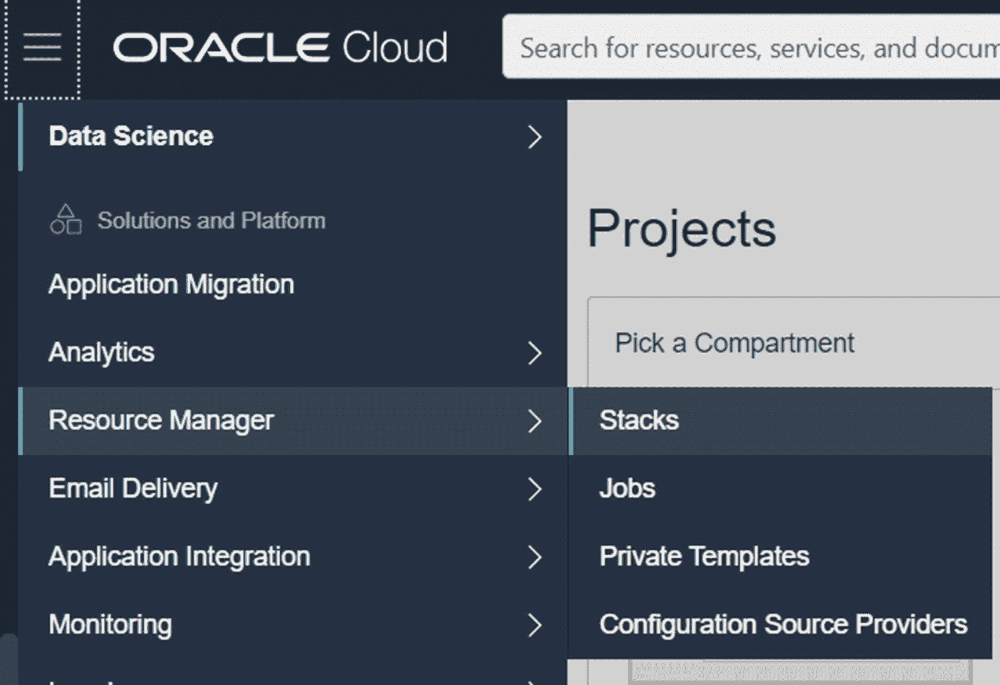
图 2-1 从资源管理器中选择堆栈

接下来，选择“创建堆栈” ➤ “模板” ➤ “数据科学 (DS2)”。单击“选择模板”，如图2-2所示。

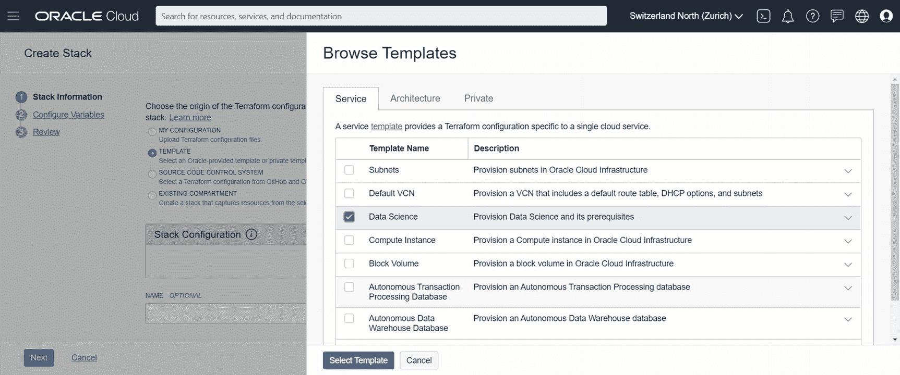
图 2-2 从模板列表中选择正确的模板。

检查信息，并在需要时进行更改。单击“下一步” ➤ “下一步” ➤ “创建”。堆栈已创建。要部署此堆栈定义的资源，请转到“Terraform操作”并选择“应用”，如图2-3所示。

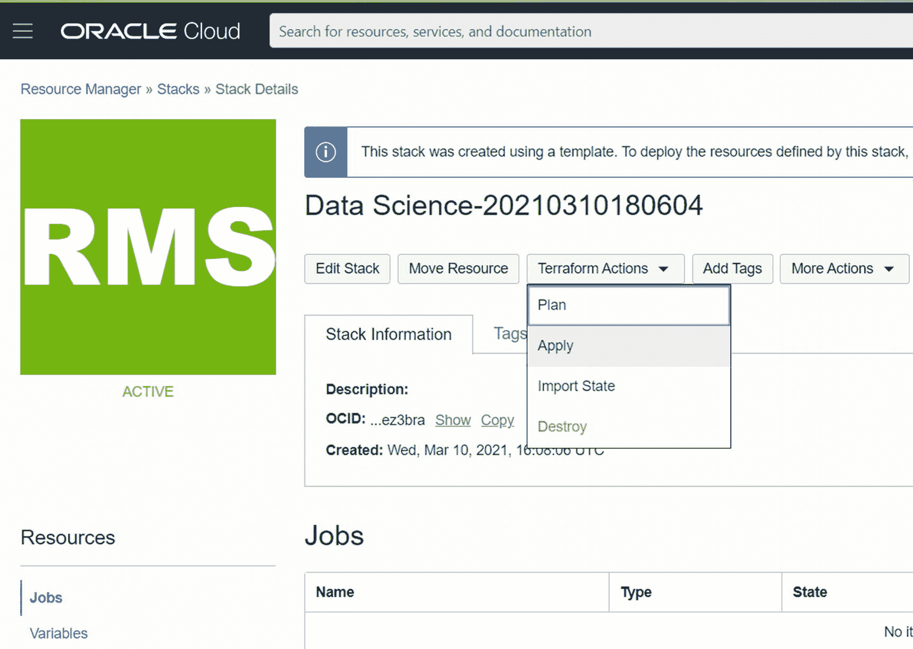
图 2-3 应用 Terraform 操作

现在环境已配置完毕，您可以开始工作了。

工作是在包含笔记本会话的项目中完成的。下一步是创建一个项目。从OCI主菜单中，选择“数据科学” ➤ “项目”。选择您要创建项目的区间，然后单击“创建项目”。输入所需信息，然后单击“创建”。接下来，您需要创建一个笔记本会话。选择该项目，然后单击“创建笔记本会话”（参见图2-4）。

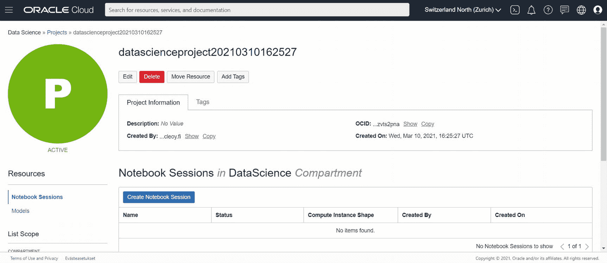
图 2-4 创建笔记本会话

通过单击“打开”按钮打开一个笔记本会话（参见图2-5）。您可以使用“停用”按钮停用笔记本会话，并使用“终止”按钮终止它。终止会删除所有内容，因此您应首先备份引导卷和附加的块卷。在停用笔记本会话之前，请确保将所有工作保存到附加的块卷中。存储在计算引导卷或内存中的任何数据或文件都将在笔记本会话停用时被删除。保存在块卷上的数据和文件会保留，并且在笔记本会话激活时恢复访问。

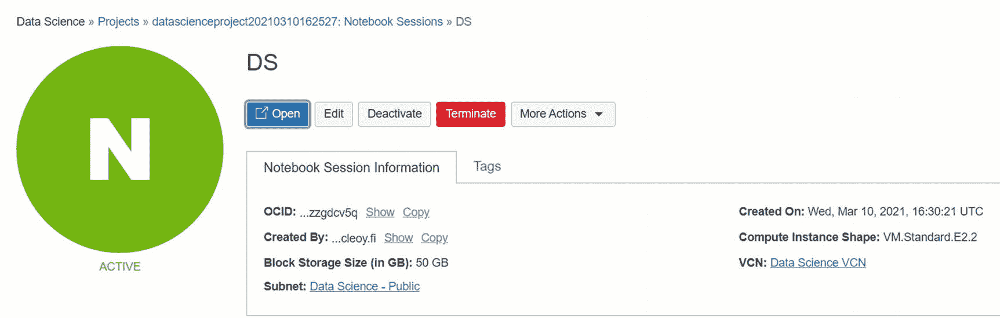
图 2-5 操作笔记本会话

图2-6显示了一个笔记本会话的示例。Oracle JupyterLab环境已预装。它还包括用于从OCI对象存储读取和写入的默认存储选项。您可以轻松地从多种其他数据源和数据格式进行读取和写入。

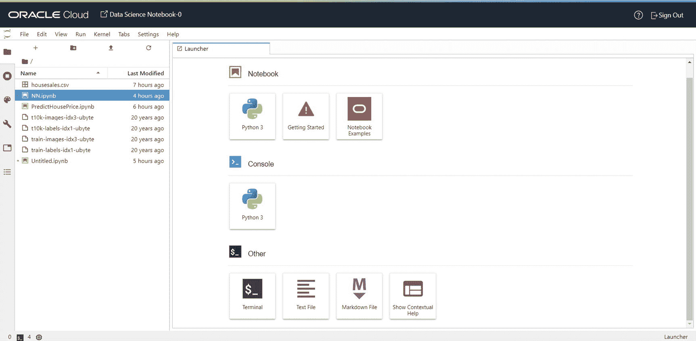
图 2-6 OCI 数据科学中的笔记本会话

笔记本的工作方式与任何笔记本一样，并且所需的大多数Python库都已存在。如果您找不到所需的库，您可以像在任何Python环境中一样，使用`pip install`命令自行添加。

在常规Python环境之上，OCI数据科学服务还包含了Oracle加速数据科学 (ADS) SDK Python库。它提供了一个友好的用户界面，其中的对象和方法涵盖了机器学习模型生命周期中的所有步骤，从数据获取到模型评估和解释。ADS SDK具有用于特征工程的自动数据可视化 (`auto_transform`) 和用于模型评估的`ADSEvaluator`。`AutoML`可自动进行特征选择、算法选择、特征编码和超参数调优。

对于图像和视频上的机器学习任务，或者如果您已经使用Python构建了大量代码，或者您想使用ADS SDK并能够安装任何Python库，OCI数据科学可能是最佳选择。

## Oracle分析云

对于业务用户或希望无需编程即可分析数据的人来说，Oracle分析云 (OAC) 可能是最佳选择。它还拥有极其强大的数据准备工具，并且能够使用几乎任何数据源。您可以将这些数据源作为单一数据使用，也可以在OAC中使用数据流将来自不同数据源的数据连接为一个整体，并将其存储到Oracle数据库中，以便与OML4SQL、OML4R或OML4Py一起使用。

Oracle拥有三条分析产品线：OAC、Oracle Analytics Server和Oracle Analytics for Applications。Oracle Analytics使数据准备变得更加容易，提供了增强分析和可视化功能。在OAC中，您可以使用通过OML4SQL创建的机器学习模型。我们将在第7章中进一步讨论OAC。

## 自动机器学习（AutoML）

自动机器学习（AutoML）是许多机器学习工具中非常流行的扩展功能，因为它不仅让模型构建阶段更高效，也让新手更容易入门机器学习。

Oracle自治数据库在机器学习功能下提供了专门的`AutoML`功能。在图2-7中，你可以看到它的位置。该功能是使用本章前面提到的相同Python AutoML库构建的。

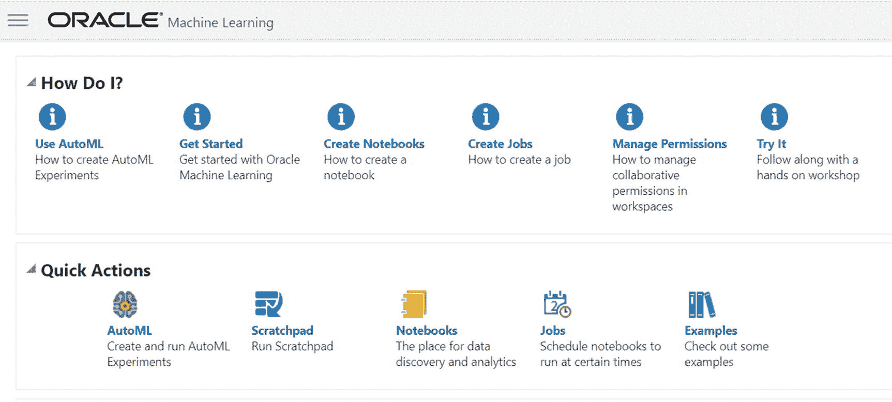
图 2-7 Oracle 机器学习中的 AutoML

当你选择`AutoML`时，`AutoML`实验工具将会打开（见图2-8）。你可以创建新的机器学习实验，或编辑、删除、复制现有实验。要开始一个实验，请点击“开始”。

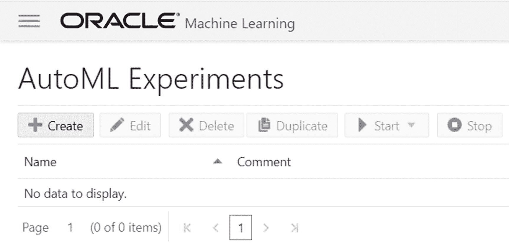
图 2-8 AutoML 实验

如果你选择“创建”，则会打开“创建实验”窗口（见图2-9）。在此窗口中，你可以为实验命名，并定义数据源、目标列、案例ID和预测类型。你还可以根据需要选择或取消选择特征。准备就绪后，选择“开始”。这里有两个选项：更快结果和更高准确率。选择你偏好的选项并开始实验过程。

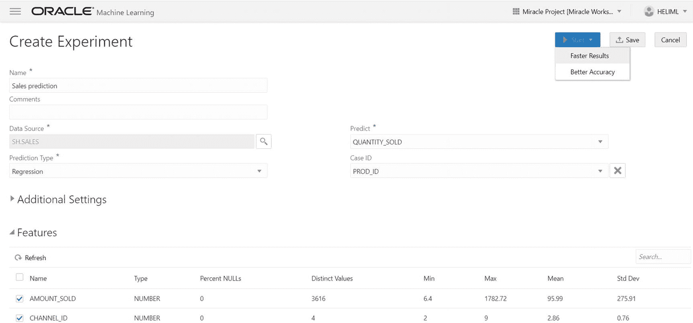

### 配置实验过程

运行实验过程需要一些时间。图 2-10 中的结果显示了哪个算法表现最佳（排行榜）以及每个特征如何影响结果（特征重要性）。

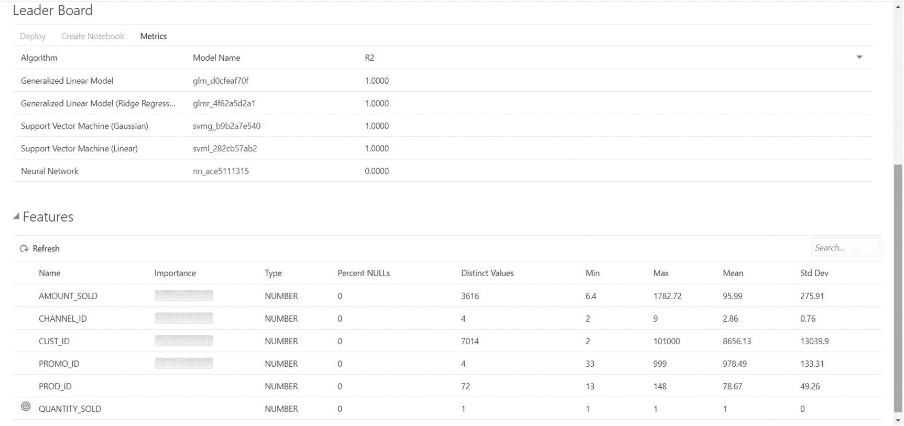

### 实验的排行榜和特征分析

### 注意

这是一个虚拟示例。其目的是展示如何使用 AutoML，而非展示机器学习过程本身。

R2（即准确率）用于比较模型，但你也可以通过选择所需的指标来使用其他指标。图 2-11 显示了在该特定情况下可能有用的其他指标。

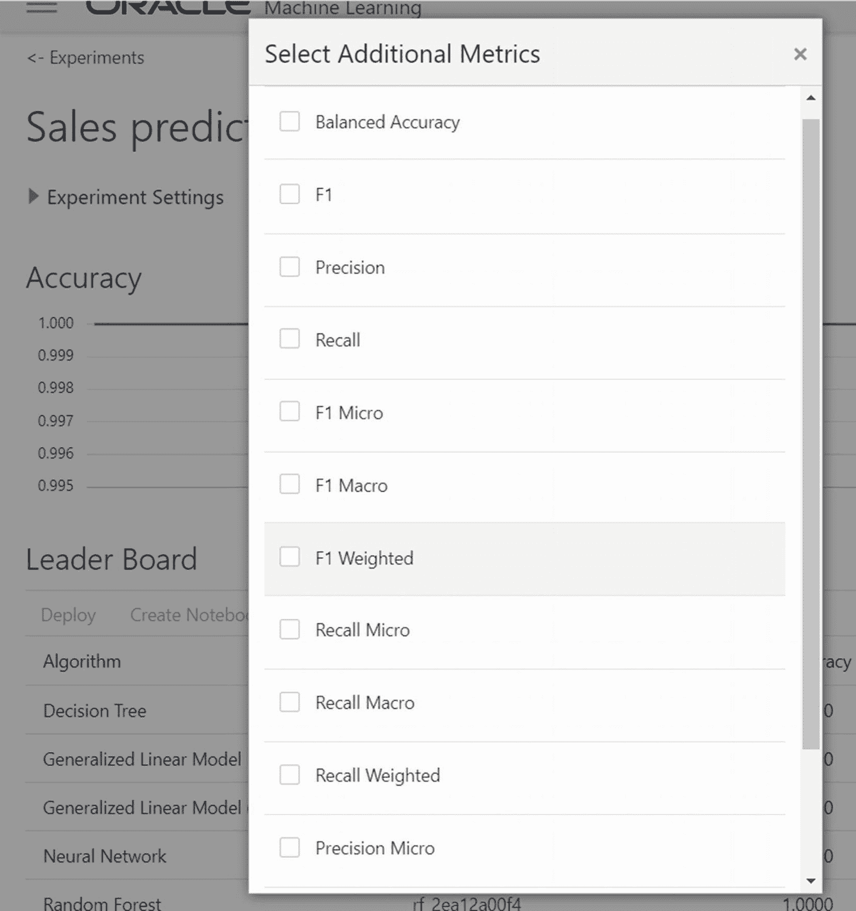

### 用于比较模型的其他指标示例

你可以选择其中任何一个模型来查看预测影响和混淆矩阵。当你确定最佳模型后，可以选择它，并通过选择“创建笔记本”从中创建一个笔记本。为笔记本命名，然后点击“确定”。

现在，这个笔记本就可以像任何其他笔记本一样，在笔记本列表中被查看和选择。图 2-12 显示了示例中创建的笔记本的一部分。

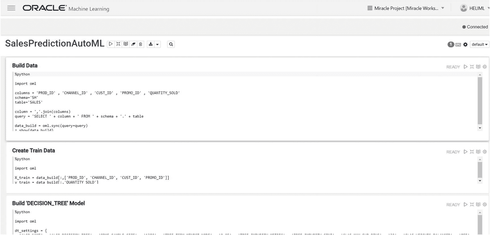

### 使用 AutoML 创建的笔记本

## 总结

Oracle 提供了多种机器学习产品。你可以使用 Oracle Analytics Cloud 进行数据准备和机器学习，而无需编程。你可以使用 OCI Data Science 配合 Jupyter Notebooks 和 Python，以及包含 AutoML 的专用 Oracle ADS SDK 机器学习库。或者，你也可以在数据库中使用 PL/SQL、R 或 Python，而无需将数据移出数据库。你可以使用多种编程语言与 Oracle 交互；例如，使用 `cx_Oracle` 的 Python 或使用 `Tribuo` 的 Java。AutoML 之所以流行，是因为它使得构建最优机器学习模型更加容易。Oracle 在其所有机器学习产品中都提供了 AutoML。