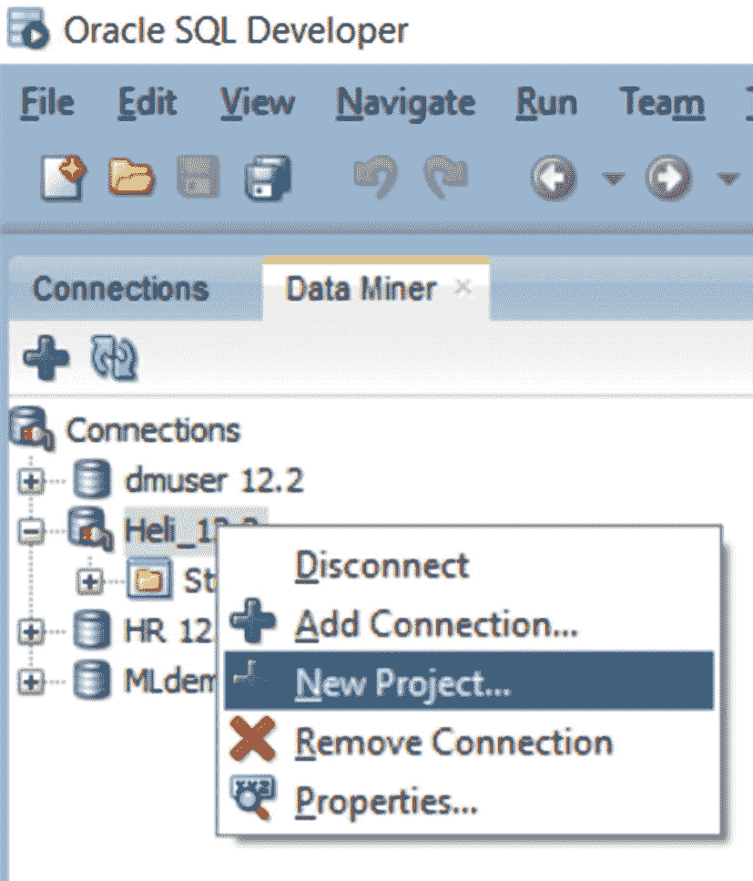
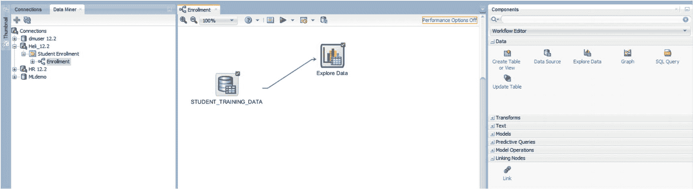
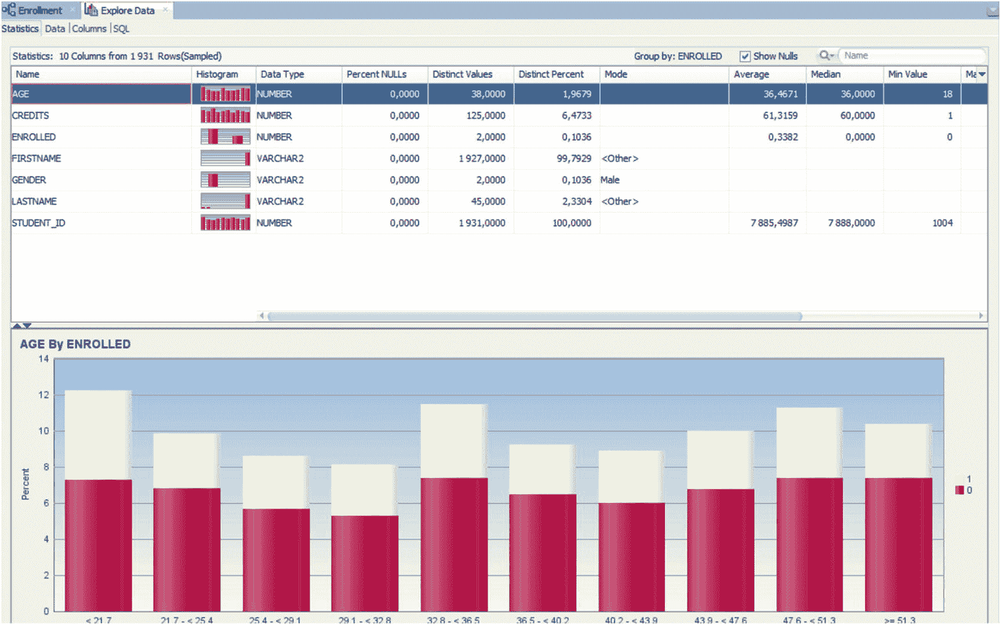
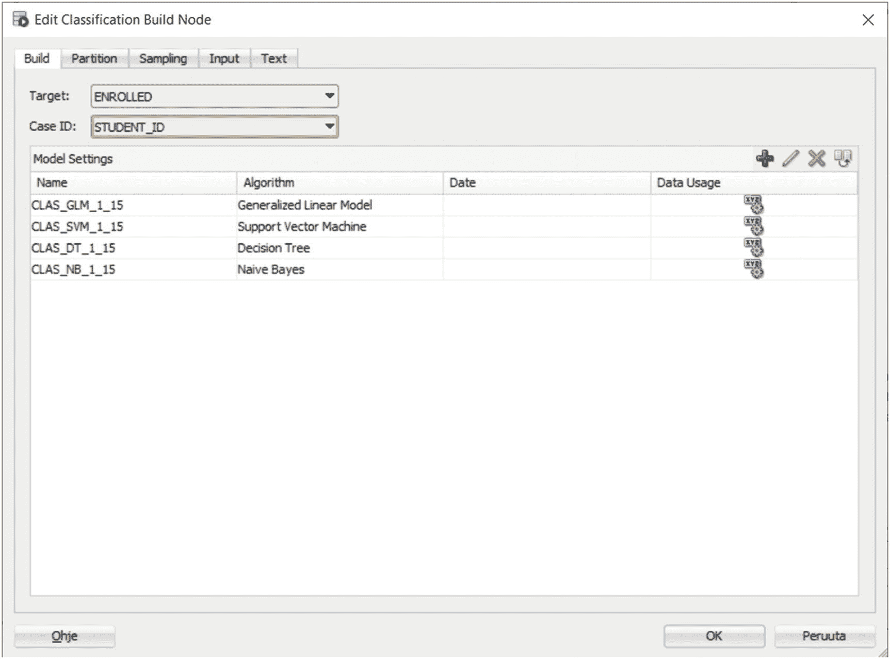
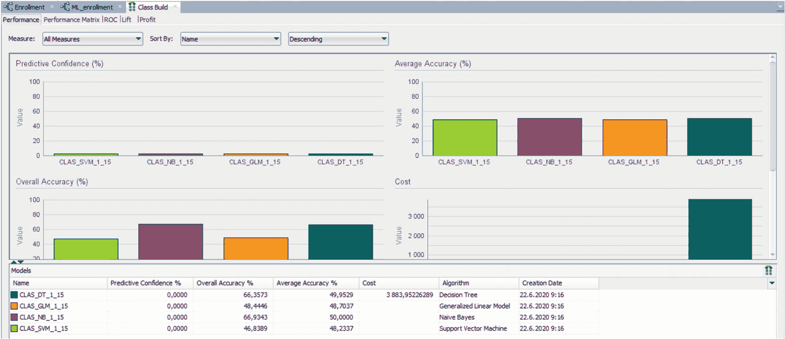
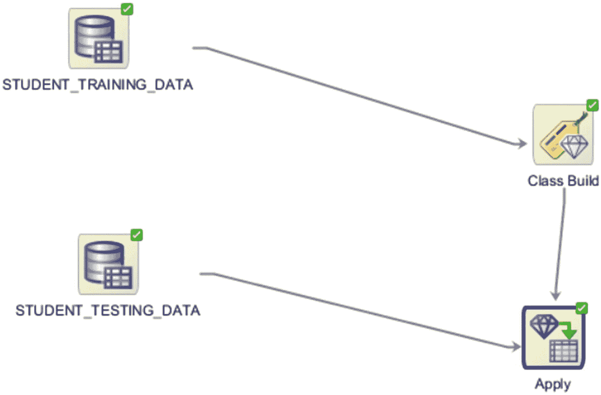

# 3. Oracle Machine Learning for SQL

Oracle Advanced Analytics 由 Oracle Data Mining 和 Oracle R Enterprise 组成。2019 年 12 月 5 日，Oracle 宣布 Advanced Analytics 功能作为免费选项提供。现在，Oracle Data Mining 已更名为 Oracle Machine Learning for SQL (OML4SQL)，Oracle R Enterprise (ORE) 更名为 Oracle Machine Learning for R (OML4R)，Oracle R Advanced Analytics for Hadoop 更名为 OML4Spark。

OML 家族也引入了新成员：Oracle Machine Learning for Python (OML4Py)、用于 Oracle 应用程序的 OML 微服务，以及 Oracle Machine Learning Notebooks（Oracle 自治数据库中受 Apache Zeppelin 启发的笔记本）。本章讨论 OML4SQL。

OML4SQL 是一组在 Oracle 数据库中实现的用于机器学习的 PL/SQL 包。这对于 Oracle 专业人员来说非常方便，因为他们在多年使用 Oracle 技术过程中积累的所有知识仍然有效，并且在学习机器学习新技能时非常有用。在 OML4SQL 中，数据存储在数据库或外部表中，机器学习算法位于数据库内部。数据无需移动即可进行机器学习处理，它保留在原位，处理也在原位完成。

移动数据通常既耗时又复杂。而处理数据的最佳场所莫过于数据库。由于数据保留在数据库中，安全性、备份等都由数据库管理系统管理。与移动数据相关的安全风险已被消除。

将模型等机器学习元素作为数据库的一等公民，使得处理它们变得容易，并且类似于处理任何其他数据库对象的过程。例如，模型可以并行训练。它们可以从测试数据库导出并导入到生产数据库，并且可以轻松、细粒度地定义权限。

能够在数据库中进行机器学习带来了许多优势并加快了处理过程。然而，缺点是算法的选择取决于数据库版本，并且添加新算法可能被认为很复杂。尽管简单的解决方案通常能产生最佳结果，并且现有算法已经足够：高质量的数据、快速的实验、特征工程和模型调优，而不是应用根本不同的算法，才能带来最大的改进。

在 Oracle 机器学习中，一个特征（例如，姓名或年龄）被称为*属性*。一种方法（例如，分类或聚类）被称为*机器学习函数*。OML4SQL 支持有监督和无监督的机器学习。它支持神经网络和文本处理，但不支持卷积神经网络和视觉识别问题。

## OML4SQL 的 PL/SQL 包

OML4SQL 包含三个 PL/SQL 包。

*   `DBMS_PREDICTIVE_ANALYTICS`：用于使用预测分析执行半自动化机器学习的例程。
*   `DBMS_DATA_MINING_TRANSFORMING`：用于为 OML4SQL 算法转换数据的例程。
*   `DBMS_DATA_MINING`：用于创建、管理机器学习模型并对其进行评估的例程。

所有这些包都有多个子程序，将在本章后面讨论。


### 权限

三个 OML4SQL 包归 SYS 用户所有，它们是数据库安装的一部分。安装过程还包括向 PUBLIC 授予这些包的执行权限。当包中的例程运行时，会以当前用户拥有的权限（调用者权限）来执行。要在 Oracle 自治数据库中使用 OML4SQL，请通过服务控制台下的“管理 Oracle ML 用户”功能创建用户。Oracle 会自动添加必要的权限。

如果要在非自治数据库中使用 OML4SQL，则需要手动创建用户并授予所需的权限。用户很可能需要以下系统权限，因为机器学习过程中的许多步骤都涉及创建表或视图。

*   `CREATE SESSION`
*   `CREATE TABLE`
*   `CREATE VIEW`

如果用户需要在其自己的模式中创建机器学习模型的权限，则必须授予 `CREATE MINING MODEL` 系统权限。这还允许用户管理其自己模式中的模型。如果需要在其他模式中创建模型，则需要 `CREATE ANY MINING MODEL` 系统权限。在这种情况下，可能还应授予以下权限。

*   `ALTER ANY MINING MODEL`
*   `DROP ANY MINING MODEL`
*   `SELECT ANY MINING MODEL`
*   `COMMENT ANY MINING MODEL`
*   `AUDIT ANY MINING MODEL`

如果用户需要使用文本类型数据进行处理，则需要 `EXECUTE ON ctxsys.ctx_ddl` 权限，因为 OML4SQL 在处理文本时会使用 Oracle Text 功能。

也可以对现有的机器学习模型授予单个对象权限。设计权限是此过程的重要步骤，测试环境中的权限可能与生产环境中的权限不同。

### 数据字典视图

由于所有 OML4SQL 对象都是数据库对象，因此与 Oracle 数据库中的任何对象一样，也存在针对其数据的 `USER_`、`DBA_` 和 `ALL_` 数据库视图。`USER_` 视图包含用户拥有的对象。`DBA_` 视图是 DBA 组成员有权访问的视图。`ALL_` 视图包含用户拥有权限的所有视图。OML4SQL 中有六个这样的视图。

*   `_MINING_MODELS`
*   `_MINING_MODEL_ATTRIBUTES`
*   `_MINING_MODEL_PARTITIONS`
*   `_MINING_MODEL_SETTINGS`
*   `_MINING_MODEL_VIEWS`
*   `_MINING_MODEL_XFORMS`

让我们以 `USER_` 视图集为例来研究这些视图。`USER_MINING_MODELS` 视图包含有关已登录数据库用户创建的所有模型的信息。它包括模型名称、使用的函数、使用的算法、算法类型、创建日期、构建模型的持续时间、模型大小、模型是否分区，以及一些关于模型的可选注释。

`USER_MINING_MODEL_ATTRIBUTES` 视图描述了构建模型时使用的所有属性。它包括模型名称、属性名称、属性类型（分类/数值）、数据类型、长度、精度、小数位数、使用类型、该属性是否为目标属性的信息，以及属性的可选规范。

`USER_MINING_MODEL_SETTINGS` 视图包含为模型定义的所有设置。该视图包括模型名称、设置名称和值，以及一个设置类型，用于指示该设置是由用户通过设置表定义的（`INPUT`），还是默认值（`DEFAULT`）。设置表将在本章后面讨论。

`USER_MINING_MODEL_VIEWS` 包含有关机器学习过程创建的所有视图的信息。这些视图称为*模型详细信息视图*。这些视图自 Oracle Database 12.2 起就已存在于数据库中。它们用于检查模型的详细信息。`USER_MINING_MODEL_VIEWS` 包括模型名称、视图名称和视图类型。视图名称始终以 `DM` 开头。视图类型包括评分成本矩阵、模型构建警报、分类目标、计算设置和决策树层次结构。创建的视图取决于所使用的算法。

`USER_MINING_MODEL_XFORMS` 视图描述了用户指定的嵌入模型的转换。这将在本章后面讨论。

`USER_MINING_MODEL_PARTITIONS` 包含有关分区模型的数据，这将在本章后面介绍。


## 预测分析

预测分析是 Oracle 专业人员使用机器学习的一种简便方式，无需创建模型或详细了解机器学习过程。预测分析使用 OML4SQL 技术，但由于它自动化了部分流程，因此无需掌握机器学习过程的知识。预测分析的核心是一个名为 `DBMS_PREDICTIVE_ANALYTICS` 的 PL/SQL 包，它包含三个过程。

*   `EXPLAIN`

*   `PREDICT`

*   `PROFILE`

`EXPLAIN` 按属性对解释目标列的影响程度进行排序；换句话说，它计算属性的重要性。`PREDICT` 使用输入数据中的值预测目标列的值。`PROFILE` 生成描述输入数据中案例的规则。所有挖掘活动都由这些过程在内部处理，但数据集中的至少部分行必须包含目标列的数据。

`EXPLAIN` 过程的语法如下。

```
DBMS_PREDICTIVE_ANALYTICS.EXPLAIN (
data_table_name     IN VARCHAR2,
explain_column_name IN VARCHAR2,
result_table_name   IN VARCHAR2,
data_schema_name    IN VARCHAR2 DEFAULT NULL);
```

`data_table_name` 指存储数据的表或视图。`explain_column_name` 是目标列的名称。`result_table_name` 是所创建表的名称，用于存储所有解释属性的数据。如果需要，您还可以定义表/视图所在的模式名称，以及结果表创建的位置（`data_schema_name`）。模式的默认值是当前模式。在 `Beer_data` 表中，包含关于啤酒的数据。让我们看看该表中的列如何影响啤酒的总体评分。

```
BEGIN
DBMS_PREDICTIVE_ANALYTICS.EXPLAIN(
data_table_name      => 'Beer_data',
explain_column_name  => 'overall',
result_table_name    => 'explain_overall');
END;
/
```

创建的结果表如下所示。

```
desc explain_overall
Name              Null? Type
----------------- ----- --------------
ATTRIBUTE_NAME          VARCHAR2(4000)
ATTRIBUTE_SUBNAME       VARCHAR2(4000)
EXPLANATORY_VALUE       NUMBER
RANK                    NUMBER
```

`ATTRIBUTE_NAME` 指数据属性名称。`ATTRIBUTE_SUBNAME` 指模型属性名称。如果数据和模型属性名称相同，则属性子名称为空。`EXPLANATORY_VALUE` 描述该属性在预测目标值时的有用程度。解释值介于 0 和 1 之间。值越大，该列对预测越重要。`RANK` 表示属性按其重要性的排序，1 表示最重要。让我们看看这些属性在定义总体评分时的重要性。

```
select attribute_name, explanatory_value from explain_overall order by rank;
ATTRIBUTE_NAME      EXPLANATORY_VALUE
TASTE               0,2674738908264884784993598978433976175381
PALATE              0,1976962138392110981663470377322550126544
AROMA               0,1526621584620192423325653905867293518344
APPEARANCE          0,1001307045987525497039916691896689883201
IDINDEX             0,0842611915621849513252059135878605389386
BEERID              0,0658762790050827900010684886511880574899
STYLE               0,0635180421364773662601208912848755547422
BREWERID            0,053665102399722024440190099821819038276
ABV                 0,0377233539260295690048729231695040245149
TIMEUNIX            0,0022278139762722427826044451470112412173
NAME                0
AGEINSECONDS        0
GENDER              0
...
```

其中十个列在预测目标属性方面具有一定的重要性。另外八个列则完全没有重要性。如果您仔细查看结果，会发现最重要的列（taste、palate、aroma、appearance）在新数据集中为空（它们也是评估结果），因此不能直接用于预测总体评分。

您可以构建一个模型并使用新数据集，或者使用其他技术，或者接受无法使用这些列的事实并将其从用于预测的数据集中移除。我们将在本书后面讨论这些步骤。

一个重要的步骤是确保用于构建预测的列不要太多，因为每个列都会减慢过程速度，并可能导致预测精度降低。在我们的示例中，我们决定通过创建视图 `Beer_view` 来移除无法使用的列。

```
CREATE VIEW beer_view AS
SELECT IDINDEX, STYLE, BREWERID, ABV, OVERALL
FROM Beer_data;
```

我们保留了 taste、palate、aroma 和 appearance 列，因为它们中有数据。此时，啤酒专家会注意到，这些数据并非用于预测总体评分的正确数据类型，因为剩下的属性都无法定义啤酒的总体评分。但是，由于我们没有业务知识（大错误！），我们继续进行了下去。

下一步是使用 `PREDICT` 来预测目标。`PREDICT` 的语法如下。

```
DBMS_PREDICTIVE_ANALYTICS.PREDICT (
accuracy                  OUT NUMBER,
data_table_name           IN VARCHAR2,
case_id_column_name       IN VARCHAR2,
target_column_name        IN VARCHAR2,
result_table_name         IN VARCHAR2,
data_schema_name          IN VARCHAR2 DEFAULT NULL);
```

`accuracy` 返回预测值的预测置信度。`data_table_name` 是存储数据的表/视图的名称。`case_id_column_name` 是标识表/视图中某个案例的列名。`target_column_name` 是我们试图预测的目标列的名称。`result_table_name` 是所创建表的名称，用于存储结果数据。`data_schema_name` 是源表/视图所在模式以及结果表创建位置的名称。

```
DECLARE
p_accuracy NUMBER(10,9);
BEGIN
DBMS_PREDICTIVE_ANALYTICS.PREDICT(
accuracy                => p_accuracy,
data_table_name         =>'Beer_view',
case_id_column_name     =>'idindex',
target_column_name      =>'overall',
result_table_name       => 'Predict_overall');
DBMS_OUTPUT.PUT_LINE('Accuracy: ' || p_accuracy);
END;
/
```

结果表如下所示。

```
Name        Null? Type
----------- ----- -------------
IDINDEX           NUMBER(7)
PREDICTION        NUMBER
PROBABILITY       BINARY_DOUBLE
```

对于每个 `IDINDEX`（案例 ID），它会预测目标列（overall）以及概率（如果是分类问题）。对于回归问题，概率始终为空。

```
IDINDEX      PREDICTION    PROBABILITY
...
6                   4      0,6489473478441403
7                   3      0,5399133550907291
9                   4      0,4870673836213656
10                  5      0,3541555965260737
11                  4      0,623283467936882
12                  4      0,36192909036295434
15                  2      0,5106388569341178
16                  4      0,5355598365975454
17                  5      0,5772967022852917
19                  4      0,44194795494972944
...
0.054057039
```

无论目标列中是否有值，都会为所有案例返回预测结果。如果您想将预测值与实际值进行比较，可以将那些有实际值的案例与其预测值进行对比。

注意

避免使用像 `PREDICTION` 或 `PROBABILITY` 这样的列名是非常明智的。这些保留字在使用某些功能时可能会引起问题。

`PROFILE` 过程创建规则（以 XML 格式表示为 if-then-else 语句），这些规则描述了影响预测的决策。`PROFILE` 不支持嵌套类型或日期。`PROFILE` 生成一组描述预期结果的规则，在我们的示例中，值为 0–5。每个配置文件包含一个规则、记录计数和分数分布。语法如下。


```
DBMS_PREDICTIVE_ANALYTICS.PROFILE (
data_table_name           IN VARCHAR2,
target_column_name        IN VARCHAR2,
result_table_name         IN VARCHAR2,
data_schema_name          IN VARCHAR2 DEFAULT NULL);
```

让我们将其应用于我们的数据集。

```
BEGIN
DBMS_PREDICTIVE_ANALYTICS.PROFILE(
DATA_TABLE_NAME    => 'Beer_view',
TARGET_COLUMN_NAME => 'overall',
RESULT_TABLE_NAME  => 'Overall_profile');
END;
/
```

它创建的结果表（Overall_profile）如下所示。

```
Name         Null? Type
------------ ----- -----------
PROFILE_ID         NUMBER
RECORD_COUNT       NUMBER
DESCRIPTION        SYS.XMLTYPE
PROFILE_ID   RECORD_COUNT      DESCRIPTION
1            410                 (XMLTYPE)
2            606                 (XMLTYPE)
3            477                 (XMLTYPE)
4            3337                (XMLTYPE)
...
22           63                  (XMLTYPE)
```

## 数据准备与转换

OML4SQL 提供了不同的接口，但无论您选择哪种，一切都要从理解业务需求和定义任务开始。然后，您需要找到支持该任务的数据。当任务被定义且数据可用后，下一步就是为机器学习过程准备数据。这样做至少有两个原因：您希望确保数据质量良好，同时 OML4SQL 和机器学习算法对数据也有一些要求。

### 理解数据

该过程始于对数据的描述、理解、探索和分析。由于数据存储在数据库中，因此有多种工具可供使用。您可以使用统计函数、分析函数、聚合函数，或者使用 `DBMS_STATS_FUNC` 包中的过程。

*   `EXPONENTIAL_DIST_FIT` 测试样本值是否符合指数分布。
*   `NORMAL_DIST_FIT` 测试样本值是否符合正态分布。
*   `POISSON_DIST_FIT` 测试样本值是否符合泊松分布。
*   `SUMMARY` 汇总表中某一数值列的信息。
*   `UNIFORM_DIST_FIT` 测试样本值是否符合均匀分布。
*   `WEIBULL_DIST_FIT` 测试样本值是否符合威布尔分布。

本示例使用 `SUMMARY` 过程研究 `Student_enrollment` 表的 `AGE` 列。

```
DECLARE
summary_values DBMS_STAT_FUNCS.SummaryType;
significance number;
BEGIN
DBMS_STAT_FUNCS.SUMMARY(
p_ownername => 'HELIML',
p_tablename => 'STUDENT_ENROLLMENT',
p_columnname => 'AGE',
p_sigma_value => 3,
s => summary_values);
dbms_output.put_line('Summary statistics: ');
dbms_output.put_line('Number of records: '
||summary_values.count);
dbms_output.put_line('Min value: '||summary_values.min);
dbms_output.put_line('Max value: '||summary_values.max);
dbms_output.put_line('Variance: '
||round(summary_values.variance));
dbms_output.put_line('Stddev: '||round(summary_values.stddev));
dbms_output.put_line('Mean: '||summary_values.mean);
dbms_output.put_line('Mode: '||summary_values.cmode(1));
dbms_output.put_line('Median: '||summary_values.median);
dbms_output.put_line('Quantiles');
dbms_output.put_line('1st Quantile: '
||summary_values.quantile_5);
dbms_output.put_line('2nd Quantile: '
||summary_values.quantile_25);
dbms_output.put_line('3rd Quantile: '
||summary_values.quantile_75);
dbms_output.put_line('4th Quantile: '
||summary_values.quantile_95);
dbms_output.put_line('Extreme count: '
||summary_values.extreme_values.count);
dbms_output.put_line('Top Five Values: '
||summary_values.top_5_values(1)||','
||summary_values.top_5_values(2)||','
||summary_values.top_5_values(3)||','
||summary_values.top_5_values(4)||','
||summary_values.top_5_values(5));
dbms_output.put_line('Bottom Five Values: '
||summary_values.bottom_5_values(1)||','
||summary_values.bottom_5_values(2)||','
||summary_values.bottom_5_values(3)||','
||summary_values.bottom_5_values(4)||','
||summary_values.bottom_5_values(5));
dbms_output.put_line('Normality test');
DBMS_STAT_FUNCS.normal_dist_fit(
ownername => 'HELIML',
tablename => 'STUDENT_ENROLLMENT',
columnname => 'AGE',
test_type => 'SHAPIRO_WILKS',
mean => summary_values.mean,
stdev => summary_values.stddev,
sig => significance);
END;
/
Summary statistics:
Number of records: 13848
Min value: 18
Max value: 55
Variance: 120
Stddev: 11
Mean: 36,40915655690352397458116695551704217215
Mode: 18
Median: 36
Quantiles
1st Quantile: 19
2nd Quantile: 27
3rd Quantile: 46
4th Quantile: 53
Extreme count: 0
Top Five Values: 55,55,55,55,55
Bottom Five Values: 18,18,18,18,18
Normality test
W value : ,953810000657651954594192725127129629851
```

对于人眼来说，理解数据的最佳方式是将其可视化。有多种工具可供使用，包括 Oracle Machine Learning Notebooks、Oracle SQL Developer、Oracle Application Express (APEX) 和 Oracle Analytics Cloud。

### 准备数据

下一步是准备数据。同样，由于数据存储在数据库中，因此有大量工具可供使用。数据准备可以利用 Oracle 数据库强大的数据处理功能和能力来完成，也可以使用 OML4SQL 中的功能：自动数据准备 (ADP) 和一个名为 `DBMS_DATA_MINING_TRANSFORM` 的 PL/SQL 包。

OML4SQL 只能处理来自一个表或一个视图的数据。该表/视图中的一行被称为一个*个案*；因此，该表或视图被称为*个案表*。每条记录必须存储在单独的行中，并可选择由一个唯一的个案 ID 标识。准备个案表可能包括转换某些列的数据类型、创建嵌套列、处理事务性数据或文本转换。

首先，确定要包含在个案表中的列非常重要。其中一个步骤是将个案表中的列数缩减到所需的列。例如，特征选择和特征提取模型可以找到重要的属性，或者用更好的属性替换原有属性。对于监督学习，您需要定义一个特定的属性：目标。这是我们试图预测其值的属性。那些用于预测的属性被称为*预测变量*。机器学习算法从这些预测变量的底层数据中学习，并为目标提供预测。

目标属性允许的数据类型包括：用于分类问题的 `VARCHAR2`、`CHAR`、`NUMBER`、`FLOAT`、`BINARY_DOUBLE`、`BINARY_FLOAT` 和 `ORA_MINING_VARCHAR2_NT`；用于回归机器学习问题的 `NUMBER`、`FLOAT`、`BINARY_DOUBLE` 和 `BINARY_FLOAT`。目标属性有一个限制：嵌套列或非结构化数据列（`BFILE`、`CLOB`、`NCLOB` 或 `BLOB`）不能用作目标。

还有另外两种属性：数据属性和模型属性。数据属性是数据集中用于构建、测试或评分模型的列，而模型属性是模型内部使用的数据表示形式。数据属性和模型属性可以相同，也可以不同。数据属性可以是任何 Oracle 数据库数据类型，但模型属性要么是数值型、类别型，要么是非结构化（文本）型。

数值属性具有无限数量的值，并且值本身以及值之间的差异都存在隐含的顺序。对于 OML4SQL，数据类型 `NUMBER`、`FLOAT`、`BINARY_DOUBLE`、`BINARY_FLOAT`、`DM_NESTED_NUMERICALS`、`DM_NESTED_BINARY_DOUBLES` 和 `DM_NESTED_BINARY_FLOATS` 被视为数值型。例如，如果一只动物重 100 公斤，它就比重 20 公斤的动物重。如果个案表中的某一列被定义为这些数据类型中的任何一种，OML4SQL 就会假定数据是数值型的并相应地进行处理。如果数据本质上不是数值型的，则必须更改其数据类型。例如，用 1/0 表示的真/假不应定义为 `NUMBER`，因为它不能也不应用于任何比较（例如，0 < 1）或计算。


分类属性（Categorical attributes）的值用于标识有限数量的离散类别或分类。这些类别之间没有与值相关的顺序。例如，如果一个人 20 岁，另一个人 50 岁，你可以说第一个人更年轻，但你不能说哪个人“更好”。相反，你可以说一个 51 岁的人与一个 50 岁的人年龄大致相同，因此他们属于同一个年龄组。在 OML4SQL 中，分类属性默认类型为 `CHAR`、`VARCHAR2` 或 `DM_NESTED_CATEGORICALS`。这些数据类型也可能是非结构化文本数据类型。数据类型 `CLOB`、`BLOB` 和 `BFILE` 始终属于非结构化文本数据类型。通过使用多个 Oracle Text 特性，OML4SQL 会自动转换文本列，以便模型能够使用这些数据。文本数据必须存储在表中，而不是视图中。每一行中的文本被视为一个独立的文档，每个文档被转换为一组文本标记（terms），这些标记具有数值和文本标签。文本列会被转换为 `DM_NESTED_NUMERICALS` 类型的嵌套列。

如果你要使用的数据不在同一个表中，则需要将多个表中的数据合并到一个案例表（case table）中（请记住，它也可以是一个视图）。如果两个表之间的关系是一对多的，例如一个表存储客户信息，另一个表存储该客户的不同地址，那么你需要使用嵌套列。为此，你可以创建一个视图，并将数据转换为一种嵌套对象类型。OML4SQL 支持以下嵌套对象类型：`DM_NESTED_CATEGORICALS`、`DM_NESTED_NUMERICALS`、`DM_NESTED_BINARY_DOUBLES` 和 `DM_NESTED_BINARY_FLOATS`。嵌套列中的每一行由一个属性名称/值对组成，OML4SQL 在内部将每个嵌套行作为一个独立的属性进行处理。

例如，在 STUDENTS（studentid, firstname, lastname,...）、COURSESPASSED（studentid, courseid, passeddate,...）和 COURSES（courseid, coursename, credits,...）表中，存储了关于学生通过课程的数据。如果你基于这些表创建了一个表（简化表），它可能如下所示。

```
select s.studentid, c.coursename, c.credits
from students s, courses c, coursespassed cp
where s.studentid=cp.studentid and
c.courseid=cp.courseid;
STUDENTID    COURSENAME                        CREDITS
1            Database designing                5
1            Python programming                4
2            Database designing                5
2            Algorithms and logical thinking   6
3            Python programming                4
...
```

每个学生在表中都有多行数据，而机器学习算法无法使用这种类型的数据。

让我们基于该查询创建一个视图（student_credits_view）。

```
create view student_credits_view as
(select s.studentid, c.coursename, c.credits
from students s, courses c, coursespassed cp
where s.studentid=cp.studentid and
c.courseid=cp.courseid);
```

使用该视图，我们在 students_credit_trans_nested 视图中将数据转换为 `DM_NESTED_NUMERICALS` 类型的列。

```
CREATE VIEW students_credit_trans_nested AS
SELECT studentid,
CAST(COLLECT(DM_NESTED_NUMERICAL
(coursename, credits)) AS DM_NESTED_NUMERICALS) studentcredits
FROM STUDENT_CREDITS_VIEW
GROUP BY studentid;
```

该视图可用于 OML4SQL，因为每个学生在案例表中只有一行数据。

```
select * from students_credit_trans_nested;
STUDENTID    STUDENTCREDITS
1            SYS.DM_NESTED_NUMERICALS (SYS.DM_NESTED_NUMERICAL('Database designing', 5), SYS.DM_NESTED_NUMERICAL('Python programming', 4))
2            SYS.DM_NESTED_NUMERICALS (SYS.DM_NESTED_NUMERICAL('Database designing', 5), SYS.DM_NESTED_NUMERICAL('Algorithms and logical thinking', 6))
3            SYS.DM_NESTED_NUMERICALS
(SYS.DM_NESTED_NUMERICAL('Python programming', 4))
...
```

OML4SQL 支持自动数据准备（ADP）、用户导向的通用数据准备以及用户指定的嵌入式数据准备。通过使用本章后面描述的 Settings 表中的 `PREP_*` 设置，你可以控制自动化或用户导向的通用数据准备。`PREP_AUTO` 设置用于启用自动数据准备。可能的值为 `PREP_AUTO_ON` 和 `PREP_AUTO_OFF`。`PREP_AUTO_ON` 是默认值。其他可用的 `PREP*` 设置需要将 `PREP_AUTO` 定义为 `OFF` 才能生效。这些设置如下：

*   `PREP_SCALE_2DNUM`，用于对二维数值列启用缩放数据准备。可能的取值如下：
    *   `PREP_SCALE_STDDEV` 将列值除以该列的标准差。与 `PREP_SHIFT_MEAN` 结合使用时，该值会产生 z-score 归一化。

*   `PREP_SCALE_RANGE` 将列值除以值的范围。与 `PREP_SHIFT_MIN` 值结合使用时，会产生 [0,1] 的范围。

*   `PREP_SCALE_NNUM` 用于对嵌套数值列启用缩放数据准备。可能的取值如下：
    *   `PREP_SCALE_MAXABS`，产生 [–1,1] 范围内的数据。

*   `PREP_SHIFT_2DNUM` 用于对二维数值列启用居中数据准备。可能的取值如下：
    *   `PREP_SHIFT_MEAN` 从每个值中减去该列的平均值。

*   `PREP_SHIFT_MIN` 从每个值中减去该列的最小值。

一些常用的转换包括特征缩放、分箱、异常值处理和缺失值处理。这些转换对于算法获得更好的性能是必要的。是否需要转换取决于所使用的算法、数据和机器学习任务。对于基于树的算法，通常不需要特征缩放，但对于基于梯度下降或基于距离的算法，它可能会产生很大的影响。

在基于梯度下降的算法（例如线性回归、逻辑回归或神经网络）中，特征的值会影响梯度下降的步长。由于特征范围的差异会导致每个特征有不同的步长，因此在将数据输入模型之前对其进行缩放，以确保梯度下降能够平稳地向最小值移动。基于距离的算法（例如 k-近邻、k-均值和支持向量机）使用数据点之间的距离来确定它们的相似性。如果不同特征具有不同的尺度，则可能会赋予量级较大的特征更高的权重，从而导致对某个特征的偏差。如果在使用基于距离的算法之前对数据进行缩放，则所有特征对结果的贡献是相等的，并且算法很可能会表现得更好。

特征缩放可以分为两类：归一化和标准化。归一化通常是一种缩放技术，其中所有特征值最终都介于 0 和 1 之间：列中的最小值设置为 0，最大值设置为 1，所有其他值介于两者之间。

标准化则使值围绕均值分布，并具有单位标准差。通常，它使用 z-score 将数据重新缩放为均值为零、标准差为一（单位方差）。特征缩放消除了数据的测量单位，使您能够更轻松地比较来自不同领域的数据。OML4SQL 支持最小-最大归一化、z-score 归一化和尺度归一化。


特征缩放可以缩小数值数据的范围。分箱（离散化）则能降低连续数据和离散数据的基数。分箱通过将值分组到不同的箱中，将连续属性转换为离散属性，从而减少不同值的数量。换句话说，它将数值变量转换为分类变量。例如，如果数据集中公司的员工数量范围是 1 到 100000，你可能希望将它们分箱为以下几组：1-10、11-50、51-100、101-1000、1001-5000、5001-8000 以及 8000 人以上。这样做是因为许多机器学习算法只接受离散值。

分箱可以是无监督的，也可以是有监督的。无监督分箱可能使用分位数箱（25、50、75、100）、排名，或者使用等宽或等频算法。等宽分箱算法将数据划分为 k 个等大小的区间，区间宽度为 w = (max-min)/k，区间边界为：min+w, min+2w, ..., min+(k–1)w。等频/等宽分箱算法将数据划分为 k 组，每组包含大致相同数量的值。有监督分箱则利用数据来确定箱的边界。分箱可以通过加强属性之间的关系来提高资源利用率和模型质量。OML4SQL 支持四种不同的分箱方式：有监督分箱（分类和数值）、Top-N 频率分类分箱、等宽数值分箱和分位数数值分箱。

*异常值*是指与其他大多数值显著偏离的值。异常值可能会对数据产生偏斜影响，并且可能对归一化或分箱产生不良影响。你需要领域知识来确定如何处理异常值，以识别异常数据是完全有效的数据，还是由错误引起的有问题数据。OML4SQL 中可用的异常值处理方法包括修剪和缩尾（裁剪）。缩尾处理将特定属性的尾部值设置为数据的某个指定分位数，而修剪处理则通过将尾部值设置为 NULL 来移除它们。

数据集中存在 NULL 值可能会在许多方面带来问题，但由于数据不存在，它无法用于任何机器学习活动。包含 NULL 值的行可以从数据集中移除，或者你也可以使用缺失值处理方法。要做出决定，你必须理解数据以及这些 NULL 值在业务场景中的含义。OML4SQL 中的自动缺失值处理分为两类：稀疏数据和包含随机缺失值的数据。

在稀疏数据中，缺失值被认为是已知的，尽管它们没有被表示出来。随机类别中缺失的数据意味着某些属性值是未知的。对于 ADP 而言，嵌套列中的缺失值被解释为稀疏数据，而具有简单数据类型的列中的缺失值则被假定为随机缺失。缺失值的处理取决于算法和数据：是分类还是数值，是稀疏还是随机缺失。Oracle Machine Learning for SQL API Guide 详细描述了每种情况下的缺失值处理方法。通过一些简单的技巧，你可以更改默认的缺失值处理方法。用精心选择的值（如 0、“NA”等）替换空值，可以防止 ADP 将其解释为随机缺失，从而使其不执行缺失值处理。但要注意，这不能过度改变数据。如果你希望将缺失的嵌套属性视为随机缺失，可以将嵌套行转换为物理属性。OML4SQL 的缺失值处理会将数值数据类型的 NULL 值替换为均值，将分类数据类型的 NULL 值替换为众数。

许多机器学习算法对数据有特定的转换要求，而 ADP 为 Oracle 数据库中支持的这些算法预定义了处理规则。当启用 ADP 时，大多数特定于算法的转换会在模型创建期间自动嵌入到模型中，并在模型应用时自动执行。你也可以更改规则、添加用户指定的转换，或者完全忽略 ADP 来手动执行所有转换。如果模型同时嵌入了 ADP 和用户指定的转换，那么两组转换都会执行，但用户指定的转换会先执行。

如果使用的算法是 Apriori 或决策树，ADP 不会影响数据集。如果算法是以下之一：广义线性模型（GLM）、k-means、非负矩阵分解（NMF）、奇异值分解（SVD）或支持向量机（SVM），ADP 会对数值属性进行归一化。如果算法是最小描述长度（MDL）或朴素贝叶斯，ADP 会使用有监督分箱对所有属性进行分箱。如果算法是期望最大化，ADP 会对使用高斯分布建模的单列数值列进行归一化，但不会影响其他类型的列。如果算法是 O-cluster，ADP 会使用一种特殊形式的等宽分箱对数值属性进行分箱，并移除所有为空或只有单一值的数值列。如果算法是 MSET-SPRT（多元状态估计技术-序贯概率比检验），ADP 会使用 z-score 归一化。如果你想对单个属性禁用 ADP，可以使用转换列表来实现。

在创建和训练模型时，有两种方法可以将用户指定的规则传递给`CREATE_MODEL`过程：传递一个转换表达式列表，或者传递一个包含转换的视图名称。当在转换列表中指定时，转换表达式由模型执行。当在视图中指定时，转换表达式由视图执行。这两个选项的主要区别在于，如果你使用转换列表，转换表达式会嵌入到模型中，并在模型应用时自动执行。但是，如果你使用视图，则在每次应用模型时都必须重新创建转换。因此，推荐使用列表方法而非视图方法。可以使用`DBMS_DATA_MINING_TRANSFORMATION`的`CREATE*`、`INSERT*`和`STACK*`包来构建列表，也可以手动创建。可以使用`DBMS_DATA_MINING_TRANSFORMATION`的`CREATE*`、`INSERT*`和`XFORM*`包来创建视图，也可以手动创建。

如果你想使用`DBMS_DATA_MINING_TRANSFORMATION`包进行转换，请执行以下步骤。

1.  使用相应的`CREATE*`过程创建转换定义表。每个表都有列来保存给定转换类型的转换定义。

2.  使用相应的`INSERT*`过程定义转换。你也可以自行填充这些表或修改转换定义表中的值，但要做到这一点，请确保你清楚自己在做什么。

3.  生成转换表达式。为此，有两种替代方法。
    *   `STACK*`过程用于将转换表达式添加到转换列表中，以便传递给`CREATE_MODEL`过程并嵌入到模型中。

*   `XFORM*`过程用于在视图内执行转换表达式。这些转换在模型外部，当与新数据一起使用时需要重新创建。

`CREATE*`过程为不同类型的转换创建转换定义表。

*   `CREATE_BIN_CAT` 用于分类分箱

*   `CREATE_BIN_NUM` 用于数值分箱

*   `CREATE_NORM_LIN` 用于线性归一化

*   `CREATE_CLIP` 用于裁剪

*   `CREATE_COL_REM` 用于列移除


*   CREATE_MISS_CAT 用于分类缺失值处理
*   CREATE_MISS_NUM 用于数值缺失值处理

CREATE* 过程会创建包含两列（col 和 att）的转换定义表。col 列保存数据属性的名称和模型属性的名称。如果两者相同，则属性为 NULL，属性名称即为 col。如果数据列是嵌套的，则 att 保存嵌套属性的名称，属性名称为 col.att。INSERT* 和 XFORM* 过程均不支持嵌套数据，它们会忽略定义表中的 att 列。STACK* 过程和 SET_TRANSFORM 过程支持嵌套数据。嵌套数据转换始终嵌入在模型中。

INSERT* 过程在转换定义表中插入定义。

*   INSERT_AUTOBIN_NUM_EQWIDTH：数值型自动等宽分箱定义
*   INSERT_BIN_CAT_FREQ：基于频率的分类分箱定义
*   INSERT_BIN_NUM_EQWIDTH：数值型等宽分箱定义
*   INSERT_BIN_NUM_QTILE：数值型分位数分箱定义
*   INSERT_BIN_SUPER：数值型和分类转换定义表中的监督分箱定义
*   INSERT_CLIP_TRIM_TAIL：数值型截尾定义
*   INSERT_CLIP_WINSOR_TAIL：数值型缩尾定义
*   INSERT_MISS_CAT_MODE：分类缺失值处理定义
*   INSERT_MISS_NUM_MEAN：数值缺失值处理定义
*   INSERT_NORM_LIN_MINMAX：线性最小-最大归一化定义
*   INSERT_NORM_LIN_SCALE：线性尺度归一化定义
*   INSERT_NORM_LIN_ZSCORE：线性 Z 分数归一化定义

STACK* 过程将表达式添加到转换列表中。

*   STACK_BIN_CAT：分类分箱表达式
*   STACK_BIN_NUM：数值分箱表达式
*   STACK_CLIP：截尾表达式
*   STACK_COL_REM：列移除表达式
*   STACK_MISS_CAT：分类缺失值处理表达式
*   STACK_MISS_NUM：数值缺失值处理表达式
*   STACK_NORM_LIN：线性归一化表达式
*   DESCRIBE_STACK：描述转换列表

每次调用 STACK* 过程都会为指定转换定义表中的所有属性添加转换记录。对于归一化转换，STACK* 过程会自动将反向转换表达式添加到转换列表中。但它们不提供逆转分箱、截尾或缺失值转换的机制。

如果您想使用视图而不是转换列表，XFORM* 过程会创建数据表的视图。

*   XFORM_BIN_CAT：分类分箱转换
*   XFORM_BIN_NUM：数值分箱转换
*   XFORM_CLIP：截尾转换
*   XFORM_COL_REM：列移除转换
*   XFORM_EXPR_NUM：指定的数值转换
*   XFORM_EXPR_STR：指定的分类转换
*   XFORM_MISS_CAT：分类缺失值处理
*   XFORM_MISS_NUM：数值缺失值处理
*   XFORM_NORM_LIN：线性归一化转换
*   XFORM_STACK：创建转换列表的视图

您也可以不使用这些过程和定义表，自行创建转换和转换列表。这种方法比使用过程更灵活。可以使用记录转换（transform_rec）为属性创建转换。每个 transform_rec 指定一个属性的转换指令。

```
TYPE transform_rec IS RECORD (
attribute_name      VARCHAR2(30),
attribute_subname   VARCHAR2(4000),
expression          EXPRESSION_REC,
reverse_expression  EXPRESSION_REC,
attribute_spec      VARCHAR2(4000));
```

其值被转换的属性由 attribute_name 参数或 attribute_name.attribute_subname 的组合来标识。attribute_name 指数据属性，即列名。当数据属性和模型属性不同时，attribute_subname 指模型属性的名称。通常，这发生在嵌套数据或文本的情况下。如果 attribute_subname 为 NULL，则属性由 attribute_name 标识。如果它有值，则属性由 attribute_name.attribute_subname 标识。您可以通过在 attribute_name 字段中设置 NULL，并在 attribute_subname 中设置嵌套列的实际名称，来指定默认的嵌套转换。您还可以为嵌套列中的不同属性定义不同的转换。在表达式中使用关键字 VALUE，可以基于该嵌套列的值定义转换。

expression 定义了属性的转换，reverse_expression 定义了该转换的反向转换。定义反向转换对于模型透明度和数据可用性非常重要，因为转换后的属性可能对最终用户没有意义。他们需要将数据转换回其原始形式。您可以使用 DBMS_DATA_MINING.ALTER_REVERSE_EXPRESSION 过程为现有模型指定或更新反向转换表达式。

attribute_spec 的默认值为 NULL。如果模型中未启用 ADP，则转换记录的 attribute_spec 字段将被忽略。如果启用了 ADP，您可以指示它在您的转换完成之前不要触碰属性值（将值设置为 NOPREP），指示该属性为非结构化文本（将值设置为 TEXT），或强制 GML 算法在模型构建中包含该属性（将值设置为 FORCE_IN）。如果您使用它来将属性标识为非结构化文本，它不会指导 ADP 的行为；但是，它允许您通过使用以下参数为文本列定义其他子设置。

*   BIGRAM
*   POLICY_NAME（使用 CTX_DDL.CREATE_POLICY 创建的 Oracle Text 策略对象的名称）
*   STEM_BIGRAM
*   SYNONYM
*   TOKEN_TYPE（NORMAL、STEM 或 THEME）
*   MAX_FEATURES

以下是一个示例。

```
"TEXT(POLICY_NAME:my_own_policy)(TOKEN_TYPE:THEME)(MAX_FEATURES:1500)"
```

您可以在 Oracle 手册中阅读有关 CTX_DDL 和 Oracle Text 的更多信息。

FORCE_IN 仅在启用了 ftr_selection_enable 设置（默认禁用）时强制将属性包含在要构建的模型中，并且它仅适用于 GLM 算法。不能为嵌套属性或文本指定 FORCE_IN。您可以通过用逗号分隔多个关键字 `("NOPREP, FORCE_IN ")`。

使用这些转换记录，您可以创建一个转换列表作为转换记录的集合。可以使用 DBMS_DATA_MINING_TRANSFORM 包中的 SET_TRANSFORM 过程创建此列表，并在创建模型时将其作为参数添加到模型中。转换列表是转换记录的堆栈：当添加新的转换记录时，它会被追加到堆栈顶部。转换列表从底部到顶部进行评估，每个转换表达式都依赖于堆栈中其下方转换表达式的结果。

该过程如下所示。

1.  编写用于转换属性的 SQL 表达式。
2.  编写用于逆转转换的 SQL 表达式。
3.  如果您想为该属性禁用 ADP，请进行定义。
4.  使用 SET_TRANSFORM 过程将这些规则添加到转换列表中。
5.  对每个要转换的属性重复步骤 1 到 4。
6.  将转换列表传递给 CREATE_MODEL 过程。


每次调用 `SET_TRANSFORM` 都会为单个属性添加一条转换记录。使用 `SET_TRANSFORM` 过程指定的 SQL 表达式必须符合 `VARCHAR2` 数据类型。如果表达式长度超过该限制，则应使用 `SET_EXPRESSION` 过程，该过程使用 `VARCHAR2` 数组来存储表达式。如果使用 `SET_EXPRESSION` 构建转换表达式，则必须构建相应的反向转换表达式，创建一条转换记录，并将该转换记录添加到转换列表中。`GET_EXPRESSION` 函数返回数组中的一行。

值得注意的是，如果某个属性在定义表和转换列表中均有指定，则 `STACK` 过程会将来自定义表的转换表达式堆叠到转换记录中该属性的现有表达式之上，并更新反向转换。

## OML4SQL 的 PL/SQL API

`DBMS_DATA_MINING` PL/SQL 包是 OML4SQL 机器学习的核心。它包含用于构建、测试和维护机器学习模型等功能的例程。

### 设置表

创建模型时，训练模型所需的所有参数都通过设置表传递。您应该为每个模型创建一个独立的设置表，插入设置参数值，然后将该设置表分配给模型。如果您没有将设置表附加到模型或定义设置，则将使用默认设置。存在全局设置、机器学习函数特定设置、算法特定设置以及数据准备设置。

所有用于创建模型的设置表都可以从 `USER_/ALL_/DBA_MINING_MODEL_SETTINGS` 数据库字典视图中查看。如果某个设置表未被使用，则该视图中将没有对应的行。最佳实践是使用命名约定来标识哪个设置表属于哪个模型。对于使用决策树算法的啤酒模型，您可能希望创建一个名为 `Beer_settings_DT` 或类似名称的设置表，以标识它是用于决策树算法的啤酒数据集的设置表。

让我们为不同的分类算法创建三个设置表：决策树 (DT)、朴素贝叶斯 (NB) 和支持向量机 (SVM)。

```
CREATE TABLE Beer_settings_DT (
setting_name  VARCHAR2(30),
setting_value VARCHAR2(4000));
CREATE TABLE Beer_settings_NB (
setting_name  VARCHAR2(30),
setting_value VARCHAR2(4000));
CREATE TABLE Beer_settings_SVM (
setting_name  VARCHAR2(30),
setting_value VARCHAR2(4000));
```

下一步是将所需的设置插入到该表中。`INSERT` 子句始终包含设置的名称和值。由于这是一个决策树模型，您至少需要插入算法信息。

```
INSERT INTO Beer_settings_DT VALUES
(dbms_data_mining.algo_name, dbms_data_mining.algo_decision_tree);
```

在此示例中，`algo_name` 设置具有 `algo_decision_tree` 值。您以相同的方式将数据添加到其他两个设置表中。可用的算法名称列于表 3-1 中。

表 3-1

设置表的算法名称 (Oracle Database 20c) (每个函数的默认算法以斜体显示)

| 机器学习函数 | ALGO_NAME 值 (算法名称) |
| --- | --- |
| 属性重要性，特征选择 | *ALGO_AI_MDL* (最小描述长度)ALGO_CUR_DECOMPOSITION (CUR 矩阵分解)ALGO_GENERALIZED_LINEAR_MODEL (广义线性模型) |
| 关联规则 | ALGO_APRIORI_ASSOCIATION_RULES (Apriori) |
| 分类 | ALGO_NAIVE_BAYES (朴素贝叶斯)ALGO_DECISION_TREE (决策树)ALGO_GENERALIZED_LINEAR_MODEL (广义线性模型)ALGO_MSET_SPRT (多元状态估计技术–序贯)ALGO_SUPPORT_VECTOR_MACHINES (支持向量机)ALGO_RANDOM_FOREST (随机森林)ALGO_XGBOOST (XGBoost)ALGO_NEURAL_NETWORK (神经网络) |
| 聚类 | ALGO_KMEANS (增强型 k-means)ALGO_EXPECTATION_MAXIMIZATION (期望最大化)ALGO_O_CLUSTER (O-Cluster) |
| 特征提取 | *ALGO_NONNEGATIVE_MATRIX_FACTOR* (非负矩阵分解)ALGO_EXPLICIT_SEMANTIC_ANALYS (显式语义分析)ALGO_SINGULAR_VALUE_DECOMP (奇异值分解) |
| 回归 | ALGO_SUPPORT_VECTOR_MACHINES (支持向量机)ALGO_GENERALIZED_LINEAR_MODEL (广义线性模型)ALGO_XGBOOST (XGBoost) |
| 时间序列 | ALGO_EXPONENTIAL_SMOOTHING (指数平滑) |
| 所有挖掘函数 | ALGO_EXTENSIBLE_LANG (可扩展算法使用的语言) |

每个机器学习函数也有一组可以定义的设置。所有设置都在 Oracle PL/SQL 包和类型参考手册的 `DBMS_DATA_MINING` 包文档中进行了描述。通常，这些设置是*超参数*，例如聚类的最大聚类数 (`CLUS_NUM_CLUSTERS`)，以及关联规则的最小置信度 (`ASSO_MIN_CONFIDENCE`)。其中一些设置是算法特定的。例如，对于决策树算法，有成本表名称的设置 (`CLAS_COST_TABLE_NAME`)，或者对于神经网络，有求解器（优化器）设置。

存在适用于任何类型模型的通用设置，但目前仅针对特定算法实现。这些设置名称以 `ODMS_` 开头，包括用于创建分区模型、文本处理、采样或随机数种子的定义。使用这些通用设置 (`ODMS_TABLESPACE_NAME`)，您可以定义用于模型数据的表空间。如果未提供此设置，则使用用户的默认表空间。

还有一些设置用于配置使用可扩展算法 (`ALGO_EXTENSIBLE_LANG`) 的机器学习模型的行为。使用可扩展算法时，模型是用 R 语言构建的。您可以在 Oracle 手册中阅读更多相关信息。


### 模型管理

机器学习模型的管理非常简单：模型可以被创建、重命名和删除。`DBMS_DATA_MINING` 包中提供了两个用于创建模型的过程：`CREATE_MODEL` 和 `CREATE_MODEL2`。`CREATE_MODEL` 过程基于表或视图中的数据创建模型，而 `CREATE_MODEL2` 则基于查询创建模型。可以使用 `RENAME_MODEL` 过程重命名模型，并使用 `DROP_MODEL` 过程删除模型。

使用 `CREATE_MODEL` 创建模型时，必须为模型定义名称、所使用的挖掘函数，以及用于训练模型的数据所在的表/视图名称。如果你正在构建预测模型，还需要定义数据的唯一 ID 和目标列名称。设置表和数据表模式名称不是必需的。`Xform_list` 参数用于定义本章前面讨论过的数据转换。

当数据和属性准备好用于构建模型时，下一步是选择所使用的机器学习函数，并查看该函数有哪些可用的算法。通常，在定义任务时就已经选定了机器学习函数，因为该函数和算法可能会决定需要哪种类型的数据转换。例如，如果任务是预测学生是否会注册下学期的课程，这是一个分类问题。如果任务是预测下周一赫尔辛基的气温，则问题属于回归类型。

OML4SQL 为不同的机器学习函数提供了多种算法。通常，每个新版本的 Oracle 数据库都会引入一些新算法。

`DBMS_DATA_MINING` 包中的 `CREATE_MODEL` 过程如下所示。

```
PROCEDURE CREATE_MODEL(
model_name            IN VARCHAR2,
mining_function       IN VARCHAR2,
data_table_name       IN VARCHAR2,
case_id_column_name   IN VARCHAR2,
target_column_name    IN VARCHAR2 DEFAULT NULL,
settings_table_name   IN VARCHAR2 DEFAULT NULL,
data_schema_name      IN VARCHAR2 DEFAULT NULL,
settings_schema_name  IN VARCHAR2 DEFAULT NULL,
xform_list            IN TRANSFORM_LIST DEFAULT NULL);
```

让我们使用之前创建的设置表（`Beer_settings_DT`），为啤酒数据集创建一个基于决策树算法的分类模型（`Beer_DT`）。原始数据集（`Beer_data`）被分为两个数据集：`Beer_training_data` 和 `Beer_testing_data`。在构建模型（即训练）时，使用数据集 `Beer_training_data`。另一个数据集则留作测试模型之用。

让我们使用训练数据和决策树设置表来创建一个模型。

```
BEGIN
DBMS_DATA_MINING.CREATE_MODEL(
model_name          => 'Beer_DT',
mining_function     => dbms_data_mining.classification,
data_table_name     => 'Beer_training_data',
case_id_column_name => 'IDIndex',
target_column_name  => 'Overall',
settings_table_name => 'Beer_settings_DT');
END;
/
```

设置表的创建方式与其他两种算法中的模型创建方式相同。

```
BEGIN
DBMS_DATA_MINING.CREATE_MODEL(
model_name          => 'Beer_NB',
mining_function     => dbms_data_mining.classification,
data_table_name     => 'Beer_training_data',
case_id_column_name => 'IDIndex',
target_column_name  => 'Overall',
settings_table_name => 'Beer_settings_NB');
END;
/
```

```
BEGIN
DBMS_DATA_MINING.CREATE_MODEL(
model_name          => 'Beer_SVM',
mining_function     => dbms_data_mining.classification,
data_table_name     => 'Beer_training_data',
case_id_column_name => 'IDIndex',
target_column_name  => 'Overall',
settings_table_name => 'Beer_settings_SVM');
END;
/
```

现在有三个不同的模型可用于预测啤酒评分：`Beer_DT`、`Beer_NB` 和 `Beer_SVM`。

要重命名模型，只需调用 `RENAME_MODEL` 过程，并传入模型的当前名称和新名称即可。

```
EXEC dbms_data_mining.rename_model('Beer_DT_current', 'Beer_DT_new');
```

要删除模型，则调用 `DROP_MODEL` 过程，并传入模型名称。

```
EXEC dbms_data_mining.drop_model('Beer_DT_new');
```

可以使用 SQL 注释语句为模型添加文档说明。

```
COMMENT ON MINING MODEL MLSchema.Beer_DT IS '决策树模型预测啤酒总体评分';
```

如果你想移除注释，则添加一个空字符串（`' '`）作为注释。数据字典视图 `USER_MINING_MODELS` 会在 `Comments` 列中显示该注释，作为模型数据的一部分。要为其他用户创建的模型添加注释，你需要拥有 `COMMENT ANY MINING MODEL` 系统权限。

Oracle 审计系统也可以跟踪对机器学习模型的操作。要审计机器学习模型，你必须拥有 `AUDIT_ADMIN` 角色。

要了解模型的详细信息，你可以查询数据字典视图 `USER_MINING_MODEL_VIEWS`，以查看 OML4SQL 创建的所有模型详情视图。

```
SELECT view_name, view_type FROM user_mining_model_views
WHERE model_name='BEER_DT'
ORDER BY view_name;
VIEW_NAME       VIEW_TYPE
DM$VCBEER_DT    评分成本矩阵
DM$VGBEER_DT    全局名称-值对
DM$VIBEER_DT    决策树统计信息
DM$VMBEER_DT    决策树构建成本矩阵
DM$VOBEER_DT    决策树节点
DM$VPBEER_DT    决策树层次结构
DM$VSBEER_DT    计算设置
DM$VTBEER_DT    分类目标
DM$VWBEER_DT    模型构建警报
```

注意

在早期数据库版本中用于获取模型详情信息的 `GET_*` 过程已被弃用，并由模型视图取代。


### 模型评估

模型构建完成后，就需要评估其表现，并确定哪种算法最适合当前任务。首先，使用 APPLY 过程将模型应用于一个已知输入和输出的新数据集，并创建一个结果表。

```
BEGIN
DBMS_DATA_MINING.APPLY(
model_name          => 'Beer_DT',
data_table_name     => 'Beer_testing_data',
case_id_column_name => 'IDINDEX',
result_table_name   => 'Beer_apply_results_DT',
data_schema_name => 'ML');
END;
/
```

结果表包含数据集中每个案例的数据，以及预测结果和概率（包括可能的成本）。

将新数据集应用于模型后，您可以在结果表中查看预测结果和概率。您还可以使用 RANK_APPLY 过程查看每个案例的排名靠前的预测结果。以下是该过程的语法。

```
DBMS_DATA_MINING.RANK_APPLY (
apply_result_table_name        IN VARCHAR2,
case_id_column_name            IN VARCHAR2,
score_column_name              IN VARCHAR2,
score_criterion_column_name    IN VARCHAR2,
ranked_apply_table_name        IN VARCHAR2,
top_N                          IN NUMBER (38) DEFAULT 1,
cost_matrix_table_name         IN VARCHAR2    DEFAULT NULL,
apply_result_schema_name       IN VARCHAR2    DEFAULT NULL,
cost_matrix_schema_name        IN VARCHAR2    DEFAULT NULL);
```

通过设置 top_N 参数的值（1），您可以获得数据集中每个案例最可能的预测结果或排名前 N 的预测结果。成本矩阵信息（cost_matrix_table_name, cost_matrix_schema_name）仅用于分类。我们将在本章后面讨论它。

apply_result_table_name 的结构取决于机器学习函数。所创建模型的评估取决于评估指标和机器学习函数。对于聚类，其结构如下所示。

```
case_id       VARCHAR2/NUMBER,
cluster_id     NUMBER,
probability    NUMBER,
rank           INTEGER
```

对于分类，其结构如下所示。

```
case_id       VARCHAR2/NUMBER,
prediction     VARCHAR2/NUMBER,
probability    NUMBER,
cost           NUMBER,
rank           INTEGER
```

通常，最重要的评估指标是准确率。准确率是指所有案例中正确预测的比例。该数值越大，模型越准确。但仅使用准确率来评估模型存在一些局限性。如果两个模型的准确率相同，但其中一个模型从未预测出任何啤酒总体评分为 4 的情况，该怎么办？如果预测总体评分为 1 而非 5 的错误，比预测总体评分为 4 而非 5 的错误更严重，又该怎么办？这就是为什么还需要其他指标来比较模型性能的原因。

混淆矩阵通过构建一个包含四个值的矩阵来比较预测值与实际值：真正例（TP）、假正例（FP）、假负例（FN）和真负例（TN）。模型的准确率定义为正确预测数除以所有案例数：(TP+TN)/(TP+TN+FP+FN)。

DBMS_DATA_MINING 包提供了一个自动计算混淆矩阵的过程：COMPUTE_CONFUSION_MATRIX。

```
DBMS_DATA_MINING.COMPUTE_CONFUSION_MATRIX (
accuracy                     OUT NUMBER,
apply_result_table_name      IN  VARCHAR2,
target_table_name            IN  VARCHAR2,
case_id_column_name          IN  VARCHAR2,
target_column_name           IN  VARCHAR2,
confusion_matrix_table_name  IN  VARCHAR2,
score_column_name            IN  VARCHAR2 DEFAULT 'PREDICTION',
score_criterion_column_name  IN  VARCHAR2 DEFAULT 'PROBABILITY',
cost_matrix_table_name       IN  VARCHAR2 DEFAULT NULL,
apply_result_schema_name     IN  VARCHAR2 DEFAULT NULL,
target_schema_name           IN  VARCHAR2 DEFAULT NULL,
cost_matrix_schema_name      IN  VARCHAR2 DEFAULT NULL,
score_criterion_type         IN  VARCHAR2 DEFAULT 'PROBABILITY');
```

在语法中，您会看到 case_id_column_name（案例 ID）、target_column_name，以及所有涉及表的模式参数。target_table_name 指的是一个包含已知输入和输出数据的数据集，因此可以对预测结果与实际值进行比较。

我们使用训练数据集来构建模型，现在该使用测试数据集来评估模型的表现了。confusion_matrix_table_name 是该过程创建的新表。cost_matrix_table_name 是可选的，如果您有一个定义了误分类成本的成本表，则可以添加该参数。我们稍后会讨论成本表。

score_criterion_type 定义了所使用的评分标准：概率或成本。最有趣的一组参数是 apply_result_table_name、score_column_name 和 score_criterion_column_name。在使用 COMPUTE_CONFUSION_MATRIX 过程之前，您需要先创建结果表。您可以使用我们之前演示的 DBMS_DATA_MINING.APPLY 过程，或者像下面这样使用 SQL PREDICTION 函数来创建该表：

```
CREATE TABLE Beer_apply_results_DT AS
SELECT IDINDEX,
PREDICTION(Beer_DT USING *) prediction,
PREDICTION_PROBABILITY(Beer_DT USING *)probability
FROM Beer_testing_data;
```

然后，您可以像这样使用结果表，以概率作为评分来构建混淆矩阵。

```
DECLARE
v_accuracy    NUMBER;
BEGIN
DBMS_DATA_MINING.COMPUTE_CONFUSION_MATRIX (
accuracy                     => v_accuracy,
apply_result_table_name      => 'Beer_apply_results_DT',
target_table_name            => 'Beer_testing_data',
case_id_column_name          => 'IDINDEX',
target_column_name           => 'OVERALL',
confusion_matrix_table_name  => 'Beer_confusion_matrix_DT',
score_column_name            => 'PREDICTION',
score_criterion_column_name  => 'PROBABILITY',
cost_matrix_table_name       =>  null,
apply_result_schema_name     =>  null,
target_schema_name           =>  null,
cost_matrix_schema_name      =>  null,
score_criterion_type         => 'PROBABILITY');
END;
/
```

成本矩阵可用于通过为特定模型结果分配成本或收益来影响模型的选择。在 OML4SQL 中，成本矩阵存储在一个成本表中。您需要创建该表，然后将矩阵数据添加到该表中。

注意

实际和预测的目标值数据类型必须与模型的目标类型相同。

让我们创建一个成本表并添加数据。

```
CREATE TABLE Beer_costs_DT (
actual_target_value           NUMBER,
predicted_target_value        NUMBER,
cost                          NUMBER);
INSERT INTO Beer_costs_DT values (5, 5, 0);
INSERT INTO Beer_costs_DT values (5, 4, .25);
INSERT INTO Beer_costs_DT values (5, 3, .50);
INSERT INTO Beer_costs_DT values (5, 2, .75);
INSERT INTO Beer_costs_DT values (5, 1, 1);
INSERT INTO Beer_costs_DT values (4, 5, .25);
...
INSERT INTO Beer_costs_DT values (3, 1, .50);
INSERT INTO Beer_costs_DT values (2, 5, .75);
INSERT INTO Beer_costs_DT values (2, 4, .50);
INSERT INTO Beer_costs_DT values (2, 3, .25);
INSERT INTO Beer_costs_DT values (2, 2, 0);
INSERT INTO Beer_costs_DT values (2, 1, .25);
INSERT INTO Beer_costs_DT values (1, 1, 0);
...
COMMIT;
```

可以通过使用参数（cost_matrix_table_name）将成本矩阵添加到混淆矩阵中，并在创建混淆矩阵时将 score_criterion_column_name 和 score_criterion_type 更改为 COST，以便使用成本作为评分。


```markdown
```
DECLARE
v_accuracy    NUMBER;
BEGIN
DBMS_DATA_MINING.COMPUTE_CONFUSION_MATRIX (
accuracy                     => v_accuracy,
apply_result_table_name      => 'Beer_apply_results_DT',
target_table_name            => 'Beer_testing_data',
case_id_column_name          => 'IDINDEX',
target_column_name           => 'OVERALL',
confusion_matrix_table_name  => 'Beer_confusion_matrix_DT',
score_column_name            => 'PREDICTION',
score_criterion_column_name  => 'COST',
cost_matrix_table_name       =>  null,
apply_result_schema_name     =>  null,
target_schema_name           =>  null,
cost_matrix_schema_name      =>  null,
score_criterion_type         => 'COST');
END;
/
```

**注意**

用于构建混淆矩阵或成本矩阵的数据集必须与构建结果表的数据集相同。

您可以使用 `ADD_COST_MATRIX` 过程将成本矩阵嵌入到分类模型中，也可以使用 `REMOVE_COST_MATRIX` 过程移除成本矩阵。

如果已将成本矩阵分配给模型，您可以查询视图 `DM$VC*modelname*`（例如 `DM$VCBeer_DT`）来查看该模型的成本矩阵。

对于二元分类，有两个常用的指标：ROC 和提升度。受试者工作特征（ROC）曲线是衡量模型区分两个类别能力的指标。ROC 曲线绘制了两个量：召回率（Y 轴）和特异性（X 轴）。召回率（也称为*真正率*或*敏感度测试*）衡量正确识别的正例比例：TP/(TP+FN)。特异性（也称为*真负率*）定义了模型识别负例的能力：TN/(TN+FT)。ROC 曲线测量从 (0,0) 到 (1,1) 的整个二维区域，即整个 ROC 曲线下方的面积。这被称为 ROC 曲线下面积（AUC）。要计算 ROC 曲线的 AUC，请使用 `COMPUTE_ROC` 过程。

```
DBMS_DATA_MINING.COMPUTE_ROC (
roc_area_under_curve         OUT NUMBER,
apply_result_table_name      IN  VARCHAR2,
target_table_name            IN  VARCHAR2,
case_id_column_name          IN  VARCHAR2,
target_column_name           IN  VARCHAR2,
roc_table_name               IN  VARCHAR2,
positive_target_value        IN  VARCHAR2,
score_column_name            IN  VARCHAR2 DEFAULT 'PREDICTION',
score_criterion_column_name  IN  VARCHAR2 DEFAULT 'PROBABILITY',
apply_result_schema_name     IN  VARCHAR2 DEFAULT NULL,
target_schema_name           IN  VARCHAR2 DEFAULT NULL);
```

让我们用另一个数据集测试一下。该数据集包含学生的信息，任务是预测该学生是否会在下学期注册。

```
DECLARE
v_AUC      NUMBER;
BEGIN
DBMS_DATA_MINING.COMPUTE_ROC (
roc_area_under_curve    =>  v_AUC,
apply_result_table_name =>  'Student_results_DT',
target_table_name       =>  'Student_testing_data',
case_id_column_name     =>  'Student_ID',
target_column_name      =>  'Enrolled',
roc_table_name          =>  'Student_ROC_DT',
positive_target_value   =>  '1',
score_column_name       =>    'PREDICTION',
score_criterion_column_name => 'PROBABILITY');
END;
/
```

**注意**

如果目标列的类型是 `NUMBER`，请不要在 `positive_target_value` 中输入 `1`，而应输入 `to_char(1)`。

结果存储在该过程创建的表（`roc_table_name`）中。

```
Name                    Null? Type
----------------------- ----- -------------
PROBABILITY                   BINARY_DOUBLE
TRUE_POSITIVES                NUMBER
FALSE_NEGATIVES               NUMBER
FALSE_POSITIVES               NUMBER
TRUE_NEGATIVES                NUMBER
TRUE_POSITIVE_FRACTION        NUMBER
FALSE_POSITIVE_FRACTION       NUMBER
```

要衡量分类模型的好坏，您可以使用增益图和提升图。这些图表衡量的是，与没有模型相比，使用预测模型可以期望获得多大的提升。提升度越高，模型越好。

`COMPUTE_LIFT` 过程用于计算分类模型的提升度。

```
DBMS_DATA_MINING.COMPUTE_LIFT (
apply_result_table_name      IN VARCHAR2,
target_table_name            IN VARCHAR2,
case_id_column_name          IN VARCHAR2,
target_column_name           IN VARCHAR2,
lift_table_name              IN VARCHAR2,
positive_target_value        IN VARCHAR2,
score_column_name            IN VARCHAR2 DEFAULT 'PREDICTION',
score_criterion_column_name  IN VARCHAR2 DEFAULT 'PROBABILITY',
num_quantiles                IN NUMBER DEFAULT 10,
cost_matrix_table_name       IN VARCHAR2 DEFAULT NULL,
apply_result_schema_name     IN VARCHAR2 DEFAULT NULL,
target_schema_name           IN VARCHAR2 DEFAULT NULL,
cost_matrix_schema_name      IN VARCHAR2 DEFAULT NULL
score_criterion_type         IN VARCHAR2 DEFAULT 'PROBABILITY');
```

以下是如何在学生注册数据中使用它的示例。

```
BEGIN
DBMS_DATA_MINING.COMPUTE_LIFT (
apply_result_table_name      => 'Student_results_DT',
target_table_name            => 'Student_testing_data',
case_id_column_name          => 'Student_ID',
target_column_name           => 'Enrolled',
lift_table_name              => 'Student_Lift_DT',
positive_target_value        => '1',
score_column_name            => 'PREDICTION',
score_criterion_column_name  => 'PROBABILITY',
num_quantiles                => 10,
score_criterion_type         => 'PROBABILITY');
END;
/
```

由 `COMPUTE_LIFT` 创建的表如下所示。

```
Name                          Null? Type
----------------------------- ----- -------------
QUANTILE_NUMBER                     NUMBER
PROBABILITY_THRESHOLD               BINARY_DOUBLE
GAIN_CUMULATIVE                     NUMBER
QUANTILE_TOTAL_COUNT                NUMBER
QUANTILE_TARGET_COUNT               NUMBER
PERCENTAGE_RECORDS_CUMULATIVE       NUMBER
LIFT_CUMULATIVE                     NUMBER
TARGET_DENSITY_CUMULATIVE           NUMBER
TARGETS_CUMULATIVE                  NUMBER
NON_TARGETS_CUMULATIVE              NUMBER
LIFT_QUANTILE                       NUMBER
TARGET_DENSITY                      NUMBER
```
```


### 模型评分与部署

大多数机器学习模型可以通过一个称为*评分*的过程应用于新数据。OML4SQL 支持分类、回归、异常检测、聚类和特征提取等操作的评分。部署指的是在新环境中使用模型。例如，如果模型是在测试数据库中构建的，部署会将模型复制到生产数据库，以便对生产数据进行评分。

注意

用于评分的数据必须与训练模型的数据采用相同的转换方式。

评分可以实时或批量对数据进行。它可以包含预测、概率、规则或其他一些统计信息。与 Oracle 数据库中的任何 SQL 查询一样，OML4SQL 评分操作支持并行执行。如果启用了并行执行，评分操作可以利用多个 CPU 和 I/O 资源来获得显著的性能提升。评分过程会将评分数据中的列名与构建模型时使用的列名进行匹配。评分数据中不需要包含模型构建时使用的所有列。如果数据类型不匹配，OML4SQL 会尝试转换数据类型。

在本章前面，我们提到评分数据必须与构建数据中相应的列经历相同的转换，以便模型能够对其进行评估。如果转换指令嵌入在模型中，转换将自动完成。如果启用了 ADP，算法所需的转换也会自动执行。

评分可以使用 `APPLY` 或 `RANK_APPLY` 过程（它们会创建结果表）来完成，也可以使用 OML4SQL 的特殊评分函数（这些函数将预测结果作为查询结果集返回）。以下示例使用 `Beer_DT` 模型和 `APPLY` 过程为新的数据集（`Beer_bryggeri`）创建预测。

```
EXEC dbms_data_mining.apply('Beer_DT','Beer_bryggeri', 'IDINDEX', 'Bryggeri_Result_Table');
select * from Bryggeri_Result_Table;
IDINDEX    PREDICTION    PROBABILITY             COST
1          4             0,5437677813054055      0,4562322186945945
1          5             0,30132354760235847     0,6986764523976415
1          3             0,12155197295179977     0,8784480270482002
1          2             0,02824392858615429     0,9717560714138457
1          1             0,005071537541747413    0,9949284624582526
1          0             0,00004123201253453181  0,9999587679874654
2          4             0,5437677813054055      0,4562322186945945
2          5             0,30132354760235847     0,6986764523976415
2          3             0,12155197295179977     0,8784480270482002
2          2             0,02824392858615429     0,9717560714138457
2          1             0,005071537541747413    0,9949284624582526
2          0             0,00004123201253453181  0,9999587679874654
3          4             0,5437677813054055      0,4562322186945945
3          5             0,30132354760235847     0,6986764523976415
3          3             0,12155197295179977     0,8784480270482002
3          2             0,02824392858615429     0,9717560714138457
...
```

针对不同类型的机器学习函数，存在相应的评分函数，评分函数的选择取决于具体的机器学习函数。预测的详细信息，即预测是如何完成的，存储在 XML 字符串中。有一些函数可以显示这些预测细节。

*   `CLUSTER_DETAILS` 返回聚类算法的详细信息。
*   `FEATURE_DETAILS` 返回特征工程算法的详细信息。
*   `PREDICTION_DETAILS` 返回分类、回归或异常检测算法的详细信息。

这些函数返回用于评分的属性的实际值，以及这些属性在确定评分时的相对重要性。默认情况下，它们会返回用于评分的最重要的五个属性。

以下函数可与分类、回归或异常检测算法一起用于预测。

*   `PREDICTION` 返回目标的最佳预测。
*   `PREDICTION_PROBABILITY` 返回预测的概率。
*   `PREDICTION_COST` 返回错误预测的成本。`PREDICTION_SET` 返回分类模型的结果，包括每个案例的预测和概率。
*   `PREDICTION_BOUNDS`（仅限 GLM）返回预测值（线性回归）或概率（逻辑回归）所在区间的上下限。

此示例使用 `Beer_DT` 模型返回 IDINDEX=6 的啤酒的预测和预测详情。

```
SELECT idindex, PREDICTION(Beer_DT USING *) pred,
PREDICTION_DETAILS(Beer_DT USING *) preddet
FROM Beer_bryggeri
WHERE idindex = 6;
```

评分函数使用 `USING` 子句来定义哪些属性用于评分。如果使用 `*` 而不是属性列表，则会使用构建模型的所有属性；但您也可以只定义部分属性或定义一个表达式。

此示例使用模型中的所有属性来预测 IDINDEX=6 的啤酒的总体评分。

```
SELECT PREDICTION (Beer_DT USING *)
FROM beer_bryggeri where IDINDEX = 6;
```

此示例仅使用 `STYLE` 属性来预测 IDINDEX=6 的啤酒的总体评分。

```
SELECT PREDICTION (Beer_DT USING STYLE)
FROM beer_bryggeri where IDINDEX = 6;
```

此示例将预测文本列中包含单词“Bryggeri”的啤酒的总体评分。

```
SELECT PREDICTION(Beer_DT USING 'Bryggeri' AS text)
FROM DUAL;
```

此示例使用模型构建时使用的所有属性，给出 IDINDEX=6 的啤酒总体评分为 5 的概率。

```
SELECT PREDICTION_PROBABILITY(Beer_DT, 5 USING *) as beer_overall_prob
FROM beer_bryggeri
WHERE idindex = 6;
0,30132354760235847
```

如果模型是分区的（本章后面会讨论），`ORA_DM_PARTITION_NAME` 过程会返回数据所在分区的名称。此示例预测学生入学情况以及结果来自哪个分区（女性或男性）。

```
SELECT prediction(STUDENT_PART_CLAS_SVM using *) pred, ora_dm_partition_name(STUDENT_PART_CLAS_SVM USING *) partname FROM studentenrolment;
PRED   PARTNAME
1      Female
0      Male
0      Male
0      Female
1      Female
0      Male
0      Male
0      Male
...
```

分区模型的另一个特性是 `GROUPING` 提示。它会对输入数据集进行分区，以便在进入下一个分区之前完整地对每个分区进行评分。在对具有多个分区的大型数据集进行评分时使用此提示可能会带来更好的性能，但在处理小型数据或分区很少的大型数据时使用它可能会导致性能下降。以下是如何使用 `GROUPING` 提示的示例。

```
SELECT PREDICTION(/*+ GROUPING */STUDENT_PART_CLAS_SVM USING *) pred FROM studentenrolment;
```

还有一些用于特征工程的评分函数。

*   `FEATURE_ID` 返回特征的 ID 及其最高系数值。
*   `FEATURE_COMPARE` 比较两组相似和不相似的文本。
*   `FEATURE_SET` 返回一个对象列表，其中包含所有可能的特征及其关联的系数。
*   `FEATURE_VALUE` 返回预测特征的值。

以下描述了用于聚类算法的评分函数。

*   `CLUSTER_ID` 返回预测聚类的 ID。
*   `CLUSTER_DISTANCE` 返回与预测聚类质心的距离。
*   `CLUSTER_PROBABILITY` 返回一个案例属于给定聚类的概率。
*   `CLUSTER_SET` 返回给定案例可能属于的所有可能聚类的列表，以及相关的归属概率。


```
select idindex,
CLUSTER_ID(Beer_KMEANS USING *) as clus, CLUSTER_PROBABILITY(Beer_KMEANS USING *) as prob, CLUSTER_DISTANCE (Beer_KMEANS USING *) as dist
from Beer_bryggeri;
IDINDEX      CLUS   PROB                  DIST
19281        8      0,3446464115268269    0,017476842283835947
5981         9      0,2813443932152596    0,2996019036949169
19177        8      0,36398701665384614   0,015375735728568318
9783         7      0,3920713116202475    0,00734828191959036
...
```

要将模型部署到新的 Oracle 数据库实例，可以使用 `EXPORT_MODEL` 和 `IMPORT_MODEL` 过程。`EXPORT_MODEL` 会创建一个转储文件，`IMPORT_MODEL` 可以读取该文件。为了标识文件位置，它们使用目录对象。目录对象是数据库中为主机计算机上的物理目录提供的逻辑名称。首先，需要创建目录。为此，需要拥有 `CREATE ANY DIRECTORY` 权限。要将机器学习模型导出到该目录，必须对目录对象和文件系统目录具有写入权限。要导入机器学习模型，必须对目录对象和文件系统目录具有读取权限。数据库还必须能够访问文件系统。创建目录，并向测试数据库机器学习用户和生产数据库机器学习用户授予所需权限。

```
CREATE OR REPLACE DIRECTORY oml_model_dir AS '/dm_path/oml_models';
GRANT READ, WRITE ON DIRECTORY oml_model_dir TO mlusertest;
GRANT READ ON DIRECTORY oml_model_dir TO mlusetprod;
```

以测试数据库机器学习用户的身份连接到测试数据库，并导出模型。

```
BEGIN
dbms_data_mining.export_model (
filename =>   'BeerDT.dmp',
directory =>  'oml_model_dir');
model_filter => 'name in (''Beer_DT'')');
END;
/
```

当然，你也可以通过省略 `model_filter` 参数来导出所有模型，或者通过将参数设置为 `'ALGORITHM_NAME IN (''DECISION_TREE'')'` 来导出所有使用决策树算法的模型，或者通过将参数设置为 `'FUNCTION_NAME = ''CLUSTERING'''` 来导出所有使用聚类的模型。

以下是 `IMPORT_MODEL` 过程调用的示例。

```
BEGIN
dbms_data_mining.import_model (
filename => 'BeerDT.dmp',
directory => 'oml_model_dir',
schema_remap => 'TestML:ProdML',
tablespace_remap => 'EXAMPLE:SYSAUX');
END;
/
```

从 Oracle 数据库 18c 版本开始，可以使用 `EXPORT_SERMODEL` 和 `IMPORT_SERMODEL` 过程来导出/导入序列化模型。序列化格式允许将模型移出数据库进行评分。模型以 `BLOB` 数据类型导出，并可以保存在 `BFILE` 中。导入过程接收 `BLOB` 中的序列化内容并创建模型。

此示例使用 `EXPORT_SERMODEL` 过程以序列化格式导出模型（`Beer_DT`），并将其存储在表（`modelexpblob`）中。你可以将其保存到 `BFILE`，以便在数据库外部共享。

```
DECLARE
v_blob blob;
BEGIN
dbms_lob.createtemporary(v_blob, FALSE);
dbms_data_mining.export_sermodel(v_blob, 'Beer_DT');
INSERT INTO modelexpblob (modeldesc) values (v_blob);
dbms_lob.freetemporary(v_blob);
END;
/
```

然后，将模型从序列化格式导入到数据库中。在我们的示例中，模型存储在表的一列中。

```
DECLARE
v_blob blob;
BEGIN
-- dbms_lob.createtemporary(v_blob, FALSE);
SELECT modeldesc into v_blob from modelexpblob;
-- 你也可以从文件中填充 v_blob，此时需要
-- 取消注释标记的其他行
dbms_data_mining.import_sermodel(v_blob, 'IMP_MODEL');
-- dbms_lob.freetemporary(v_blob);
END;
/
```

让我们通过 `USER_MINING_MODEL` 视图查看模型的样子。

```
SELECT model_name, mining_function, algorithm, algorithm_type FROM user_mining_models WHERE model_name = 'IMP_MODEL';
MODEL_NAME    MINING_FUNCTION    ALGORITHM       ALGORITHM_TYPE
IMP_MODEL     CLASSIFICATION     DECISION_TREE   NATIVE
```

预测模型标记语言（PMML）是一种基于 XML 的预测模型交换格式。如果回归模型是在其他环境中创建的，但你可以将其导出为 PMML 格式，那么可以使用 `IMPORT_MODEL` 过程将其导入 Oracle 数据库。`IMPORT_MODEL` 过程是重载的：你可以调用它从转储文件集导入挖掘模型，也可以调用它从 PMML 文档导入单个挖掘模型。

限制在于，模型必须是 `RegressionModel` 类型，即线性回归或二元逻辑回归。

这是从 PMML 文档导入挖掘模型的语法。

```
DBMS_DATA_MINING.IMPORT_MODEL (
model_name        IN  VARCHAR2,
pmmldoc           IN  XMLTYPE
strict_check      IN  BOOLEAN DEFAULT FALSE);
```

例如，从 `PMMDIR` 目录中的 `HousePrice_regression.xml` 文件导入 `PMML_regression` 模型。

```
BEGIN
dbms_data_mining.import_model ('PMML_regression',
XMLType (bfilename ('PMMLDIR', 'HousePrice_regression.xml'),
nls_charset_id ('AL32UTF8')));
END;
/
```

如果你不想构建模型，可以使用动态评分。无需向 OML4SQL 函数提供预定义模型，而是提供一个分析子句。该函数会构建一个或多个临时模型，并使用它们对数据进行评分。动态评分存在一些限制：动态评分期间创建的模型无法进行检查或微调，例如选择算法或成本矩阵。此示例预测学生的年龄。它返回学生 ID、实际年龄、预测年龄、年龄与预测年龄的差值以及模型描述。

```
SELECT student_id, age, pred_age, age-pred_age age_diff, pred_det
FROM (SELECT student_id, age, pred_age, pred_det,
RANK() OVER (ORDER BY ABS(age-pred_age) DESC) rnk FROM
(SELECT student_id, age,
PREDICTION(FOR age USING *) OVER () pred_age,
PREDICTION_DETAILS(FOR age ABS USING *) OVER () pred_det
FROM studentenrolment))
WHERE rnk <= 5;
```


### 分区模型

在数据库中使用机器学习的好处之一是可以对模型进行分区。分区模型将多个模型组织并表示为单个模型实体中的分区，使您能够轻松构建和管理针对独立数据切片定制的模型。在评分时，必须将分区列作为 USING 子句的一部分包含在内。

分区是通过分区键实现的。如果键中包含多个列，则表示为最多 16 列的逗号分隔列表。分区键根据分区键的离散值水平切分输入数据。分区键的类型必须是 NUMBER 或 VARCHAR2。

分区模型是使用 `CREATE_MODEL` 过程构建的，该过程使用包含分区信息的设置表。在模型构建过程中，数据会根据分区键的不同值进行分区。模型分区构成一个模型，但不能作为独立模型使用。最大分区数为 1000。如果需要，可以在创建模型时，通过设置表中的 `ODMS_MAX_PARTITIONS` 设置来定义不同的最大值。

让我们为学生数据创建一个 SVM 模型，并按性别进行分区。首先，需要创建一个设置表并插入所需数据。由于这是一个分区模型，需要添加一行来定义分区键（性别）。

```
BEGIN
INSERT INTO Student_part_settings VALUES
(dbms_data_mining.algo_name,
dbms_data_mining.algo_support_vector_machines);
INSERT INTO Student_part_settings VALUES
(dbms_data_mining.prep_auto, dbms_data_mining.prep_auto_on);
INSERT INTO Student_part_settings VALUES
(dbms_data_mining.svms_kernel_function,dbms_data_mining.svms_linear);
-- 定义将按 GENDER 进行分区
INSERT INTO Student_part_settings VALUES
(dbms_data_mining.odms_partition_columns, 'GENDER');
COMMIT;
END;
/
```

然后使用设置表创建模型。

```
BEGIN
DBMS_DATA_MINING.CREATE_MODEL(
model_name          => 'Student_part_SVM',
mining_function     => dbms_data_mining.classification,
data_table_name     => 'Studentenrolment',
case_id_column_name => 'student_id',
target_column_name  => 'enrolled',
settings_table_name => 'Student_part_settings');
END;
/
```

您可以从数据字典视图 `USER_MINING_MODEL_PARTITIONS` 中查看模型的详细信息。

```
select MODEL_NAME as model, PARTITION_NAME as partition, POSITION, COLUMN_NAME as cname, COLUMN_VALUE as cvalue from ALL_MINING_MODEL_PARTITIONS;
MODEL             PARTITION  POSITION  CNAME        CVALUE
STUDENT_PART_SVM  Male       1         GENDER       Male
STUDENT_PART_SVM  Female     1         GENDER       Female
```

如果您查询 `USER_MINING_MODEL_ATTRIBUTES` 视图（请记住用大写字母书写模型名称！），您会看到 GENDER 属性的类型是 PARTITION。

```
SELECT attribute_name, attribute_type
FROM user_mining_model_attributes
WHERE model_name = 'STUDENT_PART_SVM'
ORDER BY attribute_name;
ATTRIBUTE_NAME      ATTRIBUTE_TYPE
AGE                 NUMERICAL
CREDITS             NUMERICAL
ENROLLED            CATEGORICAL
FIRSTNAME           CATEGORICAL
GENDER              PARTITION
LASTNAME            CATEGORICAL
```

数据字典视图 `USER_MINING_MODEL_VIEWS` 显示了 OML4SQL 为此模型创建的视图。

```
SELECT view_name, view_type FROM user_mining_model_views
WHERE model_name='STUDENT_PART_SVM'
ORDER BY view_name;
VIEW_NAME                     VIEW_TYPE
DM$VCSTUDENT_PART_CLAS_SVM    Scoring Cost Matrix
DM$VGSTUDENT_PART_CLAS_SVM    Global Name-Value Pairs
DM$VLSTUDENT_PART_CLAS_SVM    SVM Linear Coefficients
DM$VNSTUDENT_PART_CLAS_SVM    Normalization and Missing Value Handling
DM$VSSTUDENT_PART_CLAS_SVM    Computed Settings
DM$VTSTUDENT_PART_CLAS_SVM    Classification Targets
DM$VWSTUDENT_PART_CLAS_SVM    Model Build Alerts
```

`DBMS_DATA_MINING` 包中有几个用于管理分区模型的过程。

*   `ADD_PARTITION` 在现有分区模型中添加分区。
*   `DROP_PARTITION` 删除一个分区。
*   `COMPUTE_CONFUSION_MATRIX_PART` 计算用于评估分区模型的混淆矩阵。
*   `COMPUTE_ROC_PART` 计算用于评估分区模型的 ROC。
*   `COMPUTE_LIFT_PART` 计算用于评估分区模型的提升度。

添加分区时，可能会遇到新分区的分区键与现有分区的分区键冲突的情况。您有三种选择来解决冲突。

*   `ERROR` 终止过程，不添加任何分区。
*   `REPLACE` 替换找到冲突键的现有分区。
*   `IGNORE` 消除具有冲突键的行。

如果要删除模型，只需使用 `DROP_MODEL` 过程。

## OML4SQL 的扩展

由于 OML4SQL 作为 PL/SQL 包存在于数据库中，您可以从任何 SQL 工具（例如 Oracle SQL Developer、SQLcl 或 SQL*Plus）调用这些包。但也有一些特殊的接口：Oracle Data Miner 和 OML Notebooks。


### Oracle Data Miner 与 Oracle SQL Developer

Oracle Data Miner 是 Oracle SQL Developer 的一个扩展。两者均可从 Oracle 技术网免费下载。Oracle Data Miner 是 OML4SQL 的图形界面。要使用它，您需要先安装 Oracle SQL Developer。您需要为 Oracle Data Miner 创建一个具有数据挖掘权限（类似此处列出的权限）以及数据所在表/视图访问权限的用户。

```
CREATE USER dmuser IDENTIFIED BY password
DEFAULT TABLESPACE default_tablespace
TEMPORARY TABLESPACE temp_tablespace
QUOTA UNLIMITED on default_tablespace;
GRANT create mining model TO dmuser;
GRANT create procedure TO dmuser;
GRANT create session TO dmuser;
GRANT create table TO dmuser;
GRANT create sequence TO dmuser;
GRANT create view TO dmuser;
GRANT create job TO dmuser;
GRANT create type TO dmuser;
GRANT create synonym TO dmuser;
```

如果您计划使用文本数据，还应授予 Oracle Text 包（ctxsys.ctx_ddl）的权限。

`GRANT EXECUTE ON ctxsys.ctx_ddl TO dmuser;`

然后，您需要创建一个数据库连接。从 Oracle SQL Developer 菜单中选择 **工具**、**Data Miner**、**显示**，即可在 Oracle SQL Developer 中显示 Data Miner 连接窗格。创建一个指向数据库的 Data Miner 连接。接着，双击 Data Miner 连接窗格中的该连接。如果数据库上未安装 Data Miner 存储库，系统会提示您进行安装。如果选择 **是**，安装过程将首先要求输入 SYS 用户的密码。这是必要条件。没有 SYS 密码，您将无法安装 Data Miner 存储库。明确地说，您无法在自治数据库上安装该存储库，因为您没有密码。在自治数据库中，您可以使用 OML Notebooks 及其可视化功能。存储库创建过程会自动创建存储库，创建完成后即可立即使用。如果需要删除存储库，只需转到 **工具** ➤ **Data Miner** ➤ **删除存储库**。

Oracle Data Miner 是 Oracle Machine Learning 的拖放式工具。您可以通过右键单击连接并选择 **新建项目** 来启动一个新的机器学习项目（参见图 3-1）。



图 3-1

在 Data Miner 中创建项目

然后，为项目命名。接着，右键单击项目名称并选择 **新建工作流**。为工作流命名。然后，只需从工作流编辑器中拖放组件即可。您可以使用 **连接节点** 中的 **链接** 来连接不同的元素。图 3-2 显示了作为数据源的 Student_training_data。它通过 **浏览数据** 中定义的链接连接到该节点。数据按目标属性 enrolled 进行分组。右键单击 **浏览数据** 并选择 **运行** 来执行它。右键单击并选择 **查看数据** 来查看数据。要查看属性如何与目标属性相关联，请选择 **查看统计信息**。



图 3-2

使用 Oracle SQL Developer 和 Data Miner 浏览数据

图 3-3 显示了年龄与注册情况之间是否存在相关性。红色表示未注册的学生，黄色表示已注册的学生。据此判断，年龄与注册情况之间没有强相关性。



图 3-3

按注册情况划分的年龄可视化

当您准备好数据后，就可以开始构建模型了。我们的目标是预测学生是否会注册。因此，这是一个分类问题，请从工作流编辑器中选择 **分类**。然后，定义目标和案例 ID，如图 3-4 所示。



图 3-4

为分类模型定义模型设置

接下来，运行模型。它会使用数据库中所有可用于分类问题的算法。您可以右键单击 **分类构建器** 图标，然后选择 **查看模型**、**查看测试结果** 或 **比较测试结果**。

图 3-5 显示了 **比较测试结果** 的输出，Data Miner 会自动比较不同的算法。您可以选择最适合您需求的算法。



图 3-5

使用比较测试结果比较不同算法

选择最佳算法后，您可以在 **模型** 窗格中取消选择其他算法。添加一个新的数据集，然后选择 **应用**。接着，定义案例 ID。将新数据集、**应用** 和 **分类构建** 连接起来。然后运行 **应用** 并获取预测结果，如图 3-6 所示。



图 3-6

将模型应用于新数据集

现在，右键单击 **应用** 并选择 **查看数据** 来查看预测结果。选择 **部署** 来部署模型。

如果您理解机器学习流程，Data Miner 非常易于使用。无需任何编码。所有操作都通过点击和拖放完成。

### OML Notebooks

在 Oracle 云中，可以使用自治数据库。自治数据库有两种不同的工作负载：事务处理（ATP）和数据仓库（ADW）。两者都为 Oracle Machine Learning 提供了一个额外的选项：OML Notebooks。OML Notebooks 是 Apache Zeppelin 笔记本。使用这些笔记本，机器学习过程易于记录，并且包含许多数据可视化功能。OML Notebooks 使用本章前面讨论过的相同 PL/SQL 包。您可以在第 4、5 和 6 章中了解更多关于 OML Notebooks 和自治数据库的信息。

## 总结

OML4SQL 在 Oracle 数据库中运行。这意味着无需为机器学习过程移动数据。它可以在数据库中进行处理。此外，机器学习模型是数据库对象，可以像任何数据库对象一样使用。数据库中有 PL/SQL 包，用于准备和转换机器学习数据，以及构建和评估机器学习模型。这些包可以从任何允许调用 PL/SQL 包的界面中使用。它们也可以在 Oracle SQL Developer 的 Oracle Data Miner 插件 GUI 或 OCI 的 OML Notebooks 中使用。


