# 4. 用于机器学习的 Oracle 自治数据库

接下来的三章将探讨如何在 Oracle 云环境中进行机器学习，特别是在 Oracle 自治数据库环境中，该环境为机器学习项目提供了诸多优势。首先，您可以利用各种 Oracle 云基础设施服务，例如计算、存储和内存，以及自治数据库平台。这些服务使您能够轻松地在云中提供一个自我管理且高度可扩展的机器学习开发和运行时平台，而无需花费时间和资源在环境创建和管理上。因此，您可以更专注于机器学习开发。其次，您可以在自治数据库中使用一套全面的机器学习算法，以满足各种机器学习项目的需求。第三，您可以使用 Oracle 机器学习，这是一个内置工具，为数据科学家提供了一个基于 Web 的协作式交互式数据分析环境。该工具包括一个 SQL 界面和一个数据挖掘笔记本，专为数据分析、数据发现和数据可视化，以及机器学习项目的模型构建和评估而设计。

虽然接下来的两章重点介绍 Oracle 机器学习的功能以及如何将其用于机器学习项目，但本章将描述 Oracle 自治数据库环境，包括配置和访问、加载数据以及导入数据库模式。这些是开发机器学习项目的基本任务和实践。在本章末尾，我们将讨论如何通过自治数据库访问 Oracle 机器学习。本章涵盖以下主题。

*   Oracle 云基础设施和自治数据库
*   Oracle 自治数据库架构和组件
*   Oracle 自治数据库的使用
*   使用 Oracle 自治数据库的 Oracle 机器学习

## Oracle 云基础设施和自治数据库

启动 Oracle 机器学习项目的一个快速方法是利用 Oracle 自治数据库。Oracle 云基础设施 (`OCI`) 提供三种类型的自治数据库，它们针对相应的工作负载进行了优化。

*   **自治数据仓库 (`ADW`)**：针对数据仓库、业务分析和机器学习等工作负载进行了优化。
*   **自治事务处理 (`ATP`)**：针对事务处理和实时分析应用程序以及混合工作负载（例如事务、批处理、报告、物联网 (`IoT`)、应用程序开发等）进行了优化。
*   **Oracle 自治 JSON 数据库**：一种云文档数据库，针对开发以 JSON 为中心的应用程序进行了优化。

虽然这些自治数据库共享通用的自治属性和通用的云基础设施，但我们仍然可以强调它们之间的一些主要区别。例如，`ADW` 使用列式数据格式，而 `ATP` 使用行式数据格式。`ADW` 主要将内存用于并行连接和数据聚合，而 `ATP` 将内存用于数据缓存以减少 `ATP` 的 `IO`。`ADW` 旨在加速数据访问以创建数据摘要，而 `ATP` 则专注于用于消息传递和 `IO` 的远程直接内存访问 (`RDMA`)。由于 `ADW` 和 `ATP` 都支持相同的 Oracle 机器学习环境，因此本章将以 `ADW` 为例。

`OCI` 提供所有三种类型的 Oracle 自治数据库。让我们首先回顾一下 `OCI`。

### Oracle 云基础设施服务

Oracle 云基础设施提供了一套云服务，您可以在高可用性环境中利用这些服务来构建和运行应用程序。这些服务包括核心云基础设施以及各种数据库服务、大数据和人工智能 (`AI`) 服务。核心云基础设施提供计算、存储和网络服务。`OCI` 提供的重要数据库服务之一是 Oracle 自治数据库，它包括用于业务分析和机器学习工作负载的自治数据仓库、用于事务类型工作负载的自治事务处理以及用于 JSON 应用程序的自治 JSON 数据库。

通过 `OCI`，您可以轻松配置这些基础设施资源，用于开发和运行各种应用程序和服务，例如数据库和业务分析应用程序，而无需花费大量时间和精力进行硬件和基础设施的安装和配置。例如，当您请求配置一个自治数据库实例时，配置过程会在 `OCI` 中创建以下服务。

*   计算资源，例如具有所需 `CPU` 和内存的虚拟机，用于数据库服务器运行数据库实例
*   网络资源，用于创建和管理数据库服务的网络组件（例如，配置虚拟云网络 (`VCN`) 以支持进出数据库服务的公共和私有网络流量）
*   存储服务，用于存储数据库的所有数据库文件

除了运行自治数据库实例的这些基本基础设施服务之外，您还可以使用其他 `OCI` 服务，例如[对象存储](https://docs.cloud.oracle.com/en-us/iaas/Content/Object/Concepts/objectstorageoverview.htm)服务，它为各种类型的数据提供高吞吐量存储。例如，如果您需要将数据从外部源加载到 Oracle 云中的自治数据库，则必须首先将该数据从外部源上传到 `OCI` 中的对象存储服务。然后，您可以将数据复制到您的 `ADW` 实例。

### 注册并访问 Oracle 云基础设施

要开始使用 `OCI` 中的自治数据库服务或其他服务，您需要注册一个 Oracle 云免费套餐账户或付费账户。Oracle 云免费套餐账户提供为期最多 30 天、价值 300 美元的免费试用额度，以及“始终免费”服务。在 30 天免费试用期内，您可以使用 `OCI` 中的所有服务，直至免费额度用完。免费试用期结束后，您可以选择升级为付费账户，或继续使用“始终免费”服务来保留账户。以下“始终免费”服务可无限期使用，但每项服务均有资源容量限制。

*   自治数据仓库
*   自治事务处理
*   计算
*   块存储卷
*   对象存储
*   归档存储
*   负载均衡
*   监控
*   通知
*   出站数据传输

以下内容说明如何在 `OCI` 中注册 Oracle 云免费套餐账户。

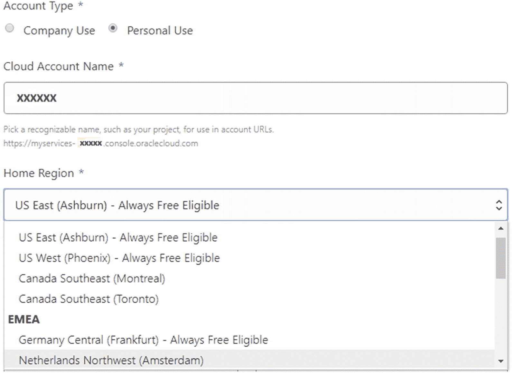

图 4-1

注册 Oracle 云基础设施账户

1.  访问 Oracle 云免费套餐页面：[`www.oracle.com/cloud/free`/](http://www.oracle.com/cloud/free/)。点击“免费开始使用”按钮。
2.  在 Oracle 云免费套餐注册屏幕上，选择您的国家/地区，输入您的姓名和电子邮件地址，并接受使用条款。
3.  这将进入下一个屏幕（见图 4-1），您可以在其中输入您的云账户信息，包括云账户名称。选择账户类型和符合“始终免费”条件的合适主区域。
4.  输入您的账户密码和手机号码以接收验证码。
5.  提供您的信用卡支付信息。除非您选择升级为付费账户，否则不会向您收费。

注册账户后不久，您将收到来自 Oracle 的确认电子邮件，其中包含云账户名称、用户名（您的电子邮件地址）以及云账户登录页面的链接。

图 4-2 显示了登录 Oracle 云后的主页面。“快速操作”部分显示了创建云服务（如 `ADW`）的快捷方式。免费云服务标记为“符合始终免费条件”。“开始探索”部分列出了有用的 Oracle 云在线文档。要启动任何云服务，您可以从 Oracle 云徽标下的下拉菜单中选择。免费试用账户可以随时升级为付费账户。免费试用期结束后，账户将仅限于使用那些“始终免费”的资源。一旦账户升级为付费账户，在试用额度用完后，您的信用卡将根据使用量进行扣费。

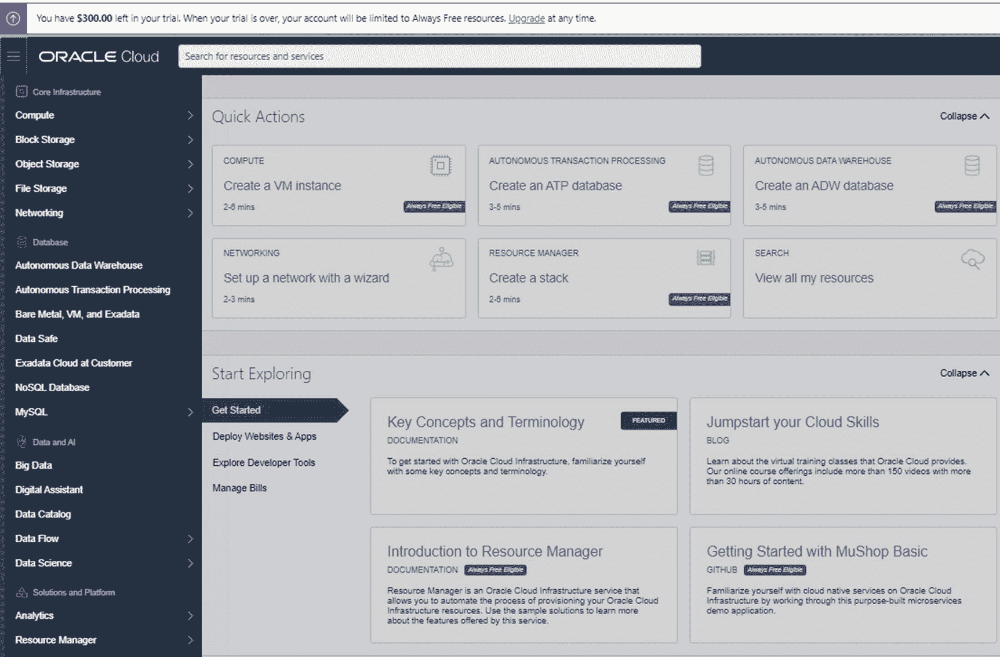

图 4-2

Oracle 云基础设施页面

## Oracle 自治数据库架构与组件

本节概述 Oracle 自治数据库主要组件的架构。Oracle 自治数据库云服务提供完全自治的数据库功能，包括 `ADW`、自治事务处理和自治 JSON 数据库。自动驾驶、自我安全、自我修复等特性完全自动化了数据库服务的配置、管理和维护。您可以使用易于使用的图形用户界面工具配置数据库服务、加载数据，并将您的应用程序连接到 `ADW`。

除了核心数据库服务，Oracle 自治数据库还提供一套协作工具。例如，`ADW` 包含数据集成和业务分析工具，如图 4-3 所示。

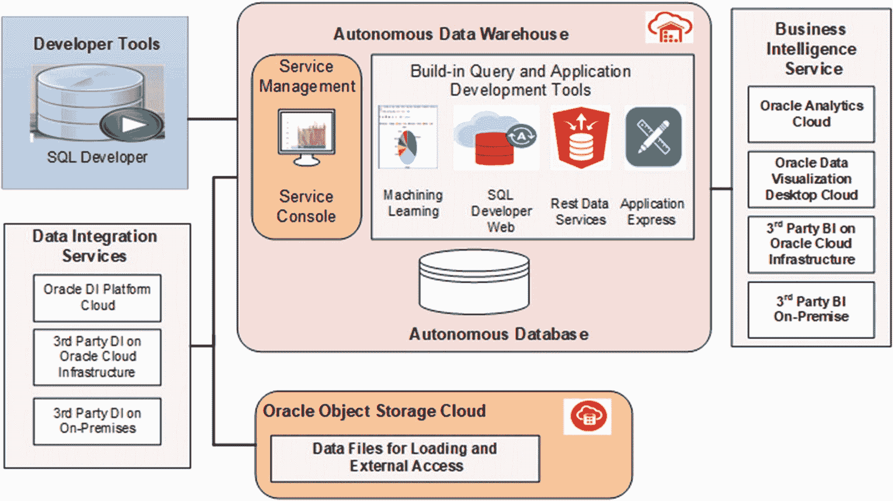

图 4-3

`ADW` 架构

`ADW` 针对数据仓库工作负载进行了优化。所有能与 Oracle 数据库配合使用的应用程序也应能与 `ADW` 配合使用。这些应用程序可以部署在您数据中心内的本地环境中，也可以部署在公有云上。图 4-3 显示，诸如 `SQL Developer` 和数据集成服务等开发工具可连接到 `ADW` 进行开发或数据集成。同时，商业智能应用程序服务也支持与 `ADW` 的连接。例如，通过连接到 `ADW`，Oracle 分析云或 Oracle 分析桌面可以创建业务数据可视化和分析。

# Oracle 自治数据仓库概述

Oracle 自治数据仓库包含一个基于云的服务控制台和多个基于云的内置查询及应用程序工具。服务控制台专为管理任务而设计，例如启动、停止和扩展数据库服务，以及服务监控任务，例如监控近期活动和数据库资源利用率。内置的查询和应用程序开发工具包括 `Oracle 机器学习`、`SQL Developer Web 版`、`Oracle REST 数据服务` 和 `Oracle Application Express`。我们将在本章末尾进一步讨论这些工具。

## Oracle 自治数据库属性

作为 Oracle 云数据库服务的一部分，Oracle 自治数据库是一个完全托管、预配置的数据库环境。它旨在为整个数据库生命周期带来完全自动化。自治数据库服务中嵌入了三种自治属性：`自动驾驶`、`自我安全`和`自我修复`。

`自动驾驶`属性包括数据库服务的快速配置、自动扩展、自动调优以及自动索引。借助这些功能，您无需配置任何硬件基础设施，也无需安装任何软件（如操作系统和 Oracle 软件），或运行数据库创建来配置 Oracle 自治数据库。您只需选择工作负载类型并指定规模信息，例如 CPU 核心数、内存大小和数据库存储大小。

Oracle 自治数据库服务可自动执行数据库生命周期管理任务，包括数据库的创建、管理和维护任务，例如数据库监控、调优、索引、备份/恢复、修补和升级。数据库配置完成后，您可以随时扩展 CPU 核心数、内存大小或存储大小。

`自我安全`属性确保自治数据库中的所有数据都以加密格式存储。只有经过身份验证的用户和应用程序才能通过基于证书的身份验证和安全套接字层 (SSL) 访问数据。基于证书的身份验证使用存储在客户端和服务器端钱包中的加密密钥。关键安全补丁会自动按需应用于堆栈的不同层级，包括固件、操作系统、虚拟机监控程序、Oracle Clusterware 和 Oracle 数据库。

`自我修复`意味着硬件和软件的自我修复特性。自我修复硬件特性基于 Exadata 基础设施独特的服务器故障检测、对故障设备的持续监控以及亚秒级 I/O 存储重定向。自我修复软件依赖于全天候在后台运行的监控工具和故障预防工具，以及自动问题检测和解决。它利用机器学习算法应用已知问题的诊断和解决方案。自我修复还得益于最大可用性架构，该架构可保护自治数据库免受硬件和软件故障导致的计划外停机，以及硬件和软件维护导致的计划内停机。

所有这些自治特性都自动化了数据库及其底层云基础设施的生命周期管理。这使得数据库用户和应用程序开发人员能够专注于开发应用程序，而不是管理和维护硬件和软件堆栈。

## 免费试用和始终免费中的自治数据库

如果您决定为您的 Oracle 云账户使用“始终免费”选项，您可以创建并访问最多两个 `ADW` 或 `ATP` 实例。为确保自治数据库实例保持免费，它不得超过以下资源和容量限制。

*   **处理器**：1 个 Oracle CPU 处理器（不可扩展）
*   **内存**：8 GB RAM
*   **数据库存储**：20 GB 存储（不可扩展）
*   **工作负载类型**：可选择事务处理或数据仓库工作负载类型
*   **数据库版本**：Oracle 数据库 21c 或 Oracle 数据库 19c
*   **基础设施类型**：共享 Exadata 基础设施
*   **最大并发数据库会话数**：20

如果“始终免费”自治数据库连续七天无活动，数据库将自动关闭。它可以随时重新启动。但是，如果“始终免费”自治数据库连续三个月处于关闭状态，数据库将自动终止并删除，数据库资源将被回收。

## 使用 Oracle 自治数据仓库

本节介绍如何使用 `ADW` 的协作环境来支持业务分析应用程序和机器学习。自治事务处理数据库的工作方式与 `ADW` 相同。

使用 Oracle 自治数据仓库从创建 `ADW` 实例开始。以下是一些典型任务。

*   配置 `ADW`
*   连接并查询 `ADW`
*   从/向 `ADW` 加载或导出数据

### 配置 Oracle 自治数据仓库

登录 `OCI` 后，您将进入主页面（见图 4-4）。

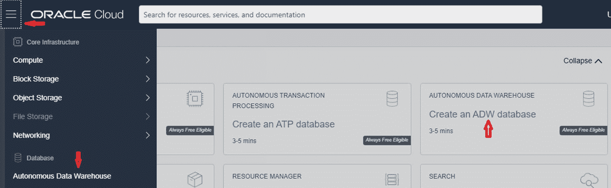
图 4-4 Oracle 云页面

要创建 `ADW` 实例，请转到 Oracle 云基础设施页面，然后在“快速操作”中单击“创建 `ADW` 数据库”，或单击 Oracle 云页面左侧导航菜单中的“自治数据仓库”。图 4-4 中的箭头突出显示了这些选项的位置。

在“自治数据库”对话框页面（见图 4-5）上，为自治数据仓库提供以下信息。

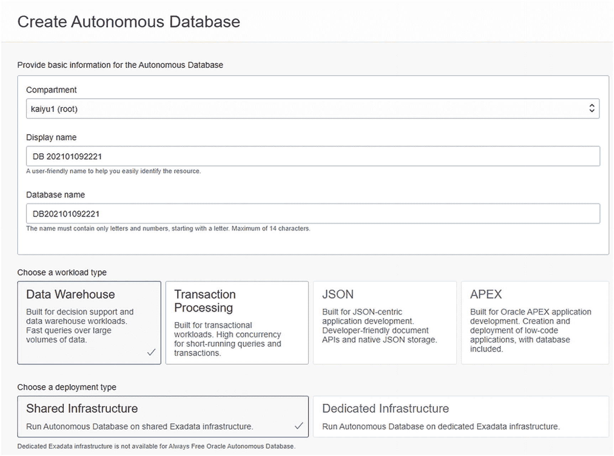
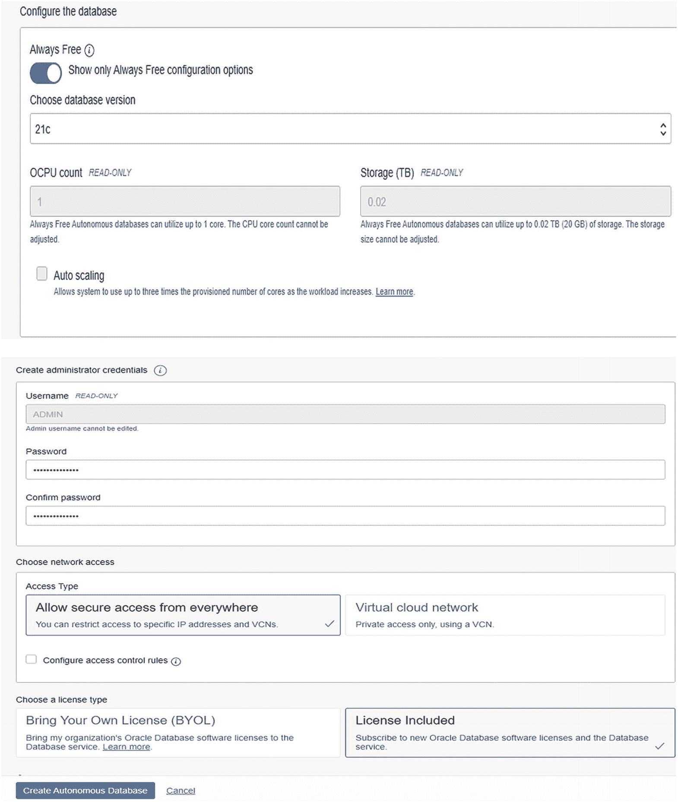
图 4-5 自治数据库对话框页面

1.  输入区间、数据库名称和显示名称。
2.  在工作负载类型中选择“数据仓库”。
3.  选择部署类型：共享基础设施或专用基础设施。
4.  确定是否仅显示“始终免费”配置选项。
5.  选择数据库版本。您可以选择 `19c` 或 `21c`。
6.  指定 `OCPU` 计数和存储大小（以 `TB` 为单位）。如果您选择“始终免费”选项，它将采用默认的固定配置：`OCPU=1` 且存储=`0.02TB`。
7.  如果选择了“自动扩展”，则启用它。
8.  创建管理员凭据。输入数据库管理员账户密码。
9.  选择网络访问。允许从任何地方进行安全访问，除非您只想使用虚拟云网络配置私有访问。
10. 选择许可证类型。选择“自带许可证”或“包含许可证”。

单击“创建自治数据库”。数据库实例将在大约 5 到 10 分钟内自动配置完成，具体时间取决于存储大小。

### 连接到 Oracle 自治数据仓库

成功创建 `ADW` 数据库后，您会在 `ADW` 徽标下方看到“AVAILABLE”字样（见图 4-6）。您会在数据库实例名称旁边看到 *Always Free*，这表示该数据库始终可用且免费。

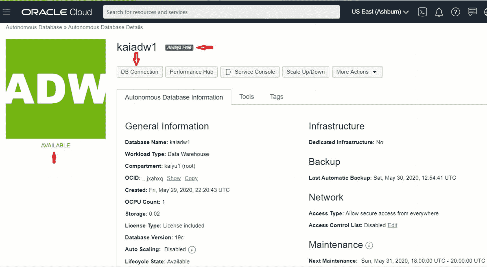
图 4-6 自治数据库信息页面

当通过公共互联网建立与 `ADW` 数据库的连接时，身份验证证书和安全套接字层 (SSL) 可确保数据库客户端与数据库服务器之间的通信完全加密且安全。证书认证使用存储在客户端和数据库服务器端（即您的 `ADW` 实例）钱包中的加密密钥。在建立通信之前，客户端存储的密钥必须与数据库服务器中存储的密钥匹配。要配置与此 `ADW` 实例的安全连接，您需要单击“DB Connection”按钮下载钱包（一个凭证 zip 文件），如图 4-6 所示。

这将进入数据库连接页面，如图 4-7 所示。您可以单击“Download Wallet”将钱包 zip 文件下载到本地计算机。如图 4-8 所示，钱包 zip 文件（`wallet_databasename.zip`）包含以下内容：


图 4-8 压缩的钱包文件


图 4-7 下载钱包

*   `tnsnames.ora` 和 `sqlnet.ora`：存储连接描述符和 `SQL*Net` 客户端配置的网络配置文件。
*   `cwallet.ora` 和 `ewallet.p12`：自动打开的 SSO 钱包和 PKCS12 文件。PKCS12 文件受 UI 中提供的钱包密码保护。
*   `keystore.jks` 和 `truststore.jks`：受下载钱包时提供的钱包密码保护的 JKS 信任库和密钥库。
*   `ojdbc.properties`：包含 JDBC 连接所需的钱包相关连接属性。该文件应与 `tnsnames.ora` 位于同一路径。

要将客户端连接到数据库，钱包 zip 文件需要作为连接配置的一部分包含在内。例如，如果您想使用 Oracle 客户端（如 Oracle `SQL*Plus`）连接到数据库，请按照以下步骤操作。

1.  将 `wallet_databasename.zip` 文件解压到一个目录；例如，`/home/oracle/adw`。

2. `cd $ORACLE_HOME/network/admin`，将`wallet_location`和`SSL_SERVER_DN_MATCH`这两个条目添加到`sqlnet.ora`文件中，如清单 4-1 所示。`wallet_location`条目指定了 Oracle 钱包的物理文件位置，其中包含由 SSL 处理的证书、密钥和信任点。将`SSL_SERVER_DN_MATCH`设置为 Yes 会强制要求数据库服务器的专有名称 (DN) 与其服务名称匹配。

1. 将`/home/oracle/adw/tnsnames.ora`中的数据库服务条目附加到`$ORACLE_HOME/network/admin/tnsnames.ora`中。

例如，将此数据库服务名称条目（如清单 4-2 所示）附加到`$ORACLE_HOME/network/admin/tnsnames.ora`中。

```
WALLET_LOCATION = (SOURCE = (METHOD = file) (METHOD_DATA = (DIRECTORY="/home/oracle/adw")))
SSL_SERVER_DN_MATCH=yes
```
清单 4-1：`sqlnet.ora` 文件中的两个条目

```
kaiadw1_low = (description= (retry_count=20)(retry_delay=3)(address=(protocol=tcps)(port=1522)(host=adb.us-ashburn-1.oraclecloud.com))(connect_data=(service_name=mojg gjecekbigkm_kaiadw1_low.adwc.oraclecloud.com))(security=(ssl_server_cert_dn="CN=adwc.uscom-east-1.oraclecloud.com,OU=Oracle BMCS US,O=Oracle Corporation,L=Redwood City,ST=California,C=US")))
```
清单 4-2：ADW 的数据库服务名称条目

通常，钱包 zip 文件中的`tnsnames.ora`文件包含三个标记为 high、medium 和 low 的数据库服务名称条目：`<database_name>_low`、`<database_name>_medium` 和 `<database_name>_high`。这些预定义的服务名称代表了数据库连接可以获得的资源和并发性的不同级别。您可以根据数据库连接的性能和并发性要求，使用其中一个服务名称连接到 ADW 数据库。例如，使用`kaiadw1_low`数据库服务名称连接到`kaiadw1` ADW 数据库，该连接为每个 SQL 语句提供最低级别的资源，并支持最大数量的并发 SQL 语句。清单 4-3 显示了使用 admin 用户和此`kaiadw1_low`数据库服务名称的 SQL*Plus 连接。

```
$sqlplus admin/admin_passwd@kaiadw1_low
```
清单 4-3：连接到 ADW 实例的 SQL*Plus 连接

要连接支持钱包的客户端应用程序（例如，SQL Developer 18.3 或更高版本），您可以选择 Cloud Wallet 作为连接类型，并在配置文件框中提供钱包 zip 文件，如图 4-9 所示。


图 4-9：使用 ADW 连接 SQL Developer

一旦 Oracle SQL Developer 连接到 ADW 实例，您就可以使用它来执行 SQL 语句、浏览数据库模式对象以及在 ADW 上执行许多其他任务，如图 4-10 所示。

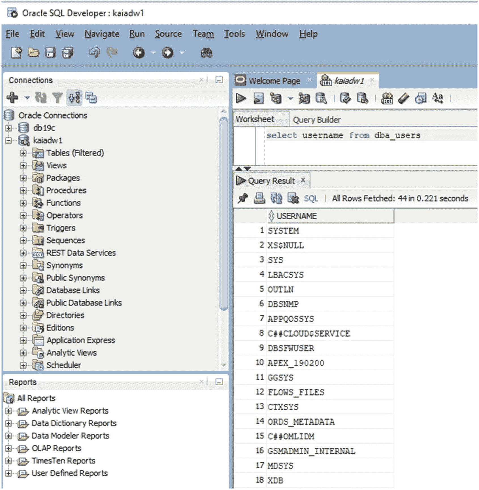

图 4-10：通过 Oracle SQL Developer 在 ADW 上执行 SQL 查询

### 将数据加载到 Oracle 自治数据仓库

要使用您的 ADW 数据库启动应用程序开发或机器学习项目，您可能需要将数据从各种数据源加载到数据库中，例如将 `.csv` 格式的文本文件加载到数据仓库。在 Oracle 自治数据仓库环境中，此数据加载过程包括三个步骤，如图 4-11 所示。

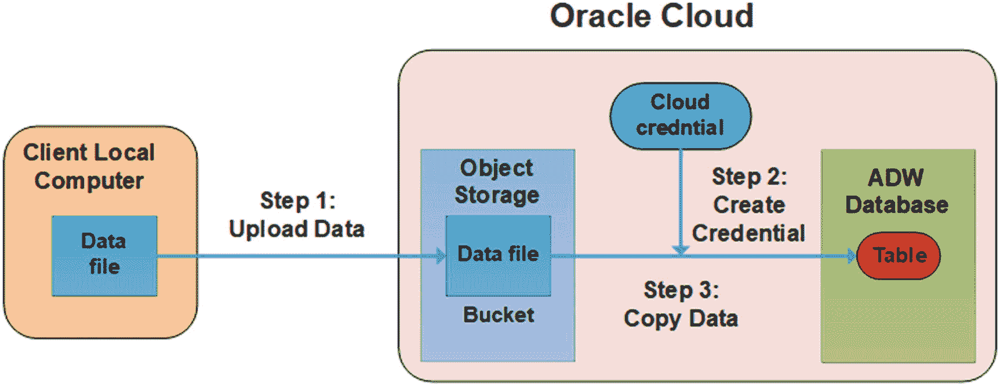

图 4-11：将数据加载到 Oracle ADW 的三个步骤

1.  将数据文件从客户端的本地计算机上传到对象存储。
2.  在 ADW 中创建适当的云凭证。
3.  将数据文件从对象存储复制到 ADW 中的表。

我们将在以下各节中详细讨论每个步骤。

#### 步骤 1：从本地计算机上传文件到对象存储

对象存储使用存储桶来组织文件。要将文件加载到对象存储，必须先在其中创建一个存储桶。请在 Oracle Cloud 控制台中执行以下步骤来创建存储桶。

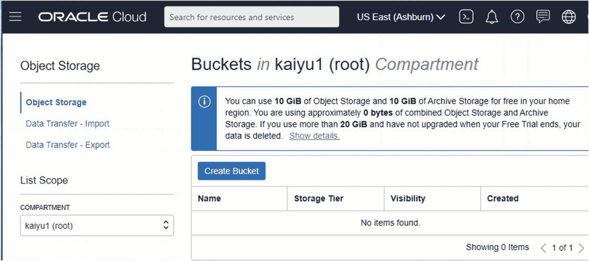

图 4-12：对象存储：创建存储桶

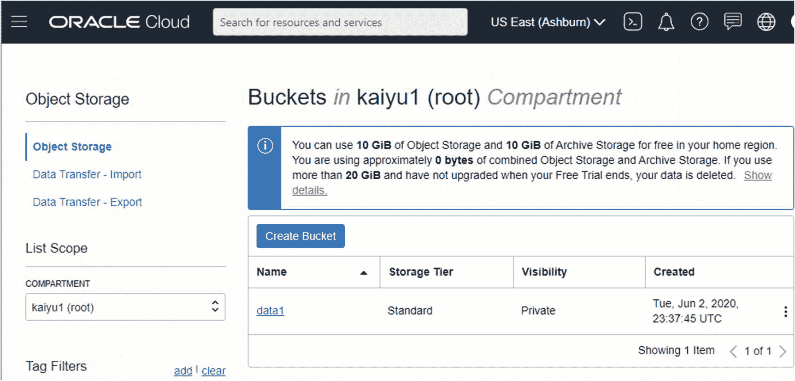

图 4-13：已创建 data1 存储桶

1.  在 Oracle Cloud 主页面，导航到对象存储并点击创建存储桶（见图 4-12）。
2.  在创建存储桶对话框中，输入存储桶名称（例如，`data1`）。选择存储层，然后点击创建存储桶。图 4-13 显示了已创建的 `data1` 存储桶。

请按照以下步骤将文件上传到存储桶窗口中的存储桶，如图 4-13 所示。

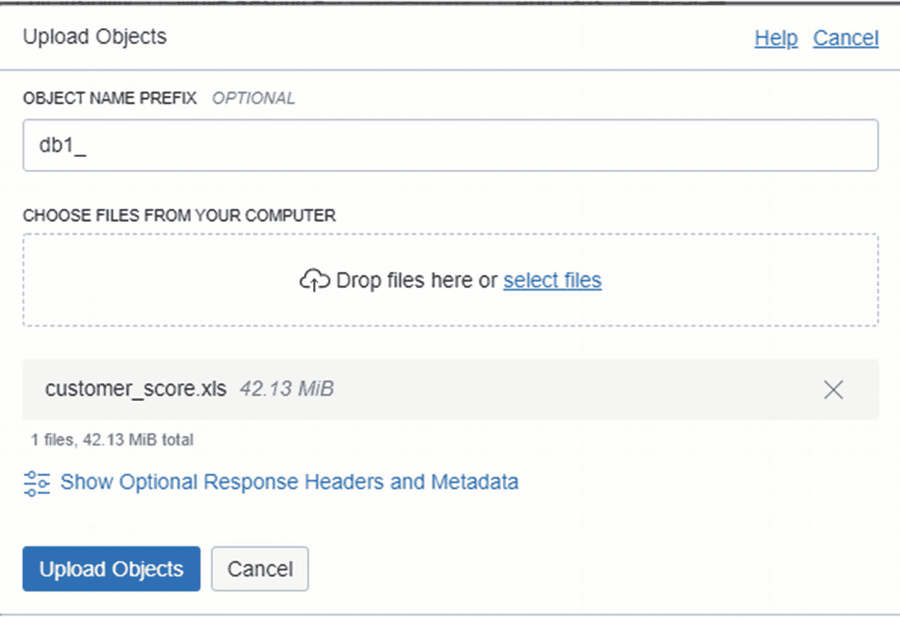

图 4-14：上传对象

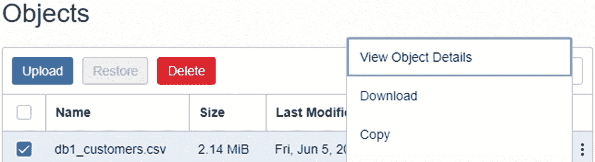

图 4-15：查看对象详细信息

1.  点击存储桶名称 (`data1`) 以获取存储桶的详细信息，然后点击上传对象（见图 4-14）。
2.  将文件拖入“将文件拖放到此处...或选择文件”对话框。
3.  可选：在对象名称前缀字段中指定文件名称前缀。
4.  点击上传对象以将文件加载到对象存储桶。
5.  上传文件后，通过点击查看对象详细信息来获取该文件的对象详细信息，如图 4-15 所示。对象详细信息如代码清单 4-4 所示。

```
Object Details

Basic Information

Name: db1_customers.csv

URL Path (URI): https://objectstorage.us-ashburn-1.oraclecloud.com/n/idudzqoitv0b/b/data1/o/db1_customers.csv

Storage Tier: Standard

Size: 2.14 MiB
```
清单 4-4：Object Details

## 从对象存储加载数据到自治数据仓库

最重要的详细信息之一是对象的 URL 路径（URI）。请保留此 URL 路径，因为它将在 `DBMS_CLOUD.COPY_DATA` 过程中使用。

### 步骤 2：创建凭证

要将数据从存储在对象存储中的文件加载到 ADW，您需要在 ADW 中创建一个对象存储凭证。请使用您的 OCI 登录名和一个身份验证令牌。

在您注册 Oracle Cloud 账户并登录 Oracle Cloud 后，请执行以下步骤为您的 OCI 登录创建身份验证令牌。

1.  在 Oracle Cloud 主页面，打开位于右上角的配置文件菜单 。然后点击用户设置（见图 4-16）以进入用户详细信息页面。

    

    图 4-16 配置文件菜单

2.  在用户详细信息页面（见图 4-17），找到资源部分并点击身份验证令牌。

    

    图 4-17 用户详细信息页面：身份验证令牌

3.  在身份验证令牌部分，点击生成令牌（见图 4-18）。

    

    图 4-18 生成令牌

4.  在生成令牌框中，输入令牌的描述；例如，`ADW_TOKEN`。

5.  点击生成令牌按钮。新的令牌字符串会显示出来（见图 4-19）。

    

    图 4-19 复制令牌字符串

6.  立即复制 `'nL7HEjMP{3>:;n4OVSdS'` 令牌字符串。使用 `ADW_TOKEN` 令牌名称和该令牌字符串，通过 `DBMS_CLOUD.CREATE_CREDENTIAL` 过程创建一个对象存储凭证。

在 `DBMS_CLOUD.CREATE_CREDENTIAL` 过程（见代码清单 4-5）中，`password` 参数使用 `'nL7HEjMP{3>:;n4OVSdS'` 令牌字符串。`username` 是 OCI 账户登录名。

```sql
BEGIN
  DBMS_CLOUD.CREATE_CREDENTIAL(
    credential_name => 'ADW_TOKEN',
    username => 'oracleidentitycloudservice/kai_yu@dell.com',
    password => 'nL7HEjMP{3>:;n4OVSdS'
  );
END;
/
```

**代码清单 4-5 在 ADW 中存储对象存储凭据**

### 步骤 3：将数据加载到自治数据仓库的表中

将数据加载到 Oracle Cloud 的对象存储服务后，您可以将此数据加载到 ADW 数据库中。首先，您需要通过执行代码清单 4-6 中的 DDL 来创建一个客户表。

```sql
create table customer
(
  customer number(38,0),
  age number(4,0),
  income number(38,0),
  marital_status varchar2(26 byte)
);
```

**代码清单 4-6 创建用于存储数据的客户表**

其次，如代码清单 4-7 所示，执行 `DBMS_CLOUD.COPY_DATA` 过程，将数据从对象存储中的 `db1_customer_score.xls` 文件复制到 ADW 中的 `customer` 表。此 `DBMS_CLOUD.COPY_DATA` 过程接受多个参数。

*   `table_name`：数据被复制到的表
*   `credential_name`：使用 `DBMS_CLOUD.CREATE_CREDENTIAL` 创建的凭证名称
*   `file_uri_list`：存储在对象存储桶中的源文件的 URL 地址，该地址从对象的对象详细信息中获取，如代码清单 4-4 所示
*   `Format`：描述源文件的格式（选项以 JSON 字符串形式指定）

```sql
BEGIN
  DBMS_CLOUD.COPY_DATA (
    table_name => 'CUSTOMER',
    credential_name => 'ADM_TOKEN',
    file_uri_list => 'https://objectstorage.us-ashburn-1.oraclecloud.com/n/idudzqoitv0b/b/data1/o/db1_customers.csv',
    format => json_object('ignore missing columns' value 'true', 'removequotes' value 'true', 'blankasnull' value 'true', 'delimiter' value ',')
  );
END;
/
```

**代码清单 4-7 从对象存储将数据加载到客户表**

如果您在使用 `COPY_DATA` 过程时遇到任何问题，可以查看过程执行时返回的错误消息以进行诊断。代码清单 4-8 是一个错误消息示例。

```
Error report -
ORA-20003: Reject limit reached, query table "ADMIN"."COPY$11_LOG" for error details
ORA-06512: at "C##CLOUD$SERVICE.DBMS_CLOUD", line 943
```

**代码清单 4-8 `DBMS_CLOUD.COPY_DATA` 过程错误消息**

此错误消息表明，您可以通过查询错误日志表 `COPY$11_LOG` 来获取错误消息的更多详细信息。代码清单 4-9 展示了对错误日志表的查询：

```sql
Select * from COPY$11_LOG;
ORA-29913: error in executing ODCIEXTTABLEOPEN callout
ORA-29400: data cartridge error
```

**代码清单 4-9 查询错误日志表 `COPY$11_LOG`**

此消息表明存在某些数据错误。在进一步调查数据后，发现数据异常是由于数据中存在一些空白字段。解决方案是将 `'blankasnull' value 'true'` 选项添加到 `DBMS_CLOUD.COPY_DATA` 的 `format` 参数的 JSON 对象中，如代码清单 4-7 所示，我们最初并未使用该选项。

## 将表/模式导入 Oracle 自治数据库

将模式或表从本地数据库迁移到 ADW 是一种常见操作。实现此类迁移的一种快速方法是将本地数据库中的模式或表导出为转储文件，然后将转储文件导入 ADW。为了实现快速稳定的导入，建议将转储文件上传到 Oracle 云对象存储，然后再导入到 ADW 数据库实例。图 4-20 展示了此迁移过程的四个步骤。

1.  将源数据库中的模式或表导出为转储文件。

2.  将转储文件上传到 Oracle 云中的对象存储。

3.  创建云身份验证凭证。

4.  将模式或表从转储文件导入到 ADW。导入过程在客户端计算机上进行。

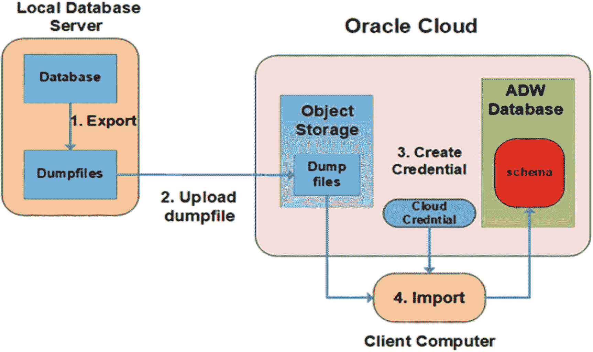

图 4-20 将模式/表导出和导入到 ADW

以下是四个步骤的详细说明。

**步骤 1. 从源数据库导出**

Oracle ADW 文档 [1] 建议为数据转储导出设置两个导出参数：`EXCLUDE` 和 `DATA_OPTIONS`。清单 4-10 显示了这两个参数的设置。

```
exclude=index,cluster,indextype,materialized_view,materialized_view_log,materialized_zonemap,db_link
```

# Oracle 数据仓库数据导入操作指南

## 清单 4-10
为数据转储导出设置两个参数

这些设置确保在导出中排除 ADW 中不需要的那些对象类型，并确保将表分区分组在一起，以便更快地导入到 ADW。清单 4-11 是从数据库 `K19cdb` 导出 `sales` 模式的示例。

```
$expdp sales/passwd@K19cdb  exclude=index,cluster,indextype,materialized_view,materialized_view_log,materialized_zonemap,db_link \
data_options=group_partition_table_data \
parallel =2 \
schemas=sales \
dumpfile=export%u.dmp \
encryption_pwd_prompt=yes \
log=expdp_k19c.log
```

## 清单 4-11
从源数据库导出 Sales 模式

此处，由于 `parallel` 参数设置为 2，因此仅生成两个转储文件：`export01.dmp` 和 `export02.dmp`。如果 ADW 实例具有更多 CPU，则可以将 `parallel` 参数设置为该数量。例如，如果有 16 个 CPU，则导出会生成 16 个转储文件，这允许您以 16 个并行流将它们导入到 ADW 实例，从而实现更快的导入。

为了提高数据库导出的安全性，您可以将 `encryption_pwd_prompt` 参数设置为 `Yes`。通过此设置，导出会提示输入密码以加密转储文件。

导入转储文件时，系统会提示您提供相同的加密密码来解密转储文件。

步骤 2. 将 `export01.dmp` 和 `export02.dmp` 转储文件上传到对象存储。执行此操作的方法与步骤 1 中介绍的方法相同。

步骤 3. 创建云身份验证凭证。让我们使用与上一节步骤 2 和清单 4-5 相同的方法来创建 `ADW_TOKEN` 凭证。

步骤 4：导入到自治数据仓库。

如图 4-20 所示，导入操作在安装了 Oracle 客户端软件的本地计算机上执行。为了从将要执行导入的本地计算机连接到自治数据仓库数据库，让我们向 `$ORACLE_HOME/network/admin/sqlnet.ora` 添加两个条目，如清单 4-12 所示。

```
WALLET_LOCATION = (SOURCE = (METHOD = file) (METHOD_DATA = (DIRECTORY="/home/oracle/adw")))
SSL_SERVER_DN_MATCH=yes
```

## 清单 4-12
`sqlnet.ora` 文件中的两个条目

ADW 数据库服务名称条目被复制到 Oracle 客户端安装中的 `$ORACLE_HOME/network/admin/tnsnames.ora`。清单 4-13 是 ADW 数据库服务名称条目的示例。

```
kaiadw1_low = (description= (retry_count=20)(retry_delay=3)(address=(protocol=tcps)(port=1522)(host=adb.us-ashburn-1.oraclecloud.com))(connect_data=(service_name=mojg gjecekbigkm_kaiadw1_low.adwc.oraclecloud.com))(security=(ssl_server_cert_dn="CN=adwc.uscom-east-1.oraclecloud.com,OU=Oracle BMCS US,O=Oracle Corporation,L=Redwood City,ST=California,C=US")))
```

## 清单 4-13
ADW 数据库服务名称条目

`SQLPLUS` 命令可以测试与 ADW 实例的连接，如清单 4-14 所示。

```
$sqlplus admin/admin_passwd@kaiadw1_low
```

## 清单 4-14
`SQLPLUS` 登录到 ADW 实例

在将转储文件导入到 ADW 数据库之前，您需要确保满足以下先决条件。

*   `export01.dmp` 和 `export02.dmp` 均已上传到步骤 2 中的对象存储。
*   已复制转储文件的 URL（参见清单 4-15）以用于导入操作。

```
https://objectstorage.us-ashburn-1.oraclecloud.com/n/idudzqoitv0b/b/data1/o/export01.dmp
https://objectstorage.us-ashburn- 1.oraclecloud.com/n/idudzqoitv0b/b/data1/o/export02.dmp
```

## 清单 4-15
两个转储文件的 URL

`ADW_TOKEN` 凭证已在步骤 3 中创建。满足所有这些先决条件后，`impdp` 命令（参见清单 4-16）将对象存储中转储文件中的模式导入到 ADW 数据库。

```
impdp admin/admin_passwd@kaiadw1_low \
directory=data_pump_dir \
credential=ADW_TOKEN \
dumpfile=https://objectstorage.us-ashburn-1.oraclecloud.com/n/idudzqoitv0b/b/data1/o/export01.dmp, https://objectstorage.us-ashburn-1.oraclecloud.com/n/idudzqoitv0b/b/data1/o/export02.dmp  \
parallel=2 \
encryption_pwd_prompt=yes \
partition_options=merge \
```

## 清单 4-16
导入到 ADW

默认情况下，导入日志文件 `import.log` 存储在 `data_pump_dir` 中，该目录是通过 `impdp` 的 `directory` 参数指定的。您可以通过在 ADW 中使用其管理员帐户运行以下查询来检查 `data_pump_dir` 的目录路径。例如，此查询结果类似于清单 4-17 中的结果。

```
Select directory_path from all_directories where directory_name = 'DATA_PUMP_DIR';

DIRECTORT_PATH
/u03/dbfs/A6B99C1F8E42C676E0539114000A16AF/data/dpdump
```

## 清单 4-17
`data_pump_dir` 目录路径

但是，由于 ADW 主机的此文件系统无法直接访问，因此您需要将此文件移动到对象存储，然后从对象存储下载此文件，而不是直接访问 `import.log` 文件。清单 4-18 展示了如何使用 `DBMS_CLOUD.PUT_OBJECT` 过程将 `import.log` 文件放入对象存储。

```
BEGIN
  DBMS_CLOUD.PUT_OBJECT(
    credential_name =>'ADW_TOKEN',
    object_uri =>'https://objectstorage.us-ashburn-1.oraclecloud.com/n/idudzqoitv0b/b/data1/o/import.log',
    directory_name  => 'DATA_PUMP_DIR',
    file_name       => 'import.log');
END;
/
```

## 清单 4-18
将导入日志放入对象存储

此过程执行后，`import.log` 会显示在对象存储中（参见图 4-21）。可以通过单击“下载”来下载此文件。


图 4-21：从对象存储下载 `Import.log`

## 使用 ADW 的 Oracle 机器学习

ADW 包含以下内置查询和应用程序开发工具（另请参见图 4-3）。

*   `Oracle 机器学习 (OML)`：一个基于 Web 的笔记本应用程序，提供简单的查询、数据可视化和协作功能。开发人员、业务用户和数据科学家可以使用该笔记本执行数据分析、数据发现和数据虚拟化。
*   `Oracle SQL Developer`：`Oracle SQL Developer` 的基于 Web 浏览器的界面。
*   `Oracle REST 数据服务 (ORDS)`：一种基于 Java 的数据服务，用于为关系数据和 JSON 文档存储开发现代 REST 接口。
*   `Oracle Application Express (APEX)`：一个低代码开发平台，使您能够构建可扩展、安全的企业应用程序。

可以通过 ADW 数据库详细信息页面的“工具”选项卡访问这些内置工具，如图 4-22 所示。我们重点关注 `Oracle 机器学习` 内置工具。如果您对其他工具感兴趣，请参阅 Oracle 公司于 2021 年 6 月发布的《在共享 Exadata 基础设施上使用 Oracle 自治数据仓库云服务指南》，文档编号 F35573-24 (URL: [`https://docs.oracle.com/en/cloud/paas/autonomous-database/adbsa/`](https://docs.oracle.com/en/cloud/paas/autonomous-database/adbsa/))。

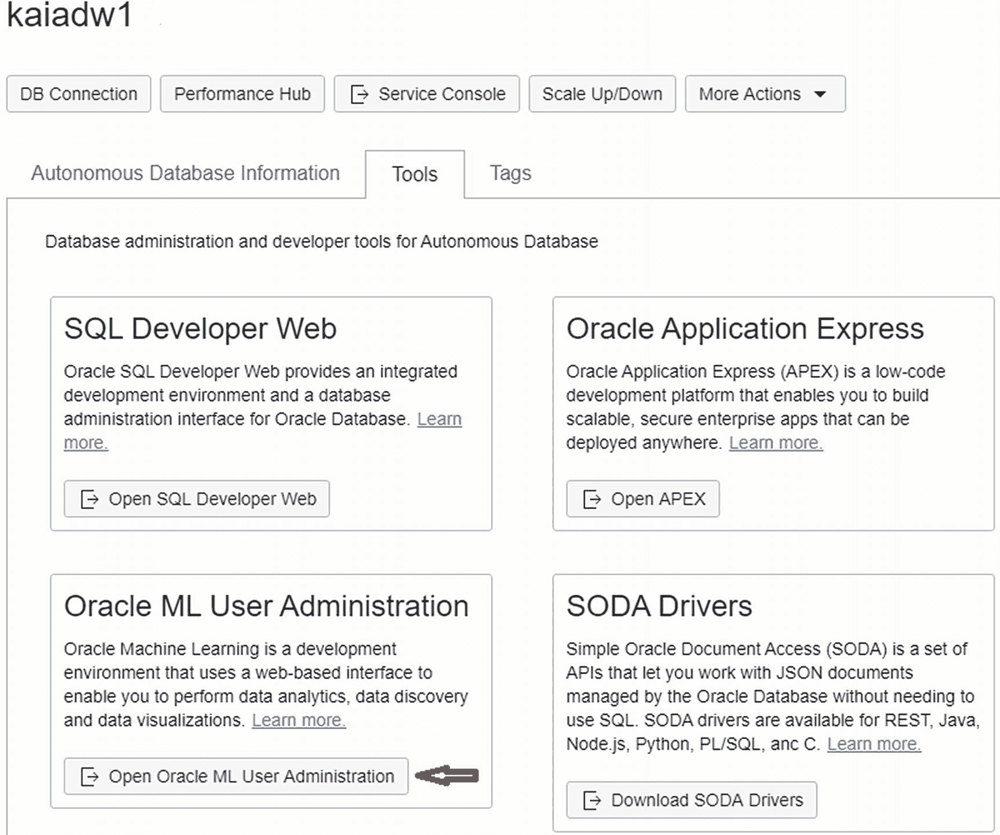
图 4-22：自治数据库构建工具

### 通过 Oracle 自治数据库访问 Oracle 机器学习

`Oracle 机器学习` 是 `Oracle 自治数据库` 的内置应用程序。您可以通过 `Oracle 自治数据库`（例如 ADW 实例）访问它，方法是将现有数据库用户帐户添加到 `Oracle 机器学习`，或使用 `Oracle 机器学习` 管理 GUI 创建新用户帐户。

执行以下操作以向 `Oracle 机器学习` 添加新用户帐户。

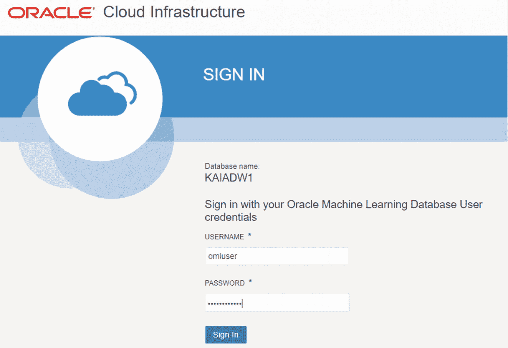
图 4-25：`Oracle 机器学习` 登录页面

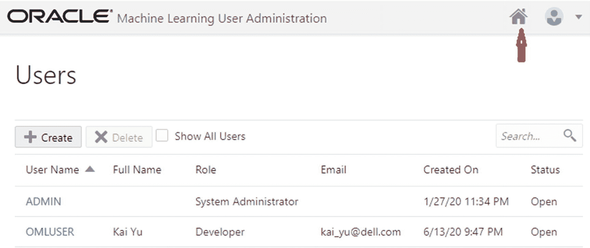
图 4-24：新用户已创建

1.  在自治数据仓库中单击“服务控制台”。
2.  在“服务控制台”上，单击“管理”。
3.  在“管理”中，单击“管理 OML 用户”以打开 `Oracle 机器学习` 用户管理页面（参见图 4-23），然后单击“创建”以打开“创建用户”页面。

    
    图 4-23：用户管理页面

4.  在“创建用户”页面上，输入所需信息，例如用户名、名字和姓氏、电子邮件地址和密码，然后单击“创建”。将创建一个新用户 `OMLUSER`。
5.  单击屏幕右上角的“主页”徽标（参见图 4-24）。这将带您进入 `Oracle 机器学习` 登录页面（参见图 4-25），您可以在其中使用您创建的用户名和密码登录 `Oracle 机器学习`。

您还可以将现有数据库用户帐户添加到 `Oracle 机器学习`。

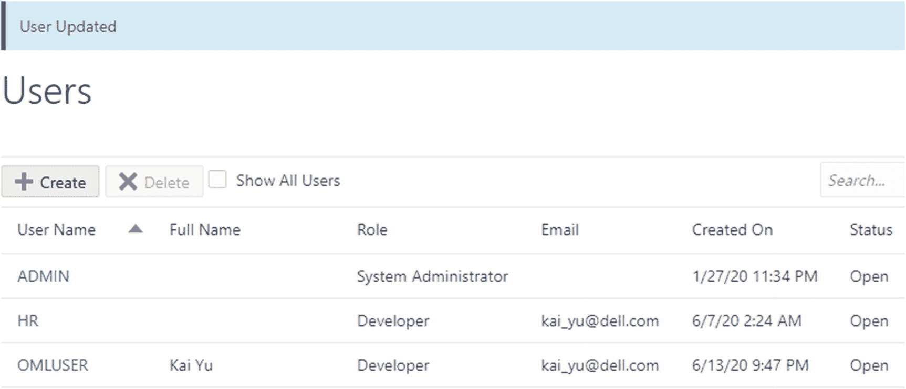
图 4-28：现有用户 HR 被授予 OML 开发者角色

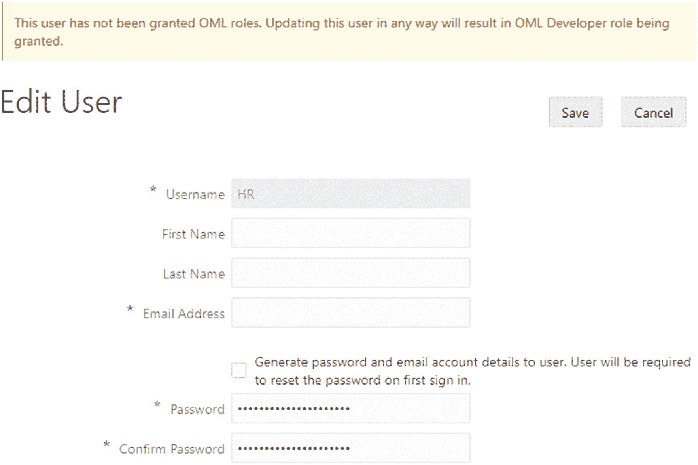
图 4-27：编辑现有用户以授予开发者角色

1.  在自治数据库实例中单击“服务控制台”。
2.  在“服务控制台”中，单击“管理”。
3.  在“管理”中，单击“管理 OML 用户”以打开 `Oracle 机器学习` 用户管理页面（参见图 4-26），然后单击“显示所有用户”以打开“创建用户”页面。

    
    图 4-26：用户管理页面

4.  选择一个用户（例如 HR）并单击以进入“编辑用户”窗口（参见图 4-27）。编辑窗口中的任何字段，然后单击“保存”。这将导致向 HR 用户授予 OML 开发者角色，如图 4-28 所示。

## 总结

本章介绍了 Oracle 云基础设施服务，并特别关注了自治数据库云服务。我们讨论了如何在 OCI 服务和自治数据库（如 ADW）上注册免费套餐帐户，以及如何实现“始终免费”服务以利用这些云服务进行持续的机器学习项目。我们还讨论了如何执行一些重要任务，例如建立数据库连接、加载数据以及将模式和表导入 ADW，这些可以被视为使用 ADW 进行机器学习项目所必需的数据库技能。在本章末尾，我们介绍了 ADW 中的 `Oracle 机器学习` 内置工具。下一章将重点介绍如何使用此工具开发机器学习项目。

# 5. 使用自治数据库运行 Oracle 机器学习

上一章探讨了 `Oracle 机器学习 (OML)`，这是自治数据库提供的内置环境。我们讨论了如何添加数据库用户帐户或为现有数据库用户帐户授予机器学习开发者角色。此角色使数据库帐户用户能够使用 OML 环境和自治数据库进行机器学习项目。`Oracle 机器学习` 适用于两种类型的 Oracle 自治数据库：自治数据仓库 (ADW) 和自治事务处理 (ATP)。

本章深入探讨 `Oracle 机器学习` 环境。它讨论了环境的元素（工作区、项目和笔记本）以及如何为协作式 OML 开发项目在开发人员之间共享此环境。我们探讨了两个重要的笔记本设置：数据库连接设置和解释器绑定设置。数据库连接设置指定笔记本及其后端数据库（在本例中为 Oracle 自治数据库）的链接。虽然本章的其余部分侧重于 ADW，但内容也适用于 ATP。

笔记本的解释器绑定决定了段落如何被解释和执行。一个重要的解释器绑定是与 Oracle 数据库的 SQL 和 PL/SQL 解释器（本质上是自治数据库）的绑定。通过设置解释器绑定和与 ADW 数据库的数据库连接，您可以在笔记本中创建并运行针对后端 ADW 数据库的 SQL 语句和 PL/SQL 脚本。通过利用 OML 中的 SQL 和 PL/SQL 支持，笔记本、开发人员、数据科学家和业务分析师可以完成其机器学习项目中的一些关键任务。

*   在笔记本中运行 PL/SQL 脚本允许 Oracle SQL 机器学习 (OML4SQL) 包执行基本的机器学习任务，例如数据转换、模型构建和模型评估。
*   在笔记本中执行 SQL 语句会从自治数据库中获取结果数据。结果数据可以以各种格式显示，用于数据分析、数据发现和数据可视化。

本章涵盖以下主题。

*   OML 协作环境
*   运行 SQL 脚本和 SQL 语句
*   笔记本和数据可视化

## Oracle 机器学习协作环境

在 ADW 等 Oracle 自治数据库中，`Oracle 机器学习` 笔记本提供了一个基于 Web 的协作式界面，用于数据分析、数据发现、数据可视化和协作。此笔记本环境基于 Apache Zeppelin 笔记本，允许数据科学家和开发人员协作构建、评估和部署机器学习模型。您可以在笔记本中编写代码、脚本和文本，并在 ADW 数据库中执行它们。笔记本允许您根据执行的代码或脚本（例如 SQL 查询结果或来自 ADW 的 SQL 脚本）创建数据可视化并执行数据分析。

### Oracle 机器学习入门

要在 ADW 中使用 `Oracle 机器学习`，您需要使用具有 OML 开发者角色的 ADW 数据库用户帐户登录 OML。ADW 数据库的管理员可以创建一个具有 OML 开发者角色的新数据库用户帐户，或者简单地将 OML 开发者角色授予 ADW 中的现有用户，如第 3 章所述。

登录 OML 后，您将进入主页（见图 5-1）。

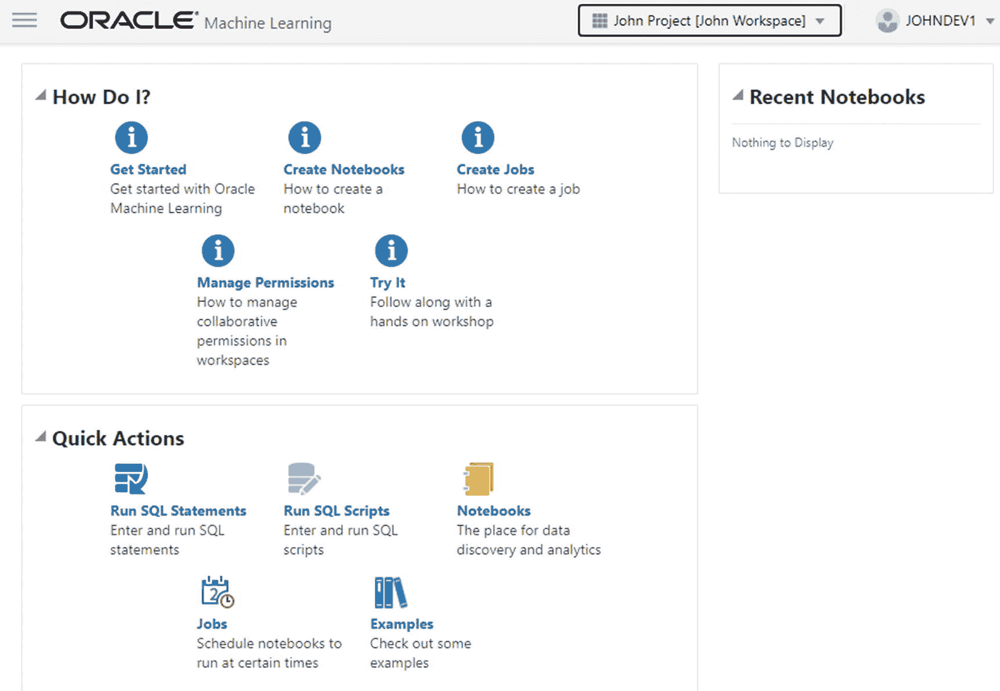
图 5-1：`Oracle 机器学习` 主页

页面上有两个部分。“我该怎么做？”部分提供了许多在线文档和实践教学材料的链接。“快速操作”部分包含指向操作页面的链接。单击“笔记本”、“运行 SQL 语句”或“运行 SQL 脚本”将分别进入笔记本创建页面、SQL 查询草稿页面或 SQL 脚本草稿页面。“示例”链接列出了许多很好的示例，您可以尝试这些示例来获得机器学习任务的实践经验。“作业”链接允许您调度要在笔记本中运行的作业。

在主页的右上角，一个文本框  显示了当前项目名称和工作区名称。OML 提供了三个层级来组织内容：工作区、项目和笔记本。工作区是您可以存储项目的区域。一个项目可以有一个或多个笔记本。换句话说，工作区是项目的容器，而项目是笔记本的容器。

当用户首次登录 OML 时，会创建一个初始工作区和一个默认项目。如图 5-2 所示，新用户登录名 `Johndev1` 被提供了初始工作区 `John Workspace` 和默认项目 `John Project`。

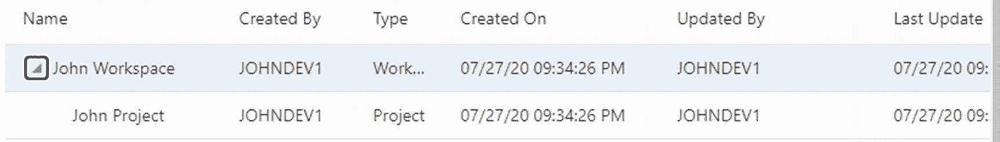
图 5-2：初始工作区和默认项目

用户还可以创建其他工作区和项目，并选择不同的工作区和项目来创建笔记本。如图 5-3 所示，通过单击 `Oracle 机器学习` 主页右上角的文本框，您可以看到一个项目工作区下拉列表，您可以从中选择一个项目、创建一个新项目或管理工作区和权限。列表顶部指示当前项目和当前工作区。

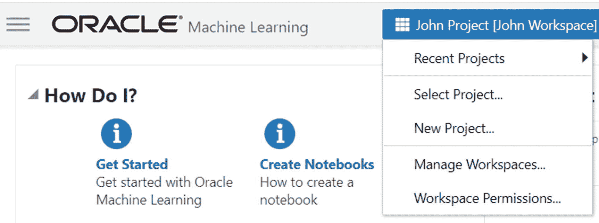
图 5-3：项目工作区下拉列表

要创建新项目，您可以使用现有工作区，也可以通过单击 +（加号）创建新工作区，如图 5-4 所示。

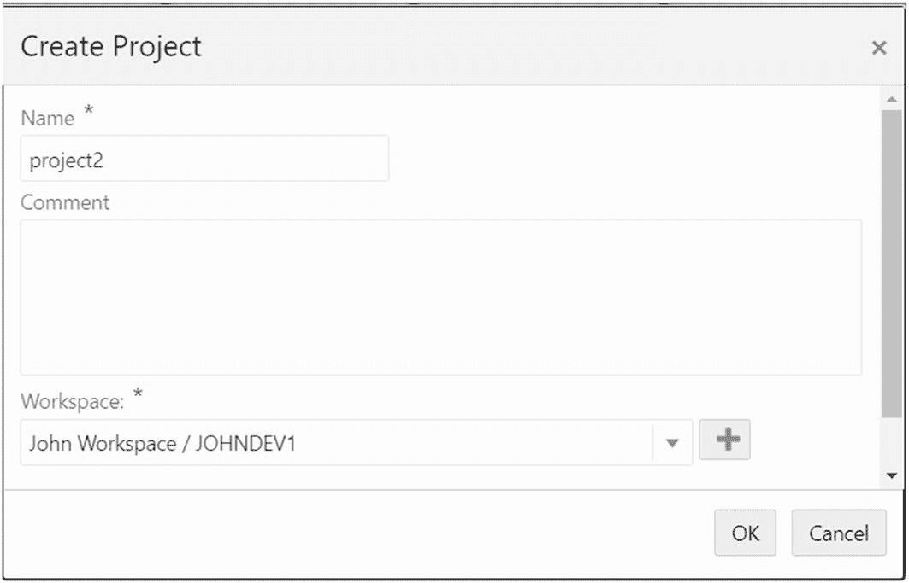
图 5-4：创建项目

图 5-5 展示了两个登录用户 `Johndev1` 和 `Nancydev2` 及其在 OML 中的工作区、项目和笔记本，以及它们如何连接到 ADW 数据库的示例。

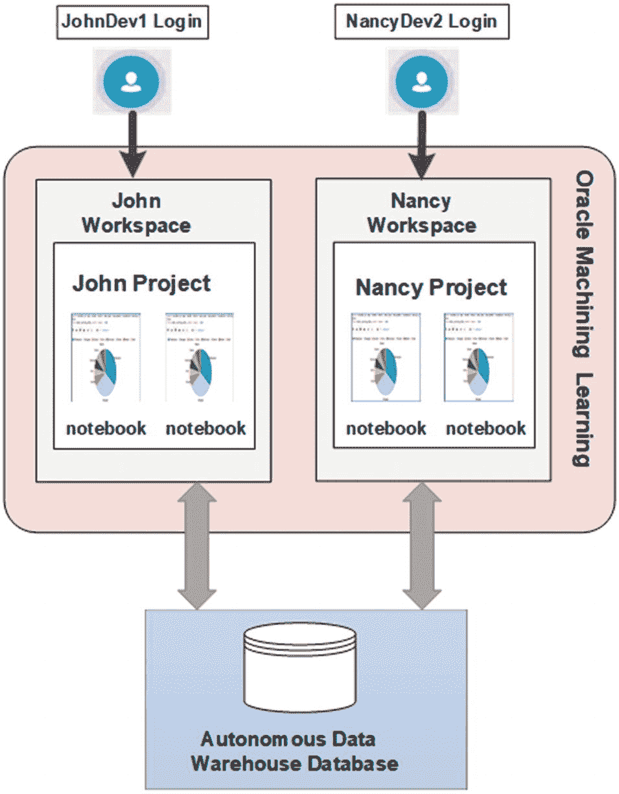
图 5-5：用户登录及其工作区、项目和笔记本

### 与其他用户共享工作区

您可以通过允许其他用户访问您的工作区以及工作区内的项目和笔记本，与他们进行协作。您可以向其他用户授予三种不同类型的工作区访问权限。

*   **管理者**：对工作区仅查看；对项目可创建、更新和删除；对笔记本可创建、更新、运行、删除和调度作业。请注意，拥有管理者权限的用户还可以在所有者账户上删除表并运行任何脚本。
*   **开发者**：对工作区仅查看；对项目仅查看；对开发者自己创建的笔记本可创建、更新、运行或删除。请注意，拥有开发者权限的用户还可以在所有者账户上删除表并运行脚本。您只能查看和运行来自共享笔记本的作业。开发者不能为共享的笔记本创建作业。

要向其他用户授予访问权限，请单击 OML 主页右上角的“项目和 Workspace”框以获取下拉列表。然后，选择“工作区权限”，如图 5-6 所示。

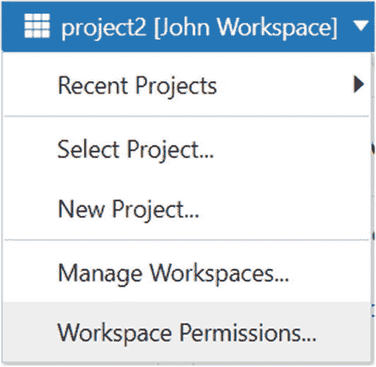
图 5-6：下拉列表

在“工作区权限”窗口中，从菜单中选择用户和权限类型：管理者、开发者和查看者，如图 5-7 所示。单击 `+添加` 和 `确定`。

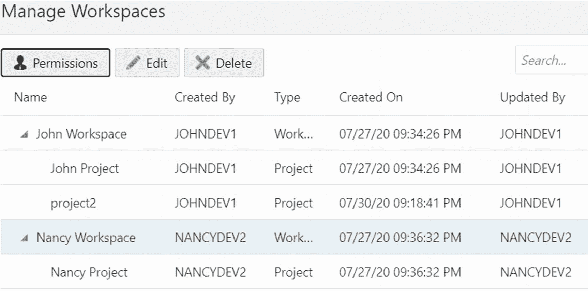
图 5-8：`Nancydev2` 拥有 `John Workspace` 的访问权限

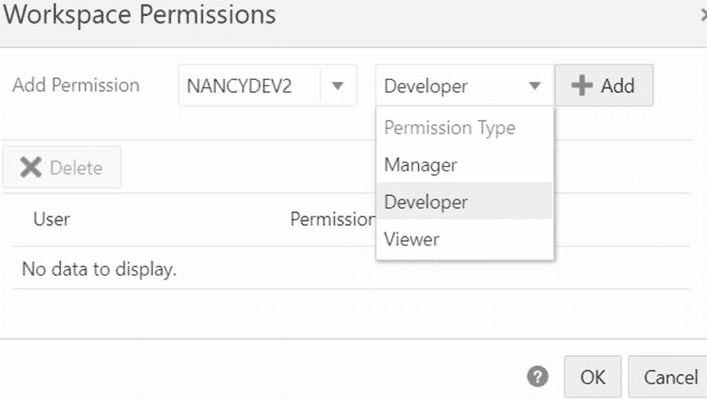
图 5-7：工作区权限窗口

接下来，用户获得访问共享工作区的权限。如图 5-9 所示，除了默认的 `Nancy Workspace` 之外，`Nancydev2` 用户还拥有 `John Workspace` 以及两个项目 `John Project` 和 `project2` 的访问权限。

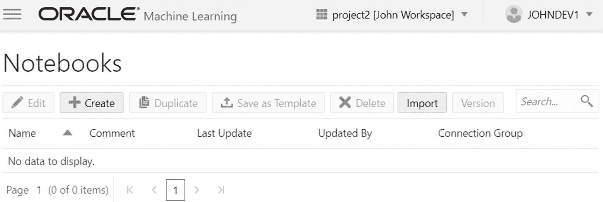
图 5-9：笔记本屏幕

### 创建机器学习笔记本

选择项目或创建新项目后，您可以在所选项目内创建笔记本。您可以通过点击快速操作区域中的笔记本图标，或在 OML 主页左上角的下拉菜单中选择“笔记本”来开始创建笔记本。这将进入笔记本页面，如图 5-9 所示。

点击“创建”按钮将进入“创建笔记本”对话框。您可以在“名称”字段中指定笔记本名称，并在“注释”字段中输入任何注释。在“连接”字段中，您可以采用默认的“全局”连接组，然后点击“确定”按钮完成创建过程，如图 5-10 所示。

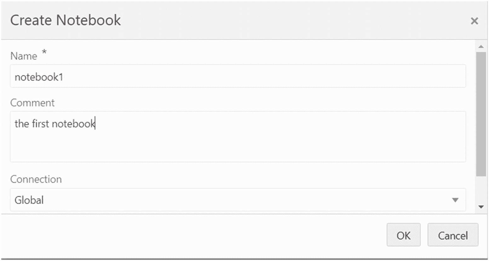
图 5-10：创建笔记本

“连接”字段指定了笔记本如何连接到获取查询结果的后端数据库。该连接组由一种连接类型组成：全局。当新数据库配置完成后，会自动创建全局连接组。它指向笔记本创建者（本例中为 `JohnDev1`）所属的 ADW 数据库。

您可以通过以管理员账户登录 OML 来验证此配置。在登录主页左侧的下拉菜单中，点击“连接组”进入“连接组：全局”页面（见图 5-11）。

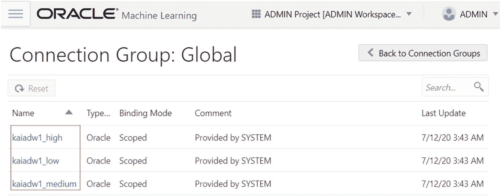
图 5-11：默认全局连接组

此全局连接组包含三个指向 ADW 数据库的数据库服务（高、中、低）。

### 指定解释器绑定和连接组

您可以在笔记本中编写 SQL 语句或 PL/SQL 脚本。您需要了解这些 SQL 语句和 PL/SQL 脚本是如何被解释和执行的。这个问题的答案与笔记本的解释器绑定有关。一个 Zeppelin 笔记本由多个段落组成，这些段落可以包含文本、SQL 语句和脚本（PL/SQL）。段落中的这些不同内容需要不同的解释器来处理。通常，解释器的名称设置在段落顶部，如下所示。

*   `%md`：使用纯文本格式化语法，可转换为 HTML 格式的 Markdown 语言
*   `%sql`：运行单个 SQL 语句
*   `%script`：运行一组 SQL 语句或 PL/SQL 脚本

Oracle 数据库在后端提供 SQL 解释器和脚本解释器，用于处理诸如 SQL 和 PL/SQL 之类的数据处理语言。为了让笔记本使用这些解释器，您需要将其绑定到一个解释器，以便从数据库或任何数据源获取数据。`Oracle 机器学习` 笔记本必须设置解释器绑定，以连接 ADW 数据库解释器组中的 SQL 和 PL/SQL 解释器。

笔记本有一个解释器设置规范，其中包含一个内部绑定列表，该列表决定了解释器组中解释器绑定的顺序。解释器的名称采用“数据库名 _ 服务名”的格式；例如，图 5-12 中的 `kaiadw1_low %sql`（默认）、`%script`。您可以通过点击屏幕右上角的齿轮图标  来检查解释器绑定的顺序。

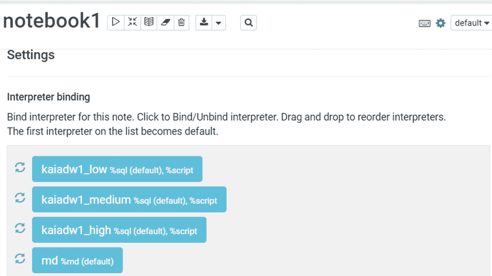
图 5-12：解释器绑定

图 5-12 展示了 Oracle 数据库解释器组中解释器绑定的默认顺序示例。

*   `kaiadw1_low %sql`（默认）、`%script`：它为每条 SQL 语句提供最低级别的资源。但它可以支持最大数量的并发 SQL 语句。此解释器优先级较低，被列为默认选项。此解释器可用于 SQL 语句和 PL/SQL 脚本。
*   `kaiadw1_medium %sql`（默认）、`%script`：它为每条 SQL 语句提供较低级别的资源。但它可以支持更多的并发 SQL 语句。此解释器可用于 SQL 语句和 PL/SQL 脚本。
*   `kaiadw1_high %sql`（默认）、`%script`：它为每条 SQL 语句提供最高级别的资源。此解释器通过支持最少数量的并发 SQL 语句来提供最高性能。此解释器可用于 SQL 语句和 PL/SQL 脚本。
*   `Md %md`（默认）：它提供纯文本格式化语法，可转换为 HTML 格式。

您可以通过拖放解释器绑定来更改顺序。列表中的第一个解释器绑定是默认选择。您可以点击为此笔记本绑定/解绑解释器。您也可以更改任何特定段落的解释器绑定。

笔记本的连接组定义了一组到这些解释器的连接。由于 SQL 和 PL/SQL 解释器在 Oracle 数据库解释器组中使用，因此连接组也是数据库连接的集合。默认情况下是“全局连接组”，如图 5-13 所示。连接组是全局的。

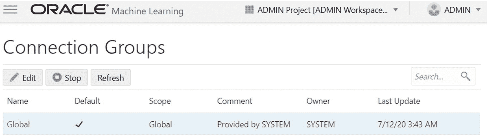
图 5-13：连接组

当创建新的 ADW 数据库时，会自动创建此全局连接组。此全局连接组的连接类型为“全局”，并包含一个作为计算资源的数据库连接列表。点击“全局”一词会显示列在“计算资源”下的数据库连接，例如 `kaiadw1_high`、`kaiadw1_medium` 和 `kaiadw1_low`，如图 5-14 所示。您可能已经注意到，这些数据库连接名称也显示在图 5-12 的解释器绑定中。这些连接表示与笔记本的解释器绑定的连接。

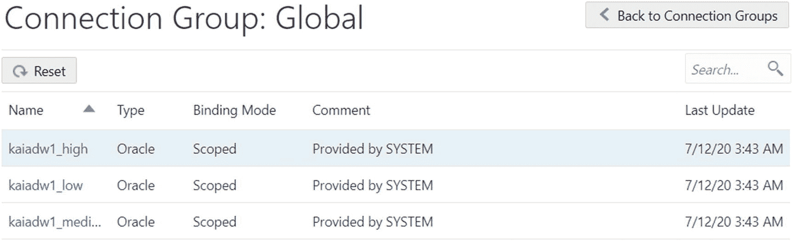
图 5-14：全局连接组的数据库连接

当笔记本使用 `kaiadw1_low %sql` 解释器绑定时，它会使用 `kaiadw1_low %sql` 解释器来解释 SQL 语句。它还会使用 `kaiadw1_low` 数据库服务连接到数据库。

一旦使用解释器绑定设置创建了笔记本，您就可以编写包含 SQL 语句或 PL/SQL 脚本的段落，用于数据分析、数据发现和数据可视化。您可以通过点击运行图标  来运行一个或所有代码段落。结果可以通过点击下载图标  导出。

图 5-15 展示了您可以在笔记本中编写和执行 SQL 查询语句。

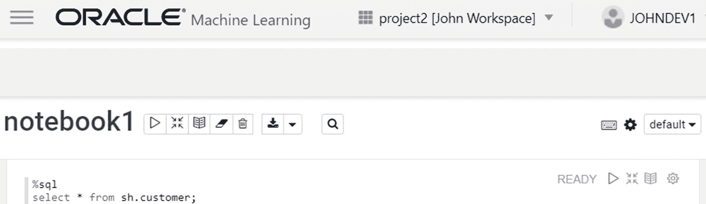
图 5-15：编辑笔记本

## 运行 SQL 脚本和语句

通常，数据库应用程序开发环境允许编写或执行单个 SQL 语句以及 SQL 或 PL/SQL 脚本。接下来，我们讨论 `Oracle 机器学习` 笔记本环境如何支持这两种方式。

### 在笔记本中创建并执行 SQL 脚本

借助 `SQL Developer` 或 `SQL*Plus` 工具，您可以在 `Oracle Machine Learning` 笔记本中编写和执行 SQL 脚本。您可以将多个 SQL 语句或 PL/SQL 块放入一个脚本中，在笔记本中运行该脚本，并将其保存为 JSON 文件。

要创建 SQL 脚本，请在 OML 主页上单击“运行 SQL 脚本”以打开 SQL 草稿板。然后输入 `%script` 并按 Enter 键，打开下一行以输入和编辑 SQL 脚本。完成脚本编辑后，您可以单击  按钮在后端数据库中运行该脚本。

图 5-16 展示了创建一个调用 `CREATE_MODEL` 过程的示例 SQL 脚本。这是用于机器学习模型创建的 ML4SQL 过程。

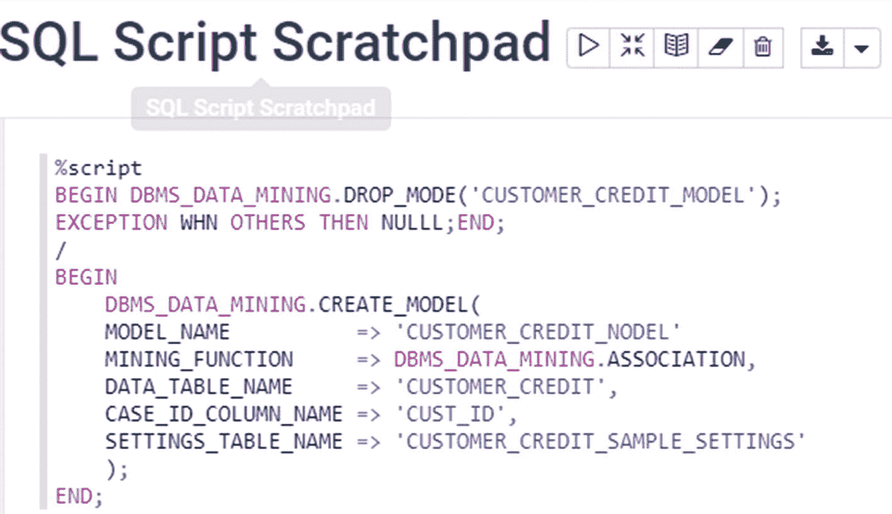
图 5-16：创建 SQL 和 PL/SQL 脚本

您还可以通过单击  图标，将 SQL PL/SQL 脚本导出为本地系统中的 .json 文件。

### 在笔记本中运行 SQL 语句

通过连接组设置以及与后端 ADW 数据库的解释器绑定，`Oracle Machine Learning` 笔记本可以被视为 ADW 数据库的 Web 前端开发和 GUI 界面。您可以在笔记本中编写 SQL 语句，并让后端 ADW 数据库解释和执行这些语句，类似于 `SQL*Plus` 或 `SQL Developer` 等 Oracle 客户端工具连接到后端的 ADW 数据库。

登录 OML 后，在“快速操作”部分单击“运行 SQL 语句”，SQL 查询草稿板随即打开。在 SQL 查询草稿板上，输入 `%sql` 并按 Enter 键。您可以在下一行输入 SQL 语句。要运行该 SQL 语句，请单击  或按 `Shift+Enter` 键。如果 SQL 语句成功运行，其执行状态将显示为 FINISHED；如果出现错误，则显示为 ERROR 并附带错误消息（见图 5-17）。

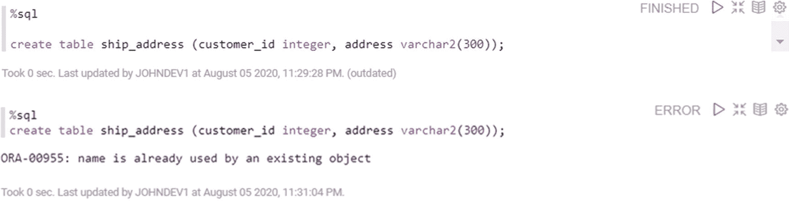
图 5-17：执行 SQL 语句并返回状态

`Oracle Machine Learning` 笔记本使您能够可视化数据。如果您运行一条 select 语句从后端数据库获取数据。例如，在 `select * from sh.customers` 中，该语句被发送到解释器执行。它从后端数据库获取数据，并显示在 select 语句下方的输出区域中。输出会话默认以表格格式显示数据，如图 5-18 所示。

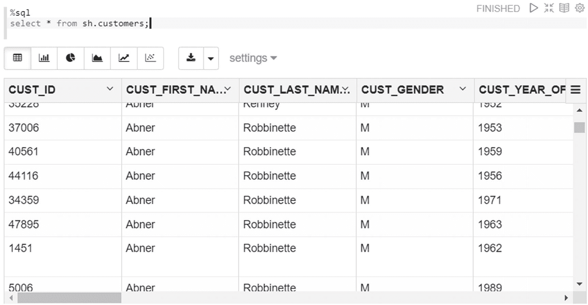
图 5-18：在笔记本中运行 select 语句

## 使用笔记本分析和可视化数据

当 SQL select 语句的结果数据显示在输出区域后，您可以基于结果数据创建各种图形展示。当您单击图 5-19 中所示的任意图标时，将获得结果数据对应的图形显示。从左到右，这些图标分别代表表格、条形图、饼图、面积图、折线图、散点图和下载为 CSV/TSV。


图 5-19：图形显示图标

这些数据的图形表示是数据分析和数据可视化的关键特性，并广泛应用于机器学习中。

图 5-20 中的设置图标允许您指定展示的 X 轴和 Y 轴。单击它可显示 select 语句中的所有字段名称。您可以将字段拖放到三个框中：键、组和值。如果您选择条形图作为图形显示，设置允许您指定以下内容。

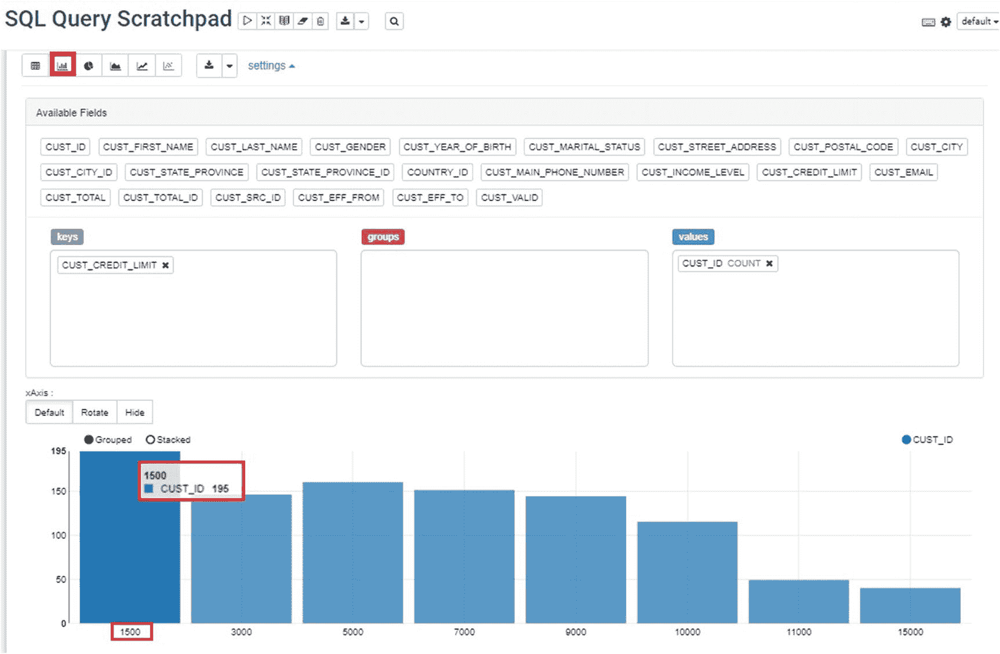
图 5-20：条形图：按客户信用额度统计的客户数量

*   “键”选项卡和“组”选项卡设置图形的 X 轴字段。
*   “值”选项卡设置图形的 Y 轴，即字段的 SUM、COUNT、AVG、MIN 或 MAX。

图 5-20 展示了一个条形图示例。

*   X 轴的键值为 `cust_credit_limit` 字段
*   Y 轴为 `CUST_ID` 的计数

通过此设置，条形图显示了按每个客户信用额度划分的客户数量分布。例如，第一个条形图显示有 195 名客户的信用额度为 1500。

如果将 `CUST_CREDIT_LIMIT` 字段移动到“组”选项卡，条形图 X 轴的单位会发生变化，如图 5-21 所示。

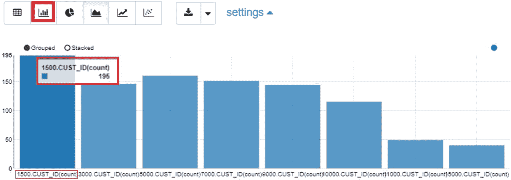
图 5-21：条形图：按客户信用等级统计的客户数量

您还可以选择饼图图标 。图 5-22 展示了按客户数量统计的信用额度饼图。

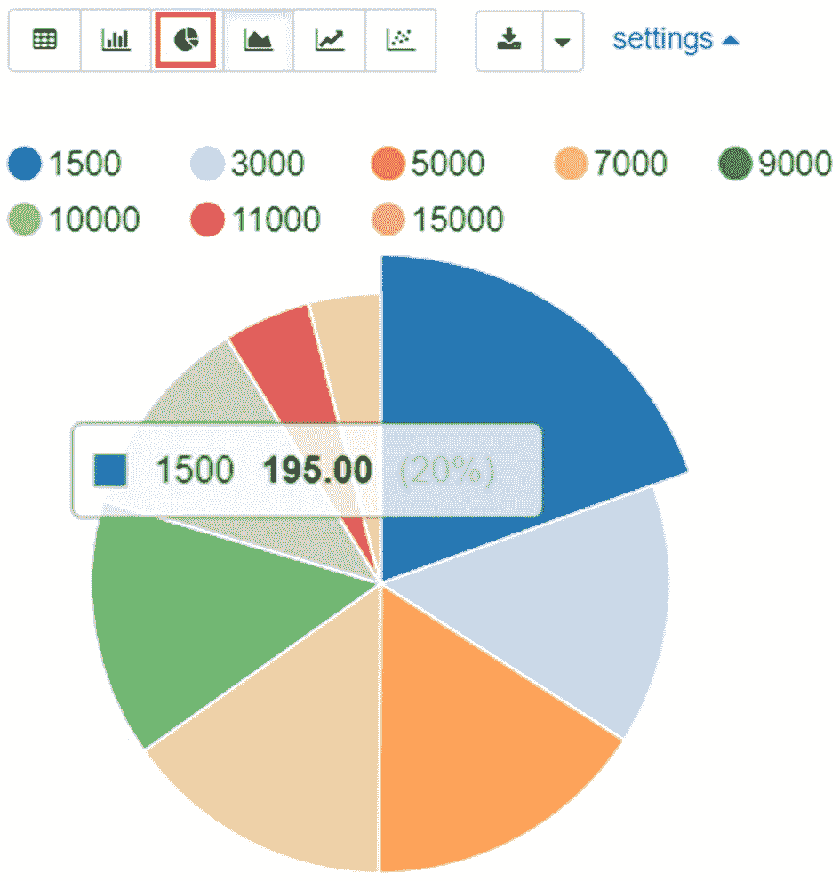
图 5-22：饼图

如果您选择面积图图标或折线图图标（见图 5-19），并将 `CUST_YEAR_OF_BIRTH` 字段作为键，`CUST_ID` 计数作为值，您将得到显示客户出生年份分布的面积图或折线图，如图 5-23 所示。

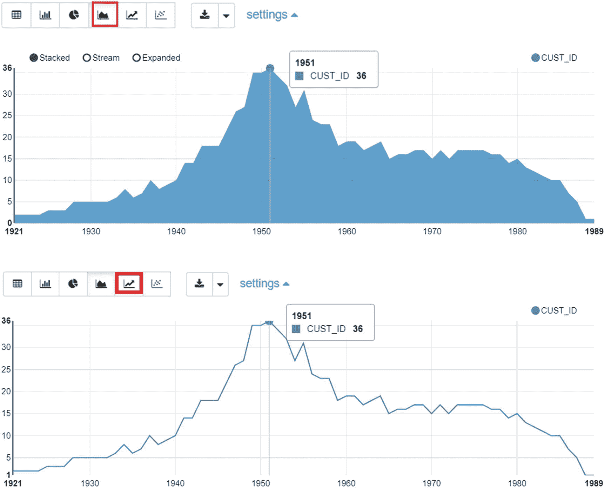
图 5-23：面积图和折线图

最后一个图标是散点图，它使用点来表示 X 轴和 Y 轴上两个变量的值。例如，图 5-24 中的散点图显示了 `CUST_YEAR_OF_BIRTH`（X 轴）和 `CUST_INCOME_LEVEL`（Y 轴）之间的关系和数据分布。

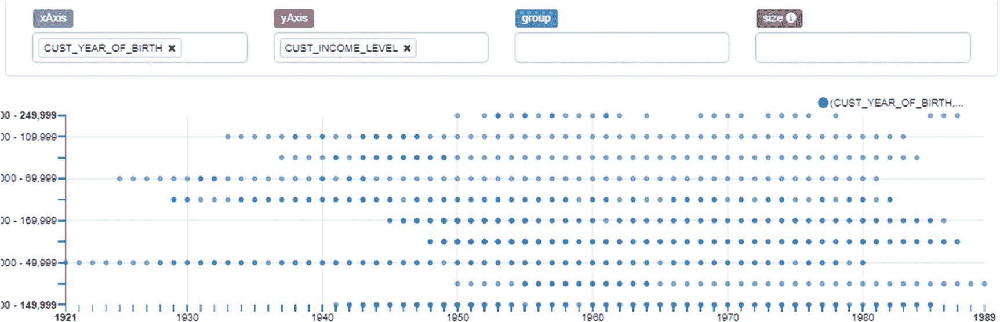
图 5-24：散点图

## 总结

本章介绍了 `Oracle 机器学习`，它是 Oracle ADW 应用环境内置工具集的一部分。要访问 OML，ADW 数据库管理员需要创建一个新用户，或为 ADW 中的现有用户授予 OML 开发者（`OML developer`）角色。拥有此角色后，该用户即可登录 OML。登录后，该用户会获得默认的工作区和默认项目。该用户也可以创建新的工作区和项目。用户在选择工作区和项目（无论是默认的还是新建的）后，即可创建笔记本。笔记本使用其连接设置连接到 ADW 数据库，并使用其解释器绑定设置连接到 ADW 数据库的 SQL 和 PL/SQL 解释器，以处理笔记本中的 SQL 语句和 SQL 脚本。

你可以在笔记本中编写 SQL 脚本，并在后端的 ADW 数据库中执行它们。这使我们能够在 `Oracle 机器学习` 笔记本中运行 OML4SQL。你也可以在笔记本中编写 SQL 语句，并在后端的 ADW 数据库中执行它们。SQL 查询语句可以从 ADW 数据库中获取结果数据，并将其显示在笔记本中。通过选择不同的显示图标以及 X 轴和 Y 轴设置，你可以以多种图形格式显示结果。这些格式包括表格、条形图、饼图、面积图、折线图和散点图。这些结果数据的图形化表示是在 OML 项目中分析和可视化数据的关键。

下一章将讨论如何使用 OML 环境。

# 6. 使用 OML 笔记本构建机器学习模型

第 4 章讨论了 Oracle 自治数据库环境，并探讨了如何在 Oracle 自治数据库中执行一些基本任务，例如数据库配置、数据加载以及数据库模式/表导入。第 5 章重点介绍了 Oracle 自治数据库的一个关键组件——`Oracle 机器学习`，并讨论了如何使用 `Oracle 机器学习` 笔记本运行 SQL 语句以及 SQL 和 PL/SQL 脚本，以及如何可视化从 Oracle 自治数据库获取的数据。通过这些关键特性，Oracle 自治数据库中的 `Oracle 机器学习（OML）` 为各种机器学习开发项目提供了一个卓越的平台。本章专门探讨如何利用这个平台进行机器学习项目。

除了 `Oracle 机器学习` 笔记本之外，Oracle 自治数据库（如自治数据仓库 (ADW) 和自治事务处理 (ATP)）通过其 Oracle 数据库引擎，为 `Oracle 机器学习 for SQL`（也称为 `OM4SQL`）提供了全面支持。`OML4SQL` 作为 Oracle 数据库的一个组件，在 Oracle 数据库内核中实现。它包含在最常见的 Oracle 数据库许可选项中，例如 SE2、EE、EE-ES、DBCS SE、DBCS EE、DBCS EE-HP、DBCS EE-EP 和 ExaCS。

`OML4SQL` 的机器学习能力使我们能够在运行于自有基础设施和 Oracle 自治数据库中的 Oracle 数据库中进行数据库内机器学习。通过 `Oracle 机器学习` 笔记本，你可以使用 PL/SQL API 以及 SQL 语言运算符和函数中的 `OML4SQL` 编程接口，在 Oracle 自治数据库中利用所有 `OML4SQL` 功能。

本章涵盖以下内容。

*   Oracle 机器学习概述
*   机器学习流程
*   Oracle 机器学习 for SQL
*   一个机器学习项目示例

## Oracle 机器学习概述

机器学习任务通常涉及构建能够基于大量数据集进行学习或提升性能的智能系统。机器学习可以帮助解决各种类型的业务问题。以下是一些需要机器学习的业务问题。

*   **模式发现**：机器学习系统通过搜索大量数据集自动发现某些模式或趋势。机器学习基于现有数据创建模型，然后将该模型应用于新数据。
*   **预测**：机器学习系统可以基于一些历史数据预测未来事件的概率。在这种情况下，机器学习基于历史数据创建模型，然后将该模型应用于未来数据，以预测该预测为真的相关概率（即可能性）。
*   **分组**：机器学习的一种形式是寻找数据的自然分组，例如识别指定信用评分范围内的客户群体。
*   **可操作信息**：机器学习可以从大量数据中生成可操作的决策。例如，机器学习系统可以创建一个模型来为客户信用卡申请分配信用额度。

### 监督学习与无监督学习

机器学习功能定义了一类可通过机器学习进行建模和解决的问题。这些机器学习功能通常分为两类：监督式机器学习与无监督式机器学习。

监督式机器学习过程由预先已知的目标输出及其依赖的输入属性所引导。模型基于已知数据集，将目标值建立为一组独立属性的函数。构建此监督式学习模型涉及模型训练、模型测试和模型评分。

*   **模型训练**：此过程分析一组已知目标和属性的案例数据。在训练过程中，模型学习将目标作为属性的函数。例如，模型训练过程基于已知信用评分的数据集以及这些属性值，将客户信用评分建立为财富、收入、职业、家庭规模和职业历史等属性的函数。
*   **模型测试**：此过程将模型应用于已知的测试数据集，并将模型生成的目标值与已知目标值进行比较，以确定模型的准确性。在上一个例子中，模型被应用于测试数据并生成目标值：客户信用评分。然后将生成的客户信用评分与测试数据中实际已知的客户信用评分进行比较。
*   **模型评分**：此过程将模型应用于实际数据（称为*评分数据*），以预测评分数据中未知的目标值。在上一个例子中，模型评分过程将模型应用于新客户。它根据这些新客户的财富、收入、职业、家庭规模和职业历史来预测其信用评分。

`Oracle Machine Learning` 支持以下监督式学习功能。

*   **属性重要性**：此功能识别并排序在预测目标属性时更为重要的属性；例如，对收入和职业等属性进行排序，以确定客户的信用评分。按重要性排序有助于在分类和回归模型的模型训练中选择更重要的属性。`Oracle Machine Learning` 不支持属性重要性功能的模型评分操作（应用模型）。
*   **分类**：此功能确定对象属于哪个类别。例如，针对一组客户的给定人口统计和个人数据，预测客户是否会购买某些产品。
*   **回归**：此功能预测与对象相关的连续值属性。例如，根据客户的人口统计数据，预测客户在促销活动期间的消费金额。

无监督式学习过程不受引导。当您不知道目标输出应该是什么时，会使用它。在无监督学习中，没有预先已知的结果来训练模型和测试模型。无监督学习可用于描述性或预测性目的。`Oracle Machine Learning` 支持以下无监督式学习功能。

*   **异常检测**：它判断案例是否符合正常案例的特征，例如确定客户的购买模式是否与同类客户中的正常模式不同。
*   **关联规则**：它识别数据内部的关联模式，例如客户倾向于一起购买的产品。
*   **聚类**：它将彼此相似的项分组；例如，它将投票给某个特定候选人的选民分组。
*   **特征提取**：它使用原始属性的线性组合创建新的属性。

`Oracle Machine Learning` 支持聚类和特征提取的模型评分操作，但不支持关联规则的评分操作。关联模型不能应用于分离的数据。相反，它们可以解释或返回关于项和事件如何相互关联的规则。

为了构建机器学习模型，`Oracle Machine Learning` 为每个机器学习功能支持至少一个或多个称为*算法*的数学过程。表 6-1 列出了 `Oracle Machine Learning` 为其对应的机器学习功能支持的机器学习算法。

表 6-1：Oracle Machine Learning 功能与算法

| 功能 | 类型 | 算法 |
| --- | --- | --- |
| 属性重要性 | 监督式学习 | 最小描述长度 |
| 分类 | 监督式学习 | 决策树、显式语义分析、朴素贝叶斯、随机森林 |
| 分类与回归 | 监督式学习 | 广义线性模型、神经网络、支持向量机、XGBoost |
| 异常检测 | 无监督式学习 | CUR 矩阵分解、多元状态估计技术 – 序贯概率比检验、单类支持向量机 |
| 关联规则 | 无监督式学习 | Apriori、*k*-均值 |
| 聚类 | 无监督式学习 | 期望最大化 |
| 特征提取 | 无监督式学习 | 显式语义分析 |

每种算法的详细描述见 *Oracle Machine Learning for SQL Concepts, 21c*，F31930-05，2021 年 6 月，Oracle 公司。（URL：[`https://docs.oracle.com/en/database/oracle/machine-learning/oml4sql/21/dmcon/index.html`](https://docs.oracle.com/en/database/oracle/machine-learning/oml4sql/21/dmcon/index.html)）。

### 机器学习流程

一个典型的机器学习过程包含以下主要阶段。

*   **业务问题定义**：这个初始阶段涉及获取业务问题需求，评估机器学习项目的目标。为了理解项目目标和需求，您可以定义机器学习问题并制定项目计划。
*   **数据收集与准备**：一旦确定了业务需求，下一步是确保有高质量的数据可用于解决业务问题。此阶段包括数据收集、数据清洗与质量检查、数据探索、数据分析、数据采样和数据转换。它还包括特征或属性选择，以及将数据集拆分为训练数据和测试数据。
*   **模型训练**：此阶段使用选定的机器学习算法，通过理解数据模式并从模式中提取洞察来创建机器学习模型。此过程基于训练数据集训练模型。在监督式学习中，模型将目标属性建立为其依赖属性的函数。
*   **模型评估与测试**：新创建的模型需要测试其准确性，并进行评估以查看该模型是否能满足业务问题的需求。测试模型的一种方法是将模型应用于测试数据，然后将模型生成的目标值与测试数据的实际目标值进行比较。
*   **模型评分与应用**：在模型通过评估和测试后，可以将模型应用于新数据，以生成先前未知的新目标值。模型应用也可以部署到业务应用环境中。例如，预测客户信用评分的模型评分可以部署在客户信用卡审批应用中。

接下来的部分将讨论如何在 `Oracle Machine Learning` 环境中，使用 Oracle Autonomous Database 执行机器学习过程的这些主要阶段。

## Oracle 机器学习 for SQL

Oracle 自治数据库（如 ADW）支持数据库内机器学习。所有机器学习功能均在 Oracle 数据库内部实现，在本例中即为 ADW。这种数据库内机器学习是通过 `Oracle 机器学习 for SQL（OML4SQL）` 实现的。

`OML4SQL` 作为 Oracle 数据库内核的一部分实现，可用于本地 Oracle 数据库和 Oracle 自治数据库（如 ADW）。因此，当您在 Oracle 云基础设施中配置 ADW 时，该 ADW 的数据库内核已完全配备 `OML4SQL`。`OML4SQL` 模型作为可导出的**一等数据库对象**存储。当您使用 `OML4SQL` 执行机器学习任务时，可以充分利用最大可扩展性和 Oracle 数据库系统资源。

如表 6-1 所示，`OML4SQL` 提供了一组数据库内机器学习算法，可实现各种机器学习功能，例如分类、回归、特征选择、聚类、异常检测和特征提取。这些机器学习算法可以直接处理 ADW 中的数据，例如星型模式数据、事务数据和其他形式的非结构化数据。因此，您无需将大量数据从 ADW 复制并转换到另一个机器学习平台。通过消除数据移动并仅在 ADW 中保留一份数据副本，数据集始终受到 ADW 广泛安全功能的保护。只有具有特定数据库权限的用户才能访问数据并执行相关的 `OML4SQL` 任务。

### OML4SQL PL/SQL API 和 SQL 函数

您可以通过其应用程序编程接口访问 Oracle 数据库中的 `OML4SQL` 功能：PL/SQL API 和 SQL 语言运算符/函数。

PL/SQL API 由一组用于构建和维护模型的 PL/SQL 包组成。一个常用的 PL/SQL 包是 `DBMS_DATA_MINING` 包，其中包含用于构建、测试和维护机器学习模型的例程。SQL 语言运算符和 SQL 函数广泛用于数据准备和模型评分阶段。接下来，我们将讨论使用 Oracle 数据库进行数据库内机器学习的各个阶段，以及这些阶段中 `OML4SQL` API 和 SQL 函数的使用。

### 数据准备与数据转换

通常，机器学习项目会访问 Oracle 数据库中单个表或视图中定义的数据。数据准备的第一步是确保数据存储在数据库表或视图中，并且每个案例的信息存储在表或视图的单行中。如果信息分布在多个表中，您可以创建一个连接这些表的视图。

#### 拆分数据

您可以使用数据库视图来拆分数据集。对于分类和回归，应准备两个数据集。一个数据集（构建数据）用于训练模型，另一个数据集（测试数据）用于测试模型。两个数据集应源自同一数据。例如，您可以创建两个视图，分别随机选择 60% 和 40% 的行作为构建数据集和测试数据集，如清单 6-1 所示。

```
-- 清单 6-1：用于拆分数据的 SQL 语句示例
CREATE OR REPLACE VIEW build_data_v AS
SELECT * FROM your_table WHERE DBMS_RANDOM.VALUE <= 0.6;

CREATE OR REPLACE VIEW test_data_v AS
SELECT * FROM your_table WHERE DBMS_RANDOM.VALUE > 0.6;
```

#### 数据转换

数据分析师通常需要在数据准备期间，通过执行一些数据转换来分析数据，然后才能使用数据构建模型。这些数据转换包括对数值数据进行分箱、处理缺失值以及选择用于模型构建的 Top N 属性（特征选择）。数据转换通过修改数据集（表）的一个或多个列的 SQL 表达式完成。OML4SQL 通过自动数据准备（ADP）自动完成大部分此类转换。通过 ADP，这些转换被嵌入模型中，并在应用模型时自动执行。您还可以使用 SQL 表达式指定额外的转换，作为模型创建过程的输入。

清单 6-1 使用视图拆分数据：

```sql
create or replace view credit_scoring_build_v as select * from admin.credit_scoring sample (60);
```

```sql
create or replace view credit_scoring_test_v as select * from admin.credit_scoring sample (40);
```

#### 转换表达式

OML4SQL API 提供了 `DBMS_DATA_MING_TRANSFORM` 包，用于机器学习中常用的转换操作。该包提供了两种实现转换的方法。

一种方法是创建转换表达式列表，并将该列表传递给 `CREATE_MODEL` 过程。此转换列表可以使用 `SET_TRANSFORM` 过程创建。以下是此方法的一个示例。声明一个转换表达式列表 `v_xlst`，并使用 `dbms_data_mining_transform.set_transform` 过程构建它。然后，通过 `xform_list` 参数将此列表传递给 `DBMS_DATA_MINING.CREATE_MODEL` 模型创建过程，如清单 6-2 所示。

清单 6-2 通过模型创建过程传递转换表达式列表：

```sql
declare
    v_xlst dbms_data_mining_transform.TRANSFORM_LIST;
BEGIN
    dbms_data_mining_transform.set_transform(v_xlst,
        'HOME_THEATER_PACKAGE', NULL, 'HOME_THEATER_PACKAGE',
        'HOME_THEATER_PACKAGE', 'FORCE_IN');

    DBMS_DATA_MINING.CREATE_MODEL(
        model_name          => 'GLMR_SH_Regr_sample',
        mining_function     => dbms_data_mining.regression,
        data_table_name     => 'mdb_rdemo_v',
        case_id_column_name => 'cust_id',
        target_column_name  => 'age',
        settings_table_name => 'glmr_sh_sample_settings',
        xform_list          => v_xlst);
END;
```

#### 分箱转换

第二种方法是创建一个实现转换的视图，并将该视图的名称传递给 `CREATE_MODEL` 过程。以下示例展示了如何创建一个名为 `mining_data_bin_view` 的视图来实现分箱转换，如清单 6-3 所示。

清单 6-3 分箱转换：

```sql
dbms_data_mining_transform.create_bin_num(
    bin_table_name     => 'bin_num_tbl');

dbms_data_mining_transform.insert_autobin_num_eqwidth(
    bin_table_name     => 'bin_num_tbl',
    data_table_name  => 'CREDIT_SCORING_100K_V',
    bin_num            => 5,
    max_bin_num        => 10,
    exclude_list       => dbms_data_mining_transform.COLUMN_LIST('CUSTOMER_ID'));

dbms_data_mining_transform.xform_bin_num(
    bin_table_name      => 'bin_num_tbl',
    data_table_name     => 'CREDIT_SCORING_100K_V',
    xform_view_name     => 'mining_data_bin_view');
```

这种分箱转换，也称为 `离散化`，是机器学习中常用的转换之一。它是一种降低数据基数的技术。通过将相关值分组到箱中，它减少了数据集属性的不同值的数量。ADP 使用默认或用户可自定义的分箱策略（例如等宽、等频和用户定义的箱）自动对数值属性进行分箱。创建分箱视图后，此 SQL 查询将在 OML Notebooks 中的分箱视图 `mining_data_bin_view` 上运行（参见清单 6-4）。

清单 6-4 `mining_data_bin_view` 查询：

```sql
Select customer_id, age, income, education_level from ming_data_bin_view;
```

通过在笔记本的“键”字段中选择“年龄”，在“值”字段中选择“客户 ID 计数”，图 6-1 显示了按每个年龄分箱组的客户数量直方图。

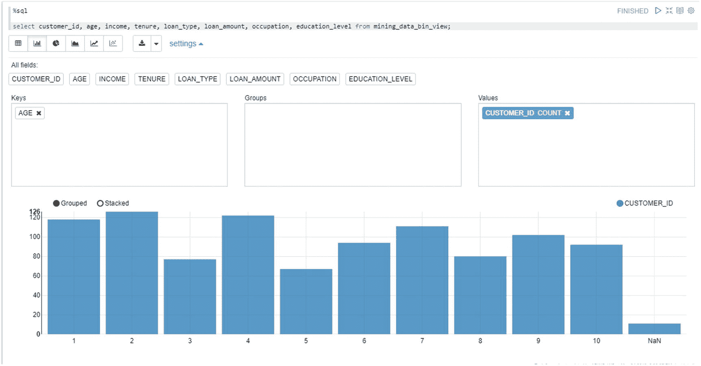

图 6-1 按年龄分箱组的客户数量直方图

### 模型创建

OML4SQL 提供了 `DBMS_DATA_MINING.CREATE_MODEL` 过程用于机器学习模型的创建。如下代码所示，`CREATE_MODEL` 过程接收一组参数作为输入来创建一个机器学习模型，如代码清单 6-5 所示。

代码清单 6-5 模型创建过程：

```sql
PROCEDURE CREATE_MODEL(
    model_name IN VARCHAR2,
    mining_function IN VARCHAR2,
    data_table_name IN VARCHAR2,
    case_id_column_name IN VARCHAR2,
    target_column_name IN VARCHAR2 DEFAULT NULL,
    settings_table_name IN VARCHAR2 DEFAULT NULL,
    data_schema_name IN VARCHAR2 DEFAULT NULL,
    settings_schema_name IN VARCHAR2 DEFAULT NULL,
    xform_list IN TRANSFORM_LIST DEFAULT NULL);
```

因此，在调用 `CREATE_MODEL` 过程之前，你需要准备好这些参数。

1.  为 `mining_function` 参数确定机器学习函数和算法的名称。OML4SQL 支持的各种机器学习函数和算法如表 6-1 所示。

2.  为 `data_table_name` 参数准备模型训练数据集。例如，我们创建了一个视图，提取了 60% 的数据集用于模型训练。

3.  确定目标属性。例如，监督学习将目标属性预测为依赖于其他属性。目标属性通过 `target_column_name` 参数传递给 `CREATE_MODEL` 过程。

4.  指定模型设置。这些是用于机器学习模型创建的配置设置。这些模型设置可以在一个包含两列（`setting_name` 和 `setting_values`）的设置表中指定。部分设置用于机器学习模型函数，部分设置用于机器学习算法。设置表通过 `settings_table_name` 参数传递给 `CREATE_MODEL` 过程。

5.  指定转换列表。这个转换表达式列表指定了模型创建所需的属性值转换。该列表通过 `xform_list` 参数传递给模型创建过程。

`CREATE_MODEL` 过程使用数据，结合模型函数/算法以及其他传递给该过程的参数，来创建一个机器学习模型。创建的模型是一个数据库表，其名称由过程中的 `model_name` 参数指定。

你可以使用以下示例代码来调用模型创建过程，如代码清单 6-6 所示。

```sql
declare
    v_xlst dbms_data_mining_transform.TRANSFORM_LIST;
BEGIN
    dbms_data_mining_transform.set_transform(v_xlst,
        'HOME_THEATER_PACKAGE', NULL, 'HOME_THEATER_PACKAGE',
        'HOME_THEATER_PACKAGE', 'FORCE_IN');

    DBMS_DATA_MINING.CREATE_MODEL(
```

### 模型创建过程示例

```
model_name          => 'GLMR_SH_Regr_sample',
mining_function     => dbms_data_mining.regression,
data_table_name     => 'mdb_rdemo_v',
case_id_column_name => 'cust_id',
target_column_name  => 'age',
settings_table_name => 'glmr_sh_sample_settings',
xform_list          => v_xlst);
END;
```

## 模型评估

一旦基于训练数据集通过模型训练过程创建了模型，你就可以评估模型的准确性。对于监督式机器学习模型（例如分类模型），由于数据集中包含已知的目标值，你可以将新创建的模型应用于测试数据，然后将模型的预测结果与测试数据中的目标值进行比较。

此模型评估包含两个步骤：模型应用和结果比较。

### 模型应用

此步骤将模型应用于测试数据以生成预测结果。`DBMS_DATA_MINING` 包中的 `APPLY` 过程用于将模型应用于测试数据表，并将模型结果写入结果表。`DBMS_DATA_MINING.APPLY` 过程的语法如代码清单 6-7 所示。

```
DBMS_DATA_MINING.APPLY (
    model_name IN VARCHAR2,
    data_table_name IN VARCHAR2,
    case_id_column_name IN VARCHAR2,
    result_table_name IN VARCHAR2,
    data_schema_name IN VARCHAR2 DEFAULT NULL);
```

以下是该过程的参数。

*   `model_name`：模型的名称
*   `data_table_name`：包含待测试数据的表或视图的名称
*   `case_id_column_name`：案例标识符列的名称
*   `result_table_name`：用于存储应用结果的表的名称
*   `data_schema_name`：包含待评分数据的模式名称

通过在 OML Notebooks 中执行以下过程，将 `N1_CLASS_MODEL` 模型应用于 `N1_TEST_DATA` 测试数据表，从而产生存储在 `N1_APPLY_RESULT` 表中的结果（参见代码清单 6-8）。

```
DBMS_DATA_MINING.APPLY(
    model_name         => 'N1_CLASS_MODEL',
    data_table_name     => 'N1_TEST_DATA',
    case_id_column_name => 'CUSTOMER_ID',
    result_table_name   => 'N1_APPLY_RESULT');
```

### 结果比较

此步骤将模型应用的结果与实际目标值进行比较。作为进行比较的一种方式，`DBMS_DATA_MINING` 包中的 `COMPUTE_LIFT` 过程旨在计算提升度，这是一种用于二分类模型的测试指标。`COMPUTE_LIFT` 将模型生成的预测与测试数据集中的实际目标值进行比较。提升度衡量模型的预测比随机猜测好多少。该过程的语法如代码清单 6-9 所示。

```
DBMS_DATA_MINING.COMPUTE_LIFT (
    apply_result_table_name =>      'N1_APPLY_RESULT'
    target_table_name       => 'N1_TEST_DATA'
    case_id_column_name     => 'CUSTOMER_ID'
    target_column_name      => 'CREDIT_SCORE_BIN'
    lift_table_name         =>  'N1_LEFT_TABL
    positive_target_value   =>  'GOOD CREDIT'
    score_column_name       =>       'PREDICTION',
    score_criterion_column_name =>'PROBABILITY',
    num_quantiles               => 100)
```

该过程中的参数包括以下内容。

*   `apply_result_table_name`：用于存储应用结果表的名称
*   `target_table_name`：存储测试数据集的表的名称
*   `case_id_column_name`：案例标识符列的名称。
*   `target_column_name`：目标列的名称
*   `lift_table_name`：提升度表的名称
*   `positive_target_value`：正目标的值
*   `score_column_name`：表示应用结果表中得分的列名；默认值为 `PREDICTION`
*   `score_criterion_column_name`：表示应用结果表中得分排序因子的列名；默认值为 `PROBABILITY`
*   `num_quantiles`：提升度表中所需的分位数数量

在代码清单 6-10 中，查询 `N1_LIFT_TABLE` 以查看模型评估结果。

```
Select QUANTITLE_NUMBER, GAIN_CUMMULATIVE from N1_LIFT_TABLE;
```

在 OML Notebooks 的图形显示选项中，这些查询结果显示为增益和提升度图。该图表通过计算使用模型和未使用模型所得结果之间的比率来衡量分类模型的有效性。该图表为评估分类模型的性能提供了可视化辅助。如图 6-2 所示，该图表由模型的提升度曲线和基线（随机）组成。提升度曲线与基线之间的面积越大，模型越好。

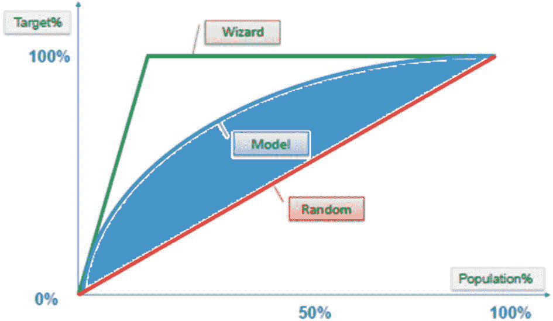

图 6-2 增益和提升度图

在此示例中，对 `NI_LIFT_TABLE` 的查询结果显示为增益和提升度图，如图 6-3 所示。曲线与直线基线之间的面积大小表明了模型的有效性。

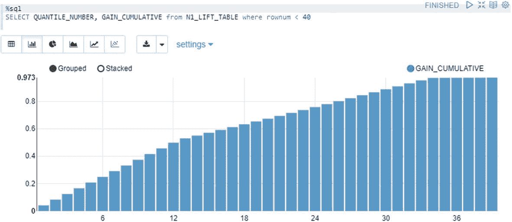

图 6-3 增益和提升度图显示了模型的有效性

## 模型评分与模型部署

模型评分，也称为*模型应用*，是将模型应用于新数据的过程。一旦基于现有的已知数据集创建并评估了模型，就可以将模型应用于新数据以预测新的目标结果。

使用 OML4SQL，模型评分通过 SQL 语言函数在数据库中进行。`PREDICTION` 函数用于分类、回归和异常检测。以下查询是一个示例，展示了如何使用 `PREDICTION` 函数应用模型，如代码清单 6-11 所示。

```
SELECT cust_gender, COUNT(*) AS cnt, ROUND(AVG(age)) AS avg_age
FROM new_data_v
WHERE PREDICTION(dt_sh_clas_sample USING *) = 1
GROUP BY cust_gender
ORDER BY cust_gender;
```

`PREDICTION` 使用 `USING` 子句来指定用于评分的属性。在此示例中，`USING *` 表示选择所有属性作为预测变量。您也可以仅指定部分属性作为预测变量。在代码清单 6-12 所示的查询中，客户的性别、婚姻状况、职业和收入水平被用作预测变量。

```
SELECT cust_gender, COUNT(*) AS cnt, ROUND(AVG(age)) AS avg_age
FROM mining_data_apply_v
WHERE PREDICTION(dt_sh_clas_sample USING
    cust_gender,cust_marital_status,
    occupation, cust_income_level) = 1
GROUP BY cust_gender
```

## 机器学习项目示例

本章的其余部分将介绍在 ADW Oracle 机器学习环境中构建和应用机器学习模型的示例。我们使用预加载在 ADW 数据库中的示例模式。此示例使用的所有 SQL 查询和 PL/SQL 脚本都记录在代码库中，您可以下载并在自己的 ADW OML 环境中执行。

创建 ADW 数据库后，它会附带 `SH` 模式，其中包含图 6-5 中使用 SQL Developer 显示的预加载表。

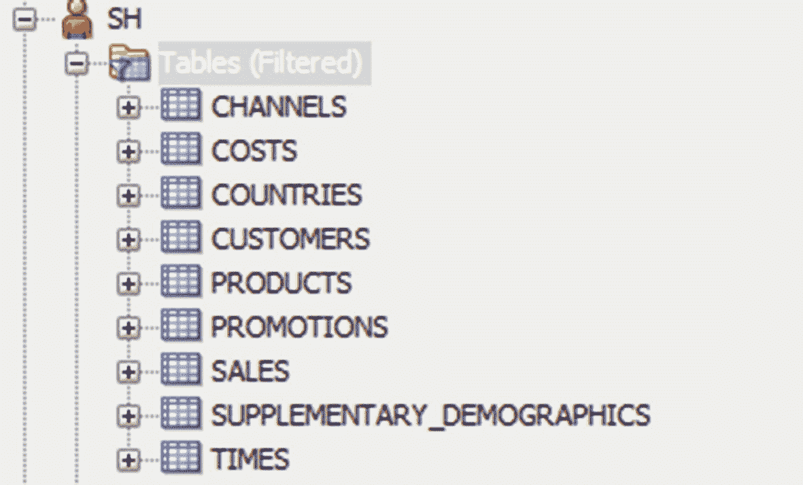

**图 6-5** ADW 数据库中的 `SH` 模式

带有 ADW 的 Oracle 机器学习笔记本可以访问这些表。您可以通过 OML 笔记本对 ADW 数据库执行 SQL 语句和 PL/SQL 脚本。OML 笔记本的可视化功能可根据通过 SQL 查询从 ADW 数据库获取的结果数据，提供各种图形化展示。

## 分类预测示例

本示例使用分类决策树函数构建一个模型，该模型根据客户信息预测客户是否可能购买家庭影院套餐。此监督学习模型基于存储在 ADW 数据库中的已知样本数据构建。

### 数据准备与数据转换

本示例使用 ADW 数据库中示例 `SH` 模式的一个 `SUPPLEMENTARY_DEMOGRAPHICS` 表。用于模型构建的每个案例的信息都存储在该表的一行中。该表有 14 列，如图 6-6 所示。每一列对应案例的一个属性。

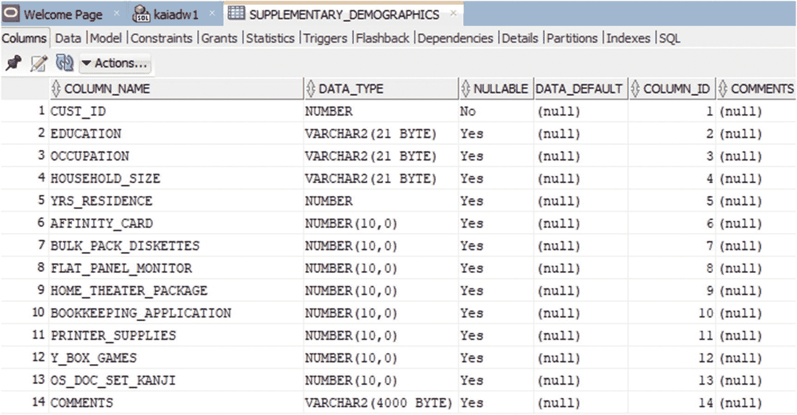

**图 6-6** `SUPPLEMENTARY_DEMOGRAPHICS` 表结构

目标属性 `home_theater_package` 的值为 1 或 0，用于定义客户是否会购买家庭影院套餐。所有案例（表中的行）的目标属性（列）都具有已知的 0 或 1 值。

让我们开始探索 `SUPPLEMENTARY_DEMOGRAPHICS` 表中的数据。为了探索目标数据分布，请在 OML 笔记本中执行以下查询以获取清单 6-16 中的数据。

```sql
select cust_id, HOME_THEATER_PACKAGE from sh.supplementary_demographics;
```

**清单 6-16** 在 OML 笔记本中获取数据

为了可视化数据，请按如下方式调整 OML 笔记本中的显示设置。

1. 单击条形图图标并展开设置。
2. 将 `HOME_THEATER_PACKAGE` 拖到键中，将 `CUST_ID` 拖到值中。组中应无内容。
3. 单击值中的 `CUST_ID` 并选择计数。

OML 笔记本通过 `CUST_ID` 计数显示目标 `home_theater_package` 值在 0 和 1 之间的分布，如图 6-7 所示。

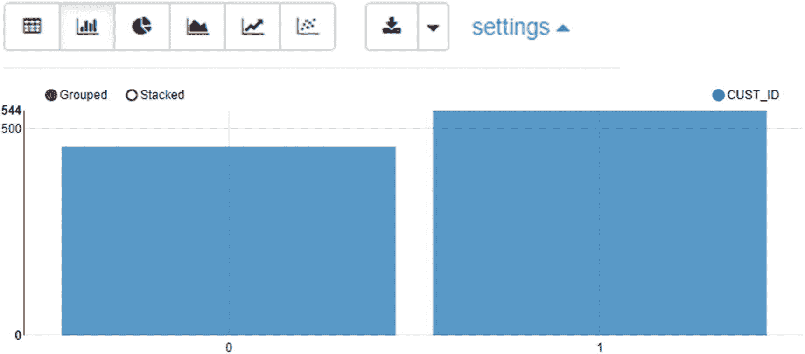

**图 6-7** `Home_theater_package` 目标值分布

类似地，清单 6-17 中的查询显示了按 `HOME_THEATER_PACKAGE` 列分组的 `YRS_RESIDENCE`、`Y_BOX_GAMES` 列的客户数量图形分布。

```sql
SELECT COUNT(CUST_ID) AS NUM_CUSTOMERS, Y_BOX_GAMES, YRS_RESIDENCE, HOME_THEATER_PACKAGE
FROM SH.SUPPLEMENTARY_DEMOGRAPHICS
GROUP BY Y_BOX_GAMES, YRS_RESIDENCE, HOME_THEATER_PACKAGE;
```

**清单 6-17** 获取图形分布信息

图 6-8 显示了按组显示客户数量分布的过程。

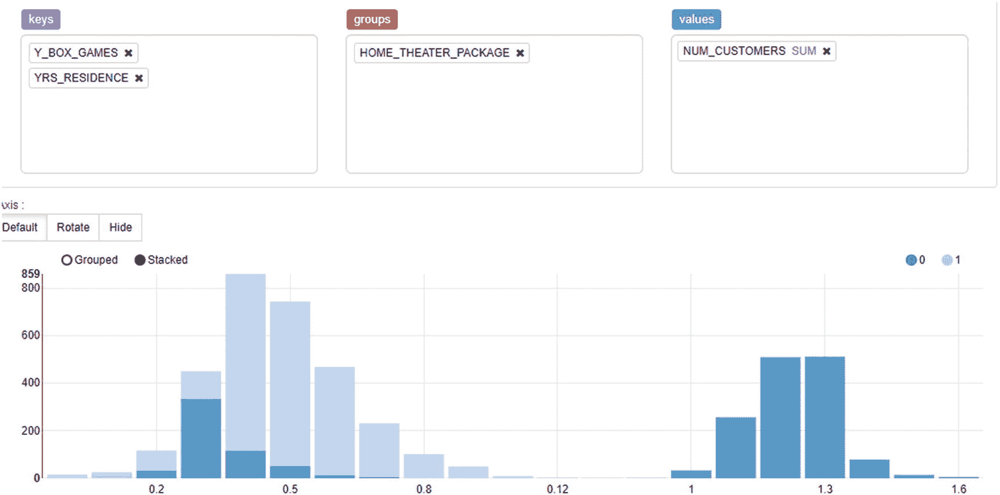

**图 6-8** 按组划分的客户数量分布

1. 单击条形图图标并展开设置。
2. 将 `Y_BOX_GAMES` 和 `YRS_RESIDENCE` 拖到键中。将 `HOME_THEATER_PACKAGE` 拖到组中。
3. 单击值中的 `NUM_CUSTOMERS` 并选择总和。
4. 单击堆叠按钮。

为了准备数据，我们基于 `SH.SUPPLEMENTARY_DEMOGRAPHICS` 创建了一个视图 `DEMOGRAPHICS_HTP_V`，如清单 6-18 所示。

```sql
%sql
CREATE OR REPLACE VIEW DEMOGRAPHICS_HTP_V
AS (SELECT AFFINITY_CARD, BOOKKEEPING_APPLICATION,
     BULK_PACK_DISKETTES, CUST_ID,EDUCATION, FLAT_PANEL_MONITOR,
     HOME_THEATER_PACKAGE, HOUSEHOLD_SIZE,OCCUPATION,
     OS_DOC_SET_KANJI, PRINTER_SUPPLIES, YRS_RESIDENCE,
     Y_BOX_GAMES

     FROM SH.SUPPLEMENTARY_DEMOGRAPHICS);
```

**清单 6-18** 创建用于数据准备的视图

该查询还支持将缺失属性和表达式作为预测变量。此查询使用客户性别、婚姻状况和职业作为预测变量。它使用一个表达式假设所有客户的收入水平都在 30 万美元或更高，如代码清单 6-13 所示。

```sql
SELECT cust_gender, COUNT(*) AS cnt, ROUND(AVG(age)) AS avg_age
FROM mining_data_apply_v
WHERE PREDICTION(dt_sh_clas_sample USING
                 cust_gender, cust_marital_status, occupation,
                 'L: 300,000 and above' AS cust_income_level) = 1
GROUP BY cust_gender
ORDER BY cust_gender;

C CNT AVG_AGE
- ---------- ----------
F 30 38
M 186 43
```

**代码清单 6-13** 带表达式的预测函数示例

`PREDICTION_PROBABILITY` 是另一个可以应用模型的 SQL 函数。该函数通过将模型应用于新数据来预测概率。图 6-4 所示的查询将模型应用于单个记录，以预测一位财富等级为“富裕”、收入为 2000 美元、客户价值细分等级为“银牌”的新客户拥有“良好信用”的概率。

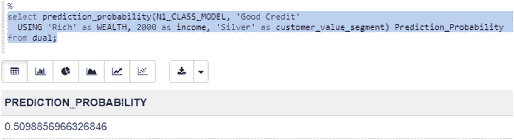

**图 6-4** 概率预测

模型评分也可以通过 `DBMS_DATA_MINING.APPLY` 过程执行。在模型测试部分，我们讨论了如何使用此 `APPLY` 过程来测试数据以获得预测结果。该方法同样适用于将模型应用于新数据。`APPLY` 过程生成与使用 SQL 评分函数评分相同的结果，并为分类、异常检测、聚类机器学习函数创建一个包含 `CASE_ID`、`PREDICTION`、`PROBABILITY` 列的结果输出表。对于回归函数，此结果表包含 `CASE_ID`、`PREDICTION` 列；对于特征提取函数，此表包含 `CASE_ID`、`FEATURE_ID` 和 `MATCH_QUALIFY` 列。

在代码清单 6-14 中，`APPLY` 过程将 `N1_CLASS_Model` 模型应用于以 `CUSTOMER_ID` 作为案例 ID 的新 `N1_NEW_DATA` 数据集表。结果，该过程生成了 `N1_NEW_RESULT` 表。

```sql
Exec DBMS_DATA_MINING.APPLY ('N1_CLASS_MODEL', 'N1_NEW_DATA', 'CUSTOMER_ID','N1_NEW_RESULT');
```

**清单 6-14** 将模型应用于新数据

清单 6-15 查询结果表，以查看每个客户 ID 的概率。

```sql
Select CUSTOMER_ID,PREDICTION,PROBABILITY from N1_NEW_RESULT;
```

**清单 6-15** 查询概率

为了利用模型的结果，这些模型通常部署在生产应用程序环境中。借助用于模型评分的 SQL 函数和 `DATA_MINING.APPLY`，OML4SQL 支持将模型部署到各种应用程序生产环境中，并实现实时和批量模型评分。模型的应用可能包括提取模型的详细结果以生成报告，或通过整合预测结果来扩展商业智能，以及将模型从模型训练数据库导出/导入到模型评分数据库环境。

# 使用OML进行预测分析

### 预测属性重要性

OM4SQL 在 `DBMS_PREDICTIVE_ANALYTICS` 包中提供了 `EXPLAIN` 函数，用于分析并创建属性重要性模型。该函数使用最小描述长度算法来分析属性在预测目标值时的相对重要性。清单 6-20 中的 `EXPLAIN` 函数创建了一个新的结果表，该表保存了按对预测影响的相对顺序排列的属性列表。

```
BEGIN

DBMS_PREDICTIVE_ANALYTICS.EXPLAIN(

data_table_name        => 'DEMOGRAPHICS_HTP_V',

explain_column_name    => 'HOME_THEATER_PACKAGE',

result_table_name      => 'EXPLAN_RESULTS');

END;
```

清单 6-20

`EXPLAIN` 函数

如清单 6-20 所示，结果表是 `EXPLAIN_RESULTS`。清单 6-21 是一个简单的 SQL 查询，列出了前 N（N=6）个属性。

```
select * from ai_explain_output_HOME_THEATER_PACKAGE where rownum<7;
```

清单 6-21

查询前六个属性

将 `EXPLAINATORY_VALUE` 拖到值中并选择总和。将 `ATTRIBUTE_NAME` 拖到键中。条形图显示了按预测目标 `HOME_THEATER_PACKAGE` 值的重要性（`EXPLAINATORY_VALUE`）排序的前六个属性。条形图可以按重要性显示前六个属性，如图 6-9 所示。


图 6-9

按重要性排序的前六个属性

### 模型创建

你可以通过执行 OML Notebooks 中清单 6-22 所示的 PL/SQL 脚本，利用 `N1_TRAIN_DATA` 表中的训练数据来构建机器学习模型。

```
%script

BEGIN

DBMS_DATA_MINING.DROP_MODEL('HTP_CLASS_MODEL');

EXCEPTION WHEN OTHERS THEN NULL;

END;

/

BEGIN

EXECUTE IMMEDIATE 'CREATE TABLE N1_BUILDING_SETTINGS

(setting_name varchar2(30), setting_value varchar2(4000))';

EXECUTE IMMEDIATE 'INSERT INTO N1_BUILDING_SETTINGS  values

(''PREP_AUTO'', ''ON'')';

EXECUTE IMMEDIATE 'INSERT INTO N1_BUILDING_SETTINGS  values

(''ALGO_NAME'', ''ALGO_DECISION_TREE'')';

DBMS_DATA_MINING.CREATE_MODEL(

model_name      => 'HTP_CLASS_MODEL',

mining_function => 'CLASSIFICATION',

data_table_name  => 'N1_TRAIN_DATA',

settings_table_name => 'N1_BUILDING_SETTINGS',

case_id_column_name => 'CUST_ID',

target_column_name => 'HOME_THEATER_PACKAGE');

END;
```

清单 6-22

执行模型创建 PL/SQL 脚本

此脚本会创建一个模型，该模型存储在 `HTP_CLASS_MODEL` 表中。

另一种方法是使用 `CREATE_MODEL2` 过程来创建模型。此过程允许我们在不创建输入表的持久表或视图（例如 `N1_TRAIN_DATA`）的情况下创建模型。相反，你可以通过 `data_query` 参数将查询传递给 `CREATE_MODEL2` 过程，如清单 6-23 所示。

```
SELECT * FROM DEMOGRAPHICS_HTP_V SAMPLE (60) SEED (1)
```

清单 6-23

向 `CREATE_MODEL2` 过程传递查询

示例代码见清单 6-24。

```
%script

BEGIN DBMS_DATA_MINING.DROP_MODEL('HTP_CLASS_MODEL');

EXCEPTION WHEN OTHERS THEN NULL; END;

/

DECLARE

v_setlst DBMS_DATA_MINING.SETTING_LIST;

BEGIN

v_setlst('PREP_AUTO') := 'ON';

v_setlst('ALGO_NAME') := 'ALGO_DECISION_TREE';

DBMS_DATA_MINING.CREATE_MODEL2(

model_name         => 'HTP_CLASS_MODEL',

mining_function    => 'CLASSIFICATION',

data_query         => 'SELECT * FROM DEMOGRAPHICS_HTP_V

SAMPLE (60) SEED (1)',

set_list           => v_setlst,

case_id_column_name => 'CUST_ID',

target_column_name => 'HOME_THEATER_PACKAGE');

END;
```

清单 6-24

调用 `CREATE_MODEL2` 过程的示例

此示例还展示了如何通过对象数据类型变量 `v_setlst`（由 `DBMS_DATA_MINING.SETTING_LIST` 数据类型定义）将模型创建设置传递给模型创建过程。

### 模型测试与评估

一旦创建了 `HTP_CLASS_MODEL` 模型，你就可以通过将其应用于测试数据来测试和评估它。如清单 6-25 的 PL/SQL 脚本所示，为了测试和评估新生成的 `HTP_CLASS_MODEL` 模型，`DBMS_DATA_MINING.APPLY` 过程将该模型应用于 `N1_TEST_DATA` 中的测试数据，并生成存储在 `HTP_APPLY_RESULT` 表中的模型评分结果。

```
BEGIN

DBMS_DATA_MINING.APPLY('HTP_CLASS_MODEL','N1_TEST_DATA','CUST_ID','HTP_APPLY_RESULT');

DBMS_DATA_MINING.COMPUTE_LIFT('HTP_APPLY_RESULT','N1_TEST_DATA','CUST_ID','HOME_THEATER_PACKAGE', 'N1_LIFT_TABLE', '1', 'PREDICTION', 'PROBABILITY',100);

END;
```

清单 6-25

将模型应用于测试数据

第二个过程 `DBMS_DATA_MINING.COMPUTE_LIFT` 接收 `HTP_APPLY_RESULT` 表中的模型评分结果，计算增益和提升结果，并将其存储在 `N1_LIFT_TABLE` 表中。要查看模型的提升结果，可以通过清单 6-26 中的 `SELECT` 语句查询提升表 `N1_LIFT_TABLE` 来创建累积增益图。

```
SELECT QUANTILE_NUMBER, GAIN_CUMULATIVE FROM N1_LIFT_TABLE;
```

清单 6-26

查询提升表

### 模型应用

在模型应用阶段，模型会被应用于一组新的数据。`N1_NEW_DATA` 表包含了除目标属性 `HOME_THEATER_PACKAGE` 值之外的新客户信息。您可以使用该模型，通过清单 6-29 中的查询，预测 `N1_NEW_DATA` 表中每位客户拥有家庭影院套件的概率。

```
SELECT *
FROM (SELECT CUST_ID, PREDICTION_PROBABILITY(HTP_CLASS_MODEL, '1'
     USING A.*) PROBABILITY
     FROM N1_NEW_DATA A);
```

清单 6-29

预测新数据的概率

若要预测一组特定客户（例如客户 ID 为 102837、103434、103459 的客户）的概率，只需运行一个简单的查询，如清单 6-30 所示。

```
SELECT CUST_ID, ROUND(PREDICTION_PROBABILITY(HTP_CLASS_MODEL, '1' USING A.*), 2) PROBABILITY FROM N1_NEW_DATA A
where CUST_ID in (102837, 103434, 103459);
```

清单 6-30

预测一组客户的概率

图 6-11 显示了此查询的结果。


图 6-11

预测一组特定客户的概率

同样的查询可以与 `N1_TEST_DATA` 表连接，以预测所有客户的概率，如清单 6-31 所示。

```
SELECT A.CUST_ID, A.PROBABILITY, B.EDUCATION, B.OCCUPATION, B.HOUSEHOLD_SIZE, B.YRS_RESIDENCE, B.Y_BOX_GAMES
FROM (SELECT * FROM (SELECT CUST_ID,
     ROUND(PREDICTION_PROBABILITY(HTP_CLASS_MODEL, '1'  USING
     C.*), 2) PROBABILITY FROM N1_NEW_DATA C)) A,
     N1_TEST_DATA B
WHERE A.CUST_ID = B.CUST_ID
ORDER by A.PROBABILITY DESC;
```

清单 6-31

预测所有新客户的概率

图 6-12 显示了 OML Notebooks 中显示的查询及其结果。


图 6-12

预测所有新客户的概率

您可以通过使用类似清单 6-32 中的查询填充数据，来创建一个名为 `HTP_NEW_PREDICTION` 的新表。

```
CREATE TABLE HTP_NEW_PREDICTION AS
SELECT A.CUST_ID, A.PROBABILITY, B.EDUCATION, B.OCCUPATION, B.HOUSEHOLD_SIZE, B.YRS_RESIDENCE, B.Y_BOX_GAMES
FROM (SELECT * FROM (SELECT CUST_ID,
     ROUND(PREDICTION_PROBABILITY(HTP_CLASS_MODEL, '1' USING
     C.*), 2) PROBABILITY FROM N1_NEW_DATA C)) A ,
     N1_TEST_DATA B
where A.CUST_ID = B.CUST_ID;
```

清单 6-32

用预测概率填充新的预测表

然后，您可以通过运行清单 6-33 中的 `SELECT` 语句来获取概率值的分布情况。

```
select * from HTP_NEW_PREDICTION;
```

清单 6-33

查询新的预测表

您可以将查询结果显示为柱状图，其中键为 `PROBABILITY`，值为 `CUST_ID COUNT`。图 6-13 显示了概率柱状图。


图 6-13 按概率划分的客户数量柱状图

## 总结

本章重点介绍了在 Oracle 机器学习环境中，使用 Oracle 自治数据库构建、评估和应用机器学习模型。它介绍了机器学习流程的主要阶段以及两类机器学习函数：监督式机器学习与非监督式机器学习，以及 Oracle 机器学习支持的相关算法。

我们讨论了如何在机器学习流程的不同阶段（例如数据准备与数据转换、模型创建、模型评估以及模型评分与应用）利用 Oracle 机器学习的 SQL 功能（`OML4SQL`）。我们讨论了一些关键的 `OML4SQL` API 包，例如 `DBMS_DATA_MINING` 和 `DBMS_DATA_MING_TRANSFORM`，及其相关过程，包括 `CREATE_MODEL`、`CREATE_MODEL2`、`APPLY` 和 `COMPUTE_LIFT`。我们还讨论了用于模型评分的 SQL 函数，例如 `PREDICTION` 和 `PREDICTION_PROBABILITY`。

本章的最后一部分通过一个逐步示例，演示了如何使用 ADW 数据库示例模式中的样本数据，通过 `OML4SQL` API 和 `OML Notebooks` 在 ADW 中构建、评估和应用机器学习模型。一旦您注册了 Oracle 云账户并创建了 ADW 数据库实例，您也可以按照此示例在 ADW `OML Notebooks` 环境中进行操作。

# 7. Oracle Analytics Cloud

本章重点介绍 Oracle Analytics Cloud。Oracle 拥有三条分析产品线：Oracle Analytics Cloud (`OAC`)、Oracle Analytics Server 和 Oracle Analytics for Applications。Oracle Analytics Desktop 可用于在个人电脑上进行独立的数据探索和可视化。Oracle 对分析的愿景是：分析应当是增强的、集成的和协作的。数据准备和可视化是机器学习过程中非常重要的步骤，而 `OAC` 正是实现这一目标的绝佳工具，尤其是其增强功能。增强分析由机器学习驱动。`OAC` 允许用户从许多不同的数据源（包括 Oracle SaaS 应用程序）添加数据，从而很好地支持集成。

`OAC` 还允许您创建机器学习模型（ML 模型）、注册并使用在 Oracle 数据库中创建的 ML 模型，以及基于 ML 模型为新数据集创建场景。它还提供了多种方法，可以轻松高效地准备数据并存储准备好的数据，例如，将其作为 Oracle 自治数据仓库 (ADW) 中的一张表，用于进一步的机器学习处理。`OAC` 以多种方式支持协作，包括精细调整的权限以及在不同平台上发布分析结果的可能性。

目前，`OAC` 有两个版本：Oracle Analytics Cloud 专业版和 Oracle Analytics Cloud 企业版。专业版包含数据分析的所有功能。企业版则包含更多功能，例如数据建模、像素级完美报告以及来自其他产品和环境的不同迁移可能性。

`OAC` 不属于免费产品，但可以使用 30 天免费试用版。桌面版（Oracle Analytics Desktop）可以免费用于测试和培训，但如果用于生产环境，则需要支付许可费。Oracle Analytics Server 将 `OAC` 平台功能引入本地部署。Oracle Analytics for Applications 为 Oracle 云应用程序提供分析功能，由自治数据仓库和 Oracle Analytics 驱动。

在图 7-1 中，您可以看到 `OAC` 的主导航菜单。`主页` 将您带到包含 `OAC` 中所有内容和搜索功能的主页面。`目录` 列出所有文件夹及其内容。`数据` 包含所有数据集、连接、数据流、序列和数据复制定义。`机器学习` 包含使用 `OAC` 创建或从 Oracle 数据库注册的所有机器学习模型。`作业` 列出在 `OAC` 中定义的所有作业和计划。`控制台` 列出用于可视化、共享、配置和管理的工具。可视化和共享工具包括地图、扩展和社交。配置和管理工具包括搜索索引、安全域、用户和角色、快照、连接、病毒扫描器、会话和查询缓存、执行 SQL、监控交付、邮件设置、系统设置和远程数据连接。`学院` 将您带到一个充满关于 `OAC` 学习资源的页面。内容涵盖从入门到高级主题，如设置和管理，或如何使用像素级完美报告。

在 `OAC` 中，`项目` 是数据准备、可视化和叙述的集合，并且可以以不同格式与其他用户共享。


图 7-1 OAC 主导航菜单

## 数据准备

与机器学习一样，数据分析始于业务问题，并定义您想要实现的目标。然后，您需要数据来支持任务和业务问题。

使用 `创建` 按钮（见图 7-2），您可以创建项目、数据集、数据流、序列、连接、数据复制和复制连接。`项目` 是一个集合，包含您的数据集、可视化以及您想要连接的所有元素，称为 `数据可视化项目`。您可以通过在画布上选择“创建项目”来从正在准备的数据集创建项目。您也可以通过打开数据集并单击“保存”来创建项目。您可以使用主页屏幕上的“创建”按钮并选择“数据集”来创建项目。


图 7-2 创建

您可以通过选择 `创建` ➤ `数据集`（见图 7-2）来创建数据集。或者，您可以通过从主菜单中选择 `主页` 或 `数据` 并找到您要查找的数据集来打开现有数据集。数据集可以从文件或与外部数据源的连接创建。如果您想使用文件，只需拖放文件即可。如果您想使用连接，则可以使用现有连接中的数据或创建新连接。创建连接时，您可以通过选择众多连接类型之一来开始。图 7-3 显示了本书编写时可用的连接类型。您还可以使用 `ODBC` 和 `JDBC` 连接到支持这些连接器的其他数据库。


图 7-3 创建连接，选择连接类型

当您打开一个数据集时，系统会自动对数据集的样本运行列级分析。分析数据集后，`OAC` 会推荐一些数据转换和扩充。您可以在 `准备` 选项卡下的 `建议` 中看到这些建议。检查这些建议，然后接受或忽略它们。这些建议可以是增强型数据扩充，例如敏感数据检测，或地理或人口统计扩充。它们也可以是转换，例如将姓名列划分为名字列和姓氏列，或从数据集中删除社会安全号码。

您还可以使用列的 `选项` 菜单添加自己的转换或扩充。列可用的菜单选项列表取决于该列中的数据类型。在屏幕中间，您可以看到数据样本。当您使用建议或手动步骤转换或扩充数据时，一个步骤会自动添加到 `准备脚本` 窗格中，并对数据样本集运行。您可以在 `准备脚本` 中添加、编辑或删除操作步骤。检查建议后，检查每一列，看看是否有需要处理的地方。例如，也许需要更改列名、数据类型、视为（属性/度量）、格式，或者创建分组或分箱。准备脚本中转换步骤旁边的蓝点表示该脚本尚未对整个数据集运行。要对整个数据集运行脚本，请单击 `应用脚本`。

您可以通过选择多个数据集来同时准备它们。如果点击屏幕底部的 `数据关系图` 选项卡，就能看到 `OAC` 认为数据集之间是如何关联的。如果关联正确，您无需进行任何操作；如果不正确，请为数据集创建准确的关联。您对某个数据集应用的数据转换和扩充，会影响所有使用该数据集的项目和数据流。如果您不希望这样，可以使用 `复制数据集` 功能，使该数据集与其他数据处理保持独立。保存数据转换和扩充后，会创建一个项目。

如果您有多个数据集需要合并，或者希望将结果保存到新的数据集中，请使用数据流。您可以使用 `准备` 功能来准备数据集，然后将这些准备好的数据集添加到数据流中。数据流会创建一系列顺序转换，并生成一个新的数据集供项目使用，而不会更改原始数据集。通过使用 `分支` 操作，您可以从一个数据流中创建多个输出。在数据流中，您可以使用过滤器来限制数据量、添加列以包含更多数据、添加新数据集以扩展维度或事实、选择列以聚焦相关数据属性、聚合数据、重命名列等等。

数据流可以手动运行，也可以按计划运行。计划选项仅在云环境中可用。您可以通过选择 `创建` ➤ `数据流` 来创建数据流，如图 7-2 所示。在图 7-4 中，您可以在数据流画布的左侧看到 `数据流步骤` 菜单。


图 7-4 数据与数据流

以下是您可以添加到数据流中的可能步骤。首先选择 `添加数据`，然后选择所需的数据集。如果您添加了多个数据集，工具会自动为数据创建联接，以查找用于联接的列。然后，针对每个数据集，定义您要执行的步骤。例如，您可以添加、选择、重命名、转换、合并或拆分列。您还可以对数据进行分箱或分组，并使用分支来分离两个不同的结果。您可以过滤或聚合数据等等。数据流的最后一步始终是 `保存数据`。数据可以保存到 `OAC`，也可以保存到您可以连接的外部目标数据库。这使得 `OAC` 成为准备数据的绝佳工具。在 Oracle 机器学习（`OML`）处理中，来自不同来源的数据可以使用 `OAC` 进行组合和准备，并存储到 `ADW` 中，以供 `OML` 使用，如图 7-5 所示。


图 7-5 将数据流的结果保存到 ADW 的表中

`序列` 是一组用于执行多个数据流的数据流集合。序列可以手动运行，也可以按计划运行。计划选项仅在云环境中可用。您可以通过将多个数据流链接在一起并执行来创建一个序列。

您也可以通过创建项目来启动准备过程。只需点击 `创建` 按钮并选择 `项目`（参见图 7-2）。创建项目后，下一步是为其选择数据集。您可以从可用数据集列表中选择，也可以创建新的数据集。

项目创建并选择好数据集后，您就可以开始处理它了。如果您选择了多个数据集，工具会尝试查找数据以联接它们，或者您可以手动操作。如果尚未准备数据，首先要做的就是准备数据。在右上角，您会看到三个选项卡：`准备`、`可视化` 和 `叙述`。对于数据准备，请选择 `准备`。在画布的左侧，您会看到两个 `准备` 选项：`数据` 和 `准备脚本`。如果选择 `数据`，您将看到所选的数据集，可以准备它们，并向项目添加新的数据集。如果选择 `准备脚本`，您将看到准备数据的步骤。您可以通过接受 `OAC` 建议的步骤或添加自己的步骤来向脚本添加步骤。

## 数据可视化与叙述

如果您从画布右侧的选项中选择 `可视化`，您会看到处理项目的三个选项：`数据`、`可视化` 和 `分析`。

您可以通过点击 `数据` 一词旁边的 + 图标并选择 `添加数据集` 来向项目添加更多数据集。您可以通过选择 `数据` 按钮来处理所选的数据集。您还可以创建场景（参见图 7-6）或添加计算（参见图 7-8）。


图 7-6 添加场景

要创建场景，请从预创建的场景列表中选择一个模型。然后，将数据集映射到模型中的数据。数据集和模型会计算出场景。该场景会显示在与数据集相同的导航器中（参见图 7-7），并可用于可视化。


图 7-7 使用机器学习模型进行预测

要添加新的计算，请选择 `添加计算`（参见图 7-8）。为计算命名，从列表中选择数学函数，然后填写所需信息。在图 7-8 中，我们选择了 `聚合`。通过双击 `度量` 一词，您可以从数据集中获取可能的度量列表。通过双击 `维度` 一词，您可以获取维度列表。


图 7-8 添加计算

要创建可视化，您可以选择属性（按住 `Ctrl` 键并选择所有需要的属性），然后将它们拖放到画布中。或者，您可以右键单击并选择 `最佳可视化`，让工具决定哪种图表最适合所选数据。或者，您可以选择 `可视化`，然后从图 7-9 所示的选项中进行选择。


图 7-9 可视化选项

如果您想快速开始分析，可以尝试使用 `解释` 功能。`解释` 功能（参见图 7-10）会自动解释所选属性。


图 7-10 解释属性

`解释` 功能会解释该属性，包括其关键驱动因素和细分，以及数据集中与之相关的任何异常。所有这些都会通过图表和文本进行解释。如果您喜欢其中任何一个或几个，可以通过将它们选择到画布中，作为分析的基础，如图 7-11 所示。


图 7-11 从解释报告中选择到画布

从 `解释` 功能开始至少有两点好处：避免认知偏差和启动任务。`解释` 能让您很好地理解数据。

您可以添加、编辑、删除、复制和复制可视化内容。您可以添加和移除数据、筛选器、图表、画布等。您可以通过画布左下角的图表属性对图表进行微调。您可以创建自己的扩展（插件），也可以使用现有的扩展，这些扩展可在 `www.oracle.com/business-analytics/data-visualization/extensions.html` 获取。您可以在控制台的 `扩展` ➤ `上传` 下将这些插件添加到您的 `OAC` 中。您还可以从列表中选择 `语言叙述` 作为可视化类型，让 `OAC` 自动创建可视化的叙述。这是一种快速生成报告基础的简便方法。

如果单击 `分析` 工具，您可以添加关于聚类或异常值的信息，或者向图表添加参考线、趋势线或预测（见图 7-12）。


图 7-12 分析选项

您可以使用 `叙述` 选项卡，从已创建的分析和可视化中创建报告或演示文稿。您可以从可视化中选择画布，为其添加描述，隐藏图表，添加注释等。您还可以从 `OAC` 中呈现叙述。或者，您可以将项目导出为 PowerPoint (`.pptx`)、Acrobat (`.pdf`)、图像 (`.png`) 或 `OAC` 包 (`.dva`) 格式，或者直接打印出来。

## Oracle Analytics Cloud 中的机器学习

您已经看到了 `OAC` 中使用机器学习的几个示例。当数据上传到 `OAC` 时，数据样本会找到转换和扩充的建议。`解释` 功能、自动语言叙述以及其他一些功能都是机器学习使工具更易用、更高效的示例。但您也可以以其他方式使用机器学习。

您可以使用数据流创建预测模型。使用数据流编辑器首先在训练数据上创建并训练模型（见图 7-13），然后将其应用于具有已知输入和输出的数据集以进行评估。您可以迭代训练过程，直到模型达到您想要的质量。最后，使用完成的模型对新数据的未知输出进行评分/预测，并保存预测的数据集。您还可以通过添加场景将预测模型应用于项目。


图 7-13 OAC 中的机器学习模型训练

要查看可用的机器学习模型，请从主导航菜单中选择 `机器学习`（见图 7-1）。如果您从可用模型中选择一个机器学习模型，您可以对其进行研究、将其标记为收藏或删除。如果您无法从列表中找到该模型，您可以注册该模型。注册允许您使用在 Oracle 数据库中创建的现有机器学习模型。选择 `注册 ML 模型`，如图 7-14 所示。


图 7-14 注册现有的机器学习模型

要注册 ML 模型，您需要选择一个连接到该模型所在的 Oracle 数据库（见图 7-15）。这可以是本地数据库或 Oracle 自治数据库。如果没有可用的连接到 ML 模型所在的数据库，您需要使用 `创建连接` 按钮创建一个新连接。


图 7-15 选择连接或创建新连接以注册 OAC 的 ML 模型

当您连接到数据库后，您会看到可用 ML 模型的列表。选择模型并单击 `注册`。现在该模型即可在 `OAC` 中使用。

您还可以在 `OAC` 主屏幕的搜索功能中使用机器学习。您可以单击麦克风图标并口头提出您的分析问题。`OAC` 会检查数据，找到回答问题的数据，并自动创建分析图表。`OAC` 使用大量机器学习来帮助用户分析数据，并基于此构建报告和预测。该工具的每个版本都会带来更多这些有趣的功能。这个工具值得深入研究。

## 总结

本章讨论了 Oracle Analytics Cloud，这是 Oracle 为分析需求提供的产品之一。`OAC` 是一个很好的分析工具，也是一个为机器学习准备数据的优秀工具。Oracle 对分析的愿景是它应该是增强的、集成的和协作的。这也是 `OAC` 成为机器学习绝佳选择的原因。您可以轻松地组合来自不同来源的数据，并使用增强功能来准备数据。完成数据准备后，您可以将其存储在数据库中供进一步使用。`OAC` 的 `解释` 功能使理解数据变得更加容易。您可以将 Oracle 数据库中的机器学习模型与 `OAC` 一起使用，或者构建简单的机器学习模型。`OAC` 是机器学习过程的一个不错选择，因为它与其他 Oracle 产品和其他可能的数据源集成良好，并且具有强大的增强功能。

# 8. 机器学习中的交付与自动化管道

可用数据量的不断增长、更便宜且更强大的计算处理能力以及更实惠的数据存储，持续加速并推动了业务应用与机器学习模型的集成。机器学习模型为生产中越来越多的应用提供动力。以下是一些著名的模型驱动应用。

*   Netflix 和亚马逊使用的在线推荐系统
*   特斯拉和 Alphabet 推出的时尚自动驾驶汽车
*   银行和电商商户的欺诈检测解决方案
*   用于医疗诊断和预测的机器学习算法
*   社交媒体上的情感分析器，提供数字消费者洞察

本章探讨了机器学习开发和部署的问题与挑战。它涵盖了 ML 部署解决方案背后的一些关键需求和设计考量。最后，深入探讨了具体的解决方案组件、最佳实践和工具。

## ML 开发挑战

与任何软件解决方案一样，模型驱动应用使用常见的软件质量特性来衡量，例如功能性、可靠性、可维护性、可扩展性和性能。ML 应用必须解决传统软件的所有质量问题，外加一套额外的 ML 特定要求。因此，ML 应用开发比传统软件开发更困难。

### 经典软件工程 vs. 机器学习

在经典软件工程环境中，所需的产品行为可以仅通过软件逻辑充分表达。一旦编码逻辑在包含模拟数据的用户场景中得到充分测试，代码预计将在生产环境中继续使用真实数据正常工作。

相反，机器学习应用无需专门编程即可学习执行任务。其质量取决于输入数据和调优参数。当模型被训练时，会在输入（即自变量）和输出（即目标变量）之间建立映射函数。如果输入和输出数据之间的关系发生变化，这种从历史数据中学习到的映射在未来面对新数据时可能不再有效。这种变化可能对依赖的应用或服务产生不利影响，因为随着时间的推移，模型预测的准确性会下降。机器学习应用必须不断输入新数据才能保持工作。

### 模型漂移

模型漂移的概念是指，随着时间的推移，变化的外部数据会导致预测模型的预测性能下降和退化。根据漂移的原因，模型漂移可分为两类：概念漂移和数据漂移。

概念漂移是指目标变量的统计属性随时间发生变化。由于垃圾邮件和合法电子邮件的不断演变，电子邮件垃圾邮件过滤应用会频繁出现概念漂移。

概念漂移关注的是目标变量，而数据漂移则发生在自变量的属性发生变化时。例如，一个数据集包含信用卡客户的违约支付信息、人口统计因素、信用数据、支付历史以及账单报表。可以训练一个机器学习模型来预测银行客户信用卡违约的可能性。在这种情况下，发生变化的是定义目标的自变量（人口统计因素、信用数据、支付历史和账单报表）的值，而不是目标变量（违约支付）的定义。

注意：在机器学习中，特征或属性是输入给机器学习算法进行分析的自变量。目标（输出）是您希望深入了解的因变量。在监督分类模型的上下文中，术语“类标签”指的是目标的一个唯一值。

## 机器学习部署挑战

随着数据科学家和软件工程师在实时机器学习系统中不断积累经验，您可以更深入地理解这些独特的挑战、它们如何发生、其影响以及如何克服这些挑战。

在部署之前，模型会经过预训练，并通常导出为某种文件格式（例如，pickle、ONNX、PMML）。在没有模型漂移的情况下，模型服务代码可以加载这些预训练的模型包并进行预测，以服务于下游应用。


图 8-1 机器学习生命周期与关键产物

对于处理实时数据的模型，模型训练并不会在模型开发阶段结束。一旦投入运行，模型需要被监控，并且可能需要频繁地重新训练模型以适应不断变化的环境。需要添加一个包含模型监控的重新训练管道来为模型服务模块提供数据，从而形成图 8-1 中的生命周期模式。

### 机器学习生命周期

部署和维护实时机器学习驱动应用的最终目标是保持最优的模型性能指标（如损失、准确率）。由于实时数据的变化，这需要持续的实验/验证来改进指标。更具挑战性的是，这种改进需要实现自动化。

如图 8-1 所述，机器学习生命周期的每次迭代都与从外部仓库推送的特定版本的源代码（包括版本化的依赖库）相关联。同时，该迭代从外部数据源访问输入数据，该数据源也是版本化的。

所有阶段的操作都需要进行编排，以便生命周期能够完全自动化。让我们看看每个阶段处理过程中产生的额外产物。

*   `数据准备`：数据处理代码首先验证原始数据，如果检测到模式或分布偏移，则生成事件。否则，数据被预处理并分割成训练集和测试集。
*   `模型构建`：使用实验参数创建一个候选模型。该模型使用训练集进行训练。
*   `模型评估`：对候选模型进行评估，并生成性能指标。
*   `模型验证`：对候选模型进行验证，并与当前的线上版本进行比较。验证代码会选择更符合性能要求的版本。
*   `模型服务`：模型服务代码将选定的模型提升到生产环境，以使用新数据进行预测服务。
*   `模型监控`：在此阶段，通过比较连续的历史数据集跨度来检测模式或分布偏移（在特征和预测中）。例如，如果数据摄取每月发生一次，则比较连续月份的训练数据。如果检测到显著的漂移，则会记录模型漂移事件，并通过启动生命周期的新迭代来触发模型重新训练。

### 规模化挑战

在规模化机器学习解决方案时，数据科学家和数据工程师关注几个关键领域。

#### 模型训练

在训练过程中，会对海量数据重复应用一系列数学计算。训练这样一个模型以达到可接受的准确率可能需要很长时间（数天或数周）。这个问题会随着需要训练的模型数量而倍增。

#### 模型推理

模型推理服务必须处理大量的输入或用户，并满足延迟和吞吐量要求。为了加速计算机视觉中的深度学习推理，需要在硬件和应用层面进行优化。

#### 输入数据处理

在整个典型的机器学习生命周期中，海量数据被输入系统。内存表示以及算法访问数据的方式会对可扩展性产生重大影响。此外，为了跟上多个加速硬件设备的数据消耗速率，必须提升数据处理速度和吞吐量。

## 关键需求

基于以上分析，支持实时机器学习模型的关键需求如下。

*   整个机器学习生命周期的自动化（在需要时允许人工干预/审批）。
*   跟踪和管理机器学习模型及产物（如数据、代码、模型包、配置、依赖项和性能指标）对于漂移检测、模型可复现性、可审计性、调试和可解释性至关重要。
*   模型性能（如准确率）是任何机器学习模型的关键质量指标。
*   机器学习运维需求包括机器学习 API 端点的响应时间、执行预测时的内存/CPU 使用率以及磁盘利用率（如果适用）。

## 设计考虑与解决方案

为了克服挑战并满足一系列需求，让我们讨论常见的设计考虑因素以及解决方案和工具方面的最新进展。

### 自动化数据科学步骤

通常，将任何机器学习模型产品化都需要自动化生命周期处理流程，这具体体现为以下数据科学步骤。

*   `数据摄取/预处理`：从传入的数据源收集并处理原始数据。
*   `数据验证`：验证输入数据的模式（Schema）和统计属性是否符合模型的预期。
*   `数据准备`：对数据进行清洗、归一化，并将其拆分为训练集和测试集。
*   `特征工程`：转换原始数据以构建额外的特征，这些特征能更好地向模型呈现底层问题。
*   `特征选择`：移除不相关的特征，并选择那些对目标变量贡献最大的特征。此步骤的输出是以训练算法所期望的格式呈现的特征拆分结果。
*   `模型训练`：对准备好的特征集应用各种机器学习算法来训练机器学习模型。这包括超参数调优，以获得性能最佳的机器学习模型。此步骤的输出是一个训练好的模型。
*   `模型评估`：使用一组指标评估训练好的模型的质量。
*   `模型验证`：基于模型评估和监控指标，确定模型是否适合部署。
*   `模型服务`：机器学习推理程序使用训练好的模型生成预测结果。
*   `模型监控`：监控以检测训练/服务偏差和模型漂移。如果漂移显著，则必须使用更新的数据重新训练并刷新模型。

在将流水线部署到任何生产环境之前，这些手动执行的数据科学步骤必须在一个自动化流水线中得以体现。MLOps 在机器学习自动化领域是一个重要且相对较新的概念。让我们先介绍 MLOps，然后深入探讨 MLOps 框架内实现的关键解决方案。

### 自动化机器学习流水线：MLOps

MLOps（`机器学习` 和 `运维` 的合成词）是一套实践方法，它结合了数据科学家和运维专业人员之间的实践，以自动化和管理生产级机器学习（或深度学习）生命周期。MLOps 是一个用于大规模机器学习产品化的 `CI/CD` 框架。

注意：`持续集成`（`CI`）是一种软件开发最佳实践，旨在频繁地将所有开发者的工作副本合并到共享仓库中，最好每天多次。每次合并后，都可以通过自动化构建和自动化验收测试进行验证。`持续交付`（`CD`）是一种实践，旨在使你的代码库在任何时候都处于可部署状态。除了确保你的应用程序通过自动化测试外，它还必须具备推送到生产环境所需的所有配置、依赖项和打包。

DevOps 是一套自动化和集成传统软件开发与运维团队之间流程的实践方法。DevOps 结合了文化理念、实践和工具，以提高组织交付高速应用程序和服务的能力。

MLOps 流程的运维方面与 DevOps 类似。MLOps 可以重用经典的 DevOps 工具链组件来处理源代码仓库、构建/测试/打包/部署自动化以及集成测试，例如以下工具。

*   Git：源代码仓库
*   Jenkins：自动化设施
*   Kubeflow 和 Airflow：编排器
*   Travis CI：持续集成服务
*   Argo CD：持续交付工具
*   Kubernetes：用于自动化应用程序部署的容器编排系统

图 8-2 展示了一个模型驱动的应用程序代码，其中包含一个机器学习流水线（步骤 1）。

一旦代码被提交并合并到代码仓库（Git）中，DevOps 的持续集成工具会自动启动集成和测试（步骤 2）。

持续交付工具确保机器学习流水线打包了所有必要的配置/依赖库，并准备好部署到生产环境（步骤 3）。


图 8-2 机器学习流水线自动化

然而，生产级机器学习由于机器学习特有的相互依赖关系，带来了额外的 `CI/CD` 和编排挑战及细微差别。MLOps 是 DevOps 的扩展，增加了额外的基础设施和工具。

*   `特殊硬件`：需要数据和算法的特殊分段与编排，以利用加速硬件（如图形处理单元（GPU）和张量处理单元（TPU））并满足可扩展性要求。
*   `复杂的计算图`：编排可能涉及复杂的运行时计算图。机器学习应用程序可以有多个并行执行的流水线。
    *   A/B 测试
    *   集成方法
    *   多臂老虎机
*   `可复现性`：由于模型训练的试验性质，保持流水线和组件的可重复性至关重要。机器学习流水线可以使用模型注册表中的信息进行重用、调整和恢复。例如，流水线可以跳过某些步骤或恢复某个中间步骤（步骤 4）。
*   `持续模型交付`：一旦模型注册表决定将模型从预发布环境提升到生产环境，该模型就会自动准备好供预测服务以及下游应用程序/客户端使用（步骤 5）。此步骤实现了在机器学习流水线内“持续交付”新模型版本，这覆盖了常规的 DevOps 流程（步骤 3）。此外，还有机器学习特有的其他相互依赖关系，例如模型注册表、模型刷新管理、模型验证、数据验证或漂移检测。
*   `法规遵从性`：额外的可解释性和可解释性模块必须阐明模型的复杂性，以满足各种合规监管机构的要求。

### 用于追踪的模型注册表

模型注册表组件是一个集中式数据存储，支持对机器学习模型全生命周期的管理。它提供模型版本管理、生产/预发布/归档状态转换、数据依赖追踪、代码依赖追踪、环境追踪，以及每个活跃流水线实例的配置追踪。

如图 8-3 中的示例所示，自动化机器学习流水线生成了训练模型的多个版本：v1、v2 和 v3。利用模型注册表的信息，模型验证/监控模块决定将 v1 部署到生产环境。v1 随后被归档，并由更优的 v2 取代。这种机制允许由模型监控触发的持续模型刷新/回滚。


图 8-3 模型注册表示例

以下项目通常会在模型注册表中被追踪和保存。

*   所选版本的训练模型
*   输入数据的版本（用于标识原始输入数据的版本）
*   代码的版本（外部源代码仓库中追踪的所有源代码版本——模型训练、应用、流水线处理等）
*   依赖项（与依赖库、数据库连接等的链接）
*   环境配置（用于控制机器学习流水线组件的参数，例如数据处理、特征选择、数据验证或模型监控使用的阈值）
*   超参数（其值控制机器学习学习过程的参数；例如，学习率、批量大小、神经网络大小、训练轮数、层数、过滤器数量和优化器名称）
*   训练好的模型包（模型训练产生的最终包。典型格式有 pickle、ONNX 和 PMML）
*   模型评分结果（模型做出的预测）
*   用于训练和测试的特征
*   特征重要性（根据输入特征在预测目标变量时的有用程度为其分配的分数）
*   模型性能指标
    *   训练时间
    *   准确率
    *   损失
    *   混淆矩阵（见图 8-4）
    *   准确率：`(TP+TN)/(TP+FP+TN+FN)`
    *   精确率：`TP/(TP+FP)`
    *   召回率：`TP/(TP+FN)`

`TP`、`TN`、`FP` 和 `FN` 分别代表真正例、真负例、假正例和假负例。图 8-4 描述了在二分类器（具有两个类别：真和假的分类器）中如何定义 `TP`、`TN`、`FP` 和 `FN`。

*   `TP` 是被预测为真且实际结果也为真的案例数量。
*   `TN` 是被预测为真但实际结果为假的案例数量。
*   `FP` 是被预测为假但实际结果为真的案例数量。
*   `FN` 是被预测为假且实际结果也为假的案例数量。


图 8-4 模型评估：二分类的混淆矩阵

通过将信息存储在模型注册表中，可以重现任何模型训练过程。您还可以监控一系列训练实例以检测任何回归，并选择重新部署甚至回滚生产环境中的全部或部分流水线。

### 数据验证

随着机器学习模型快速应用于日常生活的关键领域，解释模型预测背后的推理过程变得非常重要。然而，目前还没有简单的方法来有效检查训练后模型的内部结构以验证其正确性，从而证明意外模型行为的合理性。

相比之下，验证数据要直接得多。输入数据是机器学习流水线的起点，因此数据验证应该是在整个流水线因不良数据被激活之前标记问题的第一道防线。

验证在模型训练之前执行，通过检查一系列连续的数据集来检测数据漂移，以确保以下内容。

*   当前数据集与先前数据集遵循相同的模式。
*   当前数据集的特征值与先前数据集的特征值相似。
*   当前数据集的特征值分布与先前数据集的特征值分布相似。
*   其他特定于模型的模式保持不变。例如，在自然语言处理（NLP）场景中，单词数量或先前数据集中未出现过的单词列表发生突变。

在模型服务之前也会执行数据验证，以确保以下内容。

*   服务数据集和训练数据集遵循相同的模式。
*   模型训练所用的特征值与模型在服务时看到的特征值相似。
*   训练数据集的特征值分布与服务数据集的特征值分布相似。
*   其他特定于模型的模式保持不变。例如，在 NLP 场景中，服务数据中单词数量或训练数据中未出现过的单词列表发生突变。

### 流水线抽象

机器学习流水线由各种处理步骤组成，无论针对何种业务问题，这些步骤都或多或少是相同的。流水线抽象是一种流行的实践，旨在将通用功能模块化，并将其作为服务在所有流水线中共享。其目的是减少代码不一致性，提高流水线质量和可维护性，并提升机器学习系统的整体生产力。以下是抽象服务示例列表。

*   数据转换
*   数据归一化
*   模型调用
*   算法选择
*   词频-逆文档频率（`TF-IDF`）加权

### 自动机器学习（AutoML）

流水线抽象旨在去重和优化代码结构，而 AutoML 则旨在自动化流水线在运行时中许多繁琐且重复的步骤或步骤组。

借助 AutoML，机器学习专业知识有限的人员也可以利用最先进的模块。AutoML 还将模型开发者从重复且耗时的任务负担中解放出来。

此外，AutoML 利用神经架构搜索和迁移学习来自动选择能够产生最佳模型性能的算法和参数组合。以下是 AutoML 已针对的机器学习流水线中的一些步骤。

*   数据预处理
*   数据分区
*   特征提取
*   特征选择
*   算法选择
*   训练
*   调优
*   集成
*   部署
*   监控

### 模型监控

您如何知道生产环境中的模型是否按预期运行？当您的训练数据变得陈旧时，会对您的模型和下游应用产生什么影响？您的机器学习流水线如何处理损坏的实时数据或训练/服务偏差？

为了开始解决这些复杂问题，代表性能或行为原始测量值的指标和工件会在整个系统中被观察和收集。对于每个流水线执行实例，模型包、指标和其他工件都会持久化存储在模型注册表中。本章后面会更详细地介绍模型注册表。

利用模型注册表中的信息，模型监控组件可以重现流水线执行，对当前实例和历史实例进行详细比较，以检测数据偏差、模型漂移、依赖项变化，并进行生产环境的 A/B 测试。

### 模型监控实施

模型监控在机器学习管道的各个实例之间执行，其目标是检测预测结果、特征和指标中的显著偏移/变化。

*   原始输入数据的模式
*   原始输入数据的分布
*   回归算法的模型预测分布或分类算法的预测频率
*   数值特征的模型特征分布或分类特征的输入频率
*   缺失值检查
*   模型性能指标（损失、准确率等）

计算偏移的常用指标：

*   给定时间范围内的中位数和平均值
*   最小值/最大值
*   给定时间范围内的标准差

如果监控组件检测到显著漂移，它将使用更新的输入数据触发机器学习管道的重启。生成的模型实例被放置在预发布环境中。然后，模型验证模块决定是否在生产环境中刷新模型。

在依赖关系发生变化时，监控模块会通知数据科学家，请求人工干预/批准。

## 扩展解决方案

机器学习应用需要特定的硬件配置和可扩展性考量。例如，训练神经网络可能需要强大的 GPU。训练常见的机器学习模型可能需要 CPU 集群。为了利用加速硬件，需要将机器学习模型和输入数据进行分区、调整大小、配置，并映射到计算节点集群（运行诸如 Spark、scikit-learn 和 PyTorch 等机器学习框架）。

### 用于大规模模型训练和推理的机器学习加速器

许多机器学习加速器已发布，用于支持目标检测、自然语言处理和辅助驾驶的各种深度学习模型。机器学习加速器的能力取决于神经网络的类型。此外，神经网络训练和推理之间也存在区别。本节的目的仅是简要介绍当前生产环境中一些广泛采用的加速器。

*   GPU（图形处理单元）包含数百个嵌入式 ALU，用于处理并行计算。
*   专用集成电路（ASIC），例如谷歌的 TPU，是专为深度学习设计的矩阵处理器。
*   英特尔 Habana Goya 和 Gaudi 芯片：Gaudi 用于训练，Goya 用于推理。

### 用于模型训练的分布式机器学习

分布式机器学习指的是多节点/多处理器的机器学习算法和系统，旨在提高训练性能、准确性，并扩展到更大的输入数据规模。数据并行和模型并行是在节点间分配工作负载的不同方式。数据并行是指在每个节点上运行算法，但向其提供分区数据的不同部分；模型并行是指每个节点使用相同的数据，但在节点间拆分模型。

以下是一些用于分布式机器学习的框架。

*   Apache Hadoop (HDFS)
*   Apache Spark (MLlib)
*   Apache Mahout
*   TensorFlow 和 PyTorch：通过模型/数据并行提供分布式计算 API 的框架。

### 模型推理选项

根据推理实现方式，有多种选项可用于满足吞吐量和延迟要求。

*   REST 端点
*   传统的批量推理操作
*   分布式流处理系统，例如 Spark Streaming 或 Apache Flink

在所有可用节点/加速设备上并行化机器学习推理可以减少总体推理时间。其他推理优化方法包括批量大小调整和模型剪枝。

以下是为深度学习扩展而优化的流行硬件选择，注重速度、小尺寸和能效。

*   图形处理单元 (GPU)
*   现场可编程门阵列 (FPGA)
*   视觉处理单元 (VPU)

### 输入数据管道

使用分布式机器学习时，多个强大的 GPU/TPU 会消耗处理后的输入数据。因此，输入数据管道很容易成为新的性能瓶颈（见图 8-5）。


图 8-5 性能瓶颈：输入数据管道

典型的输入准备工作是一个 ETL 管道。`ETL` 是提取、转换和加载的缩写。

*   提取是从多个且通常不同类型的源中读取数据的过程。此阶段是 I/O 密集型的。
*   转换是应用规则将提取的数据转换/组合成所需格式的过程。此阶段是计算密集型的，通常由 CPU 处理。
*   加载是将数据写入目标数据存储并准备馈送到训练算法的过程。此阶段也是 I/O 密集型的。

如图 8-6 所示，输入管道的两个实例顺序执行。每个实例将一个数据分区馈送到一个 GPU/TPU 设备。存在两个间隙：一个在 `转换` 操作之间，另一个在 `训练` 操作之间，表明 CPU 和 GPU/TPU 处于空闲状态。


图 8-6 顺序输入数据管道

输入管道的部分可以并行化，以确保 CPU 和 GPU/TPU 得到充分利用（见图 8-7）。


图 8-7 并行（优化）输入数据管道

*   在提取阶段并行化文件/数据库读取
*   在多个 CPU 核心上并行化转换操作（如洗牌、映射等）
*   为训练预取管道和操作

## 机器学习工具生态系统

在本章开头，我们介绍了机器学习管道和管道自动化的概念。如图 8-2 所述，机器学习管道由两个不同的阶段组成：模型开发（步骤 1、2 和 3）和模型部署（步骤 4、5 和 6）。

图 8-8 概述了机器学习领域的工具格局，我们根据阶段对工具进行分组：模型开发/训练（左下）和模型服务（右下）分别是支持模型开发和模型部署阶段的特定框架/库/模块。

在此之上，机器学习平台（顶部中央）是集成和集中化的服务环境。机器学习平台的关键功能包括加速数据探索和准备、加速模型开发和训练，并从根本上简化整个生命周期中机器学习操作的规模——从模型开发、实验跟踪到部署。


图 8-8 机器学习工具

### 机器学习平台

以下是业界流行的机器学习平台列表。我们将在第 9 章详细介绍主流机器学习平台。在第 10 章中，我们将通过一个示例演示如何使用 Oracle 机器学习（`OML`）实现机器学习管道自动化。

*   Amazon SageMaker
*   Facebook FBLearner
*   Oracle 机器学习
*   Uber Michelangelo
*   Google AI Platform
*   Neptune

接下来，让我们回顾一下机器学习开发工具。模型开发/训练组中的工具可以分为以下几类：机器学习框架、开发环境、实验跟踪和资源管理。

### ML 开发工具

框架类别中的工具包含用于建模和训练的库（参见下方示例列表）。直到 2011 年，机器学习领域一直由这类库主导。

*   TensorFlow
*   Keras
*   scikit-learn
*   PyTorch
*   Spark MLlib

在开发环境类别中，Jupyter notebook、Python、R 在数据科学家中很受欢迎。Git 是一个分布式版本控制系统。

在实验管理方面，我们有用于跟踪的 mlflow。Tensorboard 对于跟踪和可视化指标以及模型图非常有用。有关 tensorboard 的更多信息，请参见：`https://www.tensorflow.org/tensorboard/get_started`。

在资源管理方面，可以使用 Docker 和 Kubernetes 来定义和定制数据处理和模型训练期间的一组资源使用条件和策略。

自 2016 年以来，随着大量数据和现成模型变得越来越容易获取，对帮助产品化/部署机器学习的工具的需求也随之增加。如图 8-8 所示，部署工具可分为模型监控和模型服务两类。

### ML 部署工具

一旦训练好的模型部署到生产环境中，模型服务工具（如下所示）对于简化模型维护、减少延迟以及扩展大数据流管道等非常有用。

*   Seldom
*   Argo
*   Kubernetes
*   Jenkins
*   此外，通常还会部署如下所示的监控工具来处理/可视化模型漂移和数据异常检测。
*   TensorFlow Data Validation
*   Logstash
*   Elasticsearch
*   Kibana

## 总结

本章分析了部署机器学习模型驱动应用的挑战。我们探讨了关键需求、重要概念、高层架构和设计考量。我们讨论了机器学习部署基础设施和解决方案。本章最后总结了支持机器学习管道生命周期的工具。

# 9. 使用 Oracle 机器学习的 ML 部署管道

随着大规模模型驱动应用以前所未有的速度部署，企业和行业竞相采用能够使构建和维护这些应用的过程更高效、成本更低的技术。机器学习平台是一种数据中心软件和硬件基础设施，它能够自动化和加速能够处理海量数据集的预测应用生命周期的交付。当前的趋势是将机器学习平台作为整个企业的集中式服务来运营，从而在众多组织之间实现高效、统一、可靠且可复现的管道。

本章首先简要介绍由主要人工智能先驱（如 Google、Facebook、Oracle 和 Uber）支持的主流机器学习平台。我们重点关注 Oracle 机器学习，将其作为 Oracle 数据库专业人员在生产环境中管理机器学习模型的理想平台。我们将深入探讨 `OML` 内置的高性能分析和内置集成能力。本章旨在赋能数据库专业人员创建和部署分析能力，将其扩展以满足不断增长的业务需求，并利用开源数据科学包来管理完整的端到端机器学习生命周期。

## 主流机器学习平台

机器学习平台集中化了所有机器学习相关任务的服务和组织。机器学习平台可以基于开源或专有组件。它们可以托管在云端或本地。然而，其核心是运行机器学习管道。让我们了解一些主要的机器学习平台，并理解它们所涵盖的机器学习管道组件、依赖的框架、扩展方式以及目标用户。

*   **Google 的 TensorFlow Extended（目标用户：数据科学家）**：`TFX` 是一个基于 TensorFlow 的开源生产级机器学习平台。`TFX` 在 Google 内部实现，旨在支持完整的机器学习管道。但是，它需要 TensorFlow 框架。所有并行和分布式机器学习策略仅针对大规模深度学习模型训练。该平台管理以下内容。
    *   数据摄取
    *   数据分析
    *   数据转换
    *   数据验证
    *   训练器
    *   模型评估与验证
    *   服务
    *   日志记录
*   **Facebook 的 FBLearner（目标用户：数据科学家）**：`FBLearner` 是一个内部的机器学习即服务数据中心基础设施，运行在特定的 FB 硬件上。`FBLearner` 需要特定的机器学习框架（如 PyTorch）来构建模型，并使用 `ONNX` 格式来交换模型。
*   **Uber 的 Michelangelo（目标用户：数据科学家）**：`Michelangelo` 构建在 `HDFS`、`Spark`、`Cassandra`、`MLlib`、`Kafka` 和 TensorFlow 等开源组件之上。它是一个内部的机器学习即服务平台，处理机器学习管道的以下阶段。
    *   管理数据
    *   训练模型
    *   评估模型
    *   部署模型
    *   进行预测
    *   监控预测
*   **MLFlow（目标用户：数据科学家）**：来自 Spark 的创建者 Databricks 的一个开源机器学习平台。`MLFlow` 专注于管理、跟踪、打包和共享模型训练实验。它需要额外的工作流和外部工具来处理生产环境中的模型服务和扩展。
*   **Oracle 机器学习（目标用户：数据库专业人员、数据科学家）**：`OML` 是 Oracle 的机器学习平台，它将超过 30 种机器学习算法的高级分析功能迁移到 Oracle 数据库和 Spark 2 集群等数据管理基础设施中。除了内置的数据安全、备份和恢复功能外，嵌入式机器学习算法经过调优，可为模型训练和模型评分提供可扩展、并行和分布式的执行。

以下是 `OML` 直接处理的机器学习管道阶段。

*   数据提取
*   数据准备
*   特征工程
*   模型训练
*   模型评分
*   模型管理/存储库

本章的主要目标是在 Oracle 机器学习平台的背景下深入介绍这些机器学习管道阶段。此外，我们将解释多个 `OML` 用户界面和 API 如何实现与开源包的集成，以处理机器学习管道的其他阶段。

*   数据验证
*   模型监控
*   管道编排与部署

## Oracle 机器学习环境

机器学习管道组件使用脚本语言（如 R 和 Python）进行编排。借助 `OML4R` 和 `OML4Py`（即将推出），管道组件可以即时访问 Oracle 数据库中的机器学习算法、数据和模型存储。同时，`OML4R` 和 `OML4Py` API 为数据科学家提供了开源环境。图 9-1 提供了可从机器学习管道访问的 `OML` 架构概览。


图 9-1 从自动化机器学习管道访问 OML

现在，让我们深入了解每个机器学习管道组件，以理解 `OML` 平台如何支持它们。

## 大数据环境下的数据提取

Oracle Machine Learning for Spark（`OML4Spark`）是 R 语言 API 组件，它将 Hadoop 与 `OML` 的其他组件（包括 Oracle 数据库）连接起来。如图 9-2 所示，`OML4Spark` 作为一个从 R 客户端运行的透明层，使用代理对象来引用和操作（通过标准 R 语法）来自各种数据源的数据，例如文件系统、`HDFS`、`Hive`、`Impala`、Spark DataFrames 和 `JDBC` 数据源。


图 9-2 OML4Spark：机器学习流水线与大数据环境之间的透明层

## 集群内并行数据处理

`OML4Spark` 通过一组 R 包和 Java 库实现了可扩展的数据摄取和预处理。从 R 客户端，这些包/库可以直接访问和操作存储在各种数据源中的大规模数据：本地文件系统、`HDFS`、`HIVE`、Spark DataFrames、`Impala`、Oracle 数据库以及其他 `JDBC` 数据源中存储的数据。数据处理是可扩展的，因为它是在 Hadoop 节点集群上以并行和分布式的方式进行准备。

Oracle Cloud SQL 支持对存储在多个大数据源中的非关系型数据进行查询。

*   Apache Hive
*   HDFS
*   Oracle NoSQL 数据库
*   Apache Kafka
*   Apache HBase
*   对象存储（Oracle 对象存储和 S3）

通过结合 `OML4Spark` 和 Oracle Cloud SQL，您可以处理大规模数据驱动的分析，并在大数据、关系型数据或两者的组合中发现模式。作为复杂机器学习流水线的一个组件，`OML4Spark` 在分布式集群中提供可扩展的数据摄取和数据预处理。

## 自动化数据准备与特征工程

机器学习流水线通常涉及许多重复性活动，例如数据准备、特征工程、文本处理、集成、算法选择和模型超参数调优。

### 通用数据处理自动化

`OML` 自动化数据准备（`ADP`）支持常见的数据转换任务，例如分箱、归一化以及异常值/缺失值插补。`ADP` 可以配置为自动执行特定算法所需的转换（更多详情见表 9-1）。用户可以通过额外的转换来补充自动转换，或者用户也可以选择自行处理所有转换。

表 9-1 ADP 执行的转换

| 算法 | `ADP` 执行的转换 |
| --- | --- |
| `GLM` | 数值属性被归一化。 |
| `k-Means` | 数值属性被归一化。 |
| `MDL` | 所有属性通过监督分箱进行分箱。 |
| 朴素贝叶斯 | 所有属性通过监督分箱进行分箱。 |
| `NMF` | 数值属性被归一化。 |
| `O-cluster` | 数值属性通过一种特殊形式的等宽分箱进行分箱，该形式自动计算每个属性的分箱数量。所有列为空或单一值的数值列将被移除。 |
| `SVD` | 数值属性被归一化。 |

### 文本处理自动化

对于文本处理，`OML` 会自动处理文本列，以基于 `TF-IDF` 分数提取词元。生成的稀疏词元化数据会自动与提供的训练数据集中的其他特征集成，并提供给算法。

### AutoML

AutoML 是即将推出的 Oracle Machine Learning for Python（`OML4Py`）引入的一项新功能。它包括自动模型选择、特征选择和超参数调优。

#### 自动模型选择

自动模型选择能够比穷举搜索更快地识别出实现最高模型质量的数据库内算法。

#### 自动特征选择

自动特征选择通过识别最相关的特征来减少特征数量，从而提高模型性能和准确性。

#### 自动超参数调优

自动调优超参数在机器学习指导下显著提高模型准确性，并避免手动或穷举搜索技术。

## 可扩展的数据库内模型训练与评分

数据库内模型训练和评分算法是 Oracle Machine Learning 最重要的特性。这些算法在 Oracle 数据库内部执行。因此，它们可以充分利用 Oracle 数据库的可扩展性、并行性、安全性、集成性、云以及结构化/非结构化数据处理能力。

本节探讨与扩展性相关的能力，例如数据库内并行执行和集群内并行执行。

### 通过嵌入式算法实现数据库内并行执行

嵌入在 Oracle 数据库内核中的 `OML` 算法消除了数据移出数据库的情况。

在本节中，让我们探讨一些支持数据库内并行执行的 Oracle Machine Learning for R 嵌入式 R 执行函数。

如图 9-3 所示，并行执行能力允许将机器学习流水线中的任何用户定义脚本卸载到 `OML` 服务器，以利用高性能计算硬件，例如 Oracle Exadata 数据库云平台。


图 9-3 基于 OML 的自动化流水线

为了支持嵌入式 R 执行，Oracle 数据库的职责可以总结如下。

*   通过在数据库服务器上生成可能多个服务器端 R 引擎来管理和控制 R 脚本的执行。
*   自动分区并将数据传递给并行执行的 R 引擎。
*   通过 `ore.frame` 代理对象引用数据，消除从 Oracle 数据库移动数据的需求。
*   确保所有数据/任务分区的所有 R 引擎执行完成；否则返回错误。
*   以 `ore.list` 格式提供每个用户定义的嵌入式 R 函数执行的结果。此列表存储在数据库中，直到用户需要该结果。

以下小节将更详细地描述这五个职责领域中的每一个。

#### 任务并行执行

在通过 `ore.indexApply` 函数进行任务并行执行期间，用户定义的函数被划分为多个任务。这些任务被分配给一个或多个 R 引擎进行处理。任务并行能力在各种用例中很有价值，例如模拟、实验，或者当整个模型太大而无法放入单个 R 引擎时。

#### 数据并行执行

在通过 `ore.groupApply` 和 `rq.groupEval` 函数进行数据并行执行期间，一个或多个 R 引擎在不同的数据分区上执行相同的用户定义 R 函数或任务。基于组的数据并行执行能够进行大量的并行模型训练会话，例如数十万个预测模型，每个数据段一个模型。

在针对 `ore.rowApply` 和 `rq.rowEval` 函数的数据并行执行中，一个或多个 R 引擎在数据批次（按行）上执行相同的用户定义 R 函数。基于行的数据并行执行适用于大规模数据集上的可扩展模型评分。

#### 并行度

`ore.groupApply`、`ore.rowApply` 和 `ore.indexApply` 函数依赖其 `parallel` 参数来指定嵌入式 R 执行中使用的并行度。`parallel` 参数默认为每个 ORE 连接的全局 `ore.parallel` 选项，如果未设置 `ore.parallel`，则默认为 `FALSE`。

对于等效的 SQL 函数 `rq.groupEval` 和 `rq.rowEval`，并行度由输入游标参数中的 `PARALLEL` 提示指定。

#### 环境

`rq.groupEval` 和 `rq.rowEval` 函数可在 `SQL*Plus` 等 SQL 环境中实现并行执行。

`ore.groupApply`、`ore.rowApply` 和 `ore.indexApply` 函数可在 R 环境中实现并行执行。

注意：使用 `ore.doEval` 或 `ore.tableApply` 调用的用户自定义 R 函数绝不会并行执行。

#### 使用分区模型的数据库内并行执行

作为一种集成模型，`OML` 中的分区模型功能会根据一个或多个列自动对数据进行分区。`OML4SQL` 会为这些分区构建、组织、维护并持久化子模型。子模型在顶层模型实体中表示为分区，使用户能够轻松构建和管理许多针对独立数据切片定制的模型。允许用户直接与顶层模型交互也极大地简化了分区模型的评分过程。

在分区模型评分期间，您必须将分区列作为 `USING` 子句的一部分包含在内。分区名称、列以及分区模型的结构都存储在 Oracle 数据库的 `ALL_MINING_MODEL_PARTITIONS` 视图中。

分区模型可以充分利用数据库内并行执行来训练和评分潜在的大量子模型。

图 9-4 描述了构建分区模型的过程。

1.  用户从输入数据集中指定一个分区键（即，一个逗号分隔的列列表）。
2.  根据分区键的不同值，输入数据被切分成多个数据分区。
3.  每个数据切片都会产生一个对应的模型分区。但是，子模型不是独立的模型，因此对用户不可见。可配置的最大分区数，默认值为 1000 个分区。
4.  使用数据库内并行执行来训练子模型。
5.  用户直接访问顶层模型进行模型评分。

注意：分区键仅支持 `NUMBER` 和 `VARCHAR2` 列数据类型。


图 9-4 分区模型：最大化数据库内并行执行

### 集群内并行执行

如图 9-2 所示，`OML4Spark` 可以访问整个 Hadoop 集群来执行并行的分布式机器学习算法。这些算法包括以下内容。

*   `OML4Spark` 算法，例如深度神经网络、自定义线性模型 (LM)、ELM、广义线性模型 (`GLM`)、H-ELM、PCA 和 SCD。这些 `OML4Spark` 算法针对 Spark 并行执行进行了优化。因此，它们的性能优于 Spark MLlib。
*   Spark MLlib 算法，例如 `GLM`、LM、梯度提升树、PCA、k-means、SVM、LASSO、岭回归、决策树和随机森林。
*   从 R 运行的通用并行分布式 MapReduce 作业，利用开源 CRAN 包。

注意：类似的核心功能在 Java 库中也可用，可以从任何 Java 或 Scala 平台调用。

## 模型管理

Oracle Machine Learning 使用户能够在 Oracle 数据库内部构建和部署预测模型。为了支持模型管理和模型分析，必须持久化已训练的模型及相关信息（训练/测试数据、版本、参数等）。

如果模型是在 Oracle 数据库中创建的，则该模型以及与模型相关的不同信息将存储在以下特定的数据库表和视图中。用户可以查询这些表和视图来了解模型。

*   `ALL_MINING_MODELS`：此视图包含当前用户可访问的所有 `OML` 模型的记录。每条记录都包含模型所有者、名称、创建日期、大小和模型算法（分类、回归、聚类等）等详细信息。
*   `ALL_MINING_MODEL_ATTRIBUTES`：此视图包含用于构建模型的训练数据中列的信息。
*   `ALL_MINING_MODEL_SETTINGS`：此视图描述了用于训练模型的参数。
*   `ALL_MINING_MODEL_VIEWS`：此视图描述了用户可访问的所有模型视图。

## 使用数据库中的 R 数据存储保存模型

由于 ML 管道是由会话中运行的脚本（例如 R）编排和驱动的，因此您可以利用 R 允许将会话中的任何 R 对象持久化到磁盘并在不同 R 会话之间重新加载的功能（见图 9-5）。


图 9-5 将 ML 模型持久化到文件系统

另一方面，`OML` 支持使用 Oracle 数据库中的 R 数据存储进行对象持久化（见图 9-6）。


图 9-6 将 ML 模型持久化到数据库中的 R 数据存储

本节重点介绍如何使用数据存储实现模型注册表。模型注册表会跟踪已训练模型的多个版本以及相应的训练/测试数据集、特征、参数以及模型评分、模型监控和模型管理所需的任何其他元数据。作为 Oracle Machine Learning 平台的关键元素，Oracle R Enterprise (`ORE`) 支持将已训练的模型（例如“mod”）及其元数据作为 R 对象持久化到数据库中。`ORE` 代理对象（例如“IRIS”）以及任何 R 对象（例如“tree10”和“ans”）都可以作为命名实体（例如“iris_class_model_v1_ds”）在 Oracle 数据库中跨 R 会话保存和恢复。模型版本可以嵌入为数据存储名称的一部分。用户可以选择覆盖或删除数据存储。

在 Oracle 数据库中，任何保存的已训练模型——连同所有相关的元数据、训练/测试集、指标和超参数——都可以使用数据存储名称进行检索。这种持久化机制允许任何实验被可靠地重复，而无需专门管理磁盘上的文件。

## 利用开源包

如今，有许多开源工具可用于满足 ML 生命周期中的特定需求。通过支持多种 API（例如 `OML4R`、`OML4Py`、`OML4SQL` 和 `OML4Spark`），可以将第三方或开源包与 `OML` 平台集成，以增强 ML 管道的功能。以下部分说明如何使用开源工具实现数据验证和模型监控。我们将介绍 TensorFlow Extended、scikit-multiflow 和 Kubeflow。

### 用于数据验证的 TensorFlow Extended (TFX)

TensorFlow 数据验证 (`TFDV`) 是 TensorFlow Extended 的一个组件，但 `TFDV` 可以在不需要 `TFX` 的情况下部署。

`TFDV` 验证可以应用于输入数据和预测值中的所有重要特征/标签。

支持的异常检测用例将在以下小节中讨论。

#### 基于模式的验证

根据数据类型、范围和其他统计数据，对照模式执行有效性检查。所有异常都会作为数据验证的结果报告。

用户无需手动从头构建模式，而是可以自动使用 `infer_schema()` 方法从任何输入数据集自动生成模式的初始版本。用户可以根据需要修改生成的模式。

#### 训练与服务偏差检测

此功能检测训练数据和服务数据之间的以下类型的偏差。

*   `模式偏差`：检测训练数据集和服务数据集是否不符合相同的模式。
*   `特征偏差`：检测训练时的特征值是否与服务时的特征值不同。
*   `分布偏差`：检测训练数据的特征值分布是否与服务数据的特征值分布显著不同。

#### 漂移检测

数据漂移的检测涉及对一系列数据进行比较。仅对连续两个数据集（例如，连续两天的训练数据）之间的分类特征进行比较。漂移程度通过 L-无穷范数距离来衡量。用户需定义一个可接受的阈值距离值，当漂移超过该阈值时，系统会通知用户。

### 用于模型监控的 scikit-multiflow

基于一种称为 `自适应窗口`（`ADWIN`）的算法，scikit-multiflow Python 包能够检测动态环境中的概念漂移变化。每当有新值添加到数据中时，`ADWIN` 会在一个自动增长和收缩的自适应窗口内跟踪数据的若干统计属性。这些统计属性包括所有值的总和、窗口宽度以及总方差。`admin.detected_change()` 方法用于指示变化。更多信息可在 GitHub 仓库 `https://github.com/scikit-multiflow/scikit-multiflow` 中找到。

一旦检测到变化（图 9-3 中的步骤 6），自动 ML 流水线将被触发重启，以使用更新的数据集重新训练模型（图 9-3 中的步骤 4）。此外，如果需要进行人工调查或代码更改，更显著的漂移可能会触发向数据科学家发送通知。在这种情况下，新代码可以触发整个 ML 流水线的重新部署（图 9-3 中的步骤 1 到 3）。

### Kubeflow：云原生 ML 流水线部署

Kubeflow 是一个开源项目，支持云原生 ML 流水线部署。Kubeflow 可在任何符合 Kubernetes 标准的集群（云端或本地）中运行。使用 Kubeflow，您可以执行以下操作。


图 9-10 使用 Katib 监控超参数作业


图 9-9 已保存的 ML 流水线实验和流水线运行


图 9-8 ML 流水线运行图


图 9-7 使用 Kale 将 Notebook 转换为 ML 流水线

*   使用 Jupyter Notebook 开发模型。
*   使用 Kale 将 Jupyter Notebook 转换为 ML 流水线。Kubeflow 控制器会自动启动并协调流水线步骤的 Pod（见图 9-7）。
*   使用 Kubeflow 仪表板查看流水线运行图（见图 9-8）。所有流水线运行都会被保存，以供审查或重新运行（见图 9-9）。
*   使用 Katib 提交或监控超参数调优作业（见图 9-10）。
*   使用 KFServing 创建和部署用于推理的服务器。
*   使用自定义资源（例如，`TFJob` 或 PyTorch）来简化使用 TensorFlow 和 PyTorch 等深度学习框架的分布式训练。一旦定义了 `TFJob` 或 PyTorch 资源，自定义控制器将负责启动和管理所有单独的 Pod，并配置它们相互通信。

## 总结

本章概述了主要的机器学习平台。它解释了 Oracle 机器学习组件如何支持 ML 流水线的各个阶段。

*   数据提取
*   数据准备
*   特征工程
*   模型训练
*   模型评分
*   模型管理/存储库

我们介绍了多种 `OML` API，例如 `OML4R`、`OML4Py`、`OML4SQL` 和 `OML4Spark`。我们解释了如何使用这些 API 将第三方或开源包（如 `TFDV`）与 `OML` 平台集成，以增强 ML 流水线功能。我们演示了 `OML` 内置的高性能分析和内置集成能力如何实现 ML 产品化流水线的关键需求：可扩展性、自动化以及与开源组件的集成，以实现端到端的生命周期管理。

# 10. 使用 Oracle 机器学习构建可复现的 ML 流水线

如前一章所述，Oracle 机器学习（`OML`）提供了内置的数据安全性和调优后的 ML 算法，为模型训练和模型评分提供可扩展、并行和分布式的执行。通过 `OML4R` 和 `OML4Py`，开源组件可以集成到 `OML` 平台中，从而在 ML 流水线中启用额外的自定义功能。

本章以一个实际的监督机器学习模型为例。它演示了如何将开源包集成到 `OML` 平台中，以端到端地自动化 ML 流水线。它还演示了如何跟踪 ML 流水线所有工件（源代码、数据、模型、指标等）的版本，并使流水线实验可复现。

如图 10-1 所示，ML 流水线（顶部中心绿色高亮部分）包含多个步骤：数据提取、数据验证、特征工程、数据准备、模型训练、模型评估、模型验证和模型监控。

在本章介绍的示例中，Oracle 机器学习（`OML`）组件提供了大部分功能。例如，`OML` 支持数据安全性、可扩展的模型训练和可扩展的模型评分。在图 10-1 中，这些 `OML` 组件以红色高亮显示，它们作为 `OML` 服务器（右侧灰色高亮部分）或 `OML` 客户端（底部灰色高亮部分）的一部分进行部署。

为了获得额外的流水线功能或特定的自定义，我们通过 `OML4Py` 或 `OML4R`（`OML` 客户端内部红色高亮部分）将开源包（左侧灰色高亮部分）集成到 ML 流水线中。在我们的示例中，开源包恰好是用 Python 编写的，但选择的 `OML` 集成机制是 `OML4R`。Python 的 `subprocess` 模块连接到 `Rscript` 中的 `OML` 客户端代码。

以下是我们的示例中包含的开源包列表。

*   TensorFlow 数据验证（`TFDV`）用于数据验证和模型监控。
*   数据版本控制（`DVC`）用于 ML 流水线实验跟踪。


图 10-1 流水线实现：将开源组件与 OML 集成

`TFDV` 和 `DVC` 将在本章后面进一步讨论。

## 环境

本章的主要目标是提供一个实现图 10-1 所述设计的 ML 流水线示例。我们将介绍 `OML` 客户端和服务器的软件栈，以及开源组件，如 `DVC` 和 `TFDV`。我们还将介绍主要的安装和配置步骤。让我们开始吧。

### 设置 Oracle Machine Learning for R

`OML4R` 客户端和服务器均以 Oracle Linux 7 作为操作系统进行设置。`OML` 服务器上安装了 Oracle Database 19c 版本。客户端和服务器端均安装了用于 Oracle Database 组件的 Oracle R Enterprise (`ORE`) 1.5.1 版本。`ORE` 1.5.1 已通过 R-3.3.0（包括开源 R 和 Oracle R 发行版）认证。R-3.3.0 与社区贡献的 R 支持包兼容。

以下是需要安装的具体 R 包及其版本。

*   arules 1.5-0
*   cairo 1.5-9
*   DBI 0.6-1
*   png 0.1-7
*   ROracle 1.3-1
*   statmod 1.4.29
*   randomForest 4.6-12

注意：所有组件均作为 Oracle Database 19c for Linux x86-64 的一部分包含在内。您可以在 `www.oracle.com/database/technologies/oracle19c-linux-downloads.html/` 下载。这些组件的版本在编写本书时是最新的。您应检查是否有更新的版本。

图 10-2 和图 10-3 分别展示了服务器端和客户端的安装步骤。


图 10-3 OML4R 客户端安装顺序


图 10-2 OML4R 服务器安装顺序

### 验证 Oracle Machine Learning for R 安装

验证软件堆栈配置是否正确始终是一个好习惯。请按照以下步骤验证 `ORE` 库能否加载，以及能否从服务器和客户端访问数据库对象。

#### 在服务器端验证 OML4R

首先，使用 `ORE` 脚本启动一个 R 实例并加载 `ORE` 库。

```
ore.connect(user = "RQUSER", sid = "ORCL", host = "localhost", port = 1521, password = "rquser")
ore.is.connected()
```

# ORE

> library(ORE)

```
> library(ORE)
```

随后应显示一系列“Loading required package: ORExxx”语句，且无任何错误。

接下来，以 `OML_USER` 身份连接到服务器。以下示例将用户 `oml_user` 通过端口 `1521` 连接到 `kaidb` 服务器主机上的数据库 `k19c`。

```
ore.connect(user="oml_user", sid="k19c", host="kaidb", password="oml_userpsw", port=1521, all=TRUE)
```

现在，执行一些基本函数。

## OML4R 客户端是否已连接到 OML4R 服务器？

```
ore.is.connected()
[1] TRUE
```

如果连接成功，该函数返回 `TRUE`。

## 列出可用的数据库表。

```
ore.ls()
[1] "TABLE1" "TABLE2"
```

如果配置成功，`ore.ls()` 函数将返回当前模式下的表列表。

### 在客户端验证 OML4R

由于我们的客户端运行在 Linux 上，请从命令提示符启动 R，并输入以下命令启动 OML4R。

```
> library(ORE)
```

随后应显示一系列“Loading required package: ORExxx”语句，且无任何错误。

使用以下命令连接到 OML4R 服务器。

```
> ore.connect(user="OML_USER", sid="pdb1", host="kaidb", password="OML_USERpsw", port=1521, all=TRUE)
Loading required package: ROracle
Loading required package: DBI
```

现在检查连接状态。

```
> ore.is.connected()
[1] TRUE
```

如果连接成功，该函数返回 `TRUE`。

接下来，列出 `ore.frame` 代理对象。

```
> ore.ls()
[1] "TABLE1" "TABLE2"
```

如果配置成功，`ore.ls()` 函数将返回当前模式下的表列表。

如果出现配置问题，本章最后一节提供了一些故障排除技巧。

一旦 OML 客户端和服务器配置完成，让我们继续设置 ML 管道的开源组件。

## 设置开源组件

我们的 ML 管道示例包含 OML 客户端和服务器以及开源组件。这里，我们重点介绍安装和配置诸如 DVC 和 TFDV 等开源组件。

要安装 TFDV，请运行以下命令。

```
pip install tensorflow-data-validation
```

要安装 DVC，请运行以下命令。

```
pip install dvc
```

或者，如果您希望在我们的环境中使用相同版本的 DVC 和 TFDV 代码，可以跳过前面两个 `pip install` 命令，直接使用附带的 `requirements.txt` 文件运行 `pip install -r` 命令。

```
pip install -r requirements.txt
```

以下是 `requirements.txt` 文件的内容。

```
absl-py==0.10.0
alembic==1.4.2
apache-beam==2.24.0
appdirs==1.4.4
appnope==0.1.0
astunparse==1.6.3
atpublic==2.0
attrs==19.3.0
avro-python3==1.9.2.1
azure-core==1.6.0
azure-storage-blob==12.3.2
backcall==0.1.0
bleach==3.1.5
bravado==10.6.2
bravado-core==5.17.0
cachetools==3.1.1
certifi==2020.4.5.1
cffi==1.14.0
chardet==3.0.4
click==7.1.2
cloudpickle==1.4.1
colorama==0.4.3
commonmark==0.9.1
configobj==5.0.6
configparser==4.0.2
crcmod==1.7
cryptography==2.9.2
databricks-cli==0.11.0
decorator==4.4.2
defusedxml==0.6.0
dictdiffer==0.8.1
dill==0.3.1.1
distro==1.5.0
docker==4.2.1
docopt==0.6.2
dpath==2.0.1
ds-ml-pipeline==1.0.0
dvc==1.7.3
entrypoints==0.3
fastavro==0.23.6
fasteners==0.15
filelock==3.0.12
Flask==1.1.2
flatten-dict==0.3.0
flufl.lock==3.2
funcy==1.14
future==0.18.2
gast==0.3.3
gdown==3.12.2
gitdb==4.0.5
GitPython==3.1.3
google-api-core==1.22.2
google-api-python-client==1.12.1
google-apitools==0.5.31
google-auth==1.21.2
google-auth-httplib2==0.0.4
google-auth-oauthlib==0.4.1
google-cloud-bigquery==1.28.0
google-cloud-bigtable==1.5.0
google-cloud-core==1.4.1
google-cloud-datastore==1.15.1
google-cloud-dlp==1.0.0
google-cloud-language==1.3.0
google-cloud-pubsub==1.7.0
google-cloud-spanner==1.19.0
google-cloud-videointelligence==1.15.0
google-cloud-vision==1.0.0
google-crc32c==1.0.0
google-pasta==0.2.0
google-resumable-media==1.0.0
googleapis-common-protos==1.52.0
gorilla==0.3.0
grandalf==0.6
grpc-google-iam-v1==0.12.3
grpcio==1.32.0
grpcio-gcp==0.2.2
gunicorn==20.0.4
h5py==2.10.0
hdfs==2.5.8
httplib2==0.17.4
idna==2.9
ipykernel==5.3.0
ipython==7.15.0
ipython-genutils==0.2.0
isodate==0.6.0
itsdangerous==1.1.0
jedi==0.17.0
Jinja2==2.11.2
joblib==0.14.1
json5==0.9.5
jsonpath-ng==1.5.2
jsonpointer==2.0
jsonref==0.2
jsonschema==3.2.0
jupyter-client==6.1.3
jupyter-core==4.6.3
jupyterlab==2.1.4
jupyterlab-server==1.1.5
Keras-Preprocessing==1.1.2
Mako==1.1.3
Markdown==3.2.2
MarkupSafe==1.1.1
mistune==0.8.4
mlflow==1.9.1
mock==2.0.0
monotonic==1.5
msgpack==1.0.0
msgpack-python==0.5.6
msrest==0.6.16
nanotime==0.5.2
nbconvert==5.6.1
nbformat==5.0.6
neptune-client==0.4.117
networkx==2.4
notebook==6.0.3
numpy==1.18.5
oauth2client==3.0.0
oauthlib==3.1.0
opt-einsum==3.3.0
packaging==20.4
pandas==1.1.2
pandocfilters==1.4.2
parso==0.7.0
pathlib2==2.3.5
pathspec==0.8.0
pbr==5.5.0
pexpect==4.8.0
pickleshare==0.7.5
Pillow==7.1.2
ply==3.11
prometheus-client==0.8.0
```


```
prometheus-flask-exporter==0.14.1
prompt-toolkit==3.0.5
protobuf==3.12.2
ptyprocess==0.6.0
py3nvml==0.2.6
pyarrow==0.17.1
pyasn1==0.4.8
pyasn1-modules==0.2.8
pycparser==2.20
pydot==1.4.1
Pygments==2.6.1
pygtrie==2.3.2
PyJWT==1.7.1
pymongo==3.11.0
pyOpenSSL==19.1.0
pyparsing==2.4.7
pyrsistent==0.16.0
PySocks==1.7.1
python-dateutil==2.8.1
python-editor==1.0.4
pytz==2019.3
PyYAML==5.3.1
pyzmq==19.0.1
querystring-parser==1.2.4
requests==2.24.0
requests-oauthlib==1.3.0
rfc3987==1.3.8
rich==7.0.0
rsa==4.6
ruamel.yaml==0.16.12
ruamel.yaml.clib==0.2.2
scikit-learn==0.23.2
scipy==1.4.1
Send2Trash==1.5.0
shortuuid==1.0.1
shtab==1.3.1
simplejson==3.15.0
six==1.14.0
sklearn==0.0
smmap==3.0.4
SQLAlchemy==1.3.13
sqlparse==0.3.1
strict-rfc3339==0.7
swagger-spec-validator==2.7.3
tabulate==0.8.7
tensorboard==2.3.0
tensorboard-plugin-wit==1.7.0
tensorflow==2.3.0
tensorflow-data-validation==0.24.0
tensorflow-estimator==2.3.0
tensorflow-metadata==0.24.0
tensorflow-serving-api==2.3.0
tensorflow-transform==0.24.0
termcolor==1.1.0
terminado==0.8.3
testpath==0.4.4
tfx-bsl==0.24.0
threadpoolctl==2.1.0
toml==0.10.1
torch==1.5.0
tornado==6.0.4
tqdm==4.49.0
traitlets==4.3.3
typing-extensions==3.7.4.2
uritemplate==3.0.1
urllib3==1.25.9
voluptuous==0.12.0
wcwidth==0.2.3
webcolors==1.11.1
webencodings==0.5.1
websocket-client==0.57.0
Werkzeug==1.0.1
wrapt==1.12.1
xmltodict==0.12.0
zc.lockfile==2.0
```

## 数据

如图 10-1 所示，任何机器学习流水线都始于数据提取。鸢尾花物种数据集是我们机器学习流水线的输入。鸢尾花数据集是一个多变量数据集，由英国统计学家和生物学家罗纳德·费舍尔在他 1963 年的经典论文中提出。该数据集可从 OML 数据库获取。你也可以从加州大学信息与计算机科学学院机器学习库[`http://archive.ics.uci.edu/ml`](http://archive.ics.uci.edu/ml)下载。

该数据集包含三种鸢尾花物种，每种有 50 个样本。数据包含多个列，记录了每朵花的其他属性。在我们的示例中，我们构建了一个分类模型来预测花的种类。

现在我们已经搭建好了开源组件（TFDV 和 DVC）并下载了输入数据（鸢尾花），接下来我们将演示如何实现机器学习流水线的功能，如数据验证、模型监控和实验跟踪（见图 10-1）。

## 数据验证与模型监控实现

我们的机器学习流水线集成了开源包以实现自定义功能。本节将介绍基于 TensorFlow 数据验证（TFDV）包的数据验证和模型监控实现。

如图 10-1 所示，自动化机器学习流水线接收输入数据集。随着数据集被处理并经过每个步骤，会生成更多的中间数据、特征集、预测结果、评估指标和评分，这些数据被存储在模型注册表中（位于图 10-1 中的 OML 服务器内）。TFDV 通过检测输入数据中的模式或分布偏移来支持数据验证。类似地，模型监控通过使用 TFDV 检查连续时间范围内的历史特征和预测结果来实现。

### TensorFlow 数据验证（TFDV）

通过`pip install`安装开源组件后，即可导入`tensorflow_data_validation`模块。如下面的 Python 代码所示，TFDV 可以基于任何 Pandas 数据框生成模式和统计信息。通过将新数据框与从现有数据框推断出的模式和统计信息进行比较，可以检测出异常。

```python
import numpy as np
import pandas as pd
import os
import tensorflow_data_validation as tfdv
from config import Config

Config.ANOMALIES_PATH.mkdir(parents=True, exist_ok=True)
Config.ORIGINAL_DATASET_FILE_PATH.parent.mkdir(parents=True, exist_ok=True)
Config.DATASET_PATH.mkdir(parents=True, exist_ok=True)

def generateSchema(input_file, schema_file):
    assets=pd.read_csv(input_file,low_memory=False)
    assets_stats=tfdv.generate_statistics_from_dataframe(assets)
    assets_schema=tfdv.infer_schema(assets_stats)
    tfdv.write_schema_text(assets_schema, schema_file)
    tfdv.display_schema(assets_schema)
    return tfdv.load_schema_text('assets_schema')

def getAnomalies(df, expected_df, anomalies_file):
    assets_stats=tfdv.generate_statistics_from_dataframe(df)
    assets_schema=tfdv.infer_schema(assets_stats)
    expected_assets_stats=tfdv.generate_statistics_from_dataframe(expected_df)
    expected_assets_schema=tfdv.infer_schema(expected_assets_stats)
    anomalies=tfdv.validate_statistics(assets_stats,expected_assets_schema)
    tfdv.write_anomalies_text(anomalies, anomalies_file)
    tfdv.display_anomalies(anomalies)
    return tfdv.load_anomalies_text('anomalies')
```

### 数据验证

数据验证在数据提取后立即进行，其目的是确保输入数据符合预期的模式。以下是示例代码。

```python
iris_df = pd.read_csv(str(Config.ORIGINAL_DATASET_FILE_PATH))
iris_drift_df = pd.read_csv(str(Config.ORIGINAL_DATASET_DRIFT_FILE_PATH))
getAnomalies(iris_drift_df, iris_df, str(Config.ANOMALIES_PATH / "anomalies_data_drift.json"))
```


图 10-4 展示了输入数据中数据变化的示例。原始鸢尾花数据集包含三个不同的标签：Iris-setosa、Iris-versicolor 和 Iris-virginica。为了模拟数据中的显著变化，我们特意将一个标签从 Iris-setosa 改为 Iris-setosaaaa。


图 10-4 输入数据中的概念漂移示例

输出结果是`anomalies_data_drift.json`文件。如图 10-5 所示，数据验证过程首先基于原始数据集生成一个基线模式。在该模式中，“species”列包含三个值：Iris-setosa、Iris-versicolor 和 Iris-virginica。由于`iris_drift_df`数据框中的拼写错误，第四个值 Iris-setosaaaa 在`anomaly_info`块中被标记为错误。


图 10-5 数据验证结果：检测到的异常

### 模型监控

模型监控可以在模型服务之前进行。其目的是确保新数据与用于模型训练的数据相似。以下示例将鸢尾花数据集拆分为训练集和测试集，然后比较这两个数据集。

```python
train_df = pd.read_csv(str(Config.DATASET_PATH / "train.csv"))
test_df = pd.read_csv(str(Config.DATASET_PATH / "test.csv"))

def extract_features(df):
    return df[["sepal_length", "sepal_width", "petal_length", "petal_width", "species"]]

train_set = extract_features(train_df)
test_set = extract_features(test_df)

getAnomalies(train_set, test_set, str(Config.ANOMALIES_PATH / "anomalies_train_test.json"))
```

生成的`anomalies_train_test.json`文件不包含`anomaly_info`块，这表明不存在训练/测试数据漂移。

## 跟踪与重现机器学习流水线

TFDV 可以检测任何数据/特征/预测集中的变化。然而，并非所有数据变化对模型的影响都相同。模型监控必须考虑数据之外其他领域的变化。例如，源代码和训练参数的变化可能需要重启部分或整个机器学习流水线。

本节演示了如何使用数据版本控制（DVC）实现变更跟踪和机器学习流水线的重现。借助 DVC，我们可以定义和自定义机器学习流水线各步骤之间的依赖关系。这种依赖关系会驱动并触发从上游最近发生变化的步骤开始重启机器学习流水线。

### 数据版本控制（DVC）

DVC 是一款开源的数据版本管理、工作流和实验管理软件（[`https://dvc.org`](https://dvc.org)）。DVC 在 Git 仓库之上运行，为数据和模型工件提供版本控制，并使机器学习流水线实验可重现。

机器学习流水线由一系列阶段组成，通常从原始数据提取开始，经过中间的特征工程和模型训练阶段，生成训练好的模型和指标，并包含漂移监控。

通过命令行界面（`dvc run`），用户可以定义一个机器学习流水线阶段。流水线定义文件（`dvc.yaml`）可以包含以下字段。图 10-15 展示了一个`dvc.yaml`流水线定义。

*   `cmd`：在此阶段要执行的命令
*   `wdir`：阶段命令运行的工作目录（相对于`dvc.yaml`文件的位置）
*   `deps`：依赖的文件或目录路径（相对于`wdir`）
*   `params`：从文件（默认为`params.yaml`）中读取的参数依赖字段名称
*   `outs`：输出的文件或目录路径（相对于`wdir`）
*   `metrics`：指标文件
*   `plots`：绘图指标
*   `frozen`：此阶段是否被冻结，不参与重现
*   `always_changed`：此阶段是否被诸如 `dvc status` 和 `dvc repro` 等命令视为已更改。默认为 false

### 对代码、数据和模型文件进行版本控制

图 10-6 中的机器学习流水线定义及其状态存储在一对元文件中：`dvc.yaml`和`dvc.lock`。这些元文件很小，它们与源代码一起被添加到 Git 仓库中。数据集、特征、参数、指标、模型和工件等大文件和目录则使用 DVC 内置的缓存进行存储，并与各种远程存储同步。


图 10-6 DVC 中的代码和数据流

### 实际机器学习流水线演示

在我们的示例中，机器学习流水线源代码的入口点是一个名为`oml-pipeline`的 Python 项目，如图 10-7 所示。该流水线在以下文件中实现了数据科学步骤。

```
pipeline/data_extraction.py
pipeline/feature_engineering.py
pipeline/model_training.py
pipeline/model_evaluation.py
pipeline/model_monitoring.py
ore_client.R
```

# 注意

在 `model_training.py` 和 `model_evaluation.py` 中，模型训练和模型评估是通过 `ore_client.R` 脚本在 OML 中实现的。

如第 9 章所述，OML 将鸢尾花数据集、特征、指标和评分存储在 Oracle 数据库中。然而，为了实现模型自动重新训练，我们希望自定义依赖关系、变更跟踪，并最终决定何时以及如何重启机器学习流水线。

让我们深入一个简单的机器学习流水线，演示启用流水线变更跟踪是多么容易，以及多个阶段的变更如何触发自定义的流水线重启。

## 使用 Git 和 DVC 初始化与配置的机器学习流水线项目

首先，让我们将目录切换到机器学习流水线项目的根目录，并运行图 10-7 中所示的 `git` 命令。


*图 10-7: Git 初始化与代码签入*

接下来，我们运行 `dvc init` 为项目初始化 DVC，运行 `dvc remote add` 将默认的 DVC 远程存储指定为本地目录，并运行 `dvc config` 关闭匿名使用统计（`core.analytics false`）。


*图 10-8: DVC 初始化与配置*

生成的 DVC 配置会自动保存在流水线项目下 `.dvc` 目录中的 `config` 文件中。


*图 10-9: 自动生成的 DVC 配置文件*

## 使用 DVC 定义和记录依赖关系

在 DVC 中，一个阶段通过要执行的命令、数据输入/输出、相互依赖关系以及结果来描述。`dvc run` 是用于创建和更新流水线阶段的辅助命令。DVC 流水线中的每个阶段都依赖于其之前的所有阶段。以下是机器学习流水线的五个阶段。

1.  提取（数据提取）
2.  特征（特征工程）
3.  训练（模型训练）
4.  评估（模型评估）
5.  监控（模型监控）

图 10-10 至 10-14 展示了一系列用于定义这五个阶段的 `dvc run` 命令。


*图 10-10: 使用 `dvc run` 定义数据提取阶段*


*图 10-11: 使用 `dvc run` 定义特征工程阶段*


*图 10-12: 使用 `dvc run` 定义模型训练阶段*


*图 10-13: 使用 `dvc run` 定义模型评估阶段*


*图 10-14: 使用 `dvc run` 定义模型监控阶段*

首次执行 `dvc run` 命令行时，会在工作目录中自动生成一对阶段跟踪文件：`dvc.yaml` 和 `dvc.lock`。要使用 Git 跟踪阶段变更，请运行以下命令。

```
git add dvc.yaml dvc.lock
```

```
在后续每次调用 `dvc run` 之后，`dvc.yaml` 和 `dvc.lock` 都会被更新，以记录流水线中的变更。图 10-15 和图 10-16 分别展示了使用 `dvc.yaml` 和 `dvc.lock` 文件表示的流水线当前状态。此状态反映了在运行图 10-10 至 10-14 中定义这五个阶段的一系列 `dvc run` 命令之后的流水线状态。


*图 10-16 自动生成并自动更新的机器学习流水线状态 (`dvc.lock`)*


*图 10-15 机器学习流水线定义 (`dvc.yaml`)*

#### 使用 DVC 跟踪和复现机器学习流水线

如图 10-17 所示，一旦生成的 `dvc.yaml` 和 `dvc.lock` 文件被添加到 Git 仓库中，流水线阶段的所有元素（输入/输出、相互依赖关系、文件、目录、数据集、模型、指标等）的变更都会被 DVC 跟踪。从此刻起，DVC 可以复现流水线的任何版本。


*图 10-17 使用 Git 跟踪并标记流水线的当前状态*

图 10-18 显示了当前的指标。


*图 10-18 显示当前模型指标*

图 10-17 中的 `git commit` 命令跟踪了流水线阶段的当前状态。`git tag -a` 命令添加了一个 `rf-pipeline` 标签，该标签引用了流水线变更历史中的一个特定点。如图 10-18 所示，`dvc metrics show -T` 命令显示了模型评估指标。

现在我们已经标记了流水线，实际上就为跟踪未来的变更建立了一个“基线”。

#### 示例跟踪用例

跟踪机器学习流水线的典型用例包括由输入数据变化引起的模型漂移（见图 10-4）以及在流水线实验期间切换算法（见图 10-19）。

数据集的变化（见图 10-4）会被 DVC 检测到，因为我们将该文件指定为两个流水线阶段（特征工程和模型监控）的依赖项。

图 10-19 展示了 DVC 跟踪的另一个流水线变更示例。在模型训练代码中，我们可以在随机森林回归和线性回归之间切换分类算法。由于模型训练代码（`model_training.py`）是训练阶段定义的一部分，因此在流水线复现期间，算法的变更会被 DVC 标记出来。


*图 10-19 模型训练算法变更示例：在随机森林回归和线性回归之间切换*

#### 复现机器学习流水线：一个示例

本节演示了 DVC 如何利用模型算法跟踪信息来优化流水线复现。

##### 步骤 1：更新流水线并使用 Git 跟踪变更

在此示例中，流水线的唯一变更是将分类算法从随机森林回归切换为线性回归。使用此变更更新 `model_training.py` 后，保存它。

##### 步骤 2：从评估阶段开始复现流水线

`dvc repro <stage>` 命令允许用户指定要复现的流水线阶段。在这种情况下，更新训练算法后，我们希望查看指标（由模型评估阶段产生）。

在图 10-20 中，DVC 被要求从模型评估阶段开始复现机器学习流水线。借助跟踪信息，DVC 发现模型训练阶段已发生变更。根据流水线定义的相互依赖关系，数据提取和特征工程阶段未受影响。因此，可以跳过它们。然后，DVC 自动运行模型训练和模型评估阶段。图 10-20 还显示了复现后的结果指标。

此示例表明，无论变更的类型或位置如何，我们都可以自动化协调机器学习流水线的所有方面。


*图 10-20 可复现的机器学习流水线*

#### 代码与流水线工件的独立存储位置

如图 10-6 所示，代码和流水线工件是分开存储的。图 10-21 展示了 Git 中追踪的源代码变更。图 10-22 展示了存储在 Git 中的 DVC 元文件。图 10-23 展示了保存在 DVC 内置缓存中的其他工件。


*图 10-23 在 DVC 内置缓存中追踪的 ML 流水线工件*


*图 10-22 ML 流水线状态变更作为 Git 中 `dvc.lock` 的一个版本进行追踪*


*图 10-21 源代码变更作为 Git 中 `model_training.py` 的一个版本进行追踪*

#### ML 流水线的可视化

`dvc dag` 命令可以提供 ML 流水线的简单可视化。图 10-24 展示了该命令输出的一个示例。


*图 10-24 将 ML 流水线可视化为连接阶段的图*

## OML4R 故障排除提示

本节介绍 OML4R 配置过程中可能出现的几个常见问题。更多信息请参阅“环境”部分。

### 连接到 Oracle 数据库时出错（以 `oml_user` 身份）

在我们的演示环境中安装好 OML4R 客户端和服务器后，我们通过以下函数调用加载了 OML4R 库，以验证 OML4R 的基本功能是否正常。

```r
library(ORE)
```

接下来，我们以 `OML_USER` 身份建立了与 OML4R 服务器的连接。

```r
ore.connect(user="oml_user", sid="k19c", host="kaidb", password="oml_userpsw", port=1521, all=TRUE)
```

最初，我们遇到了以下错误信息。

```
Error in .oci.GetQuery(conn, statement, data = data, prefetch = prefetch,  :

ORA-28578: protocol error during callback from an external procedure

ORA-06512: at "RQSYS.RQEVALIMPL", line 17

ORA-06512: at "RQSYS.RQEVALIMPL", line 14

ORA-06512: at line 4
```

该错误是由于 Oracle extproc 代理不允许 OML4R 所需的外部过程调用引起的。我们通过编辑 `$ORACLE_HOME/hs/admin/extproc.ora` 文件中的 `EXTPROC_DLLS` 环境变量解决了这个问题。

#### 解决方案

在服务器端执行以下操作。

1.  在 `$ORACLE_HOME/hs/admin/extproc.ora` 中设置 `EXTPROC_DLLS=ANY`。

2.  重启数据库。

### 构建模型时因缺少包而报错

建立与 OML 服务器的连接后，我们尝试了一些简单的函数调用，例如将并行进程数设置为全局选项。

```r
options(ore.parallel=8)
```

当我们调用 `ore.randomForest` 函数来加载训练数据的副本并构建随机森林模型时，该函数调用导致了以下错误信息。
```

# Oracle R Advanced Analytics (OML4R) 故障排查与解决方案

## 错误描述

执行以下 `ore.randomForest` 模型训练命令时，遇到了错误：

```
> mod <- ore.randomForest('default.payment.next.month~LIMIT_BAL+AGE+PAY_0+PAY_2+PAY_3+PAY_4+PAY_5+PAY_6', data = UCI_Credit_Card.train, na.action = na.exclude)
```

返回的错误信息如下：

```
Error in .oci.GetQuery(conn, statement, data = data, prefetch = prefetch,  :

Error in try({ : ORA-12801: error signaled in parallel query server P001

ORA-20000: RQuery error

Error in .ore.embed.initCairo(pngargs, imglst.name) :

The package 'Cairo' is required

ORA-06512: at "RQSYS.RQGROUPEVALIMPL", line 121

ORA-06512: at "RQSYS.RQGROUPEVALIMPL", line 118
```

该消息表明所需的 `Cairo` 包存在问题。我们按照 Oracle 文档中的“验证 Cairo 和 png 依赖项”部分安装了 `Cairo` 和 `.png` 包，但错误仍然存在。

最后，我们通过直接加载 `Cairo` 库找到了问题所在。

```
> library('Cairo')

Error : .onLoad failed in loadNamespace() for 'Cairo', details:

call: dyn.load(file, DLLpath = DLLpath, ...)

error: unable to load shared object '/usr/lib64/R/library/Cairo/libs/Cairo.so':

libtiff.so.3: cannot open shared object file: No such file or directory

Error: package or namespace load failed for ‘Cairo’
```

因此，根本原因是所需的共享库：`libtiff.so.3`。我们通过在 `OML4R` 客户端和服务器端运行以下命令解决了该问题。

### 解决方案

安装所需的 `compat-libtiff3` RPM 包：

```
[root@kaidb downloads]# rpm -i compat-libtiff3-3.9.4-11.el7.x86_64.rpm

[root@kaidb downloads]# rpm -qa | grep libtiff

compat-libtiff3-3.9.4-11.el7.x86_64

libtiff-4.0.3-27.el7_3.x86_64

[root@kaidb downloads]# rpm -ql compat-libtiff3-3.9.4-11.el7.x86_64

/usr/lib64/libtiff.so.3

/usr/lib64/libtiff.so.3.9.4

/usr/lib64/libtiffxx.so.3

/usr/lib64/libtiffxx.so.3.9.4
```

安装完成后，我们通过使用 `library(xxx)` 函数显式加载它们来验证了其他必需的包。

```
> library(Cairo)

> library(arules)

Loading required package: Matrix

Attaching package: 'arules'

The following objects are masked from 'package:base':

abbreviate, write

> library(DBI)

> library(png)

> library(randomForest)

randomForest 4.6-12

Type rfNews() to see new features/changes/bug fixes.

> library(ROracle)

> library(statmod)
```

## 创建或删除用于嵌入式 R 执行的 R 脚本时出错

我们尝试创建或删除自己的用于嵌入式 R 执行的 R 脚本，以实现更多自定义功能。遇到了以下错误信息。

```
> ore.scriptCreate("Script1")

Error: role "RQADMIN" is required to perform this operation
```

必须将 `RQADMIN` 角色显式授予 `OML4R` 用户，才能启用带有 `FUN` 参数的 `ore.doEval()`、`ore.scriptCreate()` 和 `ore.scriptDrop()` 的调用。

### 解决方案

使用系统权限登录并执行以下语句，将 `RQADMIN` 角色授予 `OML4R` 用户。

```
SQLPLUS / AS SYSDBA

GRANT RQADMIN TO oml_username;
```

## 总结

本章通过将开源包集成到 OML 平台，演示了一个可扩展且可重现的 ML 流水线。

## 索引

### A

- `ADWIN` (自适应窗口)
- `ADS` (加速数据科学)
- `OAC` (分析云)
- 定义
- 机器学习
- 主导航菜单
- 准备
- 分箱/分组数据
- 业务问题
- 连接类型选择
- 数据和数据流
- 数据集
- 数据可视化
- 项目主屏幕
- 创建
- 调度选项
- 序列
- 转换/丰富
- 专业版
- 可视化和共享工具
- 可视化/叙述
- 分析选项
- 属性计算
- 画布选择选项
- 预测场景/计算
- 分析和可视化数据
- 面积图和折线图
- 条形图/面积图/折线图
- 条形图
- 客户信用等级
- 格式
- 图形显示
- 图标
- 饼图
- 散点图
- X 轴/Y 轴
- `AI` (人工智能)
- 自动特征选择
- `ADP` (自动数据准备)
- 自动化流水线抽象
- `AutoML`
- 二分类
- 数据科学步骤
- 数据验证
- 实现 `MLOps`
- 模型监控
- 模型注册
- 扩展解决方案
- 加速器
- 推理实现
- 输入数据流水线
- 并行数据
- 顺序输入数据流水线
- 训练
- 性能、准确性和规模
- 工具生态系统
- 库和框架
- 监控
- 服务工具
- 跟踪过程
- `AutoML` 实验过程
- 排行榜和特征分析
- 库
- 含义
- 指标/比较模型
- 笔记本
- 过程
- 自动模型选择

### A (续)

- 自治数据库
- `ADW` (参见自治数据仓库)
- `ADW` 架构概述
- 属性
- 协作环境 (参见协作环境)
- 关键任务
- 定义
- 环境
- 免费试用/始终免费选项
- 解释器绑定
- 自动驾驶/自安全/自修复
- `ADW` (自治数据仓库)
- 连接过程
- 身份验证令牌部分
- 存储桶窗口
- 配置
- 凭据创建
- 数据库客户端和服务器
- 数据库服务名称
- 条目信息页面
- 实例页面
- 对象存储
- 配置文件菜单
- `SQL Developer`
- `sqlnet.ora` 文件
- 表创建
- 上传对象
- 钱包文件
- `zip` 文件
- 数据加载过程
- `OML` 应用程序管理页面
- 内置查询/开发工具
- 开发者角色
- 登录页面
- 新用户创建
- 用户账户配置
- 数据模式/表
- 过程
- 导出源数据库
- 导入操作
- 迁移过程
- 对象存储任务
- `ATP` (自治事务处理)

### A (续) - B

- 自动调优超参数

### B

- 分箱 (离散化)

### C

- 分类
- 预测
- 属性重要性
- 模型
- 条形图
- 数据准备/转换
- `DEMOGRAPHICS_HTP_V` 视图
- 分布
- 图形分布
- `OML` 笔记本
- `SUPPLEMENTARY_DEMOGRAPHICS` 表结构
- 训练和测试数据
- 决策树
- 函数
- 增益和提升图
- 模型创建
- 概率
- 测试/评估

### C (续) - D, E

- `OCI` (云基础设施)
- 概述
- 配置过程
- 注册/访问
- 账户详情页面
- 布局
- 资源容量限制
- 用户账户
- 协作环境
- 解释器绑定/连接
- 数据库连接
- 默认
- 过程
- 全局连接组
- 笔记本
- 屏幕
- 段落
- `SQL` 查询语句
- 笔记本
- 创建过程
- 全局连接组
- 笔记本页面
- `OMLdeveloper` 角色
- 下拉列表
- 主页
- 初始工作区/默认项目
- 项目创建
- 用户登录
- 工作区
- `CD` (持续交付)
- `CI` (持续集成)

### D, E

- 数据湖环境
- 数据科学
- 配置
- 导航菜单
- 笔记本会话
- `OCI` 对象存储
- 堆栈
- 选择
- 模板
- `Terraform` 操作
- `DVC` (数据版本控制)
- 深度学习
- 部署过程
- 经典软件工程
- 漂移
- 概念
- 迭代生命周期和关键工件
- 操作阶段
- 处理
- 扩展过程
- 推理服务
- 输入数据处理
- 训练

### F

- `FCM` (模糊 C 均值)

### G

- 高斯混合模型

### H, I

- `HRL` (分层强化学习)
- 方法
- `Java`
- `kNN` (k 近邻)

### L

- `Lloyd` 算法

### M

- 机器学习
- 数据过程
- 属性/列
- `AutoML` 功能
- 相关性
- 交叉验证
- 数据类型
- 伦理
- 评估
- 特征
- 超参数
- 缺失数据/值
- 归一化/分箱
- 预测模型
- 旋转估计
- 逐步回归
- 任务和训练数据
- 事务性数据
- 设计考虑
- 历史
- 关键需求
- 过程流
- 项目创建
- 需求
- 半监督学习
- 监督 (参见监督机器学习)
- 无监督学习

### M (续)

- `MLOps` (机器学习操作)
- 主流 `ML` 平台
- 解决
- 额外阶段
- 组件
- 数据提取/`OML4Spark`
- 数据准备
- 环境
- `Facebook` 的 `FBLearner`
- `Google` 的 `TensorFlow`
- `Kubeflow`
- `MLFlow`
- 模型管理
- 监控
- 超参数
- `OML` 架构
- 并行数据处理
- 并行执行
- 流水线运行图
- 流水线阶段

### M (续) - R

- 数据存储
- `scikit-multiflow`/监控
- `TFDV` 验证
- 漂移检测
- `infer_schema()` 方法
- 训练和服务数据
- 训练/评分算法
- 自动化流水线
- 数据并行执行
- 并行度
- 环境
- 并行执行 vs. 嵌入式算法
- 分区模型
- 任务并行执行
- `Uber` 的 `Michelangelo`
- 马尔可夫决策过程 (`MDP`)
- 多智能体强化学习 (`MARL`)

### N

- `NCA` (邻域成分分析)
- `NNMF` (非负矩阵近似)

### O

- `Oracle` 分析云 (`OAC`) (参见分析云)
- `Oracle` 云基础设施 (`OCI`) (参见云基础设施)
- 数据科学 (参见数据科学)
- `Python`
- `OML4R` (Oracle 机器学习 for R)
- `OML4Spark` (Oracle 机器学习 for Spark)
- `OML4SQL` (Oracle 机器学习 for SQL)
- `OML` (Oracle 机器学习)
- 算法
- 自治数据仓库
- 业务问题
- 监督/无监督学习
- `ORE` (Oracle R Enterprise)

### P, Q

- `PL/SQL` 包
- `CREATE MINING MODEL`
- 系统数据字典视图
- `DBMS_PREDICTIVE_ANALYTICS`
- 评估指标
- 模型管理
- 分区
- 模型权限
- 评分/部署
- 表设置
- 预测分析
- `PMML` (预测模型标记语言)
- `PCA` (主成分分析)
- `Python`
- `R`
- `R` 数据存储

### R

- 强化学习 (`RL`)
- 数据过程
- 定义
- 延迟奖励/信用分配问题
- `HRL` 方法
- 交互
- `MARL`
- `MDP`
- 过程
- 奖励塑形

### R (续)

- 可复现的 `ML` 流水线
- 代码和数据流
- 组件
- 数据验证/模型监控
- 实现
- 数据版本控制
- 演示流水线工件
- 自动生成的 `DVC` 配置文件
- 数据提取阶段
- 数据科学步骤
- 演示 `DVC` 初始化和配置
- 评估阶段
- 特征工程阶段
- `Git` 初始化和代码检入
- `ML` 流水线状态变更
- 模型训练阶段
- 监控阶段
- 记录依赖关系
- 源代码变更
- 跟踪过程
- 训练代码
- 可视化
- 模型监控
- `OML4R`
- 开源组件
- 流水线实现
- 子流程模块
- `TFDV` 包
- 跟踪变更
- 验证
- 版本控制
- 代码、数据/模型文件

### R (续) - S

- `R` 编程语言
- 客户端安装
- 序列
- 安装 `OML4R` 包和版本
- 服务器安装
- 序列
- 故障排除
- 嵌入式 `R` 执行
- 缺失包
- `oml_user`
- 验证

### S

- `score()` 函数
- 半监督学习
- 主动学习
- 聚类假设
- 伪标签
- 强化学习
- 自监督学习

### S (续)

- `OML4SQL` (Oracle 机器学习 for SQL)
- 优势
- 数据库
- 数据准备/转换
- 分箱
- 案例表
- 分类属性
- 数据和模型属性
- 数据理解过程
- 特征缩放
- 基于梯度的算法
- 归一化
- 数值属性
- 异常值
- 传递用户指定规则
- 预测变量
- 准备数据
- 标准化

### S (续) - T

- 评估
- 应用过程
- 比较
- 增益和提升图
- 过程
- 数据库内算法
- 模型创建
- 过程
- 笔记本
- `Oracle Data Miner`/`SQL Developer`
- 分类模型
- 比较算法
- 数据集
- 探索数据
- 授予权限
- 项目创建
- 表/视图
- 可视化
- `PL/SQL` API/`SQL` 函数
- `PL/SQL` 包 (参见 PL/SQL 包)
- `PREDICTION` 函数
- 预测分析
- 概率
- 预测
- 评分/部署
- 转换
- `SQL` 脚本/语句
- 笔记本
- 执行
- `PL/SQL` 脚本
- 返回状态

### S (续) - T

- 监督机器学习
- 算法
- 反向传播
- 装袋决策树
- 分类
- 深度学习
- 纠错输出码
- 函数
- 高质量数据
- 超参数
- 线性回归
- 含义
- 模型
- 神经网络
- 非线性回归
- `OML` 过程
- 推荐系统
- 回归
- 滑动窗口方法
- 时间序列预测
- `SVM` (支持向量机)

### T

- `TensorFlow`
- `TFDV` (数据验证)
- 数据漂移检测
- 可复现的 `ML` 流水线
- `schema()` 方法
- 训练和服务数据
- 验证

### U, V, W, X, Y, Z

- 无监督学习
- 算法
- 异常检测
- 聚类
- 数据点
- 降维
- 函数
- 层次聚类
- `k-medoids`