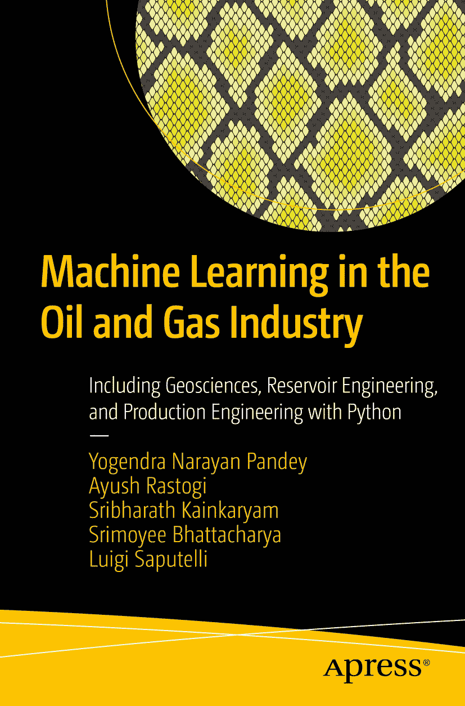

ISBN 978-1-4842-6093-7 e-ISBN 978-1-4842-6094-4 [`doi.org/10.1007/978-1-4842-6094-4`](https://doi.org/10.1007/978-1-4842-6094-4) © Yogendra Narayan Pandey, Ayush Rastogi, Sribharath Kainkaryam, Srimoyee Bhattacharya, and Luigi Saputelli 2020 Apress Standard 本出版物中使用的通用描述性名称、注册商标名称、商标、服务标志等，即使未作明确声明，也不意味着这些名称不受相关保护性法律和法规的约束，因此可被普遍使用。出版商、作者和编辑假定本书中的建议和信息在出版之日是真实准确的。出版商、作者或编辑均不对本书所含内容或可能存在的任何错误或遗漏提供明示或暗示的担保。出版商对已出版地图中的管辖权主张和机构归属保持中立。本书通过 Springer Science+Business Media New York 在全球图书贸易中发行，地址：1 New York Plaza, Suite 4600, New York, NY 10004-1562, USA。电话：1-800-SPRINGER，传真：(201) 348-4505，电子邮件：orders-ny@springer-sbm.com，或访问 www.springeronline.com。Apress Media, LLC 是一家加利福尼亚有限责任公司，其唯一成员（所有者）是 Springer Science + Business Media Finance Inc (SSBM Finance Inc)。SSBM Finance Inc 是一家特拉华州公司。

*献给我的家人。*

*——Yogendra*

*献给我的家人，感谢他们在撰写本书过程中的耐心与支持。*

*——Ayush*

*献给我的家人。*

*——Sribharath*

*献给我的家人，他们始终给予我能量和灵感。*

*——Luigi*

*献给我的家人，感谢他们所有的爱与支持。*

*——Srimoyee*

*献给所有希望在机器学习问题上抢占先机的地球科学家和石油工程师，以及需要快速了解石油和天然气行业用例的年轻一代数据科学家。*

*——作者们*

引言

本书适合所有对机器学习在石油和天然气行业应用感兴趣的人士。本书内容旨在提供计算机编程的基础知识、机器学习和深度学习算法的实现方法，以及如何利用它们解决石油和天然气行业问题的途径。本书不提供生产级代码，但会为您提供如何开始为本书及更广泛领域内讨论的石油和天然气行业问题构建机器学习解决方案的信息。本书共分为八章，内容如下。

第 1 章概述了石油和天然气行业的不同环节，并提供了机器学习在上游行业问题中的应用示例。

第 2 章是 Python 编程语言的简要入门。您将熟悉 Python 编程语言的基本语法。随后，您将学习 NumPy、pandas 和 Matplotlib 等 Python 库，这些库对于某些机器学习相关任务非常有用。

第 3 章概述了机器学习和深度学习的概念。在本章中，您将了解监督学习和无监督学习的概念。您将使用简单且干净的数据集进行练习。scikit-learn 和 TensorFlow 库分别用于实现机器学习和深度学习的代码示例。

第 4 章重点介绍机器学习在地震处理和解释问题中的应用。利用开放数据源提供的地震数据，我们实现了自动盐体解释。在不深入实现细节的情况下，简要讨论了解决其他地震解释问题的策略。

第 5 章重点介绍与地质建模相关的问题，包括使用监督机器学习来估算远离井位的岩石物理属性。

第 6 章重点介绍在递减曲线分析中开发机器学习模型的方法，以及这些模型在生产预测中的应用。

第 7 章涵盖使用机器学习方法进行生产建模，包括生产优化。本章部分内容提供了虚拟计量方法和虚拟传感器的构建方法。

第 8 章讨论了机遇、挑战和预期的未来趋势。在本章中，我们讨论了在石油和天然气行业执行基于机器学习的数字化转型项目时遇到的挑战。讨论了导致项目失败的潜在陷阱以及避免这些陷阱的方法。此外，还从管理者和实践者的角度讨论了应对这些挑战所固有的机遇。提供了未来几年上游行业基于机器学习的数字化转型路线图。

关于作者 关于技术审校者

