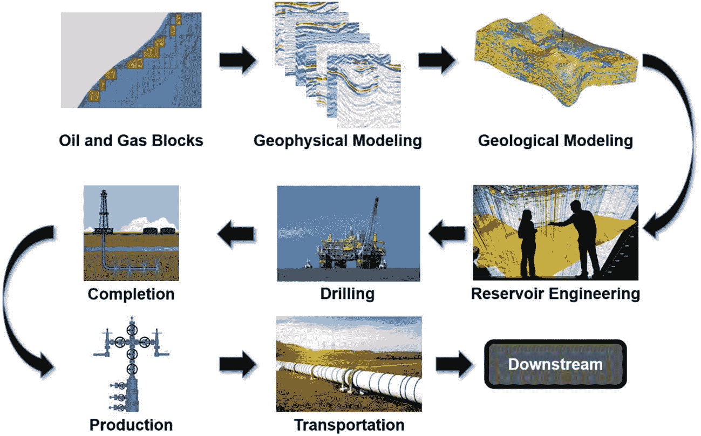
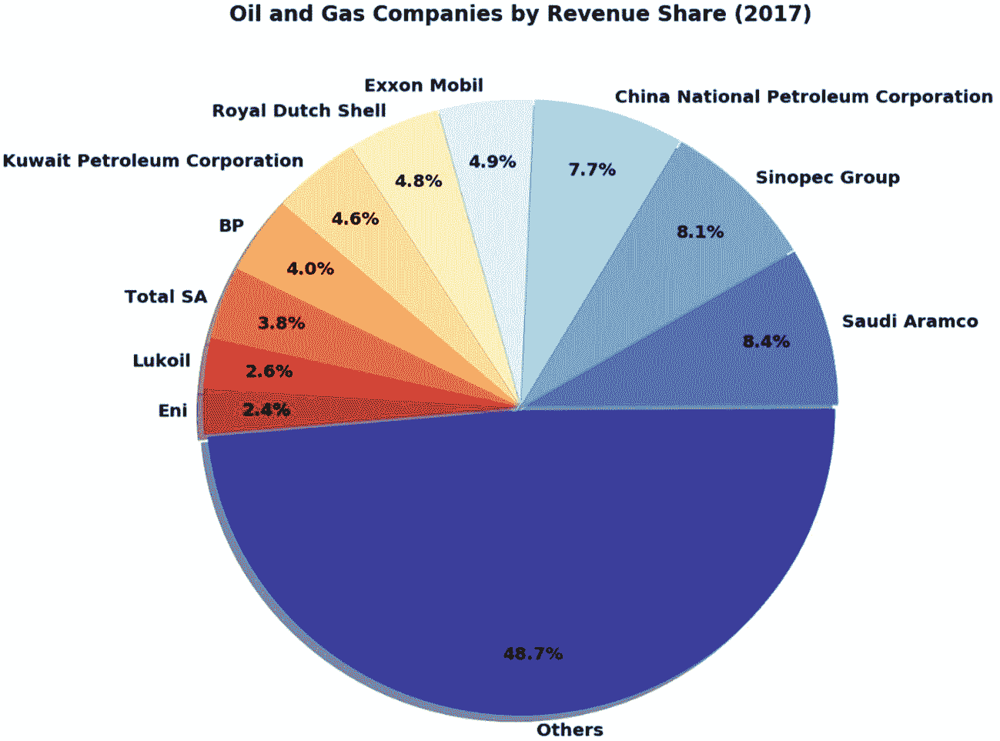
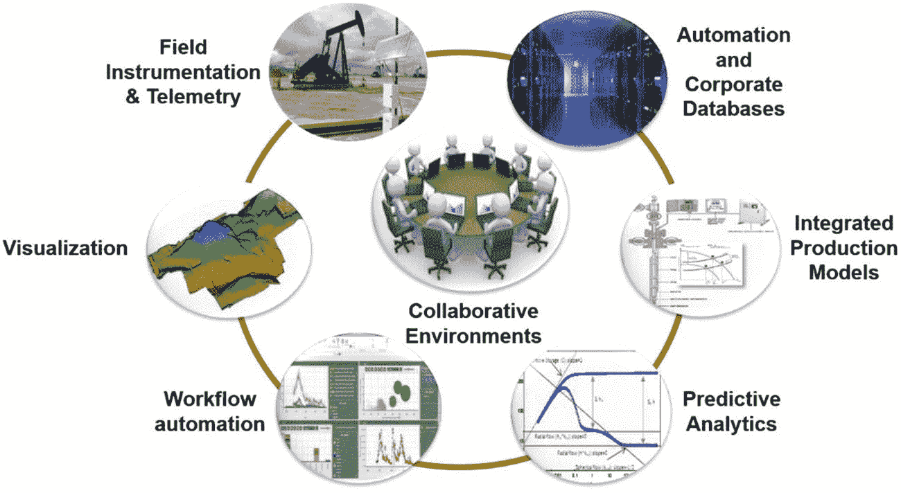
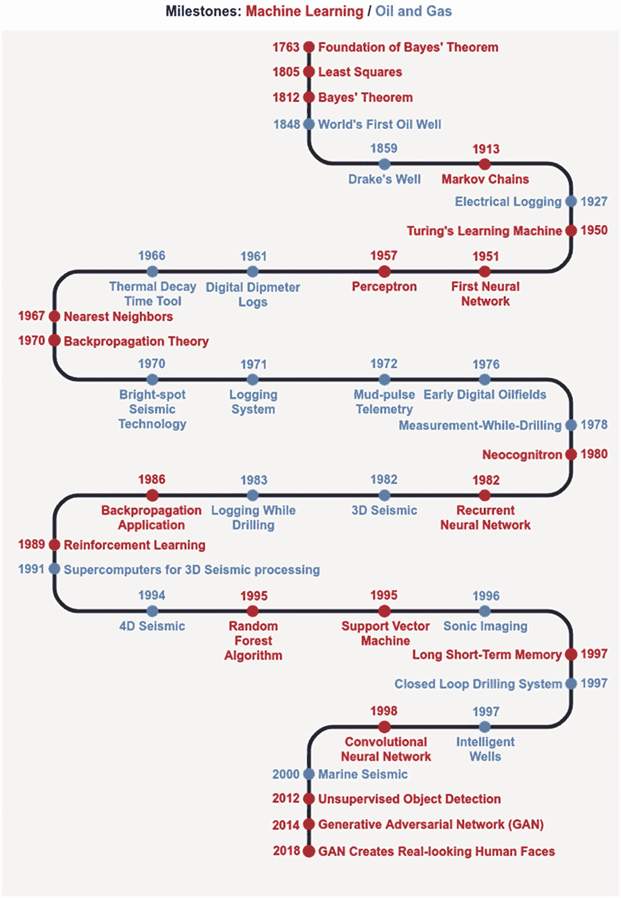
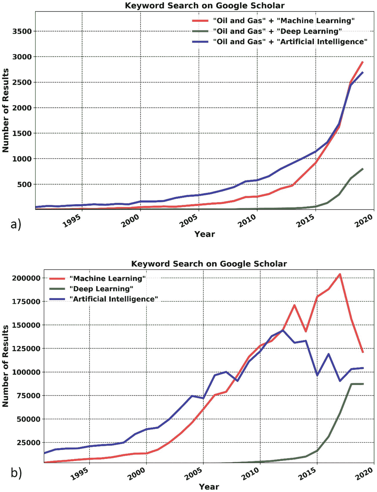

# 1. 迈向油气行业 4.0

能源是维持现代人类生活的基本需求之一。2016 年，全球能源需求为 552 千万亿英热单位。其中，石油供应了 177 千万亿英热单位，天然气供应了 127 千万亿英热单位。这表明，2016 年全球 55%的能源需求由石油和天然气行业满足[1]。预计到 2040 年，全球 57%的能源需求将由石油和天然气行业满足。这些数字展示了石油和天然气行业当下及未来对我们日常生活的影响。尽管石油作为能源的使用可追溯到数百年前，但现代历史上第一口油井于 1848 年在阿塞拜疆的巴库钻成[2]。

1859 年，埃德温·德雷克在美国钻成了第一口商业油井（见图 1-1）。德雷克油井是现代石油和天然气行业的转折点，由此引发了油井钻探领域的投资热潮。150 多年来，该行业不断发展并采用新技术。石油和天然气行业很可能是少数几个以推动工业革命而闻名的行业之一。在过去的几个世纪里，世界见证了三次工业革命。

图 1-1

德雷克油井被认为是第一口使用钻机成功钻探的油井[3]

*   第一次工业革命始于 1760 年左右，以蒸汽机的发明为标志。在这个时代，蒸汽动力工具促进了工厂的机械化生产，蒸汽机彻底改变了人们的出行方式。
*   从 19 世纪末到 20 世纪初，生产的科学原理被引入工业领域。这导致了装配线上产品的大规模生产。福特汽车公司生产的汽油发动机汽车是第二次工业革命期间大规模生产的杰出典范之一。
*   随着 1945 年第一台通用计算机 ENIAC 的诞生，第三次工业革命或数字革命的种子被播下。到 20 世纪 80 年代，半导体技术的进步彻底改变了全世界的工业，计算从大型主机转向个人电脑。互联网的出现连接了世界，信息技术的进步开启了一个新的工业化时代。

目前，全球各行业正在经历第四次工业革命。这场革命由计算基础设施、预测技术、数据存储和数据处理能力的非凡增长所推动。第四次工业革命——有时以附加在不同行业名称后的“4.0”版本指代——正由以下推动因素驱动：

*   工业物联网，它促进了企业和运营环境中众多设备之间的无缝连接，并支持协作决策。
*   大数据技术，它利用分布式数据存储和处理来高效地存储和处理海量数据。
*   利用加速计算设备（如图形处理单元）的云计算机器。

石油和天然气行业也正在进行数字化转型，这被称为“油气行业 4.0”。石油和天然气行业的运营涉及高风险情况，无论是对人类生命还是环境而言。因此，只有在经过严格的验证阶段，确保健康、安全和环境标准得到适当满足后，才能采用新技术。尽管在采用新技术时极为谨慎，但石油和天然气行业始终对优化和简化现有流程的新技术持开放态度。

本书聚焦于机器学习（人工智能的一个子集）在石油和天然气行业的应用。在本章中，我们不深入探讨机器学习技术的具体细节，而是讨论与上游石油和天然气行业不同生命周期阶段相关的一些应用实例。为了便于那些对石油和天然气行业背景了解不多的读者，我们首先简要概述该行业的不同部门。

## 主要油气行业部门

石油和天然气矿床通常位于地表以下数千英尺处。将这些深度的石油和天然气开采到地表，然后将其转化为可用能源的过程涉及大量操作。图 1-2 展示了石油和天然气行业运营中不同的生命周期阶段。广义上讲，石油和天然气生产的整个过程分为以下三个行业部门。

图 1-2

典型石油和天然气行业运营环境中的不同生命周期阶段

*   上游行业
*   中游行业
*   下游行业

### 上游行业

上游石油和天然气行业也称为勘探与生产行业。上游行业的运营侧重于识别地表以下可能蕴藏石油和天然气的区域。在确定潜在储量后，详细的勘探规划、油井钻探以及石油和天然气的生产也属于上游行业的范畴。从逻辑上讲，上游运营可分为以下活动：

*   勘探与评估
*   油田开发规划
*   钻井与完井
*   生产作业
*   废弃

#### 勘探与评价

在地表下精确找到油气藏的位置，是一项如同大海捞针般充满挑战的活动。过去一个世纪以来，人类对地球地下结构的科学认识已显著提升。地质调查提供了地表下结构的地质图或模型。结合地球物理勘探，这些模型有助于形成对地下结构的详细理解。

地球物理勘探有多种类型，具体取决于所使用的技术，例如磁法、电磁法、重力法和地震勘探等。近年来，地震勘探已被证明是定位潜在油气藏最可靠的方法。地震勘探可以在陆上或海上进行。

地震成像的基本原理与人体超声波成像相似。进行地震勘探的过程需要一个声能源。在陆地上，这些声源可以是大型振动卡车；在海上地震勘探中，则是气枪。从不同地下结构反射回来的声波由地表或水面附近的检波器或水听器（非常灵敏的麦克风）接收。3D 和 4D 地震勘探是石油和天然气行业中数据量最大的数据集之一，有时其规模可达拍字节级别。这些地震勘探提供的信息有助于识别地下构造特征以及潜在的油气藏。

地质学家对地球的沉积环境有详细的理解，这有助于他们了解不同岩层在地下的排列方式。地质学家利用他们在盆地和层序地层学方面的深厚知识，并结合地震数据解释所获得的信息，来精确定位可能发现石油的位置。

一旦以一定的置信度确定了油气藏的潜在位置，运营的石油和天然气公司就会获得该油气区块的租赁权。基于地球物理和地质认识的结合，会钻探探井（也称为*野猫井*）来验证潜在的油气藏位置。如果在第一口野猫井中发现了石油，油藏工程师便会参与到油田评价过程中。

在此过程中，会在原始野猫井周围钻探更多的评价井。从探井中收集不同的测井记录和岩心记录，这些记录将进一步用于更详细地了解已发现的油气藏。

地质学家和岩石物理学家利用地质模型以及测井数据，在目标区域建立详细的物理属性三维油藏模型，这一过程被称为*岩石物理建模*。在目标区域计算岩石物理属性，例如孔隙度（岩石中可储存或输送油气的空隙比例）以及油、水饱和度。这些详细的岩石物理模型有助于计算已发现油气藏中总可采和可恢复油气量的概率估算值。

#### 油田开发规划

一旦勘探和评价活动结束，油藏工程师和地球科学家（地质学家和地球物理学家）会共同制定一份详细的计划，以进一步开发油气生产田。勘探和评价阶段获得的所有信息和见解——包括详细的油藏模型——都会被考虑在内。此阶段做出的决策包括：确定钻井的精确位置、优化井位布局的详细设计、完井设计（包括所需的射孔和增产措施）。

设施工程师、油藏工程师和生产工程师还会制定处理油气所需的详细设施设计（例如，用于分离油、水和气的分离器）。油田开发计划还包括将生产的油气运输到储存或处理设施的策略。一旦油田开发计划获得批准，就开始按照计划中规定的规格建造设施、钻探油井并完成完井。

#### 钻井与完井

钻井过程的核心是创建油气从油气藏流向地表的通道。钻井是一项高风险、高资本支出的作业。深水海上钻井平台的日租金及相关费用可能接近每天 100 万美元。粗略估算，一口海上油井的成本可能在 1 亿至 2 亿美元之间——在深水区域甚至更高。一口陆上油井的钻井成本可能在 500 万至 800 万美元之间[4]。

在钻井作业中，钻头连接在钻柱的最下端，钻柱是由钢或铝合金制成的钻杆依次连接而成的长柱。钻柱的顶端连接着一个驱动装置（一种机械设备），为钻柱提供扭矩。

由于这个扭矩，连接在钻柱底部的钻头旋转并切削岩石，从而形成井眼。在钻井作业期间，钻井泥浆会流经钻杆以冷却钻头。钻井泥浆还有助于清除钻井过程中产生的岩屑。

在钻井过程中，钻柱会定期收回，并通过固井和下套管来稳定井眼。套管是高强度的中空钢管，它与固井作业相结合，可以加固井眼，防止井眼坍塌。除了提供结构强度外，套管还能确保钻井过程中使用的化学流体不会污染附近的含水层和地下水源。

在固井并将套管下入井眼后，生产油管会被下入井眼。油管是耐腐蚀的中空不锈钢管，其直径始终小于套管，通过封隔装置固定在套管内。油管为油气从井底到地表提供通道，并保护套管免受腐蚀和其他可能的磨损。

一旦套管和油管就位，就会在套管或套管与油管上制造射孔，以促进油气从储层岩石流入井眼。除了射孔，完井活动还可能包括水力压裂和其他增产措施。

在水力压裂过程中，水以极高的压力注入井眼。高压会在岩石中产生裂缝，为油气从储层流向井眼创造额外的通道。支撑剂是直径很小的砂粒，在压裂过程中用于确保裂缝保持张开状态。支撑剂的运移由转向剂辅助，转向剂是一种化学化合物，用于促进支撑剂颗粒从井眼流向裂缝内部。

一旦油田开发计划中规定的所有完井活动完成，油井便开始生产油气。需要注意的是，上述几页中提到的活动，从开始到油井产出第一滴油，有时可能需要五到十年的时间。

#### 生产作业

一旦油井开始产出石油和天然气，生产工程师和油藏工程师会持续监测该井的生产趋势。在整个油井生命周期内，其油气产量会随时间推移而递减。生产工程师会制定方案，通过采用诸如人工举升等技术来维持油井的石油流动。人工举升可以利用泵（如电动潜油泵、抽油杆泵等），或通过向井底注入气体进行气举，以增加或维持油井的油气流量。在生产作业期间，还可以进行其他修井和干预作业，例如更换完井设备以维持油井的产出。

#### 废弃

经过多年的持续生产，油井的油气产量持续下降。如前所述，工程师们会尝试通过修井和干预作业来使油井复产。然而，在某个时间点之后，鉴于油井极低的生产潜力，复产可能被认为在经济上不可行。在这种情况下，油井会被注入水泥封堵并废弃。这是油气井生命周期的最后一个阶段。在封堵和废弃过程中，会严格遵守不同监管机构制定的封井要求，以确保合规。

### 中游产业

中游产业负责将从油井产出的原油运输至下游加工设施。运输方式可通过管道、油轮、卡车或铁路。此外，中游产业还负责石油商品（包括原油和天然气）的储存和营销。通过这种方式，中游产业充当了偏远地区油气生产设施与通常建在人口稠密区附近的下游加工设施之间的连接纽带。

### 下游产业

下游产业的主要功能包括原油的分馏或裂解（将粘稠的高分子量原油转化为透明状的低分子量石油燃料的过程）以及相关的化学处理。随后是调合操作，最终生产出供大众消费的成品石油燃料。此外，下游炼油厂还负责天然气的净化。下游产业的完整范围包括炼油厂、石化厂、分销运营、零售中心及其他相关设施。在石油天然气行业的三个部门中，下游产业对普通大众的可见度最高，因为我们几乎所有人日常通勤的车辆都使用汽油或柴油。喷气燃料、沥青、润滑油、塑料和天然气是下游产业生产的其他各种石油产品。

到目前为止，我们已经讨论了石油天然气行业的三个部门。我们有意将中游和下游产业的描述保持简短。在接下来的章节中，我们将重点讨论上游石油天然气行业的数字化及其与机器学习的联系。

## 数字油田

全球石油天然气行业拥有巨大的经济影响力。根据公共领域可用的数据，2017 年全球石油天然气公司的收入约为 5.5 万亿美元[5]。其中，排名前十的公司占据了近一半的收入（见图 1-3）。近年来，几乎所有公司都开始投资于数字化转型工作。根据世界经济论坛发布的一份报告，2016 年至 2025 年间，石油天然气行业的数字化转型可能价值 1.6 万亿至 2.5 万亿美元[6]。这些数字让我们得以一窥石油天然气行业数字化努力的巨大规模。

图 1-3

全球领先的石油天然气公司及其在 2017 年全球收入中的份额[5]

数字化对石油天然气行业来说并不新鲜。计算机辅助的互联油田可以追溯到 20 世纪 70 年代末[7]。在过去二十年中，上游石油天然气行业在实时数据和现场驱动设备的使用方面呈指数级增长，这导致了众多数字油田的实施。这些实施已展现出在提升运营效率、优化产量和最大化油气采收率方面的价值。同时，数字油田的实施促进了更好、更快的决策，同时降低了健康、环境和安全风险。正式地讲，数字油田是一个“测量-计算-控制”循环的过程，其频率能够确保系统在其时间常数约束内始终维持最佳运行条件，同时可持续地：

*   最大化产量
*   最小化资本支出/运营支出
*   最小化环境影响
*   保障相关人员的安全和相关设备的完整性[8] [9]

这些目标可以通过协调四个相互关联的领域来实现：人员、自动化工作流程、流程和技术。需要注意的是，要恰当地描述支持数字油田实施的工作流程需要付出巨大努力。简而言之，数字油田是自动化与信息技术的集合，它转变了石油资产管理理念，并驱动更高效的运营工作流程。它涉及由数字自动化支持的学科、数据、应用和工作流集成工具的协同（见图 1-4），具体包括以下内容。

图 1-4

数字油田的不同组成部分

*   现场仪表
*   遥测技术
*   自动化
*   数据管理
*   集成生产模型
*   工作流自动化
*   可视化
*   协作环境
*   预测分析

成功的数字油田实施需要所有这些组件之间的同步。数字油田的预测分析组件负责为油田的当前和未来前景生成数据驱动的洞察。该组件通常承载着机器学习算法，是成功实施数字油田的关键。在下一节中，我们将讨论机器学习如何为数字油田实施乃至整个石油天然气行业提供预测分析能力。

## 上游产业与机器学习

上游产业应用机器学习已有数十年历史，不过它可能曾被称作人工智能或其他别名。图 1-5 展示了机器学习与石油天然气行业里程碑事件的综合时间线。该时间线特别强调了代表数据采集与数字化进程的油气行业里程碑。根据时间线上技术演进的性质，我们可以将其划分为不同时期。截至 20 世纪头十年，这两个行业都处于奠基阶段。

图 1-5  
石油天然气行业与机器学习里程碑事件。数据来源：参考文献[2]和[10]

在早期阶段，机器学习领域诞生了基础理论发现——如贝叶斯定理和最小二乘法。而在石油天然气行业，首批商业油井被钻探，石油作为重要燃料逐渐普及，并缓慢取代燃煤蒸汽机。进入 20 世纪中期，我们看到油气行业开始使用电测井技术。与此同时，图灵的学习机在第一台通用计算机（ENIAC，1945 年）问世后不久便出现了。

20 世纪 50 年代标志着机器学习领域两项极其重要的发现：神经网络和感知机。这两者都被视为 20 世纪后期发展出的强大高级机器学习算法的基础。20 世纪 60 年代，油气行业工具取得重要进展，包括数字地层倾角仪（可测量井筒中的地层倾角，帮助区分不同类型的岩层）。同一时期还诞生了最近邻算法，这是机器学习的基础算法之一。

随着时间推移，我们看到 20 世纪 70 年代油气行业出现了多项重大发展。一些关键技术如亮点地震、测井系统、泥浆脉冲遥测和随钻测量（MWD）均在这一时期问世。这些都是数据采集技术的重大进步，至今仍是石油工程师最重要的数据来源之一。在这十年间，数字油田的初步概念化和实施得以实现，通过计算机系统整合了不同信息平台。对于机器学习而言，反向传播理论诞生了。反向传播理论的重要性体现在：没有它，我们就不会看到近年来神经网络引领的人工智能领域革命。

20 世纪 80 年代，三维地震彻底改变了地球科学家研究地下结构的方式。大约在同一时期，随钻测井（LWD）技术使钻井作业期间能够获取实时数据，提供关于地下地层物理特性的精确信息。同一十年间，新认知机的发明为高级计算机视觉奠定了基础，而循环神经网络（RNN）则为序列建模提供了新工具。或许只是巧合：地下三维地震成像最重要的进展之一，与基础计算机视觉算法新认知机的发现，仅相隔数年。在本书第 4 章中，您将看到这两个在不同行业仅相隔两年发生的事件，如何通过将计算机视觉算法应用于地震图像，从而产生对地球地下结构的洞察。

20 世纪 80 年代机器学习领域的另外两项重要发现是：应用反向传播理论促进神经网络训练，以及强化学习的基础建立。强化学习是机器学习范式之一，它依靠奖励函数来训练软件代理完成特定任务。这些算法可以教会虚拟玩家在游戏中战胜人类，或教会机器人像人类一样行走。^(¹)

20 世纪 90 年代，地震技术取得了重大进展。一方面，超级计算机被用于处理三维地震数据；另一方面，四维地震数据帮助地球科学家解释和可视化地下结构随时间的演变。这又是一个美妙巧合的十年。当地球科学家获得了理解地震时间序列演变的能力时，机器学习发现了一种名为*长短期记忆*（LSTM）的新算法用于序列预测。这两个事件在时间线上仅相隔三年。LSTM 解决了传统循环神经网络的一些局限性，提供了更强的序列预测能力。您将在第 3 章中了解更多关于 LSTM 的知识。

20 世纪 90 年代还见证了随机森林和支持向量机算法的发现。随着时间的推移，随机森林算法已成为每位机器学习从业者首选算法之一。

20 世纪 90 年代是机器学习研究加速发展的十年，在此期间发表的最引人入胜的算法之一是卷积神经网络（CNN）。CNN 在过去十年中一直是计算机视觉领域的驱动力。在 20 世纪 90 年代，石油天然气行业也见证了新技术的发展，如声波测井、闭环钻井系统和智能井。

自 21 世纪初以来，油气行业在数据采集领域取得了显著的技术进步。除了海上地震勘探获取的海量数据外，非常规油气行业的蓬勃发展也成为了大量数据的来源。此外，计算硬件的发展，例如基于图形处理单元（GPU）的计算机，极大地提升了计算能力。借助快速计算硬件与海量训练数据的结合，近年来开发的机器学习算法已能够在无需任何人工监督的情况下，识别图像和视频中的物体。另一方面，一类新型算法——生成对抗网络（GAN）——已经能够生成几乎无法与真实照片区分的人脸图像。有趣的是，GAN 也被有效地应用于地震图像重建中[11]。

对这两个行业的里程碑回顾显示，它们在数据采集、数字化以及从海量数据中学习的能力方面都取得了显著进展。在本章的后续部分，我们将简要回顾机器学习在上游行业不同环节的应用。首先，我们简要概述特定上游行业环节中可用的不同类型数据，然后讨论将这些数据与机器学习算法结合以解决上游行业问题的案例。对于那些没有机器学习背景的读者来说，在学习这些算法在油气行业的应用之前，先对它们有一个初步了解是很重要的。因此，在本书接下来的章节中，我们将首先详细介绍这些机器学习算法的细节。然后，我们将展示这些算法如何用于解决行业特定问题的示例。在本章中，你只需理解存在不同类型的机器学习算法，并且它们已被应用于解决各种行业相关问题即可。

### 地球科学

地球科学可以被理解为涵盖地质学、地球物理学和岩石物理学的一门学科。在以下小节中，我们将讨论一些与地球科学相关的问题，这些问题已通过应用机器学习算法得到解决。

#### 地球物理建模

地球物理学家处理地震数据。地震数据可以是二维、三维或四维（描述时间演化）。由于数据量庞大，地震数据集最适合用于需要大量数据进行充分训练的先进机器学习算法，例如 CNN。以下讨论一些可通过应用机器学习来解决的地球物理学问题。

##### 自动断层解释

断层解释是地震解释中的一个关键步骤。断层由不同的地下运动机制形成，导致结构不连续性。在考虑目标区域存在断层后，需要做出某些操作决策。在传统工作流程中，断层解释是一个耗时的过程。卷积神经网络可能有助于将断层解释作为一个计算机视觉问题进行公式化和求解。然而，生成大量代表地震图像及其对应断层位置的标记数据来训练 CNN 模型并不总是可行的。不过，最近的研究已经确立了用最小训练数据集训练先进 CNN 变体的方法，同时能在提供的地震图像中对断层位置进行高度精确的逐像素预测[12] [13]。

##### 自动盐体识别

地震解释中的另一项关键任务是识别地下环境中的盐体。在传统工作流程中，目视拾取盐/沉积物边界是进行盐体识别的标准方法。这是一个耗时的手动过程，且可能受到个人偏见的影响。基于先进 CNN 的分类，结合残差学习，在描绘盐体方面已展现出高精度。这些基于 CNN 的算法的结果与手动解释的盐体显示出良好的一致性。这些结果表明了应用 CNN 进行自动盐体识别的潜力[14]。

##### 地震插值

获取高分辨率、规则采样的地震数据常常受到物理或经济条件的限制。这导致了欠采样的地震数据集。此外，数据质量问题（如坏道或死道）的存在，给依赖高分辨率、高质量地震图像的勘探和生产活动带来了额外挑战。应对这些挑战可以使地球科学家、油藏工程师及其他行业专业人士提高其模型的预测能力。

近年来，生成对抗网络已被用于地震图像的插值。地震插值有助于重建坏道和死道。它也可以用作地震数据的分辨率增强工具。使用生成对抗网络进行地震插值的结果使其成为经典方法的一个有趣替代方案[11]。

##### 地震反演

地震反演过程将地震数据转换为描述油藏的定量岩石属性估计值。在最近的研究中，GAN 已被结合作为创建地下地质结构及其岩石物理属性的*先验*模型。生成的结构和属性信息被用于辅助地震反演[15]。这是 GAN 在地震处理领域的另一个有趣应用。

#### 地质建模

地质建模是在目标区域的地表及地下生成详细的二维或三维物理属性模型的过程。建模过程使用了地表的地质观测数据、该区域钻探井的不同类型测井数据以及地震数据。以下讨论一些在地质建模中的机器学习应用。

##### 岩石物理建模

岩石物理建模对于了解油藏中油气储层的结构和属性至关重要。神经网络已被成功应用于创建油气藏中岩石物理属性分布的详细表示，这有时被称为*神经克里金法*[16] [17]。近年来，深度神经网络已被应用于生成详细的二维和三维模型或油藏[18] [19]。这些研究证明了机器学习方法在构建详细的岩石物理属性模型方面的有效性。

##### 岩相分类

岩相可理解为具有独特特征的一类岩石。了解油气藏中的岩相分布有助于识别更可能产出油气岩石的区域。近年来，应用深度神经网络的机器学习方法在基于测井岩石物理性质[20]以及远离井位的随机兴趣点[19]进行岩相分类方面，已展现出合理的准确性。

### 油藏工程

油藏工程师能够获取地球科学家使用的几乎所有数据。他们还掌握其负责油田的油气产量和作业历史数据。他们利用多种多样的数据来制定从油藏乃至整个油田经济最优地开采油气的方案。接下来将讨论一些机器学习已展现出潜在优势的油藏工程活动。

#### 油田开发规划

在油田开发规划期间，油藏工程师利用现有井的数据。基于对现有井数据的分析，他们决定新井的布井位置。具体而言，这是非常规油气资源开发中的标准做法。已有多种方法尝试应用机器学习，基于历史数据来规划新井。

其中一种方法是通过应用主成分分析（PCA）进行降维，随后采用回归方法来预测拟建新井的生产潜力[21]。基于机器学习方法的分析也证明了其揭示隐藏模式的能力，这些模式在高维空间中不易被察觉。通过识别这些模式，可以识别出预期表现相似的井。进一步的分析可以揭示表现相似井的共同属性、表现不佳井性能欠佳的根本原因，以及在新井中避免类似不良性能的措施[22]。

#### 辅助历史拟合

历史拟合过程遵循一个迭代方案来调整油藏参数。当历史拟合结果与观测到的油藏表现达到合理匹配时，该过程即收敛。在非均质性强、复杂性高的油藏中，历史拟合可能是一个耗时且计算成本高昂的过程。近年来，基于人工神经网络的方法已被应用于油藏历史拟合[23]。这类方法采用完全数据驱动的代理模型，显著降低了计算成本。与全尺寸数值油藏模拟器相比，代理油藏模型的计算成本仅为其一小部分。这种计算成本的降低使得历史拟合过程变得非常高效[24]。

#### 产量预测与储量估算

预测生产井的石油产量是油藏工程师的主要职责之一。基于生成的产量预测，可以做出关于未来油田开发活动的决策。产量预测有助于估算可采储量和进行经济评价。传统上，数值模拟和递减曲线分析（DCA）技术被广泛用于产量预测。这些技术需要了解油藏行为，并且在模拟复杂物理过程方面缺乏灵活性。

近年来，使用前馈神经网络[25][26]和循环神经网络的机器学习方法已在单井和多井的产量预测中证明了其有效性和准确性。这些机器学习方法使得无论资产是否拥有大量作业历史信息，其预测过程都变得高效且准确[27]。

### 钻井与完井

海上钻井是一项高风险、高资本支出的作业。深水海上钻井每天的成本可能高达 100 万美元，而在深水钻井场景下，单口井的成本可能高达数亿美元。鉴于这些事实，采用机器学习模型的自动化可以显著提高钻井作业的操作安全性，同时降低钻井成本。接下来将讨论机器学习在钻井与完井活动中的一些应用，这些应用展示了在提高操作安全性和成本效益方面的巨大潜力。

#### 自动化事件识别与分类

上游资产通过人工生成的作业报告和传感器数据（如钻压、立管压力、转速等）创造有价值的见解。只有当数据质量足够，且信息得到正确解释、存储和使用时，才能实现这种价值。报告和数据为推导井事件提供了基础。井事件的例子包括：生产时间（例如，钻进）、非生产时间或 NPT（例如，卡钻、粘滑振动、井眼清洁、管柱故障、井漏、底部钻具组合涡动、过大扭矩和摩阻、低机械钻速、钻头磨损、地层损害、井眼失稳等），以及隐性损失时间或 ILT（例如，缓慢的接单根、次优钻进和起下钻）。

多年来，钻井和完井作业一直得到广泛数据收集过程的支持。在过去的二十年里，随着井下传感器和远程通信能力的加入，钻井和完井作业期间出现了广泛的实时数据收集过程。当前的挑战是从实时数据中识别事件并获取见解，以防止 NPT 和 ILT。传统上，每日钻井报告（DDR）一直是描述井场关键作业和事件详细日志的权威来源；然而，它们受制于人为偏差，并且使用不一致的文本格式和术语。自动化事件识别与分类的目标是，在能够实现最佳和安全钻井作业的时间范围内，查明并纠正钻井过程中出现的问题[28]。

已经提出了各种机器学习技术，通过检测事件发生时钻井参数的变化趋势来自动识别和分类钻井事件。钻井事件是使用定义的专家规则、阈值和标准[29]，以及回归和分类方法[30]，从海量 DDR 和实时钻井数据库中提取的。也有研究尝试最大化 DDR 和实时数据的价值[31]。

#### 非生产时间（NPT）最小化

钻井作业中的非生产时间（NPT）可能由多种原因引起。由于钻井设备租赁费用高昂，因此存在经济激励来最小化此类非生产时间。井涌和卡钻是导致非生产时间的两个最重要问题。接下来将讨论一种用于预测这些问题发生概率的机器学习方法。

##### 早期井涌检测

*井涌*是指气体突然从地层渗入井筒的事件。当气体进入井筒后，便开始向地表上升。气体的向上运动表现为地表泥浆体积增加，同时伴随泥浆流出井口的流速增大。

井涌是一种危险事件，对其后果进行补救的成本往往十分高昂。越早检测到井涌，钻井平台上的工作人员就能越早采取必要的纠正措施。然而，传统的报警系统要么存在大量误报，要么无法准确识别井涌。机器学习算法的应用能够在钻井过程中提供泥浆体积和流速的精确估算，同时也显著降低了误报频率。这有助于钻井人员及时采取有效的纠正措施 [32]。

##### 卡钻预测

在钻井作业的某些情况下，钻杆可能会卡在井筒内。一旦钻杆被卡住，钻井作业就会暂停，直到采取补救措施。卡钻问题是导致钻井作业非生产时间的主要因素之一。为了预测卡钻事件相关的非线性行为，通过粒子群优化算法优化的人工神经网络在提前预测卡钻事件可能性方面表现出了高精度。从这种机器学习方法获得的预测，结合合理的工程判断，具有预防卡钻事件的潜力 [33]。

#### 自主钻井平台

大型海上钻井平台通常位于偏远地区，每天可产生高达 1 到 2 太字节的数据。使用 2 Mbps 的卫星链路传输海上平台一天产生的如此大量的数据需要 12 天或更长时间 [34]。因此，任何关键的数据驱动决策都必须在海上钻井平台本身上进行。自主钻井平台结合了机器学习、工业物联网和机器人技术。此外，平台上的决策需要安装在平台上的边缘计算设备（嵌入了机器学习和其他算法的电子电路设备）。钻井平台上精密的机械和大量的传感器提供了决策所需的所有相关信息。工业物联网设备获取的数据可以由运行在边缘计算设备上的机器学习算法处理。最后，算法给出的建议被传回给钻井操作员或机器人，从而执行最终行动。自主钻井平台的目标包括以下内容。

*   以最优速率钻井（机械钻速优化）[35]。

*   最小化非生产时间，例如，提前预测卡钻的可能性，并提高不同补救措施的成功概率（钻井作业中总非生产时间的 25%归因于卡钻）[33]。

*   操作安全，例如，早期井涌检测以确保人员安全并保护生态系统 [32]。

### 采油工程

随着油气田的成熟，油藏和井况会持续变化，并且很可能是朝着恶化的方向发展。结果，由于含水率（石油中水的比例或百分比）上升、举升设备效率低下、缺乏足够的油藏压力支持或地面回压瓶颈等诸多原因，产量会迅速下降。油藏和油田的衰退可能是单井产量下降以及非生产井（停产井）数量快速增加的结果。

为了管理产量下降，需要钻新井或对现有井进行干预。为了通过现有井提高产量，油藏和采油工程师会规划并执行修井作业，包括挤水泥、井完整性、打捞作业和层位封隔，以优化和维持石油生产。

采油工程的作用是确保油藏生产在已批准的油田开发方案的现有边界内进行，包括井数、设施能力和有限的支出。采油工程师的职责可能包括以下内容。

*   规划、收集和解释生产监测数据。

*   建立、维护和利用模型进行井性能管理。

*   确定井的操作包络线和设定点。

*   识别、排序、实施和评估增产机会，包括修井作业。

#### 修井机会候选井识别

在其生命周期内的某些情况下，一口井可能无法令人满意地运行和生产。识别此类井，并执行干预和补救活动（也称为*修井*）以使井的性能达到令人满意的水平，已显示出显著的经济效益。专家系统在石油和天然气行业已使用数十年，其流程涵盖从数据集成和清洗、问题检测，到根据产量增益、成本、风险和净现值对候选井进行排序。利用数据分析、机器学习和推理工具（如贝叶斯信念网络 [36] [37]）的新型系统已被提出并用于检测生产问题，并给出井、油藏或设施中各种问题发生的可能性。这些系统有助于区分根本原因，并对现有的不同应对措施进行优先级排序。这些筛选逻辑作为一个可重复的自动化过程运行，可以按计划执行或按需执行。

##### 生产优化

生产优化的目标是利用到该时间点为止所有可用信息来管理并确保盈利地实现资产目标，自信地预测结果，做出能产生最优结果的决策，并在下一个决策时间点之前实施这些决策。油田中实时井下测量和远程驱动阀门的日益普及，使得实时进行全油田范围的操作优化成为可能 [38]。有了更多的实时数据和测量值，就有可能构建机器学习模型，这些模型可以在获得新数据时进行更新。虽然实时优化这个术语当然并不新鲜，并且实时优化已在生产操作的某些环节中得到实践，但如今在日常生产操作中实现实时优化的可行性已大大提高。

##### 加密钻井

加密钻井是指在油田开发周期的后期阶段，为了增加井-油藏接触面积而选择的额外泄油位置。加密钻井的目的是提高或改善井的采收率，这些井的泄油区域内可能存在未被开采的油气藏。选择加密井候选井需要仔细分析，以验证、量化并定位这些未被开采的油藏位置。已经开发出多种数据驱动的方法来预测潜在侧钻井的产量，提供一套标准来选择最适合侧钻的井，同时利用所有相关的不确定性，并与随机经济分析相关联 [39]。

#### 最优完井策略

*完井*是指安装在井筒内以确保油气从储层提升至井口的硬件设备。最优完井策略需要正确理解储层潜力（即随时间变化的多相流体、固体、产能及压力状态）以及生产要求（即产量目标和井口压力）。

许多研究者采用多变量分析方法，包括多元线性回归分析和利用多学科数据的统计模型，例如岩石物理数据（如厚度、渗透率、饱和度）、完井数据（如油管尺寸、增产液及裂缝强度）和生产数据（如压力及多相流测试数据）。传统上，生产工程模型（如节点分析井模型）足以提供准确的预测性能关系，以实现成功完井。在未知井况失效或储层现象不确定的情况下，数据驱动模型比纯工程模型能提供更好的预测。

过去五年间，机器学习算法在非常规油气完井性能预测中的应用呈爆炸式增长[40] [41]。数据驱动方法帮助作业者选择最优完井参数，这些参数对生产有积极影响，并有利于降低单位成本，例如段间距、泵送桥塞射孔固井设计、注入速率、每英尺水平段支撑剂质量及每英尺水平段液量[42]。

#### 预测性维护

上游油气行业使用了大量设备。所有设备在最终失效前都有一定的运行寿命。超过 90%的生产油井需要人工举升方法来提高产量。*电潜泵*（ESP）被广泛用于人工举升，使其成为确保油井持续产油的关键部件。

尽管是上游作业中的关键设备之一，但 ESP 的故障率非常高[43] [44]。这些故障通常是随机发生的，并导致油井产量损失。据估计，ESP 故障每年导致数亿桶原油产量损失或延迟。以往的研究采用*主成分分析*（PCA）方法，利用完整的历史数据来检测 ESP 故障并预测设备在失效前的剩余使用寿命。即将发生的故障通常表现为 PCA 数据点远离原点。将基于机器学习模型的这些预测与工程原理相结合，可以在 ESP 问题发生之前很久就检测到问题，并制定预防措施，从而产生显著的经济效益[45] [46]。

## 行业趋势

到目前为止，我们已经讨论了机器学习在上游油气行业的几种应用。现在，我们通过分析研究发表趋势（见图 1-6），来整体分析油气行业和机器学习行业的一些趋势。

为了分析行业趋势，我们在谷歌学术上使用了不同的搜索查询，以了解油气行业内机器学习社区以及整个机器学习社区的发表趋势是如何演变的。以下有趣的趋势已经显现。

*   在 2008 年，整个研究社区中，*人工智能*一词的主导地位被*机器学习*一词超越。油气行业在 2018 年也观察到了类似的交叉点。这表明油气行业采用机器学习术语的时间滞后了十年。

    

    图 1-6

    基于谷歌学术关键词搜索结果数量（a）油气行业，以及 b）所有行业中与机器学习、深度学习和人工智能相关的出版物）得出的 1991 年至 2019 年趋势。2019 年的引用次数是根据 2019 年 3 月的数据估算的。

*   2012 年之后，*人工智能*一词在整个研究社区中的流行度急剧下降。这种下降推动了*机器学习*和*深度学习*这两个术语使用量的增长。2019 年可能标志着油气行业开始出现类似趋势。

*   整个研究社区在 2010 年观察到的*深度学习*模式，大约在 2015 年开始在油气行业出现，滞后了将近五年。

*   对于整个研究社区而言，*机器学习*在 2017 年出现急剧下降。大约在同一时间，*深度学习*的兴起仍在继续。

基于这些观察，可以得出以下结论。

*   与整个行业相比，油气行业对机器学习和深度学习的采用滞后了大约五到十年。

*   目前，该行业对机器学习和深度学习的采用正在上升。

*   在不久的将来，机器学习和深度学习的增长应会持续。在某个时间点，深度学习将在流行度上超越机器学习。

如果你还在犹豫是否值得花时间学习机器学习而不是深度学习，答案是肯定的。深度学习是机器学习的一个子领域。在第 3 章中，我们将讨论机器学习和深度学习的基础知识。这些技术在油气行业的采用率有巨大的增长潜力。

## 总结

在本章中，我们概述了油气行业的不同环节。我们还比较了上游油气行业数据采集与集成技术的时间线，以及机器学习算法的历史演变。此外，我们概述了机器学习在一些上游行业问题中的应用。我们希望你现在对上游油气行业有了一个总体了解，知道机器学习可以在哪些方面提供有价值的解决方案。在接下来的章节中，我们将选择其中一些问题，并看看如何使用真实数据集为这些问题构建机器学习解决方案。在此之前，接下来的几章将专门介绍 Python 编程、机器学习和深度学习概念的概述。

