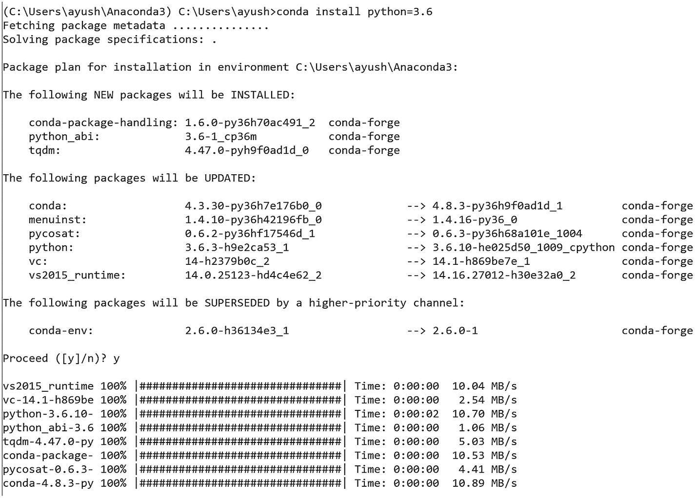
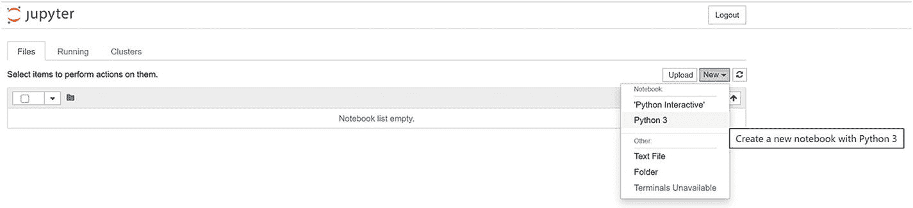
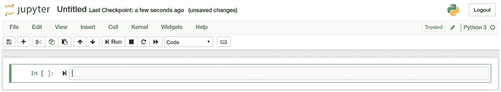
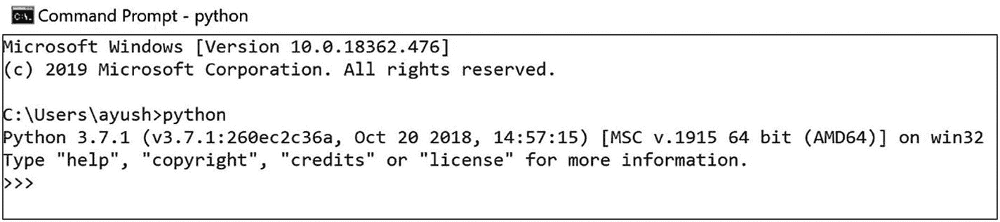
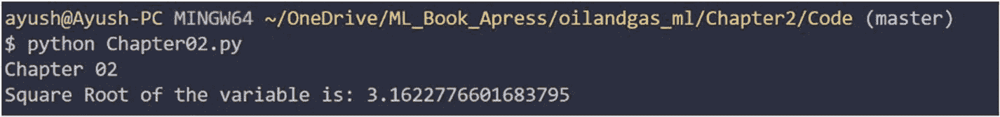
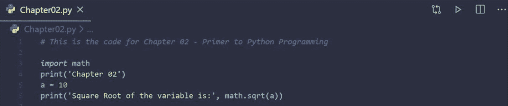
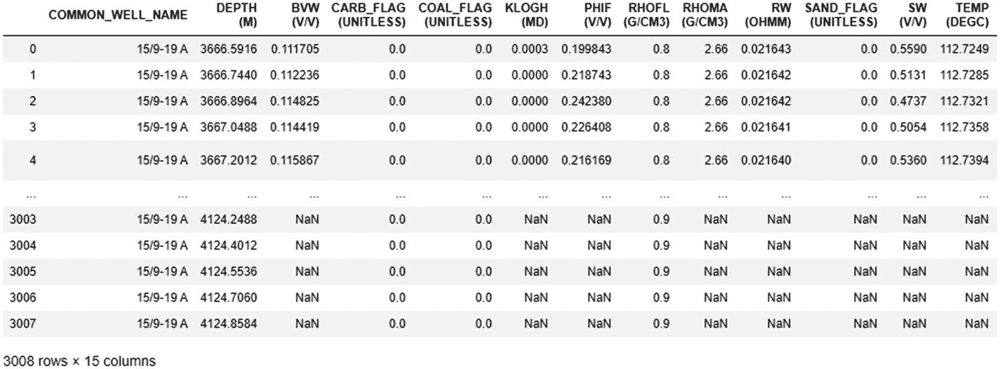
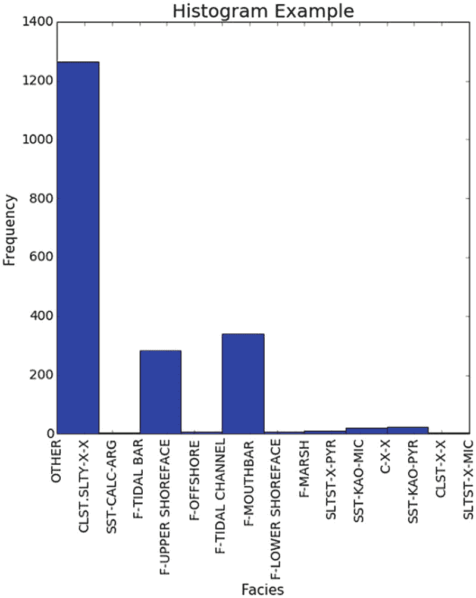
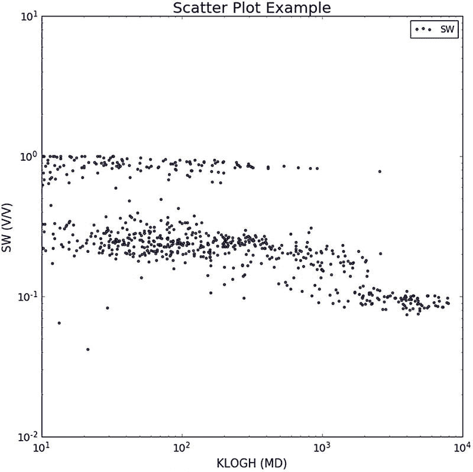
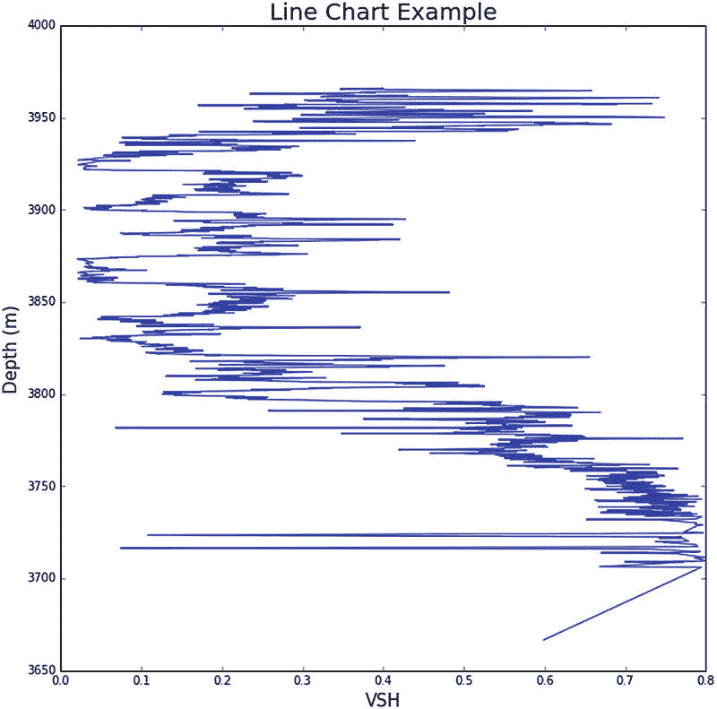

# 2. Python 编程入门

在上一章中，我们讨论了石油和天然气行业面临的一些挑战，而机器学习可以提供数据驱动的洞察和解决方案。然而，在实施这些解决方案之前，你需要学习如何编写适用的机器学习算法代码。这使得在深入机器学习之前，必须先理解一门计算机编程语言。

有多种编程语言可用于跨行业开发机器学习解决方案和应用。Python、R、Java、C/C++、Julia、Scala、Go 和 Lua 是用于开发机器学习算法和应用的领先语言中的一部分。在这些语言中，截至 2019 年，Python 拥有最大的机器学习从业者社区。这种情况会随时间改变吗？也许在遥远的未来，另一种编程语言会在受欢迎程度上超越 Python。我们避免陷入关于哪种编程语言更好或更差的争论，因为这并非本书的意图。应该承认，每种编程语言都有其自身的优点和缺点。然而，鉴于 Python 提供的丰富机器学习生态系统和活跃社区，在学习机器学习算法时学习 Python 具有实际意义。

Python 具有以下特性。

*   **平台无关性**。在一个平台上编写的 Python 代码可以在另一个平台上运行。这意味着，如果你在 Windows 操作系统上编写了代码，若想在 Linux 操作系统上运行，无需重写。Python 已被移植到几乎所有常用的平台。不过，对于与操作系统和文件系统相关的功能，可能需要进行一些微小的调整。

*   **解释型语言**。你无需在运行 Python 代码之前显式地编译它。Python 代码由解释器执行，解释器负责将 Python 代码转换为字节码。

*   **高级语言**。在编写 Python 代码时，你无需担心复杂的系统级细节，例如在程序执行期间如何分配或释放内存。Python 为大量通用函数提供了抽象，使你能够更多地关注编程逻辑，而不是系统或硬件级别的细节。

*   **开源**。Python 是免费分发的，甚至可用于商业目的。任何人都可以查看和修改 Python 源代码。一个庞大的开发者社区不断为丰富的 Python 生态系统贡献新的功能和特性，用于通用计算和机器学习。

*   **面向对象**。Python 支持面向对象的编程范式，你可以使用一组变量和函数来定义现实世界实体的数据结构和行为。我们将在本章后面提供更多细节。

*   **动态类型**。在 Python 中定义变量时，你无需担心定义其数据类型。简单来说，你不需要描述一个变量是整数还是带小数的实数（浮点数）。Python 会动态地为变量分配数据类型。

*   **会话式语法**。Python 语法直观且具有会话风格。举个例子，如果你想查看一个数字是否存在于一个数字列表中，你可以编写 `if 5 in [1, 2, 3, 4, 5]`，结果将是 `True`。

*   **易于学习**。Python 的特性使其成为一种易于学习的编程语言。虽然精通 Python 可能需要付出巨大努力，但与本章前面提到的大多数其他编程语言相比，入门 Python 的学习曲线更短。

在我们开始用 Python 编写代码之前，我们需要安装 Python 并设置编程环境。下一节将引导你在计算机上完成 Python 的安装过程。

## 安装与环境设置

在选择 Python 安装程序时，有很多选项可供选择。对于本书，我们建议从 Anaconda 发行版下载网站 [2] 获取适用于你计算机操作系统的最新 Python 3.x 安装程序。Anaconda 发行版包含了大部分所需的 Python 库，并且还附带包管理的额外好处，这确保了安装在 Python 环境中的不同库的版本彼此兼容。详细的安装说明在 [3] 中提供。

成功安装 Anaconda 发行版后，我们建议你通过从 Anaconda Prompt（可以从程序/开始菜单访问，如图 2-1 所示）执行以下命令集，将 Python 版本降级到 3.6。



图 2-1

使用 Anaconda Prompt 安装 Python 3.6 版本

```
> conda update --all
> conda install python=3.6
```

这些步骤确保你拥有 Python 3.6 版本，这是安装稍后在第 3 章中使用的一些机器学习库所必需的。至此，你应该拥有完成本章剩余部分所需的所有 Python 库。现在，让我们熟悉一下 Jupyter Notebook。

## Jupyter Notebook

Jupyter Notebook，或简称为 *notebook*，提供了一种在基于 Web 的界面中交互式编写和执行 Python 代码的方式。Notebook 还允许你编写 Markdown，这使得共享有关代码的信息更加容易。如果你想制作一个吸引人的 notebook，可以在 Markdown 单元格中包含图像和其他格式化文本。但是，我们将把重点放在 Python 代码上。要为本章启动一个新的 Jupyter Notebook，请在命令提示符或终端中导航到包含数据和本书源代码的目录，并使用以下命令：

```
> jupyter notebook
```

你应该会看到一个互联网浏览器窗口打开，并显示一个仪表板，如图 2-2 所示。



图 2-2

在 Web 浏览器中显示的 Jupyter Notebook 仪表板

成功启动 notebook 仪表板后，找到并单击仪表板右侧的 New 按钮，然后在 Notebook: 下选择 **Python 3**。你应该会看到一个新的 notebook 在一个新的浏览器标签页中打开，如图 2-3 所示。



图 2-3

在 Web 浏览器中显示的一个新的 Jupyter Notebook

*恭喜！* 你已经创建了你的第一个 Jupyter Notebook。在基于 Web 的界面中，你可以看到带有不同选项卡的菜单栏，例如 File、Edit 等。在菜单栏下方，工具栏提供了创建新单元格的选项（由带有 **+** 符号的按钮表示），该单元格可以是代码单元格、Markdown 单元格或其他类型，具体取决于工具栏下拉菜单中相关选项的选择。代码单元格包含常规的 Python 代码，而 Markdown 单元格则可以包含对 notebook 中正在开发的功能的纯文本或格式化文本描述。可以通过按 Ctrl+Enter 或 Alt+Enter 来执行单元格。如果按 Ctrl+Enter，当前单元格中的代码或 Markdown 将被执行。但是，如果按 Alt+Enter，除了执行当前单元格中的代码或 Markdown 之外，还会在当前单元格下方插入一个新单元格。


### 为什么选择 Jupyter？

这种执行 Python 代码的过程可以看作是 Python 解释器和 Python 脚本的混合体。Jupyter Notebook 提供的一些额外优势包括：通过融合代码、图形、数据和文本的丰富计算与数据驱动叙事，提供了一种便捷的分享工作成果的方式 [4]。这种基于 Web 的环境的另一个优势是，它将代码、文本、图像、方程和可视化图表等所有不同部分整合到一个文档中。Notebook 易于共享，并且可以随时编辑，因为它们对关联系统的依赖性不大。这就是 Jupyter Notebook 在教学/学术环境中被使用的主要原因。

这些不同的方法通常根据代码的目标和用户的经验水平来选择。例如，处于入门阶段的数据科学家通常从 Jupyter Notebook 开始，因为它们无需安装单独的 IDE（集成开发环境）就能提供交互式环境。然而，软件开发人员通常更喜欢 IDE，因为它们提供了更高级的调试程序、Git 集成和集成终端。

现在你已经了解了一些关于 Notebook 的基础知识，让我们编写并执行我们的第一个 Python 代码。

注意

各章节中使用的代码片段以 Jupyter Notebook 的形式提供，可以在本书的代码仓库中找到。这些 Jupyter Notebook 提供了一个全面的代码库，使你能够浏览本书各章节中讨论的端到端问题工作流程。

## Python 入门

现在，在新 Notebook 的代码单元格中，让我们输入以下代码，然后按 Ctrl+Enter。

```
print("Hello World!")
```

你应该会看到以下输出。

```
Hello World!
```

恭喜！你已经用 Python 编写了第一行代码。在这一行代码中，我们要求 Python 解释器将“Hello World!”这句话打印到输出控制台。在本章的后续部分，我们将更详细地介绍 Python 编程。

你可以在已创建的 Notebook 中为每个代码片段创建一个新的代码单元格，并在我们学习本章不同编程概念时执行这些代码片段。

本章重点介绍 Python 编程语言的基础知识，本书将使用该语言来执行机器学习算法。本章涵盖的主题列表包括以下内容。

*   Python 编程语言基础
    *   执行代码（三种不同方法）：Python 解释器、IPython 和 .py 脚本

    *   语言结构与含义：编程语言的语法和语义

    *   Python 中一切都是对象吗？讨论 Python 中的变量和运算符

    *   如何在 Python 中使用数字并执行运算？

    *   为什么 Python 被认为是一种动态且强类型的语言？

*   数据结构：列表、元组、集合和字典

*   控制流工具和迭代器：if、else、for 和 while 语句

*   基本面向对象编程：函数、方法和类

*   Python 库：如何使用 Python 中丰富的模块和包库，以及其他有用的库？
    *   NumPy：使用数组和矩阵进行科学计算

    *   pandas：数据分析

    *   Matplotlib：2D 绘图和可视化

本章使用来自石油和天然气行业的开源数据集，并提供了使用 Python 库进行基础数据分析和可视化的入门指南。

## Python 基础

像 C、Fortran 或 Java 这样的编译型语言与像 Python 这样的解释型语言之间的一个主要区别在于执行过程。Python 是一种非常灵活的语言，可以轻松地逐行执行，并提供了多种不同的方式来执行用 Python 编程语言编写的代码。接下来介绍三种常用的方法。

### Python 解释器

Python 解释器提供了执行逐行代码最基本的方法之一。一旦在系统上安装了 Python，在命令提示符下运行 `'python'` 就会启动该过程。会显示当前 Python 版本，随后出现 `>>>`，表示可以从此处开始执行 Python 代码（见图 2-4）。



图 2-4

使用 Python 解释器运行逐行代码

### Python 脚本

经验更丰富的程序员更喜欢以扩展名为 `.py` 的脚本形式生成代码。整个代码使用 Python 终端执行（见图 2-5 和 2-6）。



图 2-6

在集成终端中执行来自 .py 文件的代码



图 2-5

使用 IDE 创建一个简单的 .py 文件


### 语言结构与含义

本节简要介绍 Python 编程语言的语法和语义，这有助于更轻松地解释、实现和动态编码多种编程范式。如需深入讨论其中任一概念，可参考 Python 编程语言的作者吉多·范罗苏姆 [5]。Python 简洁一致的设计基于“应该有一种——且最好只有一种——显而易见的方法来完成它”的哲学，正如*Python 之禅* [6] 中所提到的。

语言的结构或形式构成了编程语言的语法。它通常包含三个层次——单词、短语和上下文——这些层次定义了编写程序的规则。语法不提供有关命令含义或执行的任何信息。另一方面，语言的语义由代码背后的含义及其预期提供的结果来定义。本章列出了该语言背后的一些规则和含义。

Python 是一种区分大小写的语言；例如，`test_variable` 和 `Test_Variable` 被视为两个不同的对象。与其他一些编程语言不同，Python 不需要命令终止符。例如，不需要在每个语句后使用分号（`;`）。但是，如果需要在同一行代码中执行两个不同的语句，则可以使用分号将它们分隔开，如下所示。

```
test_var = 10; print (test_var)
```

*输出*

```

```

空白字符限制了流程控制，但不会影响代码。这在以下代码片段中得到了说明。

```
x1 = 10*2
x2 = 10 * 2
x3 = 10   *    2
print(x1)
print(x2)
print(x3)
```

*输出*

```

```

缩进对于定义代码块的开始至关重要，并指示一组一起执行的语句。这就是空白字符起作用的情况。Python 不使用花括号（`{}`）来定义代码块，因此缩进是区分代码块与其余代码的关键。例如，以下 `'for'` 循环显示，由于循环重复，缩进的代码打印 `'Count'` 三次，但语句 `'Outside the loop'` 仅打印一次。

```
var_length = 3
for i in range(var_length):
# 缩进的代码块，是循环的一部分
print('Count', i)
print ('Outside the loop') # 不是循环的一部分
```

*输出*

```
Count 0
Count 1
Count 2
Outside the loop
```

正斜杠用于为目录分配路径，因为 Python 遵循 UNIX 风格的路径规范。例如，Windows 中文件夹的相对路径 `C:\Desktop\Python\Code` 需要更改为路径 `C:/Desktop/Python/Code`*。*

字符串可以用单引号（‘ ’）、双引号（“ ”）或三引号（‘“ ”’）表示。惯例是使用单引号表示单词字符串，双引号表示句子，三引号表示段落或文档字符串。

```
word = 'Example'
sentence = "This is an example of a sentence"
para = '''This is a paragraph 
```

对于用三引号（`'''`）括起来的多行语句，注释是代码中不可或缺的一部分，用于解释程序员的思考过程，并帮助其他人理解代码的意图。在 Python 中，单行注释可以用井号（`#`）开头，而多行注释（注释块）可以用三引号括起来。

为了更深入地了解代码风格和格式，建议阅读 PEP8 风格指南 [7]，它可以帮助读者以更有条理和一致的风格编写代码。

## Python 中一切都是对象吗？

Python 是一种面向对象的编程语言，并将一切视为对象。与其他编程语言相比，Python 中对*对象*的定义较为宽松，某些对象不一定需要具有属性或方法。也不是所有对象都可以被子类化。该语言的创建者吉多·范罗苏姆 [8] 希望“所有可以在语言中命名的对象（例如，整数、字符串、函数、类、模块、方法等）都具有同等的地位”，因此将它们归类为“一等公民”。换句话说，每个对象都可以赋值给变量、作为列表的成员、用作字典中的键值对，或作为参数传递。

Python 作为一种动态类型和解释型语言的优势之一在于定义变量的方式非常简单。在这种情况下，数据类型会在程序执行期间进行检查，并且源代码会被翻译。

在 Python 中，每个变量名仅绑定到一个对象。通常，赋值运算符执行此操作。当将值赋给变量时，在许多编程语言中，它被认为是以容器或内存桶的形式存储的 [4]。在 Python 中，这最好表示为指针而不是容器。这也是为什么没有声明*数据类型*的原因之一，而这在其他语言中非常常见。以下代码片段提供了变量名如何指向任何类型对象的示例。

```
var1 = 5 # var1 是一个整数
var2 = 'This is a String' # var2 是一个字符串
var3 = [1,2,3] # var3 是一个列表
```

有不同类别的运算符可用于对数据执行多种操作。下面列出了一些。

*   算术运算符（加法、减法、取模等）
*   位运算符（AND、OR、XOR 等）
*   赋值运算符（+=、/= 等）
*   比较运算符（<=、!= 等），输出布尔值（即 True 或 False）
*   布尔运算（and、or、not 等），输出布尔值（即 True 或 False）
*   身份和成员运算符（is、is not、not in 等）

### 数据结构

程序中常用的基本内置数据类型包括整数、浮点数、复数、布尔值、字符串和 None 数据类型。除了这些基本类型之外，本节还将讨论一些其他的数据结构。这些复合类型的数据结构包括列表、元组、字典和集合。结合每种情况的示例进行简要描述，可以帮助我们理解它们的格式以及可能使用的不同方式。

建议读者参考 Python 文档 [9] 以获取每种数据结构的详细说明。


#### 列表

列表（List）是用方括号（`[]`）括起来的元素集合，是一种有序且可变的数组，元素之间用逗号分隔，可以包含不同的数据类型，如整型、浮点型、字符串等。列表中允许存在重复元素。嵌套列表是“列表的列表”，常用于表示二维矩阵。列表及其元素有多种访问方式。索引从 0 开始，0 代表列表的第一个元素。

负索引也可以访问列表中的元素，其中最后一个元素的索引为 –1，倒数第二个为 –2，以此类推。有多种方法可用于访问或修改列表中的元素。一些示例包括 `append()`、`pop()`、`count()`、`sort()` 等等。由于列表是可变的，因此可以修改/更改列表中的元素，也可以合并多个列表。

```
# 列表
list1 = [1,2,3] # 包含整数值的简单列表
list2 = [1,None,'Python',3.14] # 包含混合数据类型的列表
# 嵌套列表
list3 = [ [1,2,3], [10,20,30], ['示例', '嵌套', '列表']]
list4 = [1,2,3,3,2,2,2,1,5,8,0] # 包含重复元素的列表
print(list1[0])
print(list2[-2])
print(list3[2][1])
print(list4.count(2))
print(list3[2][1:3])
print(list1 + list2)
```

*输出*

```

Python
嵌套

['嵌套', '列表']
[1, 2, 3, 1, None, 'Python', 3.14]
```

#### 元组

元组（Tuple）用圆括号 `()` 括起来，与列表非常相似，主要区别在于其不可变性（不可更改）。元组通常包含一个异构的元素序列，通过解包或索引进行访问。与列表一样，元素是有序的，并用逗号分隔。元素的访问方式与列表相同，索引也从 0 开始。与列表类似，负索引可以访问元组中的元素，其中最后一个元素的索引为 –1，倒数第二个为 –2，以此类推。元组可用的方法包括 `count()` 和 `index()`。使用元组而非列表的优势包括：与等效列表相比执行速度更快，以及在我们不希望数据被修改的情况下使用。

```
# 元组
tuple1 = (1,2,3) # 包含整数值的简单元组
tuple2 = (1,None,'Python',3.14) # 包含混合数据类型的元组
# 嵌套元组
tuple3 = ([1,2,3], [10,20,30], ['示例', '嵌套', '元组'])
tuple4 = (1,2,3,3,2,2,2,1,5,8,0) # 重复元素
print(tuple1[0])
print(tuple2[-2])
print(tuple3[2][1])
print(tuple4.count(2))
print(tuple3[2][1:3])
print(tuple1 + tuple2)
```

*输出*

```

Python
嵌套

['嵌套', '元组']
(1, 2, 3, 1, None, 'Python', 3.14)
```

#### 字典

字典（Dictionary）用花括号（`{}`）括起来，是另一种复合数据类型，有时也称为关联数组，由一组键值对组成。它与列表有某些相似之处，因为这两种数据类型都是可变的、动态的（可增加或减少大小），并且可以嵌套（字典中的字典）。主要区别在于元素的访问方式。字典元素通过键而不是索引位置来访问。也可以使用内置函数 `dict()` 创建字典，如下例所示。字典的一个限制是给定的“键”只能出现一次。字典的一些常用方法包括 `clear()`、`items()`、`keys()`、`values()` 和 `pop()`。

```
# 字典
dict1 = {
'德克萨斯州': '二叠纪盆地',
'科罗拉多州': ' DJ 盆地',
'北达科他州': '威利斯顿盆地'
}
# 嵌套字典
dict2 = dict(
美国 = {'埃克森美孚', '雪佛龙', '康菲'},
英国 = 'BP',
收入 = [279.3, 158.9, 38.73, 303.7])
print(dict1)
print(dict2)
```

*输出*

```
{'德克萨斯州': '二叠纪盆地', '科罗拉多州': ' DJ 盆地', '北达科他州': '威利斯顿盆地'}
{'美国': {'康菲', '雪佛龙', '埃克森美孚'}, '英国': 'BP', '收入': [279.3, 158.9, 38.73, 303.7]}
```

#### 集合

集合（Set）用花括号（`{}`）括起来，元素之间用逗号分隔，是一个无序的元素集合。由于元素没有特定的顺序，因此索引在集合中没有意义。集合可以包含不同数据类型的元素，但这些元素必须是唯一的且不可变的。然而，集合本身是可以改变的，并且可以向其中添加/删除元素。

使用集合的一大优势是能够执行数学运算，如并集、交集、对称差集等。尽管元素可以是不同的数据类型，如整型、浮点型或字符串，但集合不能包含可变元素（如列表或字典）作为其元素。下面是一个示例，展示了如何更新集合的元素以及打印两个集合的并集。集合可用的方法包括 `add()`、`clear()`、`discard()`、`intersection()` 和 `pop()` 等。

```
# 集合
set1 = {1,2,3} # 包含整数值的简单集合
set2 = set((1,None,'Python',3.14)) # 包含混合数据类型的列表
# 会报错
# set3 = {[1,2,3], [10,20,30], ['示例', '嵌套', '列表']}
set4 = {1,2,3,3,2,2,2,1,5,8,0} # 包含重复元素的集合
print(set1)
print(set2)
# print(set3)
print(set4)
```

*输出*

```
{1, 2, 3}
{3.14, 1, 'Python', None}
{0, 1, 2, 3, 5, 8}
```

### 控制流工具与迭代器

控制流是指需要重复执行某段代码块以完成操作的情况。一些简单的条件语句包括 `if`、`elif` 和 `else`，它们使用布尔条件来执行一组命令。这些概念的实现通过一个示例来说明，我们假设一个只有三种岩石渗透率类别的简单情况。缩进和冒号（`:`）的使用是 Python 语法的一部分。

```
# if-elif-else 示例
perm = 0.001 # 输入，单位为毫达西
if (perm > 0.0001):
    print('这是毫达西级别，似乎是砂岩或石灰岩！')
elif(perm == 1E-6):
    print('这是微达西级别，似乎是致密砂岩！')
else:
    print('这是纳达西级别，似乎是页岩！')
```

*输出*

```
这是毫达西级别，似乎是砂岩或石灰岩！
```

另一方面，循环控制语句主要有两类：基于循环次数的或由事件控制的。循环控制的示例包括 `for`、`while`、`break`、`continue` 和 `pass`。`for` 语句属于第一类，它对列表中的每个项目或循环次数执行循环。`while` 语句在特定条件为真时执行。在某些情况下，需要强制退出循环，此时使用 `break`。当需要跳过当前循环的剩余部分进入下一次迭代时，使用 `continue`。

```
for i in range(3):
    print('进入循环，计数为', i)
print('循环执行完毕！')
```

*输出*

```
进入循环，计数为 0
进入循环，计数为 1
进入循环，计数为 2
循环执行完毕！
while (perm<1E-6):
    print('渗透率极低，典型非常规井！')
else:
    print('不是非常规井！')
```

*输出*

```
不是非常规井！
```


## 基本面向对象编程

在项目开发过程中，经常会遇到需要用不同参数重复执行某段代码的情况。代码被组织成更可复用的模块，这些模块被称为*函数*。在 Python 中，可以通过 `def` 或 `lambda` 语句创建函数。下面展示了一个用于单位转换的函数示例。每次需要再次转换单位时，只需调用该函数并传入新参数即可。

```
# 用于转换泥浆重量单位的函数
def unit_conversion(a):
"""
该函数用于转换泥浆重量单位。
输入：泥浆重量（kg/m3）
输出：泥浆重量（ppg 或 psi/ft 或比重）
"""
print('输入的泥浆重量（kg/m3）为：', a)
mw_ppg = a * 0.0083454
mw_psift = a * 0.000434
sp_gravity = a * 0.001
print('泥浆重量（ppg）：', mw_ppg)
print('泥浆重量（psi/ft）：', mw_psift)
print('比重：', sp_gravity)
# 输入泥浆重量（kg/m3）
mud_weight = 1250
unit_conversion(mud_weight)
```

*输出*

```
输入的泥浆重量（kg/m3）为：1250
泥浆重量（ppg）：10.43175
泥浆重量（psi/ft）：0.5425
比重：1.25
```

当我们在代码中仅将函数作为语句块使用时，这被称为面向过程的编程方式。然而，还有另一种编写更复杂、更有组织程序的方法，通常被称为*面向对象编程*（OOP）。数据和功能（即属性和行为）被封装在类和对象中，这是 OOP 的两个主要方面。类创建了与特定特征相关的用户自定义数据结构。它可以被看作一个蓝图，可以用不同的实例来填充。在类内部创建包含属性的不同对象。下面展示了一个简单类的示例。该示例说明了如何将“井”作为一个类，其属性包括 API 编号、盆地和产量。关于类的更详细描述，建议参考 [11]。

```
class well():
# 类属性
well_type = 'oil well'
# 初始化器
def __init__(self, api, basin, oil_prod, gas_prod):
self.api = api
self.basin = basin
self.oil_prod = oil_prod # 桶
self.gas_prod = gas_prod # 千立方英尺
# 实例方法
def boe_calc(self):
boe = self.oil_prod + self.gas_prod/5.8
return boe
# 实例化类
well_1 = well(12345, 'Williston', 1000, 5000)
# 调用类的方法
print(well_1.boe_calc()) # well_1 的桶油当量产量
well_2 = well(78910, 'Permian', 2000, 6000)
print(well_2.boe_calc()) # well_2 的桶油当量产量
```

*输出*

```
1862.0689655172414
3034.4827586206898
# 访问实例属性
print('第一口井的 API 编号为：', well_1.api, '，位于', well_1.basin, '盆地')
if well_1.well_type == 'oil well':
print("{0} 属于 {1} 类别".format(well_1.api, well_1.well_type))
```

*输出*

```
第一口井的 API 编号为：12345，位于 Williston 盆地
12345 属于 oil well 类别
```

## Python 库

在接下来的部分中，将简要讨论一些最流行的库，包括 pandas、NumPy 和 Matplotlib。另一个常用的 Python 库是 scikit-learn，用于机器学习，将在后续章节中介绍。

### pandas：数据分析库

pandas 是一个开源库，其名称源于术语*面板数据*，常用于多维结构化数据集的数据分析。Pandas 可以接受多种格式的数据文件作为输入，例如 .csv、.xlsx、.json、.html 以及其他许多常用格式。数据随后可以组织成由行和列组成的数据框形式。一旦数据转换为数据框，就可以使用多种不同的方法进行数据探索。还可以从数据框本身获取统计信息，如均值、中位数和标准差。

本章以北海 Volve 油田的一个数据集为例。导入数据后，通过查看数据类型和描述性统计进行简要的*探索性数据分析*（EDA）。通过删除 NA 值来清理数据，尽管更全面的 EDA 过程包括多个步骤，例如数据插补、异常值分析以及初步特征选择。还会导入另一个具有相同标题信息但属于不同井的数据集，并将两个数据框合并。

该数据集包含以下可供分析的岩石物理信息。

*   井数：2

*   井名：15/9-19 A 和 15/9-19 BT2

*   BVW (V/V)：总体积含水率

*   CARB_FLAG (无量纲)

*   COAL_FLAG (无量纲)

*   KLOGH (mD)

*   PHIF (V/V)：裂缝孔隙度

*   RHOFL (G/CM3)：流体体积密度

*   RHOMA (G/CM3)：骨架体积密度

*   RW (OHMM)：水电阻率

*   SAND_FLAG (无量纲)

*   SW (V/V)：含水饱和度

*   TEMP (DEGC)：温度（摄氏度）

*   VSH (V/V)：泥质含量

*   LITHOTYPE：岩石特征

```
import pandas as pd
# 将 .csv 文件作为数据框导入
data = pd.read_csv('data/15_9-19_A_CPI_LITHO.csv')
# 数据以包含行和列的表形式导入
data # 整个数据集
```

*输出*



以下代码片段获取构成数据框的索引和不同列。要访问元素/列，可以使用列名或数字索引。

```
print(data.index)
print(data.columns)
```

*输出*

```
RangeIndex(start=0, stop=3008, step=1)
Index(['COMMON_WELL_NAME', 'DEPTH (M)', 'BVW (V/V)', 'CARB_FLAG (UNITLESS)',
'COAL_FLAG (UNITLESS)', 'KLOGH (MD)', 'PHIF (V/V)', 'RHOFL (G/CM3)',
'RHOMA (G/CM3)', 'RW (OHMM)', 'SAND_FLAG (UNITLESS)', 'SW (V/V)',
'TEMP (DEGC)', 'VSH (V/V)', 'LITHOTYPE'],
dtype='object')
```

理解一维（序列）和二维（数据框）操作非常重要，下面将对其进行定义。

*   **序列**：一个数组，其中索引被分配给一个值

*   **数据框**：一个二维数组，其中索引被分配给多个值，并且可以包含多个列

如果你想合并来自不同来源的数据集，可以通过多种方式组合它们。下面简要介绍语法中使用的不同参数。

```
pd.merge(left, right, how, on)
```

这里，前两个参数表示需要合并的第一个和第二个数据框，通常称为*左*数据框和*右*数据框。`how` 参数定义要执行的合并类型，可以是以下之一。

*   how = ‘outer’ 允许你取数据集的并集并将它们附加在一起。

*   how = ‘inner’ 允许你取数据集的交集，仅保留共同的值。

*   how = ‘left’。包含左数据框的所有索引。如果某些索引不存在于‘左’数据框中，则它们不会包含在合并后的数据集中。

*   how = ‘right’。包含右数据框的所有索引。如果某些索引不存在于‘右’数据框中，则它们不会包含在合并后的数据集中。

关键字 `on` 决定数据框是否基于某个唯一标识符（例如，油气井的 API 编号）进行合并。

```
# 从另一个文件合并数据
# 使用另一口井的数据并合并数据框
data2 = pd.read_csv('data/15_9-19_BT2_CPI_LITHO.csv')
data_combined = pd.merge(data, data2, how="outer", on = None)
```


### NumPy：科学计算

这是 Python 中一个常用于科学计算的库，它使用多维数组对象。创建 NumPy 数组是一个直接的过程。接下来展示了使用不同方法创建 NumPy 数组的示例。

```
# 导入库
import numpy as np
array1 = np.array([1,2,3,4])
array2 = np.array([1,None,'Python',4.19])
array3 = np.array([[(1,3.14,6),(1,2,3)], [(100,200,300), (99,9.9,0.99)]])
# 均匀间隔的值 - 步长
array4 = np.arange(5, 20, 4)
# 均匀间隔的值 - 样本数量
array5 = np.linspace(0,100,9)
array6 = np.random.randint(10, size=6)  # 一维数组
print(array1)
print(array2)
print(array3)
print(array4)
print(array5)
print(array6)
```

*输出*

```
[1 2 3 4]
[1 None 'Python' 4.19]
[[[  1\.     3.14   6\.  ]
[  1\.     2\.     3\.  ]]
[[100\.   200\.   300\.  ]
[ 99\.     9.9    0.99]]]
[ 5  9 13 17]
[  0\.   12.5  25\.   37.5  50\.   62.5  75\.   87.5 100\. ]
[6 7 3 6 1 1]
```

NumPy 支持数学运算（加法、对数等）和数组排序。以下代码片段展示了一个简单示例。要全面了解可用的 NumPy 操作，我们建议您参考 NumPy 文档 [12]。

```
# 数组数学运算 - 两种不同方法
print(array1 + array4)
print(np.add(array1, array4))
print(np.log(array1))
# 数组排序
array6.sort(axis=0)
print(array6)
```

*输出*

```
[ 6 11 16 21]
[ 6 11 16 21]
[0\.         0.69314718 1.09861229 1.38629436]
[1 1 3 6 6 7]
print("维度数量: ", array3.ndim)
print("数组形状:", array3.shape)
print("数组大小: ", array3.size)
```

*输出*

```
维度数量:  3
数组形状: (2, 2, 3)
数组大小:  12
```

通过索引访问 NumPy 数组中的元素与访问列表中的元素非常相似。对于多维数组，可以使用逗号分隔的索引元组来访问元素。*切片操作*也非常相似。NumPy 中还提供了其他一些更常用的数组操作例程，这些在 NumPy 数组操作文档 [13] 中有描述。接下来展示了一些简单的数组操作示例。

```
i = np.append(array6, [25,26,27])
print(i)
concat = np.concatenate((array1, array2), axis=0)
print(concat)
mean_val = np.mean(array5)
print(mean_val)
```

*输出*

```
[ 1  1  3  6  6  7 25 26 27]
[1 2 3 4 1 None 'Python' 4.19]
50.0
```

### Matplotlib：Python 数据可视化库

Matplotlib 是最流行的数据可视化库之一，由 John D. Hunter 于 2003 年开发。它包含多个对象/组件，如坐标轴、轴域和图形，它们的组合构成了 Matplotlib 图表。Matplotlib 提供了不同的接口和后端渲染选项。该库还提供不同的自定义和设计，以生成出版质量的图表。沿用相同的数据集，折线图、散点图和简单直方图的示例如图 2-7 至 2-9 所示。请参考提供的 Jupyter Notebook 以获取用于生成这些图表的代码片段。



图 2-9

用于观察数据集中不同岩相频率的直方图示例



图 2-8

K.Log(h) 与含水饱和度之间的散点图示例



图 2-7

用于观察页岩体积 (Vsh) 随深度变化的折线图示例

## 总结

Python 是一门庞大的编程语言，需要不止一本书才能涵盖其所有编程概念；然而，在本章中，我们提供了一个简要的介绍。我们希望您已经了解了基本的数据结构、控制流以及一些标准库。本章为本书提供了必要的编程基础。我们强烈建议您参考原始的 Python 文档以及本章提到的其他资源。这些资源为不断发展的 Python 编程概念和库提供了最新的描述和解释清晰的示例。

