# 3. 机器学习和深度学习概念概述

在本章中，我们重点探索机器学习和深度学习算法的领域。前一章的数据集在本章中也会用到。此外，我们还将介绍一些新的公开数据集，用于构建机器学习和深度学习模型。在上一章中，您学习了 Python 编程的基本概念。在本章中，我们将开始使用 Python 编程和相关库来探索数据，并进行数据整理以清理数据，使其能够用作不同机器学习模型的输入。本章分为七个主要部分，从机器学习概述开始。

本节之后是机器学习应用相关的一些通用概念和最佳实践。后续部分将深入探讨探索性数据分析、监督学习、回归和分类算法以及无监督学习算法。另有专门章节介绍深度学习和超参数优化概念及其在特定石油和天然气行业问题中的应用。

## 机器学习

机器学习是一个领域，在该领域中，计算机通过算法进行编程，使其能够从经验中学习和适应，从而在使用指标评估时改进某项任务，而不是明确告知其结果 [1]。这个定义通过一个简单示例进行解释：任务是识别手写数字，指标是使用人类标注的手写数字图像数据库（作为经验）正确分类的数字百分比。“学习”部分利用大量数据使计算机能够理解底层模式。

随着计算能力的进步和高效机器的出现，过去几年中机器学习算法的效率有了显著提高。机器学习已成功应用的一些领域包括图像识别、文本分析（例如垃圾邮件过滤）、情感分析或信息提取、视频游戏和机器人技术。每一天，机器学习的新应用都在不断涌现。

### 近期进展

机器学习领域的最新进展体现在自动驾驶汽车和自主车辆上，它们拥有多个传感器，可以高频收集实时数据。传感器数据由预训练的机器学习算法处理，为自动驾驶汽车或自主车辆提供“智能”。类似技术也用于激光地形测绘、路径规划和自适应视觉。

机器学习的另一个成功应用在于自动语音识别和语言翻译器，这些功能在智能设备中很常见。基于生成对抗网络（GAN）原理构建的生成模型是机器学习最新进展的另一个例子，通过专门的深度学习模型，可以重建或生成逼真的人脸。


### 机器学习分类

机器学习算法可分为三大类。

*   **监督学习：** 在监督学习中，期望的输出或响应变量是已知的，机器学习算法提供输入特征与输出变量之间的映射关系。监督学习的两个主要子类是回归问题和分类问题，具体由输出变量的类型决定。当输出变量为连续值时，属于回归问题。

    另一方面，对于分类问题，输出变量包含多个类别或标签。在监督学习中，模型训练过程会持续评估误差并进行改进，直到达到期望的准确度水平。

*   **无监督学习：** 在无监督学习中，没有明确的输出变量，关系是基于提供给算法的数据生成的。属于此类别的一些算法可以揭示输入特征之间的隐藏结构和关系。无监督学习的一些例子包括聚类、降维算法和关联规则学习。

*   **强化学习：** 这类算法的设计方式是，算法做出的决策序列会关联一个奖励或惩罚。奖励或惩罚有助于算法学习为实现既定目标而应采取的一系列决策。这些算法使用马尔可夫决策过程（MDP）进行建模。

    强化学习通常被认为是“半监督”学习，但在不确定且可能复杂的环境中，算法会采用试错方法，通过对其执行的动作进行惩罚或奖励来寻找解决方案。工业自动化机器人是强化学习应用的一个例子。

如第 1 章所述，本章的讨论仅限于监督学习和无监督学习算法。

### 模型训练注意事项

由于数据科学工具包中提供了大量算法，有时确定解决某个问题应使用哪种算法会变得具有挑战性。许多算法可以解决同一个问题，并学习输入特征与输出变量之间的关系。然而，不同算法采用的技术和学习过程可能差异显著。

当某些模型参数改变时，一种算法可能优于其他算法。模型训练过程涉及称为*超参数*的附加参数，这些参数可能包括以下内容。

*   模型训练的迭代次数。
*   每次迭代中使用的训练数据比例（批量大小）。
*   用于改变模型参数的估计误差比例（学习率）。

这种为学习最优模型参数而调整超参数的迭代过程称为*超参数优化*。我们将在本章后面部分讨论一种简单的超参数优化技术。

除了最优模型参数外，选择最优数量和类型的输入特征也可以提高模型的准确性。这使得特征工程和特征选择成为机器学习过程中非常重要的方面。

需要注意的是，本节我们仅提供所选机器学习算法的基本概述和示例代码实现。要透彻理解每种算法，需要对每种技术进行全面回顾，这在单一书籍章节中是无法实现的。我们鼓励您在将每种算法及其相关模型参数和超参数应用于实际问题之前，深入探索和理解它们。与每种算法相关的参数列表可在相应机器学习库的官方文档中找到。

每种机器学习算法都有三个主要组成部分：*表示、优化*和*评估* [2]。函数以数值、符号、基于实例或概率图模型的形式表示 [3]。为了提高算法性能，会采用优化方法，例如梯度下降、动态规划或进化计算。这些模型的评估通过统计指标进行，可能包括精确率、召回率和均方根误差（RMSE）的计算。

### 机器学习库

Scikit-learn 是 Python 中最流行的开源机器学习库之一，它构建于其他开源 Python 库之上，包括 NumPy、SciPy 和 Matplotlib。Scikit-learn 最初于 2007 年作为 Google 编程之夏项目的一部分开发。它通过 Python 编程接口提供了广泛的监督和无监督学习算法的实现。

TensorFlow 是另一个由 Google 开发的开源软件库，用于数值计算，在机器学习应用（如浅层人工神经网络和深度学习）中非常流行。TensorFlow 允许使用*张量*创建数据流图，张量是进行计算的多维数组。该库旨在支持在多个 CPU 和 GPU 上并行运行，并为多种编程语言（如 Python、C++ 和 Java）提供封装器。在本书中，我们使用 TensorFlow 2.x 版本。

Keras，在希腊语中意为*角*，是一个开源的高级神经网络库，非常用户友好、模块化，并且易于与 Python 配合使用。它不像 TensorFlow 那样处理底层计算，而是使用后端引擎来执行模型开发的计算。Keras 默认使用 TensorFlow 后端。

还有许多其他开源库，例如 Theano、PyTorch、OpenCV 和 Apache Spark ML，可用于开发机器学习模型。然而，由于社区广泛采用且功能完备，我们选择 TensorFlow 作为首选库。

我们不提供算法的数学细节。我们专注于使用标准 Python 库进行机器学习算法的动手实践。请参阅本章末尾的“延伸阅读”部分，查找一些有用的资源，这些资源有助于加深对本章讨论的机器学习算法数学基础的理解。

注意

本章使用的主要 Python 库包括 NumPy、SciPy、Matplotlib、scikit-learn、Keras、TensorFlow 2.x、XGBoost、LightGBM 和 Hyperopt。其中一些库应已存在于标准的 Anaconda 安装中。对于缺失的库，请按照各个库的帮助页面中的安装说明进行操作。安装过程可能因操作系统（例如 Windows 或 Linux）、所用计算机的硬件（是否带有 NVIDIA GPU）等而有显著差异。我们建议您根据您的操作系统和硬件找到合适的安装程序，并在继续阅读本章其余部分之前安装所需的库。


### 机器学习流水线

机器学习流水线是一系列处理单元（包括进程、线程、例程和函数）以流程图形式排列而成，用于将数据从一种表示形式转换为另一种表示形式。构建机器学习流水线的目标是在注重可重复性和灵活性的同时提升模块化程度。

一个可用于生产环境的机器学习项目需要精心设计的机器学习流水线。模型本身只是端到端流水线中的众多组件之一。机器学习工作流程的其他组件包括数据收集、数据验证与预处理、特征提取、模型选择、训练与验证、预测、评估以及部署。本章的重点是构建机器学习模型。

## 通用概念

在本节中，我们将讨论适用于大多数机器学习模型构建实践的通用概念。

### 数据预处理：归一化与标准化

为了构建机器学习模型，我们需要对数据进行预处理，以确保机器学习算法的计算稳定性。数据预处理中的一个重要步骤是重新缩放输入特征和输出变量（针对回归问题），使其范围保持一致，然后再将其作为输入提供给机器学习算法。为了理解这一概念，我们考虑一个输入特征或输出变量具有不同数据范围的示例。在训练过程中，我们可能会遇到一个范围很大的输入特征，例如累计产量（范围从 1000 桶到 100,000 桶）。而另一个特征的范围可能非常小，例如孔隙度（范围从 0.05 到 0.60）。

在迭代训练过程中，与较大值输入特征相关联的模型参数（例如系数或权重）会与较小值输入特征对应的参数存在显著差异。此外，如果输出变量的范围非常大，那么误差指标（如 RMSE）可能会产生非常大的数值。当使用这个较大的误差值来调整已经相当大的模型参数时，在模型参数的迭代更新过程中，某些值可能会超出计算机能够处理的数值极限。这可能导致计算不稳定，最终导致学习过程中的性能不佳。对输入值的高度敏感还可能引发严重的泛化误差[4]。

在处理具有不同单位和范围的多个特征的数据时，对数据进行预处理以实现更快的训练至关重要，这有助于减少过拟合并获得更准确的预测。例如，在梯度下降优化过程的收敛中就可以观察到这一点[5]。

scikit-learn 库中提供了多种方法，例如标准化、归一化和缩放，可以帮助高效地处理数据。预处理方法的选择取决于算法和参数优化过程。需要提醒的是：这些术语在不同领域的习惯用法中经常互换使用。

#### 归一化

归一化是将数据从原始范围重新缩放，使其值落在 0 到 1 或-1 到 1 范围内的过程。当已知数据的近似上下界、数据中几乎没有或没有异常值、且数据分布接近均匀分布时，可以应用此方法。scikit-learn 库提供的用于缩放数据的工具之一是`MinMaxScaler()`，它使用以下公式。

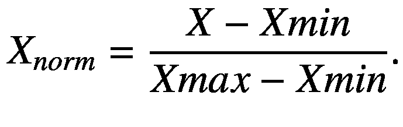

(3.1)

#### 标准化（Z 分数归一化）

当特征被重新缩放，使其具有均值为零、标准差为一的标准正态分布（钟形曲线的高斯分布）特性时，这个过程称为*标准化*。当机器学习算法假设输入数据呈正态分布时，这一点非常重要。在这种方法中，重新缩放后的值通过以下公式计算。

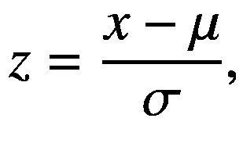

(3.2)

*其中*z 是标准 Z 分数，*x*是输入数据，*μ*是输入数据的样本均值，*σ*是均值标准差。此方法适用于特征分布中不包含极端异常值的情况。

### 欠拟合或过拟合

当我们训练机器学习模型时，主要目标之一是将其用于对未见过的数据进行预测。一个训练充分的模型应该对未见过的数据展现出与训练数据相同的预测精度。然而，在某些情况下，模型可能无法在未见过的数据上表现良好。这可能是由模型的欠拟合或过拟合引起的。

*   **欠拟合：** 当训练过程过早停止，或者模型接触训练数据不足时，就会发生欠拟合。在这种情况下，模型无法学习到训练数据中存在的通用模式。在训练数据和未见过的数据上预测精度都很差，是欠拟合的指标。

*   **过拟合：** 人们可能会选择使用训练数据集中的所有可用数据对模型进行大量迭代训练，以便模型学习到训练数据中存在的所有模式。结果，模型可能在训练数据上展现出非常高的精度。然而，模型对训练数据调整得过于精细，以至于失去了对未见过的数据进行泛化的能力。在这种情况下，即使模型能够以高精度对训练数据进行预测，它对未见过的数据的预测精度也很差。这种情况表明模型过拟合。

确保模型既不欠拟合也不过拟合非常重要。机器学习模型应该得到充分训练，以便能够以合理的精度对未见过的数据进行预测。换句话说，机器学习模型应该能够进行*泛化*。


### 数据划分：训练集、验证集与测试集

正如我们刚刚讨论的，过拟合是机器学习模型训练过程中遇到的主要挑战之一。这是由于模型学习了训练数据中的细微细节或噪声所致。在这种情况下，模型开始记忆训练数据。这会导致模型在训练数据上表现良好，但对于未见过的数据，其准确率会显著下降。为了解决过拟合问题并帮助模型更具*泛化*能力，划分数据集被视为一个必要步骤。根据经验法则，数据集通常被分为三个观测集：训练数据、验证数据和测试数据[6]，其定义如下。

*   **训练数据：** 用于模型训练过程的观测子集。算法使用该数据集来学习机器学习模型的参数。

*   **验证数据：** 一个观测子集，用于在训练过程中评估模型的预测性能。通过验证数据观察到的预测误差趋势，有助于确定充分训练所需的迭代次数。在典型的模型训练中，通过迭代训练过程，训练集和验证集的预测误差都应持续下降。然而，如果我们观察到某个点，训练数据的预测误差持续下降，但验证数据的预测误差开始上升，则应停止训练。验证误差开始上升的点，标志着过拟合的开始。

*   **测试数据：** 该数据子集仅用于评估完全训练好的模型的性能。测试数据上的预测准确率，是模型在真实场景中遇到未见数据时性能的指标。

以下代码片段展示了使用 scikit-learn 工具进行数据集划分的应用。

```
from sklearn.model_selection import train_test_split
X_train, X_test, y_train, y_test = train_test_split(X, y, test_size=0.25, random_state=42)
```

### 模型评估指标

为了理解模型在未见数据集上的泛化程度，并评估其性能，使用一个可以据此评估模型性能的量化指标至关重要。

在本节中，我们将讨论一些用于量化模型预测准确率的评估指标，并据此选择性能最佳的算法。这些指标也取决于问题的类型。对于回归模型中的定量结果，一些常用的指标包括决定系数（*R*²）和均方根误差（RMSE）。*R*² 使用以下公式计算。

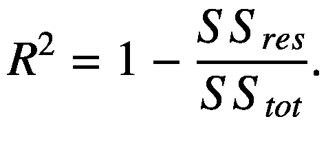

(3.3)

*SS*[*res*] 是残差平方和，*SS*[*tot*] 是总平方和，其数学计算公式如下。

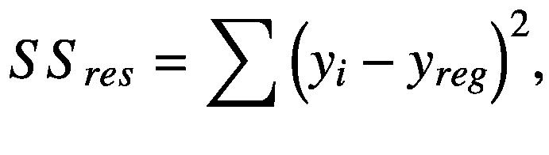

(3.4)

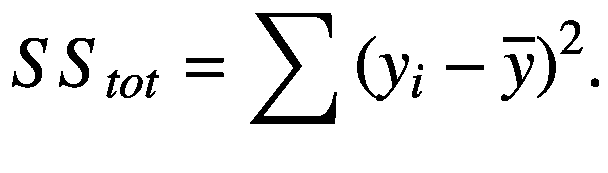

(3.5)

这里，*y*[*i*] 是每个数据点的值，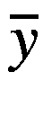 是平均值，*y*[*reg*] 是回归模型预测的值。

另一方面，RMSE 指标使用以下公式计算。

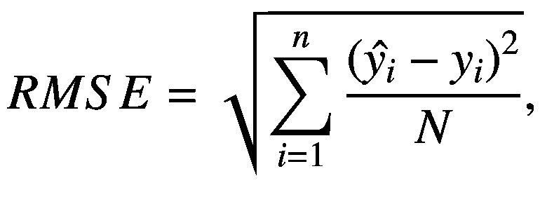

(3.6)

其中 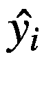 是回归模型预测的值，*N* 是观测数量。

对于分类问题，模型准确率定义为正确预测数量与总预测数量的比率。对于一个包含 *N* 个不同类别的分类问题，还会使用*混淆矩阵*或*误差矩阵*，它是一个 *N*×*N* 的矩阵，主对角线上包含 *N* 个正确分类，其余可能的错误位于非对角线元素上。该矩阵提供了一种可视化方法来评估机器学习模型在分类问题上的性能。图 3-1 展示了二分类（两个类别）混淆矩阵的示例。

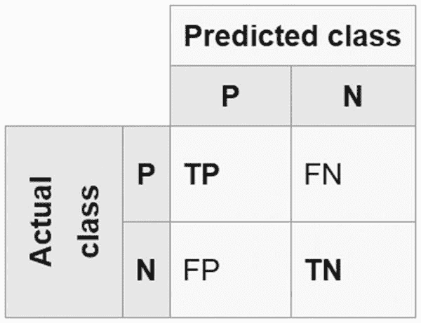

图 3-1

混淆矩阵示意图，其中 P = 正类，N = 负类，TP = 真正例；FP = 假正例；TN = 真负例；FN = 假负例

基于该矩阵，可以确定一些准确率指标，包括精确率、召回率和 F1 分数。

#### 精确率

精确率定义为对于给定类别，真正例（正确预测）样本数量与预测为该类别的总样本数量的比率。高精确率输出表明，在模型预测属于给定类别的样本中，大多数样本确实属于该类。

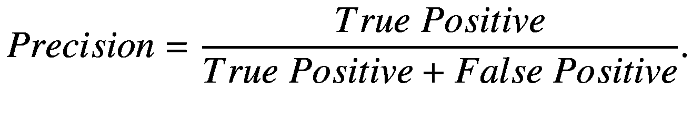

(3.7)

#### 召回率

召回率定义为真正例样本数量与属于该类别的总样本数量的比率。高召回率表明，属于给定类别的样本中，被错误分类为其他类别的样本非常少。


(3.8)

#### F1 分数

F1 分数提供了精确率和召回率的调和平均值。在模型选择过程中，会在多个分类算法中选择具有最高 F1 分数的模型。

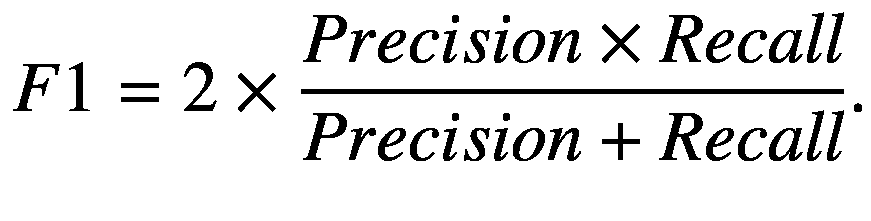

(3.9)

### 可复现的机器学习

机器学习算法为一系列工业相关问题提供了比传统方法更好的预测能力。然而，对于工业应用而言，确保模型训练和模型生成的预测结果能够完全复现至关重要。有时，即使使用相同的数据集和相同的算法，也可能难以复现结果并获得相同的性能。

这些差异可归因于多种原因，例如权重的随机初始化、数据集的随机打乱以及多种机器学习算法的随机性。为了解决这个问题，在机器学习算法实现中仔细设置*随机种子*，可以让我们向实现可复现性迈进一步。以下代码片段展示了为操作系统环境变量、Python 随机模块、NumPy 和 TensorFlow 设置随机种子的一些示例。

```
seed_value = 42
# 使用环境变量设置 Python 随机种子
os.environ['PYTHONHASHSEED']=str(seed_value)
import random
# 使用 Python 随机模块设置 Python 随机种子
random.seed(seed_value)
import numpy as np
np.random.seed(seed_value) # 设置 Numpy 随机种子
import tensorflow as tf
tf.random.set_seed(seed_value) # 设置 TensorFlow 随机种子
```


### Bagging 与 Boosting

到目前为止，我们已经讨论了如何选择单个机器学习模型以获得最佳且可重复的性能。然而，在现实场景中，基于单一算法的单个模型可能无法提供最佳解决方案。*集成学习* 正是为了应对这一挑战而引入的；它通过使用相同算法训练多个机器学习模型，来构建一个更强大、更稳健的预测模型。

其核心理念是组合多个弱学习器，形成一个强大的学习集成体，从而提供比单个机器学习模型更高的准确率。Bagging 和 Boosting 是该类别中最常用的两种技术。它们有助于降低噪声、方差（即避免过拟合）或偏差（即避免欠拟合）。在定义这些概念之前，理解*自助法（Bootstrapping）* 很重要，这是一种统计学中使用的重采样技术。在自助法过程中，会从给定的数据集中有放回地随机抽取多个样本。自助法可以量化与统计学习方法相关的不确定性 [7]。

*Bagging* 是 *Bootstrap Aggregation（自助聚合）* 的简称。当在某些机器学习算法（如决策树）中遇到高方差（过拟合）时，Bagging 非常有用。它通过并行训练同质弱学习器（即性能较差的模型）来组合它们，并通过平均（回归）或投票（分类）过程提供预测。这个过程会产生一个更稳健的模型，同时降低过拟合的可能性。

另一方面，*Boosting* 也是从同质弱学习器的集成中学习，但采用的是顺序和自适应方式。与 Bagging 旨在减少方差（过拟合）不同，这种方法试图通过基于先前训练的性能较差的模型来训练新模型，从而最小化偏差（欠拟合）。换句话说，Bagging 使用等权平均来生成预测，而 Boosting 则使用多个学习器的组合来提供一个性能更好的模型。

### 模型可解释性

在统计学和机器学习领域，众所周知，过于复杂的模型并不总是问题的最佳解决方案。这主要是因为随着模型变得复杂，会损失模型的可解释性。对于许多需要解释模型输出且模型推理是优先级的行业来说，可解释性至关重要。例如，在一个具有多层和多个神经元的深度神经网络中，可能很难解释某个特定输入特征对输出的影响。

这与基于决策树的方法，或者更简单的线性回归模型形成对比，在后两者中，参数的变化直接映射到输出变量的变化。人们投入了大量精力来更好地理解复杂的机器学习算法；然而，这仍然是一个正在进行的研究领域。

## 探索性数据分析 (EDA)

在现实场景中，数据通常不会以完美的格式准备好，可以直接输入到机器学习模型中。机器学习项目的第一步是进行探索性数据分析 (EDA)，其中包括检测不一致性、检查假设、确定解释变量之间的关系以及理解特征之间关系的步骤 [8]。

探索性数据分析是理解和准备机器学习模型数据的关键过程。EDA 中的一些步骤包括变量识别、单变量和双变量分析、缺失值处理、异常值移除以及额外变量的转换或创建。EDA 的目的在于更好地理解数据及其假设，提高数据质量，并通过发现数据趋势的线索来生成分析假设 [9]。这涉及使用汇总统计和可视化技术来回答关于给定数据的问题。

本节对第 2 章中使用的油气数据进行了简要的探索性分析。我们继续上一章的分析，其中来自两口井的数据已被合并。合并后的数据集作为输入，并生成一个数据框来执行 EDA。以下代码输出显示了合并后数据框的大小。

```
Shape of the dataset (rows, columns): (5127, 15)
```

如图 3-2 所示，该数据框包含多个 NA 值，需要移除这些值以清理数据集。从图中可以看出，多个特征列存在 236 个缺失值，这些都需要处理。在这种情况下，由于 NA 出现在同一组数据点上，我们选择删除这些值，而不是进行插补（即替换缺失值）。一旦从数据集中移除 NA 值，数据框的新形状如下所示。

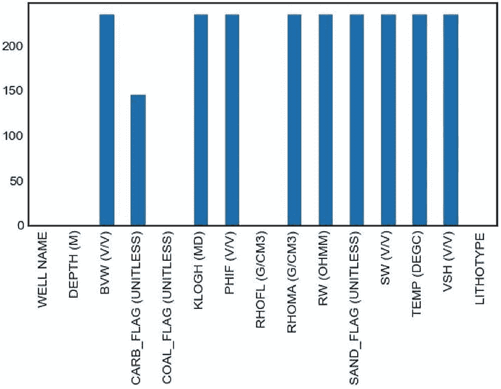

图 3-2

数据集中缺失值或 NA 值的直方图

```
Shape of the dataset (rows, columns): (4818, 15)
```

下一步是研究数据集中特征的描述性统计。图 3-3 显示了数据框的描述性统计。

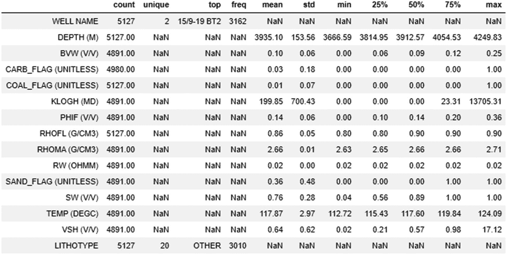

图 3-3

数据框的描述性统计

下一步是查看特征的分布。在图 3-4 中，以一些特征为例进行了展示。VSH (V/V) 是其中一个特征，它显示出偏态，这可能是由于出现了范围更广的较少出现的值或存在异常值。观察异常值存在的一个简单方法是通过箱线图。图 3-5 展示了同一组特征的箱线图示例。再次查看特征 VSH (V/V)，您可以看到一些点远在上四分位数范围之外。在本节中，不涉及异常值分析。但是，您可以采取额外的过滤步骤来移除数据中任何现有的异常值。

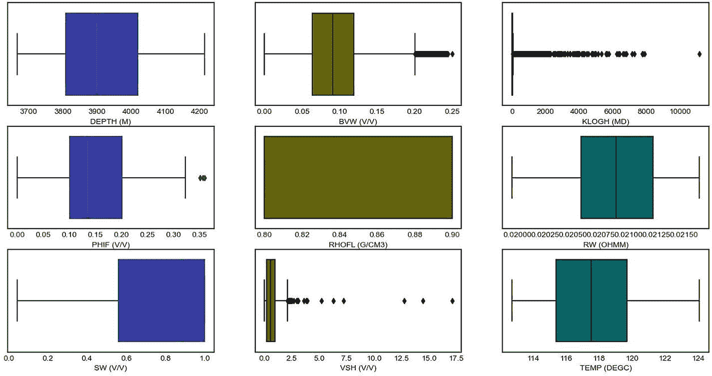

图 3-5

数据集中特征的箱线图，用于识别异常值的存在

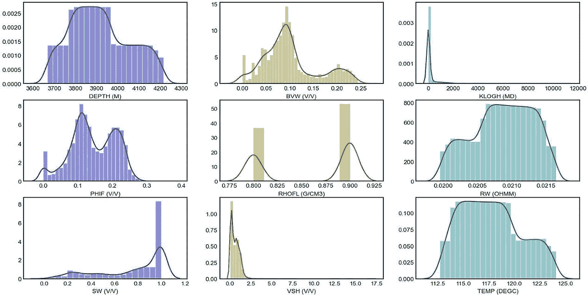

图 3-4

数据集中某些具有多模态和偏态行为的特征分布


确保数据集中不存在高度共线性的变量至关重要。图 3-6 所示的可视化热力图展示了不同特征之间的相关性。

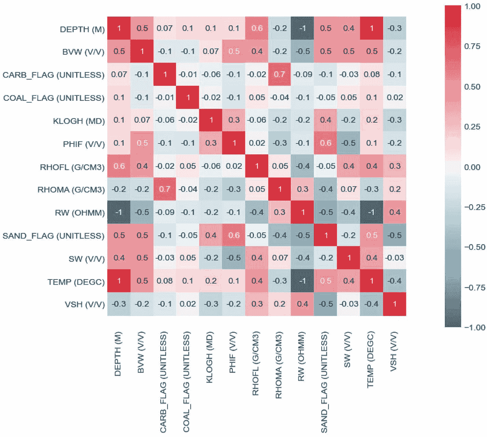

图 3-6

相关性热力图，用于了解变量之间存在的任何共线性

聚焦于 KLOGH (MD)（即回归中的输出变量，将在后文讨论），未发现任何特征存在高度共线性，但 RHOMA (G/CM3) 和 CARB_FLAG (无量纲) 除外，它们显示出 70% 的共线性。根据经验法则，建议采取额外步骤来理解特征的重要性，并仅保留重要性较高的特征。然而，特征工程和特征选择是内容广泛的课题，超出了本章的讨论范围。我们将重点放在构建机器学习模型上。

观察图 3-7 中的最终变量列表及其观测数量，数据集中只有一个主要分类变量——LITHOTYPE。对于分类问题，这就是输出变量。

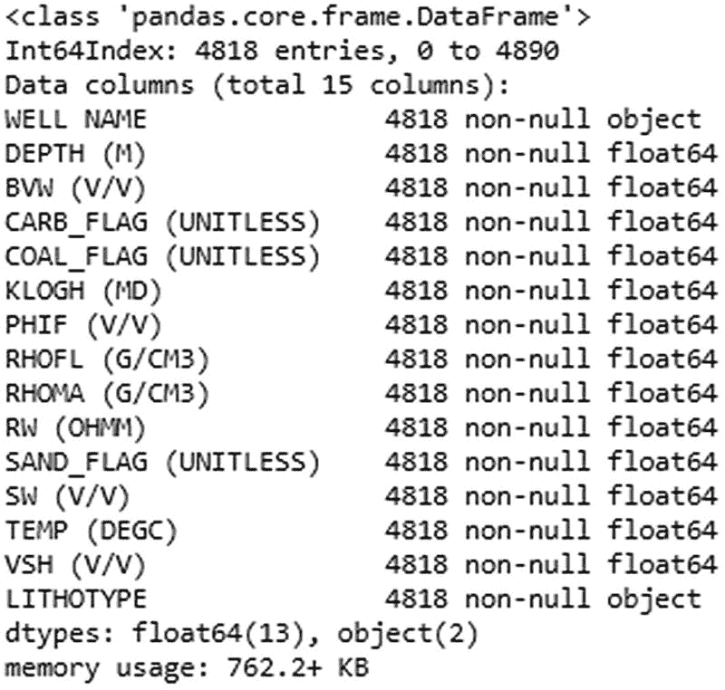

图 3-7

数据集中特征的数据类型信息

## 监督学习

正如我们在本章开头所讨论的，那些利用已知输入来预测变量输出的问题属于监督学习范畴。如果输出是定量或连续的，则属于回归问题。而如果输出是定性或离散/分类的，则属于分类问题 [10]。换句话说，目标是学习一个函数 *f*，该函数表示由输入变量提供的系统信息，用于预测或推断响应（输出）变量 [7]。

在本节中，我们提供了各种回归和分类算法的基本实现代码片段。目的是通过提供一个起点，让您熟悉不同的算法。本章后面的一节将介绍一个超参数调优示例，该示例可适用于本章讨论的任何机器学习算法。

在简要描述不同算法并提供代码片段后，将进行简要分析以了解每种算法的性能。但需要注意的是，这些算法实现并未针对性能进行优化；因此，使用这些算法进行微调的模型可能会表现出比此处基本实现更好的性能。

### 回归

回归是监督学习问题的一个子类型，其输出是定量或连续变量。在我们一直使用的岩石物理数据示例中，KLOGH 被选为输出变量。所有其他特征都被视为独立的输入变量。因此，回归问题的目标是找到最优函数 *f*，该函数能够利用所有其他变量作为输入特征，准确预测 KLOGH。


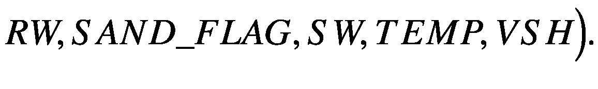

(3.10)

本节简要讨论了各种机器学习算法，但未深入探讨其数学细节或超参数优化。本节展示了这些算法的最小实现，我们建议您按照本章末尾“延伸阅读”部分提供的建议，更深入地研究每种算法。

使用 scikit-learn 和 TensorFlow 机器学习库，通过 Python 实现这些算法。本章示例的端到端代码可在本书代码仓库中的 Jupyter notebook 中找到。该 Jupyter notebook 还包含一些基本函数，这些函数用于生成精度指标、绘制回归曲线以及生成预测结果的散点图。

#### 多元线性回归

多元线性回归，或简称为多元回归，是最简单的回归算法。在该算法中，为每个输入特征分配一个数值系数，输出变量则预测为特征值与其对应数值系数相乘所得值的总和。该算法的训练过程试图最小化观测值与模型预测输出值之间的残差平方和。以下代码片段展示了该算法的一个示例实现。

```
# 多元线性回归
from sklearn.linear_model import LinearRegression
lin_reg = LinearRegression()
lin_reg.fit(X_train, y_train)  # 训练算法
print(lin_reg.intercept_)  # 截距
print(lin_reg.coef_)  # 系数
# 对测试数据进行预测
y_pred_lin = lin_reg.predict(X_test)
```

**结果**

```
平均绝对误差: 283.89717843775026
均方误差: 245181.5892137209
均方根误差: 495.15814566027376
R 平方: 0.1488228559603506
```

多元线性回归的回归图如图 3-8 所示，同时还包括测试数据集中 KLOGH 预测值的比较。从测试数据观测值与预测值的回归图可以看出，线性模型未能捕捉到输入特征与输出变量之间的非线性映射关系。可以得出结论，该算法过于简单，无法解决该问题，并且存在较强的偏差（欠拟合）。

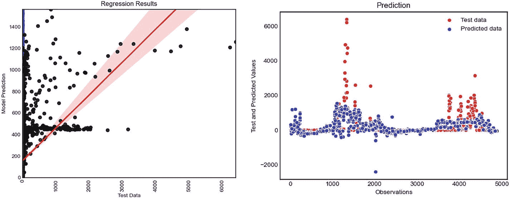

图 3-8

多元线性回归结果，以回归图和散点图形式展示


#### 支持向量回归

支持向量回归基于支持向量机。该方法通过允许一定的误差范围对每个数据点执行回归。对于每个数据点 *y*，预测值落在 (*y* + *ϵ*) 到 (*y* - *ϵ*) 的范围内都是可以接受的。在图 3-9 中，误差范围 *ϵ* 由两个支持向量描绘，并允许模型调优的灵活性。

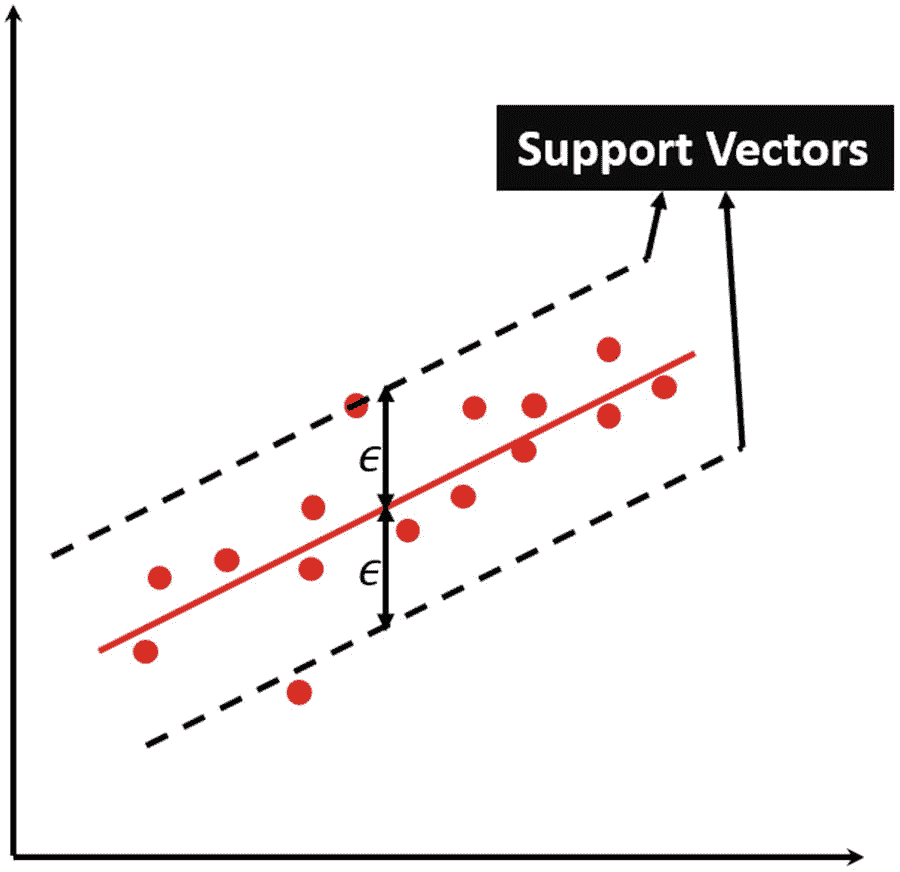

图 3-9

描绘带有误差范围 *ϵ* 的支持向量的示意图

除了误差范围，该算法还利用了*核技巧*。核技巧将非线性的低维空间投影到高维空间。在高维空间中，可以将原始的非线性问题表示为线性问题。scikit-learn 中有多种核函数可用于支持向量回归的实现，包括 `'linear'`、`'sigmoid'`、`'rbf'` 和 `'polynomial'`。

由于数据集中存在非线性，本例选择了径向基函数（`'rbf'`）核，也称为*高斯核*。以下代码片段展示了一个示例实现。

```
# Support Vector Regression (SVR)
from sklearn.svm import SVR
svr_reg = SVR(kernel='rbf', C=100, gamma=0.1, epsilon=.1)
svr_reg.fit(X_train, y_train)
# Prediction on test data
y_pred_svr = svr_reg.predict(X_test)
```

**结果**

```
Mean Absolute Error: 82.06389051208197
Mean Squared Error: 112564.26261124818
Root Mean Squared Error: 335.5059799932755
R Squared: 0.6092197302512246
```

基于支持向量回归结果的回归图和散点图如图 3-10 所示。该算法的性能显著优于多元线性回归。这种改进归功于支持向量回归中应用的误差范围和核技巧。

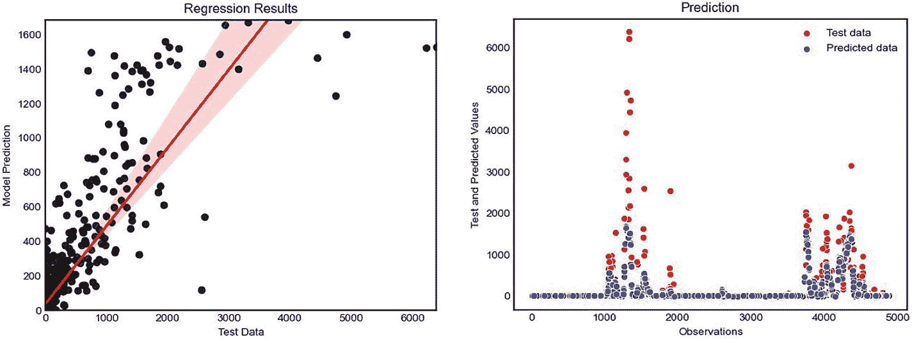

图 3-10

支持向量回归结果以回归图和散点图形式展示

#### 决策树回归

决策树是一种非参数化的基于树的流程图。该算法通过构建一个由多个叶节点组成的基于规则的层次树结构来工作。在每个叶节点上，对一个特征或一组特征施加一个条件。在决策树的每个节点处，根据施加的条件，训练数据中的样本被分割成多个子节点。预测值根据终端叶节点中样本的平均值计算得出（见图 3-11）。

在训练过程中，算法学习在每个叶节点分割训练数据的规则，以使观测值与预测值之间的均方误差（MSE）最小化。由于其高度可解释的特性，决策树非常常用于回归问题。图 3-12 显示，与之前两种算法相比，应用该算法提供了更好的预测。然而，该算法存在过拟合的问题。此处展示了一个决策树回归的代码片段。

```
# Decision Tree – Regression
from sklearn.tree import DecisionTreeRegressor
dt_reg = DecisionTreeRegressor(random_state=42)
dt_reg.fit(X_train, y_train)
# Prediction on test data
y_pred_dt = dt_reg.predict(X_test)
```

**结果**

```
Mean Absolute Error: 29.73391044401977
Mean Squared Error: 35097.83335297129
Root Mean Squared Error: 187.34415750957191
R Squared: 0.8781536833529513
```

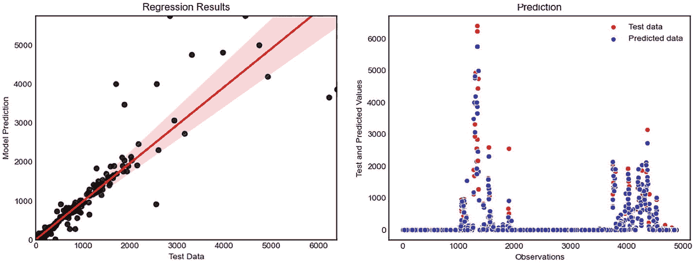

图 3-12

决策树回归结果以回归图和散点图形式展示

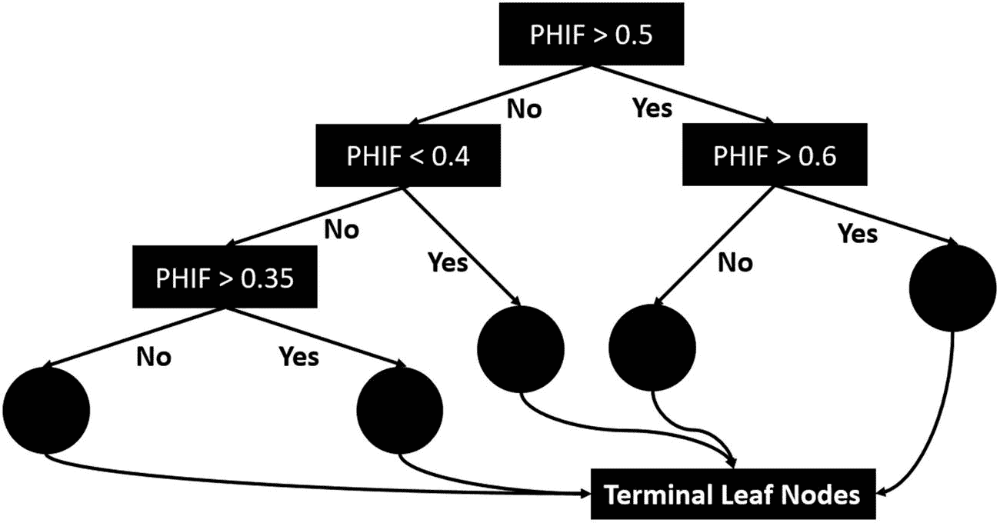

图 3-11

决策树的概念性描述，该树根据 PHIF 的值分割数据

#### 随机森林回归

*随机森林*是一种基于决策树集成的算法。该算法应用了本章前面讨论过的装袋（bagging）方法。随机森林算法对输入特征和训练数据都应用装袋方法。这意味着，对于随机森林模型中生长的每棵决策树，都会随机选择输入特征的一个子集和训练数据的一个子集来训练该决策树。该算法并行训练多棵决策树。

决策树算法存在过拟合问题。这是由于使用单棵树造成的，它几乎记住了整个训练数据，而无法泛化。然而，通过对特征和训练数据进行装袋，随机森林算法解决了过拟合问题，从而能够提供稳健的预测模型。从随机森林回归获得的结果显示出比之前讨论的算法更好的预测精度。通过查看图 3-13 中的图可以验证这一观察结果。此处展示了一个示例代码实现。

```
# Random Forest – Regression
from sklearn.ensemble import RandomForestRegressor
rf_reg = RandomForestRegressor(random_state=42)
rf_reg.fit(X_train, y_train)
# Prediction on test data
y_pred_rf = rf_reg.predict(X_test)
```

**结果**

```
Mean Absolute Error: 20.0011266166531
Mean Squared Error: 14744.082604216954
Root Mean Squared Error: 121.4252140381764
R Squared: 0.948814157854232
```

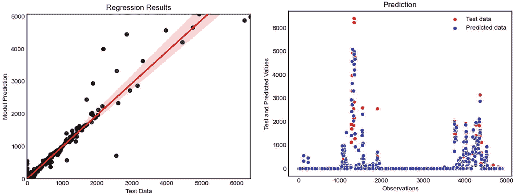

图 3-13

随机森林回归结果以回归图和散点图形式展示

#### XGBoost：极端梯度提升

XGBoost 是非常强大且流行的机器学习算法之一，由于其优化的实现，它为大型数据集提供了高精度。该算法遵循提升（boosting）概念，其中弱学习器（决策树）按顺序生长。每棵后续树都基于前一棵树的预测误差进行学习。对于在前一个学习器中表现出较高 MSE 的数据点，会给予更高的权重来改进预测。该算法从弱学习器中创建一个复合模型，从而提供稳健的性能。

该算法旨在以更高的执行速度优化性能。模型本身使用梯度下降算法进行优化；因此，它提供了更高的精度。图 3-14 显示了使用 XGBoost 回归的预测绘制的回归图和散点图。以下代码片段展示了 XGBoost 回归算法的示例实现。

```
# XGBoost – Regression
import xgboost as xgb
xgb_reg = xgb.XGBRegressor()
xgb_reg.fit(X_train, y_train)
# Prediction on test data
y_pred_xgb = xgb_reg.predict(X_test)
```

**结果**

```
Mean Absolute Error: 34.95929924279304
Mean Squared Error: 14853.490861224791
Root Mean Squared Error: 121.87489840498243
R Squared: 0.948434334034536
```

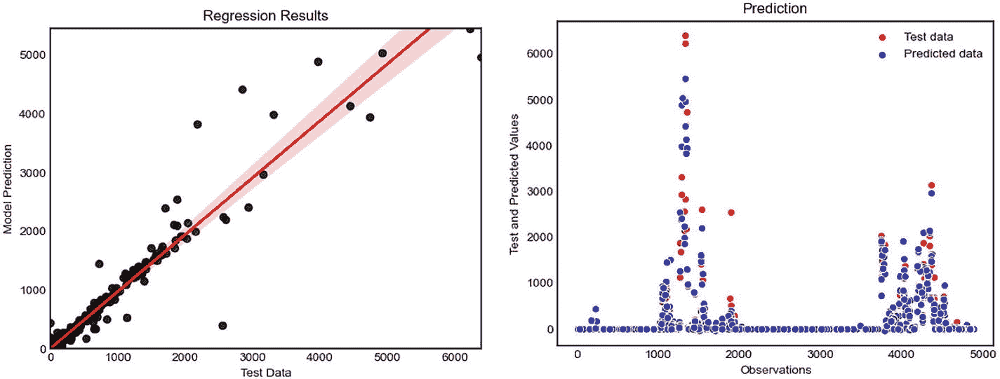

图 3-14

XGBoost 回归结果以回归图和散点图形式展示


#### 人工神经网络

人工神经网络建立在人脑神经元决策能力原理之上，它们是更复杂的深度学习网络的基础构建模块。神经网络架构包含一个输入层、一个或多个隐藏层以及一个输出层。每一层都由神经元构成，计算就在这些神经元中进行。

在本章稍后的部分，我们将更详细地讨论人工神经网络及其在深度学习中的应用。在以下代码示例中，构建了一个多层感知器模型，该模型将误差反向传播原理作为主要学习机制。

在误差反向传播过程中，模型预测中的估计误差会被反向传播，以调整神经网络模型参数，并计算出更新后的模型参数。这个迭代训练过程会持续进行，直到满足模型精度或训练时长的特定条件。图 3-15 展示了基于以下代码构建的神经网络模型所获得的预测结果图。

```
# 多层感知器 – 回归
import tensorflow as tf
from tensorflow import keras
from tensorflow.keras import layers
def build_model():
ann_reg = keras.Sequential([
layers.Dense(32, activation="relu", input_shape=[len(X_train.keys())]),
layers.Dense(32, activation="relu"),
layers.Dense(1) ])
optimizer = tf.keras.optimizers.RMSprop(0.001)
ann_reg.compile(loss='mse', optimizer=optimizer, metrics=['mse'])
return ann_reg
```

**结果**

```
平均绝对误差: 80.5055592187044
均方误差: 51228.191722683405
均方根误差: 226.33645690140906
R 平方: 0.8221552194654382
```

这里构建的基础神经网络模型的精度，可能不如本章前面讨论的一些更简单的模型。随着机器学习模型复杂度的增加，充分训练它们的任务也变得更加具有挑战性。为了充分训练一个*深度*神经网络模型，我们需要遵循超参数优化的流程，这将在本章后面讨论。

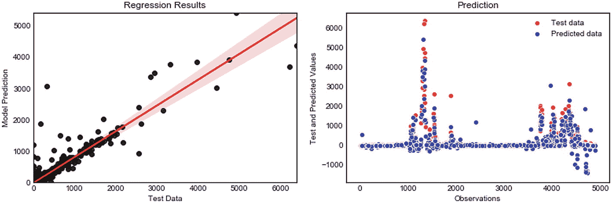

图 3-15

人工神经网络回归结果，以回归图和散点图形式展示

#### 回归模型比较

为了比较前面讨论的不同机器学习模型的结果，我们比较了 RMSE 分数来评估它们的性能。基于测试数据集的结果，随机森林和 XGBoost 回归算法似乎是表现最好的（见表 3-1）。然而，我们想重申的是，这些结果是基于这些算法最简单的实现，并且没有调整任何参数。每种算法的微调模型所显示的精度与本摘要中显示的不同。然而，这一分析确立了随机森林和 XGBoost 算法在快速构建回归问题原型方面的有效性。

表 3-1

回归模型与 RMSE 分数

| 回归模型 | RMSE |
| --- | --- |
| 多元线性回归 | 495.16 |
| 支持向量回归 | 335.51 |
| 决策树 | 187.34 |
| 随机森林 | 121.42 |
| XGBoost | 121.87 |
| 人工神经网络 | 226.34 |

### 分类

分类是监督学习的一个子类别，其中输出变量是离散的或分类的。对于本章讨论的示例，LITHOTYPE 是唯一的分类变量，因此被用作输出变量。分类算法的目标是找到函数 *f*，该函数能够映射特征以准确预测不同的岩性类别。

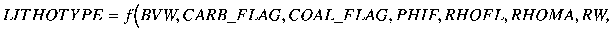

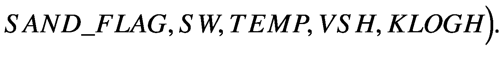

(3.11)

对于本章使用的岩石物理数据集，数据中存在多个岩性类别，如图 3-16 所示。

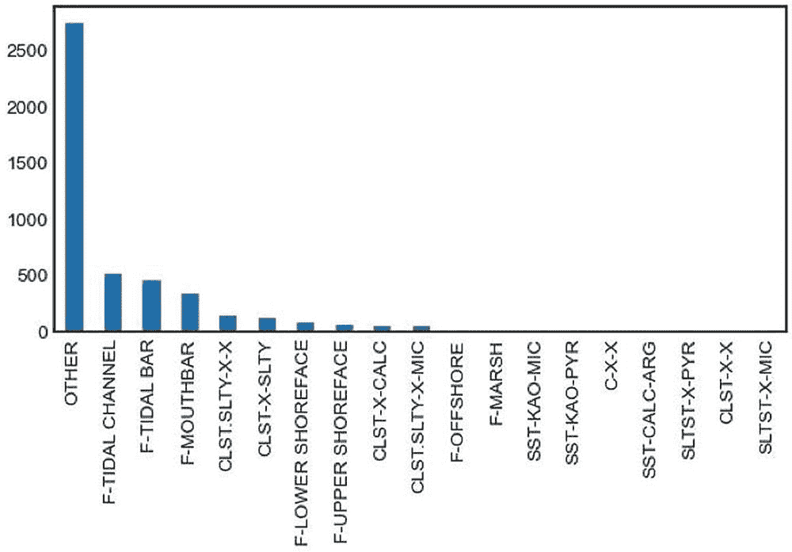

图 3-16

输出变量中可用的不同岩性类别

为简单起见，只保留至少包含 250 个数据点的类别，其余的被过滤掉。从图 3-16 中可以看出，频率最高的类别是“其他”，它不传递任何有用信息，因此也被丢弃。

图 3-17 显示了分类模型中使用的三个主要类别。一个只有两个类别的分类输出变量是二分类问题。然而，在我们使用的数据集中，输出变量有超过两个类别。因此，在本示例中，我们解决的是一个*多类别*分类问题。

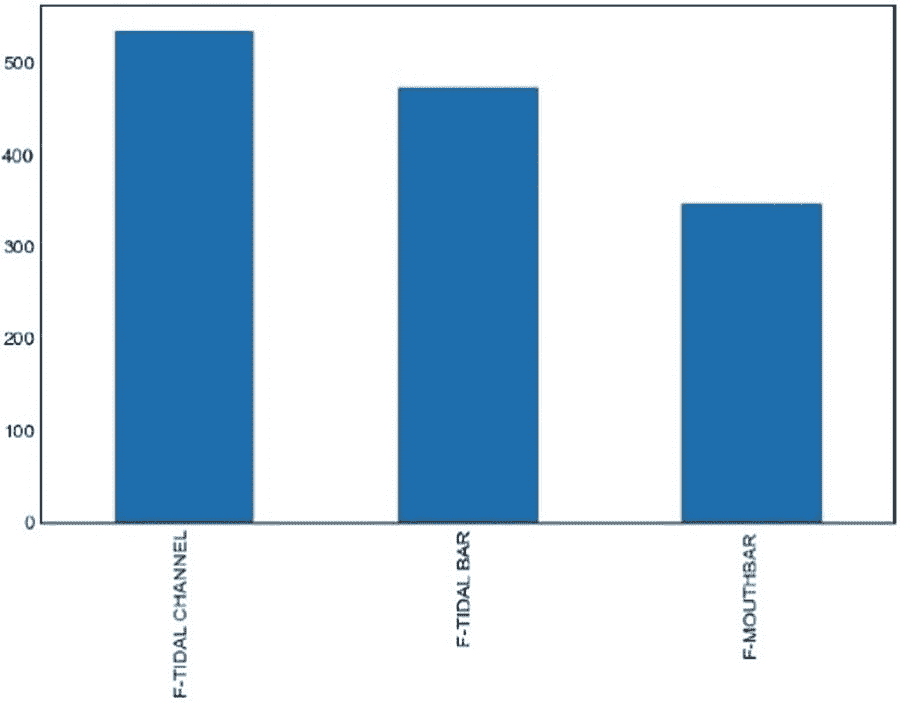

图 3-17

LITHOTYPE 分类输出变量中的三个主要类别


#### 多项逻辑回归

逻辑回归是一种分类技术，用于解决二分类问题。二分类相当简单：如果一个样本不属于某一类，则它必然属于另一类。逻辑回归使用 Sigmoid 函数（见图 3-21）。该函数在输入值发生微小变化时，其输出值会从 0 急剧变化到 1。Sigmoid 函数的这一特性有助于对属于两个不同类别的样本数据进行分类。对于涉及两个以上类别的分类问题，*多项逻辑回归*是基本的多类分类算法之一。该算法使用*softmax*函数，其表达式如下：

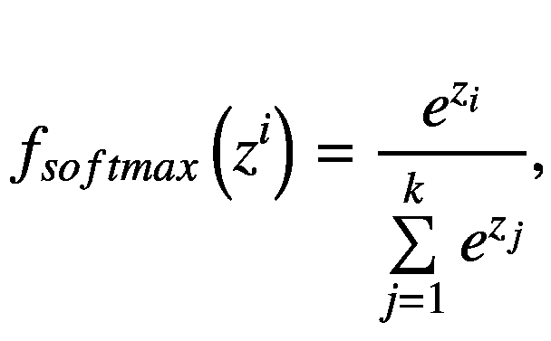

(3.12)

其中，*k* 是多类分类问题中的类别数量，*i* 是当前针对输入 *z*^(*i*) 计算 softmax 函数的类别。Softmax 函数也会从 0 到 1 发生非常迅速的变化，但它具备处理多个类别的能力。简单来说，softmax 函数提供了样本属于 *k* 个类别中任一类的概率。多项逻辑回归也称为*softmax 回归*。以下代码片段展示了使用该算法进行多类分类的示例实现。

```
from sklearn.linear_model import LogisticRegression
clf_logreg = LogisticRegression()
clf_logreg.fit(X_train, y_train)
# 对测试数据进行预测
y_pred_logreg = clf_logreg.predict(X_test)
# 准确率指标
clf_metrics(y_test, y_pred_logreg)
```

**结果**

```
Classification Accuracy Score: 0.6480938416422287
Classification Report:
precision    recall  f1-score   support
F-MOUTHBAR       0.40      0.05      0.08        87
F-TIDAL BAR       0.53      0.86      0.66       119
F-TIDAL CHANNEL       0.82      0.85      0.84       135
accuracy                           0.65       341
macro avg       0.59      0.58      0.53       341
weighted avg       0.61      0.65      0.58       341
```

分类准确率的结果以分类报告的形式呈现，其中精确率、召回率和 F1 分数作为分类器预测能力的量化指标。该算法对 F-TIDAL CHANNEL 类别的预测精确率较高，但对样本数量较少的类别预测精确率不佳。

需要注意的是，当数据集中某个类别的样本数量远多于其他类别时，某些分类器的表现可能不佳。在*样本不平衡*的情况下，对训练数据进行重采样以使各类别样本数量相等，可能有助于提高分类算法的精确率和准确率。

#### 支持向量分类器

之前，我们讨论了支持向量和核技巧。*支持向量分类器*使用了类似的概念。为了执行分类，该算法构建了最优超平面，以分离属于不同类别的样本。其二维等效表示可以看作是一条划分属于两个不同类别的点簇的直线。该算法使用一个正则化参数，该参数决定了分隔超平面的间隔（回顾 *ϵ*）。结果表明，该算法无法有效识别样本数量较少的类别。

```
from sklearn.svm import SVC
clf_svc = SVC()
clf_svc.fit(X_train, y_train)
# 对测试数据进行预测
y_pred_svc = clf_svc.predict(X_test)
# 准确率指标
clf_metrics(y_test, y_pred_svc)
```

**结果**

```
Classification Accuracy Score: 0.6217008797653959
Classification Report:
precision    recall  f1-score   support
F-MOUTHBAR       0.00      0.00      0.00        87
F-TIDAL BAR       0.50      0.87      0.64       119
F-TIDAL CHANNEL       0.80      0.81      0.80       135
accuracy                           0.62       341
macro avg       0.43      0.56      0.48       341
weighted avg       0.49      0.62      0.54       341
```

#### 决策树分类器

决策树分类器算法采用的方法与之前讨论的决策树回归类似。在回归算法中，预测是通过对样本所属的终端叶节点中的值取平均来生成的。而在分类问题中，属于某个终端树节点的所有样本都被归类为其中一个类别。

在模型训练过程中，该算法试图最小化熵（随机性）并最大化信息增益。一个经过充分训练且无随机性的树，其任何给定终端叶节点中的所有样本都只属于一个样本类别。结果表明，尽管存在样本不平衡问题，该算法在不同岩性类别上仍能提供高精确率和准确率。

```
from sklearn.tree import DecisionTreeClassifier
clf_dt = DecisionTreeClassifier()
clf_dt.fit(X_train, y_train)
# 对测试数据进行预测
y_pred_dt = clf_dt.predict(X_test)
# 准确率指标
clf_metrics(y_test, y_pred_dt)
```

**结果**

```
Classification Accuracy Score: 0.9853372434017595
Classification Report :
precision    recall  f1-score   support
F-MOUTHBAR       0.98      0.98      0.98        87
F-TIDAL BAR       0.99      0.97      0.98       119
F-TIDAL CHANNEL       0.99      1.00      0.99       135
accuracy                           0.99       341
macro avg       0.98      0.98      0.98       341
weighted avg       0.99      0.99      0.99       341
```

#### 随机森林分类器

随机森林分类器的工作原理与我们之前讨论的随机森林回归完全相同。唯一的区别在于，在分类算法中，会生长出一片由决策树分类器组成的森林，最终的预测是基于*投票*而非取平均值来生成的。

在投票方法中，集成预测中出现频率最高的类别被选为最终输出。该算法还提供了预测样本属于任一类别概率的灵活性。选择这两种输出方法中的哪一种取决于具体问题。示例代码实现和分类结果表明，该算法提供的预测具有高精确率和准确率。

```
from sklearn.ensemble import RandomForestClassifier
clf_rf = RandomForestClassifier()
clf_rf.fit(X_train, y_train)
# 对测试数据进行预测
y_pred_rf = clf_rf.predict(X_test)
# 准确率指标
clf_metrics(y_test, y_pred_rf)
```

**结果**

```
Classification Accuracy Score: 0.9882697947214076
Classification Report:
precision    recall  f1-score   support
F-MOUTHBAR       0.99      0.98      0.98        87
F-TIDAL BAR       0.99      0.98      0.99       119
F-TIDAL CHANNEL       0.99      1.00      0.99       135
accuracy                           0.99       341
macro avg       0.99      0.99      0.99       341
weighted avg       0.99      0.99      0.99       341
```


#### *k*-近邻算法 (*k*-NN)

*k*-近邻算法 (*k*-NN) 是一种基于相似度度量（例如，距离函数，如两个样本之间的欧几里得距离，或二元向量之间的汉明距离）的非参数算法。该算法利用相似度度量在样本数据中寻找 *k* 个最近的邻近点，并根据这 *k* 个邻居中出现频率最高的类别来预测输出类别。

该算法的输入参数之一是在未知类别样本点附近搜索的邻居数量。该算法的示例实现和结果展示了其合理的性能。然而，其表现不如之前讨论的基于树的算法。

```
from sklearn.neighbors import KNeighborsClassifier
clf_knn = KNeighborsClassifier()
clf_knn.fit(X_train, y_train)
# 对测试数据进行预测
y_pred_knn = clf_knn.predict(X_test)
# 准确率指标
clf_metrics(y_test, y_pred_knn)
```

**结果**

```
Classification Accuracy Score: 0.8592375366568915
Classification Report:
precision    recall  f1-score   support
F-MOUTHBAR       0.83      0.75      0.79        87
F-TIDAL BAR       0.86      0.85      0.86       119
F-TIDAL CHANNEL       0.87      0.94      0.90       135
accuracy                           0.86       341
macro avg       0.86      0.85      0.85       341
weighted avg       0.86      0.86      0.86       341
```

#### 高斯朴素贝叶斯分类

高斯朴素贝叶斯算法基于**贝叶斯定理**，并假设多个输入特征独立地对样本属于特定类别的概率做出贡献。该算法假设与每个类别相关的连续特征服从高斯分布或正态分布。

通过使用最大似然原理，该算法可以预测样本点属于特定类别的概率。该算法也属于基础分类算法的范畴，但其性能优于其他基础分类算法，例如多项逻辑回归。以下代码片段展示了该算法的示例实现和分类结果。

```
from sklearn.naive_bayes import GaussianNB
clf_gnb = GaussianNB()
clf_gnb.fit(X_train, y_train)
# 对测试数据进行预测
y_pred_gnb = clf_gnb.predict(X_test)
# 准确率指标
clf_metrics(y_test, y_pred_gnb)
```

**结果**

```
Classification Accuracy Score: 0.6099706744868035
Classification Report:
precision    recall  f1-score   support
F-MOUTHBAR       0.40      0.54      0.46        87
F-TIDAL BAR       0.61      0.34      0.44       119
F-TIDAL CHANNEL       0.77      0.89      0.82       135
accuracy                           0.61       341
macro avg       0.59      0.59      0.57       341
weighted avg       0.62      0.61      0.60       341
```

#### 线性判别分析

线性判别分析（LDA）同样基于输入特征服从高斯分布的假设。此外，该算法假设每个特征具有相同的方差。在该算法中，输入特征被转换，使得两个不同类别的输入特征值之间的重叠最小化。这是通过执行转换来实现的，该转换最大化样本中任意两个不同类别的特征统计均值之间的距离。该算法提供了样本点属于特定类别的概率。

LDA 是一种简单的算法，对于小型数据集可以表现合理。然而，如果训练数据包含统计均值重叠的输入特征，则该算法无法区分属于不同类别的样本。以下代码片段和结果展示了 LDA 在多类分类问题上相比其他基础算法（即高斯朴素贝叶斯和多项逻辑分类器）具有更好的性能。

```
from sklearn.discriminant_analysis import LinearDiscriminantAnalysis
clf_lda = LinearDiscriminantAnalysis()
clf_lda.fit(X_train, y_train)
# 对测试数据进行预测
y_pred_lda = clf_lda.predict(X_test)
# 准确率指标
clf_metrics(y_test, y_pred_lda)
```

**结果**

```
Classification Accuracy Score: 0.7800586510263929
Classification Report :
precision    recall  f1-score   support
F-MOUTHBAR       0.73      0.56      0.64        87
F-TIDAL BAR       0.71      0.82      0.76       119
F-TIDAL CHANNEL       0.87      0.89      0.88       135
accuracy                           0.78       341
macro avg       0.77      0.76      0.76       341
weighted avg       0.78      0.78      0.78       341
```

#### 分类模型比较

对于本节中构建的分类模型，我们使用 F1 分数作为指标来比较它们的性能。基于测试数据集的结果，决策树和随机森林分类器是性能最好的分类模型，如表 3-2 所示。对这些模型进行进一步调优预计会改变这些准确率结果。

表 3-2

分类模型与 F1 分数

| 分类模型 | F1 分数 |
| --- | --- |
| 多项逻辑回归 | 0.648 |
| 支持向量分类器 | 0.621 |
| 决策树分类器 | 0.985 |
| 随机森林分类器 | 0.988 |
| *k*-NN | 0.859 |
| 高斯朴素贝叶斯 | 0.609 |
| 线性判别分析 | 0.780 |

## 无监督学习

到目前为止，我们讨论了与监督学习相关的问题，其中机器学习算法试图将训练数据中的输入特征映射到相应的输出变量。在无监督学习问题中，没有需要映射到输入特征的关联输出变量。相反，无监督机器学习算法通过寻找训练数据中隐藏的关系和/或模式来工作。无监督学习问题的两大类别包括聚类和降维。我们将讨论这两类算法并展示示例实现。

### 聚类

在这类无监督学习中，算法试图在样本数据中找到具有相似特征的簇。当样本总体中存在相对不同的群体时，聚类算法在样本数据上效果非常好。一旦聚类算法训练完成，任何新的观测值都会被预测属于该算法基于原始样本数据识别出的某个簇。


#### K-Means 聚类

K-Means 聚类算法用于将包含 *n* 个观测值的数据集划分为以质心为中心的 *k* 个不同簇。训练数据中的每个观测值都属于一个特定的簇。一个簇或聚合的点群具有某些嵌入其中的相似特征。对于本章使用的岩石物理数据集，找到生成肘部图所需的簇数非常重要，如图 3-18 所示。肘部图展示了*惯性*（各点到其簇质心的距离平方和）随簇数变化的情况。

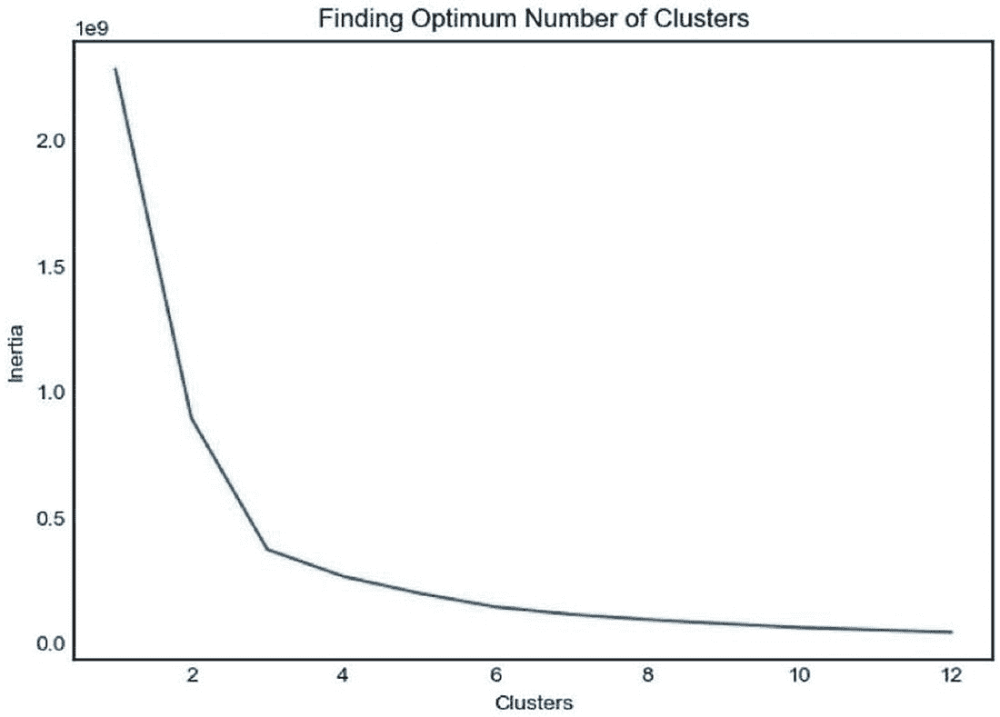

图 3-18

基于惯性值指示最佳簇数的肘部图

观察肘部图，当 *k* = 3 个簇时，存在一个明显的拐点或肘部。使用该数据集的最佳簇数 *k* = 3，在 KLOGH 和 PHIF (V/V) 之间生成的散点图显示了三个不同簇之间的清晰边界（见图 3-19）。从物理意义上讲，这些簇可能描绘了地下岩石的逻辑分组，类似于相或岩性类型。

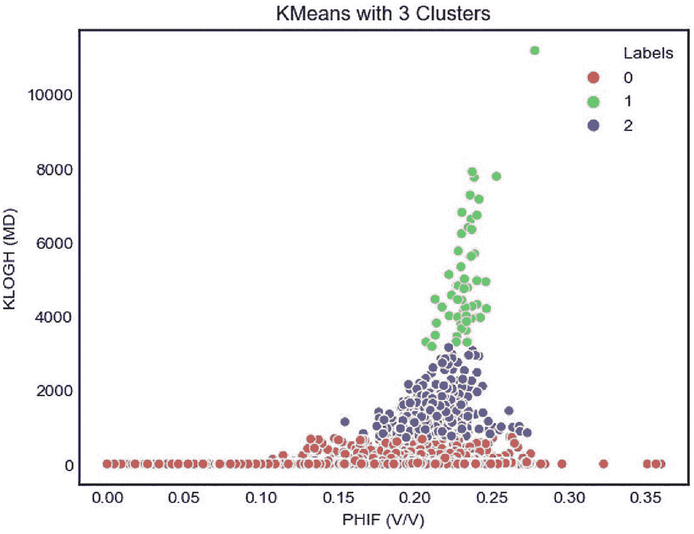

图 3-19

KLOGH 与 PHIF 之间的散点图，显示了使用 K-Means 聚类算法生成的不同簇之间的边界

```
import sklearn.cluster as cluster
import seaborn as sns
km3 = cluster.KMeans(n_clusters=3, init='k-means++', max_iter=300, n_init=10, random_state=42).fit(X)
X['Labels'] = km3.labels_
X['Labels'].value_counts()
sns.scatterplot(X['PHIF (V/V)'], X['KLOGH (MD)'], hue=X['Labels'], palette=sns.color_palette('hls', X['Labels'].nunique()))
plt.title('KMeans with 3 Clusters')
```

### 降维

降维是一个抽象概念，对于分析具有极多特征的数据集非常有用。执行降维通常是为了为机器学习算法获得更好的输入特征。它在不显著牺牲模型预测能力的情况下提高了计算效率。降维还消除了原始数据中不同特征之间可能存在的共线性。主成分分析就是此类算法中的一种。

#### 主成分分析

*主成分分析*（PCA）利用特征的正交变换，提供了一种统计方法，通过将多个线性相关的特征转换为线性无关的变量来减少输入数据的维度。这些线性无关的变量被称为*主成分*，它们彼此正交。

第一个主成分解释了数据集中的最大方差，随后的每个主成分解释的方差依次递减。这种方法有一个注意事项：主成分通常不如原始特征易于解释。需要注意的是，PCA 对缩放敏感，因此使用本章前面讨论的方法对特征进行缩放非常重要。

使用本章前面使用的相同数据集，以下实现表明前四个主成分可以解释大约 86% 的样本方差。

```
from sklearn.decomposition import PCA
pca = PCA()
X_train = pca.fit_transform(X_train)
X_test = pca.transform(X_test)
explained_variance = pca.explained_variance_ratio_
print(explained_variance)
```

**结果**

```
Explained Variance
[4.32302153e-01 2.49297862e-01 1.06117586e-01 7.90285832e-02
4.83399458e-02 3.41638092e-02 2.32342217e-02 1.67907297e-02
6.98516043e-03 2.81954933e-03 9.13677877e-04 6.64565466e-06
7.64286168e-08]
```

计算主成分后，我们使用随机森林分类来了解在 PCA 之后减少输入特征数量如何影响机器学习模型的准确性。在这里，我们比较了使用全部 12 个特征的预测准确性与使用前四个主成分生成的预测准确性。从以下代码实现结果来看，将输入特征数量减少到前四个主成分并不会显著降低预测准确性。

```
# Random Forest with entire data
classifier = RandomForestClassifier(random_state=42)
classifier.fit(X_train, y_train)
# Predicting the Test set results
y_pred = classifier.predict(X_test)
print(confusion_matrix(y_test, y_pred))
print(accuracy_score(y_test, y_pred))
Accuracy with all features: 0.9377289377289377
# Random Forest with only 4 components
classifier_4comp = RandomForestClassifier(random_state=42)
classifier_4comp.fit(X_train_4comp, y_train)
# Predicting the Test set results
y_pred_4comp= classifier_4comp.predict(X_test_4comp)
print(confusion_matrix(y_test, y_pred_4comp))
print(accuracy_score(y_test, y_pred_4comp))
Accuracy with only first 4 principal components: 0.8974358974358975
```

## 深度学习

我们已经讨论了用于解决分类、回归、降维和聚类相关问题的有监督和无监督机器学习算法。在讨论回归算法时，我们简要提到了人工神经网络。神经计算是深度学习算法的核心。深度学习算法试图创建深度层次模型，这些模型可以执行复杂任务，例如区分不同物体、理解人类语音或基于多个输入图像创作新画作。

在本节中，我们将讨论以下深度学习算法。

*   多层感知器（MLP）

*   卷积神经网络（CNN）

*   循环神经网络（RNN）

*   长短期记忆网络（LSTM）


### 多层感知机 (MLP)

多层感知机（MLP）是最基础的深度学习算法。神经元是深度神经网络（包括 MLP）的基本构建模块。图 3-20 展示了一个神经元的示意图。神经元通过使用与输入相关联的权重计算输入值的加权和，然后对加权和施加一个非线性的*激活函数*（*f*）。神经元执行的这种非线性变换赋予了 MLP 和其他深度神经网络对高度非线性过程进行建模的能力，这些过程出现在许多自然现象和工业问题中。神经元也被称为*神经网络节点*。

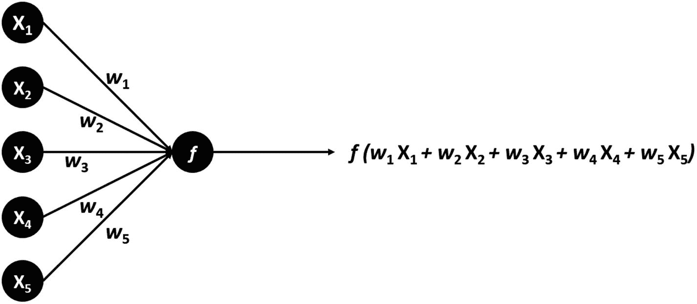

图 3-20

人工神经网络中神经元计算的示意图

神经元可以使用多种激活函数来执行非线性变换。Sigmoid 函数和双曲正切函数是经典使用的激活函数。一些更先进的激活函数包括*线性整流单元*（ReLU）、带泄露的 ReLU 和指数线性单元。图 3-21 展示了这些传统和现代非线性激活函数 [11] 的函数形式和形状对比。这些函数易于求导（连续且可微）。这一特性使得这些函数在梯度计算过程中计算效率很高，而梯度计算是训练深度神经网络的重要部分。

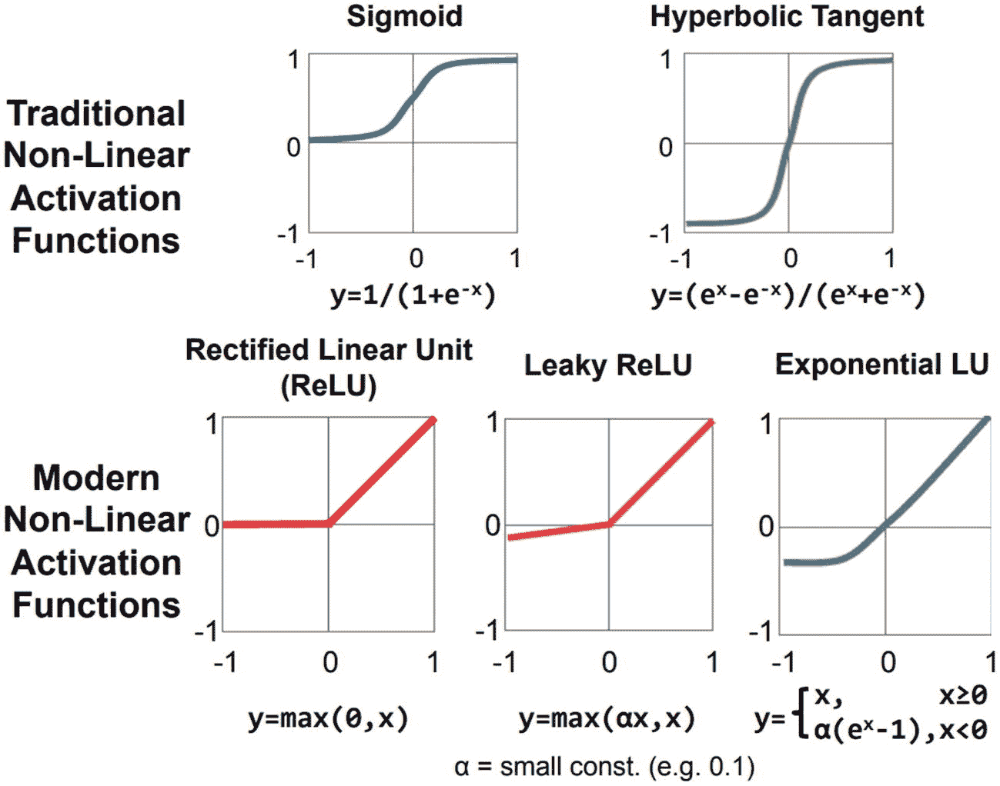

图 3-21

传统与现代激活函数对比 [11]

图 3-22 展示了一个 MLP 的示意图。这种深度神经网络由以下组件构成。

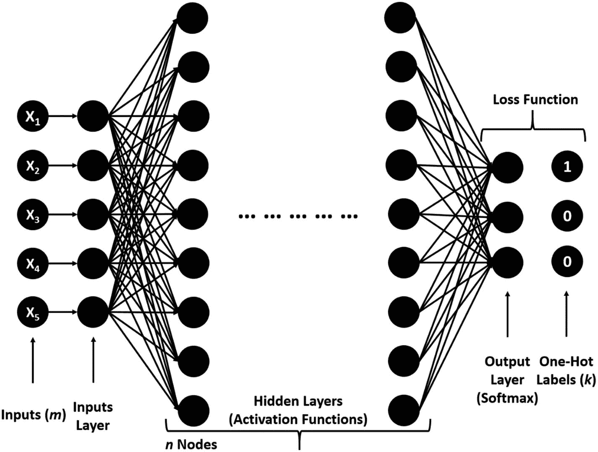

图 3-22

多层感知机的示意图

*   **输入层：** 该层包含节点，这些节点便于将输入特征引入神经网络，并应用非线性变换。

*   **隐藏层：** 这些层包含具有非线性激活函数的神经元或节点。隐藏层由一个权重矩阵（*W*）和一个偏置向量（*b*）表示。矩阵 *W* 和向量 *b* 的维度取决于该层中节点的数量。例如，连接 *m* 个输入（特征矩阵 *X*）并将值广播到第一个隐藏层中 *n* 个节点的输入层，其权重矩阵的维度为 *m* × *n*。同时，偏置向量 *b* 有 *n* 个元素。该层的输出是 *f* (*WX* + *b*)，其中 *f* 是激活函数。

*   **输出层：** 输出层与最后一个隐藏层连接，并确保神经网络的输出与问题定义一致。例如，如果神经网络正在被训练用于对具有 *k* 个不同类别的数据集进行分类，输出层会计算 *k* 个不同的值，然后对每个 *k* 值应用 softmax 函数。在所描述的场景中，输出中的每个元素对应样本属于 *k* 个类别中某一个的概率。

*   **优化器：** 优化器通过使用误差反向传播来促进神经网络各层权重矩阵 *W* 和偏置向量 *b* 的更新。

优化器使用损失函数来评估预测值的准确性。在回归问题中，这个损失函数可以是 RMSE。然而，在分类问题中，可能需要一个相对复杂的损失函数。在分类问题中，输出层提供 *k* 个概率值（*y*）。如果一个对象只属于其中一个对象类别（这是大多数现实世界分类任务的情况），那么为了实现分类器的最佳性能，这 *k* 个值中应该有一个接近 1。标签被进行独热编码，以将类别标签转换为概率。例如，在一个 *k*=3 类的问题中，类别 1、2 和 3 分别表示为独热向量（*p*）[1, 0, 0]、[0, 1, 0] 和 [0, 0, 1]。像分类交叉熵这样的损失函数会使用这些值来提供误差的定量估计，这对于迭代更新神经网络模型参数（即权重和偏置）非常有用。通过使用输出向量（*y*）和独热编码标签向量（*p*），可以使用以下公式计算分类交叉熵。

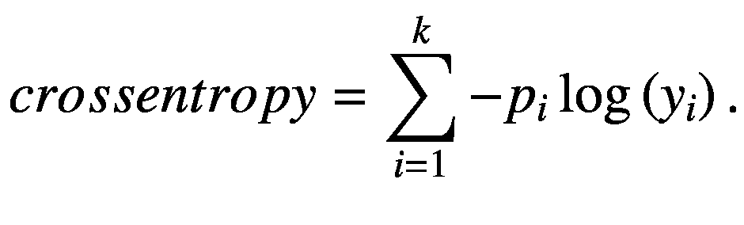

(3.13)

接下来，我们将这些概念应用于对图 3-23 所示数据集中的图像进行分类。

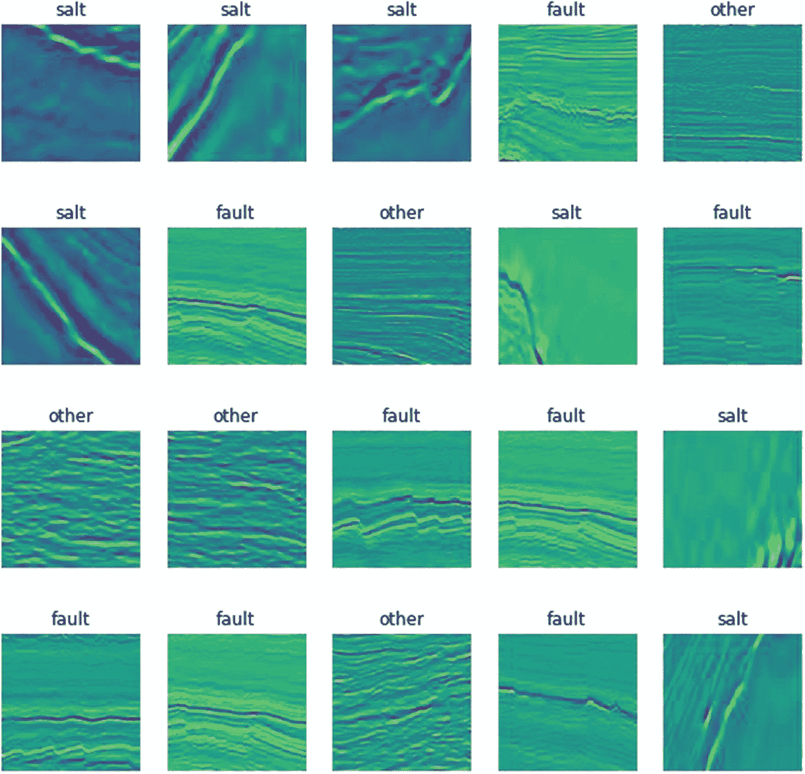

图 3-23

来自 SFO（盐体/断层/其他）数据集的一些样本图像

机器学习社区中有一些标准的图像数据集，通常用于评估分类模型。这些数据集包括手写数字集合（MNIST）、日常生活中遇到的物体集合（CIFAR10）等等。在本章中，我们使用公共领域和 Kaggle 上可用的地震勘测数据创建了一个数据集。该数据集（昵称为 *SFO 数据集*）包含 1,500 张属于三个类别（盐体、断层和其他）的地震图像。我们使用 MLP 对该数据集中的图像进行分类。以下代码片段展示了使用 TensorFlow 库实现 MLP 模型的方法。

```
# 定义一个深度神经网络模型
reg_param = 0.02 # L2 正则化的正则化参数
model = Sequential()
model.add(Dense(1024, activation="relu", kernel_initializer="he_normal", kernel_regularizer=l2(l=reg_param),
input_shape=(n_features,)))
model.add(Dense(512, activation="relu", kernel_initializer="he_normal",
kernel_regularizer=l2(l=reg_param)))
model.add(Dense(256, activation="relu", kernel_initializer="he_normal",
kernel_regularizer=l2(l=reg_param)))
model.add(Dense(128, activation="relu", kernel_initializer="he_normal",
kernel_regularizer=l2(l=reg_param)))
model.add(Dense(64, activation="relu", kernel_initializer="he_normal",
kernel_regularizer=l2(l=reg_param)))
model.add(Dense(32, activation="relu", kernel_initializer="he_normal",
kernel_regularizer=l2(l=reg_param)))
model.add(Dense(16, activation="relu", kernel_initializer="he_normal",
kernel_regularizer=l2(l=reg_param)))
model.add(Dense(8, activation="relu", kernel_initializer="he_normal",
kernel_regularizer=l2(l=reg_param)))
model.add(Dense(3, activation="softmax"))
# 编译模型
model.compile(optimizer='Adadelta', loss="sparse_categorical_crossentropy", metrics=['accuracy'])
```

上述神经网络模型的实现包含以下组件。


*   一个包含 1024 个节点的**密集**输入层。七个隐藏层，节点数分别为 512、256、128、64、32、16 和 8。这些节点被称为**密集**层，是因为这些层中的每个节点都与前一层和后一层的每个节点相连，从而提供了密集连接（见图 3-22）。最后，是一个包含三个节点的输出层。所有节点（输出层除外）都使用 ReLU 激活函数。输入层和隐藏层的权重使用`he_normal`初始化器进行初始化。

*   正则化是指在模型训练过程中，当模型参数（权重和偏置）发生较大变化时施加惩罚。它提供了一种防止过拟合的保护措施。惩罚的程度可以通过正则化参数进行调整，该参数通常是一个较小的数值。在所示的 MLP 模型中，我们使用了 L2 正则化，正则化参数为 0.02。

*   模型中的输出层使用 softmax 激活函数来输出估计的分类概率。

*   该模型使用`Adadelta`优化器，该优化器采用具有自适应学习率的随机梯度下降方法。虽然其他一些优化器需要预定义学习率，但`Adadelta`优化器会自适应地计算学习率。该优化器使用`sparse_categorical_crossentropy`作为损失函数，这是之前讨论的分类交叉熵在每种对象只能属于样本类别中一个类别的情况下的变体。

以下代码片段用于训练上述 MLP 模型。

```
# 使用验证集进行早停的回调
earlystop_callback = EarlyStopping(monitor='val_accuracy',
min_delta=0.0001, patience=50)
# 保存最佳模型
ckpt_path = './models/dnn.h5'
ckpt_callback = ModelCheckpoint(filepath=ckpt_path, mode="max",
monitor='val_accuracy', verbose=1,
save_best_only=True)
# 训练模型
history = model.fit(X_train, y_train, epochs=500, batch_size=BATCH_SIZE, validation_data=(X_valid, y_valid),
callbacks=[earlystop_callback, ckpt_callback],
verbose=1)
```

模型训练过程的重要组件如下。

*   **Epochs（轮次）：** 一个 epoch 对应于算法处理一次训练数据中所有样本所需的训练迭代次数。这里的 MLP 模型预计训练 500 个 epoch。

*   **Early-stopping（早停）：** 此概念使用验证数据集持续监控训练过程。`min_delta`参数定义了最小验证准确率提升。如果模型准确率在`patience`参数定义的训练轮次数内没有超过`min_delta`的提升，则停止训练。此代码实现会在每次超过之前的最佳验证准确率时保存模型。在训练结束时提供最佳验证准确率的模型可用于后续生成预测。

图 3-24 展示了训练和验证数据集在训练轮次中损失函数的变化。使用该过程训练的 MLP 模型用于对测试数据集生成预测。该模型对盐层、断层和其他类别的预测准确率如下。

```
Test Accuracy: 0.713
```

通过优化超参数，模型准确率可以在一定程度上得到提升。

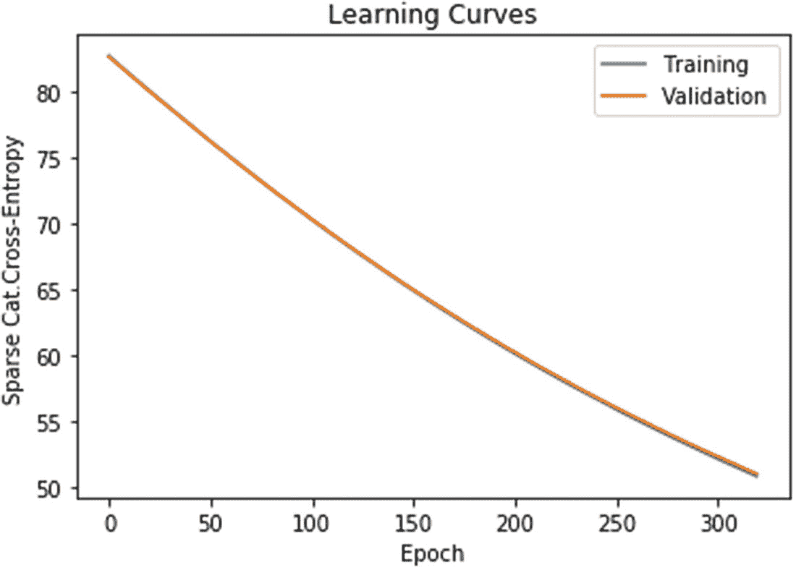

图 3-24

学习曲线，展示了多层感知器随轮次变化的训练损失

这个例子向我们展示了 MLP 可以生成一个用于识别图像的模型，其正确率约为 70%。然而，MLP 并非专门用于图像识别任务的算法。接下来，我们将讨论一种专门用于图像识别和其他通用计算机视觉应用的深度神经网络架构。

### 卷积神经网络（CNN）

只有在 2D 或 3D 上下文中同时观察图像像素时，才能实现物体的视觉识别。我们使用 MLP 进行图像分类任务。尽管 MLP 的表现比抛硬币要好，但它生成的预测无法用于任何实际应用。这种较低的准确率源于 MLP 在查看图像时缺乏空间上下文。

卷积神经网络（CNN）是一种专门的神经网络，它通过执行允许在学习过程中包含空间上下文的计算来学习识别物体。CNN 是使用卷积层构建的。虽然训练 CNN 的大部分方面与训练 MLP 相似，但神经网络架构存在显著差异。

图 3-25 总结了与 CNN 架构相关的一些重要概念。在 CNN 的卷积层中，卷积滤波器遍历图像以提取图像特征，这有助于识别给定图像所属的类别。

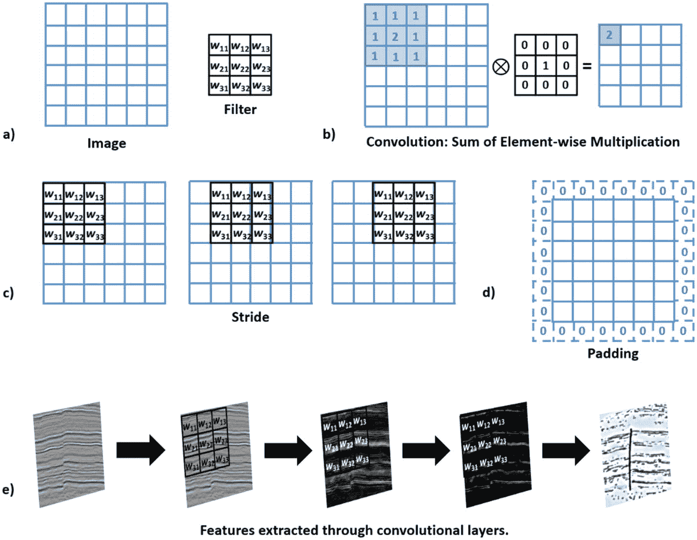

图 3-25

(a) 图像和卷积滤波器，(b) 卷积操作，(c) 步长，(d) 图像周围的零填充，以及 (e) 在卷积层上进行的特征提取的概念性表示

以下是图 3-25 中所示与 CNN 相关的一些重要概念。

*   **Filter（滤波器）：** 一个方形权重矩阵通常代表卷积层中的一个滤波器。CNN 训练过程的主要目标之一是学习卷积滤波器的最优权重。

*   **Convolution（卷积）：** 在卷积操作期间，计算图像重叠像素与滤波器之间逐元素乘积的总和。该值被分配给重叠图像块的中心像素（见图 3-25-b）。

*   **Stride（步长）：** 滤波器可以一次移动一个像素来遍历图像，或者可以跳过中间的几个像素。滤波器在图像上遍历时一次移动的像素数称为*步长*（见图 3-25-c）。

*   **Padding（填充）：** 当滤波器遍历图像时，由于边缘处没有重叠单元，它会减小图像的尺寸。在某些需要保持图像尺寸的场景中，可以在图像边缘填充零（见图 3-25-d）。对于大小为*W* × *W*的图像，由大小为*F* × *F*的滤波器以步长*S*遍历，并在图像边缘填充*P*个单元，输出图像的尺寸可通过![$$ \left[\frac{W-K+2P}{S}\right]+1\. $$](images/480430_1_En_3_Chapter/480430_1_En_3_Chapter_TeX_IEq3.png)计算。

当图像通过多个卷积层处理时，滤波器会提取出图像中的区分性特征，使得更容易将样本数据中的一个类别与其他类别区分开来（见图[3-25](https://doi.org/10.1007/978-1-4842-6094-4_2Fig#25)-e）。以下代码片段展示了用于对 SFO 数据集中的图像进行分类的 CNN 模型。

```
model = Sequential()
model.add(Conv2D(96, (5, 5), activation="relu",
input_shape=(IMG_DIM, IMG_DIM, 1)))
model.add(MaxPooling2D((2, 2)))
model.add(Conv2D(128, (5, 5), activation="relu"))
model.add(MaxPooling2D((2, 2)))
model.add(Conv2D(128, (5, 5), activation="relu"))
model.add(MaxPooling2D((2, 2)))
model.add(Conv2D(64, (5, 5), activation="relu"))
model.add(Flatten())
model.add(Dense(64, activation="relu"))
model.add(Dense(32, activation="relu"))
model.add(Dense(3, activation="softmax"))
```


代码中的 CNN 模型交替使用了二维卷积层和最大池化层。在最大池化操作中，算法从一组像素中选择最大值来替换现有像素值。所展示的 CNN 架构包含四个二维卷积层，滤波器大小为 5×5，并使用 ReLU 激活函数。卷积层之后是两个使用 ReLU 激活函数的全连接层，以及一个包含三个节点并使用 softmax 激活的输出层。该 CNN 采用与之前描述的训练 MLP 相同的机制进行训练。图 3-26 展示了损失函数随训练轮次的变化。该 CNN 模型在识别盐体、断层和其他类别方面表现出较高的预测精度。

```
Test Accuracy: 0.953
```

至此，我们结束了关于图像分类任务的深度学习算法概述。接下来，我们将讨论用于时间序列预测的深度学习算法。

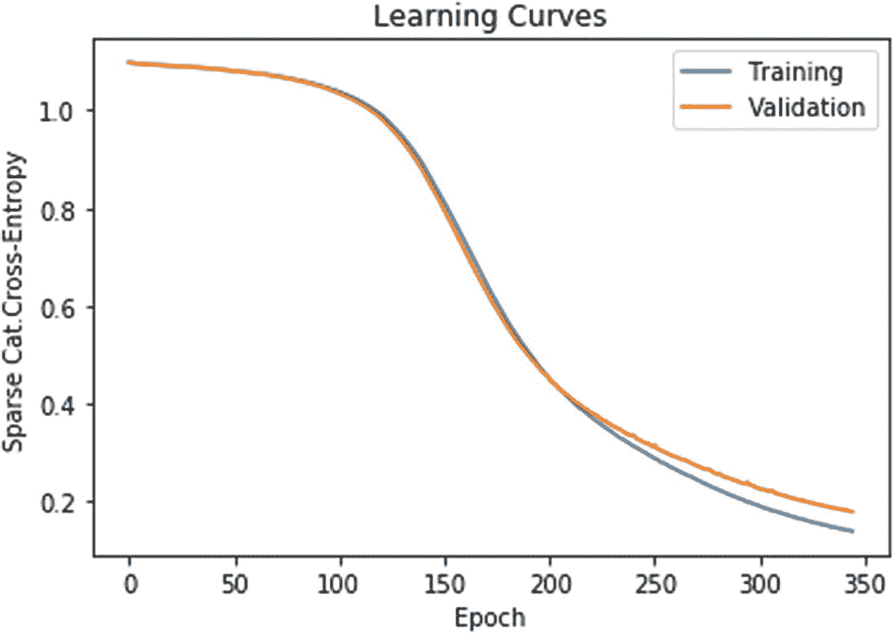

图 3-26

学习曲线，展示了卷积神经网络随轮次变化的训练损失

### 循环神经网络（RNN）

循环神经网络（RNN）提供了一种专门的架构，可以对序列（包括时间序列数据）进行建模。图 3-27 展示了 RNN 架构的示意图。

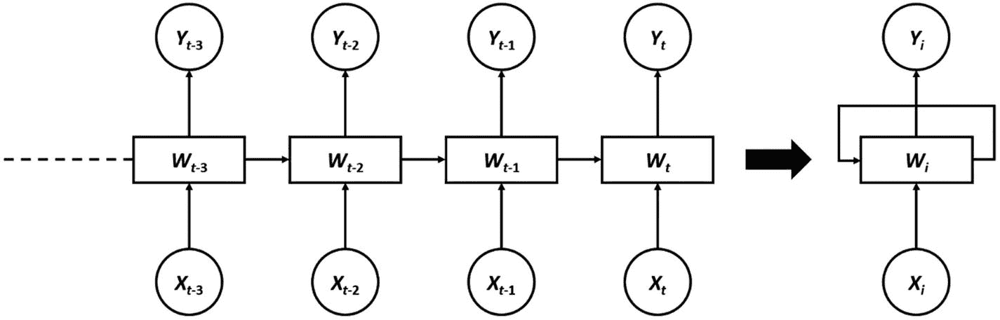

图 3-27

RNN 架构的示意图

RNN 是一系列基础神经网络模型，其中每个模型都从序列中单个步骤的输入和输出中学习。如果我们将这个序列中的模型折叠成一个单一的模型，该模型将其输出作为输入，并不断更新模型参数，我们就得到了如图 3-27（最右侧）所示的 RNN 架构。

然而，这种学习模型参数（权重和偏置）的方法存在稳定性问题。有时，由于误差梯度较大，模型权重从序列中的一个步骤到下一个步骤的变化可能过大。梯度在序列的多个步骤中累积可能导致权重更新过大，从而使得数值超出计算机能处理的数值范围。这被称为*梯度爆炸*问题。

另一方面，如果误差梯度在序列的多个步骤中过小，累积这些梯度可能导致值接近于零。在这种情况下，模型停止更新权重，无法学习。这被称为*梯度消失*问题。

存在专门解决梯度爆炸和梯度消失问题的架构。在讨论其中一种专门算法之前，我们先看看用于构建时间序列预测模型的时间序列数据。

图 3-28 展示了由 Equinor（[`https://data.equinor.com`](https://data.equinor.com)）提供的 Volve 数据集中两口井的日产量（左图）和累计产量（右图）数据。我们将使用这些数据，根据最近几周的产量数据来生成次日产量预测。

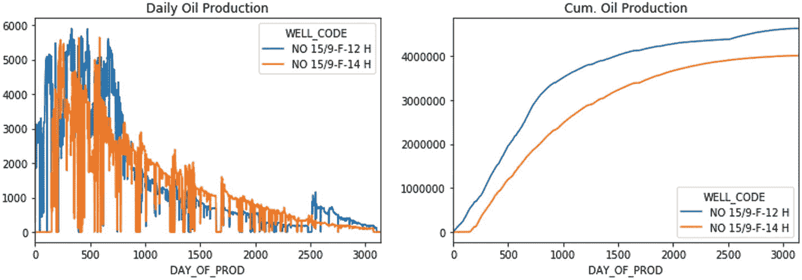

图 3-28

图表展示了从 Volve 数据集中选取的两口井的日产油量（左图）和累计产油量（右图）数据

#### 长短期记忆网络（LSTM）

我们讨论了在训练 RNN 模型时遇到的梯度爆炸和梯度消失问题。长短期记忆网络（LSTM）是一种通过控制信息从序列中的一个步骤流向下一个步骤来解决这些问题的架构。LSTM 模型被表示为一个带有信息流调节*门*的单元（见图 3-29）。LSTM 模型中的单元状态变量保留了序列（或正在建模的时间序列）的长期记忆。这些门包括以下内容。

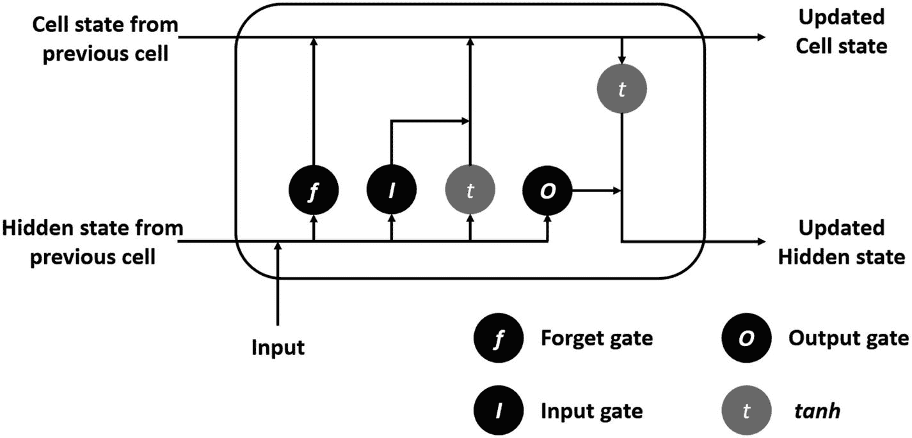

图 3-29

长短期记忆网络（LSTM）单元架构示意图

*   **遗忘门：** 该门根据单元输入和序列前一步的输出（隐藏状态）的组合来收集学习到的信息。然后，使用 sigmoid 函数决定应该丢弃多少信息。sigmoid 函数提供 0 到 1 之间的值，其中 1 表示保留所有信息，0 表示丢弃所有信息。

*   **输入门：** 该门也使用单元输入和前一步的输出。输入门使用 sigmoid 函数来学习应该保留多少信息用于更新单元状态。相同的输入会通过*tanh*激活函数。输入门提供 0 到 1 之间的值，而*tanh*提供-1 到 1 之间的值。这两者的组合用于更新单元状态。

*   **输出门：** 输出门使用的输入与前两个门类似。它使用 sigmoid 函数学习计算模型输出所需的信息量。应用于单元状态（序列的长期记忆）的*tanh*激活函数与从输出门接收到的值的组合，提供了单元的输出。

以下代码片段展示了使用 TensorFlow 实现 LSTM 架构的示例。使用过去 14 天的累计产量数据来预测次日的累计产量。该实现包含两个堆叠的 LSTM 层，之后是一个全连接层，以及一个具有单个节点（一个输出变量）的输出层。我们使用`Adadelta`优化器，并最小化均方误差（MSE）指标来训练 LSTM 模型。该实现还使用了基于验证数据的早停法（此处未显示）。

```
model = Sequential()
model.add(LSTM(NUM_HIDDEN, activation="relu", return_sequences=True, input_shape=(LOOKBACK, 1)))
model.add(LSTM(NUM_HIDDEN, activation="relu", return_sequences=False))
model.add(Dense(NUM_HIDDEN))
model.add(Dense(1))
model.compile(optimizer='Adadelta', loss="mse")
```

图 3-30（左图）展示了观测到的测试数据的归一化累计产量，以及 LSTM 模型预测的累计产量。图 3-30（右图）展示了观测到的测试数据与 LSTM 对测试数据预测值的交叉图。结果表明，尽管在油井生产初期存在一些不匹配，但 LSTM 模型具有良好的预测能力。一个工业相关的实现会输出未来多天的产量——我们鼓励您使用提供的代码来实现这一点。

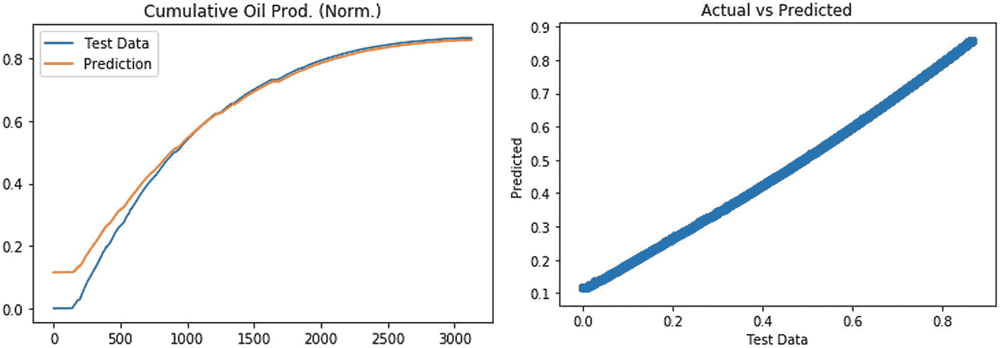

图 3-30

图表展示了测试数据及对应的 LSTM 模型对累计产油量的预测（左图），以及观测到的测试数据与 LSTM 预测的累计产油量的交叉图（右图）

## 超参数优化

我们之前提到，超参数优化有助于提高模型精度。在本节中，我们将演示一个优化过程的简单代码示例。但在深入实现细节之前，让我们先了解超参数的定义。


### 什么是超参数？

超参数是在机器学习算法训练过程中用于学习最佳模型参数的变量。换句话说，超参数是帮助学习最优模型参数的参数。以下是一些超参数的示例：

*   神经网络中的层数
*   神经网络层中的节点数
*   神经网络节点的激活函数类型
*   模型训练的迭代次数或轮数（epochs）
*   基于核的方法中“核”类型的选择
*   正则化参数
*   神经网络权重初始化的类型
*   提前停止的容差（`min_delta`）
*   提前停止前等待的轮数（`patience`）

尽管这种方法的名称暗示它仅适用于优化超参数，但在某些场景下，它也可以调整模型参数。我们通过一个代码示例来演示这一点。

#### 使用 Hyperopt 进行超参数优化

我们使用 Hyperopt（一个 Python 库）来演示超参数优化过程。我们使用支持向量分类器算法来演示该过程。我们使用了岩性分类数据，并构建了一个基础分类器。该基础分类器的准确率将作为基准，用于评估超参数优化过程带来的模型性能提升。以下代码片段展示了基础分类器的实现及其对应的分类准确率。

```
svc = SVC()
svc.fit(X_train, y_train)
# 对测试数据进行预测
y_pred = svc.predict(X_test)
# 准确率指标
clf_metrics(y_test, y_pred)
分类准确率得分：0.8621700879765396
```

Hyperopt 使用一个目标函数，通过最小化该函数来计算模型参数和超参数的最优值。在以下示例中，使用 k 折交叉验证的准确率得分乘以 -1 作为目标函数。通过 50 次迭代中反复调整超参数和模型参数来最小化目标函数。实现中的一些重要方面包括：

*   **K 折交叉验证：** 在此方法中，训练数据被分成 *k* 个子集或折。利用这些 k 折，训练 *k* 个独立的模型。每个模型在训练时，每次保留其中一折用于验证（验证折），并使用剩余的 k-1 折来训练模型。k 折交叉验证的准确率得分是通过计算各个模型在各自验证折数据上的准确率得分的平均值得到的。

*   **参数空间：** 定义了模型参数和与模型相关的超参数可以取值的范围。

*   **超参数：** 在此示例中，核的类型是一个超参数。常数 *C*、多项式次数和 gamma 是模型参数。这是一个同时优化超参数和模型参数的示例。

以下代码片段展示了为支持向量分类器模型寻找最优核及其对应参数的方法。

```
def objective(params):
svc = SVC(**params)
return -1\. * cross_val_score(svc, X_train, y_train).mean()
kernels = ['rbf','poly','rbf','sigmoid']
space = {'C':hp.lognormal('C', 0, 1),
'kernel':hp.choice('kernel', kernels),
'degree':hp.choice('degree', range(1, 15)),
'gamma':hp.uniform('gamma', 1e-2, 1e2)
}
trials = Trials()
best_svc = fmin(objective, space, algo=tpe.suggest, max_evals=50, trials=trials)
print(best_svc)
{'C': 1751.5444736790396, 'degree': 11, 'gamma': 5.899864955354083, 'kernel': 0}
```

在确定了最佳核类型和模型参数后，使用最佳模型对测试数据进行预测。

```
svc = SVC(C=best_svc['C'],
kernel=kernels[best_svc['kernel']],
degree=best_svc['degree'],
gamma=best_svc['gamma'])
svc.fit(X_train, y_train)
# 对测试数据进行预测
y_pred = svc.predict(X_test)
# 准确率指标
clf_metrics(y_test, y_pred)
分类准确率得分：0.9618768328445748
```

该示例表明，使用 Hyperopt 库进行超参数优化，将模型分类准确率从 0.86 提升到了 0.96。通过实现适当的目标函数，类似的过程可以应用于提高任何其他机器学习或深度学习算法的准确率。

## 总结

> *我来这里不是要告诉你结局如何，而是告诉你这一切将如何开始。*
> 
> ——尼奥，《黑客帝国》[12]

机器学习和深度学习是内容广泛的课题。在本章中，我们试图概述与机器学习和深度学习算法相关的几个概念。我们的重点是使用开源数据集为每种算法提供简单的代码实现。然而，我们承认，掌握这些概念需要进一步学习和持续练习。请参考“延伸阅读”部分推荐的后续步骤。在接下来的章节中，我们将通过应用本章讨论的概念，为石油和天然气行业相关问题构建一些有趣的机器学习应用。

