# 4. 地球物理学与地震数据处理

在前面的章节中，我们了解了 Python 编程，学习了机器学习和深度学习的概念，并使用 Python 实现了其中一些概念。本章的重点是概述机器学习在地球物理学领域的应用。勘探工作流程的主要目标是利用地震数据处理来构建地球模型，以估算储层属性。这是一个成熟且经过充分研究的问题，在地震成像和储层属性估算科学背后，有数十年的学术和工业研究积累。

机器学习在勘探地球物理学中的应用历史悠久，几乎与过去几十年机器学习的兴衰同步。其在勘探地球物理学工作流程中的应用非常广泛。详细解释每一个应用超出了本章的范围。本章的方法旨在概述地震成像过程，并详细讨论盐体解释这一具有挑战性的问题。本章将以简要总结其他几个问题以及勘探和解释工作流程的相关文献指引作为结尾。


## 地震反射实验

地震波在地球内部的反射和折射现象，最早是在记录地震产生的地震波的地震仪上观测到的。地震反射实验的基本原理是向地下发射波，并用数千个传感器进行记录。图 4-1 展示了一个用于在海洋环境中采集反射数据的实验示意图。使用爆炸性能源发射波，这些波会从地下的不同界面反射回来。来自关键地层的这些反射波被传感器记录下来。如图中所示，数千个传感器由拖缆拖曳。

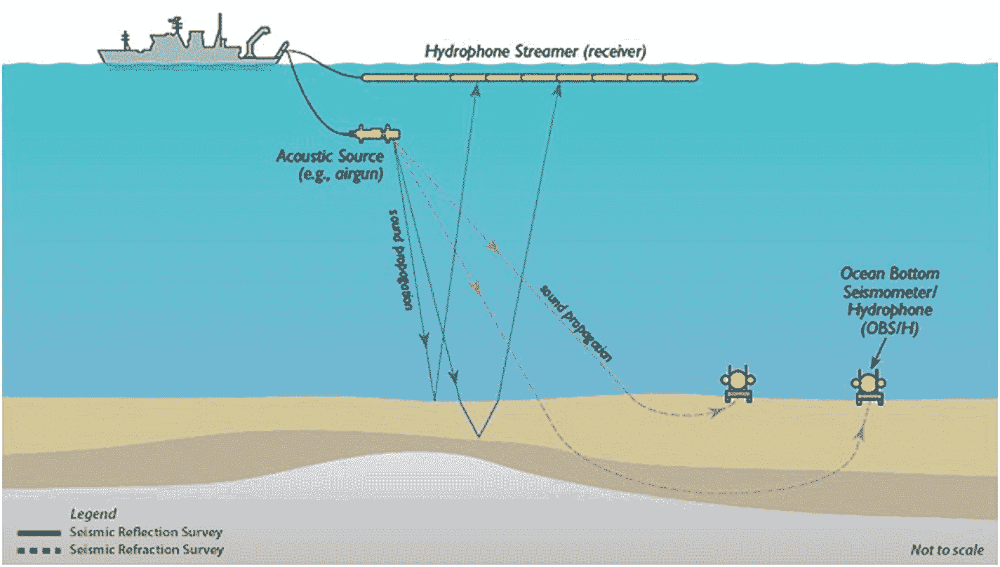

**图 4-1**

海洋地震反射实验示意图（来源：美国国家科学基金会）

图 4-2 展示了一个由地震实验记录的样本记录示例。这种类型的数据记录被称为“炮集记录”，因为它对应于一次爆炸，并记录了由此产生的反射波。对于一个典型的海洋实验，在一个区域内会采集数千个这样的炮集记录。

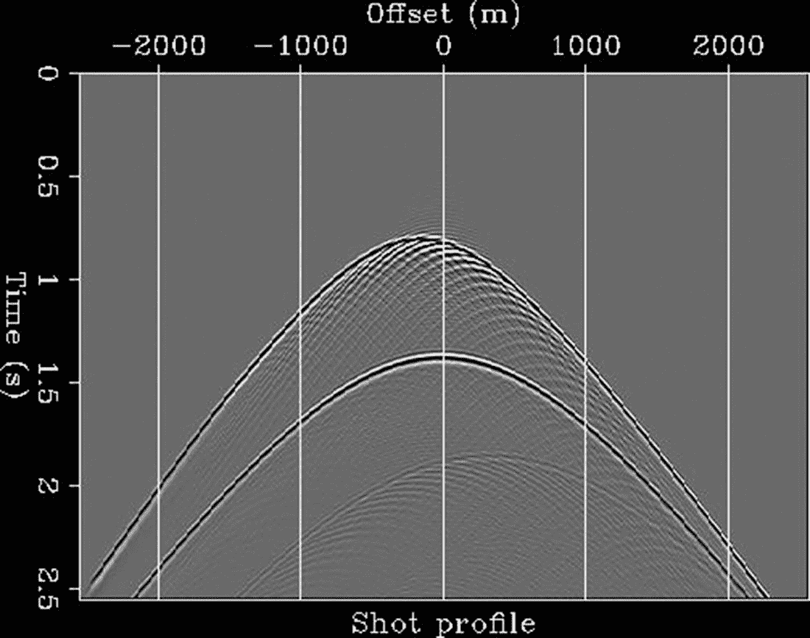

**图 4-2**

炮集：由单个地震实验捕获的数据（来源：地震成像导论）

地震处理的目标是利用如图 4-2 所示的传感器数据，生成地下的图像，并估算地球的物理属性。通常，目标是估算穿过地球的压缩波的速度，因为该速度是波长尺度上储层属性的一个替代指标。将这些炮集记录转换为地球图像的过程称为成像。在生成地下图像的过程中，通过一个称为地球模型构建的过程来估算地下属性也至关重要。关于地震采集问题及其各种挑战的概述，请参考文献 [1]。

## 反问题：成像与速度模型构建

记录 PB 级地震数据的目标是获取地球地下的图像，并估算地下的物理属性。用于模拟地下波传播的最小模型由声波方程给出。存在更复杂的模型用于精确模拟波传播，但这些模型超出了本入门章节的范围。关于基于波动方程的成像及其相关反问题的优秀数学概述，可参考文献 [2]。

声波方程的模型可以通过图 4-3 所示的偏微分方程组来定义。

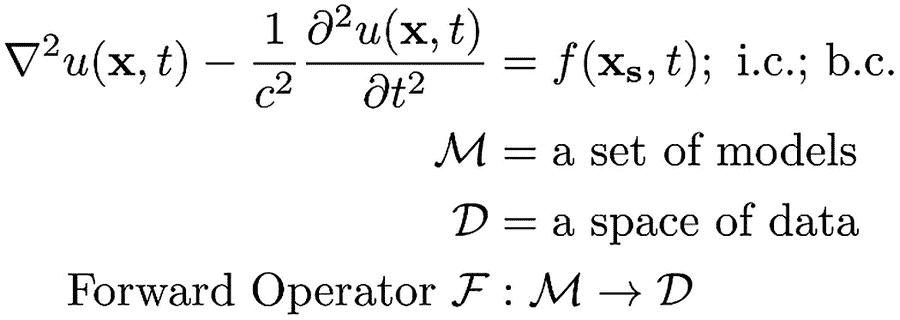

**图 4-3**

声波方程

在上述方程组中，*u*(x, *t*) 是水听器记录的压力场，*c*(x) 是地下声波（压缩波）的波速，*f*(x[s], *t*) 是上一节所述实验的震源子波。该方程组需结合适当的初始条件和边界条件来求解。

在数学和地球物理学文献中，这个线性系统被称为正问题，因为它给出了一个物理系统的定义，用于在给定地下波速定义的情况下模拟波场。这是一个经过充分研究且定义明确的问题，拥有数个世纪的学术历史。感兴趣的读者可查阅参考文献 [3] 及其中的参考文献。

然而，地震成像的目标是求解上述系统所定义问题的反问题。其目标是找到一个能够解释已记录数据的模型（图 4-4）。与线性问题的正问题不同，反问题是一个强非线性问题，求解起来颇具挑战性。此外，反问题的解是非唯一的。非唯一性意味着可能存在多个模型都能合理地解释已记录的数据。

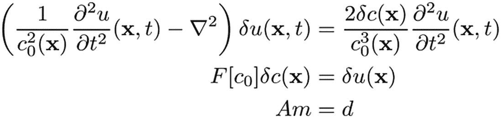

**图 4-4**

反问题

图 4-5 展示了构成地震成像学科的两大类问题的比较。成像问题是精确确定反射体的位置，而反演问题是估算一个能够解释地下已记录数据的地下模型（速度和各向异性属性）。

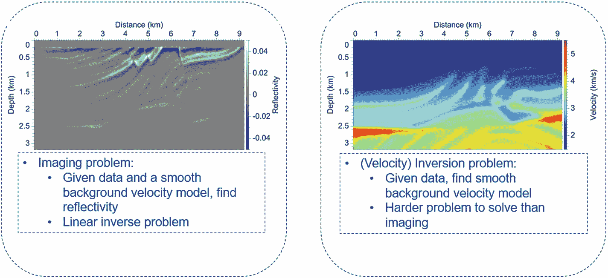

**图 4-5**

成像与反演

### 沉积岩的物理性质

在沉积岩中，压缩波速度变化显著，并且在所有尺度上都能观察到非均质性。图 4-6 显示了来自美国陆上某口井的速度剖面。可以在不同尺度上观察到速度的变化，其变化范围跨越多个数量级——从微米到毫米再到公里。

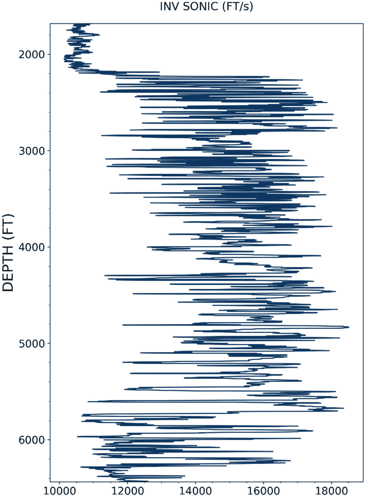

**图 4-6**

岩石属性的多尺度非均质性（数据来源：TGS）

为了研究图 4-4 所示方程组中定义的非线性反问题，采用微扰方法来研究地下引起的散射。Born 近似是一种最初用于量子力学中研究扩展体散射的技术。当散射体尺寸相对于波长较小时，该近似被证明是准确的。感兴趣的读者可参考文献 [2]。

速度模型可以根据尺度进行分离。一个平滑的宏观模型包含了速度的长尺度分量。通常，这表现为一个平滑的背景。散射体则以平滑背景之上的振荡微扰形式表示，代表了速度的高频分量。这种地下模型仅模拟单次散射。换句话说，这些模型模拟了主要的反射波。对 Born 近似的详细处理超出了本次地震成像入门讨论的范围。有关详细信息，感兴趣的读者可参考文献 [2]。


### 成像与反演

本节旨在深入探讨速度估算以及地下散射体成像的过程。基于地表记录的数据和平滑的背景速度模型，成像的目标是找到地下的反射率。这是一个线性反演问题，存在多种方法可以对地下的散射体进行成像。

为了准确识别地下的反射体，拥有精确的速度模型也至关重要。基于地表记录的数据，速度反演的目标是找到一个能够解释地表记录数据的平滑背景速度模型。这比成像问题困难得多，且具有强非线性。在实践中，估算反射体与更新速度模型的过程是在一个迭代循环中完成的，直到满足特定标准。

用于定位地下反射体的线性反演问题在实践中是近似处理的。其数学细节超出了本成像入门材料的范围。我们计算一个近似逆，这个过程被称为偏移。目前使用的偏移算法有多种，包括基尔霍夫偏移、逆时偏移、波动方程偏移等。其目标是将接收波场向后传播，并将震源波场向前传播，而成像结果就是不同时延值下波场的互相关。得到的零时延值即为图像（图 4-7）。

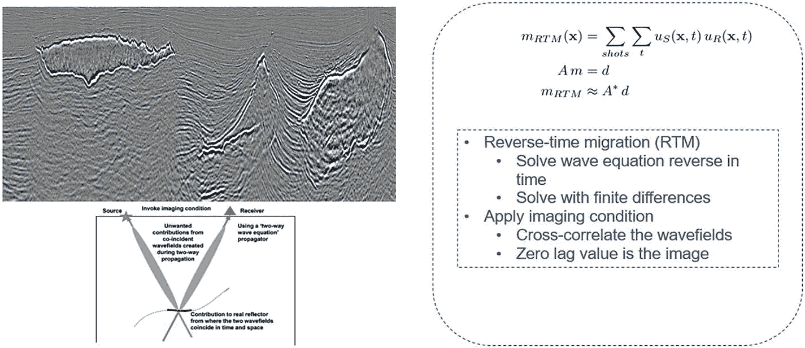

图 4-7
偏移概述

估算地下速度属性的一种常用技术是使用全波形反演方法。这是一种迭代方法，用于匹配在特定频率范围内地表记录的数据。该技术计算速度模型的平滑部分，并且与大多数强非线性优化问题一样，对初始模型的选择非常敏感。由于数据的带限特性，这种方法只能得到平滑解，无法解析所有尺度的结构。参考文献 [4] 描述了在墨西哥湾构建速度模型所面临的挑战。图 4-8 展示了来自参考文献 [4] 的、在墨西哥湾亚特兰蒂斯油田通过全波形反演获得的速度模型。

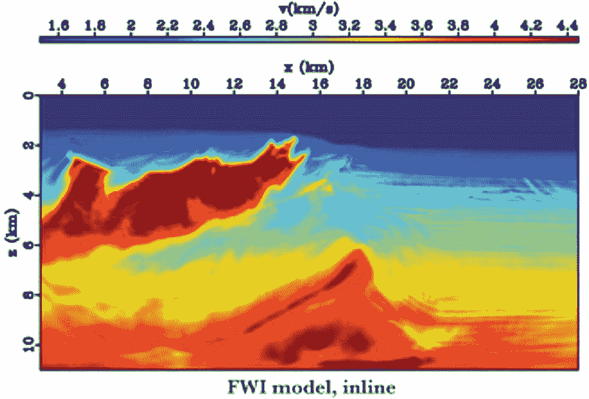

图 4-8
由全波形反演导出的速度模型 [4]

由于数据的带限特性，一个精确的初始模型对于解决这个优化问题至关重要，以避免陷入局部极小值。该优化问题的公式化假设是：观测到的波形与预测波形在最低频率处的差异小于半个波长。然而，地震数据中低频信息的缺失会导致周期跳跃，从而使问题陷入局部极小值而非达到全局极小值。这个问题在诸如墨西哥湾这样的盆地中更难解决，因为其中存在的盐体复杂结构导致了速度对比，使得优化问题极具挑战性（图 4-9）。

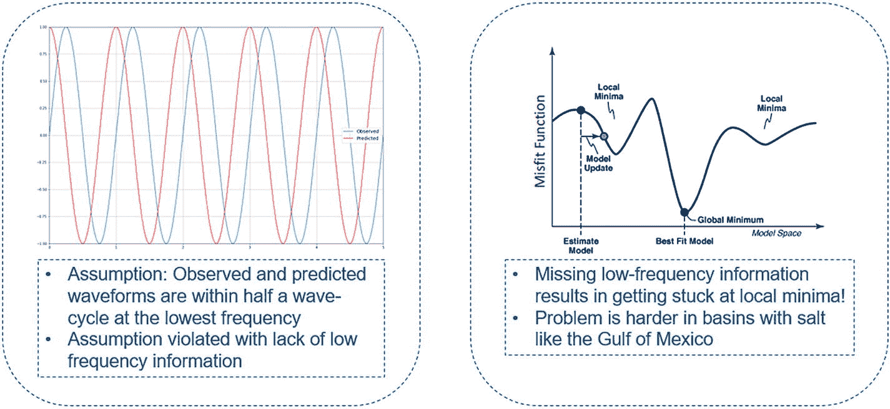

图 4-9
缺乏低频数据带来的挑战

### 克服低频挑战

在过去几年中，地震采集技术取得了快速的技术进步。在过去的二十年里，覆盖范围和方位角（角度）的范围有了显著改善——近方位角采集、宽方位角采集、全方位角采集是过去几十年中一些操作创新的例子。此外，在过去几年中，人们多次尝试拓宽采集的频率范围。低频数据至关重要，因为它有助于避免优化问题陷入局部极小值。因此，在过去几年中，人们进行了多次尝试来获取低频数据。但是，采集技术极其昂贵，并且在大规模实施上可能面临挑战。然而，在无法获得低频数据的情况下，从更好的初始速度开始，并拥有一个*先验*的速度模型结构，有助于加速收敛。

在构建用于建立结构的速度模型时，盐体解释是一项具有挑战性的任务。盐体解释的最先进方法涉及由训练有素的地质学家和领域专家团队进行人工解释，他们将其地质先验知识施加于反演问题中。然而，鉴于反演问题的迭代性质，解释人员需要在每次成像应用之后挑选盐体的结构。挑选盐体结构的过程是一个耗时的问题，对于构建精确的地震速度模型至关重要。


## 基于机器学习的盐体解释

本节将重点概述地震成像中的监督学习问题。作为示例，我们将详细聚焦于前文所述速度模型构建中的二值分割问题。

语义分割问题在计算机视觉领域已得到充分研究。其目标是为图像中的每个像素分配一个对象类别。图 4-10 展示了计算机视觉数据集中的示例以及地震图像-掩膜对，以说明问题之间的相似性。左侧面板展示了语义分割数据集中的两个样本。右侧面板则显示了地震图像以及通过对给定输入图像进行语义分割过程获得的掩膜。除了识别图像中的各种对象外，任务还包括描绘对象的边界。

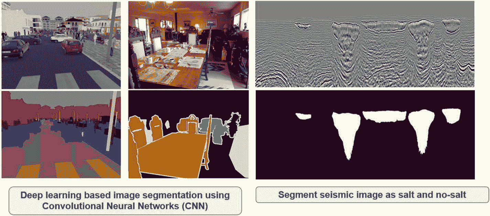

**图 4-10**

语义分割：计算机视觉 vs 地震成像

从概念上讲，这与速度模型构建工作流程中使用的解释过程相似。给定一幅地震图像，目标是将其中的每个像素分类为盐体或沉积物。这可以构建为一个监督学习问题，类似于计算机视觉中的语义分割问题，其中图像是偏移算法的输出，而标签是一个二值掩膜。

图 4-10 展示了一个示例，说明了地震成像中语义分割问题的相似性。这是一个更大的三维数据体中的一个切片，代表了偏移后的振幅。标签是从同一区域的 velocity 模型中提取的。需要注意的重要一点是，这些是连续的振幅，不同于计算机视觉数据集中已量化的图像。此外，从不同偏移体采样的图像具有不同的振幅分布。因此，在将这些图像应用于深度学习算法之前，通常需要进行某种形式的归一化。

将深度学习算法应用于地震图像有一些重要方面。请注意，这些方面特定于从地震图像中解释盐体的问题。

1.  **图像尺寸的选择：** 可以使用合适的窗口提取算法来获取图像块用于训练或推理。

2.  **图像的预处理：** 为了将连续振幅转换为量化级别，我们应用归一化。大多数归一化方法原则上都有效。然而，基于均值和标准差的缩放已被证明是有效的。

### 数据集描述

我们使用由 TGS 和 Kaggle 主办的 TGS Kaggle 盐体解释挑战赛 [5] 的数据集。该数据集是一组在地下随机位置选取的图像。图像尺寸为 101 × 101 像素，每个像素被分类为盐体或沉积物。图 4-11 展示了所选数据集中的几个图像样本。

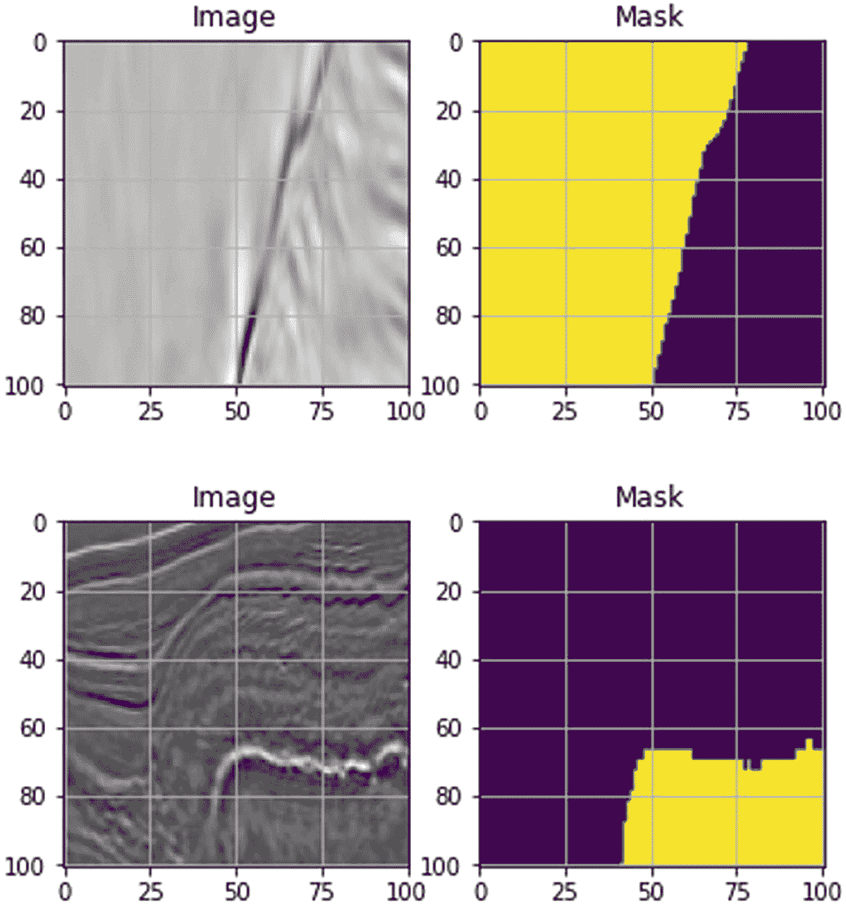

**图 4-11**

来自 Kaggle 数据集的几个样本图像（左）及对应的标签（右）

### 用于语义分割的 U-Net

为了训练一个深度学习模型来执行语义分割，过去几年中已经发表了几种架构。其中一些语义分割架构已经建立了分割领域的最先进记录 [6]。尽管我们将列出详细解释这些模型的出版物，但在本章中，我们将重点介绍 U-Net 作为一个典型示例 [7]。

如图 4-12 所示，U-Net 由一个收缩路径（如图左侧所示）和一个扩展路径（如图右侧所示）组成。收缩路径遵循卷积神经网络的架构。重复应用两个 3 × 3 卷积，每个卷积后接一个线性整流单元（ReLU），以及一个步长为 2 的最大池化操作进行下采样。在每个下采样步骤中，特征通道数加倍。扩展路径中的每一步都包含特征图的上采样，随后是一个 2 × 2 卷积（“上卷积”）。此上采样步骤将特征通道数减半，并将其与来自收缩路径的相应裁剪特征图进行拼接，然后是两个 3 × 3 卷积，每个卷积后接一个 ReLU。由于每次卷积都会丢失边界像素，因此裁剪是必要的。在最后一层，使用一个 1 × 1 卷积将每个 64 分量的特征向量映射到所需的类别数。该网络总共有 14 个卷积层。

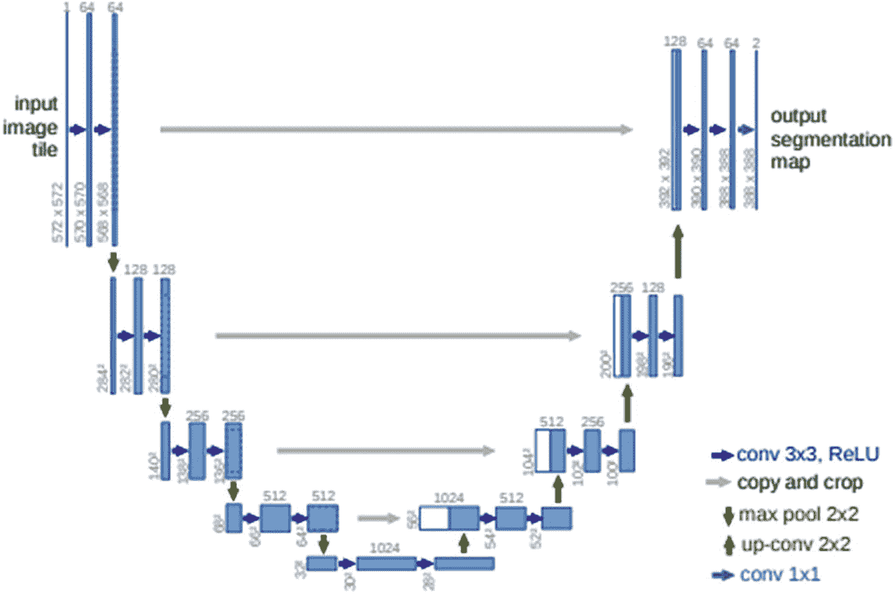

**图 4-12**

U-Net 架构（参考文献 [7]）

### U-Net 的损失函数

交并比（IOU）目标函数通常用于评估语义分割问题的准确性（图 4-13）。计算机视觉领域还提出了其他几种目标函数。我们想指出，尽管 IOU 是评估分割网络常用的指标，但 Jupyter notebook 中分享的示例使用二元交叉熵作为损失函数，原因很简单：它更容易理解，并且在大多数深度学习库中普遍可用。

为了应用该指标，计算预测对象与期望对象的交集作为分子，计算预测对象与期望对象的并集作为分母。该商即为衡量准确性的指标。可以看出，如果模型准确地预测了对象的形状，那么交并比将为 1。

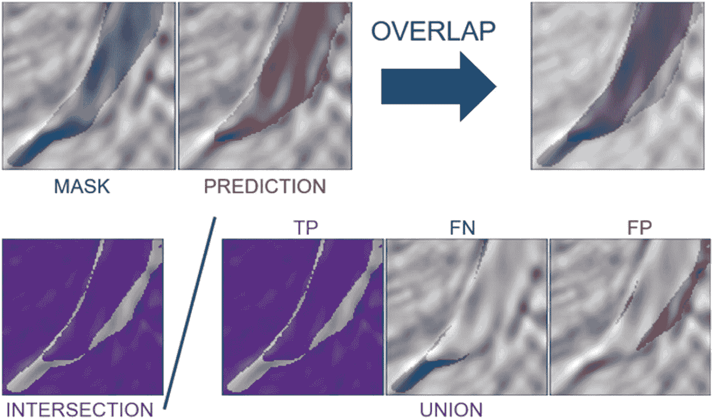

**图 4-13**

交并比目标函数


### U-Net 实现

此处展示了一段代表 U-Net 模型的代码片段。它由一个收缩路径和一个扩展路径组成，与图 4-12 所示的架构类似。U-Net 背后的主要思想是补充收缩层，其中通过池化发生的收缩被上采样或转置卷积层所替代。这在以下代码列出的模型架构中进行了定义：

```
def UNet(input_image, n_filters=16, dropout=0.5, batchnorm=True):
# Encoder
c1 = conv2d_block(input_image, n_filters=n_filters*1, kernel_size=3, batchnorm=batchnorm)
p1 = MaxPooling2D((2, 2)) (c1)
p1 = Dropout(dropout*0.5)(p1)
c2 = conv2d_block(p1, n_filters=n_filters*2, kernel_size=3, batchnorm=batchnorm)
p2 = MaxPooling2D((2, 2)) (c2)
p2 = Dropout(dropout)(p2)
c3 = conv2d_block(p2, n_filters=n_filters*4, kernel_size=3, batchnorm=batchnorm)
p3 = MaxPooling2D((2, 2)) (c3)
p3 = Dropout(dropout)(p3)
c4 = conv2d_block(p3, n_filters=n_filters*8, kernel_size=3, batchnorm=batchnorm)
p4 = MaxPooling2D(pool_size=(2, 2)) (c4)
p4 = Dropout(dropout)(p4)
c5 = conv2d_block(p4, n_filters=n_filters*16, kernel_size=3, batchnorm=batchnorm)
# Decoder
u6 = Conv2DTranspose(n_filters*8, (3, 3), strides=(2, 2), padding="same") (c5)
u6 = concatenate([u6, c4])
u6 = Dropout(dropout)(u6)
c6 = conv2d_block(u6, n_filters=n_filters*8, kernel_size=3, batchnorm=batchnorm)
u7 = Conv2DTranspose(n_filters*4, (3, 3), strides=(2, 2), padding="same") (c6)
u7 = concatenate([u7, c3])
u7 = Dropout(dropout)(u7)
c7 = conv2d_block(u7, n_filters=n_filters*4, kernel_size=3, batchnorm=batchnorm)
u8 = Conv2DTranspose(n_filters*2, (3, 3), strides=(2, 2), padding="same") (c7)
u8 = concatenate([u8, c2])
u8 = Dropout(dropout)(u8)
c8 = conv2d_block(u8, n_filters=n_filters*2, kernel_size=3, batchnorm=batchnorm)
u9 = Conv2DTranspose(n_filters*1, (3, 3), strides=(2, 2), padding="same") (c8)
u9 = concatenate([u9, c1], axis=3)
u9 = Dropout(dropout)(u9)
c9 = conv2d_block(u9, n_filters=n_filters*1, kernel_size=3, batchnorm=batchnorm)
outputs = Conv2D(1, (1, 1), activation="sigmoid") (c9)
model = Model(inputs=[input_img], outputs=[outputs])
return model
model.compile(optimizer=Adam(), loss="binary_crossentropy", metrics=["accuracy"])
callbacks = [
EarlyStopping(patience=10, verbose=1),
ModelCheckpoint('./model/model-tgs-salt.h5', verbose=1, save_best_only=True, save_weights_only=True)
]
results = model.fit(X_train, y_train, batch_size=16, epochs=25, callbacks=callbacks, validation_data=(X_valid, y_valid))
```

本章附带的 Jupyter notebook 提供了使用 Kaggle 数据集训练一个简单 U-Net 模型的分步代码。

### 解释结果

我们通过对结果进行简要讨论来结束这个实践示例。该网络使用 Adam 优化器在一个包含 4,000 个图像块的训练集上进行了训练，其中 10% 被保留作为验证集。模型训练了 25 个 epoch 并使用了早停法，保存了最佳模型用于对验证集生成预测。图 4-14 展示了从验证集样本生成的预测结果中的一些可视化图像。从两个示例样本的概率可以看出，模型已经学会了预测盐体与沉积物之间的边界。这些概率可以通过设定阈值来获得给定图像块的预测结果。

需要注意的一点是，神经网络模型是在图像块上训练的。然而，这个训练好的模型通常应用于偏移后的图像。如前所述，偏移后的图像是三维体数据。为了获得盐体掩膜，需要逐块进行推理，并通过确保权重以适当方式分配来累加概率。这可以通过一个简单的滑动窗口算法来实现，该算法逐行独立地推断每个图像块。应用此类工作流程得到的盐体掩膜如图 4-15 所示。

将深度神经网络泛化应用于地震解释是一项挑战。对这些挑战的讨论超出了本入门章节的范围。

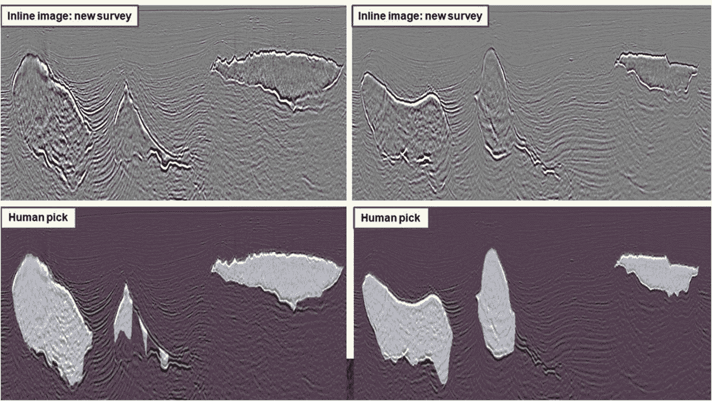

图 4-15

U-Net 解释结果与解释员标注的真实情况对比

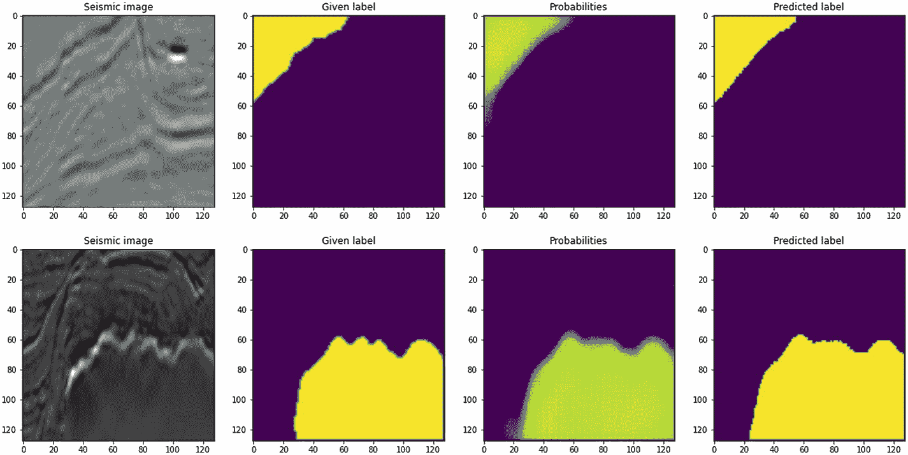

图 4-14

U-Net 在图像块上的预测结果。（从左到右）地震图像、记录标签、预测概率和预测标签。概率通过应用 sigmoid 层获得，标签通过对概率设定阈值获得。

## 问题选例

本章我们重点关注从地震图像中解释盐体的问题。然而，地球物理学界还发表了机器学习的其他几种应用。我们在此列举一些地球物理和地震数据处理中的问题，并附上部分参考文献。

相分类是储层属性估计核心中的一个重要课题。对岩性和相进行分类，以建立对井筒中遇到的沉积环境的详细理解至关重要。这是勘探中一个极其重要的问题。多位作者对此问题进行了详细探讨。关于机器学习在相分类中应用的良好介绍，可参见参考文献 [8] 和 [9]。

储层属性反演是另一个重要的应用领域。参考文献 [10] 提供了一个使用物理引导的卷积神经网络来估计储层属性的示例。另一个常见的研究问题是从地震图像中解释断层的过程。参考文献 [11] 给出了一个使用 3D 卷积神经网络执行分割来在三维空间中解释断层的示例。

## 总结

在本章中，我们概述了地球物理学和地震数据处理。我们重点讨论了盐体解释问题，并概述了地球物理学中的其他重要问题。鉴于地震成像领域可用的图像数据的性质，这些问题适合应用计算机视觉领域的思想。该领域的许多问题都是跨学科的，本章对其中多种问题进行了概述。


