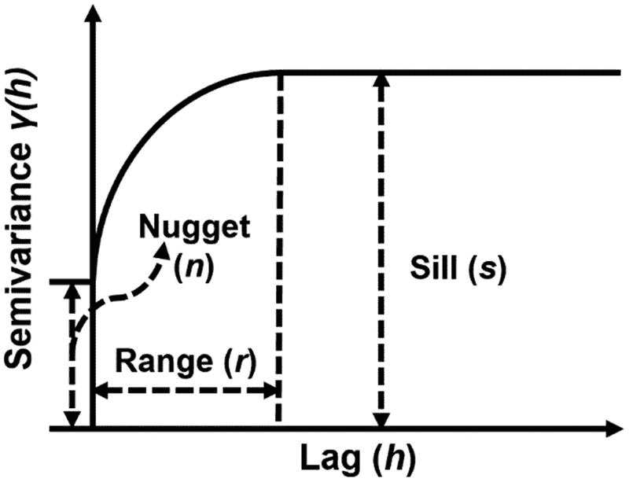
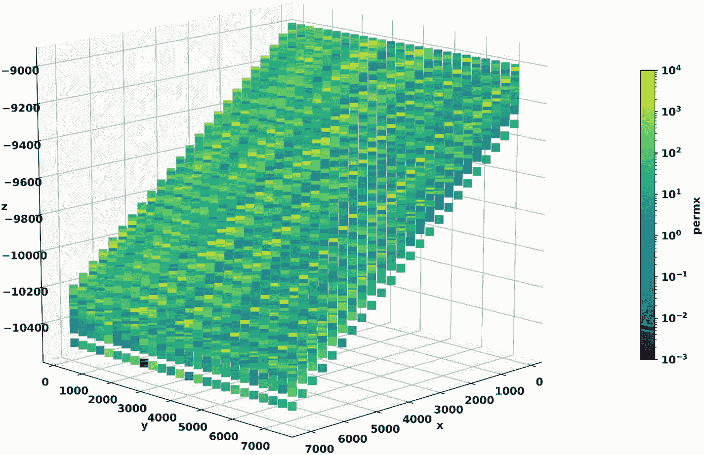
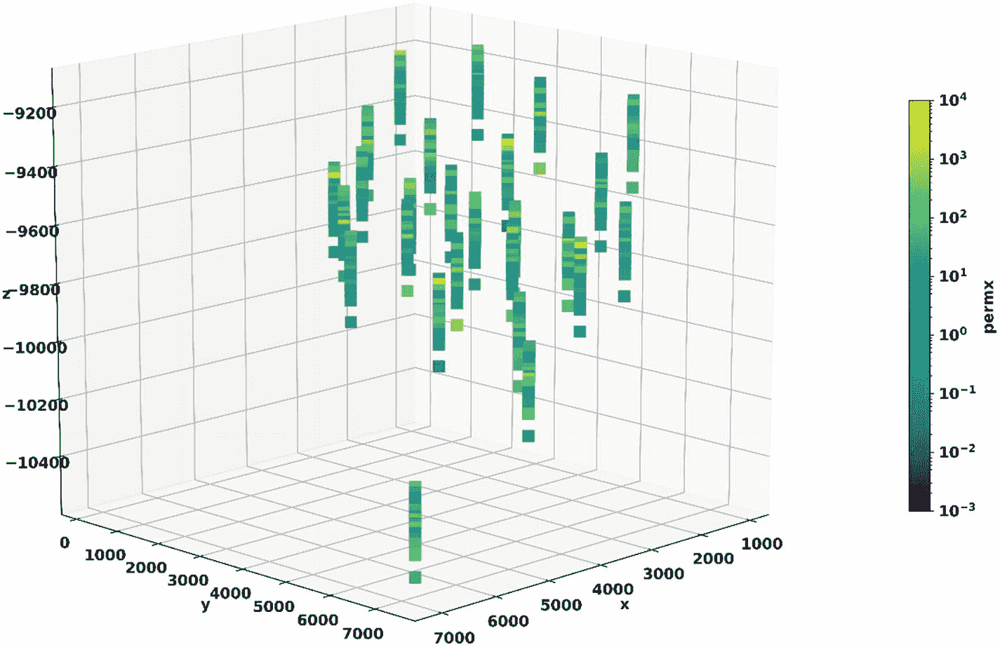
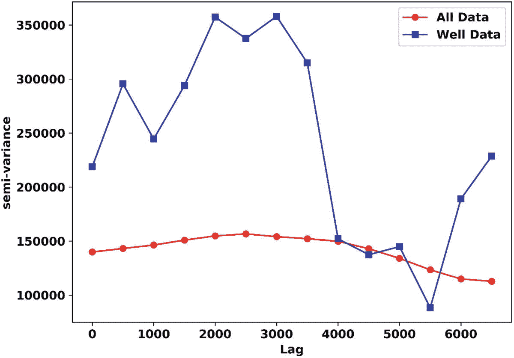
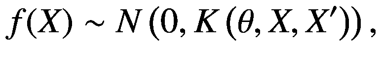
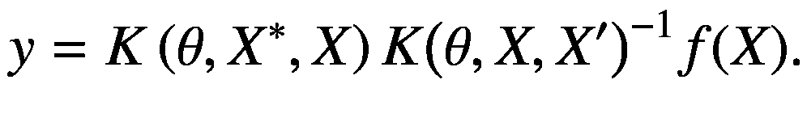
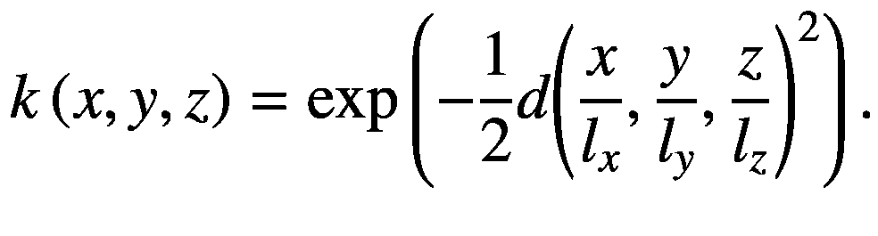
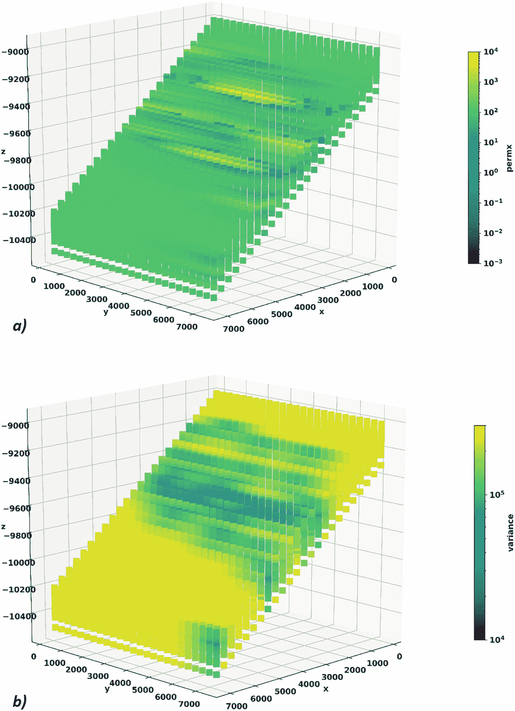
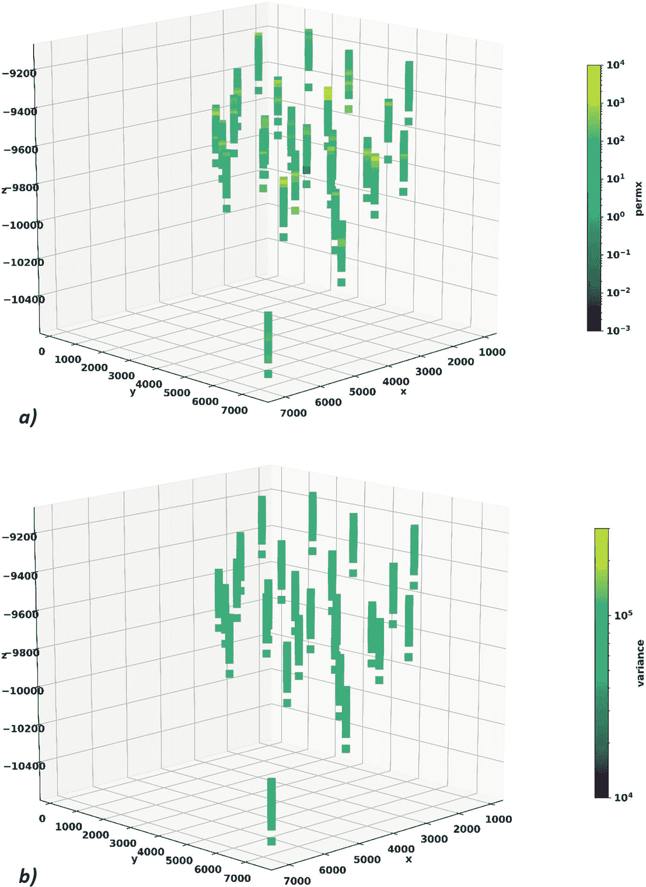

# 5. 地质建模

地质建模是勘探与开发规划过程中的重要步骤。地质建模是在利用地震解释过程中提取的信息，对油藏构造框架形成认识之后进行的。通过构造框架定义的层位和断层，创建一个三维（3D）网格。该三维网格与测井数据一起使用，以生成油藏属性（如孔隙度、渗透率等）的详细三维模型。此步骤是油藏模拟的前置环节。基于三维油藏模型的计算也有助于估算重要参数，包括原始石油地质储量（`OOIP`）。

一旦利用构造框架创建了三维网格，在执行任何进一步的工作流程步骤之前，需要估算离散的岩石物理属性（如相）和连续属性（如孔隙度和渗透率）。测井数据构成了属性估算的基础。应用多种建模技术来为三维网格的每个单元生成这些属性。一些最常用的技术涉及以下算法 [1] [2]。

*   简单克里金法
*   普通克里金法
*   泛克里金法
*   序贯高斯模拟
*   多元高斯模拟

在本章中，我们将讨论机器学习如何帮助我们估算三维网格上的岩石物理属性值。首先，我们讨论所有技术共有的基本基础，以及本章中使用的机器学习技术。接着，我们描述本章使用的数据集，展示机器学习算法在该数据集上的应用，并概述一些算法局限性。

## 变差函数

变差函数是几乎所有具有工业相关性的三维空间建模技术的基础。变差函数提供了属性 *Z* 在距关注点不同距离处的半方差（通常简称为*方差*）。在经典的地统计学方法 [1] 中，属性 *Z* 的半变差函数 `γ (h)`（通常称为*变差函数*）定义为

![$$ \gamma (h)=\frac{1}{2n(h)}\sum \limits_{n(h)}E\left[{\left(Z\left(u+h\right)-Z(u)\right)}²\right], $$](images/480430_1_En_5_Chapter/480430_1_En_5_Chapter_TeX_Equ1.png)

(5.1)

其中 `n(h)` 是相距距离 `h`（也称为*滞后距*）的点对数量。需要注意的是，使用此公式计算得到的实验变差函数需使用解析表达式（如球状变差函数模型）进行拟合。

图 5-1 展示了变差函数 `γ (h)` 的球状变差函数模型拟合示意图。在图 5-1 中，*r* 代表变差函数的变程。该值表示从给定点开始，属性值之间的相关性消失（即属性值去相关）的距离。基台值用 *s* 表示，是变差函数渐近达到的半方差值。基台值可以理解为位于距离大于变差函数变程 (*r*) 的两点处属性值的方差。块金方差 *n* 是对实验或测量数据不确定性的估计。



图 5-1 球状变差函数模型示意图

变差函数可以是全方向的或各向同性的，即假设在任何方向上对于相同的滞后距值都能观测到相同的半方差。也可能存在各向异性的变差函数，其中半方差取决于滞后距值和方向。各向异性变差函数的一个例子是沿侧向（例如 *x* 和 *y* 方向）使用相同的变差函数模型，而沿深度方向使用另一个不同的变差函数模型。克里金法在估算远离井点处的岩石物理属性值时依赖于变差函数。克里金法是一种广义线性回归形式，它提供了一个最优估计量，以最小化估计属性值的均方误差。在本章中，我们不打算讨论克里金技术的细节。相反，我们专注于一种机器学习算法，该算法大致相当于简单克里金算法。

能够获取用于进行三维地质建模练习的开源数据集是最大的挑战。在本章中，我们的目标是为你提供一个在三维地质模型上进行岩石物理属性插值的工作示例。考虑到这一点，我们选择了由石油工程师协会比较解决方案项目 SPE 9 [3] 提供的一个简单地质模型，该模型可在 `https://github.com/OPM/opm-data` 获取。SPE 9 模型如图 5-2 所示，叠加显示了 *permx*（*x* 方向渗透率）。

## 数据描述

该网格在 x、y、z 方向上分别有 24、25 和 15 个单元。通过目视观察该模型中的数据，我们可以快速注意到该模型的两个明显特征。首先，该模型具有显著的异质性；其次，相邻单元之间的值相关性较低。基于目视观察形成的假设将在本章后面的部分通过数据的定量分析进行检验。



图 5-2 SPE 9 模型渲染图，叠加了 `permx` 属性

我们根据 SPE 9 模型中提供的井位，提取了属性 `permx` 的测井曲线，如表 5-1 所列。图 5-3 显示了提取的属性 `permx` 的测井曲线。



图 5-3 基于 SPE 9 模型井位的 `permx` 属性测井曲线

在图 5-3 中，可以在油藏模型的东北角看到一个孤立的注入井。相比之下，生产井则以聚集的方式集中在远离注入井的地方。

接下来，我们对网格数据和提取的测井曲线进行一些基本分析。

表 5-1 SPE 9 模型网格中的井位索引

| 井名 | 井 I | 井 J | 井名 | 井 I | 井 J |
| :--- | :--- | :--- | :--- | :--- | :--- |
| INJE1 | 23 | 24 | PRODU14 | 7 | 12 |
| PRODU2 | 4 | 0 | PRODU15 | 10 | 13 |
| PRODU3 | 7 | 1 | PRODU16 | 12 | 14 |
| PRODU4 | 10 | 2 | PRODU17 | 14 | 15 |
| PRODU5 | 9 | 3 | PRODU18 | 10 | 16 |
| PRODU6 | 11 | 4 | PRODU19 | 11 | 17 |
| PRODU7 | 3 | 5 | PRODU20 | 4 | 18 |
| PRODU8 | 7 | 6 | PRODU21 | 7 | 19 |
| PRODU9 | 13 | 7 | PRODU22 | 10 | 20 |
| PRODU10 | 10 | 8 | PRODU23 | 14 | 21 |
| PRODU11 | 11 | 9 | PRODU24 | 11 | 22 |
| PRODU12 | 9 | 10 | PRODU25 | 9 | 23 |
| PRODU13 | 4 | 11 | PRODU26 | 16 | 24 |

### 测井数据的基本统计分析

我们想要探究，SPE 9 三维模型中填充的 `permx` 数据，以及从该模型中提取的测井数据，是否遵循相同的统计规律。采用实用主义方法，我们首先利用提取的测井数据中的 `permx` 值，以及 SPE 9 模型的所有网格单元，计算了样本均值、标准差和方差。这些数值汇总于表 5-2。

表 5-2 从 SPE 9 模型提取的测井数据与所有网格单元的 `permx` 属性均值与标准差

| 提取的测井数据 | 所有 SPE 9 网格单元 |
| :--- | :--- |
| 均值 | 标准差 | 方差 | 均值 | 标准差 | 方差 |
| 116.47 | 507.24 | 257287.53 | 108.08 | 375.31 | 140856.44 |

从提取的测井数据和 SPE 9 模型所有网格单元中得到的 `permx` 属性均值相对接近。然而，标准差和方差的值表明，提取的测井数据中，数值围绕均值的分布范围明显更广。一个可能的结论是，SPE 9 模型上的 `permx` 属性值可能并非基于模型提供的井位处的属性分布生成的。我们还利用代码清单 5-1 中的代码，从提取的测井数据和所有网格单元计算了实验变差函数模型，该代码用 Python 实现了公式 5.1。

```
from scipy.spatial.distance import pdist, squareform
import numpy as np
def variogram_one_lag(X, perm, lag, bin_width):
    """单个滞后距的实验半变差函数"""
    dist_mat = squareform(pdist(X))
    n_points = dist_mat.shape[0]
    list_var = []
    for i in range(n_points):
        for j in range(i + 1, n_points):
            if (dist_mat[i, j] >= (lag - bin_width)) and \
               (dist_mat[i, j] <= (lag + bin_width)):
                list_var.append((perm[i] - perm[j])**2.0)
    return np.sum(list_var) / (2.0 * len(list_var))
def variogram(X, perm, lags, bin_width):
    """实验变差函数计算"""
    variogram = []
    for lag in lags:
        variogram.append(variogram_one_lag(X, perm, lag, bin_width))
    return variogram
```

代码清单 5-1
实验变差函数计算的代码片段

图 5-4 展示了针对提取的测井数据和整个网格计算得到的实验变差函数。首先值得注意的是，这两个变差函数模型都存在显著较大的块金方差。较大的块金值表明数据噪声很大，且空间相关性不足。

这是我们通过目视观察得出的一个假设，现在我们可以通过变差函数计算来定量地证实这一点。至此，很明显，基于井位处属性分布的三维插值将无法重现 SPE 9 模型中所示的 `permx` 属性模型（图 5-2）。有人可能会倾向于认为我们可以使用块金值为零的解析变差函数，但这并不现实，因为它无法捕捉到用于插值的输入数据中固有的不确定性。

在下一节中，我们将开始讨论高斯过程回归，这是一种与克里金概念相似的机器学习算法，并演示如何将其用于在 SPE 9 网格单元上对提取的测井数据进行三维插值。



图 5-4
基于所有网格单元数据（红色圆圈）和基于井位提取的测井数据（蓝色方块），从 SPE 9 模型计算得到的实验变差函数

## 高斯过程回归

高斯过程回归是一种监督学习方法，它利用高斯过程来解决回归问题。高斯过程回归具有某些优势，使其对三维空间插值问题颇具吸引力。

*   该算法具有出色的观测数据插值能力。因此，在已钻井之间的区域估算的属性值非常可靠。

*   使用高斯过程回归生成的预测是概率性的。因此，可以计算置信区间，并对估算值提供不确定性估计。此功能已在 `scikit-learn` 库中实现。这对于地质建模非常重要，因为不确定性量化是三维属性建模中一个非常重要的方面。

*   高斯过程回归使用了核技巧。核函数将问题输入投影到高维空间，使得高度非线性的回归问题变为线性或近似线性。这使得解决具有挑战性的非线性回归问题更加高效。

然而，与其他任何算法一样，高斯过程回归也存在一些缺点。其中一些缺点包括：

*   模型训练需要全部的样本信息。这使得它不适合在非常大的数据集上进行训练。然而，地质建模是一个地球科学家必须处理数据匮乏问题的领域。因此，在大多数情况下，这并不会构成严峻的挑战。

*   如果输入特征中的变量数量有限（大约几十个），高斯过程回归效果良好。当我们转向更高维的输入特征时，该方法会失去效率。这也不是一个重大问题，因为对于空间三维插值，输入特征主要由 `x`、`y` 和 `z`（或变换后的 `u`、`v` 和 `w`）坐标组成。

*   该方法不适用于外推。当我们远离样本数据时，估算值趋向于样本数据的均值，而估算方差则趋向于样本数据的方差。

### 公式表述

高斯过程（GP）是一个随机变量的集合，其中这些变量的任意有限子集都服从多元正态分布。如果我们有一个服从高斯（即正态）分布的单一随机变量，并将其绘制出来，会得到一条钟形曲线。如果我们有两个具有类似分布的随机变量，将它们分别绘制在 `x` 轴和 `y` 轴上，就会得到一个钟形曲面。这就是包含两个随机变量的多元正态分布。我们可以想象三个满足条件的随机变量，以此类推。

现在，假设存在一些点 `X`，其观测到的属性值由 `f(X)` 或简写为 `f` 给出。此外，基于这些信息，对于一组点 `X^∗`，我们试图估计 `f(X^∗)` 或 `f^∗`。这意味着我们试图计算概率分布 `p(f^∗| f)`。在零均值的假设下，我们可以将 `f(X)` 近似为如下形式 [4]。



(5.2)

其中 `N` 表示均值为零的正态分布，`K(θ, X, X^′)` 表示所有观测数据点对 `(X, X^′)` 之间的协方差矩阵。该协方差矩阵确保在输入空间中距离相近的点，其输出值也彼此接近。在点 `X^∗` 处的估计均值由下式给出：



(5.3)

在公式 5.3 中，出现了一个新项 `K(θ, X^∗, X)`。该项衡量了观测数据点（本例中为导出的测井曲线）与我们试图估计属性值的点之间的协方差。如果我们将克里金法与高斯过程回归进行类比，那么协方差矩阵类似于图 5-1 中所示的解析变差函数。在高斯过程回归中，协方差函数是通过前面讨论的*核技巧*来实现的。最常用的核是径向基函数（RBF）核。

### 径向基函数（RBF）核

RBF 核也被称为*平方指数*核。该核由长度尺度参数进行参数化，这些参数类似于图 5-1 中所示的变差函数变程。RBF 核可以具有单一长度尺度，从而等效于全方向（各向同性）变差函数；或者，它可以具有与输入维度相同的数量，从而等效于各向异性变差函数。RBF 核的函数形式如下：



(5.4)

在公式 5.4 中，`l_x`、`l_y` 和 `l_z` 分别表示 `x`、`y` 和 `z` 方向上的长度尺度或变差函数变程。此外，`GaussianProcessRegressor` 的 `scikit-learn` 实现提供了一个超参数 `alpha`，它代表图 5-1 中变差函数模型的块金方差（`n`）。需要注意的是，这里讨论的方法假设样本均值为零。这可以通过在 `scikit-learn` 中使用 `StandardScaler` 来实现。清单 5-2 展示了使用 `GaussianProcessRegressor` 对 `permx` 进行插值的实现。

# 代码示例

```python
from sklearn.preprocessing import StandardScaler
from sklearn.gaussian_process import GaussianProcessRegressor
from sklearn.gaussian_process.kernels import RBF
x_scaler = StandardScaler()
X_scaled = x_scaler.fit_transform(X)
y_scaler = StandardScaler()
y_scaled = y_scaler.fit_transform(np.array(y).reshape(-1, 1))
kernel = RBF([5.e-1, 5.e-3, 5.e-3], (1.e-3, 1.e0))
gpr = GaussianProcessRegressor(kernel=kernel,
alpha=0.75,
n_restarts_optimizer=10,
normalize_y=False,
random_state=12345)
y_scaled = y_scaled.flatten()
gpr.fit(X_scaled, y_scaled)
pred, sigma = gpr.predict(X_scaled, return_std=True)
pred = y_scaler.inverse_transform(pred.reshape(1, -1))
print('GPR Fit Score: %f' % gpr.score(X_scaled, y_scaled))
GPR Fit Score: 0.708586653049732
```

清单 5-2 用于远离井点属性值估计的高斯过程回归代码片段

在代码示例中，我们将数据转换为具有零均值和单位方差。具有单位方差也有助于我们选择 `alpha` 参数作为样本方差的一个分数。较小的 `alpha` 值会使数据在井点位置拟合得非常好，从而获得更高的拟合分数。您可以尝试使用不同的 `alpha` 值，观察拟合分数和整体预测结果如何变化。

代码中的 RBF 核具有三个长度尺度，这表明正在使用各向异性核（变差函数）。在长度尺度列表之后，RBF 核中的参数是一个元组，定义了长度尺度的上限和下限。在训练过程中，优化算法会在定义的上限和下限范围内选择最佳拟合的长度尺度。使用清单 5-2 中生成的模型，可以预测井点位置的 `permx` 值。如图 5-5 所示，这些估计值的方差较低。

此外，还使用训练好的模型预测了 SPE 5 模型所有网格单元中的 `permx` 值。图 5-6 显示了估计的均值预测及其对应的方差。可以观察到，井点附近的估计值方差较低。随着我们远离井点，得到的预测值和方差等于根据导出的测井曲线数据计算出的均值和方差值，如表 5-2 所示。根据图 5-4 中观察到的变差函数模型，我们预期会出现这种情况，其中块金方差与基台值相比显著，表明导出的测井曲线数据相关性较低。



图 5-6 使用训练好的高斯过程回归模型 (a) 预测所有 SPE 9 网格单元的 permx 值及 (b) 对应的估计方差



图 5-5 使用高斯过程回归 (a) 预测 SPE 9 井点位置的 permx 值及 (b) 对应的估计方差

## 总结

在本章中，我们使用了一种机器学习方法，该方法提供了与克里金技术等效的工具。我们利用一个开源数据集来训练高斯过程回归模型。近年来，空间插值领域出现了一些新的发展。最值得注意的是`生成对抗网络`（GAN）。在石油和天然气行业，GAN 已被用于地震图像的插值[5]。然而，退一步评估这些方法在地质建模视角下的适用性或许是值得的。

通常，地球科学家面临的最大挑战是能否从测井数据中获得优质数据。在油田开发的初始阶段，测井数据非常稀缺。在这种情况下，像 GAN 这类算法的适用性令人质疑，因为训练它们需要大量数据。然而，在拥有数百口井的测井数据时，评估基于深度学习的技术[6]的适用性或许是值得的。但在一般情况下，高斯过程回归是岩石物理属性插值的一个不错算法选择。

## 参数 Alpha 的影响

本章展示的结果是在训练 `GaussianProcessRegressor` 模型时，使用了值为 0.75 的 `alpha` 参数生成的。

*   尝试使用不同的 `alpha` 参数值，观察输出结果如何变化。你会看到，随着 `alpha` 值的降低，`GaussianProcessRegressor` 的评分会不断提高，但其预测远离井位处属性值的能力会减弱。

*   如果你能访问一个真实的、格式为.GRDECL 的 3D 网格模型，请尝试使用本书提供的代码处理该 3D 网格，看看是否能用 `GaussianProcessRegressor` 生成良好的结果。