# 6. 油藏工程

石油和天然气行业从一开始就在解决与自动化和优化相关的问题。现代技术和数据驱动算法为该行业提供了额外的机制来解决问题和获取洞察。机器学习在油田中的应用体现在钻井工程中的机械钻速优化[1]、钻柱压差卡钻[2]、甜点识别[3]、岩石物理建模[4]、储层流体性质估算[5]、地下表征[6]、油藏模拟[7]、采油工程[8]以及完井工程[9]等领域，仅举几例。

一些研究试图将传统的统计方法与机器学习相结合[10]，以提高完井作业和整体生产的性能。近年来的一个热门话题是优化完井设计以减轻压裂干扰[11]，这被认为对非常规油气藏至关重要[12]。由于油藏中存在的非均质性和不确定性，许多人提出了对纯物理模型[13]的质疑，这促使我们将注意力转向数据驱动的解决方案，以补充这些研究。现代计算能力也使得神经网络和基于深度学习的解决方案能够应用于解决石油和天然气行业的问题。多项研究尝试使用这种学习技术来解决诸如钻头回弹检测[14]、生产数据分析[15]、地震层位解释[16]等问题。

机器学习的应用可分为两类[12]。第一类依赖于生产数据，第二类包括完井、作业和其他油藏参数。本章基于第一类，使用公开的生产数据进行分析。

在石油工程领域，油藏工程师的主要职责之一是能够量化油藏的动态。这是通过`递减曲线分析`（`DCA`）来完成的，即监测产量随时间的变化，并预测油藏可产出的石油或天然气体积。`DCA` 扮演着重要角色，是油藏工程师工具箱中最有价值的技术之一，因为它提供了一种估算原始地质储量和废弃时的剩余储量，并预测未来产量直至达到经济极限的方法。使用这种方法做出的预测通常用于向美国证券交易委员会（`SEC`）报告储量，因此它在石油经济学领域具有高度重要性。

随着石油和天然气行业越来越多地采用基于机器学习的解决方案，人们一直在努力改进递减曲线分析，以做出更准确的预测。机器学习应用日益增长的原因之一是海量数据的存在，这些数据有助于构建油藏模型并进行历史拟合。传统的油藏工程和油藏建模方法成本高昂且耗时，因此我们的注意力转向了能够提供相似或更高精度估算的数据驱动方法。

本章介绍了油藏工程领域中可以使用机器学习解决的问题。后续章节将专门介绍如何抓取一个公开数据集，并为递减曲线分析开发预测模型。

本章介绍了使用 `Arps` 递减方法和基于时间序列分析进行产量预测的传统统计分析形式。讨论了不同方法的预测结果。这只是一个简要描述，鼓励读者尝试其他方法，如循环神经网络（`RNN`）和长短期记忆网络（`LSTM`），来预测石油和天然气产量，这些方法已被证明能提供更高精度的预测[17]。

## 机器学习在油藏工程中的作用

机器学习解决方案可直接应用的油藏工程领域包括优化油藏管理 [18]，其中新井的识别与规划始终是一大挑战。通过机器学习，还可以实现储层属性的地下表征，以制定高效的油田开发方案 [5]。机器学习的另一个应用领域包括利用类比井数据生成伪测井曲线或预测 `PVT` 属性 [19][20]。其他示例还包括地质解释 [21]、地球物理解释 [22]，以及构建能够提供更深入见解的知识图谱。

文献表明，与 `Arps`、`Duong` 和`拉伸指数产量递减`（`SEPD`）模型 [13] [23] [24] 相比，某些基于机器学习的方法（如神经网络和深度学习）已改进了预测效果。通过使用机器学习算法，传统的利用标准井进行产量预测 [25] 的方法已得到改进。随机森林、支持向量机和多元自适应回归样条等算法也提高了预测精度 [26]。其他研究表明，使用神经网络预测巴肯页岩油井的产油率取得了更好的结果 [27]。图 6-1 展示了一条典型的随时间变化的递减曲线。

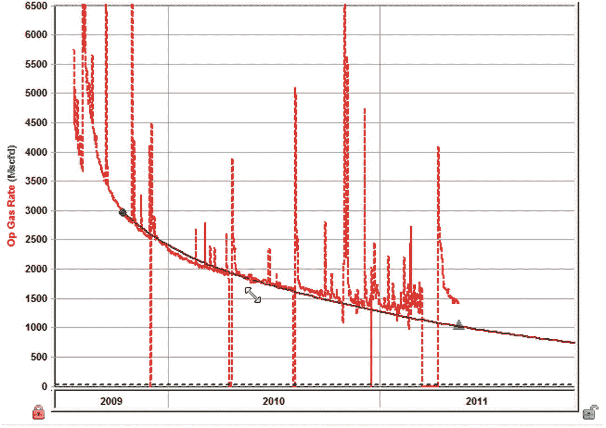

**图 6-1**

典型递减曲线示例，x 轴为时间，y 轴为运行气量 [28]

## 数据集描述

分析中使用了来自北达科他州工业委员会（`NDIC`）油气部门 [29] 的公开生产数据。通过一个 `Python` 脚本从网站抓取数据。网站上提供了 2015 年中期至今的 `Excel`（`.csv`）文件，本章即使用这些文件。`NDIC` 网站的截图如图 6-2 所示。

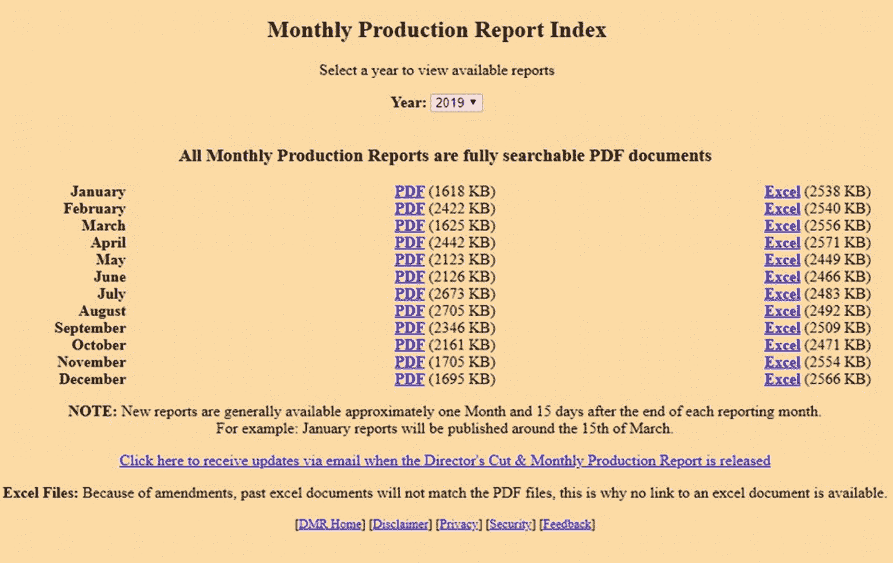

**图 6-2**

用于抓取生产数据的北达科他州工业委员会网站截图 [29]

数据抓取完成后，从不同的 `API` 编号可以看出，分析中包含了 17,756 口井。并非所有井的油气产量都准确上报，因此面临的挑战是尽可能清理数据。通过一些基础的数据可视化，我们可以了解当前正在处理的数据集。

分析重点放在石油产量上，因为它是北达科他州油井的主要产出物。在本研究中，我们使用 2015 年中期至 2018 年的数据进行历史拟合，并对 2019 年的数据进行预测。数据以时间序列的形式呈现，分析中使用了月度产量数据。除了用于递减曲线分析的传统 `Arps` 方程外，本章还进行了基于时间序列的预测。

基于这两种方法，我们可以使用均方根误差（`RMSE`）作为指标来确定更准确的方法，因为这是一个回归问题。需要注意的是，分析仅针对少数几口井展示，但代码仓库包含了从网站检索到的全部井集。图 6-3 展示了电子表格中生产数据的截图，其中包含 21 列。

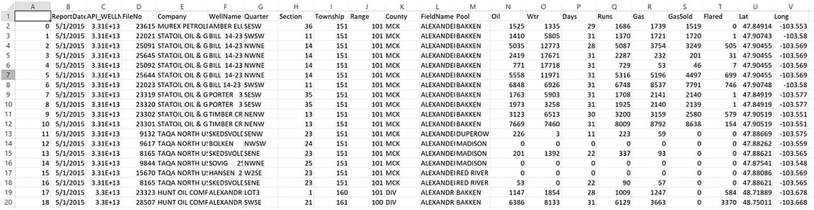

**图 6-3**

显示生产数据的电子表格截图

数据集中包含以下列，其中包括一些静态信息以及按月报告的石油、天然气和水的产量。数据库中还提供了以经纬度形式表示的井位坐标。关于生产天数的信息用于确定产油率。

以下是 21 个数据列。

```
Index(['ReportDate', 'API_WELLNO', 'FileNo', 'Company', 'WellName', 'Quarter', 'Section', 'Township', 'Range', 'County', 'FieldName', 'Pool', 'Oil', 'Wtr', 'Days', 'Runs', 'Gas', 'GasSold', 'Flared', 'Lat', 'Long'], dtype="object")
```

添加到现有数据框中的一些额外特征包括油井投产日期，以及计算特定油井的在线天数。以下代码片段用于查找数据库中产油量最高的前十口井。

```
# 查找产量（总和）最高的前 10 口井
grouped_data = train_prod.groupby(['API_WELLNO']).sum()
grouped_data = grouped_data.sort_values(by=['Oil'])
grouped_data = grouped_data.nlargest(10, 'Oil').reset_index()
```

两口示例井的递减趋势如图 6-4 所示，其中*y*轴为产油率，*x*轴为时间。

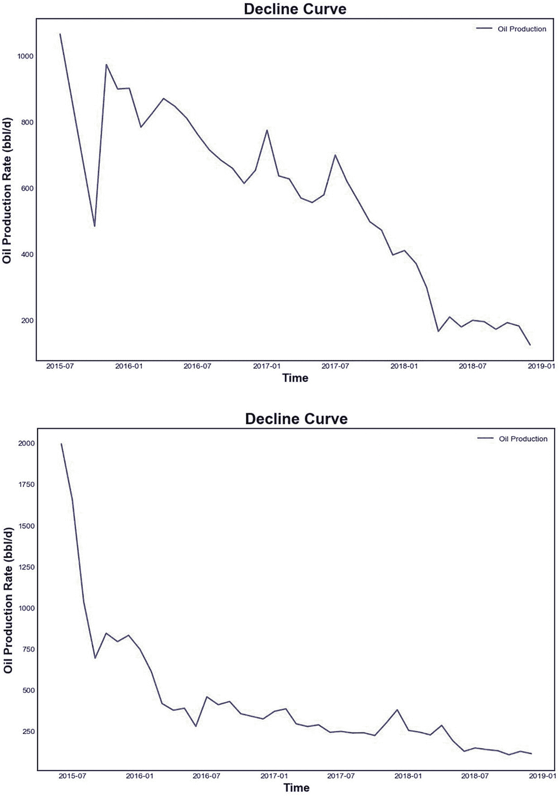

**图 6-4**

两口示例井的递减曲线（产油率相对于时间尺度绘制）

## 使用 Arps 经验模型进行递减曲线分析

在本节中，我们重点介绍递减曲线分析，这是一种油藏工程师用于预测油井或气井未来产量的技术。其结果用于确定`估算最终采收率`（`EUR`）。最常用的方程形式是递减参数、产量和时间之间的经验关系，如先前研究[29]所述，并且至今仍被广泛使用。作为现代生产数据分析的一个组成部分，该过程还包括流态表征、采收率系数估算以及地质储量估算。

使用此方法进行递减曲线分析的方程将在下一节中展示。这种传统的图形方法没有理论基础，并且隐含地假设井的整个生命周期内操作条件恒定。`Arps` 模型已成功应用于达到`边界主导流`（`BDF`）的井中。

需要注意的是，大多数非常规井尚未达到边界主导流，并且在瞬态期本身就表现出急剧递减：这种方法也不使用压力数据。文中展示了一个井的示例，其中使用参数 `qi`、`b` 和 `Di` 拟合曲线，并采用双曲方程。利用拟合曲线对 2019 年期间进行了预测。

为了匹配历史数据并进行预测，我们使用了基于 `Python` 的开源库 `SciPy`。`SciPy` 提供了 `scipy.optimize.leastsq`[30] 的封装函数——`curve_fit()`。该函数使用非线性最小二乘法来拟合函数并确定必要的系数。`curve_fit` 方法至少需要三个参数。

```
𝑝𝑜𝑝𝑡, 𝑝𝑐𝑜𝑣 = 𝑐𝑢𝑟𝑣𝑒_fit (𝑓𝑢𝑛𝑐, 𝑇, 𝑄)
```

## 函数调用中的第一个参数是一个函数

任何函数都可以像其他变量一样传递给它。在我们的案例中，函数是指数型、双曲型或调和型，它可以接受自变量（例如，递减曲线示例中的时间）以及任何其他拟合参数。例如，在双曲函数中，需要传递`qi`、`b`和`Di`；而在指数函数中，由于`b`=0，只需要`qi`和`Di`。除了函数定义外，还需要传递自变量和需要拟合的观测数据。L2 范数可以通过将实际值与曲线拟合预测值进行比较来确定拟合质量。

$$
\text{Error}_{L2} = \sum |(t) - q_{obs}(t)|^2
$$
(6.2)

## 方程与描述

递减曲线分析中使用的每种函数形式都具有特定特征。这里我们讨论不同类型递减曲线的一些显著特征。

### 指数递减

在这种递减类型中，产量与累积产量之间，以及产量对数与$x$轴上的时间之间，均呈现直线关系。递减率是恒定的。根据此方程得出的预测结果给出了最小的*估算最终采收率*（EUR），产量可通过以下方程计算。

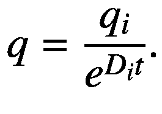

(6.3)

### 双曲递减

这是最常见的 Arps 方程，因为在现实场景中很少遇到直线图。对于常规油藏（边界主导流是主要流态的情况），递减率不是恒定的，而递减指数因子`b`介于 0 和 1 之间，通常通过非线性曲线拟合方法确定。在非常规油藏中观察到`b`因子值更高。这种情况的一个例子是瞬态线性流，其中`b`=2。表现出双曲递减的油藏的产量可通过以下方程获得。

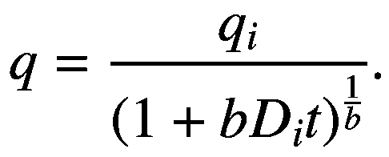

(6.4)

### 调和递减

这被认为是`b`=1 时双曲递减的一个特例。在这种情况下，递减率与产量成正比。产量对数与累积产量的半对数图呈现一条直线。产量可使用以下方程计算。

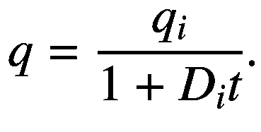

(6.5)

## 结果

对井进行了历史拟合，结果如图 6-5 所示。

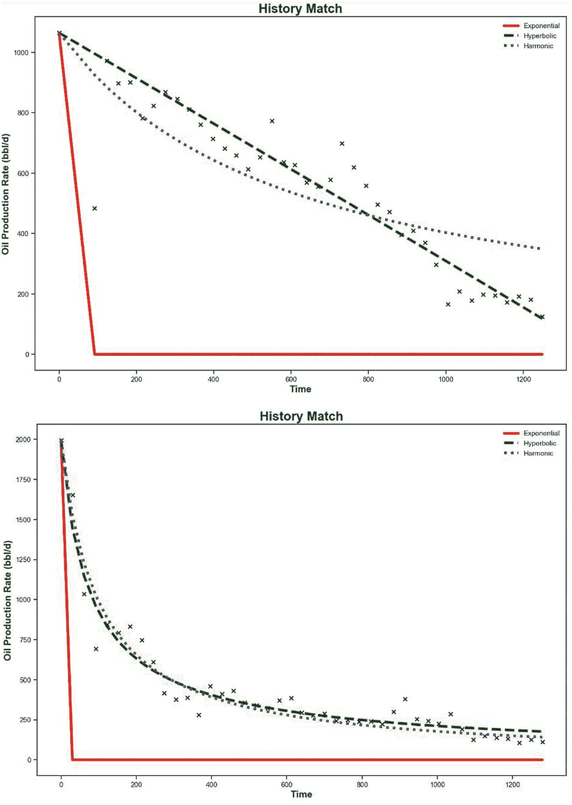

图 6-5

使用 Arps 递减曲线模型的历史拟合结果

对于两口示例井，双曲方程提供了更好的拟合。尽管对于第二口井，双曲方程和调和方程都显示出相似的历史拟合效果。

使用模型参数，可以通过改变方程中的时间`t`来预测石油产量。图 6-6 显示了对这两口井额外 5000 天的预测结果。

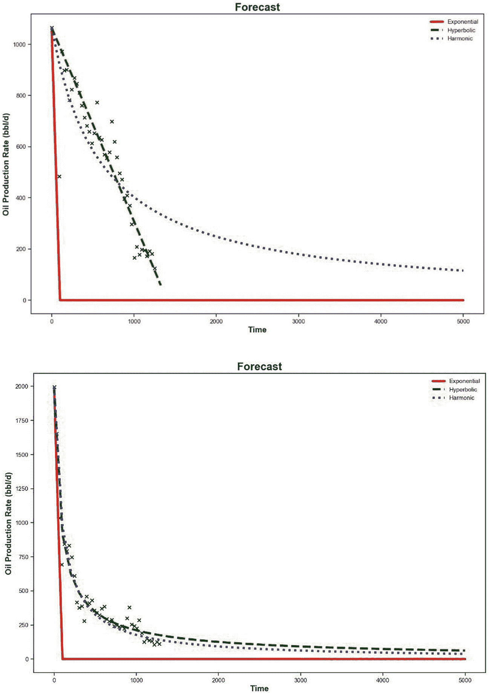

图 6-6

使用 Arps 递减曲线模型的预测结果

## 验证

使用包含 2019 年起产量的测试数据集来验证递减曲线模型预测的性能。这些数据未用于训练经验模型，旨在验证模型的性能。图 6-7 包含了双曲曲线性能与实际数据的比较。

在此示例中，确定了一个常见的精度指标——均方根误差（RMSE）——以量化双曲模型预测的准确性。

```
RMSE - 双曲模型: 81.419 bbl/d
```

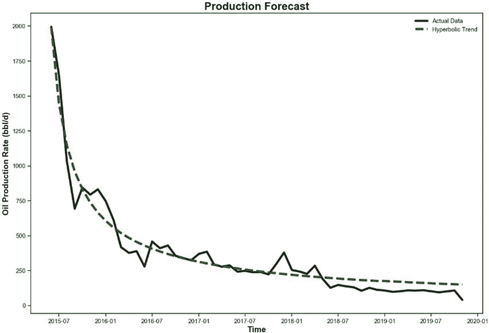

图 6-7

实际数据与包含测试数据（即 2019 年起的产量）的双曲预测之间的比较

## 基于时间序列的 ARIMA 模型预测

理解时间序列数据趋势并进行预测的另一种方法包括分析历史数据的统计趋势。本章使用了一种常见模型——ARIMA（自回归积分滑动平均模型）。在此特定分析中，需要将日期列转换为 `datetime` 数据类型，以便于时间数据的处理。

### 时间序列的平稳性要求

在使用时间序列建模算法时，我们需要确保数据是平稳的。平稳时间序列是指其统计属性（如均值、方差和自相关）随时间保持恒定 [31]。通过使用数学变换（例如对数变换），可以将数据转换为平稳时间序列的形式。迪基-福勒检验可用于判断时间序列是否平稳 [32]。

API 编号为 `33025021780000` 的油井示例中的递减曲线显示了时间趋势（在递减曲线分析中通常为下降趋势）和季节性，这使得局部均值成为时间的函数。这证明了递减曲线的非平稳性质，如图 6-8 所示。采用指数加权移动平均法来去除数据中的时间趋势。经过变换后，数据失去了趋势，并呈现出接近恒定的滚动均值。

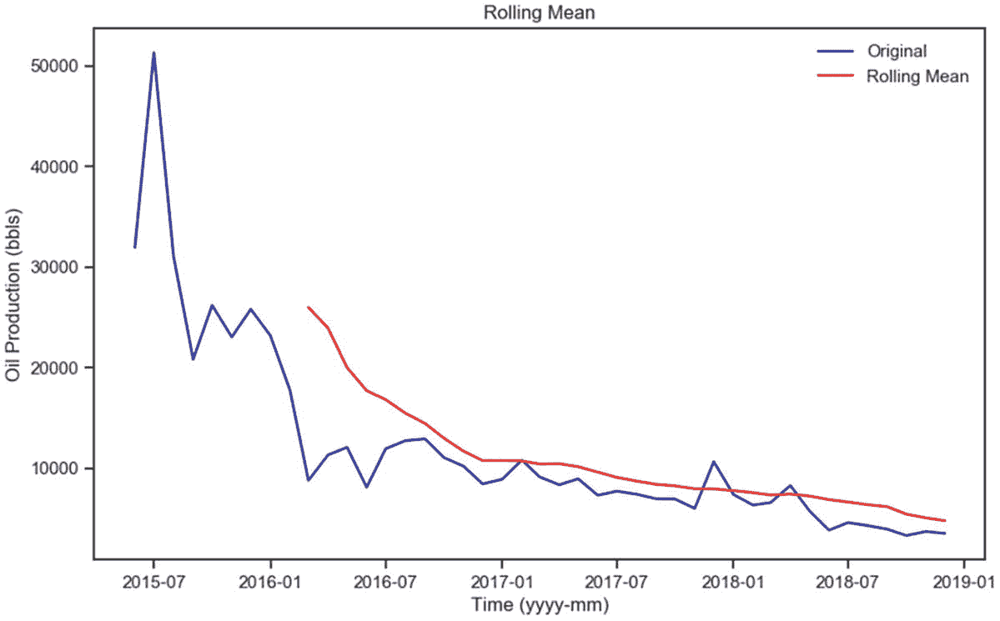

图 6-8

石油产量数据显示出递减趋势，且滚动均值变化，表明存在非平稳行为

通过使用差分法，可以同时去除数据中的季节性和趋势。在该方法中，将特定时间点的观测值与前一个观测值相减。一阶差分可以使用 `pandas` 库在 Python 中实现，是去除季节性的有效方法。其实现如图 6-9 所示，该图显示了应用变换后趋势和季节性的消失。

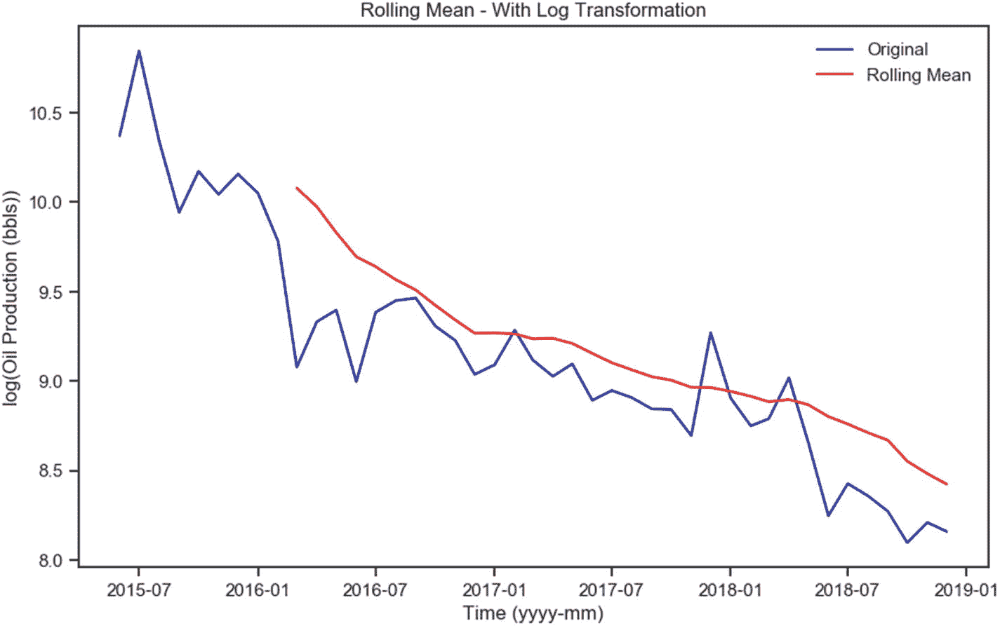

图 6-9

使用对数变换去除趋势和季节性，从而得到局部稳定的均值

执行统计相关性分析是为了理解两个变量之间关系的强度。这引出了*自相关函数*（ACF）和*偏自相关函数*（PACF）。ACF 定义为时间序列中两个值之间的相关系数，它可以衡量当前时间 `t` 的观测值与先前时间的观测值之间的线性关系 [33]。如果对时间序列进行变换并得到相关系数，则得到 PACF，它通常有助于确定自回归模型的阶数。对于所讨论的示例，ACF 和 PACF 图如图 6-10 所示。

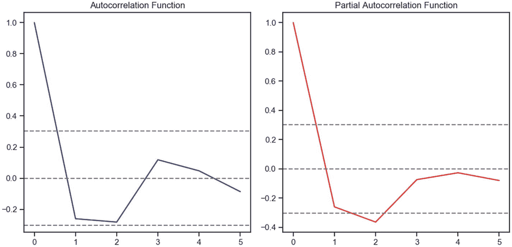

图 6-10

用于理解变量间相关性的 ACF 和 PACF 图

### ARIMA 组件

如果你分解*自回归积分滑动平均*（即 ARIMA）建模算法，该缩写的每个组成部分都有其自身的定义。ARIMA 对时间序列数据进行建模以进行预测（即预测序列中的未来点），其方式如下所述 [34] [36]。

*   考虑了数据中的增长/衰退模式（因此称为*自回归*组件）

*   考虑了数据中增长/衰退的变化率（因此称为*积分*组件）

*   考虑了连续时间点之间的噪声（因此称为*滑动平均*组件）

这些组件中的每一个都在模型中作为参数明确指定。ARIMA 使用标准符号 (`p`, `d`, `q`)，其中参数被替换为整数值，以快速指示所使用的特定 ARIMA 模型 [35] [37]。ARIMA 模型的参数定义如下。

*   `p`：模型中包含的滞后观测值数量，也称为*滞后阶数*

*   `d`：原始观测值进行差分的次数，也称为*差分阶数*

*   `q`：滑动平均窗口的大小，也称为*滑动平均阶数*

自相关函数和偏自相关函数（ACF 和 PACF）有助于确定这些参数的起始值。通过观察图 6-10，我们可以观察到 ACF 和 PACF 在特定数量的滞后（显示在 `x` 轴上）之后急剧下降。通过分析这种下降的滞后，我们可以估计 ARIMA 模型的参数。自回归部分的参数 `p` 使用 PACF 确定，而 ACF 则提供模型滑动平均部分的参数 `q`。基于图 6-10 中的观察结果，我们将使用参数 `p`=2、`d`=1 和 `q`=2 的 ARIMA 模型。接下来，我们展示从自回归模型（见图 6-11）、滑动平均模型（见图 6-12）以及组合的 ARIMA 模型（见图 6-13）获得的残差平方和（RSS）图。

#### 自回归模型

```
model_AR = ARIMA(ts_log, order=(2, 1, 0))
```

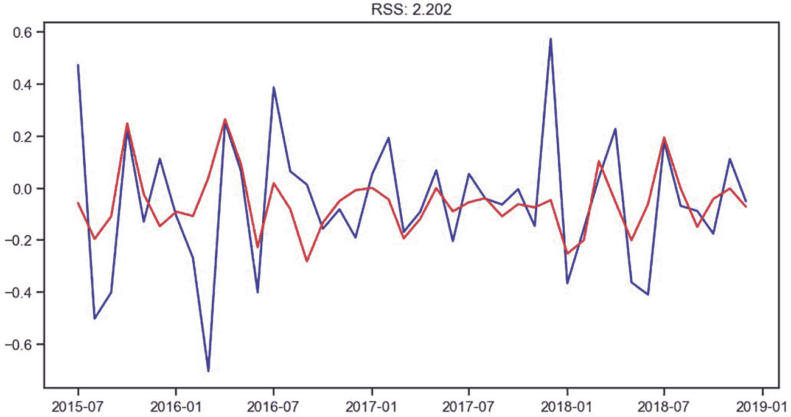

图 6-11

残差平方和为 2.202 的自回归模型

#### 滑动平均模型

```
model_MA = ARIMA(ts_log, order=(0, 1, 2))
```

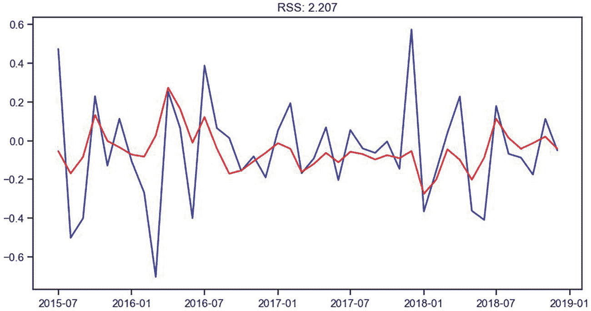

图 6-12

残差平方和为 2.207 的滑动平均模型

#### ARIMA 模型

model = ARIMA(ts_log, order=(2, 1, 2))

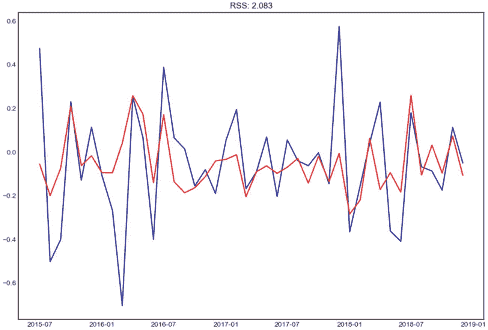

图 6-13

采用对数变换且残差平方和为 2.083 的 `ARIMA` 模型

使用 Python 中的 `statsmodels` 库，可以生成结果摘要，如图 6-14 所示。

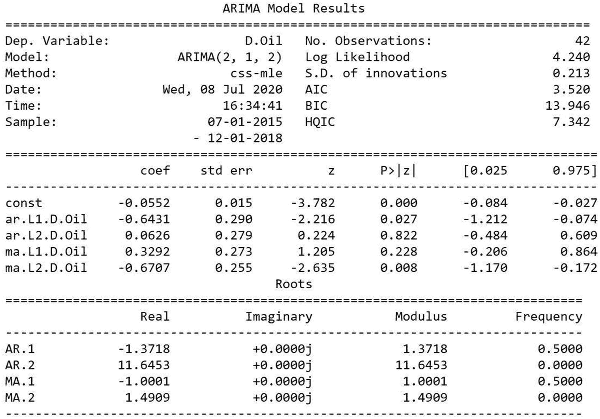

图 6-14

`ARIMA` 模型的结果摘要

表格中的结果难以直观呈现，因此对残差和*核密度估计*（`KDE`）进行了更深入的分析。残差和 `KDE` 的分析结果分别如图 6-15 和图 6-16 所示。在残差图中，大部分残差点位于 0 值附近。`KDE` 图显示了残差的高斯分布。这些图表明预测性能良好。

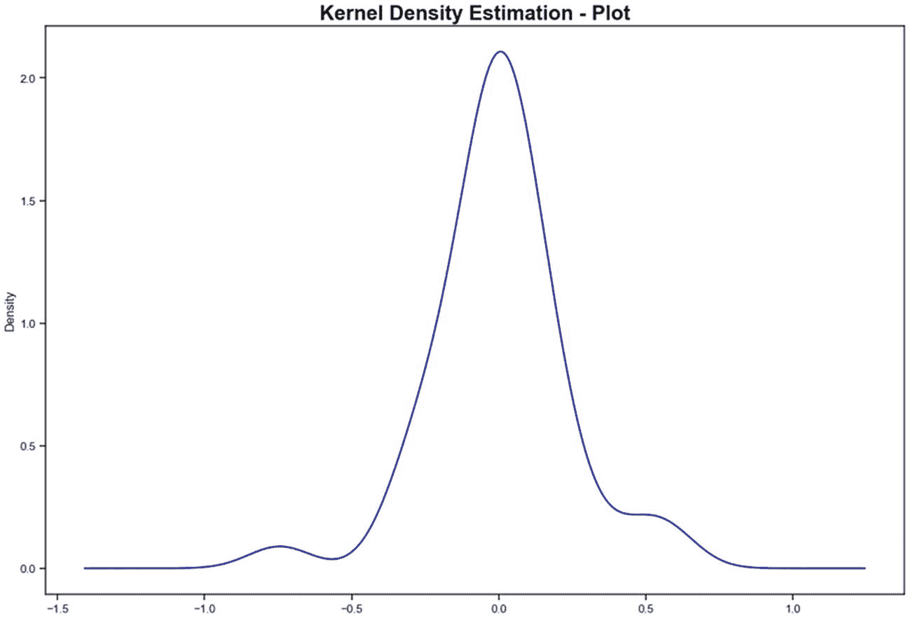

图 6-16

`KDE` 图

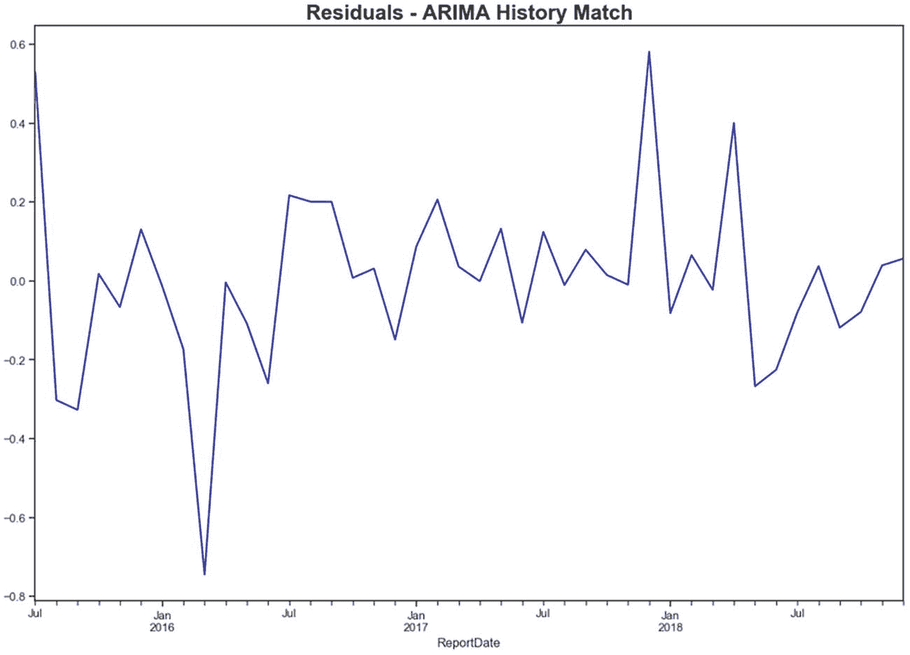

图 6-15

残差图

基于时间序列的 `ARIMA` 模型对石油产量进行了历史拟合，并对额外一年的预测结果如图 6-17 所示。该图还显示了 95%置信区间的窗口。

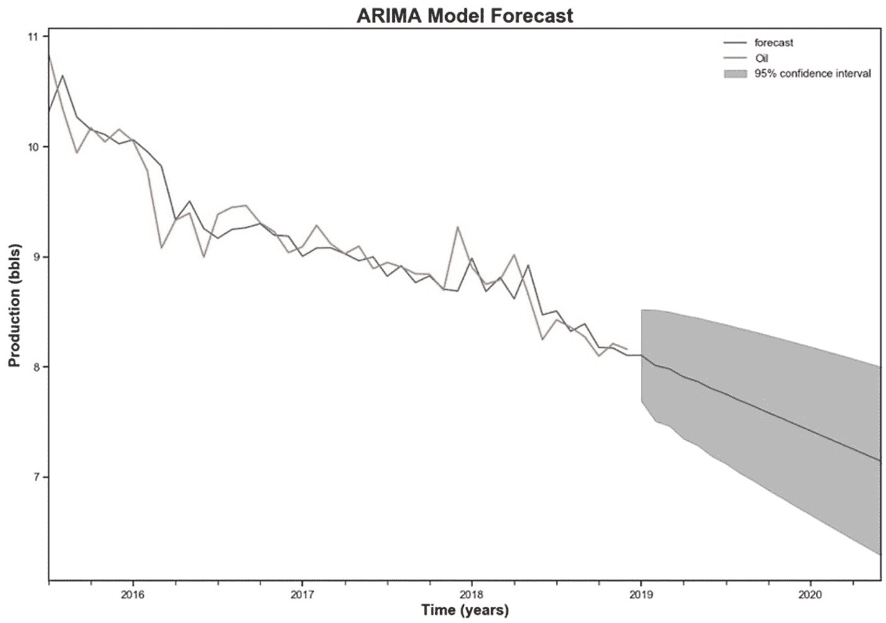

图 6-17

使用 `ARIMA` 模型对产量数据进行历史拟合与预测

与使用 `Arps` 递减曲线的过程类似，2019 年的数据被用作测试数据。将 `ARIMA` 模型的预测结果与实际值进行比较，并使用以下代码片段以 `RMSE` 作为精度指标。验证曲线如图 6-18 所示。

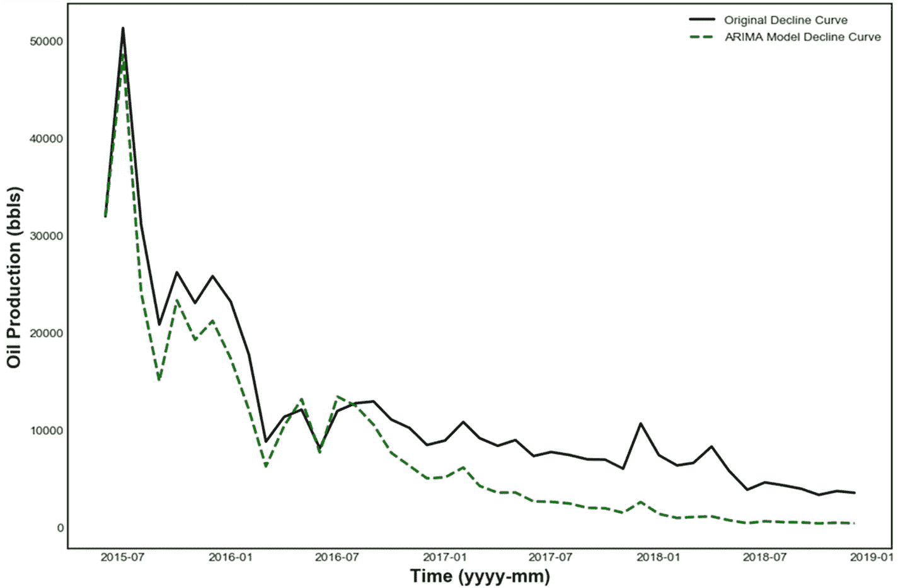

图 6-18

使用 `ARIMA` 模型对产量数据进行历史拟合与预测

```
from sklearn.metrics import mean_squared_error
from math import sqrt
rmse = sqrt(mean_squared_error(actual, forecast))
print("RMSE - ARIMA Method:", rmse)
RMSE - ARIMA Method: 4141.44 bbls
```

## 总结

本章讨论了两种不同的产量预测方法，即 `Arps` 和 `ARIMA`。以北达科他州某口井的产量数据为例，该信息是从一个公共网站抓取的。使用 `Arps` 方法进行递减曲线分析是油藏工程领域中传统的预测形式。基于时间序列的 `ARIMA` 方法则侧重于统计学，为产量预测问题提供了机器学习的视角。这两种方法的应用证明了它们在解决问题上的有效性。我们鼓励您在日常的产量预测工作中应用这些方法。