# 7. 采油工程

采油工程涉及分析现场数据和模型，以制定如何最优地维持油井和地面生产设施性能的决策。本章涵盖了使用机器学习方法进行生产建模的精选主题。这些主题包括用于预测井产量的模型识别、识别实现最优产量的早期措施，以及识别可能受益于修井作业的生产井。

## 采油工程概述

采油优化涵盖了多种活动，包括测量、分析、建模、排序和实施旨在提高生产效率和盈利能力的措施。采油工程师通常会广泛考虑多种方案，以在技术、经济和环境方面改善生产系统状况。作为一个从油藏源头到销售点的上游一体化生产系统示例，图 7-1 展示了从储层界面到销售点的煤层气生产系统示意图[1]。

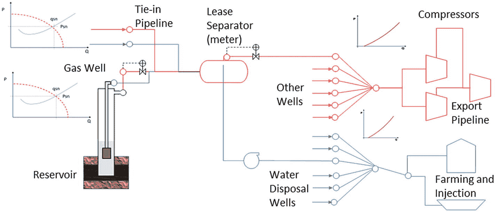

图 7-1

一体化气水生产系统[1]

流动压力与产液量之间的关系描述了任意时间点的稳态井性能（图 7-2）。油井优化的结果可能是提高油藏的生产能力（左侧），从而在更高的流动压力下获得更高的产液量，和/或减少流出端的限制（右侧），从而在更低的流动压力下增加产液量。

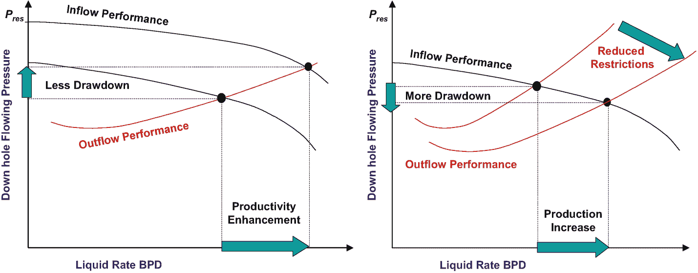

图 7-2

沿流入和流出性能曲线的产量增加

随着过去几十年数字自动化的引入，已经存在一个成熟的技术框架，用于实现一次性或持续的油气田优化[2]。持续优化需要集成现场硬件（例如，井下传感器、远程激活完井设备、地面设施）和能够支持决策的计算机算法，包括数据处理、虚拟传感、模式识别和物理模型集成。

采油工程通常通过数据分析和物理建模来解决以下问题。

*   资产（油藏、油井、设施）是否达到了其全部生产潜力？

*   监测数据揭示了资产健康状况的哪些信息？

*   限制产量的因素是什么？

*   产量损失/延迟的最可能原因是什么？

*   阻止递减、恢复或增加产量的最有效措施是什么？

*   如果采取某项措施，它是否会成功、盈利且可持续？

采油工程是一个持续的过程，旨在提高油气田的技术和财务绩效。其目标是以最小的成本和努力最大化有效的生产系统能力。这个循环过程包括常规数据采集、数据分析和信息整合、方案分析与决策，以及详细的工程设计与执行（见图 7-3）。

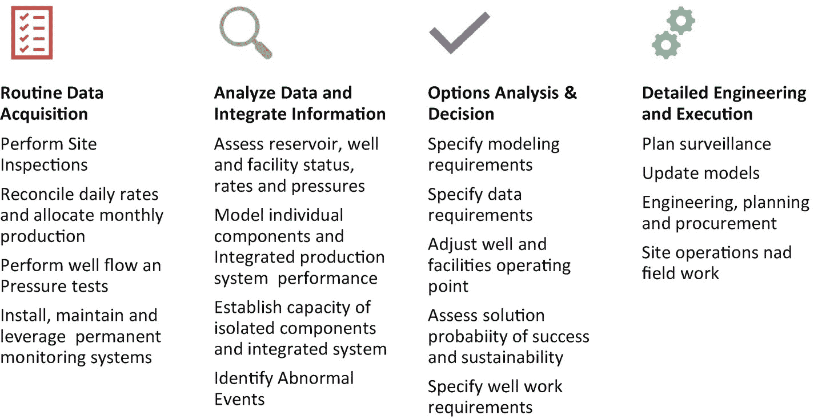

图 7-3

采油工程关键流程

通过常规监测计划捕获了大量种类和数量的数据，这些数据被同化以通过异常识别来发现异常事件。据此，采油工程师分析并整合所有采集的数据，以评估状态、对系统性能进行建模，并确定油井和设施的最佳运行范围。这种分析允许为油井和设施标记关键性能标签。

*   基于流动状态：活跃健康、活跃不健康、不活跃

*   基于预期性能：符合预期、高于或低于预期性能

*   基于问题识别：无、前兆事件、问题、故障

*   基于潜力和受限产能：油藏、油井、设施、法规、计划性维护

随着机器学习被引入石油和天然气行业，大量应用已被发布，用于辅助流动状态识别、性能计量、问题识别以及产能约束等方面的研究。

在油藏层面，有多种方法可用于寻找机会，包括钻新井，或通过堵水、化学增产、补射其他层位、侧钻至油藏其他区域或废弃现有井来修复现有井。生产工程师专注于挑战油井的生产和注入目标、增加注入支持、选择最佳的人工举升系统、清除生产管柱中的固相沉积物等。生产工程师还会审查并确保地面设施（包括仪表、控制、井口、管道、分离器、泵、压缩机、加热器等）的最大可操作性和维护。

## 生产优化

优化生产操作——以最小的努力——可能涉及对生产系统（油藏、井、地面设备）中增产机会进行排序。此外，为了维持精益运营，生产操作需要持续审查流程、管理系统、人员适应性以及智能技术的应用。通常，尽管存在油井性能、地下响应、设备故障率和下游需求的不确定性，也必须做出决策。信息的异质性和当前资产的复杂性意味着需要采用迭代方法来识别可行的机会。管理生产优化机会涉及风险与不确定性的管理。

生产优化是一个关于生产绩效和资产运营的持续改进过程 [3]。持续的生产优化意味着，通过用更高层级的目标和当前资产状态更新最优预测，来频繁地质疑预期绩效（见图 7-4）。这是通过采取行动来缩小实际绩效与预期绩效之间的差距来实现的。更快的监控回路会比较实际与预期绩效，以确定每分钟、每小时和每天的差距。较慢的监控回路则会更新资产的预期绩效。

持续生产优化背景下的主要输入包括：(i) 用于标定和验证生产模型的现场数据，(ii) 用于确定资产状态的现场数据，(iii) 井和管道几何结构，以及 (iv) 先验过程知识。主要输出是：(i) 指示预期或实际绩效的模型响应，(ii) 指示现场诊断的模型失配，(iii) 指示最优解的操作变量变动，以及 (iv) 优化后的预测和假设情景。

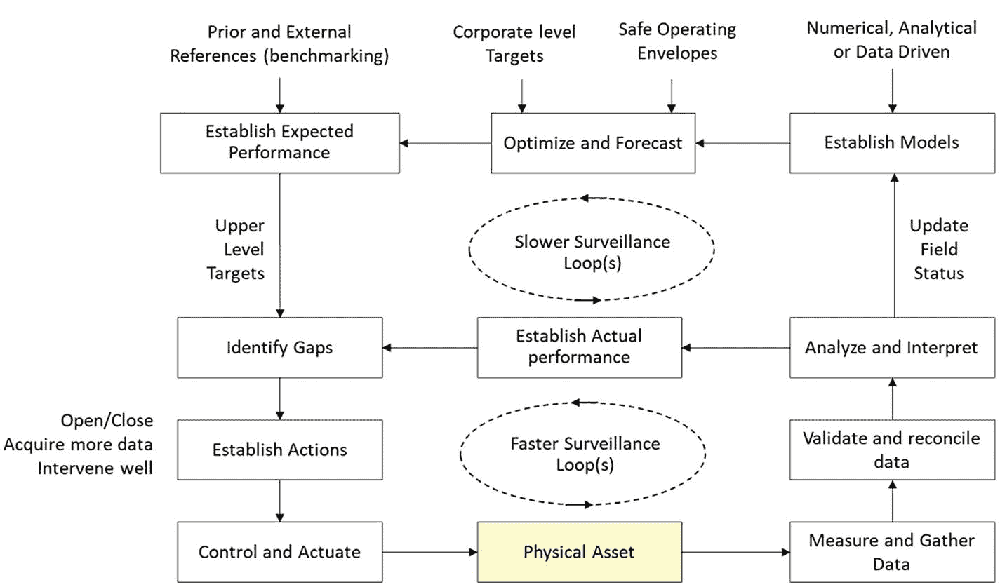

图 7-4

持续生产优化循环

由于生产系统的复杂性（见图 7-1），操作员可以做出众多决策来寻找最优绩效。这些决策可分为短期决策，例如调整油井的操作点和确定油井维护需求，以及长期决策，例如井数、井距和地面设施能力。

多变量优化技术在石油工业中以多种方式被用于支持决策和完成日常任务，例如资源调度、油藏参数的最优历史拟合、最优井位和井距、生产参数设置 [4] [5]，以及驱替效率或采收率的优化 [6]。此类优化使用通过第一性原理离线生成的模型，或使用现场采集的数据通过半经验方法生成的模型。

尽管在石化行业广泛应用，但多变量优化尚未深入渗透到上游行业。在已应用的范围内，它缺乏与实际油田的联系，并且没有考虑纳入动态数据以持续更新模型。

## 预测油井产能潜力

*油井产能潜力*预测是评估油井性能的关键活动，对于确定与当前测量值之间的任何差距是必要的。传统上，对于一口完全穿透单层、裸眼完井且具有圆形泄油区域的垂直井（见图 7-5），稳态液体产量（`Q[Liquid]`）是使用流体在多孔介质中流动的基本方程（方程 6.1）以及从井底到地面的生产系统压降来预测的 [7]。

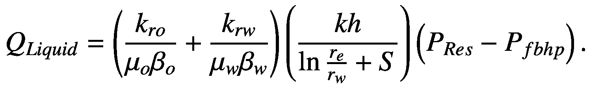

(7.1)

油井产能潜力 `Q[Liquid]` 取决于岩石-流体性质，包括油相相对渗透率（`k[ro]`）和水相相对渗透率（`k[rw]`）；岩石性质，包括绝对渗透率（`k`）和厚度（`h`）；流体性质（油和水的粘度（`μ[o]`, `μ[w]`）以及油和水的体积系数（`β[o]`, `β[w]`））；静态油藏压力（`P[Res]`）；井筒结构，包括井筒半径（`r[w]`）和油藏泄油半径（`r[e]`）以及表皮系数（`S`）。通过将井底流动压力（`P[fbhp]`）从零变化到静态油藏压力（`P[Res]`），可以得到如图 7-2 所示的油藏流入动态关系（IPR）。

`P[fbhp]` 也是 `Q[Liquid]`、流体性质（即初始溶解气油比，`Rsi`；原油密度，^oAPI）的函数。流出系统中的压降取决于井口回压（`P[sep]`）、油嘴内径、油管内径（`ID[tubing]`）、油管长度（`TVDSS[well]`）、井筒倾斜角、井筒长度（`MD[well]`）以及油管内的流体（`Q[Oil]`, `Q[wat]`, `Q[gas]`）。

## 利用虚拟传感器增强油井感知能力

在许多情况下，由于传感器故障、技术可用性、仪表可靠性或经济原因，直接的物理测量不可用或与过程性能不一致。在这种情况下，虚拟传感器是物理传感器的便捷替代品，它利用在已安装仪表的油井中已知条件下可用的数据来预测其他测量值 [8]。许多技术已被开发出来，用于从其他间接测量值（例如，虚拟计量或软传感器）估算产量和压力。

例如，对于特定的油嘴直径，井口压力（WHP）和温度（WHT）与出油管线压力（FLP）相关；因此，在这四个变量之间建立一个机器学习模型是方便的，这样它可以在需要时作为替代。由于大多数油气井表现出非平稳过程，其边界条件可能随着油井寿命的变化而改变，因此可以稳妥地认为，虚拟传感器模型可能并非在整个油井寿命期间都有效，而仅适用于特定时间段。

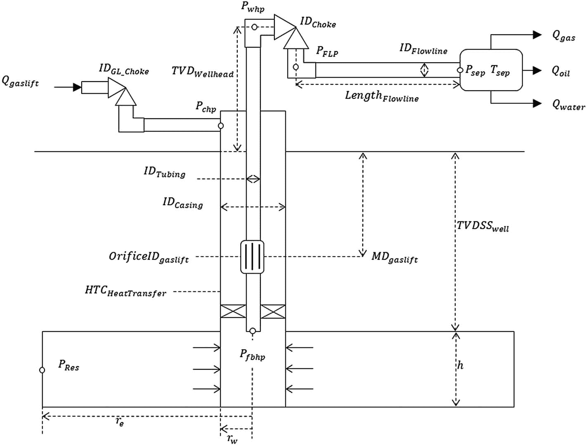

图 7-5

带气举的垂直井

### 虚拟流量计量

## 井监测与虚拟产量估算

井监测对于油藏表征、管理生产潜力以及选择增产措施至关重要。监测的关键在于了解井的流动状况（即流量和流动状态）。通常，井的产量（如油、水和气）并非始终直接测量；然而，借助虚拟传感器，可以构建并实施连续的井产量估算（WRE），也称为虚拟产量估算器（VRE）。虚拟流量计量是虚拟传感器的一种类型 [9]。

在石油和天然气行业中，一类广为人知的虚拟产量估算器源自基于物理学的节点分析模型。这种产量估算需要一致的流体物性（PVT）数据、适合用途的生产井测试以及可靠的传感器 [10]。在这类模型中，数据缺失、数据偏差或传感器故障可能导致产量估算中断，并需要进行新的校准。此外，传感器输入的不确定性和产量估算的置信度在这些方法中通常被忽视 [11]。

另一种方法是关注由机器学习算法驱动的数据驱动型 VRE。该过程涉及使用地面实时传感器数据、历史产量和井测试数据，建立预测模型，用于即时预测多相流量、累计产量以及其他关注量（如气油比、含水率）。

当测量数据充足时，包括频繁的井测试（例如，每年 8-12 次）、永久式井口和地面管线传感器（压力、温度），数据驱动型 VRE 能产生令人鼓舞的结果。井下传感器的可用性是理想的，但并非必需。

## 从间接测量值预测井产量

考虑一口拥有超过 2000 次流量测试的自喷井。使用其中一半的测试数据构建一个用于预测虚拟产量（包括油、水和气）的机器学习模型，并用其预测另一半数据。输入数据指可用的井测量值，包括井底压力（`BHP`）、井口压力（`WHP`）、井口温度（`WHT`）、分离器压力（`Psep`）、分离器温度（`TSep`）以及油嘴内径（`ID_Choke`）。预测输出包括作为所有给定测量值函数的油、水和气产量。

- 输入数据：`Well_Rates.csv`
- Python 代码：`Chapter07_Well_Rate_Predictor_RF_GBM.ipynb`

该笔记本提供了使用随机森林（RF）回归方法（即产量 = `f` (`BHP`, `WHP`, `WHT`, `Tsep`, `Psep`, `Choke`)）进行油产量预测的简化代码。提供的文件中还包含其他虚拟计量功能。

```python
df = pd.read_csv("./data/Well_Rates.csv")
X = df[["BHP", "WHP", "WHT", "Tsep", "Psep", "Choke_in"]]
y = np.array(df[["Qoil"]].values).reshape(-1, )
scaler = MinMaxScaler()  # Scale Data
```

在归一化的 PCA 数据上应用无监督分类（例如，`DBSCAN`, `GMIX`），可以在数据进入回归步骤之前筛选出干净的数据。

```python
X_scaled = scaler.fit_transform(X)
pca = PCA()
X_pca = pca.fit_transform(X_scaled)  # Perform PCA
pca_df = pd.DataFrame(X_pca)
# Cluster using DBSCAN
clustering = DBSCAN(eps=0.5, min_samples=12).fit(X_pca)
pca_df["DBSCAN"] = clustering.labels_ + 1
# Keep only the rows where DBSCAN=0
clust_df = pca_df[(pca_df["DBSCAN"] == 1)]
# Delete text columns "DBSCAN"
clust_df.drop(columns=["DBSCAN"],inplace=True)
# Merge data
X_merge = X.merge(pca_df,left_index=True,right_index=True)
X_merge["Labelled Y"] = y
```

创建训练数据，并将数据集拆分为训练集和验证集。

```python
# Bring only the Xrows selected as per Clust_df --> # X.iloc[clust_df.index.tolist(),:]
# Bring only the Yrows selected as per Clust_df --> # y[clust_df.index.tolist()
train_X, test_X, train_y, test_y = train_test_split(X.iloc[clust_df.index.tolist(),:],y[clust_df.index.tolist()], test_size=0.5, random_state=123)
```

构建一个 RF 估算器。

```python
# Random Forest Regression
model_RF = RF(n_estimators=200, random_state=123)
model_RF.fit(train_X, train_y)
```

对训练集和验证集进行预测。

```python
pred_y_RF_test = model_RF.predict(test_X) # Blind test
pred_y_RF_train = model_RF.predict(train_X)
pred_y_RF_all = model_RF.predict(X.iloc[clust_df.index.tolist(),:])
# Compute  r2 scores
r2_RF_train = r2_score(train_y, pred_y_RF_train)
r2_RF_test = r2_score(test_y, pred_y_RF_test)
r2_RF_all = r2_score(y[clust_df.index.tolist()], pred_y_RF_all)
```

包含使用原始数据集的计算，以便进行绘图。

```python
# RF to X_merge file
all_pred = np.array([np.nan for i in range(len(X_merge))])
all_pred[clust_df.index.tolist()] = pred_y_RF_all
X_merge["Predicted_RF"] = all_pred
X_merge.to_csv("X_merge.csv", index=False)
```

准备绘图。

```python
# Xplot of predicted and actual values
fig = plt.figure(figsize=(6,6))
ax = plt.axes()
plt.scatter(y[clust_df.index.tolist()], pred_y_RF_all, c="blue")
plt.scatter(test_y, pred_y_RF_test, c="red")
ax.set(xlabel="Test Data", ylabel="RF Model Prediction", title="Oil Rate RF Predictor Model")
plt.show()
```

同样的过程可以重复用于 GBM 估算器或您偏好的任何其他算法。RF 和 GBM 回归方法的结果如图 7-6 所示。

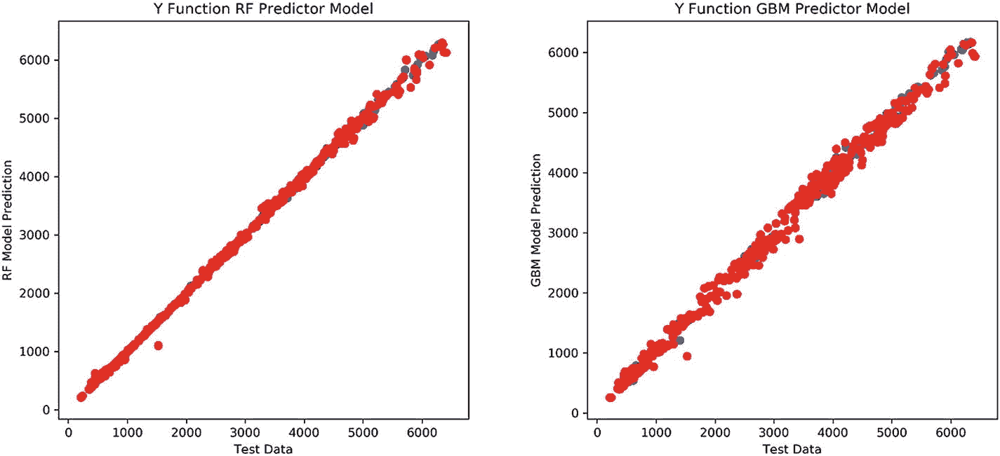

**图 7-6** RF 和 GBM 方法的井虚拟产量估算器（红色为训练数据，蓝色为盲测数据）

回归器的得分如下：
- 使用随机森林的训练数据 `R²` 为 `0.999838`。
- 使用随机森林的盲测数据 `R²` 为 `0.998584`。
- 使用随机森林的所有数据 `R²` 为 `0.999230`。
- 使用 `GradientBoostingRegressor` 对训练数据计算的 `R²` 为 `0.995428`。
- 使用 `GradientBoostingRegressor` 对盲测数据计算的 `R²` 为 `0.992874`。
- 使用 `GradientBoostingRegressor` 对所有数据计算的 `R²` 为 `0.994193`。

请注意，工程师可以利用六种可用的测量值（[`BHP`, `WHP`, `WHT`, `Tsep`, `Psep`, `Choke_in`]），通过更改训练矩阵 `X` 和输出向量 `Y` 中的输入特征，为多个虚拟流量计算器（也称为控制体）实施计算。一种方法是“取消注释”所需的 `X` 和 `Y` 组合。

### 创建输入特征和目标值

```python
# 创建输入特征和目标值
#X = df[["WHP", "Psep"]] # 流动管线性能
#X = df[["WHP", "Psep", "Choke_in"]] # 流动管线和节流阀性能
#X = df[["BHP", "WHP"]] # 油管垂直举升性能 (VLP)
#X = df[["BHP", "WHP", "Choke_in"]] # VLP 和节流阀性能
#X = df[["WHP", "WHT", "Tsep", "Psep"]] # 流动管线压力与温度性能
#X = df[["WHP", "WHT", "Tsep", "Psep", "Choke_in"]] # 节流阀性能
#y = np.array(df[["Qoil"]].values).reshape(-1, )
#y = np.array(df[["Qwater"]].values).reshape(-1, )
#y = np.array(df[["Qgas"]].values).reshape(-1, )
```

另一种便捷的方法是构建独立的虚拟计量函数，并同时运行所有函数（例如，`Y1oil = f(X1)`, `Y1water = f(X1)`, `Y1gas = f(X1)`, `Y2oil = f(X2)`, `Y2water = f(X2)`, `Y2gas = f(X2)`, ……等）。

```python
# 创建输入特征和目标值
X0 = df[["BHP", "WHP", "WHT", "Tsep", "Psep", "Choke_in"]]
X1 = df[["WHP", "Psep"]]
X2 = df[["WHP", "Psep", "Choke_in"]]
X3 = df[["BHP", "WHP"]]
X4 = df[["BHP", "WHP", "Choke_in"]]
X5 = df[["WHP", "WHT", "Tsep", "Psep"]]
X6 = df[["WHP", "WHT", "Tsep", "Psep", "Choke_in"]]
Y1 = np.array(df[["Qgas"]].values).reshape(-1, )
Y2 = np.array(df[["Qoil"]].values).reshape(-1, )
Y3 = np.array(df[["Qwater"]].values).reshape(-1, )
```

这种方法的优势在于，所有 7 个输入矩阵（`X0` 到 `X6`）以及每个流量（`Y1`, `Y2`, `Y3`）都是基于不同的物理过程假设构建的；例如，流体流经流动管线、流经节流阀或流经油管。

当过程条件稳定且模型校准良好时，所获得的模型结果趋于一致。但它们也是识别系统中异常情况的强大工具；当过程条件与原始假设不同时，这些模型的结果会出现分歧；例如，含水率上升或气油比增加。

## 预测气举井的产量

一口气举井（见图 7-7），其属性如表 7-1 所示，拥有约 12,538 个流动测试数据点。将构建一个用于预测油井产量（包括油、水、气）的机器学习模型。输入数据指井口可用的测量值，包括井底压力（`BHP`）、井口压力（`WHP`）、井口温度（`WHT`）、流动管线压力和温度（`FLP`, `FLT`）以及节流阀内径（`ID_Choke`）。预测输出包括作为所有给定测量值函数的油、水和气产量。

**表 7-1 具有气举特性的垂直井**

| | 平均值 | 标准差 |
| --- | --- | --- |
| 原油重度，^oAPI | 36.3 | 0.2 |
| 原油初始溶解气油比，`Rsi`，`SCF/bbl` | 516.7 | 3.0 |
| 天然气相对密度， | 0.8 | 0.0 |
| 水矿化度，`ppm` | 230,010 | 1,330.2 |
| 储层温度，^oF | 240 | 1.4 |
| 储层压力，`psi` | 4,347 | 376.3 |
| 油管长度，`ft` | 12,269 | 7.1 |
| 套管内径，`inches` | 6.2 | 0.0 |
| 油管内径，`inches` | 3.1 | 0.0 |
| 气举阀孔深度，`ft` | 12,069 | 7.1 |
| 流动管线内径，`inches` | 3.1 | 0.0 |
| 流动管线长度，`ft` | 10 | 0.1 |
| 地表温度，^oF | 80 | 0.5 |
| 传热系数，`BTU/(hr∙ft²∙^oF)` | 9.2 | 1.6 |

*   输入数据：`Well_Choke_GL.csv`
*   Python 代码：`Chapte07_GL_Well_Rate_and_Pressure_MLP_Predictor.ipynb`

用于油、水和气产量预测的 Python 代码采用多层感知器（`MLP`）回归方法实现（即，产量 = `f(BHP, WHP, WHT, FLP, FLT, ID_Choke, ID_orifice, Q_Gas_lift)`）。

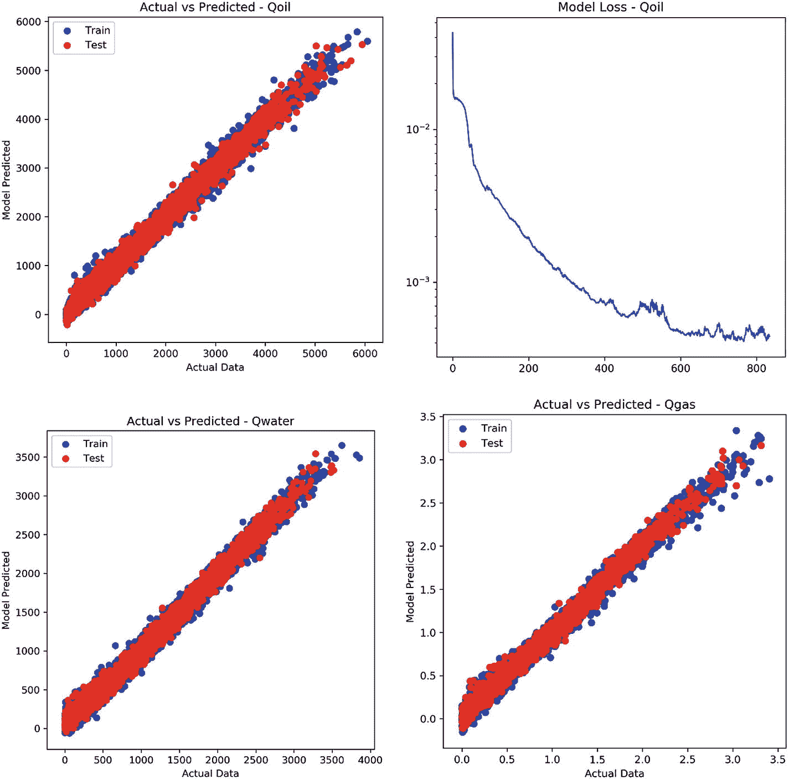

*图 7-7 使用 MLP 算法估算气举井产量（油、水、气）的模型*

## 预测油井故障

生产工程师的任务之一是建立实践和方法，以主动检测和预防油井故障，并就油井（及设施）的操作范围提出建议。储层、近井地带环境、井下设备以及地面生产系统的任何组件都可能在任何时间点发生故障，导致大量的非计划停机、产量损失和不受控的运营支出。主动识别和预防油井故障有助于制定适当的维护计划，最终减少不当维修，最大限度地减少停机时间，并随后提高运营效率[12]。

工程师在仅凭性能数据识别候选井和对增产机会进行排序时面临挑战。标准的生产数据管理和决策平台难以预测油井运行时间的下降、可用性以及最佳操作范围。这些挑战通常与对系统的正确理解、油井状况诊断、主动机会识别、机会的有效排序以及作业后性能分析有关。

用于检测有杆泵（`SRP`）井故障的系统性模式识别工作流程已成功实施[12]。这为检测 `SRP` 故障节省了大量工程成本，并最大限度地减少了产量损失。

推荐最佳处理方法也是管理运营支出的必要任务，不仅要最大限度地减少钻机和设备成本，还要使油井更快地投入生产，并避免因相同原因导致的未来故障[13]。其理念是将历史成功与失败数据、现场人员意见以及基本业务规则结合到一个数据驱动的模型中，该模型能够推荐优化设计、现场计划、设备使用和作业性能的处理方法。

构建任何预测油井故障的咨询解决方案的步骤包括：数据筛选、数据特征工程、根本原因分析、推荐行动和反馈。

### 数据筛选

数据筛选用于识别资产性能未达到预期的征兆。检测井间的模式以识别相似行为，并将筛选问题的复杂性从几百个传感器降低到几类相似的测量类型。

### 数据特征工程

数据特征工程可能涉及利用领域知识生成数据特征、特征提取和模式识别。此步骤的目标是让算法能够根据趋势而非实际值采取行动。例如，咨询系统不应仅仅承认`油管头压力`是 1200 kPa 这一事实，而应考虑`油管头压力`是上升、稳定还是下降。任何输入变量的变化率只是需要从数据流中提取的特征之一。

领域专家访谈以及对监控逻辑的详细阐述表明，专家通常使用数据流中特征的组合来检测事件。仅在少数情况下，是绝对值或阈值向专家发出警报；通常，它是一个信号或多个信号组合中的一系列特征。

### 根本原因分析 (RCA)

应用技术分析方法和诊断手段，以确定性能高于或低于预期的原因。目标是识别约束条件，例如液体产量是受油藏产能、油井生产潜力还是设施处理能力的限制。

由于上一步（特征工程）中识别出的某些症状存在模糊性，`RCA` 的结果通常是概率性的，指出最可能的原因，同时也列出可能的替代原因。

一种已知的根本原因识别方法是`贝叶斯网络`。一个用于确定井下泵性能下降最可能原因的例子，是通过`贝叶斯网络`模型来完成的，该模型考虑了观测数据和实时测量值。这些观测值可以是独立的（例如，泵排量和油藏压力），但也可以通过因果关系相关联（例如，井口压力和产量）。

在这个例子中，关于泵、油藏、流体、测量到的液体下降速率和井口压力的信息，被用来确定最可能的原因是`气体吸入`；然而，这并不完全排除机械问题和可能的过度泵磨损（例如，由于泵内进入砂粒）。

### 推荐改进性能的措施

一个高层次的油井“健康评分”可以根据油井传感器和其他测量数据中识别出的特征来计算。还可以计算其他评分来量化问题的严重程度（即问题评分）、油井修复或改进后的机会大小（即潜力评分）等。为一口井计算的所有评分汇总后得出一个最终评分。这个最终评分可以被视为健康评分；数值越小，表明该井出现严重问题的可能性越低。然后可以根据最终评分对油井进行排序，为日常运营提供优先级列表。

对于生产系统中的每个要素（例如，每口井、每个设施），都可以获得计算得出的事件、条件和推荐措施。某个事件发生的可能性乘以该事件影响的严重程度（安全问题、产量损失、时间损失）的结果，就是该事件的评分。

基于效用定义（例如，最大化产量、最小化损失、增加净现值、减少时间损失等），会提出决策建议来解决前序步骤中识别出的问题。该建议可能是概率性的。总体效用值是各种子效用的组合；因此，必须为每个组织甚至每个项目建立一个统一的评估体系，以便能够比较货币和非货币目标。

### 预测油井性能不佳

预测油井性能不佳时遇到的挑战之一，源于在生产早期阶段，产量快速下降的迹象非常少。然而，通过使用无监督机器学习技术，例如聚类算法，有可能识别出那些在若干年后可能表现出石油产量下降的油井。一种基于聚类的方法如图 7-8 所示。

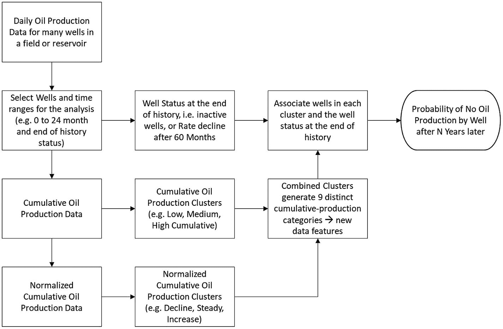

图 7-8

一种基于聚类的、用于识别未来产量下降可能性高的油井的方法论

考虑许多油井在生产早期阶段（例如，最初的 24 个月）的日产量数据，用于计算这些油井的累计产油量。此外，通过使用所考虑时间段结束时该井的累计产量，将每口井的累计产油量归一化为 1。然后，这两个累计产量图可以分别创建油井聚类。基于累计产油量的聚类，如图 7-9（左）所示，产生了三个不同的油井类别。

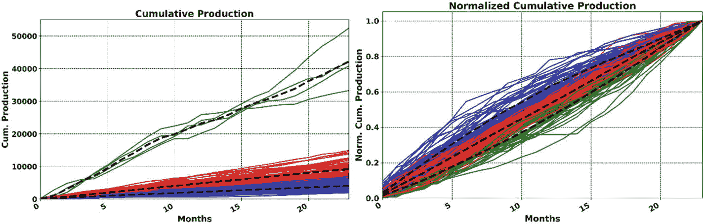

图 7-9

累计产油量聚类（左）和归一化累计产量聚类（右）显示出不同的油井群组

*   低累计产油量井（蓝色线）
*   中累计产油量井（红色线）
*   高累计产油量井（绿色线）

同样，基于归一化累计产油量的聚类也显示了三个类别的油井（见图 7-9 右）。黑色虚线显示了每个时间点的聚类均值。观察聚类均值可以清楚地看到，这三个聚类代表了以下三种不同的生产趋势：

*   产量递减（蓝色线），聚类均值斜率递减
*   产量稳定（红色线），聚类均值斜率几乎恒定
*   产量递增（绿色线），聚类均值斜率递增

通过结合基于累计产油量和归一化累计产油量的聚类，识别出九个不同的油井类别，每个类别对应累计产油量和产量趋势类别的组合（例如，高累计产量—产量递增趋势，低累计产量—产量递减趋势等）。

此外，从所分析的产量数据来看，相当数量的油井在五年或更长时间范围内出现了严重的产量下降。对于这九个类别中的每一个，通过考虑该类别中的油井总数以及未来出现严重产量下降的油井数量，计算了产量严重下降的概率。表 7-2 总结了计算出的油井在未来五年内停产的概率。

可以很容易地观察到，在本研究考虑的时间范围内，“高累计产量”聚类中的油井，无论它们属于哪个产量趋势类别，都没有显示出停产的可能性。

表 7-2

五年内停产井的概率

| 产量趋势 → | 递减趋势 | 稳定趋势 | 递增趋势 |
| --- | --- | --- | --- |
| **累计产量 ↓** | | | |
| **低** | 0.258 | **0.308** | **0.357** |
| **中** | 0.12 | 0.14 | 0.19 |
| **高** | 0.000 | 0.000 | 0.000 |
| **平均含水率与停产井概率相关系数** | 0.719563 | | |

此外，在考虑的时间范围内，低累计产量且产量稳定或递增的类别中的油井，显示出显著更高的停产概率。基于这些观察，建议对于所研究的油田，应密切监测那些累计产油量低且产量稳定或递减的新井。根据最初 24 个月的产量数据，属于这两个类别的油井应优先进行更频繁的监测活动和增产修井作业。

*   输入数据：`“Well_Monthly_Production.csv”`
*   输出：`“油井停产的概率”`
*   `Python` 代码：`“Chapter07_Well_Failure_Clustering_using_KMeans.ipynb”`
*   方法：`k-means` 聚类

## 管理依赖产量的含水率

在许多情况下，含水率（`WCT`）和气油比（`GOR`）是依赖产量的现象，可以通过降低产量来最小化。这些现象可能是高迁移率相粘性指进和/或锥进的结果。

当井底油水接触面因井底压降而形成锥形剖面，克服了油水重力分异时，就会发生水锥。水突破后，锥进会增加含水率，并显著降低产油量和采收率[14]。作业者可以以不导致水或气突破的产量进行生产。这种稳态条件下的最大产量称为*临界产油量*。临界产油量准则限制了短期收益；因此，明智地计算它至关重要，尤其是在天然裂缝性油藏（`NFR`）中。

由于具有底水驱动的天然裂缝性油藏以瞬时水突破和极高含水率而闻名，当产量过低时，在临界产油量以下生产油井可能变得不经济。因此，有必要研究在天然裂缝性油藏中进行临界产油量生产的可行性[14]。

### 预测临界产油量

通过使用商业模拟器[15]上实现的双重孔隙-双重渗透率（`DPDP`）模型，对多种具有底水的天然裂缝性油藏进行建模，开发了一个临界产油量预测器。模拟输入数据表明，少数天然裂缝性油藏的临界产油量可高达 200 桶/天，这是经济的。

在开发临界产油量的半解析模型[14]过程中，执行了以下步骤。

1.  通过将裂缝网络表示为等效的连续多孔介质，简化了天然裂缝性油藏。
2.  在用天然裂缝性油藏的等效渗透率替换基质渗透率后，用天然裂缝性油藏的模拟临界产量值验证了 Chaperon 的临界产量机理模型[16]。
3.  使用代表多种天然裂缝性油藏的设计系列模拟实验，对所得机理模型进行统计校准，以纳入被忽略的物理效应。

这些步骤得出了一个经统计校准的天然裂缝性油藏临界产油量机理模型[16]（`q[cr, fr]`），可写为方程 7.2。


(7.2)

其中，`k[f, m] = k[fh] + k[mh]`

其中，`k[fh]` 是有效裂缝渗透率，毫达西；`k[mh]` 是基质渗透率，毫达西；`k[f, m]` 是天然裂缝性油藏的平均渗透率，毫达西；`h[o]` 是油层厚度，英尺；`r[e]` 是油藏半径，英尺；`μ[o]` 是原油粘度，厘泊；`B[o]` 是原油地层体积系数；`h[op]` 是射孔段长度，英尺；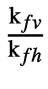 是裂缝网络的各向异性比；`q[cr, fr]` 是天然裂缝性油藏中裂缝井的临界产油量。

为了确定模型的经验分量（方程 7.1）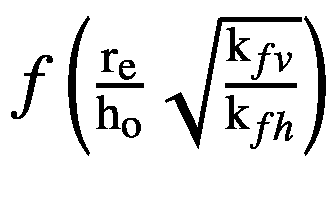，我们通过改变井-油藏属性（包括有效裂缝渗透率、基质渗透率、流度比、油藏半径、各向异性比和穿透比[17]）来设计一系列模拟实验。`Box-Behnken` 实验设计[18] [19]是一种三水平因子设计，它创建了模拟实验矩阵，在最小化实验次数的同时捕捉非线性效应。为了建立回归模型，方程 7-2 被重写为归一化临界产量 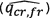 的形式，如（方程 7.3）所示。


(7.3)

# 裂缝井临界速率与最优井距预测

运行线性回归后，归一化临界速率与纵横比的相关关系表示为 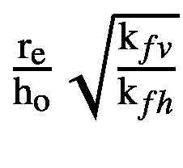，其回归系数如表 7-3 所示。

表 7-3

经验参数的回归模型，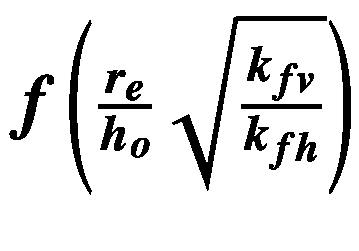

| 变量 | 系数 | t 值 | Pr > |t| |
| --- | --- | --- | --- |
| 截距 | 0.728 | 214.7 | 0 |
| 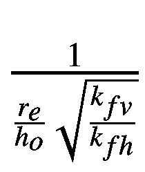 | 1.997 | 18.4 | 0 |

该回归模型与实验数据拟合良好，`R` 方值为 0.85。因此，NFR 中裂缝井临界速率的最终方程可写为公式 7.4。

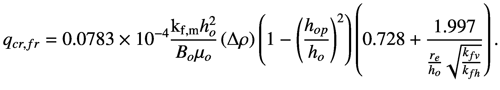

(7.4)

临界产油量作为输入参数的函数实现。

*   输入数据：“`Critical_Oil_Rate.csv`”
*   输出：“`临界产油量`”
*   Python 代码：“`Chapter07_Critical_Oil_Rate_Predictor_using_OLS.ipynb`”
*   方法：多元线性回归方法

```python
import statsmodels.api as sm
from statsmodels.tools.tools import add_constant
import pandas as pd
import statsmodels
df = pd.read_csv("Critical_Oil_Rate.csv")
Y = df.normalized_criticalrate.values
x = df.Empirical_component.values
X = sm.add_constant(x) # adding a constant
model = sm.OLS(Y, X).fit()
predictions = model.predict(X)
model.summary()
```

OLS Regression Results
Dep. Variable: `y`   R-squared:               0.850
Model:                     OLS   Adj. R-squared:          0.847
Method:          Least Squares   F-statistic:             339.5
Date:         Wed, 15 Jul 2020   Prob (F-statistic):   2.21e-26
Time:                 21:36:44   Log-Likelihood:         170.01
No. Observations:           62   AIC:                     -336.0
Df Residuals:               60   BIC:                     -331.8
Df Model:                    1
Covariance Type:     nonrobust
coef    std err          t      P>|t|      [0.025      0.975]
`const`                   0.7277      0.003    214.698      0.000       0.721      0.734
`x1`                      1.9969      0.108     18.426      0.000       1.780      2.214
Omnibus:                119.548   Durbin-Watson:          1.967
Prob(Omnibus):            0.000   Jarque-Bera (JB):    5122.268
Skew:                    -6.193   Prob(JB):               0.00
Kurtosis:                45.772   Cond. No.               53.9

## 推荐 NFR 中的最优井距

极限含水率定义了存在水锥的油藏中理论上的最大含水率，它决定了底水油藏中经济可采油量的上限。在此类油藏开采过程中，水锥形成阶段含水率会快速上升，随后在无边界油区（无限大油区）中含水率趋于稳定（极限含水率）。然而，在多井油藏中，每口井均受无流动边界（`NFB`）约束，含水率不会稳定，而是表现为缓慢的含水率上升/推进速率。这是因为有限边界油藏中的原油被采出，导致含水率缓慢上升。

如果井的泄油面积足够大，其尺寸超过水锥的横向长度（在水锥形成（扩展）阶段结束时），则对于 `NFB` 系统，后期含水率缓慢推进阶段主要受油层采出程度控制，因为水锥扩展的影响变得可忽略不计。

后期含水率可能导致产油不经济，因此井的采收率主要受水锥扩展结束时间控制。这意味着最优井的泄油半径应等于水锥的横向长度，从而使井的原油采收率最大化。这一概念如图 7-10 所示。该最小井间距定义为阈值井距，或两倍井的阈值泄油半径 [14]。

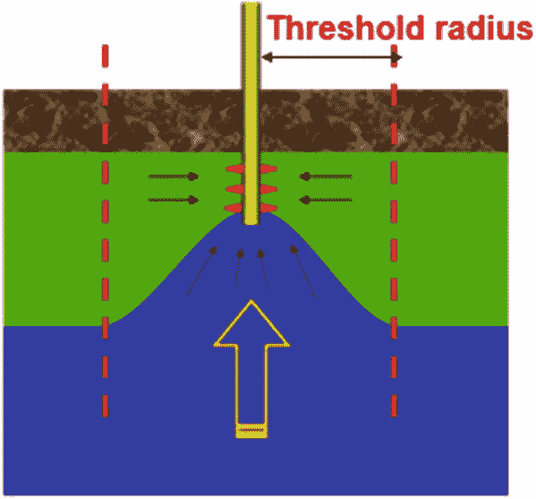

### 预测阈值储层半径

阈值半径可通过大量模拟实验进行统计确定，这些实验针对多种井/储层系统，通过改变包括水平渗透率（`k[h]`）、各向异性比（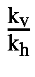）和穿透比（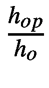）、油层厚度（`h[o]`）、流度比（`M`）以及含水层厚度（`h[w]`）等属性。`Box` 和 `Behnken` 方法可以设计一个模拟实验矩阵 [18]。该设计规定了总共 54 次不同的模拟运行（储层/含水层系统），通过系统性地增大泄油面积直至其等于最大水锥的横向长度来确定阈值半径。然后利用这些结果，通过多元二阶多项式回归，推导出一个用于计算阈值泄油半径 `r[eTh]` 的经验公式。

预测阈值储层半径的公式如下：

![$$ {\mathrm{r}}_{eTh}=14920.6-3563.7\mathrm{M}-68.5{\mathrm{h}}_{\mathrm{w}}-34586\frac{{\mathrm{k}}_{\mathrm{v}}}{{\mathrm{k}}_{\mathrm{h}}}+99.65{\mathrm{h}}_{\mathrm{o}}+288{\mathrm{M}}²+0.107{\mathrm{h}}_{\mathrm{w}}²+31290{\left(\frac{{\mathrm{k}}_{\mathrm{v}}}{{\mathrm{k}}_{\mathrm{h}}}\right)}²+1.5\mathrm{M}{\mathrm{h}}_{\mathrm{w}}-0.55M{\mathrm{k}}_{\mathrm{h}}-10.13{Mh}_{\mathrm{o}}-0.087{\mathrm{h}}_{\mathrm{w}}{\mathrm{h}}_{\mathrm{o}}+0.1{\mathrm{k}}_{\mathrm{h}}{\mathrm{h}}_{\mathrm{o}}. $$](img/480430_1_En_7_Chapter_TeX_Equ5.png)

(7.5)

以下是作为输入参数函数的阈值储层半径预测器的实现。

- 输入数据：`Threshold_reservoir_radius.csv`
- 输出：“阈值半径值”
- Python 代码：`Chapter07_Threshold_Radius_Predictor_using_OLS.ipynb`
- 方法：多元线性回归方法

```
import statsmodels.api as sm
from statsmodels.tools.tools import add_constant
import pandas as pd
import statsmodels
from statsmodels.stats.outliers_influence import variance_inflation_factor
df = pd.read_csv("Threshold_reservoir_radius.csv")
Y = df.threshold_radius.values
x = df.drop(['threshold_radius' ], axis=1)
vif = pd.DataFrame()
vif = [variance_inflation_factor(x.values, i) for i in range(x.shape[1])]
print(vif)
X = sm.add_constant(x) # adding a constant
model = sm.OLS(Y, X).fit()
predictions = model.predict(X)
model.summary()
OLS Regression Results
===========================================================================================
Dep. Variable:                              y   R-squared:                            0.693
Model:                                    OLS   Adj. R-squared:                       0.654
Method:                         Least Squares   F-statistic:                           7.67
Date:                        Sat, 02 May 2020   Prob (F-statistic):                1.39e-10
Time:                                23:17:49   Log-Likelihood:                     -512.69
No. Observations:                          54   AIC:                                   1039.
Df Residuals:                              47   BIC:                                   1053.
Df Model:                                   6
Covariance Type:                    nonrobust
===========================================================================================
coef     std err         t    P>|t|       [0.025      0.975]

const                       6094.0420    1815.138     3.357    0.002     2442.455    9745.629
Oil-zone thickness            71.2688      10.830     6.581    0.000       49.482      93.055
Mobility                    -888.1647     144.831    -6.132    0.000    -1179.528    -596.802
Aquifer thickness            -10.5367       2.554    -4.125    0.000      -15.675      -5.398
Horizontal permeability        5.0949       2.719     1.874    0.067       -0.375      10.565
Penetration ratio           -275.2788    2302.091    -0.120    0.905    -4906.489    4355.932
Anisotropy ratio           -1728.2702    1189.820    -1.453    0.153    -4121.879     665.339
===========================================================================================
Omnibus:                                7.561   Durbin-Watson:                         1.358
Prob(Omnibus):                          0.023   Jarque-Bera (JB):                     6.630
Skew:                                   0.762   Prob(JB):                             0.0363
Kurtosis:                               3.791   Cond. No.                           1.73e+03
===========================================================================================
```

## 总结

在本章中，我们简要概述了采油工程。我们还讨论了生产优化以及预测油井产量表现的公式。通过使用基于第一性原理模型生成的逼真合成数据，我们向您展示了用于虚拟计量的机器学习方法。虚拟计量示例演示了如何利用从油井获取的传感器数据来持续监测单井的生产情况。本章的其中一节还提供了使用历史生产数据实现机器学习算法以预测即将发生的油井故障的示例。

在本章的最后几节中，我们讨论了预测临界油产量以及在天然裂缝性储层中确定最优井距的问题。我们希望您能够深入理解如何将传感器数据和生产数据与机器学习算法相结合，以解决在生产作业过程中观察到的采油工程问题。