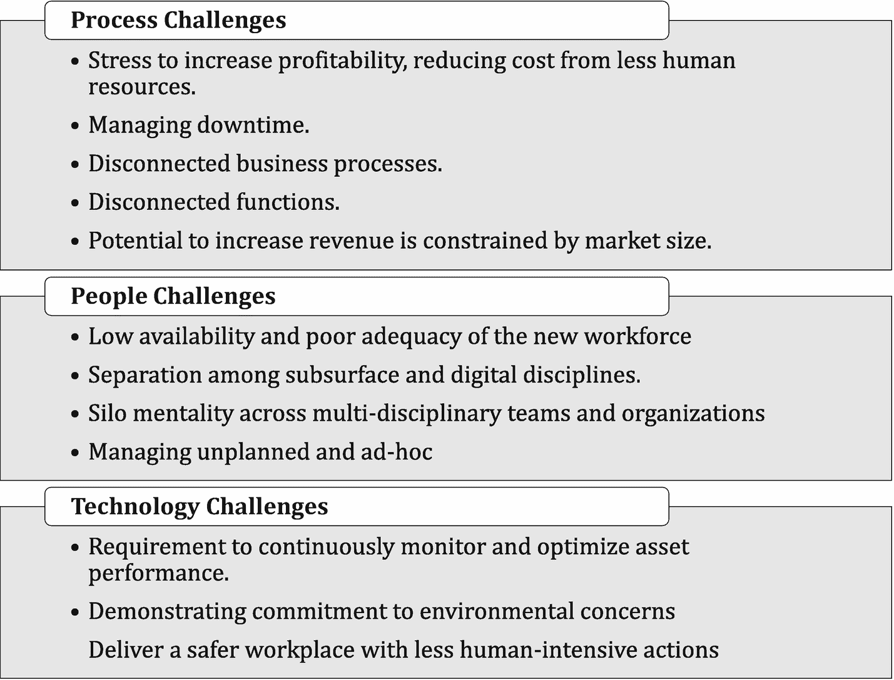
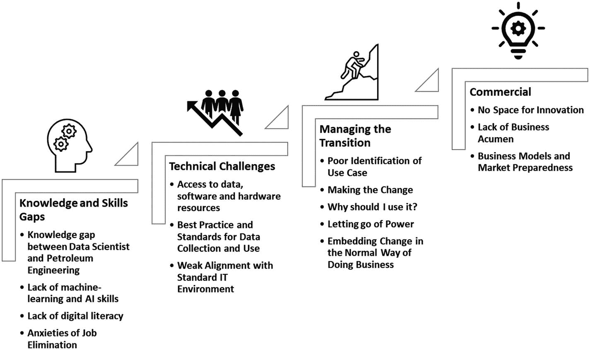
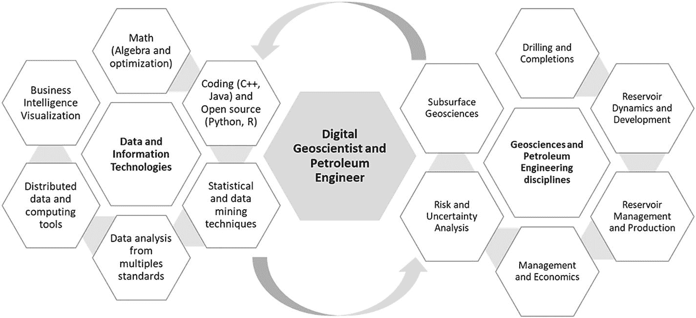

# 8. 机遇、挑战与未来趋势

在接下来的三十年（2020 年至 2050 年）间，人均国内生产总值预计将以每年平均 2%至 4%的速度增长。由于许多制造业基地向非洲、南亚和印度转移，非经合组织国家的增长速度将是经合组织国家的两到四倍[1]。石油和天然气行业将继续呈现增长态势。2018 年，全球超过一半的能源需求由石油和天然气行业提供[1]，并且到 2050 年，它仍将提供高达 50%的能源结构。这些增长预测是在 2020 年新冠疫情爆发之前做出的。

然而，三个相互关联的挑战正困扰着石油和天然气行业：盈利能力、环境影响和替代能源；这些挑战对资源获取、产量增长和可持续性构成了限制。

*   由于产能建设能力大于需求增长，大宗商品价格和盈利能力往往受到限制。在油气价格较高（即高于 50 美元/桶）的时期，更多国家会加速开发高成本资源的潜力。低成本产油区无论全球价格趋势如何都能生存。为了以更低的单位成本进行勘探、开发和生产，运营公司期望用更少的人力资源和技术资源获得更高的产量。

*   石油和天然气行业被视为所有能源行业中的“害群之马”。除非该行业持续投资于减少其环境足迹——无论是通过更精简的地面作业现场还是更低污染的加工燃料——否则碳氢能源的可持续性将受到威胁。利用二氧化碳进行提高采收率为可持续性提供了一种选择。

*   碳氢化合物主要用于工业部门、交通运输和发电。随着终端消费转向电力使用，几种替代能源（如太阳能、核能和风能）正变得越来越受欢迎，通过为新消费者提供激励性接入、持续降低单位成本和更清洁的选择来满足这一需求。此外，经合组织国家和非经合组织国家的环境保护政策都倾向于太阳能、核能和水力能源。这种情况降低了碳氢化合物在全球需求结构中的增长速率。

在未来几十年里，石油和天然气行业将重新定义自身，只有通过创新才能巩固其长期地位。利用“油气 4.0”对传统碳氢化合物行业进行转型，可能成为其在未来 30 至 50 年持续发展的游戏规则改变者；数字化可以为创新提供独特的基础，同时提高公众意识和人类生活质量。自动化和机器人化的现场作业和办公流程可以在降低成本的同时，改善人们的生活和社会质量。

本章旨在概述该行业在应用机器学习和人工智能方面所面临的机遇与挑战。同时，它还将概述各种用例和技术中预期的未来趋势，这些趋势可能塑造石油和天然气行业在未来三十年中的发展方向。

## 应用机器学习的挑战与机遇

石油和天然气行业要在未来几十年内保持可持续发展，面临着诸多挑战。这些挑战可以从不同角度列出：股东角度（盈利能力和业务可持续性）、员工幸福感与效率、业务流程以及技术（见图 8-1）。

从股东的角度来看，盈利能力和可持续性是最普遍的目标。它们最终受到价格、产品需求、单位净成本、安全绩效、员工满意度和环境足迹的影响。从员工的角度来看，常见的挑战涉及如何实现个人目标（例如，薪酬、发展和成长）以及员工如何为公司目标做出贡献（例如，信息共享、创新、持续改进思维、效率）。从业务流程的角度来看，公司部署高效的方法，以持续简化从勘探、开发、生产到加工碳氢化合物的产品转化过程。

图 8-1

石油和天然气行业应用机器学习和人工智能的挑战与机遇

### 流程挑战与缓解措施

以下重点列出了与流程相关的主要挑战及建议的缓解方案。

*   **挑战**：企业持续面临提升盈利能力的压力，主要通过减少人力资源来降低成本，但这导致工作时间比平时更长，工作场所的安全性降低。未来一代将不得不以更少的资源完成更多的工作，从而在单位时间内产生更多成果，并降低单位成本。

    **缓解措施**

    *   使用机器人化操作实现钻井现场作业自动化，并利用高级数据分析进行事件检测，重点关注异常关键事件（例如，卡钻和井漏）。

    *   实现生产监控自动化，增加对井场参数的持续数据分析，同时通过基于异常的监控（`EBS`）实现常规油井分析，重点关注关键井况。

    *   实施油井和油藏性能分析，以主动识别机会，同时专注于高附加值活动 [2]。

    *   通过自动化的常规操作建议，实现人工智能辅助的复杂决策。

*   **挑战**：管理停机时间。油气产能的一个关键组成部分是设施需要关闭的时间以及无法达到预期产能的情况。一个关键挑战是尽可能将这些时间段保持得低且可预测。意外、计划外的停机时间可能会显著增加单位运营成本。

    **缓解措施**

    *   实施数据分析和业务流程，以预测意外事件、跟踪停机时间、产量损失（即`产量延迟`），以及计划内与计划外停机的原因。

    *   实施事件分类，以便对所有计划外停机事件进行根本原因分析（`RCA`）。

*   **挑战**：业务流程脱节，以及由于“筒仓思维”带来的挑战，导致职能组织设计困难。对于一些综合性的油气公司，关键业务流程通常在跨职能以及职能内部之间脱节。

    **缓解措施**

    *   实施跨职能的关键绩效指标（`KPI`），并使用业务分析仪表板在组织的多个层级共享这些指标。

    *   定义跨职能共享的关键角色和职责，并进行共享。

*   **挑战**：在上游层面，生产运营、油藏管理、油田开发和钻井通常是相互脱节的职能。这阻碍了对提升业务绩效机会的全局优化。是修复一口高含水井更好，还是钻一口新的泄油井更好？

    **缓解措施**

    *   实施一个集成的油井性能提升机会识别与排序流程，该流程涉及多目标约束下的全局优化目标函数，兼顾短期和长期目标。

    *   基于集成的、符合物理原理的方法，利用深度学习实现更快、更可靠的预测。

*   **挑战**：在公司层面，上游和下游有着截然不同的关键绩效指标（`KPI`）。尽管原油销售利润更高，但增加收入的潜力通常受市场规模限制；因此，增加利润的选择是在不损害上游义务的前提下，最大化下游产品的收入。

    **缓解措施**

    *   实施公司层面的计划和排程流程，该流程涉及多目标约束下的全局优化，兼顾短期和长期目标。这包括使用无梯度方法和先进的进化优化技术。

### 人员挑战与缓解措施

以下重点列出了与人员相关的主要挑战及建议的缓解方案。

*   **挑战**：新劳动力的可用性低且素质不足，加剧了可持续性目标的实现难度。年轻专业人员可能不具备应对即将到来的挑战所需的能力水平，并且需要很长时间才能得到培训。

    **缓解措施**

    *   在本科和研究生课程中纳入混合型学术大纲。

    *   提供公共数据集，使学生和研究界能够熟悉典型数据集，为行业设定标准分析和机器学习问题的期望。

    *   实施`企业文档管理`（`EDM`）和利用`自然语言处理`（`NLP`）的知识搜索，通过更好的技术信息共享和知识利用来优化资源利用。

    *   实施机器人工程师助手：支持 `NLP` 和语音识别的聊天机器人，可访问大型知识库。

    *   更快地教育新一代掌握最重要的内容（例如，创建侧重于机器学习和数据分析的本科油气项目）。

*   **挑战**：地下学科与数字学科之间的分离。通常，大多数工程和地质学科，特别是那些拥有最丰富油田经验的人员，缺乏解决涉及数据和流程自动化问题的数字化导向。

    **缓解措施**

    *   为新员工实施短期在职培训项目，涵盖油气行业中机器学习和人工智能的关键方面。

    *   促进技术与数字专业之间的交叉任职项目。

*   **挑战**：管理跨多学科团队和组织中的“筒仓思维”是各行业长期存在的挑战 [3]。在这种情况下，个人和团队缺乏共同目标，阻碍了他们共享关键数据和信息。这种心态最终会影响效率和员工士气。

    **缓解措施**

    *   实施协作项目管理，使正在进行的工作具有可见性。

    *   奖励团队合作，支持那些提出新想法的人、分享经验教训的人，以及保护和分享知识的人。

    *   提供知识共享和思想培育的环境。

*   **挑战**：管理计划外和临时性工作，需要人员偏离其原有职责，从而影响公司目标的实现。如果这成为常态，则表明职能设计有误和/或可用（人力）资源在数量和质量上不足。

    **缓解措施**

    *   实施数据分析和业务流程，以跟踪临时性工作以及计划内与计划外停机的原因。

### 技术挑战与缓解措施

以下重点介绍了最相关的技术挑战及建议的缓解方案。

*   **挑战**：需要持续管理（监控、优化和控制）资产性能。石油和天然气生产需要持续了解油藏、油井和设施；然而，这些目标必须在资源有限的情况下实现，而现有资源只能看到运营的一小部分。这是由于缺乏能够深入洞察工艺状态的传感器和技术。

    **缓解方案**

    *   实施数据分析和业务流程，实现资产`基于异常的监控`（`EBS`）自动化，重点关注关键井况。

    *   实施机器学习模型，在考虑不确定性的情况下持续搜索最优资产运行包络线。

    *   实施一个具备自动化常规操作建议功能的、由人工智能辅助的复杂决策引擎。

*   **挑战**：在向股东提供最大回报的同时，展示对环境问题的承诺。

    **缓解方案**

*   通过永久性仪表处理、包含无人机和卫星图像在内的数字图像处理视频监控，以及人机交互机器人技术，实现常规 HSE 检查的自动化，重点关注关键事件。

*   实施涉及多目标约束优化目标函数的分析流程，以寻求更优质的燃料和高利润产品。

*   `挑战`：打造更安全的工作场所，减少人力密集型操作和决策过程。实现运营和流程的 7x24 小时高可用性运行，降低人力需求。

    **缓解方案**

    *   实现生产监控和油田作业的自动化。

    *   实现常规 HSE 检查，包括在关键区域使用联网可穿戴安全设备。

    *   实现常规操作的自主和远程控制：节流阀、气举、频率等。

## 采用机器学习的障碍

这些障碍可能出现在任何机器学习和人工智能项目执行之前、期间和之后（见图 8-2）。这些障碍一旦被正确识别，就应予以缓解，因为它们会危及可持续性，并可能在项目执行的任何阶段扼杀创意。这些障碍是根据经验及文献中的各种参考资料总结得出的。

### 知识与技能差距

了解人员技能方面的差距对于可持续地实施机器学习和人工智能解决方案至关重要。多学科知识差距、缺乏机器学习和人工智能技能、数字素养不足以及对失业的焦虑，是这些技术在行业内更广泛采用的一些障碍。

#### 数据科学家与石油工程师之间的知识差距

石油工程是一门经常被迫在数据匮乏的情况下做出决策的科学；这催生了大量关于统计学、不确定性管理和分析的知识体系。然而，上游领域中的现代机器学习和高级数据分析技术仍处于起步阶段。

此外，拥有高级数据科学技能的个人可能并不熟悉石油和天然气行业的工程实践。

缓解这一挑战的方法是培养精通两个领域的人才，并开展跨领域培训。

*图 8-2 石油和天然气行业采用机器学习和人工智能的障碍*

#### 缺乏机器学习和人工智能技能

石油和天然气专业人员通常未接受过处理高级机器学习和人工智能技术的培训。正如历史上许多运营商和服务公司所见，只有一小部分专业人员选择通过自学来应对新技术的应用。机器学习和人工智能领域也不例外，只有少数人能理解此类技术的完整应用。

缺乏机器学习技能是一个关键障碍，它阻碍了组织充分利用其数据的价值。

新劳动力的可用性低和适应性差加剧了行业的可持续性目标。年轻专业人员可能不具备应对即将到来的挑战所需的能力水平，并且需要较长时间进行培训。

在降低成本和人力压力的驱动下，需要招聘不同类型的员工，或者培养能够更充分利用人工智能应用的新型或新一代劳动力。

#### 缺乏数字素养

石油工程师和管理专业人员能够应对有限程度的数字知识。然而，当谈到机器学习和人工智能时，个人需要拥有更广泛的词汇量、对计算机更深入的理解以及数字系统知识。这涉及构建数字解决方案的通用知识，包括其所有组成部分：定义问题目标、用例、算法、工作流程、数据以及硬件和软件需求。

将机器学习和人工智能解决方案扩展到更广泛的基于用户的生产环境是一项更复杂的任务。我们相信，新兴一代将拥有更高的数字素养和吸收数字世界中更多数据的能力。

新一代将适应并要求更多数据驱动的应用。

#### 对失业的焦虑

从历史上看，所有工业革命都意味着劳动力需要适应其他技能要求。

正如技能差距所揭示的那样，人们确实担心有一天机器会变得超级智能，由机器学习和人工智能主导的数字化转型将大规模地消除工作岗位。这进一步引发了人们对机器学习和人工智能应用的负面反应。

### 技术挑战

在技术方面，一些障碍会随着时间推移而轻易消除，这包括获取机器学习资源（数据、软件和硬件）、缺乏数据使用的最佳实践以及 IT 环境的一致性。

#### 获取数据、软件和硬件资源

石油和天然气行业可能缺乏在其大部分运营中运行高级数据分析所需的基础设施。数据通常位于无法被充分利用的地方（例如，在那些对如何使用数据知之甚少的现场作业中）。

网络安全限制也构成了障碍；它会导致项目延迟，直到企业 IT 人员完全理解数据操作工作流程。过于严格的 IT 策略会阻止用户协作和分享有关机器学习应用的知识。这些策略还会阻止用户下载和执行开源软件和编程语言，例如 R 和 Python。

#### 数据收集和使用的最佳实践与标准

尽管有大量用于机器学习和人工智能应用的开源资源，但对于数据的收集和使用，既没有既定的最佳实践，也没有标准的操作程序。

#### 与标准 IT 环境弱对齐

尽管许多软件资源是开源的，但在启动新项目时，缺乏支持机器学习和人工智能应用的企业 IT 环境通常是一个令人担忧的问题。

虽然越来越多的商业解决方案能够轻松实现从创新到软件开发和运维环境（DevOps）的过渡，但在与现有遗留系统对接，以及从企业架构角度维护解决方案方面，仍然存在顾虑[4]。

### 管理过渡

妥善管理变革能让我们成为赢家。这些过渡要素包括：正确识别用例、打破现状、阐明拥抱变革的原因、放下权力，以及将解决方案嵌入现有业务流程。

#### 用例识别不当

准确识别新方案试图解决的问题，是任何新应用开发项目中的关键步骤。对所需用例的识别不当，可能会在后续毁掉机器学习应用开发的努力，并给团队带来挫败感。

#### 推动变革

安于舒适区会阻碍新应用进入市场并取代传统应用。打破现状使得创新应用更难进入主流。

#### 心理因素：我为何要使用它？

一系列心理因素会影响新技术的采纳。这些因素包括：僵化的思维模式、风险规避、早期采用者的犹豫、缺乏信任、“非我发明”心态、嫉妒、社会规范、过往经验，以及领导力和文化等组织层面的因素[5]。

研究表明，对自动化的显性信任倾向与隐性态度之间并无显著相关性[6]。因此，类比机器学习和人工智能，这些心理因素的组合会阻碍新应用的采纳。

#### 放下权力

人工智能应用以更民主化的方式使用数据，包括在整个组织内分发数据洞察，这可能会危及许多个人的权力地位。对特定数据集的控制权紧握不放，是跨行业的常见不良做法。

#### 将变革嵌入常规业务方式

一个挑战在于管理这些新应用可能给组织带来的变革。

变革管理分为两种类型：（1）新的机器学习应用改变了现有流程，使其更加高效；（2）新应用创建了一个全新的流程。在这两种情况下，所识别的用例都应明确定义新应用交付价值的业务流程和治理机制。

### 商业障碍

组织在商业层面面临障碍，原因在于没有为创新留出空间、缺乏商业敏锐度，以及缺乏合适的商业模式和市场准备，无法在供应商和客户之间创造双赢局面。

#### 没有创新空间

运营人员通常负责运维预算，并承受着将其控制在目标范围内的压力。另一方面，运营人员可能没有任何动力去开发会彻底改变其工作方式的新应用。这阻碍了机器学习/人工智能技术应用的任何创新机会，而这些创新最终可能为利润底线增加价值。

#### 缺乏商业敏锐度

缺乏足够有力的增值案例来支持新应用的资本支出。工程师和运营人员往往缺乏制定商业案例所需的财务敏锐度。

此外，很难设定恰当的成功衡量标准，或是以可量化的产量或收入增长来定义财务回报目标。

因此，组织可能没有准备好适当的预算项目，从而无法开展机器学习项目。

#### 商业模式与市场准备

由于机器学习和人工智能应用是作为新的市场产品出现的，并非所有软件供应商都能完全把握其工具/解决方案应有的商业模式。

这可能涉及按席位收费还是按资产收费、固定费用还是公益性质、永久许可还是租赁、按交易次数还是按 `CPU`/`GPU` 数量、批量折扣等讨论。

这些讨论可能会在技术供应商和客户之间引发冲突，导致冗长的争论，有时甚至会损害双方关系。

## 机器学习和人工智能赋能油气行业数字化转型

如果各种促成因素成为现实，包括更多机器学习/人工智能领域的专业人才、扩展的井场传感能力、可穿戴设备的普及、更完善的法规实施，以及政府机构中人工智能工具使用率的提升，那么机器学习和人工智能将能够赋能油气行业的数字化转型。

### 人员技能

在油气行业的某些领域，机器无法轻易取代人类的贡献。未来的石油工程师将从传统的繁琐任务中解放出来，需要更多地专注于创造性工作，包括创新的多孔介质开采机理、碳氢化合物在社会中角色的开创性商业模式、环保材料的新用途、经济高效的设施延寿方案等。

#### 未来的人才需求

未来，在数字化、分析技术和人工智能的赋能下，碳氢化合物行业将需要更复杂、更具创新性的思维模式和技能组合。这将使从业者能够吸收来自多个领域的分析洞察。总的来说，这有望带来一个更安全、利润更高的行业，员工工作时间更短，工作与个人生活也能实现更好的平衡。

在应对当今数字化世界时，能源专业人士将掌握一系列技能，包括计算升级、系统维护，以及从探索性数据分析到基于异常的监控规则编程等数据处理技能（见图 8-3）。

*图 8-3 未来的数字地球科学家和石油工程师*

### 推动机器学习进一步发展的促成因素

若干促成技术和法律框架可能会极大地改变机器学习和人工智能在油气行业的采纳方式。这些因素为机器学习创造了更多机会，也为井筒和油藏建模及解释开辟了新的范式。

#### 井筒与油藏传感技术

# 未来传感技术的普及

未来传感技术的普及，包括沿井筒和井筒外的声学与电磁传感，将能够实时追踪饱和度和压力在时间和空间上的变化。这将为数据分析和人工智能开辟充满挑战的新途径。

## 利用社交与人类传感器进行大规模数据采集

在大型无线传感器应用方面，石油和天然气行业落后于其他行业（例如金融、医疗和市场营销）[7]。这些传感器可能来自多种来源：可穿戴联网设备、社交网络、多领域协作，或任何物联网设备网络。

## 人工智能政策制定

随着机器学习和人工智能在社会和企业世界中扮演越来越重要的角色，政府和组织制定政策的需求也日益明显[8]。政府政策和全球合作协议可以极大地加速（或减缓）机器学习和人工智能在社会各层面的进步与采用，涵盖健康、食品、服务、能源、交通和教育等领域。

## 政府组织对人工智能的采用

政府在采用人工智能方面面临着诸多挑战[9]，包括数据的有效利用、人员技能、人工智能生态系统、遗留文化和采购机制。然而，像阿联酋这样的国家在人工智能采用率上的变化，可能对石油和天然气行业的机器学习/人工智能发展产生巨大影响。公民满意度与政府采用率之间存在很强的相关性[10]。

## 机器学习与人工智能技术前景

毫无疑问，机器学习和人工智能在过去十年中取得了指数级的进步[11]。这种加速的步伐表明，相关的科学和技术在未来十年也将继续发展[12]。

人工智能将在我们的日常生活中扮演常规角色[13]，包括石油和天然气行业。人工智能将在解决未来十年关键工程挑战方面发挥关键作用[14]；特别是，它将解决钻井[15]、生产和油藏工程中的许多挑战。

### 深度学习

机器学习模型的性能会随着数据可用性的增加而提升。深度神经网络具有利用更多数据的潜力。以下是深度学习应用的示例。

*   自动化钻井作业需要对时间序列数据进行正确的事件分类。一个基于语义分割的离线模型与基于 `CNN` 的推理模型并行运行，可以在实时钻井分析系统中以 99% 的准确率对钻机状态进行分类和预测[16]。

*   得益于机器学习和人工智能辅助的复杂事件检测，水力压裂作业持续改进。这些事件包括压裂阶段开始和结束、球座操作识别以及泵速周期的分类。一个基于 `CNN` 和 `U-Net` 架构的深度学习应用提供了水力压裂事件的实时自动解释[17]。

*   测井解释通常被视为一项耗时的任务，其主观结果会给油藏研究增加不必要的不确定性。使用多种建模技术（即用于监督分类的模型堆叠）的自动岩石物理解释，在缩短地下模型研究周期和提高预测质量方面前景广阔[18]。

*   通过目视检查钻屑来识别岩性和流体，是油气检测、井位部署、地下导航以及最终优化油田开发成本所必需的。然而，这类任务通常被认为附加值低，因为它依赖于主观解释。近年来，使用 `CNN` 进行视觉识别在该领域已变得流行。

*   使用深度学习技术可在钻机现场实时对岩屑量进行分类[19]。在将每一帧视频输入分类模型之前，会进行归一化和主成分分析。

*   由于图像类别之间高度相似，钻屑图像分类十分困难。一个贝叶斯优化的 `CNN` 集成方法优于其他已知方法，尤其是在参数空间巨大的情况下[20]。

### 强化学习

在数据量庞大的领域，强化学习具有巨大的潜力。强化学习对数据的需求量很大。一项基于井数据的深度强化学习应用被提出用于优化注水[21]。`AI` 代理可以通过使用压力和相监测等可用数据来学习油藏行为。经过训练的代理可以预测其策略变化如何影响目标函数。

### 多物理场模型

传统的基于静态和基于流动的升尺度方法，用于从离散裂缝模型生成等效连续介质模型，存在精度低和计算成本高的问题。能够像数据驱动模型一样快速运行的详细流体流动模型，在石油和天然气行业中一直备受关注且具有价值。一种基于物理的深度学习方法被用于对裂缝介质构建的等效连续介质模型的高分辨率图像进行升尺度处理[22]。

### 人工智能的未来

由于人工智能具有处理信息的程序化能力，人们一致认为，未来人工智能将提供更多情境化信息[23]（见表 8-1）。

#### 表 8-1

人工智能的各个浪潮（源自[23]）

| 主要 AI 浪潮   | 第一波（<2000 年）          | 第二波（过去十年）                     | 第三波（未来）                       |
| :------------- | :------------------------- | :------------------------------------- | :----------------------------------- |
| **描述**       | 分类                       | 解释                                   |                                      |
| **主要范围**   | 由人类定义的知识结构；算法探索具体细节 | 针对特定问题领域、基于数据训练的统计模型 | 针对现实世界现象类别的情境化解释模型 |
| **能力**       | 能够对狭义定义的问题进行推理 无学习能力，处理不确定性能力差 | 细致的分类和预测能力 无情境化能力，推理能力极弱 | 模型驱动决策 模型生成关于测试字符可能如何创建的解释 |

### 可解释人工智能

随着机器学习/人工智能模型性能的提升，理解和解释它们也变得越来越困难。可解释人工智能的目标是生成具有同等优越性能（即高预测精度）的自我解释型机器学习模型，同时使个人能够理解和信任这些模型[24]。

### 计算语言学家

计算语言学家致力于自然语言的统计或基于规则的建模。实现超越人类水平的人工智能，取决于直接阅读自然语言文本中文档的能力 [25]。

考虑到石油和天然气行业中人工智能辅助对话引擎的兴起（例如，`Nesh` [26]、`Sandy` [27]、`Willow` [28] 及其他 [29]），我们有理由相信，自然语言处理将在未来十年机器学习与人工智能应用的发展中发挥关键作用。

### 聚焦重点举措

有时，采取“煮干大海”式的方法会导致挫败感和过早的幻灭。同时推进过多举措，并试图在所有方面证明其价值，可能最终一无所获。因此，建议聚焦于少数几个举措，并尝试在有限的范围和较短的时间内证明其价值。一旦利益相关者确认并沟通了回报，就会有更大的动力去推进更大型的工作。

### 数据即资产

没有大型数据库，构建强大的机器学习应用并非易事。因此，除非各行业决定公开共享有意义的数据集（例如，挪威 `Volve` 油田数据集）以合作构建稳健的应用，否则这将仅限于少数公司。即使是大型服务公司或运营商，也未能掌握理解油田运营复杂性的完整数据集。这可能会对供应链成本降低，或油田领域通过广告、供应商和公司盈利的新业务线的出现产生影响。

### 推动更多创意被采纳

机器学习和人工智能应用正作为一种新型的工程或科学方法崭露头角。当今所做的许多工作，都是寻找完美算法的实验性步骤。石油和天然气公司才刚刚开始投入大量精力来制定数据驱动应用的蓝图。

许多举措仍处于创意和概念验证阶段；然而，只有少数创意会进行小规模试点，而其中只有一小部分会作为主流产品推出。

与此同时，石油和天然气行业需要进行大量的试错。如果不尝试，石油和天然气行业就无法取得其他行业已实现的成就。为此，需要一种成长型思维。

也许有些创意尚未成熟到可以大规模应用，但试错是必要的。

## 总结

石油和天然气行业在未来几十年将继续在我们的社会中发挥关键作用，其可持续性取决于我们应对和缓解关键流程、人员和技术挑战的能力。

石油和天然气行业的“流程”挑战包括：管理停机时间、连接其业务流程，以及优化碳氢价值链，以提供可持续的行业和可靠的社会能源。

人员挑战包括：解决持续性问题所需劳动力的可用性低且适配性差，而地下学科与数字学科之间的分离、跨多学科团队和组织的“筒仓思维”管理，以及对计划外和临时性工作的优先排序，都加剧了这一问题。

技术相关挑战包括：持续管理（监控、优化和控制）资产性能的需求，在展示对环境问题的承诺的同时为股东提供最大回报，以及通过减少人力密集型操作和决策流程来提供更安全的工作场所。

机器学习和人工智能技术应用在石油和天然气行业仍处于起步阶段；因此，年轻专业人士拥有巨大的机会来施展才华并寻找职业发展路径。主要障碍存在于知识技能与差距、技术挑战（包括缺乏标准、与传统 `IT` 部门协调不力），以及变革方面（包括清晰的用例定义和将变革嵌入现有流程）。

在商业层面，机器学习和人工智能技术仍缺乏一个行业框架，以在创新与可持续商业模式之间取得平衡。这种情况不仅存在于石油和天然气行业，也普遍存在于许多行业。

关键数字技术的演进将为机器学习和人工智能技术在石油和天然气行业铺平更好的道路，包括通过可穿戴设备实现经济高效的井场传感器和海量数据采集。

机器学习和人工智能核心技术（包括深度学习和可解释人工智能）的持续进步，是提升其在包括石油和天然气在内的众多行业中可用性的关键因素，这将促成更多变革性和增值的流程。

针对机器学习和人工智能使用的政策制定，加上大型政府组织对其采纳度的提升，将促进机器学习和人工智能在所有领域的应用。因此，这将为石油和天然气行业在未来几十年的发展提供动力。