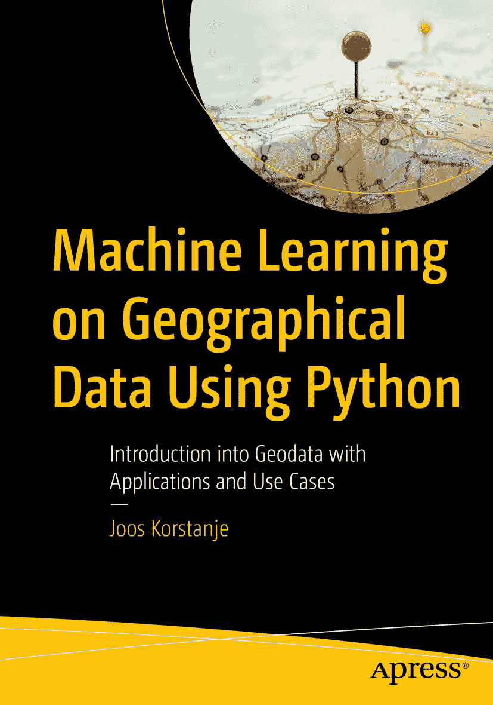

<!--

ISBN 978-1-4842-8286-1 e-ISBN 978-1-4842-8287-8 [`doi.org/10.1007/978-1-4842-8287-8`](https://doi.org/10.1007/978-1-4842-8287-8) © Joos Korstanje 2022 Apress Standard 本出版物中使用的通用描述性名称、注册商标名称、商标、服务标志等，即使未作明确声明，也不意味着这些名称不受相关保护性法律和法规的约束，因此可自由使用。出版商、作者和编辑可以合理假定，本书中的建议和信息在出版之日是真实准确的。出版商、作者或编辑均不对本书所含材料或可能存在的任何错误或遗漏提供明示或暗示的担保。出版商对已出版地图中的管辖权主张和机构隶属关系保持中立。

本 Apress 印记由隶属于 Springer Nature 的注册公司 APress Media, LLC 出版。

注册公司地址为：1 New York Plaza, New York, NY 10004, U.S.A.
-->

# 引言

长期以来，空间数据在一般数据科学和统计学课程中一直是被忽视的数据类型。然而与此同时，空间分析领域却得到了长足发展。由于工具和方法的差异，这两个领域长期以来一直在各自的环境中独立发展。

随着数据在许多商业环境中的普及，处理空间数据的重要性也与日俱增。本书的目标是通过涵盖两个领域的工具，并展示如何使用这些工具来解答实际用例，从而弥合数据科学与空间分析之间的鸿沟。

本书首先对地理数据进行了一般性介绍，包括数据存储格式、数据类型、Python 中的常用工具和库等。其中特别关注了空间数据的特性，例如坐标系等。

本书的第二部分涵盖了空间分析领域的一些方法。所有这些操作都在 Python 中完成。尽管 Python 并非空间分析中最常用的工具，但其生态系统在用户友好性方面已取得巨大进步，并且与机器学习库具有出色的互操作性。Python 凭借其丰富的库生态系统，将在不久的将来成为空间分析的重要工具。

本书的第三部分涵盖了多个关于空间数据的机器学习用例。在本部分中，您将看到空间分析工具如何与机器学习和数据科学工具相结合，以实现比许多空间分析工具更高级的用例。由于坐标的特殊性以及空间数据的其他特定数据格式，将机器学习应用于空间数据时需要进行特殊的考量。

## 源代码

本书中使用的所有源代码均可从 `github.com/apress/machine-learning-geographic-data-python` 下载。

关于作者 关于技术审校

# 第一部分 总论

