# 2. 坐标系与投影

在上一章中，您已经了解了坐标系的介绍。您看到了一个示例，说明如何使用笛卡尔坐标系和极坐标系在平坦的二维欧几里得空间中标识点。当时已经提到，现实世界的场景要复杂得多。

当您制作地图时，您展示的是位于地球上的事物（物体、图像等）。地球并不遵循欧几里得示例中展示的规则，因为地球是一个椭球体：一个并非完美圆形的球体。这使得地图和坐标系的计算比高中数学教给我们的坐标知识要复杂得多。

为了更清楚地说明问题，让我们看一个飞机导航的例子。飞机航班是说明这个问题的绝佳例子，因为它们通常覆盖很长的距离。在测量您露台的大小时，考虑地球曲率确实无关紧要，但在跨越大陆移动时，它会产生巨大影响。

想象一下，您正使用这张世界地理的简图从巴黎飞往纽约。您可能非常熟悉这种在二维图像上展示世界地图的方式。

一个合乎逻辑的第一印象是，从马德里到纽约的最快路线，我们应该沿着一条与纬线平行的线飞行。然而（起初可能令人惊讶），这**并非**最短路径。飞机最好经由北方弯曲飞行！

原因是，越往北移动，纬线实际上越短。纬线环绕地球，因此在北极点，其长度为零，而在赤道，中间那条线是最长的。越靠近两极，环绕地球的距离越短。

由于这个例子发生在北半球，最近的地极是北极。在北半球向北（朝向地极）弯曲飞行，飞机可以以更少的公里数到达目的地。图 2-1 说明了这一点。

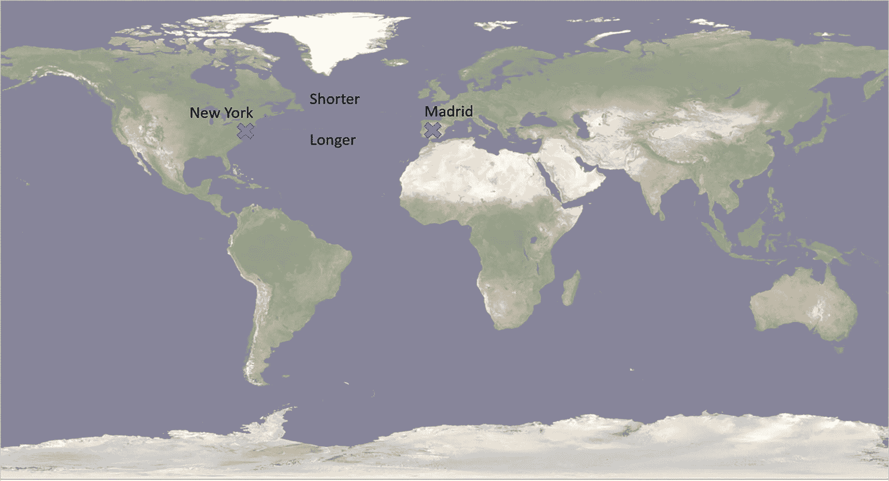

*图 2-1：一张参考地图显示，飞机航线在地图上并非直线。该图展示了纽约和马德里之间的距离，其上方路线比下方路线更短。*

现在让我们考虑一个例子，您正拿着一个圆形的足球。当从球上的一点到另一点时，您凭直觉就能说出哪条路径最快。如果您直视这个球，当您的手指从一点移动到另一点时，您会看到您的手划出一个类似图 2-2 中的形状。

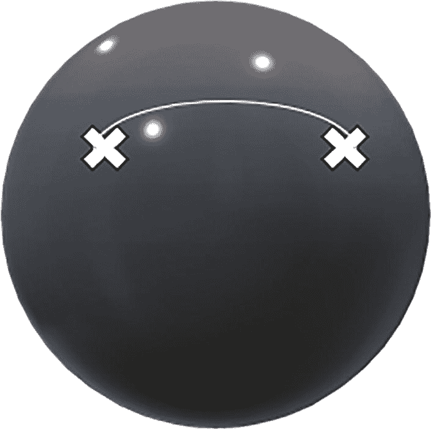

*图 2-2：一张在二维视图中球体上最短路径并非直线的示意图。在中间两侧各有一个 X 标记，从一个 X 有一条曲线连接到另一个 X。图片来源：作者*

在制作地图时，我们无法在三维空间中绘图，因此，我们需要找到某种方法将三维路径放到二维图像上。

许多地图制作者提出了各种方法来解决这个无法解决的问题，本章的目标是帮助您理解如何有效处理这些从 3D 到 2D 的地图投影变形，这些变形将不断试图使您的地理数据处理工作复杂化。

## 坐标系

虽然之前的讨论仅仅是直观上的，现在是时候逐步了解你所见概念的更正式定义了。由于我们暂时忽略点的高度（例如，相对于海平面），我们可以识别出三种类型的坐标系：

*   地理坐标系
*   投影坐标系
*   局部坐标系

让我们逐一介绍它们。

### 地理坐标系

地理坐标系是我们在上一部分中一直在讨论的坐标系。它们尊重世界是一个椭球体的事实，因此使用经纬度的度数或弧度来表示点。

由于它们尊重地球的椭球体特性，因此很难用此类坐标系制作地图或图表。

#### 纬度和经度

在地理坐标系中，我们谈论纬度和经度。通常，度数要么与北（赤道以北）和南（赤道以南）、东（格林威治子午线以东）或西（格林威治子午线以西）的说明一起表示。东/西和北/南也可以写成负坐标和正坐标。东和北取正值，而南和西取负值。

尽管这是标准做法，但这可能会根据你所使用的地理坐标系的具体定义而改变。理论上，任何人都可以发明一个新的坐标系，并使其完全不同。实际上，有一些大家都习惯使用的标准，因此最好使用这些标准。

#### WGS 1984 地理坐标系

`WGS 1984`，也称为 `WGS 84` 或 `EPSG:4326`，是最常用的地理坐标系之一。它也是全球定位系统（GPS）的参考坐标系，广泛应用于众多应用中。让我们深入了解 `WGS 84` 是如何设计的。

`WGS 1984` 的设计目标是使坐标原点位于地球的质心。参考子午线或零子午线是 IERS 参考子午线。它非常接近格林威治子午线：仅向东偏移 5.3 角秒或 102 米。

还有更多具体的定义来界定 `WGS 84`，但到了这一点，信息变得非常技术性。引用 `WGS 84` 的维基百科页面：

> *WGS 84 基准面是一个扁球体，赤道半径 a = 6378137 m，扁率 f = 1/298.257223563。WGS 84 引力常数（包括地球大气质量）的精确值为 GM = 3986004.418×108 m3/s2。地球的角速度定义为 ω = 72.92115×10−6 rad/s。*

你绝对不需要记住任何这些细节。但我确实希望它能让你了解地理坐标系定义必须有多详细。这解释了为什么其他人和组织能够提出替代定义。这就是为什么存在许多坐标系，也是为什么处理地理空间数据在开始时可能难以掌握的原因之一。

#### 其他地理坐标系

例如，`ETRS89` 是欧盟推荐用于欧洲地理数据的坐标系。它与 `WGS 84` 非常接近，但有一些细微差别，使得 `ETRS89` 不会因大陆漂移而改变。正如你将理解的，大陆漂移非常缓慢，考虑此类因素部分基于理论而非实际重要性。

另一个例子是 `NAD-83` 系统，主要用于北美。由于地球是一个不完美的椭球体，该系统的创建者希望考虑北美与椭球体的偏差程度，以便在北美地区表现更好。

### 投影坐标系

在制作地图时，我们需要将三维地球转换为二维形式。这个任务不可能完美完成：想象一下拿一个圆形的塑料足球，把它切开弄平。你永远无法将这个圆球粘贴成一个平坦的矩形，而不经历巨大的挣扎去寻找一种切割方式，使其看起来或多或少连贯。

幸运的是，许多伟大的思想家在我们之前接受了这个挑战，并找到了“切割椭球地球并将其粘贴到矩形上”的绝妙方法。我们称之为投影，你可以想象三维地理坐标与正方形上的某个位置相匹配。这将中间的所有内容投影到其对应的位置。

#### X 和 Y 坐标

当使用投影坐标系时，我们不再谈论纬度和经度。因为纬度和经度仅适用于地球（椭球体）上的测量，但在平面上，我们可以放弃这种复杂性。一旦三维的经纬度坐标被转换为其投影的坐标，我们只需谈论 x 和 y 坐标。

X 通常是从原点向东的距离，y 是从原点向北的距离。原点的位置取决于你使用的投影。测量单位也因投影坐标系而异。

#### 四种类型的投影坐标系

正如你所理解的，所有投影坐标系都会存在变形。由于投影将三维球状形式上的位置放置到二维平坦矩形上，现实的一些特征得以保留，而其他特征则会丢失。

没有一种投影比另一种更好。这里的问题在于你想要保留哪些类型的特征，并接受失去哪些特征。投影坐标系有四种类别，它们都确保现实的一个方面在投影上得到完美保留。

在为你的项目选择地图投影时，关键选择是决定哪种变形最合适，以及你绝对想要保留哪些特征。

##### 等面积投影

第一种投影类型是保留特定特征面积的投影。你可能没有意识到，但你看到的许多地图并不尊重等面积。例如，如果你在谷歌地图上缩小一点，你会看到格陵兰岛在谷歌地图选择的投影中显得巨大。

对于某些用例来说，这可能是一个大问题。等面积投影旨在确保特定特征（例如国家或其他）的表面积保持不变。这样做的代价是，形状和角度等其他特征可能会变形。你最终可能会得到一个投影，其中格陵兰岛保持了其真实面积，但形状因此未能完美呈现。

###### 示例 1：`摩尔维特投影`

`摩尔维特投影`是等面积投影的一个例子。它也被称为巴宾内投影、同积投影和椭圆投影。使用`摩尔维特投影`时，世界看起来如图 2-3 所示。

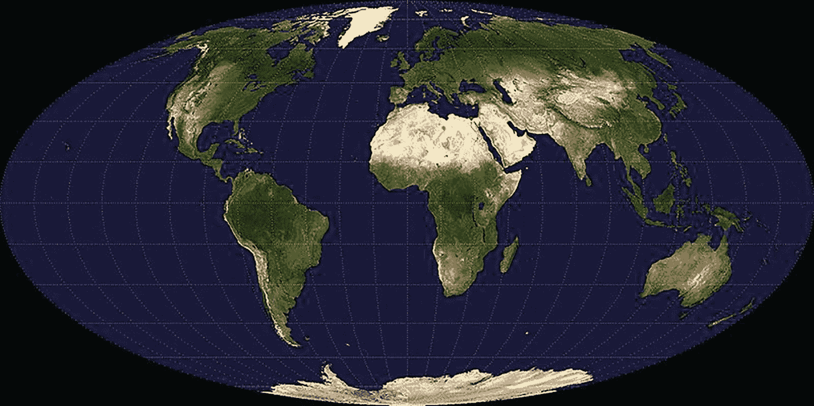

*图 2-3：`摩尔维特投影`下的世界图像。一种等面积伪圆柱地图投影，以轴比为 2:1 的椭圆形式显示世界。来源：[*https://commons.wikimedia.org/wiki/File:Mollweide-projection.jpg*](https://commons.wikimedia.org/wiki/File:Mollweide-projection.jpg)。公共领域*

###### 示例 2：`阿尔伯斯等积圆锥投影`

`阿尔伯斯等积圆锥投影`采用了一种截然不同的方法，因为它是一种圆锥投影。制作圆锥地图通常是为了更好地表现某些区域。`阿尔伯斯等积圆锥投影`，也称为阿尔伯特投影，将世界投影到二维地图上，同时保持面积不变，如图 2-4 所示。

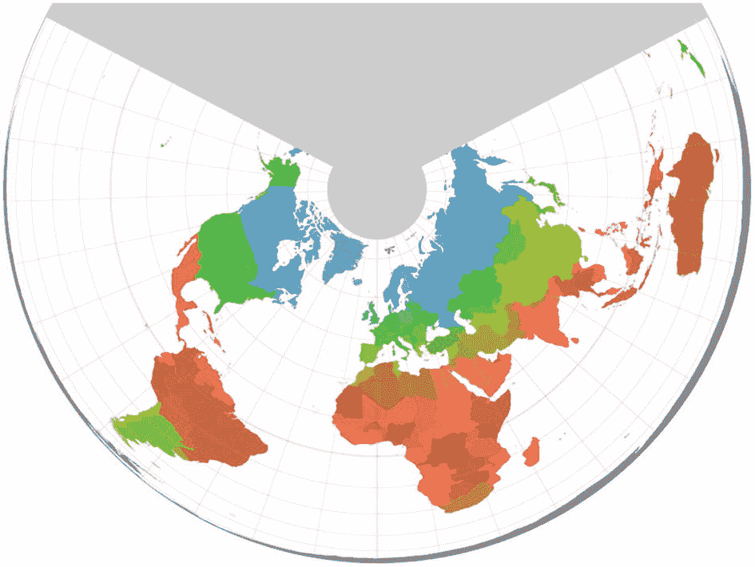

*图 2-4：一幅采用`阿尔伯斯等积圆锥投影`的世界图像。它使用两条标准纬线来减少仅使用一条标准纬线的投影中出现的某些变形。来源：[*https://commons.wikimedia.org/wiki/File:World_borders_albers.png*](https://commons.wikimedia.org/wiki/File:World_borders_albers.png)。公共领域*

# 等角投影

如果形状对你的用例很重要，你可能需要使用等角投影。等角投影旨在保持形状不变。这类投影以扭曲地图上的面积为代价，保证所有角度都得以保留，从而确保你在地图上看到的是“真实”的形状。

## 墨卡托投影

墨卡托地图非常著名，是许多项目的标准地图投影。它的优点是上北下南，同时保持局部方向和形状不变。

不幸的是，远离赤道的地区（例如格陵兰岛和南极洲）被严重放大，而赤道附近的区域（例如非洲）相比之下则显得过小。

该地图的外观如图 2-5 所示。

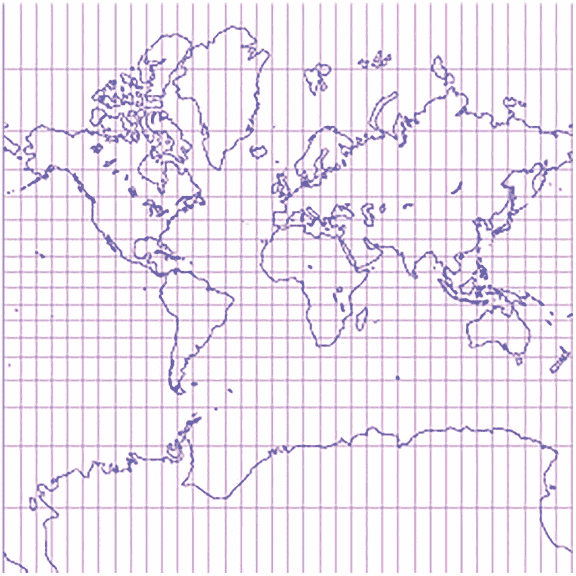

一幅采用墨卡托投影的世界地图。经线是等间距的平行竖直线，纬线是平行的水平直线，随着距离赤道越远，它们之间的间距越大。

图 2-5

墨卡托投影下的世界 来源：[`https://commons.wikimedia.org/wiki/File:Mercator_projection_of_world_with_grid.png`](https://commons.wikimedia.org/wiki/File:Mercator_projection_of_world_with_grid.png)。公共领域

## 兰勃特等角圆锥投影

兰勃特等角圆锥投影是另一种等角投影，意味着它也能保持局部形状不变。这种投影不太普及，因为它是一种圆锥地图，而圆锥地图从未像矩形地图那样流行。然而，它在绘制地球并保持形状方面同样出色，并且在尺寸变形方面问题更少。其外观如图 2-6 所示。

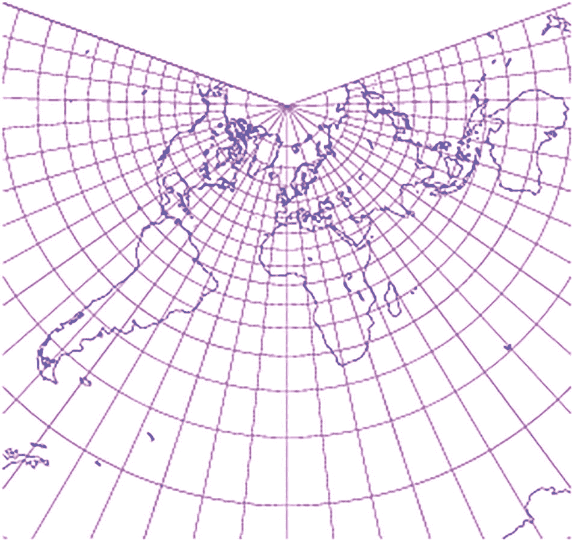

一幅采用兰勃特等角圆锥投影的世界地图。在这种地图投影中，所有经线都由从映射区域外一个公共点辐射出的直线表示，纬线则由以该公共点为圆心的圆弧或圆表示。

图 2-6

兰勃特等角圆锥投影下的世界 来源：[`https://commons.wikimedia.org/wiki/File:Lambert_conformal_conical_projection_of_world_with_grid.png`](https://commons.wikimedia.org/wiki/File:Lambert_conformal_conical_projection_of_world_with_grid.png)。公共领域

# 等距投影

顾名思义，如果你想要一张保持距离准确的地图，就应该使用等距投影。在前面讨论的两种投影类型中，无法保证两点之间的距离保持不变。可以想象，这对许多用例来说将是一个问题。如果距离是你的解决方案的关键，等距投影可以帮你解决这个问题。

## 方位等距投影

等距投影的一个例子是方位等距投影，也称为波斯特尔投影或天顶等距投影。它保持从中心点出发的距离不变，其外观如图 2-7 所示。

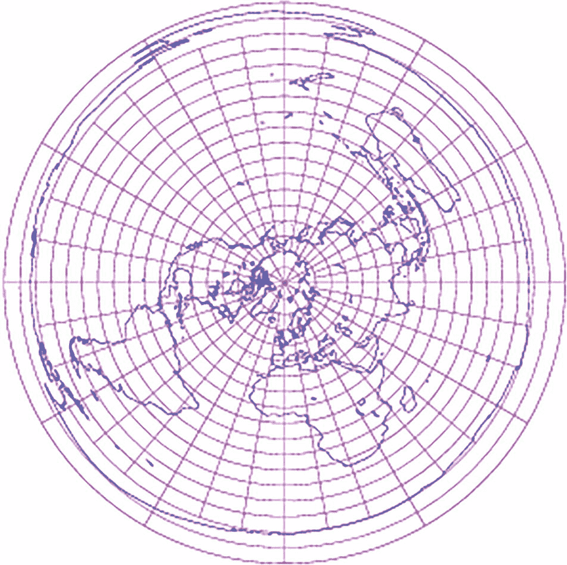

一幅采用方位等距投影的世界地图。世界被从地球上的任意一点投影到一个平面上。

图 2-7

方位等距投影下的世界 来源：[`https://commons.wikimedia.org/wiki/File:Azimuthal_equidistant_projection_of_world_with_grid.png`](https://commons.wikimedia.org/wiki/File:Azimuthal_equidistant_projection_of_world_with_grid.png)。公共领域

## 等距圆锥投影

等距圆锥投影是另一种圆锥投影，但这次它保持距离不变。它也被称为简单圆锥投影，其外观如图 2-8 所示。

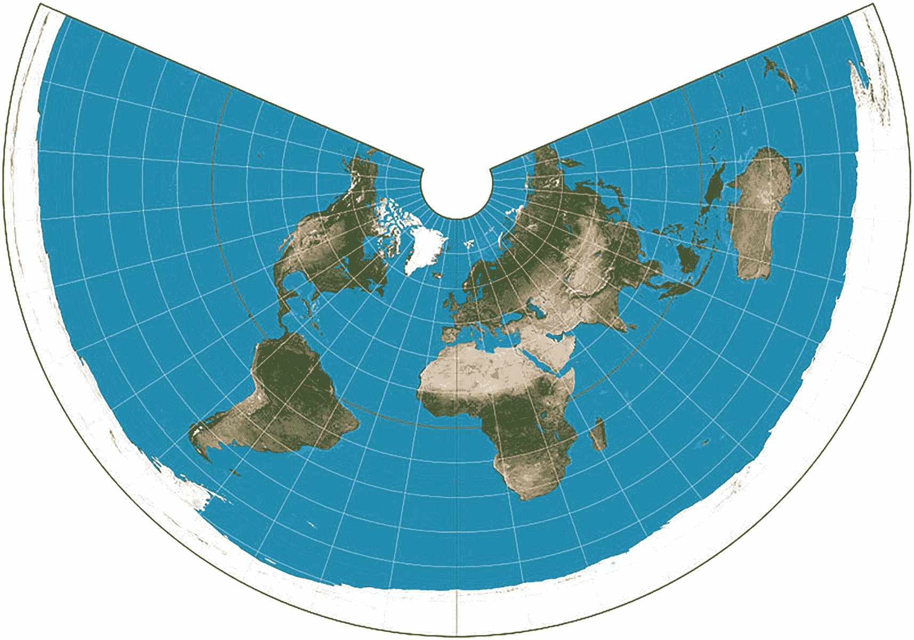

一幅采用等距圆锥投影的世界图像。它保持所有经线和两条标准纬线上的距离不变。形状、面积、距离、方向和角度通常都会发生变形。在标准纬线上没有变形。变形值随着远离标准纬线而增大。

图 2-8

等距圆锥投影下的世界 来源：[`https://commons.wikimedia.org/wiki/File:Equidistant_conical_projection_of_world_with_grid.png`](https://commons.wikimedia.org/wiki/File:Equidistant_conical_projection_of_world_with_grid.png)。公共领域

# 真方向或方位投影

最后，方位投影旨在保持从一个点到另一个点的方向准确。例如，如果你正在制作导航地图，那么保持方向准确的方位地图可能至关重要。地图上任何一点的方向都将保证从中心点出发以正确的方向描绘。

这类投影还有一个有趣的额外优势，即它们可以与前面三种类型的地图结合使用，因此并非非此即彼的选择。

## 兰勃特等积方位投影

方位投影的一个例子是兰勃特等积方位投影。顾名思义，它不仅是方位投影，同时也是等积投影。根据这种投影绘制的世界如图 2-9 所示。

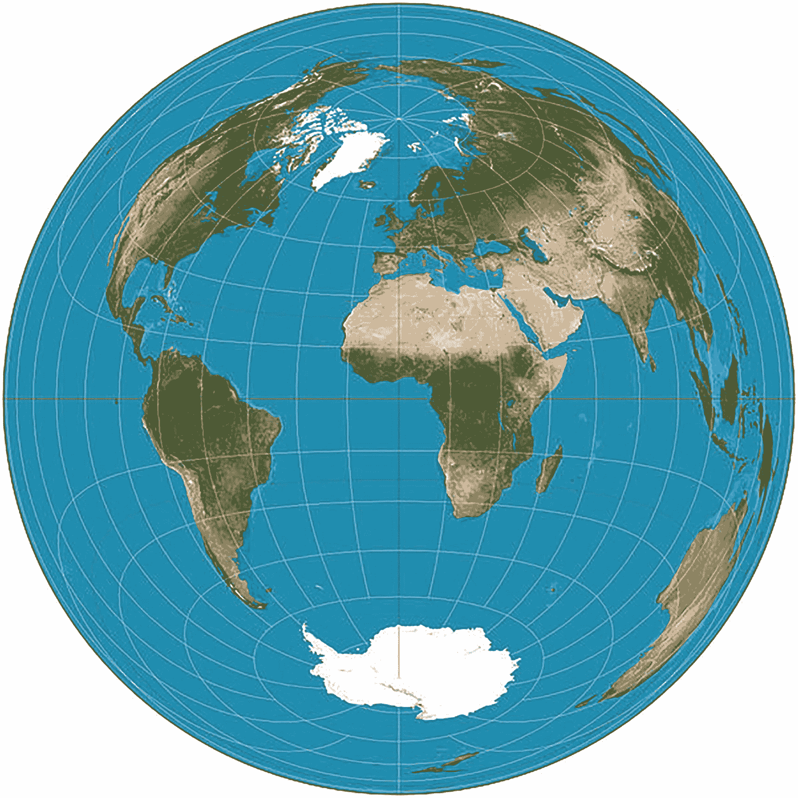

一幅采用兰勃特等积方位投影的世界图像。一种地图投影，假设地球仪放置在一个平面上，其上的特征被投影到该平面上。在保持陆地特征真实相对大小的同时，也保持了从中心点出发的真实方向感。

图 2-9

兰勃特等积方位投影下的世界 来源：[`https://commons.wikimedia.org/wiki/File:Lambert_azimuthal_equal-area_projection_of_world_with_grid.png`](https://commons.wikimedia.org/wiki/File:Lambert_azimuthal_equal-area_projection_of_world_with_grid.png)。公共领域

## 两点等距投影

另一种方位投影是两点等距投影，也称为双等距投影。使用这种投影制作地图时，必须在地图上选择两个点，从这两个点到地图上任何其他点的距离都保证与地图比例尺所对应的距离一致。例如，在图 2-10 中，你可以看到欧亚大陆的两点等距投影，其中标出了两个尊重所有距离的参考点。这种投影也是方位投影。

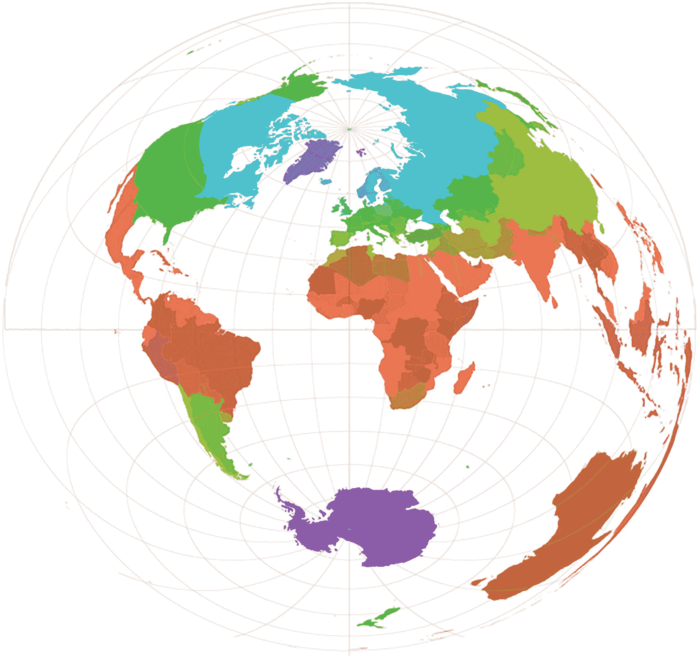

一幅采用两点等距投影的世界图像。两点等距投影是一种改进的方位投影，它保留了地图上两个选定点的距离。如果这两个点重合，则生成的投影即为等距方位投影。

图 2-10

两点等距投影下的世界 来源：[`https://commons.wikimedia.org/wiki/File:World_borders_donald.png`](https://commons.wikimedia.org/wiki/File:World_borders_donald.png)。公共领域

## 局部坐标系

如你所见，存在大量地理坐标系，随后还有数量更多的地图投影，每种投影都有其特定的数学定义，并针对特定的用例或实践与理论目标而创建。然而，它们的共同点是通常设计用于全球范围。

第三种类型的坐标系是局部坐标系。顾名思义，局部坐标系仅适用于局部地图和用例。它们被设计用于在较小的地理区域内良好运行。其原点通常位于对该区域合理但对其他任何地图都不合理的位置。因此，它们仅包含局部区域的坐标，并且可以选择使得局部、放大的地图能够以尽可能小的变形描绘该区域。

我们在此不再深入探讨，因为大多数局部坐标系的用途有限，难以挑选出有趣的案例。然而，了解它们的存在很重要，因为你可能会遇到它们，甚至可能需要为你所在的个人区域查找一些局部坐标系。

## 如何选择坐标系

在了解了坐标系的多样性和细节之后，你可能会想知道应该使用哪些坐标系。不幸的是，对此并没有一个明确的答案。只有当你有非常明确的需求时，无论是等距、等形还是等面积，才会有一个非常明确的优胜者。锥形投影与圆柱投影的比较也可能是选择中的一个明确因素。

答案的另一部分是，你经常会“被迫”使用特定的坐标系，因为你获取的地理数据集已经采用了某种坐标系。你总是可以从一种坐标系转换到另一种，但如果你的数据集很大，转换可能会花费一些时间并带来问题：如果你没有特定需求，保留数据集的坐标系可能是正确的选择。

除此之外，使用“标准”选择可能是一种最佳实践。如果你所在领域或地区的所有地图都使用特定的坐标系，那么为了增强一致性，你也可以选择使用该坐标系。

这里的一个关键要点是，元数据是地理数据的重要组成部分。发送带有坐标的数据集却未能提及所用坐标系的详细信息，会带来很大问题。同时，如果你是数据接收方，请对接收的数据保持批判态度，并密切关注你是否使用了正确的坐标系。错误很容易发生，并且可能造成重大影响。

## 动手操作一些地图

为了结束本章关于坐标系的讨论，让我们进入一些实际应用。你将看到如何创建一些数据、更改坐标系，并在这些不同的坐标系中展示一些简单的地图。你将看到第一个示例，其中使用 Google My Maps 创建你自己的数据集。你将把数据投影到另一个坐标系中，并比较差异。

### 示例：处理自有数据

### 步骤 1：在 Google My Maps 上创建你自己的数据集

`Google My Maps` 是构建简单地理数据集的一个很好的起点。虽然它在专业用例中不常用，但对于入门或为小型项目快速绘制草图来说，这是一个很好的方法。

要开始构建 `Google My Maps`，你需要进入你的 `Google` 云端硬盘 (`drive.google.com`)。在你的 `Google` 云端硬盘中，点击“新建”，然后选择“新建 Google My Map”。完成后，它将自动打开一个类似 `Google` 地图的页面，其中包含一些附加工具。你会在左上角看到工具栏。

### 步骤 2：在地图上添加一些要素

你可以通过点击  气球图标（用于在地图上添加要素和点）来添加点要素，以及点击  点图标（用于线和多边形）来添加线和多边形要素。让我们尝试通过点击法国边境周围来创建一个包含整个法国的多边形。你应该会得到一个灰色的多边形。出于版权原因，无法以 `Google` 格式转载该地图，但你可以在此处自由访问：[`www.google.com/maps/d/edit?mid=1phChS9aNUukXKk2MwOQyXvksRk-HTOdZ&usp=sharing`](https://www.google.com/maps/d/edit%253Fmid%253D1phChS9aNUukXKk2MwOQyXvksRk-HTOdZ%2526usp%253Dsharing)。

### 步骤 3：将地图导出为 .KML 格式

通过以上操作，你刚刚创建了一个非常简单的、包含一个多边形的地理数据集。现在，要将这些地理数据导入到其他环境中，让我们导出数据。

为此，请点击地图名称右侧的三个小点，然后根据你的版本和设置，点击“导出地图”或“下载 `KML`”。然后，你可以选择提取**仅图层而非整个地图**。这样，你将得到一个包含你自己多边形的数据集。同时，选择**获取 `.KML` 文件而非 `.KMZ` 文件**的选项。

### 步骤 4：在 Python 中导入 .KML 文件

现在，让我们看看如何将这个地图导入 `Python`。你可以结合使用 `geopandas` 库和 `Fiona` 库来轻松导入 `.KML` 地图。如果你尚未安装这些库，并且正在使用 `Jupyter notebook`，可以使用代码块 2-1。

```
!pip install fiona
!pip install geopandas
代码块 2-1
安装库
```

然后，你可以使用代码块 2-2 中的代码导入你的地图，并显示其中包含的数据。

```
import fiona
import geopandas as gpd
gpd.io.file.fiona.drvsupport.supported_drivers['KML'] = 'rw'
kmlfile = gpd.read_file(“the/path/to/the/exported/file.kml")
print(kmlfile)
代码块 2-2
导入数据
```

你会发现这个数据框中只有一行数据，其中包含一个名为“法国”的多边形。图 2-11 展示了这一情况。

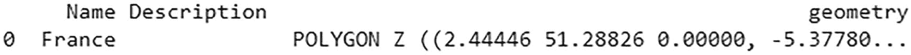

数据框内容的图像。上方是名称和描述，第一行显示 0 法国，`POLYGON Z` 左括号 `2.44446 51.28826 0.00000`，负 `5.37780` 三点省略。

图 2-11

数据框的内容。作者提供的图片

我们可以通过使用代码块 2-3 中的代码，将该多边形从数据框中提取出来，从而更详细地检查它。

```
print(kmlfile.loc[0,'geometry'])
代码块 2-3
从数据框中提取几何图形
```

你会看到这个多边形的数据是一系列表示轮廓的坐标。看起来就像代码块 2-4 所示。

```
POLYGON Z ((2.4444624 51.288264 0, -5.3778032 48.3696347 0, -1.0711626 46.315323 0, -2.0599321 43.3398321 0, 2.5103804 42.2434336 0, 7.7178999 43.7697753 0, 8.135380400000001 48.8924149 0, 2.4444624 51.288264 0))
代码块 2-4
生成的几何图形，代码块 2-3 的输出
```

### 步骤 5：绘制地图

现在你已经了解了如何将多边形形状的地图数据定义为文本文件，让我们使用简单的 `Python` 功能将其制作成地图。通过使用 `plot` 方法可以非常轻松地完成此操作，如代码块 2-5 所示。

```
import matplotlib.pyplot as plt
kmlfile.plot()
plt.title('Map in WGS 84')
代码块 2-5
绘制地图
```

此代码的结果如图 2-12 所示。

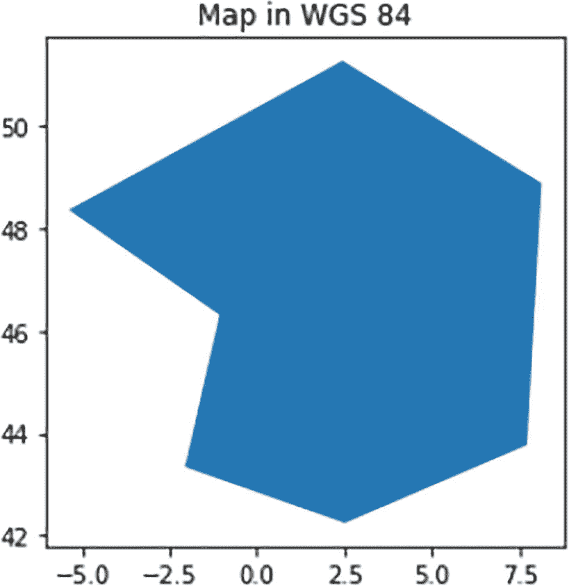

一张图表展示了 `WGS 84` 坐标系下的地图。图表内部是一个七边形图形。Y 轴数值从 42 到 50，增量为 2。X 轴数值从 -5.0 到 7.5，增量为 2.5。

图 2-12

代码块 2-5 生成的地图。作者提供的图片

你将获得一个多边形地图。你应该能认出这个多边形的确切形状，因为它是在你的地图或示例地图中定义的，具体取决于你使用的是哪一个。

### 步骤 6：更改坐标系

`KML` 标准使用 `WGS 84` 地理坐标系。你可以使用代码块 2-6 中的代码来验证这一点。

```
kmlfile.crs
代码块 2-6
提取坐标系
```

你将在 `notebook` 中看到如图 2-13 所示的结果。

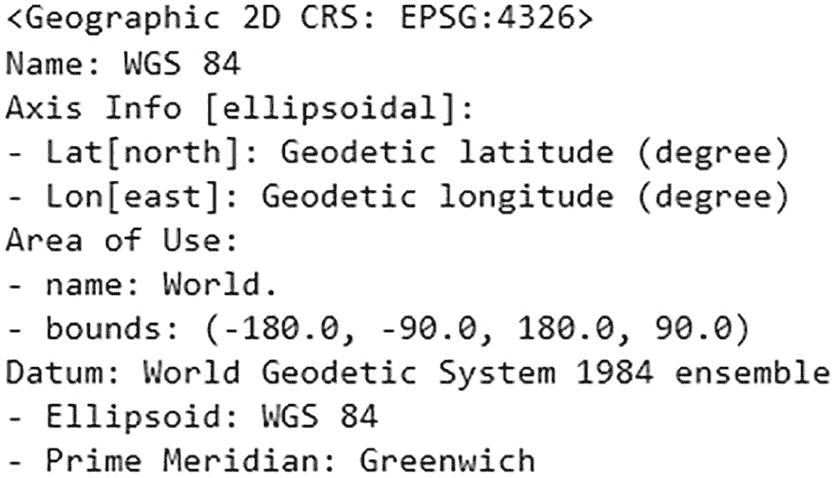

代码块 2-6 结果的图像。上方是 `Geographic 2D CRS: EPSG: 4326`。下方是 `Name: WGS 84`，再下方是 `Axis Info [ellipsoidal]:`。接着是 `- Lat [north]: Geodetic latitude (degree)`。

图 2-13

代码块 2-6 的结果。作者提供的图片

看看当我们把地图绘制到一个非常不同的坐标系中会发生什么，这可能会很有趣。让我们尝试使用 `geopandas` 库将这个地图转换到另一个坐标系。我们将从地理坐标系 `WGS 84` 转换为投影坐标系欧洲兰勃特等角圆锥地图投影，也称为 `ESRI:102014`。

代码块 2-7 中的代码执行从源坐标系到目标坐标系的转换。

```
proj_kml = kmlfile.to_crs('ESRI:102014')
proj_kml
代码块 2-7
更改坐标系
```

结果如图 2-14 所示。

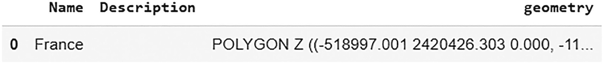

代码块 2-7 生成的数据框图像。上方是名称、描述和几何图形。下方是一行数据，内容为 0, 法国, `POLYGON Z` 左括号 负 `518997.001 2420426.3030.000`, 负 `11`, 三点省略。

图 2-14

代码块 2-7 生成的数据框。作者提供的图片

### 步骤 7：再次绘制地图

现在要绘制这个多边形，代码块 2-8 中的代码可以完成这项工作。

```
proj_kml.plot()
plt.title('ESRI:102014 map')
代码块 2-8
绘制地图
```

结果如图 2-15 所示。

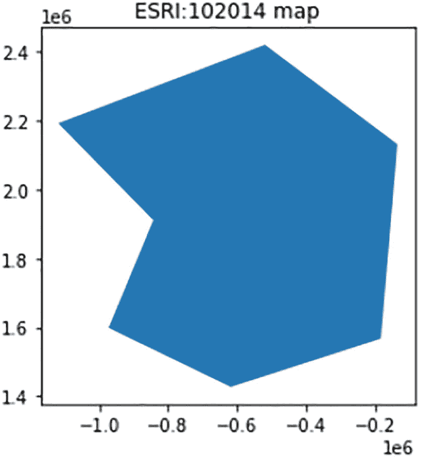

一张图表展示了 `ESRI:102014` 地图。图表内部是一个七边形图形。Y 轴数值从 1.4 到 2.4，增量为 1.2。X 轴数值从 -1.0 到 -0.2，递减量为 -0.2。

图 2-15

代码块 2-8 生成的图形。作者提供的图片

这些坐标系的 x 和 y 值差异很大。要看到形状和大小的差异，你必须非常仔细地观察。你可以观察到左侧角度的制作方式略有不同。左侧地图中左边的尖角更指向底部，而右侧地图中则更指向顶部。如图 2-16 所示。

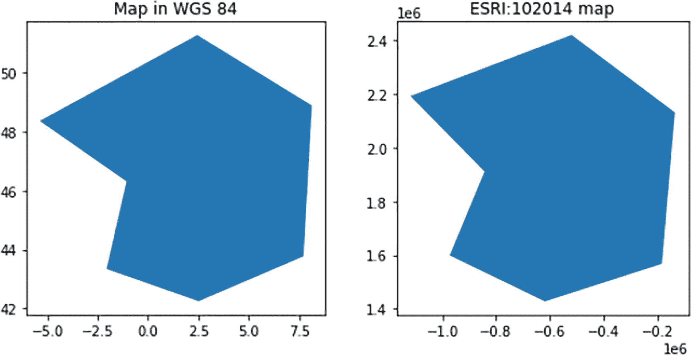

两张图表并排展示了两个坐标系。标题分别是“WGS 84 地图”和“ESRI:102014 地图”。两者都描绘了相同的七边形图形。

图 2-16

并排显示两个坐标系。作者提供的图片

尽管这里的差异很小，但它们可能会对你的应用产生严重影响。这里需要理解的重要一点是，这些地图没有“错误”之分。它们只是使用了不同的数学公式，将三维弯曲的地球表面投影到二维图像上。

## 关键要点

1.  坐标系是对地球的数学描述，使我们能够精确地交流位置信息。
2.  存在多种坐标系，每种都有其优势和缺陷。必须根据具体用例选择合适的坐标系。

# 坐标系与投影

3.  地理坐标系使用度数，并试图将地球建模为椭球体或球体。

4.  投影坐标系提出了将三维现实转换到二维地图的方法。这以牺牲现实世界的某些特征为代价，因为这些特征无法在二维中完美呈现。

5.  存在多种著名的投影类别。等距投影确保距离不受干扰。等积投影确保面积得到保持。等角投影保持形状不变。方位投影保持方向一致。

6.  局部坐标系对于非常具体的局部研究或用例很有意义，因为它们通常指定一个在局部尺度上有意义的原点和投影。

## 实际应用

7.  你已经了解了如何使用简单直观的 Google 我的地图手动标注地理空间数据集。你可以将地图导出为`.KML`格式，该格式可以轻松导入 Python。

8.  你已经了解了如何使用`geopandas`在 Python 中导入地图，以及如何将地理空间数据集从一个坐标系转换到另一个坐标系。你已了解到差异的大小取决于你所使用的不同坐标系之间的差异程度。