# 3. 地理数据数据类型

在前面的章节中，你（不知不觉地）接触到了多种不同的地理数据数据类型。在第 1 章中，我们讨论了在坐标系中识别点。在上一章中，你看到了如何创建一个法国国家形状的多边形。你还看到了将 TIFF 数据文件导入 Python 的示例。

理解地理数据数据类型是高效处理地理数据的关键。在常规的表格数据集中，在不同数据类型之间进行转换通常成本不高。而且，通常很容易判断哪种数据类型是给定变量或给定数据点的“最佳”数据类型。

在地理数据中，数据类型的选择影响要大得多。将国家形状的多边形转换为点并非易事，因为这需要（人为地）定义每个点应放置的位置。这通常位于“中心”，往往需要相当昂贵的计算。

然而，反过来则不再可能。一旦你拥有了包含国家中心的点数据集，你就再也无法找到这些国家的精确边界了。

这个问题通过图 3-1 和图 3-2 中的两张图片进行了说明。你看到第一张地图上有世界各国的轮廓，并有一些黑色十字标记指示某些国家的中心点。在第二个示例中，你看到同一张地图，但多边形已被删除。你可以清楚地看到，一旦多边形信息丢失，就无法再恢复这些信息。这对于某些用例来说可能可以接受，但对于许多用例来说可能是个问题。

在本章中，你将了解四种主要的地理数据数据类型，以便你能熟练处理所有类型，并能够决定使用哪种数据类型。

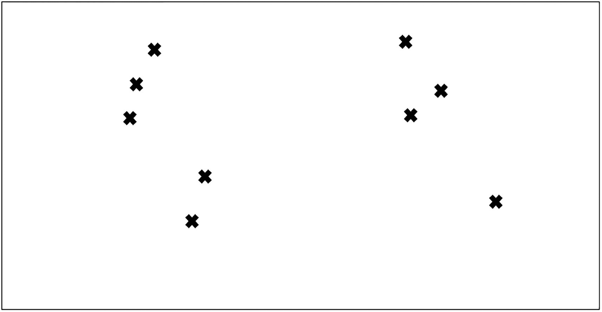

一个由十字标记组成的矩形，左侧垂直排列五个，右侧四个。

图 3-2

从点回到多边形是不可能的（作者提供图片）

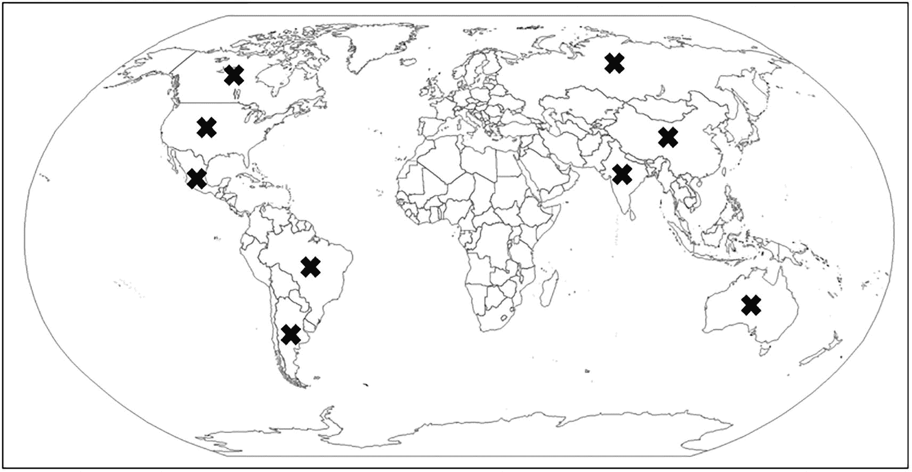

一张世界地图，上面有十字标记分别标在加拿大、美国、墨西哥、巴西、阿根廷、俄罗斯、中国、印度和澳大利亚。

图 3-1

在多边形中放置中心点是可能的（图片改编自 `geopandas`，BSD 3 条款许可）

## 矢量数据 vs. 栅格数据

地理数据数据类型的主要划分在于矢量数据和栅格数据。这两种数据的组织方式存在根本性差异。

矢量数据是包含对象及其特定坐标的数据。这些对象是点、线和多边形。在前面介绍的两张图片中，你看到的就是矢量数据。第一个数据集是一个多边形数据集，其中包含这些多边形在给定坐标系中的空间位置数据。第二张地图显示了一个点数据集：它包含点及其坐标。

栅格数据集的工作方式不同。栅格数据类似于数字图像。就像图像一样，栅格数据集被分割成大量非常小的正方形：这些就是像素。每个像素都存储一个值。

你会看到矢量数据和栅格数据之间的主要区别在于，矢量数据只存储对象及其坐标。地图的其余部分实际上是空的，这在矢量数据中不是问题。在现实世界中，许多对象都是这样工作的。如果你考虑一个包含高速公路和铁路的交通数据集，你可以理解地球上的大部分区域并没有被它们覆盖。只说明对象所在的位置（矢量方法）比说明世界上每个像素是否存在道路（栅格方法）要高效得多。

栅格数据必须在每个像素中都有一个值，这使得它特别适用于表示不局限于特定空间的现实世界现象。一个很好的例子是高程图：地球上的每个位置都有特定的高度。通过将世界切割成像素，你可以为每个位置分配高度（相对于海平面）。这将为你提供一张极好的地形图。其他连续型用例也存在，例如绘制地球上的温度分布、污染值分布等等。

### 处理矢量和栅格中的属性

坐标通常不是您想了解的关于多边形或栅格的唯一信息。在收集地理数据时，您通常希望了解有关位置的更多信息，而不仅仅是它们的位置。附加信息存储在我们称之为数据集属性的内容中。

由于处理矢量和栅格数据存在根本性差异，了解通常如何解决此类数据存储问题会很有趣。

对于矢量数据，您通常会看到一个表格，其中每个对象（点、线或多边形）对应一行。在表格的列中，您会看到一个 ID 以及包含形状和坐标的地理信息。您可以轻松地想象，在此表格中添加您选择的任何列，以包含关于该对象的附加信息，例如名称或您可能拥有的任何其他数据：国家人口规模、创建日期等等。图 3-3 展示了一个示例。

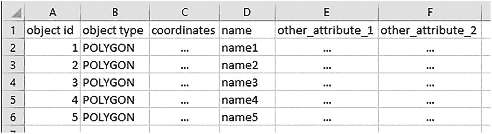

一个包含六列六行的窗口页面。列标题分别是对象 ID、对象类型、坐标、名称、其他属性 1 和其他属性 2。

图 3-3

矢量数据示例。作者提供图片

对于栅格数据，存储方式通常类似于图像。如前所述，每个像素都有一个值。因此，通常将数据存储为二维表格，其中每一行代表一行像素，每一列代表一列像素。数据表中的值代表且仅代表一个变量的值。处理栅格数据可能有点难以入门，因为这种类似图像的数据格式不太便于添加附加数据。图 3-4 展示了一个示例。

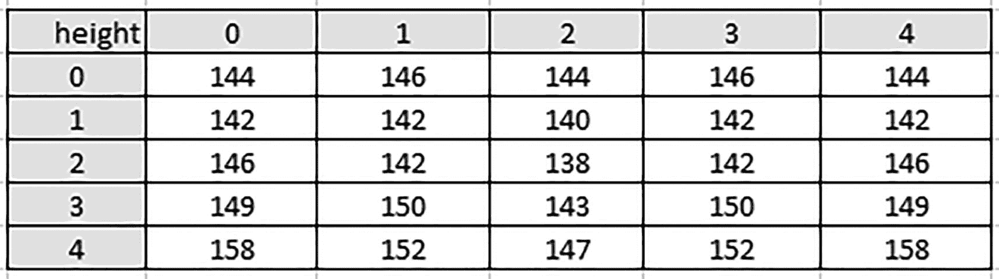

一个包含五行五列的表格，标记为“高度”。它由不同的数字集组成。

图 3-4

栅格数据。作者提供图片

现在，我们将深入描述您可能遇到的每种数据类型，并了解如何在 `Python` 中处理它们。

## 点

最简单的数据类型可能就是点。您在前面的章节中已经看到了一些点数据的示例，并且之前已经了解到点是矢量数据的子类型之一。

点是矢量数据的一部分，因为每个点都是地图上的一个对象，拥有自己的坐标，并且可以拥有任意数量的必要属性。点数据集非常适合识别特定地标或其他类型位置的位置。点无法存储地标大小形状之类的信息，因此，只有在不需要此类信息时才应使用点。

### 点的定义

在数学中，点通常被描述为一个没有长度、宽度或厚度的精确位置。这是理解点数据的一个有趣且重要的概念，因为在地理数据中也是如此。

一个点仅由一个精确位置组成，由一对坐标（无论是 `x` 和 `y`，还是纬度和经度）表示。坐标是数值，这意味着它们可以有无限多位小数。例如，数字 `2.0` 与 `2.1` 不同。然而，`2.01` 也不同，`2.001` 又是另一个不同的位置，而 `2.0001` 则是另一个不同的位置。

即使两个点非常接近，理论上它们也并非相互接触：只要它们不在同一位置，两点之间就总会存在一个微小的距离。

另一个考虑因素是，如果您有一个点对象，您无法得知其任何大小信息。尽管您可以在地图上将点放大或缩小，但您的点的大小仍然为 `0`。它实际上只是一个位置。

### 在 Python 中导入示例点数据集

让我们开始在 `Python` 中使用一个真实的点数据集。对于此数据示例，您将使用 2018 年中央公园松鼠普查数据，这是纽约市的一个开放数据集。它包含了在纽约著名的中央公园观察到的松鼠的坐标。数据集中的每一行都是一只松鼠，包含其坐标以及观察的日期和时间。

您可以从此处下载数据：[`https://data.cityofnewyork.us/Environment/2018-Central-Park-Squirrel-Census-Squirrel-Data/vfnx-vebw`](https://data.cityofnewyork.us/Environment/2018-Central-Park-Squirrel-Census-Squirrel-Data/vfnx-vebw)。如果您点击“查看数据”，然后点击“导出”，您可以将文件下载为 `KML` 文件，您已经了解如何在 `Python` 中导入该文件。

在进入 `Python` 之前，通过文本编辑器查看文本文件会很有趣。如果您通过文本编辑器打开 `KML` 文件，您会看到许多数据块，每个数据块包含一次松鼠观察记录。您可以使用 `XML` 格式化工具（只需在 `Google` 上搜索“`XML formatter`”即可找到免费的在线工具）并将一个数据块复制粘贴到其中，使其更易读。您将得到类似图 3-5 所示的内容。

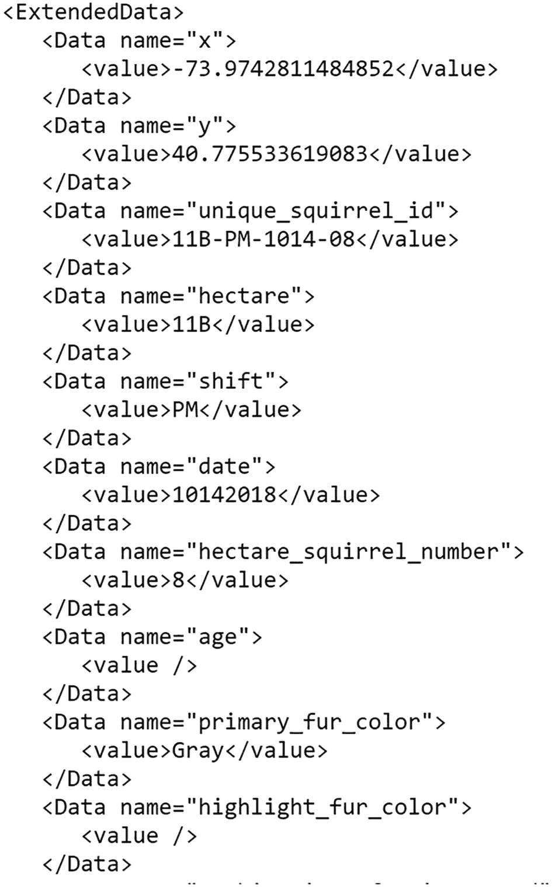

一段数据代码，包含 30 行位于尖括号内的代码。

图 3-5

数据内容截图。作者提供图片 数据来源：NYC OpenData。2018 年中央公园松鼠普查数据

当然，这只是一个片段，关于松鼠的实际变量列表要长得多。有趣的是，`KML` 数据格式仅通过包含坐标就存储了点数据。`Python`（或任何其他地理数据工具）将识别该格式，并能够自动以正确的方式导入它。

要将数据导入 `Python`，我们可以使用前一章中使用的相同代码。它使用 `Fiona` 和 `geopandas` 将 `KML` 文件导入到 `geopandas` 数据框中。代码如代码块 3-1 所示。

```python
import fiona
import geopandas as gpd
gpd.io.file.fiona.drvsupport.supported_drivers['KML'] = 'rw'
kmlfile = gpd.read_file("2018 Central Park Squirrel Census - Squirrel Data.kml")
print(kmlfile)
```

代码块 3-1
导入松鼠数据

您将看到包含几何图形的数据框被打印出来，如图 3-6 所示。

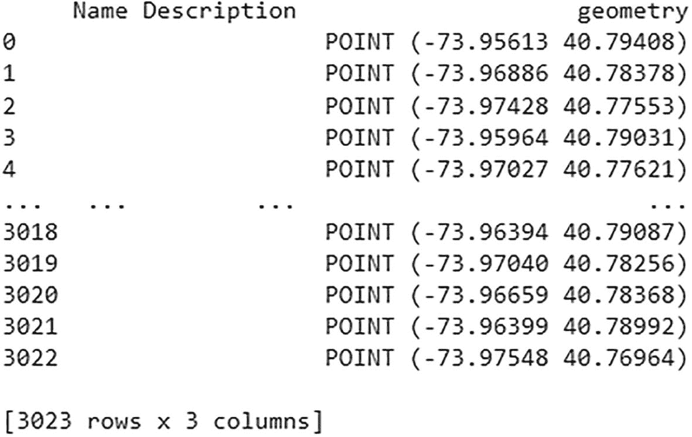

一个包含三列（名称、描述和几何图形）和十行的表格。

图 3-6

松鼠数据截图。作者提供图片 数据来源：NYC OpenData。2018 年中央公园松鼠普查数据

您可以清楚地看到每一行都标注为：`POINT (坐标 坐标)`。坐标系应位于地理数据框的属性中，您可以使用代码块 3-2 中的代码查看它。

### kmlfile.crs 代码块 3-2：检查坐标系

您将看到关于坐标系的信息被打印出来，如图 3-7 所示。

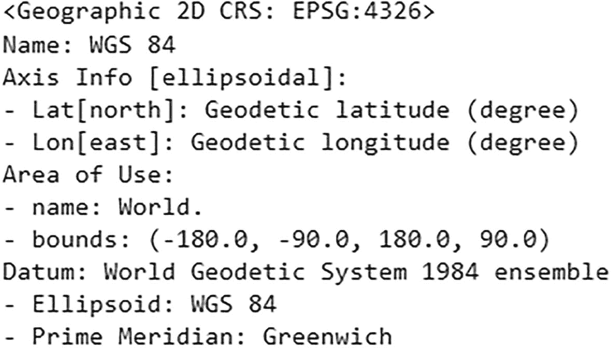

一段代码：`< Geographic 2D CRS, EPSG, 4326 >`。下方是轴信息、使用区域和基准面（世界大地测量系统 1984 集合）的数据。**图 3-7** 代码块 3-2 的输出。作者提供图片 数据来源：NYC OpenData。2018 年中央公园松鼠普查数据

您可以使用代码块 3-3 中的代码绘制地图，以在地图上查看松鼠观察点。目前看起来不太美观，但更多的可视化技术将在第 4 章中讨论。现在，让我们使用代码块 3-3 专注于数据格式。

```python
import matplotlib.pyplot as plt
kmlfile.plot()
plt.title('Squirrels in Central Park (WGS84)')
```

**代码块 3-3：绘制数据**

你将得到如图 3-8 所示的图表。

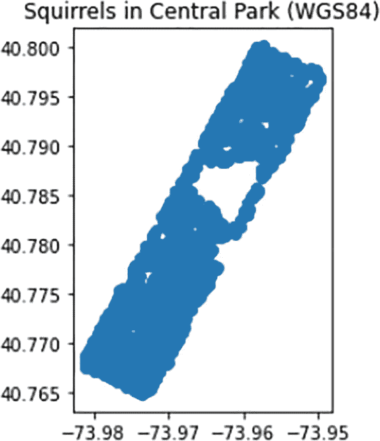

该图表展示了呈上升趋势的散点图，其 x 轴范围在 -73.98 到 -73.95 之间，增量为 0.01；y 轴范围在 40.765 到 40.800 之间，增量为 0.005。图 3-8 中央公园松鼠目击地点地图。图片来源：作者 数据来源：NYC OpenData。2018 年中央公园松鼠普查

### 点的基本操作

让我们尝试对这个点数据集执行一些简单的操作。这是一个真实世界的数据集，因此会伴随真实世界的问题。我们深入探索一下，看看如何得出一些结果。

#### 按上午/下午筛选

作为一项研究，我们尝试进行筛选，分别生成上午观测和下午观测的地图。这或许能告诉我们一天中松鼠是否有显著的活动轨迹。

查看导入的数据框，你会发现 KML 文件中的“扩展变量”部分不幸未被 geopandas 识别。让我们使用代码块 3-4 中的代码检查各列。

```python
kmlfile.columns
```

**代码块 3-4：检查各列**

你会看到只有图 3-9 所示的数据被成功导入。

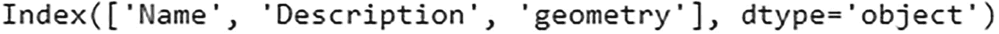

代码、索引、左括号、左方括号、名称、描述、几何、右方括号、dtype、等号、对象、右括号。图 3-9 代码块 3-4 的输出结果。图片来源：作者

对于任何非代码的地理数据程序来说，这都会是一个巨大的障碍，但因为我们使用的是 Python，我们完全有能力自主找到解决这个问题的方法。我并不是说必须自己解析 XML 是件好事，但至少我们在此处没有被卡住。

可以使用 `xml` 库进行 XML 解析。XML 是一种基于树结构的数据格式，利用 XML 元素树，你可以遍历树的不同层级并深入解析。代码块 3-5 展示了如何实现。

```python
import xml.etree.ElementTree as ET
tree = ET.parse("2018 Central Park Squirrel Census – Squirrel Data.kml")
root = tree.getroot()

# 循环遍历 xml，逐数据点进行解析
df = []
for datapoint_i in range(1,3023):
    elementdata = root[0][1][datapoint_i][1]
    df_row = []
    for x in elementdata:
        df_row.append(x[0].text)
    df.append(df_row)

# 获取列名
column_names = [x.attrib['name'] for x in elementdata]

# 转换为数据框并打印
import pandas as pd
data = pd.DataFrame(df, columns = column_names)
data
```

**代码块 3-5：解析 XML 数据**

你将得到类似图 3-10 的结果。

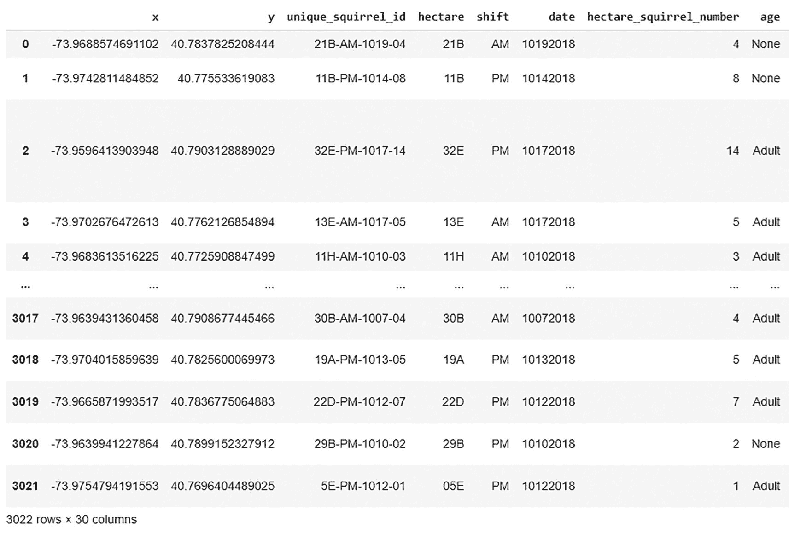

一个包含八列十行的表格。列标题分别为：x、y、唯一松鼠 ID、公顷、班次、日期、公顷内松鼠编号、年龄。图 3-10 代码块 3-5 的结果。图片来源：作者 数据来源：NYC OpenData。2018 年中央公园松鼠普查

现在，我们（终于）可以使用代码块 3-6 中的代码，对“班次”列应用筛选。

```python
AM_data = data[data['shift'] == 'AM']
PM_data = data[data['shift'] == 'PM']
```

**代码块 3-6：应用筛选**

为了绘制图表，我们需要再次回到地理数据框。这可以通过将变量 x 和 y 组合成点几何图形来实现，如代码块 3-7 所示。

```python
AM_geodata = gpd.GeoDataFrame(AM_data, geometry=gpd.points_from_xy(AM_data['x'], AM_data['y']))
PM_geodata = gpd.GeoDataFrame(PM_data, geometry=gpd.points_from_xy(PM_data['x'], PM_data['y']))
```

**代码块 3-7：创建几何格式**

最后，我们使用代码块 3-8 构建两个图表。

```python
AM_geodata.plot()
plt.title('AM squirrels')
PM_geodata.plot()
plt.title('PM squirrels')
```

**代码块 3-8：构建两个图表**

结果如图 3-11 所示。现在你有了研究上午和下午松鼠差异所需的地图。同样，这里可以改进视觉参数，但这将在第 4 章中介绍。目前，我们专注于数据类型及其可能性。

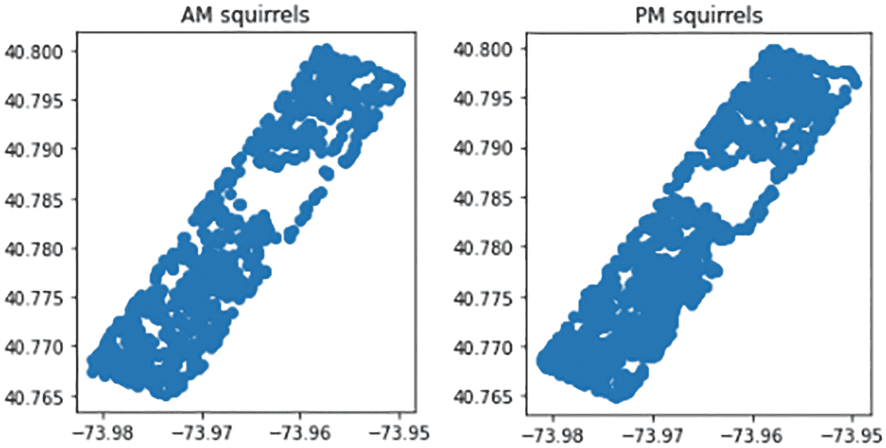

两个图表展示了呈上升趋势的散点图。两个图表的水平轴范围均在 -73.98 到 -73.95 之间，增量为 0.01；垂直轴范围均在 40.765 到 40.800 之间，增量为 0.005。图 3-11 代码块 3-8 生成的地图。图片来源：作者 数据来源：NYC OpenData。2018 年中央公园松鼠普查

### 线

线数据是地理空间数据中矢量数据的第二大类。它们是点数据之后合乎逻辑的下一步。我们直接进入定义。

#### 线的定义

线也是众所周知的数学对象。在数学中，我们通常考虑从一个点延伸到第二个点的直线。线没有宽度，但有长度。

在地理数据中，线数据集通常包含多条线，而非单一线段。线段是直的，因此只需要一个起点和一个终点。这意味着一条线需要两组坐标（第一个点的坐标和第二个点的坐标）。

线由多个线段组成，因此可以呈现不同的形状，由直线段和多个点构成。因此，地理数据中的线除了表示长度外，还可以表示要素的形状。

#### Python 中的线数据集示例

在本示例中，你将通过从一个仅包含坐标的开放数据集创建线数据集，来学习如何处理线数据。你可以在 [`www.kaggle.com/usdot/flight-delays/data?select=flights.csv;`](http://www.kaggle.com/usdot/flight-delays/data%253Fselect%253Dflights.csv%3B) 找到本示例的两个数据文件；该数据集属于许可的公共领域。

你可以下载两个数据集：`flights.csv` 和 `airports.csv`。它们都是扩展名为 `.csv` 的 CSV 文件。你可以使用代码块 3-9 和代码块 3-10 中的代码轻松地将它们导入到 pandas 中。

```python
import pandas as pd
flights_data = pd.read_csv('flights.csv')
flights_data
```

**代码块 3-9：在 Python 中导入航班数据**

航班数据如图 3-12 所示。

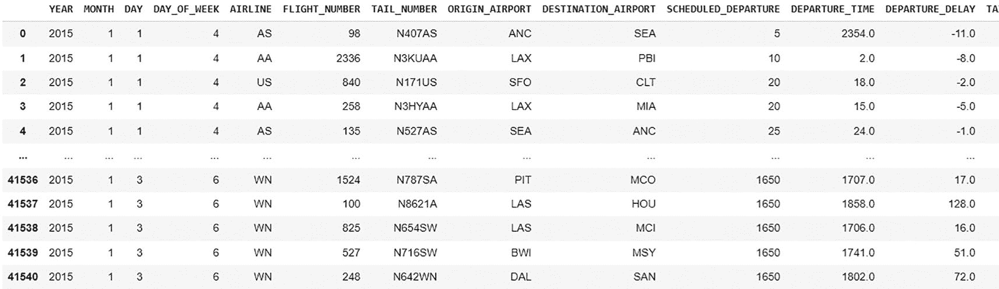

一个包含 14 列和 10 行的表格，由不同航班的数据组成。图 3-12 航班数据。图片来源：作者 数据来源：[*www.kaggle.com/usdot/flight-delays*](https://www.kaggle.com/usdot/flight-delays)，公共领域

```python
geolookup = pd.read_csv('airports.csv')
geolookup
```

**代码块 3-10：在 Python 中导入机场数据**

机场数据如图 3-13 所示。

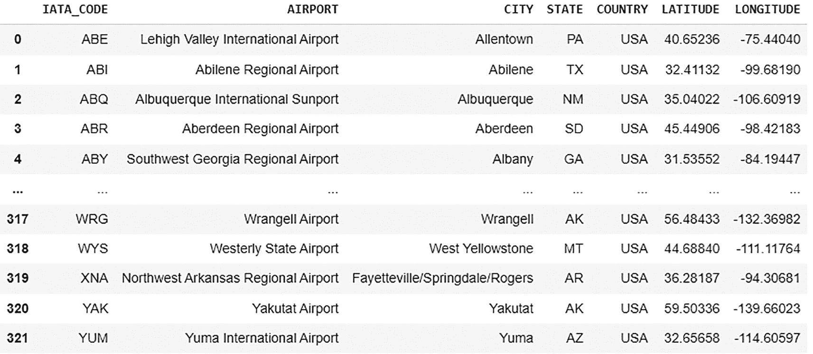

一个包含 7 列和 10 行的表格。列标题从左到右依次为：IATA 代码、机场、城市、州、国家、纬度和经度。图 3-13 机场数据。图片来源：作者 数据来源：[*www.kaggle.com/usdot/flight-delays*](https://www.kaggle.com/usdot/flight-delays)，公共领域

正如你在数据中所见，`airports.csv` 是一个包含地理定位信息的文件，因为它包含了所有被引用机场的纬度和经度。`flights.csv` 包含了大量美国境内的航线，由出发机场和目的地机场标识。我们的目标是将这些航线转换为地理参考线数据：每条航线对应一条带有起点和终点坐标的线。

让我们首先将纬度和经度变量转换为一个点，以便在后续操作中能够识别几何图形。以下代码循环遍历数据框的行以生成一个新变量。整个操作执行两次，以生成一个“到/目的地”查找数据框和一个“从/来源”查找数据框。如代码块 3-11 所示。

```python
# 将地理查找的坐标转换为点

# 为“到”和“从”连接创建“到”和“从”数据集
from shapely.geometry import Point
from_geo_lookup = geolookup[['IATA_CODE', 'LATITUDE', 'LONGITUDE']]
from_geo_lookup['geometry_from']= [Point(x,y) for x,y in zip( from_geo_lookup['LONGITUDE'], from_geo_lookup['LATITUDE'])]
from_geo_lookup = from_geo_lookup[['IATA_CODE','geometry_from' ]]
to_geo_lookup = geolookup[['IATA_CODE', 'LATITUDE', 'LONGITUDE']]
to_geo_lookup['geometry_to']= [Point(x,y) for x,y in zip( to_geo_lookup['LONGITUDE'], to_geo_lookup['LATITUDE'])]
to_geo_lookup = to_geo_lookup[['IATA_CODE','geometry_to' ]]
```

由于数据类型不一致，这里最简单的技巧是将所有数字转换为字符串。存在一些缺失的代码，最好通过检查数据质量问题来解决，但对于这个入门示例，字符串转换已经足够。你还可以看到这里删除了一些列。这在代码块 3-12 中完成。

```python
# 为连接对齐数据类型
from_geo_lookup['IATA_CODE'] = from_geo_lookup['IATA_CODE'].map(str)
to_geo_lookup['IATA_CODE'] = to_geo_lookup['IATA_CODE'].map(str)
flights_data['ORIGIN_AIRPORT'] = flights_data['ORIGIN_AIRPORT'].map(str)
flights_data['DESTINATION_AIRPORT'] = flights_data['DESTINATION_AIRPORT'].map(str)
flights_data = flights_data[['ORIGIN_AIRPORT', 'DESTINATION_AIRPORT']]
```

现在我们进入下一步，将航班数据框与我们刚刚创建的“从”和“到”地理查找表合并。代码块 3-13 中的代码执行了两次合并（一次与“从”坐标合并，一次与“到”坐标合并）。

```python
flights_data = flights_data.merge(from_geo_lookup, left_on = 'ORIGIN_AIRPORT', right_on = 'IATA_CODE')
flights_data = flights_data.merge(to_geo_lookup, left_on = 'DESTINATION_AIRPORT', right_on = 'IATA_CODE')
flights_data = flights_data[['geometry_from', 'geometry_to']]
flights_data
```

运行此代码后，你将得到一个数据框，其中每条航线仍占一行，但现在包含两个地理参考列：起点坐标和终点坐标。此结果如图 3-14 所示。

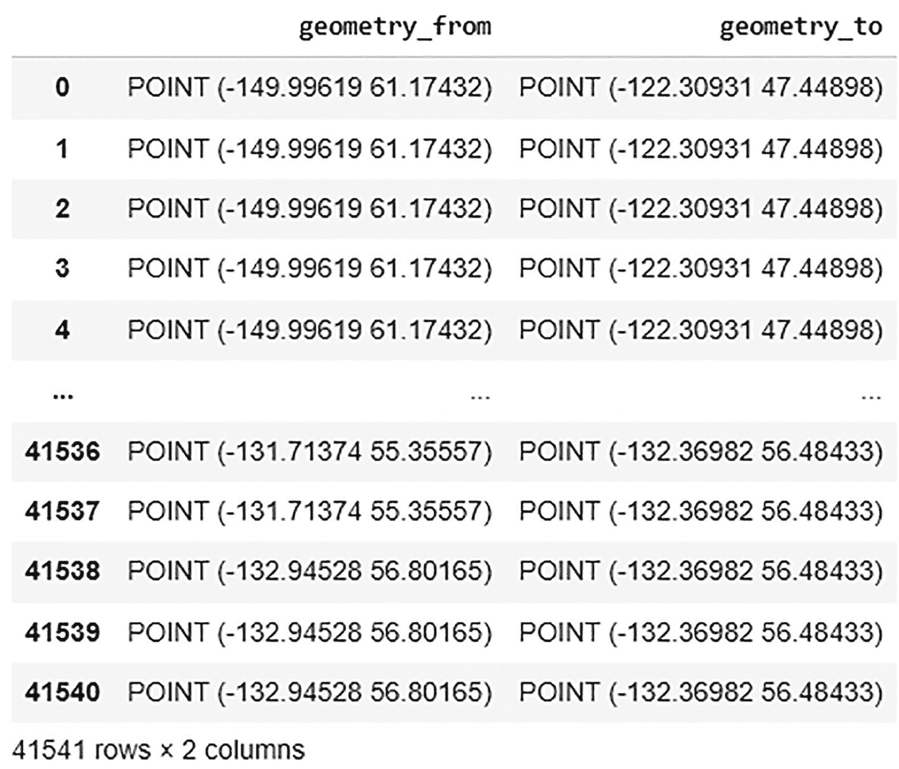

一个包含两列（标签为 `geometry_from` 和 `geometry_to`）和十行（标签为 0, 1, 2, 3, 4, 41536, 41537, 41538, 41539, 41540）的表格。

图 3-14

代码块 3-13 生成的数据框。图片来源：作者 数据来源：[www.kaggle.com/usdot/flight-delays](https://www.kaggle.com/usdot/flight-delays)，公共领域

转换过程的最后一步是根据这些起点和终点点创建线。可以使用 `LineString` 函数完成，如代码块 3-14 所示。

```python
# 将点转换为线
from shapely.geometry import LineString
lines = []
for i,row in flights_data.iterrows():
    try:
        point_from = row['geometry_from']
        point_to = row['geometry_to']
        lines.append(LineString([point_from, point_to]))
    except:
        # 一些数据行有错误，因此我们忽略它们
        pass
geodf = gpd.GeoDataFrame(lines, columns=['geometry'])
geodf
```

你将得到一个仅包含 `LINESTRING` 的新几何变量。在每个 `LINESTRING` 内部，你可以看到两个坐标的四个值（起点 x 和 y，以及终点 x 和 y）。如图 3-15 所示。

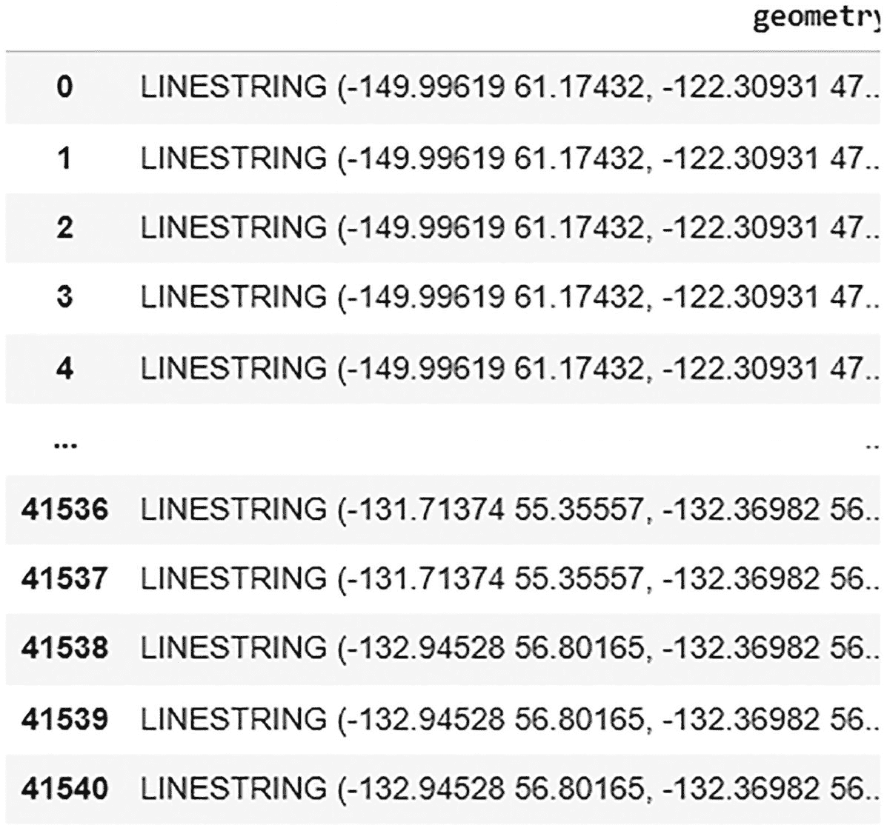

一个包含一列（标签为 `geometry`）和十行（标签为 0, 1, 2, 3, 4, 41536, 41537, 41538, 41539, 41540）的表格。

图 3-15

线串几何图形。图片来源：作者 数据来源：[www.kaggle.com/usdot/flight-delays](https://www.kaggle.com/usdot/flight-delays)，公共领域

现在你已经创建了自己的线数据集，让我们作为最后一步进行快速可视化。和之前一样，你可以简单地使用绘图功能来生成线的基本图。如代码块 3-15 所示。

```python
# 绘制线
import matplotlib.pyplot as plt
geodf.plot(figsize=(12,12))
plt.title('世界航线轨迹线')
```

你现在应该得到图 3-16 中给出的美国地图。你可以清晰地看到所有表示为直线的飞机轨迹。显然，并非所有轨迹都是正确的，因为飞机并非沿直线飞行（如前一章所述）。然而，这很好地概述了如何处理线数据，并且有趣的是，我们甚至可以通过仅使用航线（加上一些想象力）来识别出美国地图。

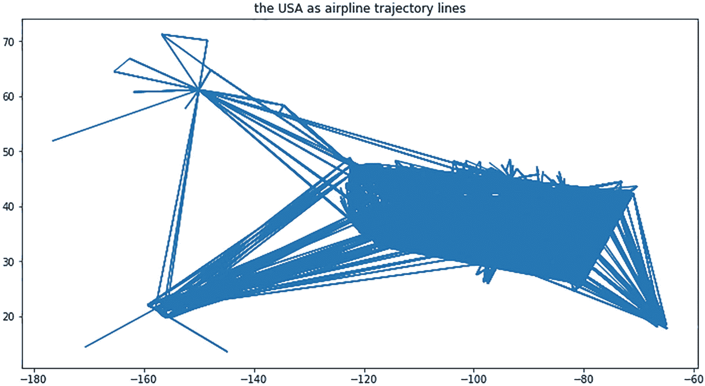

一个图表展示了一系列线条，水平轴范围从负 180 到负 60，增量为 20；垂直轴范围从 20 到 70，增量为 10。

图 3-16

代码块 3-15 生成的绘图。图片来源：作者 数据来源：[www.kaggle.com/usdot/flight-delays](https://www.kaggle.com/usdot/flight-delays)，公共领域

## 多边形

多边形是点和线之后复杂度进一步提升的要素，也是矢量地理数据的第三类，即最后一类。

### 多边形的定义

在数学中，多边形被定义为由线段连接而成的封闭二维图形，例如三角形、矩形、五边形等。圆形严格来说并非多边形，因为它并非由直线段构成，但你可以想象用大量极短的直线段来相当精确地逼近一个圆形。

在地理数据中，多边形的定义与此并无太大差异。它本质上是一个由多个点构成的封闭图形。多边形通常能更真实地反映现实世界。地标通常用点来标识，但当你查看非常详细的地图时，就需要用多边形（即轮廓）来表示地标，这样才具有实用性。道路可以用线很好地表示（请记住线没有宽度），但一旦地图比例尺缩小到足以看清房屋、道路等细节时，就必须用多边形来代替。

多边形是包含信息最多的数据类型，因为它不仅能存储位置（与点和线相同）和长度（与线相同），还能存储面积和周长。

### Python 中的多边形数据集示例

在此示例中，你可以直接通过 `geopandas` 下载国家地图。你可以使用代码块 3-16 中的代码，在 Python 中使用 `geopandas` 导入数据。

## 矢量数据操作

```
import geopandas as gpd
geojsonfile = gpd.read_file(gpd.datasets.get_path('naturalearth_lowres'))
print(geojsonfile)
```

你将在图 3-17 中看到多边形数据集的内容。它包含一些多边形和一些多多边形（由多个多边形组成的多边形，例如美国包含不与本土相连的阿拉斯加，因此需要多个多边形来描述其领土）。

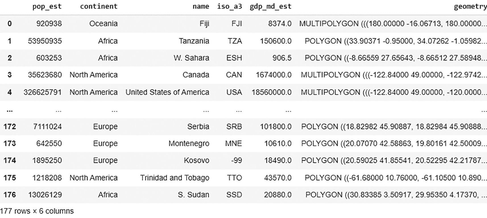

图 3-17 多边形数据内容。图片来源：作者，数据来源：`geopandas`，BSD 3 条款许可

你可以像之前一样，使用 `plot` 函数轻松创建地图。代码块 3-17 演示了这一点，这次它将自动绘制多边形。

```
geojsonfile.plot()
```

绘制出的图形如图 3-18 所示。

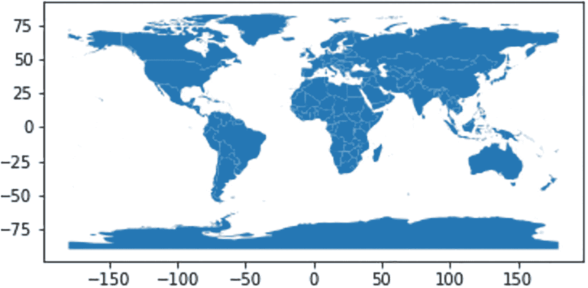

图 3-18 使用代码块 3-17 创建的多边形图。图片来源：作者，数据来源：`geopandas`，BSD 3 条款许可

### 多边形的一些简单操作

由于多边形是比之前介绍的数据类型更复杂的形状，让我们来看看可以对它们进行哪些操作。我们可以对多边形进行的一项操作是轻松计算其表面积。例如，让我们计算一份面积最小的十个国家的列表。

为此，我们首先使用多边形的 `area` 属性计算所有国家的面积。然后按面积排序，并显示前十行。代码如代码块 3-18 所示。

```
geojsonfile['area'] = geojsonfile['geometry'].apply(lambda x: x.area)
geojsonfile.sort_values('area').head(10)
```

在图 3-19 中，你将看到这些数据的前十行，即世界上表面积最小的国家。

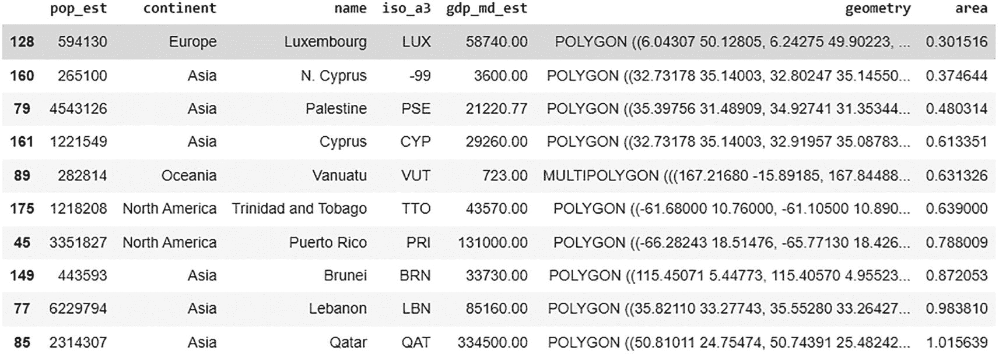

图 3-19 数据的前十行。图片来源：作者，数据来源：`geopandas`，BSD 3 条款许可

我们还可以通过计算多边形边界的长度来计算国境线的长度。`length` 属性允许我们这样做。你可以使用代码块 3-19 中的代码来识别轮廓线最长的十个国家。

```
geojsonfile['length'] = geojsonfile['geometry'].apply(lambda x: x.length)
geojsonfile.sort_values('length', ascending=False).head(10)
```

你将在图 3-20 中看到结果，南极洲位居榜首。但请注意，这可能会因坐标系的选择而产生偏差。你可能还记得，一些常用的坐标系在极地附近存在严重的变形，使得靠近中央的位置显得更小。这可能会影响此处进行的计算类型。如果需要非常精确的结果，你需要解决这个问题，但为了大致了解哪些国家拥有最长的边界，当前的方法已经足够。

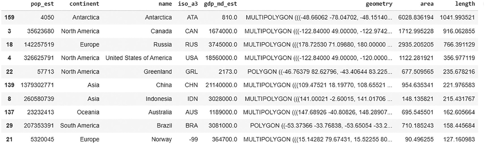

图 3-20 由代码块 3-19 得到的数据集。图片来源：作者

## 栅格/网格

栅格数据，也称为网格数据，是矢量数据的对应物。如果你习惯在 Python 中处理数字图像，你可能会觉得栅格数据非常相似。如果你习惯处理数据框，它可能更抽象一些，需要花点时间适应。

### 网格或栅格的定义

网格或栅格，是由均匀分布的水平线和垂直线组成的网络，它将一个空间切割成许多小方格。在图像中，我们通常将每个小方格称为像素。在数学中，网格还有许多其他用途，因此像素并非通用术语。

网格地理数据是每个“像素”或单元格包含一个值的网格，因此最终会形成大量数值填充一个方形区域。如果你不熟悉这种方法，可能觉得这不太可能转换成有用的东西，但一旦为这些数值分配了颜色刻度，这实际上就是图像生成的方式。对于栅格/网格地图来说，情况也是如此。

### 在 Python 中导入栅格数据集

在以下网站，你可以下载一个包含法国 `Kerbernez` 地区插值地形模型的 `GeoTIF` 文件：

[`https://geo.data.gouv.fr/en/datasets/b0a420b9e003d45aaf0670446f0d600df14430cb`](https://geo.data.gouv.fr/en/datasets/b0a420b9e003d45aaf0670446f0d600df14430cb)

你可以使用代码块 3-20 中的代码在 `Python` 中读取并显示该栅格文件。

```
import rasterio
griddata = r'ore-kbz-mnt-litto3d-5m.tif'
img = rasterio.open(griddata)
matrix = img.read()
matrix
```

如图 3-21 所示，这些数据看起来完全不像地理数据框。相反，它只是一个矩阵，充满了该数据中包含的这一个（且唯一一个）变量的值。

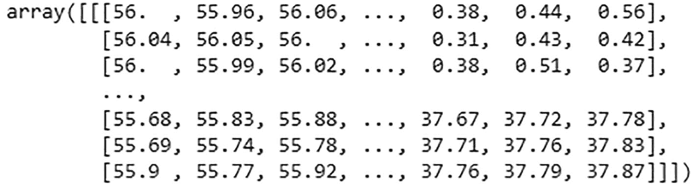

图 3-21 `Python` 中的栅格数据。图片来源：作者。数据来源：`DINSIC` 部，[*https://geo.data.gouv.fr/en/datasets/b0a420b9e003d45aaf0670446f0d600df14430cb*](https://geo.data.gouv.fr/en/datasets/b0a420b9e003d45aaf0670446f0d600df14430cb)。创建日期：未知。开放许可 2.0：[www.etalab.gouv.fr/wp-content/uploads/2018/11/open-licence.pdf](https://www.etalab.gouv.fr/wp-content/uploads/2018/11/open-licence.pdf)

你可以使用默认色阶绘制这些数据，然后就能看到这个数值表示实际包含的内容。作为人类，我们特别不擅长从像前面那样的大型矩阵中读取和解释信息，但当我们看到它被用颜色编码到地图上时，就能对我们所看到的内容有更好的感知。代码块 3-21 中的代码正是实现了这一点。

```
from rasterio.plot import show
show(img)
```

其结果如图 3-22 所示。

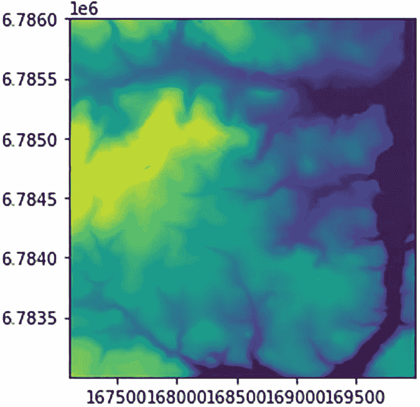

图 3-22 栅格数据的绘图。图片来源：作者。数据来源：`DINSIC` 部，[*https://geo.data.gouv.fr/en/datasets/b0a420b9e003d45aaf0670446f0d600df14430cb*](https://geo.data.gouv.fr/en/datasets/b0a420b9e003d45aaf0670446f0d600df14430cb)。创建日期：未知。开放许可 2.0：[www.etalab.gouv.fr/wp-content/uploads/2018/11/open-licence.pdf](https://www.etalab.gouv.fr/wp-content/uploads/2018/11/open-licence.pdf)

在添加数据方面，栅格数据比矢量数据更受限制。添加更多变量会相当复杂，除非将数组变成三维，其中第三维包含额外数据。然而，对于绘图来说，这并没有什么帮助，因为每个像素的绘图颜色仍然是一种颜色，并且你永远无法用这种方法为每个像素显示多个变量。

尽管如此，栅格数据仍然是一种非常重要的数据类型，你会经常需要并使用它。任何需要在大面积区域上测量的值都更适合用栅格数据。例如，高程图、污染图、密度图等等，都只能通过栅格数据来解决。栅格数据的用例通常在数学上更复杂一些，因为它们经常涉及大量的矩阵计算。你将在本书后面的章节中看到这些数学运算的示例。

# 关键要点

1.  地理数据主要有两大类：矢量数据和栅格数据。它们存储数据的方式有根本性的不同。

2.  矢量数据存储对象，并存储这些对象的地理空间参考。

3.  栅格数据将区域切割成大小相等的正方形，并为每个正方形存储一个数据值。

4.  矢量数据主要有三种类型：点、线和面。

5.  点是零维的，没有大小。它们仅由一个 x,y 坐标表示。点非常适合表示对象的位置。

6.  线是一维的。它们有长度，但没有宽度。它们由两个或更多按顺序排列的点表示。线非常适合表示线状事物，如河流和道路。

7.  面是二维对象。它们有形状和大小。当你的对象是面并且需要保留此信息时，面非常有用。如果你还需要定位对象的轮廓，面也可以表示对象的位置。当需要存储河流和道路的精确形状和宽度数据时，面也同样适用。在三种矢量数据类型中，面是能够保留最多信息的数据类型。

8.  栅格数据适用于在区域上连续的测量，例如高程图、密度图、热力图等。