# 创建地图

地图制作是地理数据领域最早且最明显的应用之一。地图是一种特殊形式的数据可视化：它们有许多标准，因此几乎任何人都能轻松识别和解读。

与其他数据可视化方法一样，地图是传达数据集信息的强大工具。可视化工具常常被错误地解读为对事实的客观描述，而实际上，地图制作者和可视化构建者拥有巨大的权力，可以决定在地图上呈现什么或省略什么。

一个例子是地图上的色阶选择。人们对某些可视化技术非常熟悉，以至于当他们看到它们时，会不自觉地相信它们。

想象一张显示特定区域污染水平的地图。如果你想让人们相信该地区的污染不是一个严重问题，你可以制作并分享一张地图，将低污染区域显示为深绿色，将严重污染区域显示为浅绿色。再加上一个微小且难以辨认的图例，人们很容易就会解读为不存在严重的污染问题。

如果你想论证相反的观点，你可以发布另一张地图，显示完全相同的数值，但将严重污染描绘为深红色，轻微污染描绘为浅红色。当人们看到这张地图时，他们会直接倾向于得出结论：你所在地区的污染是一个巨大的问题，需要立即采取行动。

重要的是要理解，选择可视化方式没有绝对的正确。然而，在地图制作中有一些杠杆，你应该熟练掌握，以便为你的特定目的创建地图。无论你的目的是制作客观的地图、美观的地图，还是传达某种信息，本章中你将发现一些工具和最佳实践。这些在制作地图时需要牢记，并且在解读地图时也会派上用场。

## 使用 Geopandas 和 Matplotlib 进行地图绘制

正如你在本书前面的章节中已经看到许多使用 `geopandas` 的示例，开始地图绘制最简单的方法是结合使用 `geopandas` 和 `matplotlib`。`Matplotlib` 是 Python 中标准的绘图和可视化库，并且它与 `geopandas` 有着出色且直观的集成。

### 将数据集导入 Python

在第一个示例中，我们将使用基于 `geopandas` 文档（[`https://geopandas.org/en/stable/docs/user_guide/mapping.html`](https://geopandas.org/en/stable/docs/user_guide/mapping.html)）的示例。该文档内容详实，详细介绍了如何使用 `geopandas` 结合 `matplotlib` 绘制地图，因此我建议你查阅该文档，以了解你可能感兴趣的、适用于自身用例和可视化的更详细的地图绘制选项。

要开始这个示例，你可以使用 `geopandas` 内置的示例地图。它包含了世界各国的多边形区域。你可以通过代码块 4-1 中的代码将其导入 Python。

```python
import geopandas as gpd
world = gpd.read_file(gpd.datasets.get_path("naturalearth_lowres"))
world.head()
```

代码块 4-1 导入数据

执行这段代码后，你将包含世界各国数据的地理数据框的前五行，如图 4-1 所示。

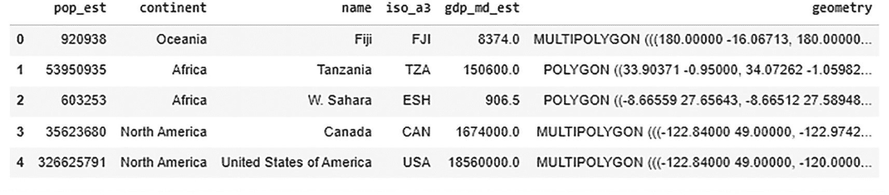

一个包含六列五行数据的表格。列标题分别为：人口估计、大洲、名称、ISO 3166-1 三位字母代码、GDP 估计和几何信息。

图 4-1 数据。图片来源：作者 数据来源：geopandas，BSD 3 条款许可

在本示例中，我们将制作一个颜色编码地图：颜色将基于各国的面积。为此，我们需要在地理数据框中添加一个包含各国面积的列。这可以通过代码块 4-2 实现。

```python
world['area'] = world.geometry.apply(lambda x: x.area)
world.head()
```

代码块 4-2 计算面积

如果你现在再次查看数据框，你会发现确实多了一列，如图 4-2 所示。该列包含每个国家的面积，将帮助我们进行地图绘制。

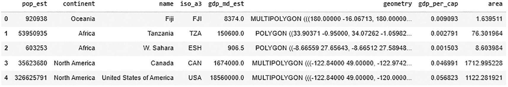

一个包含七列五行数据的表格。列标题分别为：人口估计、大洲、名称、ISO 3166-1 三位字母代码、GDP 估计、几何信息、人均 GDP 和面积。

图 4-2 添加了新列的数据。图片来源：作者 数据来源：geopandas，BSD 3 条款许可

### 绘制基础地图

在前面的章节中，你已经了解了如何在地理数据框上使用 `plot` 方法。你可以添加 `pyplot` 的 `rcParams` 来在笔记本中获得更大的输出尺寸，我建议这样做，因为默认尺寸相当小。代码块 4-3 展示了具体操作。

```python
import matplotlib.pyplot as plt
plt.rcParams["figure.figsize"] = [16,9]
world.plot()
```

代码块 4-3 设置图形尺寸

执行此操作后，你将得到一个仅包含多边形的地图，如图 4-3 所示。此时没有进行任何额外的颜色编码。

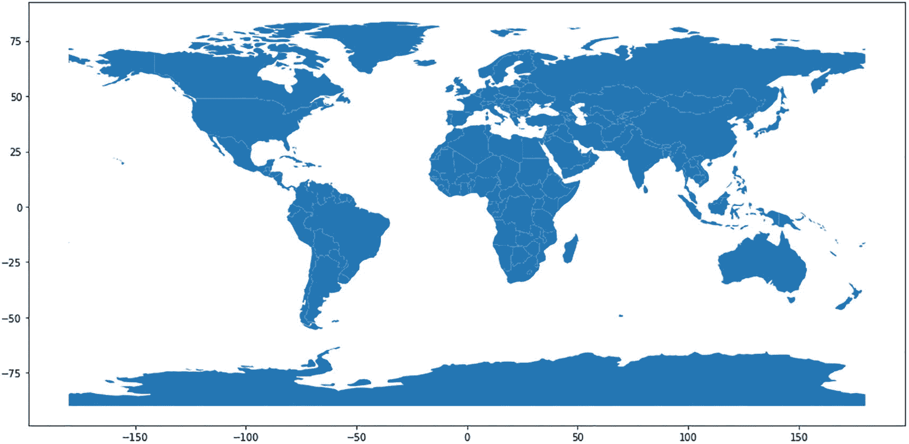

一张世界地图的图像被绘制在图表中，水平轴从 -150 到 150，以 50 为增量；垂直轴从 -75 到 75，以 25 为增量。

图 4-3 更大的绘图尺寸。图片来源：作者 数据来源：geopandas，BSD 3 条款许可

由于我们练习的目标是根据各国的总面积进行颜色编码，因此我们需要开始通过添加额外的绘图参数来改进这张地图。

使用 `geopandas` 和 `matplotlib` 为地图添加颜色编码相当简单。`plot` 方法可以接受一个 `column` 参数，当指定列名时，地图将自动根据该列进行颜色编码。

在我们的示例中，我们希望使用新生成的名为 `area` 的变量进行颜色编码，因此我们需要在绘图参数中指定 `column='area'`。代码块 4-4 展示了具体操作。

```python
world.plot(column='area', cmap='Greys')
```

代码块 4-4 添加颜色编码列

你将看到如图 4-4 所示的黑白编码地图。

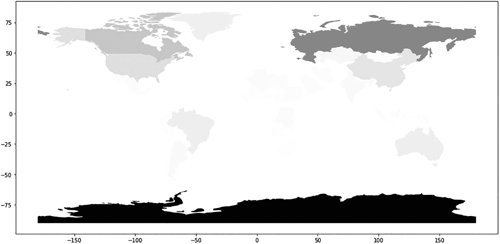

一张世界地图的图像被绘制在图表中，水平轴从 -150 到 150，以 50 为增量；垂直轴从 -75 到 75，以 25 为增量。

图 4-4 由代码块 4-4 生成的灰度地图。图片来源：作者 数据来源：geopandas，BSD 3 条款许可

### 地图标题

让我们继续完善这张地图。任何可视化（包括地图）都需要添加的一个重要元素是标题。标题能让读者轻松理解你地图的目标。

在使用 `geopandas` 和 `matplotlib` 绘制地图时，你可以使用 `matplotlib` 命令 `plt.title` 轻松在地图顶部添加标题。代码块 4-5 中的示例展示了如何操作。

```python
world.plot(column='area', cmap='Greys')
plt.title('Area per country')
```

代码块 4-5 添加地图标题

你将得到图 4-5 所示的地图。它仍然是之前的地图，但现在顶部有了标题。

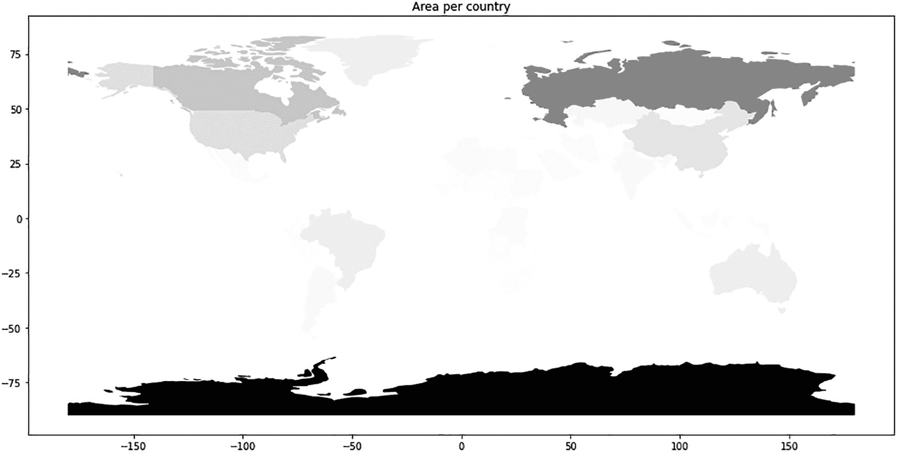

一张世界地图的图像被绘制在图表中，水平轴从 -150 到 150，以 50 为增量；垂直轴从 -75 到 75，以 25 为增量。

图 4-5 添加了标题的同一张地图。图片来源：作者 数据来源：geopandas，BSD 3 条款许可

### 地图图例

地图（及其他可视化）的另一个基本组成部分是，当你使用颜色或形状编码时，需要添加图例。在我们的地图中，我们使用颜色编码来直观地显示各国的面积，但尚未添加图例。因此，地图的读者可能会对哪些值代表大面积、哪些值代表小面积感到困惑。

在代码块 4-6 的代码中，`plot` 方法接受了两个额外参数。`legend` 设置为 `True` 以生成图例。`legend_kwds` 接受一个字典，其中包含图例的一些额外参数。`label` 将是图例的标签，`orientation` 设置为 `horizontal` 以使图例显示在底部而不是侧面。代码末尾添加了一个标题，就像你在上一部分看到的那样。

```python
import matplotlib.pyplot as plt
world.plot(column='area', cmap='Greys', legend=True)
plt.title('Area per country')
```

代码块 4-6 添加图例

你将得到图 4-6 所示的图形。

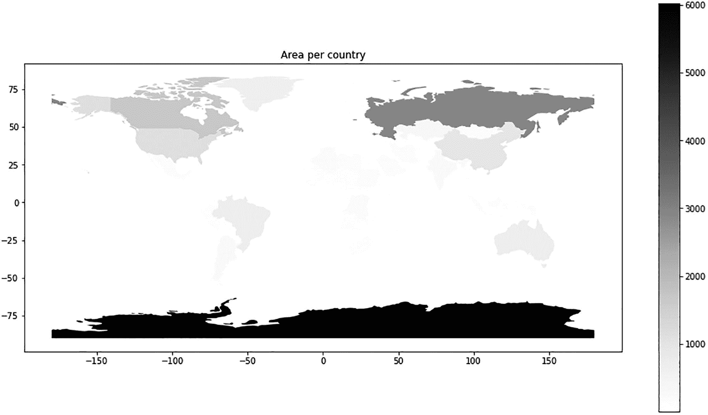

一张世界地图的图像被绘制在图表中，水平轴从 -150 到 150，以 50 为增量；垂直轴从 -75 到 75，以 25 为增量。右侧有一个垂直矩形，其值从 1000 到 6000，以 1000 为增量。

图 4-6 为地图添加图例。图片来源：作者 数据来源：geopandas，BSD 3 条款许可

这是当前示例中这张地图的最终版本。该地图在表示不同国家的数值方面做得相当不错。这类用例使用 `geopandas` 和 `matplotlib` 可以轻松解决。虽然它可能不是最美观的地图，但对于分析等目的来说已经非常完美了。

# 使用 Geopandas 和 Matplotlib 绘制点数据集

在前一个示例中，你已经了解了如何使用多边形数据集制作图表。在当前示例中，我们将更深入地探讨如何使用 `geopandas` 和 `matplotlib` 进行绘图。你将看到如何从内置的 `geopandas` 数据集中获取第二个数据集（这次是一个点数据集），并将其绘制在多边形数据集之上。这将教会你如何绘制点数据集，同时学习如何将多个数据集叠加绘制。

你可以使用代码块 4-7 中的代码导入内置数据集。该数据集包含地球上的城市，并具有点几何形状。这在代码块 4-7 中完成。

```python
cities = gpd.read_file(gpd.datasets.get_path('naturalearth_cities'))
cities.head()
```
*代码块 4-7：导入数据*

执行此代码时，你将看到数据框的前五行，如图 4-7 所示。`geometry` 列显示了这些点，它们由两个坐标组成，正如你在前几章中看到的那样。

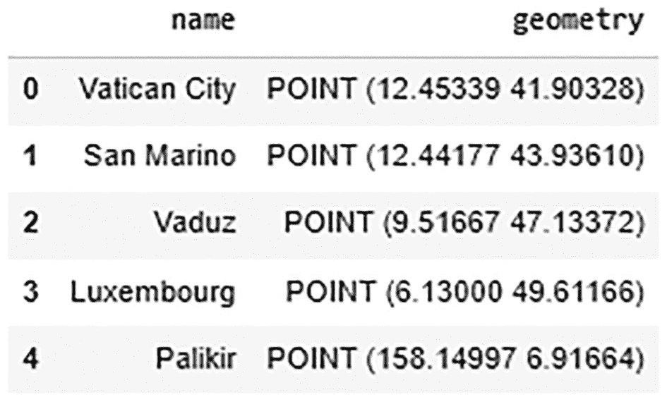
*图 4-7：数据头部。图片来源：作者 数据来源：geopandas，BSD 3 条款许可*

你可以像之前多次做的那样，使用 `plot` 命令轻松绘制此数据集。如代码块 4-8 所示。

```python
cities.plot()
```
*代码块 4-8：绘制城市数据*

你将获得一张仅包含点的地图，如图 4-8 所示。

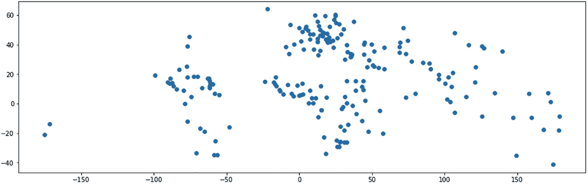
*图 4-8：城市数据图。图片来源：作者 数据来源：geopandas，BSD 3 条款许可*

这张图的可读性确实不高。我们需要添加一个背景来提供更多上下文。我们可以使用世界国家数据，仅使用国家边界，并将内容留白。

代码块 4-9 中的代码正是实现了这一点。它首先创建 `fig` 和 `ax`，然后将 `aspect` 设置为 "equal"，以确保叠加不会导致任何不匹配。接着，使用白色绘制世界（国家多边形）以使其看起来透明，然后使用 `marker='x'`（表示叉号）和 `color='black'`（表示黑色）绘制城市。

```python
import matplotlib.pyplot as plt
plt.rcParams["figure.figsize"] = [16,9]
fig, ax = plt.subplots()
ax.set_aspect('equal')
world.plot(ax=ax, color='white', edgecolor='grey')
cities.plot(ax=ax, marker='x', color='black', markersize=15)
plt.title('Cities plotted on a country border base map')
plt.show()
```
*代码块 4-9：为城市数据添加背景*

生成的地图如图 4-9 所示。

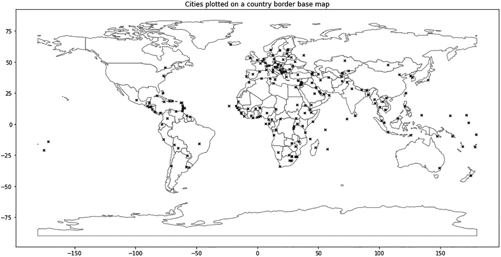
*图 4-9：为城市数据添加背景。图片来源：作者 数据来源：geopandas，BSD 3 条款许可*

## 关于使用 Geopandas 和 Matplotlib 绘图的总结

这个入门示例展示了如何使用 `geopandas` 和 `matplotlib` 创建基本地图。地图制作和数据可视化通常是创造性的过程，尽管我可以在本书中为你提供一些指导，但制作可视化并没有唯一正确的方法。

如果你想进一步探索可视化和地图绘制，我强烈建议查看 `geopandas` 绘图的文档，并尝试不同的方法，以熟悉所有可用的选项。

# 使用 Cartopy 制作地图

现在我们转向 Python 中另一个著名的地图绘制库：`Cartopy`。我们将逐步讲解 `Cartopy` 文档中展示的一个较简单的示例，以便了解这个库的不同选项、优点和缺点。

`Cartopy` 的一个优点是它拥有一个相对丰富的映射图库，你可以从中获取地图并进行自定义。如果你想查看其图库中的示例，可以通过此链接找到：[Cartopy Gallery - Lines and Polygons Feature Creation](https://scitools.org.uk/cartopy/docs/latest/gallery/lines_and_polygons/feature_creation.html#sphx-glr-gallery-lines-and-polygons-feature-creation-py)。

我们将首先查看的示例基于名为 "lines and polygons feature creation" 的示例。它允许你制作地球某个区域的基本陆地地图。

代码块 4-10 中的代码展示了如何实现这一点。它经历了一系列步骤。代码的第一个重要部分是创建 `fig.add_subplot`，在其中调用 `projection` 参数，以便从一开始就解决任何坐标系问题。在此例中，选择了 `PlateCarree` 投影，但 `cartopy.crs` 库提供了大量替代方案。

其次，你会看到调用了 `ax.set_extent`。这将创建一个地图子集，范围从左下角坐标 (-10, 30) 到右上角坐标 (40, 70)。你将在下一章中看到关于设置范围的更多细节。

之后，调用 `ax.stock_img()` 来添加背景地图。这是一个简单但易于识别的背景图像，包含蓝色海洋和棕色/绿色陆地。

还向地图添加了 `Cartopy` 的一些内置要素：陆地、海岸线以及来自 Natural Earth Features 的 `states_provinces`，并设置为 1:1000 万比例尺。

最后，在右下角添加了版权信息。

```python
!pip install cartopy

import cartopy

import matplotlib.pyplot as plt

import cartopy.crs as ccrs

import cartopy.feature as cfeature

from matplotlib.offsetbox import AnchoredText

plt.rcParams["figure.figsize"] = [16,9]

fig = plt.figure()

ax = fig.add_subplot(1, 1, 1, projection=ccrs.PlateCarree())

ax.set_extent([-10, 40, 30, 70], crs=ccrs.PlateCarree())

# 背景图像

ax.stock_img()

# 使用 cartopy 的内置要素

states_provinces = cfeature.NaturalEarthFeature(

category='cultural',

name='admin_1_states_provinces_lines',

scale='10m',

facecolor='none')

ax.add_feature(cfeature.LAND)

ax.add_feature(cfeature.COASTLINE)

ax.add_feature(states_provinces, edgecolor='gray')

# 添加版权信息

text = AnchoredText('\u00A9 Natural Earth; license: public domain',loc=4, prop={'size': 12}, frameon=True)

ax.add_artist(text)

plt.show()
```
*代码块 4-10：创建 Cartopy 图*

这个 `Cartopy` 入门示例生成的地图如图 4-10 所示。

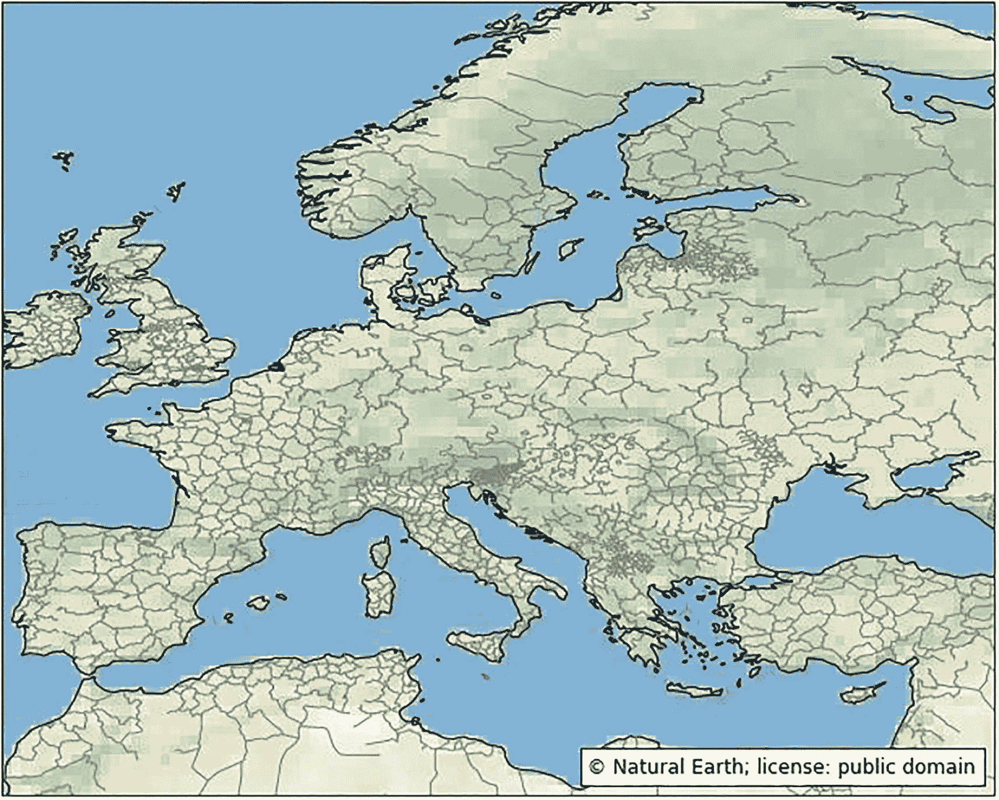
*图 4-10：Cartopy 地图。图片来源：作者 数据来源：Natural Earth，通过 Cartopy 提供，公共领域*

## 关于使用 Cartopy 绘制地图的总结

现在你已经看到了 `Cartopy` 的示例，不妨将 `geopandas` + `matplotlib` 的绘图技术与 `Cartopy` 技术进行一下比较。

在使用 geopandas 时，重点似乎在于数据本身。生成的图表相当实用，并且因其 matplotlib 语法而具有巨大优势。另一方面，Cartopy 是一个真正为制图而生的库。它没有用于存储数据的方法或最佳实践。

如果你对制图功能特别感兴趣，你可能会更喜欢 Cartopy，因为它能让你做很多事情。另一方面，它管理起来稍微不那么容易，并且与使用 geopandas 相比，你需要自己承担更多繁重的工作。

从美学角度来看最终结果，我认为没有明显的赢家。两种方法可能都能获得相似的结果。使用这两种方法制作出美观的地图都需要付出努力，但对于获取信息丰富的地图来说，它们都表现出色。

## 使用 Plotly 制作地图

现在，是时候转向一个能让你制作出更美观可视化的制图库了。一个可以实现这一点的库是 Plotly。Plotly 是 Python 中一个著名的数据可视化库，它也有一个非常完善的制图组件。

我强烈建议你查看 Plotly 地图画廊（图 4-11），这是开始制作地图的绝佳资源。他们的图表画廊位于 [`https://plotly.com/python/maps/`](https://plotly.com/python/maps/)，其中包含大量不同类型图表的代码示例，包括：

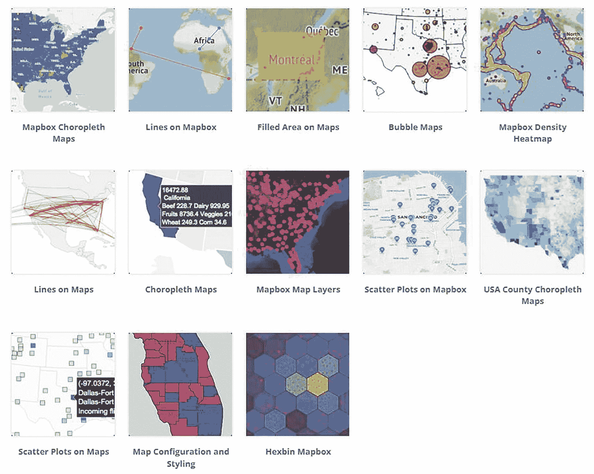

十三张不同地图的图像，在特定区域上带有绘图或线条。第 1 行和第 2 行有五张带有标签的图像，第 3 行有三张带有标签的图像。

图 4-11

Plotly 图表画廊截图 (plotly.com/python/maps)

*   分级统计图

*   气泡图

*   热力图

*   散点图

*   以及更多

为了很好地掌握 Plotly 的语法，让我们基于其图表画廊中著名的图表，快速浏览一个简短的 Plotly 示例。在这个示例中，你将看到 Plotly 如何仅通过添加一些额外的功能，就能轻松制作出美观的地图。

你可以使用代码块 4-11 中的代码来获取一个包含某些城市数据的 Plotly express 示例数据集。

```
import plotly.express as px
data = px.data.gapminder().query("year==2002")
data.head()
代码块 4-11
使用 Plotly 绘制地图
```

数据框前五行内容告诉我们有哪些类型的变量。例如，你有每个国家每年的预期寿命、人口和 GDP。在前面的查询中应用的对 2002 年的过滤，使得我们每个城市只有一个数据点；否则，绘图会更加困难。

让我们创建一个名为 `gdp` 的新变量来绘制图表。这个变量可以使用代码块 4-12 来计算。

```
data['gdp'] = data['gdpPercap'] * data['pop']
data.head()
代码块 4-12
添加一个新变量 gdpPerCap
```

现在，让我们使用代码块 4-13 制作一个气泡图，其中每个国家的图标根据新创建的变量 `gdp` 而变大或变小。

```
fig = px.scatter_geo(data, locations="iso_alpha", size="gdp", projection="natural earth")
fig.show()
代码块 4-13
添加变量 gdp
```

即使使用这样相当简单的代码，你也会得到一个看起来相当有趣的图表，如图 4-12 所示。

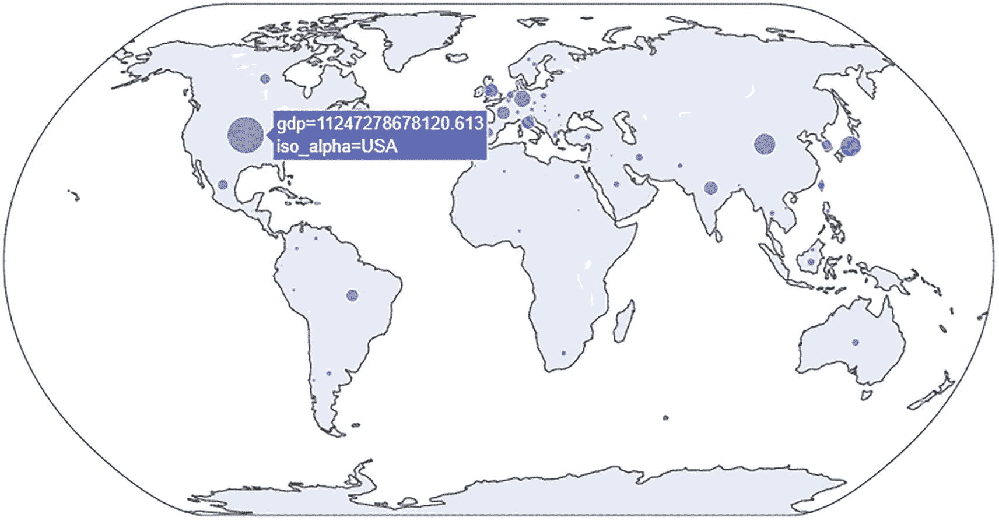

一张世界地图，由不同大小的点组成，绘制在不同的区域或国家上。一个大致绘制在北美区域的点带有标签。

图 4-12

使用 Plotly 绘制的地图。图片来源：作者 数据来源：Plotly 数据 gapminder。源数据是来自世界银行（通过 gapminder.org）的免费数据，采用 CC-BY 许可。

每个国家都有一个代表其 GDP 的气泡，各大洲颜色不同，背景是著名的自然地球底图。你可以将鼠标悬停在数据点上以查看关于每个点的更多信息。

### 关于使用 Plotly 绘制地图的总结

你可能已经自己得出了结论，Plotly 的真正价值在于其简单性。这个库非常适合制作美观的地图，而无需长时间深入思考你可能遇到的许多复杂问题。我邀请你查看 Plotly 中的更多示例，以了解其他强大的功能，并尝试他们画廊中的一些示例代码。

## 使用 Folium 制作地图

在本系列关于使用 Python 制作地图的第四部分也是最后一部分中，你将朝着更优的美学效果再进一步。Folium 是一个 Python 库，它与一个名为 Leaflet.js 的 JavaScript 库集成。

Folium 允许你创建交互式地图，其结果几乎会让你感觉像是在使用谷歌地图或类似的软件。所有这些只需几行代码即可实现，而生成这些交互式地图的所有复杂工作都隐藏在 Folium 和 Leaflet.js 背后。

Folium 拥有详尽的文档，其中包含大量示例和快速入门教程（[`https://python-visualization.github.io/folium/quickstart.html#Getting-Started`](https://python-visualization.github.io/folium/quickstart.html%2523Getting-Started)）。为了让您感受使用 Folium 所能获得的结果类型，我们将快速浏览一些精彩的示例。让我们从简单地创建一张地图开始，然后逐步添加特定参数以创建更出色的结果。

使用代码块 4-14 中的语法，你将自动创建一张巴黎地区的地图。这是一行代码，仅包含巴黎的坐标，它直接展示了 Folium 库的强大功能。

```
import folium
m = folium.Map(location=[48.8545, 2.2464])
m
代码块 4-14
使用 Folium 进行地图绘制
```

你将在笔记本中获得一张交互式地图。它看起来如图 4-13 所示。

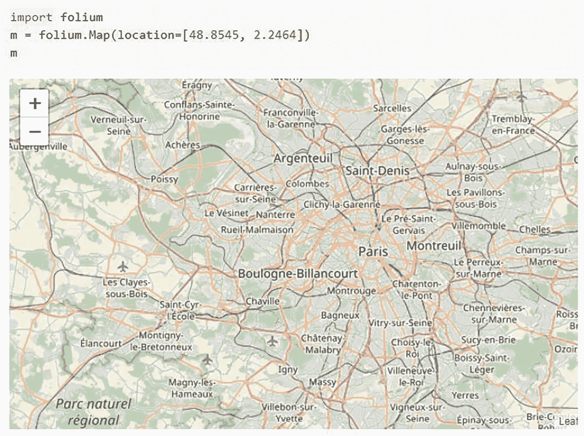

一段代码：import folium, m 等于 folium 点 map, 左括号, location 等于, 左括号 48.8545, 2.2464, 右括号, 左括号, m。代码下方是一张法国城市和地区的地图图像。

图 4-13

使用 Folium 制作的地图。作者提供的图像。此衍生作品基于 OpenStreetMap 的地图数据源。地图数据源：OpenStreetMap 贡献者。底层数据遵循开放数据库许可证。地图（衍生作品）受本书版权保护。[*https://wiki.osmfoundation.org/wiki/Licence/Licence_and_Legal_FAQ#What_is_the_licence,_how_can_I_use_it?*](https://wiki.osmfoundation.org/wiki/Licence/Licence_and_Legal_FAQ%2523What_is_the_licence,_how_can_I_use_it?)

现在，有趣的是，这张地图不包含你的任何数据。它看起来像是一张充满了复杂点、多边形、标签等内容的地图，并且在软件的底层深处确实如此。Folium 作为可视化层的强大之处在于，你完全无需担心这一点。你所有的“背景数据”都将对用户保持干净地隐藏。你可以想象，如果使用巴黎地区实际的多边形、线和点来创建，这将非常复杂。

让我们更进一步，向这个底图添加一些数据。我们将添加两个标记（Folium 术语中的点数据）：一个用于埃菲尔铁塔，一个用于凯旋门。

代码块 4-15 中的代码显示了相对于之前代码的一些新增内容。首先，它添加了一个 `zoom_start`。这基本上告诉你在初始化地图时要显示多少缩放级别。如果你尝试过第一个示例，你会发现你可以缩小到在地图上看到整个世界，也可以放大到看到非常详细的地图。它确实非常完整。然而，对于特定的用例，你可能希望专注于特定的区域或地带，设置 `zoom_start` 将帮助你的用户识别他们需要查看的内容。

其次，地图上添加了两个标记。它们使用 `.add_to` 方法非常直观地添加到地图上。一旦添加到地图，你只需像之前一样显示地图，它们就会出现。你可以指定一个弹出窗口，以便在悬停在标记上时看到附加信息。使用 HTML 标记，你可以在此处创建整段信息，如果你愿意的话。

由于标记是点几何数据，它们只需要 x 和 y 坐标即可在地图上定位。当然，这些坐标必须位于正确的坐标系中，但这与你之前见过的任何内容并无不同。

```
import folium
m = folium.Map(location=[48.8545, 2.2464], zoom_start=11)
folium.Marker(
[48.8584, 2.2945], popup="埃菲尔铁塔").add_to(m)
folium.Marker(
[48.8738, 2.2950], popup="凯旋门").add_to(m)
m
代码块 4-15
向 Folium 地图添加项目
```

# 第二部分 GIS 操作

如果你在笔记本中工作，你将能够看到交互式地图出现，如图 4-14 所示。它有两个标记，分别用于显示埃菲尔铁塔和凯旋门，正如我们开始所做的那样。

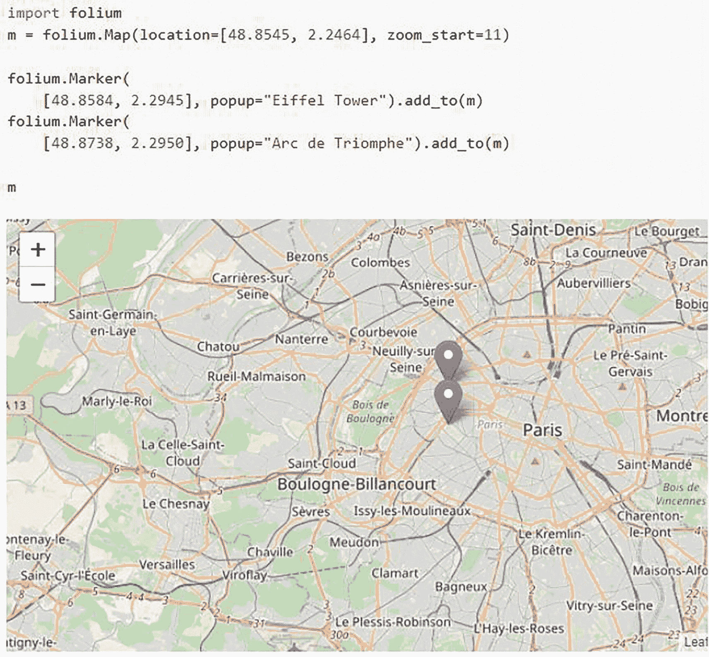

一个包含五行代码的 `import folium` 代码。代码下方是一张法国城市和地区的地图图像，巴黎市内有两个标记位置。

图 4-14

改进后的 Folium 地图。作者提供的图像。此衍生作品基于 OpenStreetMap 的地图数据源。地图数据源：OpenStreetMap 贡献者。底层数据遵循开放数据库许可证。地图（衍生作品）受本书版权保护。[`https://wiki.osmfoundation.org/wiki/Licence/Licence_and_Legal_FAQ#What_is_the_licence,_how_can_I_use_it?`](https://wiki.osmfoundation.org/wiki/Licence/Licence_and_Legal_FAQ%2523What_is_the_licence,_how_can_I_use_it?)

有关使用 `folium` 绘制地图的更多详细信息，我强烈建议你阅读文档。网上还有更多的文档，以及示例地图和包含不同数据类型的示例。

## 关于使用 Folium 进行地图绘制的总结

如果你正在寻找制作交互式、用户友好、美观的地图，你将在 `folium` 中发现一个出色的工具。如果你希望通过底图获得地理空间上下文，而无需获取任何关于这些背景数据的数据，那么其内置的背景地图可能是一个强大的优势。

`folium` 允许你用少量数据创建漂亮的交互式地图，因此非常适合以可视化为导向的用例。对于科学地图以及更具分析和数学目的的地图，其缺点可能是背景地图会分散人们对分析试图展示内容的注意力。在这种情况下，不那么花哨的地图可能是更好的选择。

## 关键要点

1.  Python 中有许多地图绘制库，每个库都有其特定的优缺点。
2.  将 `geopandas` 与 `matplotlib` 结合使用，可能是用 Python 制作地图最简单、最直观的方法。这种方法允许你以类似 pandas 的直观方式在 `geopandas` 中处理数据框，并使用熟悉的 `matplotlib` 绘图语法。要获得美观的地图可能需要花费一些功夫。
3.  `Cartopy` 是一个替代方案，它更侧重于实际的地图绘制部分，而非数据处理。它是一个非常专业的制图库，对不同几何形状、不同坐标系等有很好的支持。
4.  `Plotly` 是一个可视化库，因此它较少关注地理空间功能。但它确实提供了强大的可视化选项列表，并且可以创建美观且能有效传达信息的地图。
5.  `Folium` 是创建交互式地图的绝佳库。即使只用少量代码，你也能创建出高质量、用户体验类似于谷歌地图等的地图。内置的背景地图让你即使在需要展示的数据很少时，也能制作出有用的地图。
6.  了解了这些多种地图绘制方法后，最重要的收获是：地图是为特定目的而创建的。它们要么试图客观地呈现某些数据，要么试图传达某种信息。它们也可以是为了美观而制作。在选择用 Python 制作地图的方法时，你应该选择最能服务于你目的的库和方法。这始终取决于你的具体用例。