# 6. 缓冲区

在上一章中，我们开始探讨一些常见的地理空间操作：这些操作在常规数据上无法实现，或至少不常见，但在地理空间数据中却非常普遍。

我们将介绍的标准操作包括：

*   裁剪与相交
*   缓冲区
*   合并与融合
*   擦除

在上一章中，你已经了解了两个主要操作。首先，你学会了如何将数据裁剪到特定范围，主要用于基于空间范围丢弃数据。其次，你还学会了如何使用相交操作，基于集合论对地理空间数据集创建新数据。当时也提到，在该范畴内还可以找到其他集合论操作。

在本章中，我们将探讨一种截然不同的地理空间操作。你将了解缓冲区（或称创建缓冲区）这一地理空间操作。它是地理空间操作中的标准操作之一，掌握这一工具非常有用。

与相交操作类似，缓冲区既可以作为独立工具使用，也可以作为进一步分析的工具。之前没有提及的是，在相交操作的示例中，正是使用了缓冲区操作来创建桥梁和河流的多边形数据。

这清楚地表明，所有这些空间操作都应被视为工具箱中的工具。当你想要实现特定目标时，需要选择不同的工具来达成目的。这通常意味着要以智能的方式组合使用不同的工具。你了解的工具越多，能实现的目标就越多。

本章将首先介绍缓冲区背后的理论，然后通过 Python 进行若干示例，你将看到如何使用不同的地理数据类型创建缓冲区。

## 什么是缓冲区？

缓冲区是围绕其他现有形状新创建的多边形。“缓冲区”这个术语很贴切，因为它实际上就是在现有对象周围创建一个缓冲区域。

你可以围绕所有矢量数据对象创建缓冲区，并且它们始终会变成多边形。例如，根据数据类型，会得到以下结果：

*   当你在一个点周围创建缓冲区时，最终会得到一个包含该点周围区域的新缓冲区多边形。
*   通过为一条线添加缓冲区，你会得到一个包含该线周围区域的新要素。
*   多边形周围的缓冲区也会包含该多边形外部的区域。

缓冲区是新创建的对象。计算缓冲区多边形后，你的原始数据仍然存在。你只是创建了一个新的要素，即缓冲区。

### 缓冲区示意图

让我们用一个更直观的例子来阐明这个定义。我们将沿用上一章中使用的例子：我们有一个道路线数据集，但需要将这些线转换为多边形，以考虑道路的宽度。在图 6-1 中，你看到一条道路首先以多边形形式呈现，然后以线形式呈现。

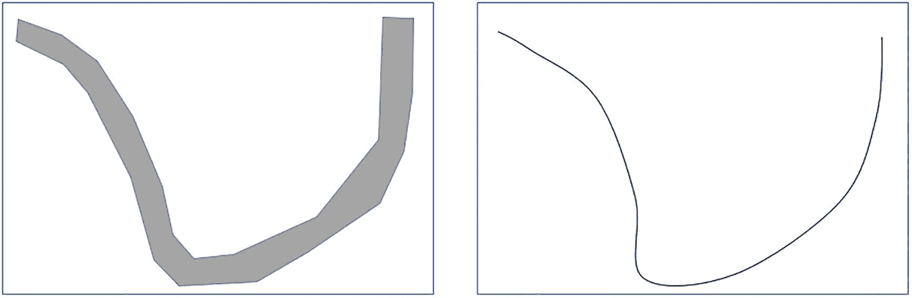

一张示意图，道路首先以多边形形式呈现，然后以线形式呈现。左侧，一条弯曲的道路以多边形表示。右侧，一条弯曲的道路以线表示。两者都在正方形内。

图 6-1
展示道路首先以多边形形式呈现，然后以线形式呈现。图片由作者提供

将道路表示为线可以让你做很多事情，比如计算道路长度、查找与其他道路的交叉点并构建道路网络等。然而，在现实生活中，道路也有宽度。对于道路周边的城市规划、修建桥梁等情况，你始终需要知道每个位置的道路宽度。

正如你在第 3 章介绍数据类型时所看到的，线有长度但没有宽度。无法表示线的宽度。不过，你可以在线周围创建一个缓冲区，并为缓冲区指定一个宽度。这将生成一个包含道路的多边形，然后你就可以生成类似多边形的数据。

### 缓冲区操作在实践中是如何进行的？

现在让我们看一些关于相交操作如何应用于地理数据的示例。请记住，在栅格数据中，没有要素，只有像素，因此使用集合论仅对矢量数据有用。你将看到一些不同矢量数据类型的示例，以及相交操作如何应用于它们。

#### 点数据的缓冲区

首先，我们来考虑在点周围构建缓冲区时会发生什么。点没有宽度或长度，只有位置。如果我们创建缓冲区，通常会使缓冲区的边界与被缓冲对象保持等距。因此，点周围的缓冲区通常是圆形。缓冲区的大小决定了这些圆的大小。你可以在图 6-2 的示意图中看到一个示例。

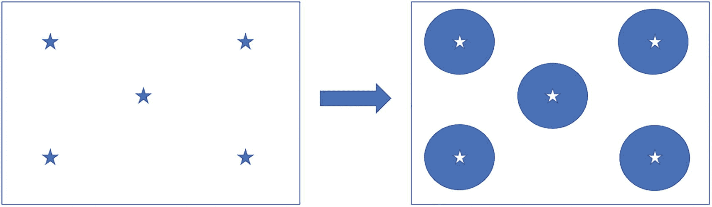

点数据缓冲区的示意图。从左到右，一个矩形内嵌有五颗星，然后一个箭头连接到另一个矩形，该矩形内嵌有五个圆，每个圆内都有一颗星。

图 6-2
点数据的缓冲区。图片由作者提供

在这张示意图中，你看到左侧图像包含点，这里用星形表示。在右侧图像中，你看到缓冲区是如何精确围绕点形成的圆形多边形。

尽管这可能看起来难以找到用例，但确实存在一些有用的场景。想象一下，你的点数据是噪音污染源，并且已知噪音可以从源头传播一定米数。在点周围创建缓冲区有助于确定噪音问题发生的区域。

另一个截然不同的用例是，你收集的数据点不太可靠。例如，假设它们是手机提供的 GPS 位置。如果你知道数据点存在多少不确定性，你可以在数据点周围创建缓冲区，表明缓冲区内的所有位置都可能是该特定手机用户访问过的。这对于营销或广告推荐等场景非常有用。

#### 线数据的缓冲区

现在我们来考虑将缓冲区应用于线数据的情况。前面已经给出了第一个示意图示例。在该示例中，存在一个线数据集，但需要将其转换为多边形，以便用于相交分析。

让我们再看另一个例子。假设你正在某处规划一条铁路线，需要研究将会产生的噪音问题程度，以及这将影响多少人。这是一个有趣的例子，因为它是对之前介绍的声音污染问题的进一步深化。

我们可以设想在铁路周围建立不同的缓冲区（一个用于受强烈影响的地点，另一个用于受中等影响的房屋）。图 6-3 中的示意图展示了如何在铁路周围建立不同的缓冲区来帮助你解决这个问题。

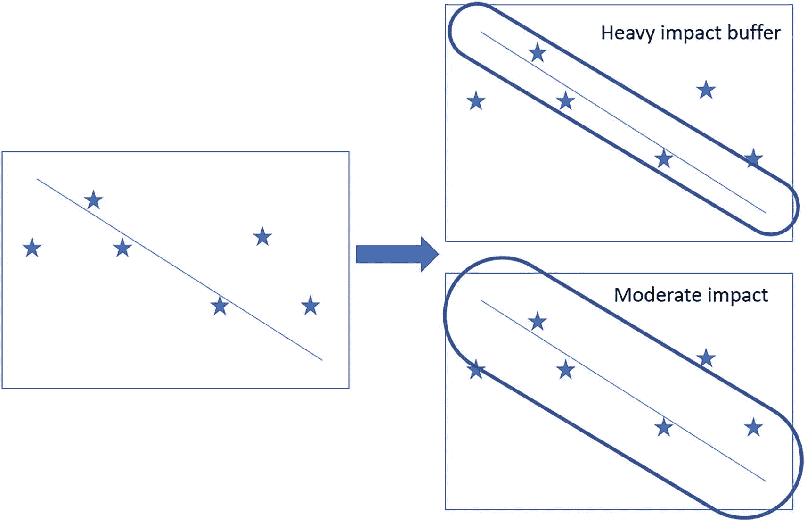

线数据缓冲区示意图。从左到右，一个带有斜线的矩形，其上下各嵌入三颗星，然后一个箭头连接到右侧上方的矩形，该矩形内嵌一个带有斜线的椭圆，内部有三颗星，矩形内也有三颗星。右下方是一个矩形，内嵌一个带有斜线的大椭圆，内部有六颗星，标注为“中等影响”。

图 6-3

线数据的缓冲区。作者自绘

你可以看到，左侧图像包含一条线（规划的铁路）和若干房屋（用星形表示）。在右上方，可以看到线周围有一个狭窄的缓冲区，表示强影响区域。你可以筛选出位于这个强影响缓冲区内的点，以便更详细地识别它们。左下方的图表包含受中等影响的房屋。你可以考虑使用前一章中的集合运算，来选择所有不在强影响缓冲区内的中等影响房屋（例如，对缓冲区使用差集运算，但其他方法也是可行的）。

#### 面数据的缓冲区

我们将讨论的第三种也是最后一种数据类型是面数据。假设你有一个城市某区域的地理数据集，其中包含一个湖泊要素。众所周知，这个湖泊周围有一条小路，但在地图上却看不到。你可以决定在湖泊周围使用缓冲区来快速估算小路的位置。图 6-4 中的示意图展示了这一思路。

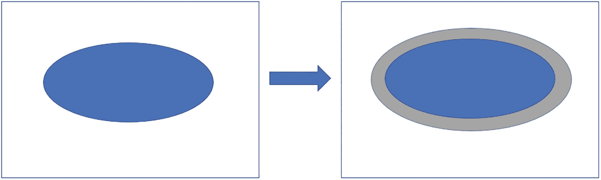

面数据缓冲区示意图。从左到右，一个矩形内嵌一个椭圆，然后一个箭头连接到右侧的矩形，该矩形内嵌一个合并后的椭圆。

图 6-4

面数据的缓冲区。作者自绘

在示意图的左侧，你可以看到湖泊面要素，一个椭圆形。在右侧，可以看到湖泊周围创建了一个灰色缓冲区——这或许不是估算小路精确位置的最佳方法，但绝对是在数据集中快速创建新要素的简便方法。

现在你已经了解了缓冲区在理论上的工作原理，是时候进行一些实践了。在下一节中，我们将开始用 Python 应用这些操作。

## 在 Python 中创建缓冲区

在接下来的示例中，我们将看一个非常简单直观的例子：搜索出租房屋。假设你有一个包含房屋地理点数据的数据库，并且你想进行地理数据查询以检验若干条件。在本例中，我们将通过几个使用缓冲区的示例来学习。你将发现如何利用缓冲区来满足你的房屋搜索条件：

*   你将看到如何使用点周围的缓冲区来调查每栋房屋是否在步行可达地铁站的范围内（这是一个真正的附加值）。

*   然后你将看到如何使用地铁线周围的缓冲区来确保房屋不受地铁线噪音的干扰（这可能是一个真正的问题）。

*   最后你将看到如何使用公园周围的缓冲区来查看每栋房屋是否至少步行可达一个公园。

让我们从第一个条件开始，在一些地铁站周围创建缓冲区。

### 在 Python 中为点创建缓冲区

首先，我们导入 `.kml` 数据。在前几章中已经多次执行此操作，现在这应该已经成为一种习惯。导入数据的代码如代码块 6-1 所示。

```
import geopandas as gpd
import fiona

# 导入巴黎地铁站数据
gpd.io.file.fiona.drvsupport.supported_drivers['KML'] = 'rw'
data = gpd.read_file('Paris_Metro_Stations.kml')
data
代码块 6-1
导入数据
```

生成的数据框如图 6-5 所示。

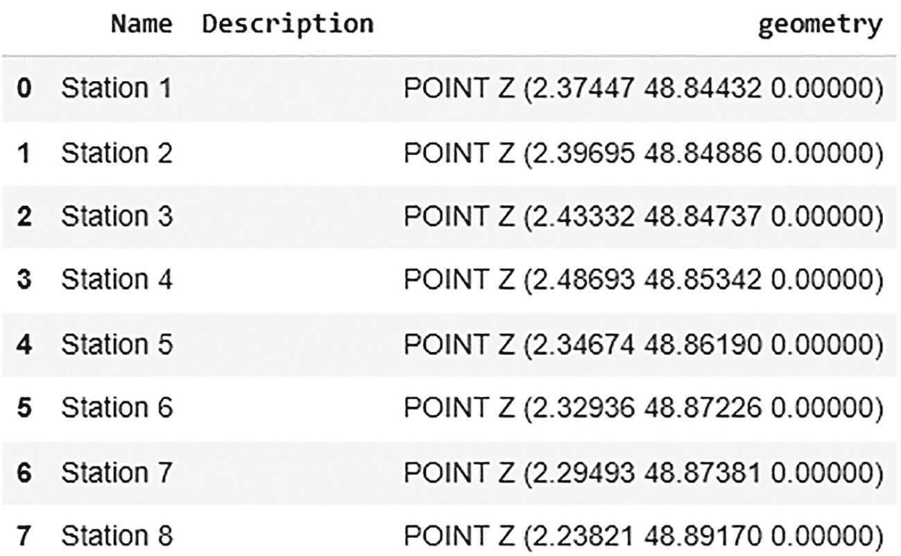

缓冲区操作中的点数据表。列标题为名称、描述和几何。行条目为站点 1 至站点 8，并附有其点 Z 坐标。

图 6-5

点数据。作者提供的图片

你会看到数据包含八个地铁站。它们没有名称，因为对于本例来说，名称并没有实际价值。它们都是点数据，包含经纬度。它们也有 z 值（高度），但未使用，因此全部为零。

让我们快速创建一个简单的可视化，以便更好地了解我们正在处理的数据。你可以使用代码块 6-2 中的代码来实现。

```
data.plot()
代码块 6-2
绘制数据
```

此图将显示数据的绘图。如图 6-6 所示。

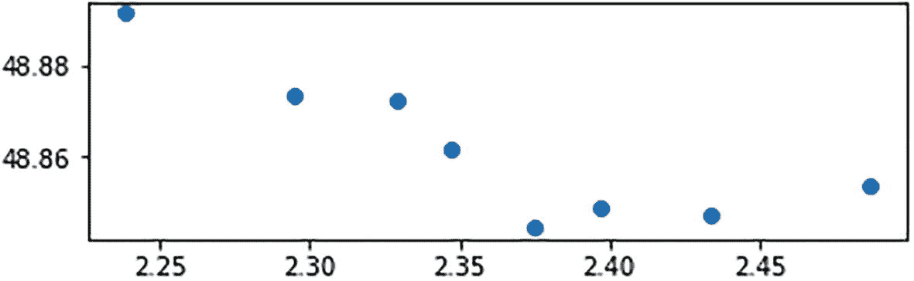

由代码块 6-2 生成的绘图。第一个图位于图表的上边界，后续的图显示向图表底部边界的最小向下移动，并伴有最小向上移动，直到最后一个图位于 48.86 处。

图 6-6

由代码块 6-2 生成的绘图。作者提供的图片

我们可以清楚地想象这些点是地铁线路的站点。这个绘图不太直观。如果你想在视觉效果上下功夫，可以随意添加第 4 章中的一些代码来创建背景视觉效果。你也可以使用 `contextily` 库，这是一个可以非常轻松地创建背景地图的 Python 包。代码块 6-3 中的代码展示了如何操作。它使用了第 5 章的示例数据来创建一个范围更大的背景地图。

```

# !pip install contextily
import contextily as cx

# 导入巴黎地铁站数据
gpd.io.file.fiona.drvsupport.supported_drivers['KML'] = 'rw'
paris = gpd.read_file('ParisSeineData.kml')
paris = paris.loc[1:,:]

# 使用巴黎数据设置范围，但保持不可见
ax = paris.plot(figsize=(15,15), color="None")

# 添加数据
data.plot(ax=ax)

# 添加背景地图
cx.add_basemap(ax, crs=data.crs)
代码块 6-3
使用背景地图绘图
```

这将生成如图 6-7 所示的地图。

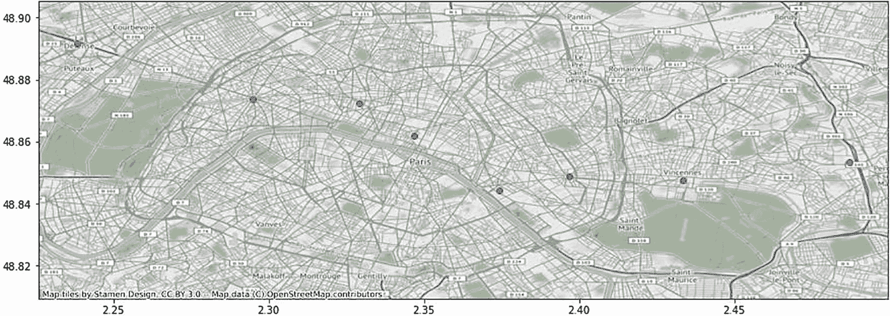

一张带有背景的地图。地图的鸟瞰图上标记了八个圆圈。它描绘了主要街道和次要街道。

图 6-7

带有背景的地图。作者提供的图片，使用了 contextily 源数据及图片中引用的图像

如你所见，这些点显示在地图上，位于东西走向的地铁线上。当我们向这些数据中添加房屋时，我们可以计算每栋房屋到每个地铁站的距离。但是，我们无法在集合操作或叠加分析中使用这些点。叠加方法比距离计算要简单得多，这也说明了掌握缓冲区操作的重要性。

我们可以使用缓冲区来与其他要素结合，正如示例定义中所指定的那样。现在，让我们在这些点上添加一个缓冲区，开始创建一个房屋选择多边形。

创建缓冲区非常简单。只需使用 `.buffer` 并指定宽度即可，如代码块 6-4 所示。

```
data.buffer(0.01)
代码块 6-4
创建缓冲区
```

此缓冲区操作将生成一个包含所有缓冲区多边形的多边形数据集，如图 6-8 所示。

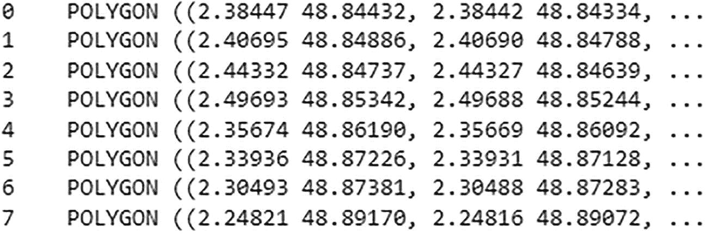

缓冲区多边形的数据图像。8 行条目从 0 到 7 标记，并附有其多边形和坐标。

图 6-8

缓冲区多边形。作者提供的图片

理论上，最好只在投影坐标系中进行此操作，但本例并非如此，不过这对本例影响不大。为了简化示例，我们跳过坐标转换。

现在，让我们将这个缓冲区添加到我们的绘图中，以便可视化那些可能满足距地铁站距离标准的房屋选择区域。执行此操作的代码如下所示。你只需将原始点数据集替换为新生成的缓冲区数据集，如代码块 6-5 所示。

```
import contextily as cx

# 导入巴黎地铁站数据
gpd.io.file.fiona.drvsupport.supported_drivers['KML'] = 'rw'
paris = gpd.read_file('ParisSeineData.kml')
paris = paris.loc[1:,:]

# 使用巴黎数据设置范围，但保持不可见
ax = paris.plot(figsize=(15,15), color="None")

# 添加数据
data.buffer(0.01).plot(ax=ax, edgecolor='black', color='None')

# 添加背景地图
cx.add_basemap(ax, crs=data.crs)
代码块 6-5
使用缓冲区数据创建绘图
```

缓冲区在背景地图上显示为黑色圆圈。你可以在图 6-9 中查看结果。

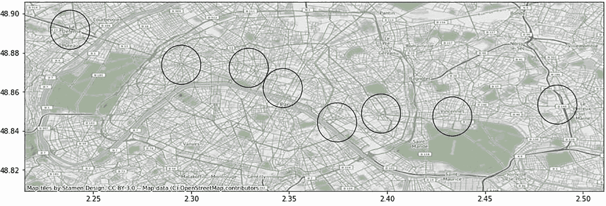

由代码块 6-5 生成的绘图地图。这些图位于中心上方，向下移动到中心，直到最后一个图位于中心。一个连续的图位于中心。

图 6-9

由代码块 6-5 生成的绘图。作者提供的图片，使用了 contextily 源数据及图片中引用的图像

有了这个结果，我们成功创建了一个空间图层，以帮助我们筛选要选择的房屋。现在，让我们继续使用缓冲区来实现以下两个标准。

### 在 Python 中为线要素创建缓冲区

在本练习的第二部分，你将学习如何为线要素创建缓冲区。我们将使用一条代表地铁线路的线要素，并创建一个我们认为距离地铁线路过近的缓冲区。想象一下，地铁会产生相当大的噪音。需要说明的是，该线路的大部分实际上位于地下，但为了简化练习，我们在此不考虑这一点。

与其导入一个线数据集，不如使用之前的点数据集，并将这八个点转换为一个单一的线要素。为此，我们首先需要确保这些点按正确的顺序排列，然后将它们传递给 shapely 包中的 `LineString` 函数。所有这些操作都在代码块 6-6 的代码中完成。

```
from shapely.geometry.linestring import LineString
LineString(data.loc[[7,6,5,4,0,1,2,3], 'geometry'].reset_index(drop=True))
代码块 6-6
一个 LineString 对象
```

在笔记本中调用此代码时，你将看到一条线会自动打印出来，如图 6-10 所示。


打印出的线字符串对象的图像。一条水平线，描绘了起始处的一个微小斜坡，并在末端略微向上。

图 6-10

打印出的 LineString 对象。作者提供的图片

这种可视化效果并不是特别有用，因此我们最好尝试将其添加到现有的绘图中。代码块 6-7 中的代码正是通过将 `LineString` 存储为 geopandas 数据框，然后进行绘图来实现这一点。

```
import pandas as pd
df = pd.DataFrame(
{
'Name': ['metro'],
'geometry': [LineString(data.loc[[7,6,5,4,0,1,2,3], 'geometry'].reset_index(drop=True))]
}
)
gdf = gpd.GeoDataFrame(df)
gdf
代码块 6-7
将此 LineString 添加到我们现有的绘图中
```

你将看到，生成的 geodataframe 恰好包含一条线，即代表我们地铁线路的线，如图 6-11 所示。

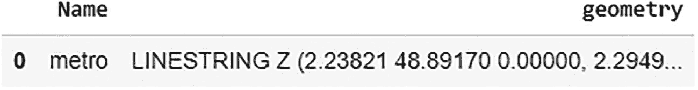

数据框的表格。列标题为 Name 和 geometry。行条目为 0、metro、linestring Z 和坐标。

图 6-11

数据框。作者提供的图片

为了绘制这条线，我们使用代码块 6-8 中的代码，直接将此数据添加到带有底图的绘图中。

```
import contextily as cx

# 使用巴黎数据设置范围，但保持不可见
ax = paris.plot(figsize=(15,15), color="None")

# 添加点数据
data.buffer(0.01).plot(ax=ax, edgecolor='black', color='None')

# 添加线数据
gdf.plot(ax = ax, color = 'black')

# 添加底图
cx.add_basemap(ax, crs=data.crs)
代码块 6-8
在绘图中添加此数据

你现在得到了一张包含地铁站缓冲区和地铁轨道（以线表示）的地图。结果如图 6-12 所示。

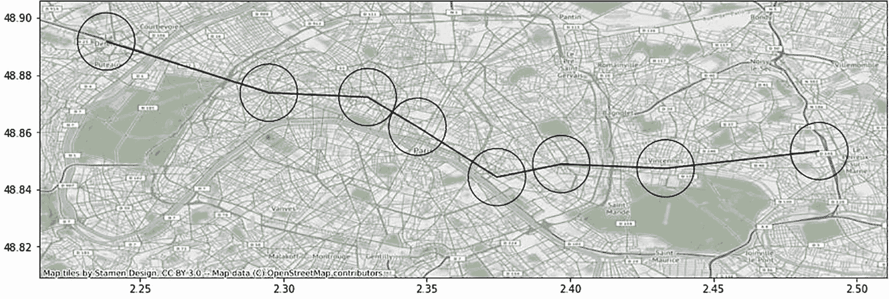

一张包含两种数据类型绘图的图。图中标记了八个圆形图。第一个图位于 48.90，第二个图位于 48.88，第三个图位于 48.88，第四个图位于 48.86，第五个图位于 48.84，第六个图位于 48.84，第七个图位于 48.85。

图 6-12

包含两种数据类型的绘图。作者使用 contextily 源数据和图像（如图中引用所示）提供的图片

下一步是计算这条线周围的缓冲区，以标示出你在寻找房屋时想要排除的区域，从而满足引言中给出的标准。这可以使用与之前相同的操作来完成，但现在我们将选择一个稍小的缓冲区大小，以避免排除过多区域。这在代码块 6-9 中完成。

```
gdf.buffer(0.001)
代码块 6-9
添加一个较小的缓冲区

通过这种方式创建缓冲区，你最终会得到一个包含缓冲区多边形（而非初始线数据）的 geodataframe。如图 6-13 所示。

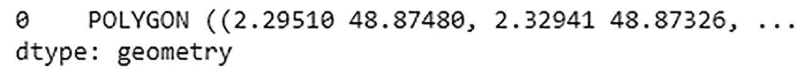

带有缓冲区的多边形图像。行条目为 polygon、coordinates、d type、geometry。

图 6-13

带有缓冲区的多边形。作者提供的图片

现在，你可以简单地将此多边形添加到绘图中，你将得到一个多边形，它显示了你应该尝试寻找房屋的区域以及一些应避免的子区域。使用 `alpha` 参数设置透明度可以极大地帮助生成更易读的地图。这在代码块 6-10 中完成。

```
import contextily as cx

# 使用巴黎数据设置范围，但保持不可见
ax = paris.plot(figsize=(15,15), color="None")

# 添加点数据
data.buffer(0.01).plot(ax=ax, edgecolor='black', color='green', alpha=0.5)

# 添加线数据
gdf.buffer(0.001).plot(ax = ax, edgecolor='black', color = 'red', alpha = 0.5)

# 添加底图
cx.add_basemap(ax, crs=data.crs)
代码块 6-10
改进绘图
```

你将获得如图 6-14 所示的中间结果。

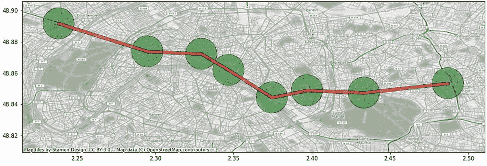

由代码块 6 到 10 生成的绘图结果图。八个圆形图与图 12 中的相同，圆圈内部有标记，并且圆圈上的线条具有更重的权重。

图 6-14

由代码块 6-10 生成的绘图结果。作者使用 contextily 源数据和图像（如图中引用所示）提供的图片

这显示了巴黎的地图，其中最适合使用的圆圈以绿色标记，而红色多边形区域应避免，因为它距离地铁线路太近。在下一节中，我们将在地图上添加第三个标准：靠近公园。这将通过为多边形创建缓冲区来完成。

### 在 Python 中为多边形创建缓冲区

房屋选择的第三个标准是靠近公园。在 `Paris_Parks.kml` 数据集中，你可以找到巴黎的一些公园。这些数据仅用于示例，远非完美，但足以完成本次练习。你可以使用代码块 6-11 中的代码导入数据。

```

# 导入巴黎公园数据
gpd.io.file.fiona.drvsupport.supported_drivers['KML'] = 'rw'
parks = gpd.read_file('Paris_Parks.kml')
parks
代码块 6-11
导入公园数据
```

在图 6-15 中，你会看到该数据集中有 18 个公园，全部以多边形形式标识。

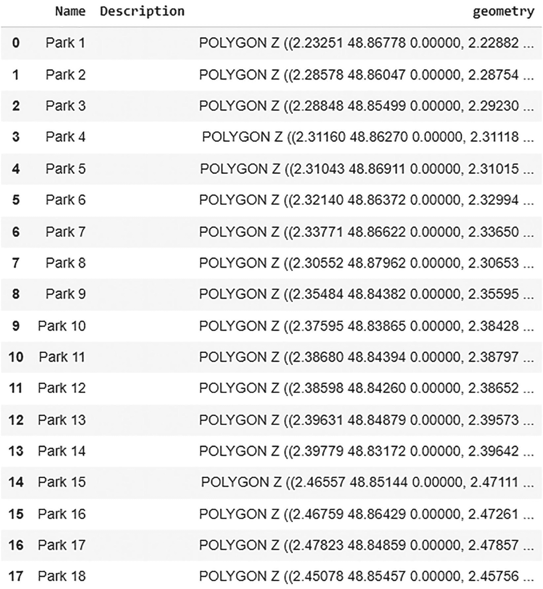

来自代码块 6-11 的数据表。列标题为名称、描述和几何图形。行条目为公园 1 至 18 及其多边形 Z 坐标。

图 6-15

来自代码块 6-11 的数据。作者提供的图片

你可以通过代码块 6-12 中的方式，将这些数据直接添加到地图中进行可视化。

```
import contextily as cx

# 使用巴黎数据设置范围，但保持不可见
ax = paris.plot(figsize=(15,15), color="None")

# 添加点数据
data.buffer(0.01).plot(ax=ax, edgecolor='black', color='green', alpha=0.5)

# 添加线数据
gdf.buffer(0.001).plot(ax = ax, edgecolor='black', color = 'red', alpha = 0.5)

# 添加公园数据
parks.plot(ax=ax, edgecolor='black', color="none")

# 添加底图
cx.add_basemap(ax, crs=data.crs)
代码块 6-12
在地图中直接可视化数据
```

公园在地图中显示为黑色轮廓线。尚未创建任何缓冲区。这个中间结果如图 6-16 所示。

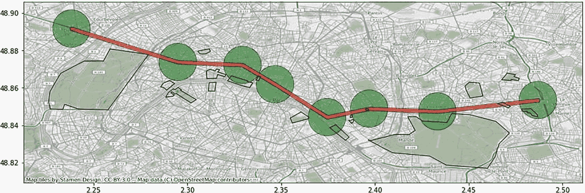

一张添加了公园的地图。地图上的图形相同，此次图形分布在地图的左右两侧。

图 6-16

添加了公园的地图。作者使用 contextily 源数据和图像作为参考提供的图片

当然，你不太可能在公园内找到房子，因此我们需要将搜索区域设定为包含公园周边的边界。同样，这可以通过为多边形数据添加缓冲区来实现。缓冲区操作与之前一样，通过调用带有距离参数的 `buffer` 方法完成。代码块 6-13 展示了这一过程。

```
parks.buffer(0.01)
代码块 6-13
为公园添加缓冲区
```

结果如图 6-17 所示。

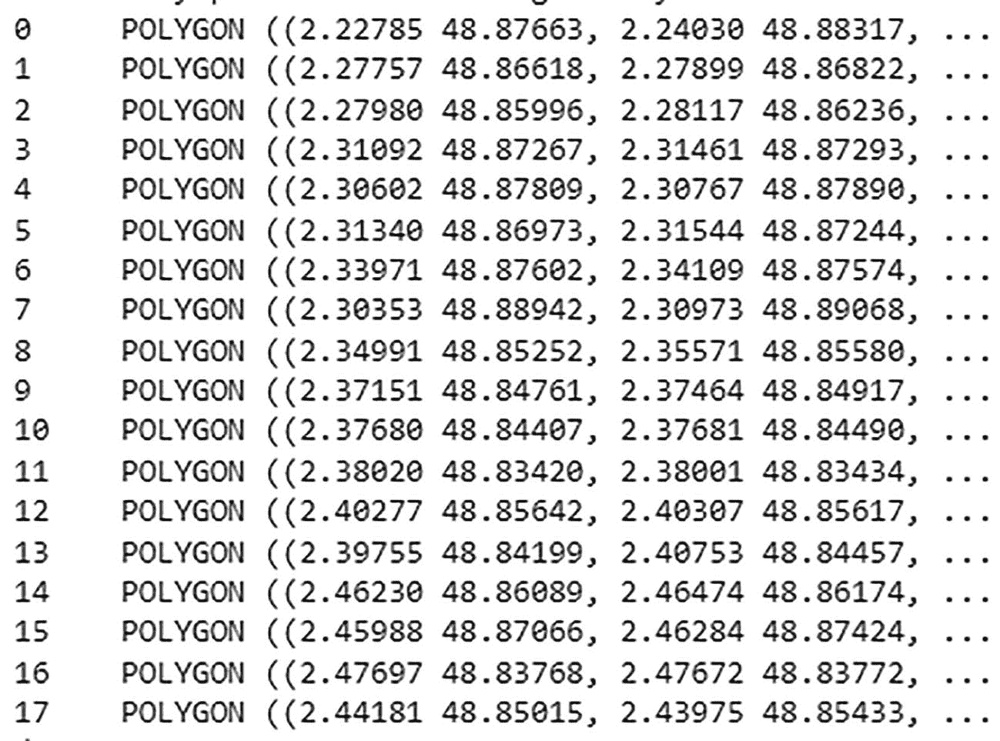

缓冲区操作结果数据表。18 行条目包含多边形及其坐标。

图 6-17

来自代码块 6-13 的结果数据

缓冲区操作后，你得到的是多边形数据，与之前相同。但多边形的尺寸现在变大了，因为它包含了原始多边形周围的缓冲区。现在，我们将此结果添加到图形中，看看它如何影响我们寻找房屋的区域。代码块 6-14 展示了这一过程。

```
import contextily as cx

# 使用巴黎数据设置范围，但保持不可见
ax = paris.plot(figsize=(15,15), color="None")

# 添加点数据
data.buffer(0.01).plot(ax=ax, edgecolor='none', color='yellow', alpha=0.5, zorder=2)

# 添加线数据
gdf.buffer(0.001).plot(ax = ax, edgecolor='black', color = 'red', alpha = 1, zorder=3)

# 添加公园数据
parks.buffer(0.01).plot(ax=ax, edgecolor='none', color="green", alpha = 0.5)

# 添加底图
cx.add_basemap(ax, crs=data.crs)
代码块 6-14
将所有数据整合在一起
```

颜色和“zorder”（叠加顺序）已稍作调整，以使地图更易读。毕竟，它开始包含大量要素。你将看到如图 6-18 所示的结果。

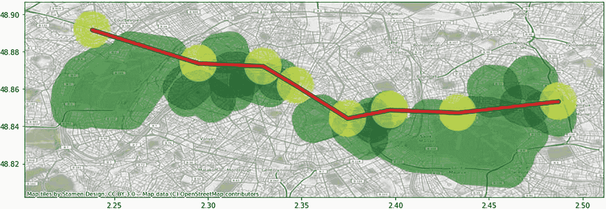

来自代码块 6 至 14 的结果图。多边形的尺寸现在变大了，因为它包含了原始多边形周围的缓冲区。

图 6-18

来自代码块 6-14 的结果图。作者使用 contextily 源数据和图像作为参考提供的图片

这张地图是一个你可以使用的初步结果。当然，你还可以更进一步，将其与第 5 章的理论相结合，在该章中你学习了如何使用集合论中的运算来组合不同形状。让我们看看如何实现这一点，最终目标是获得一个数据框，该数据框仅包含基于引言中所有三个标准我们想要寻找房屋的区域。

## 组合缓冲区与集合运算

要将三个缓冲区组合在一起，我们需要执行多个操作。首先，我们需要对“地铁站邻近区域”和“公园邻近区域”进行交集运算。毕竟，我们希望同时拥有两者，而不能只满足于其中之一。正如你在前一章所见，交集运算正是实现这一目标的正确操作。

代码块 6-15 中的代码在两个缓冲数据框之间创建了一个交集图层。它们首先被分别赋值给各自的数据框变量，以便创建更易于使用的对象。

```
station_buffer = data.buffer(0.01)
rails_buffer = gdf.buffer(0.001)
park_buffer = parks.buffer(0.01)
A = gpd.GeoDataFrame({'geometry': station_buffer})
B = gpd.GeoDataFrame({'geometry': park_buffer})
C = gpd.GeoDataFrame({'geometry': rails_buffer})
代码块 6-15
准备创建交集图层
```

然后，使用交集参数应用叠加方法，如代码块 6-16 所示。

```
A_and_B = A.overlay(B, how='intersection')
A_and_B
代码块 6-16
创建交集图层
```

你将获得一个类似于图 6-19 所示的数据集。

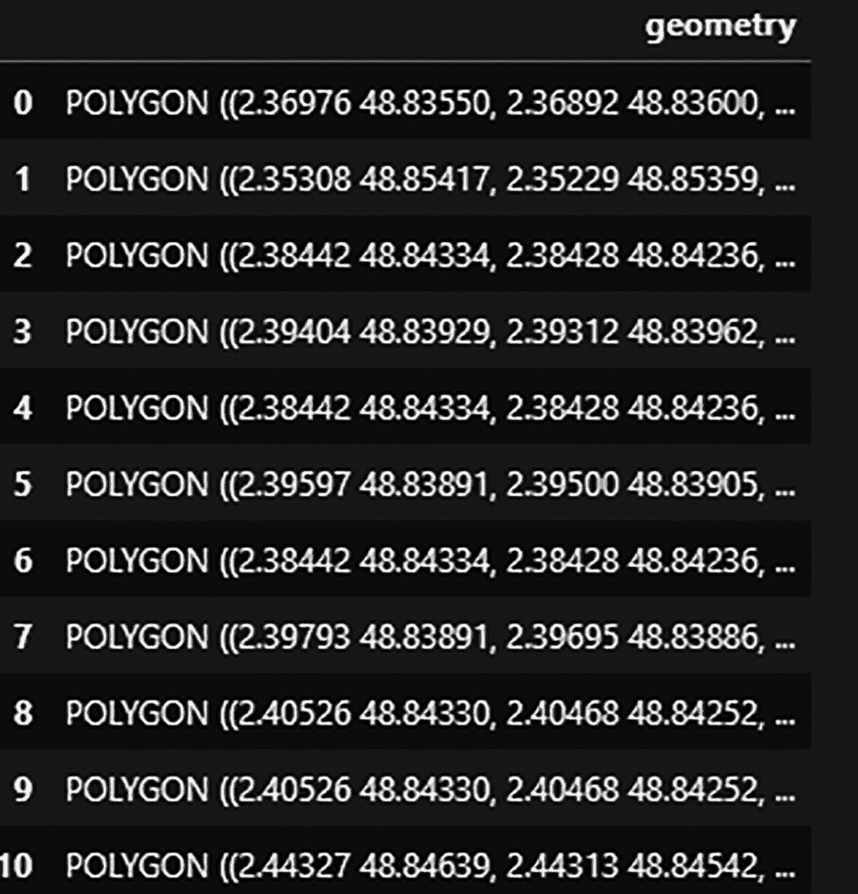

代码块 6 至 16 生成的数据表。列标题为 geometry。11 行条目包括多边形及其坐标。

图 6-19

代码块 6-16 生成的数据。图片由作者提供

有了这个车站和公园的交集，我们现在需要移除所有离地铁线路太近的位置，因为正如引言中所述，这些地方预计会过于嘈杂。

为此，我们也可以使用叠加方法，但这次我们不需要集合论中的交集运算，因为交集运算会保留所有同时靠近车站、公园和铁路的位置。然而，我们想要的是靠近车站和公园，但不靠近铁路的位置。为此，我们需要使用集合论中的差集运算。代码块 6-17 中的代码展示了如何实现这一点。

```
A_and_B_not_C = A_and_B.overlay(C, how='difference')
A_and_B_not_C
代码块 6-17
创建差集
```

数据看起来仍然和之前的数据框类似。唯一的变化是，随着每一步操作，数据变得复杂得多，因为我们可接受位置的形状变得越来越不规则。让我们使用代码块 6-18 绘制最终对象的地图。

```
import contextily as cx

# 使用巴黎数据设置范围，但保持不可见
ax = paris.plot(figsize=(15,15), edgecolor="none", color="none")
A_and_B_not_C.plot(ax=ax, edgecolor='none', color='green', alpha=0.8)

# 添加背景地图
cx.add_basemap(ax, crs=data.crs)
代码块 6-18
创建最终对象的地图
```

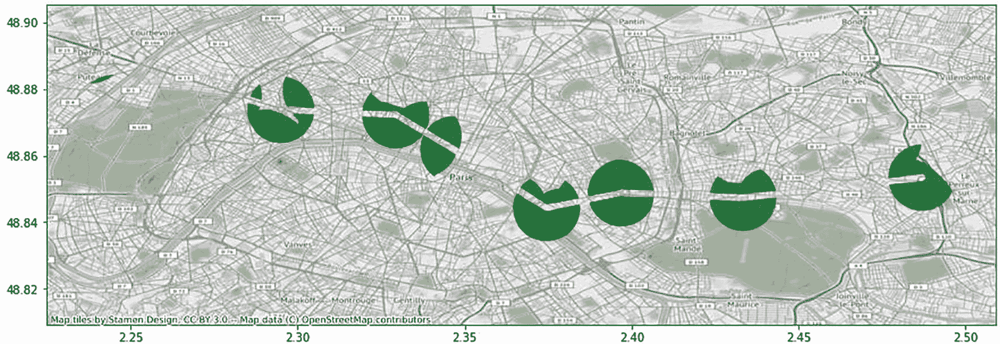

练习的最终地图。绿色区域现在是一个过滤器，用于根据坐标确定房屋位置。所有表示都绘制在地图上。

图 6-20

练习的最终地图。图片由作者使用 contextily 源数据及图像中引用的图像创建

如图 6-20 所示，绿色区域现在是一个过滤器，我们可以用它来根据坐标选择房屋。这回答了练习中提出的问题，同时也生成了一张有趣的地图。如果你想进一步进行此练习，可以创建一个包含房屋点数据的小型数据集。然后，要查找某个房屋（点数据坐标）是否在多边形内部，可以使用称为“contains”或“within”的操作。相关文档可在此处找到：

*   [`https://geopandas.org/en/stable/docs/reference/api/geopandas.GeoSeries.within.html`](https://geopandas.org/en/stable/docs/reference/api/geopandas.GeoSeries.within.html)

*   [`https://geopandas.org/en/stable/docs/reference/api/geopandas.GeoSeries.contains.html`](https://geopandas.org/en/stable/docs/reference/api/geopandas.GeoSeries.contains.html)

此操作留作练习，因为它超出了本章重点——缓冲区操作演示的范围。

## 关键要点

1.  有许多基本的地理数据操作，这些操作在大多数地理数据工具中都是标准实现的。它们乍看之下可能很简单，但将其应用于地理数据可能会带来一些困难。

2.  缓冲区操作为矢量对象添加一个多边形。无论初始对象是点、线还是多边形，结果始终是一个多边形。

3.  应用缓冲区时，可以选择缓冲区边界到初始对象的距离。选择完全取决于具体用例。

4.  一旦计算出缓冲区，它们可用于制图目的，或用于进一步的地理空间操作。

