# 7. 合并与融合

在前两章中，我们开始研究一些常见的地理空间操作：这些操作在常规数据上不可能实现，或者至少不常见，但在地理空间数据上却非常普遍。

尽管本书旨在为机器学习应用做准备，但了解存在哪些类型的地理空间操作，并具备通过文档或研究来理解其他类似操作的工作性知识，是很有益处的。本书展示的标准操作包括：

*   裁剪与相交
*   缓冲区
*   合并与融合
*   擦除

在上一章中，你已经了解了裁剪、相交和缓冲区操作。你甚至看到了一个以逻辑方式组合这些方法的用例。

在本章中，我们将研究合并与融合，它们与之前介绍的操作截然不同。它们也属于标准的地理空间操作，掌握这些工具非常有用。

正如前几章所解释的，这些空间操作都应被视为工具箱中的工具。当你想要实现特定目标时，需要选择到达目标所需的不同工具。这通常意味着要以智能的方式使用不同的工具组合。你了解的工具越多，能实现的目标就越多。

我们将从合并操作开始本章，涵盖其理论和 Python 实现，然后继续介绍融合操作。最后，你将看到两者的比较。

## 合并操作

让我们从介绍合并操作开始。我们将从理论介绍和一些示例入手，然后进入合并操作的 Python 实现。

### 什么是合并？

与常规数据一样，合并地理数据包括获取多个输入数据集，并将它们组合成一个新的单一输出要素。在上一章中，你已经看到了一个可能的合并用例。如果你还记得，基于多个标准创建了多个“适宜性”多边形。最后，所有这些多边形被组合成一个单一的空间图层。尽管在该示例中使用了另一种解决方案，但也可以使用合并来将所有图层整合到同一个图层中。

### 合并操作的示意图例

让我们通过一个可视化示例来阐明这一定义。作为一个简单直观的例子，假设你有三个数据集，每个数据集包含某个特定区域的多边形要素。你需要制作一张包含这三个区域的地图，因此需要找到一种方法，将这三个数据集合并成一个包含三个区域的单一数据集。合并操作就能为你实现这一点。图 7-1 展示了其工作原理。

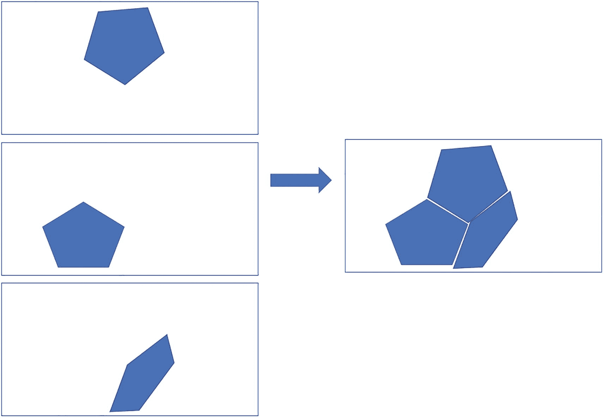

一个关于三个多边形数据集合并操作的示意图。三个方框各自包含不同大小的五边形，它们被组合在一起，形成一个包含三个区域的单一数据集。

图 7-1 合并操作。作者供图

#### 合并的不同定义

根据你使用的软件不同，合并操作的定义也并非完全相同。理解不同类型合并的工作原理非常重要，这样你就能根据文档中的描述找到所需的方法。

合并操作真正的定义是：将要素按行方向追加在一起。这不会改变现有要素的任何属性，也不会对列方向产生任何影响。上述示例的示意图展示的正是这种操作。

“合并”这个词有时也用来指代连接。将这些操作称为“连接”可能更合适，但有些软件并未采用这种命名方式。常见的连接有两种类型：空间连接和属性连接。

属性连接可能是你已经熟悉的一种连接类型。这是一种类似 SQL 的连接，你的地理数据中拥有某种键，用于从另一个也包含此键的表中添加信息。图 7-2 的示意图展示了一个例子。

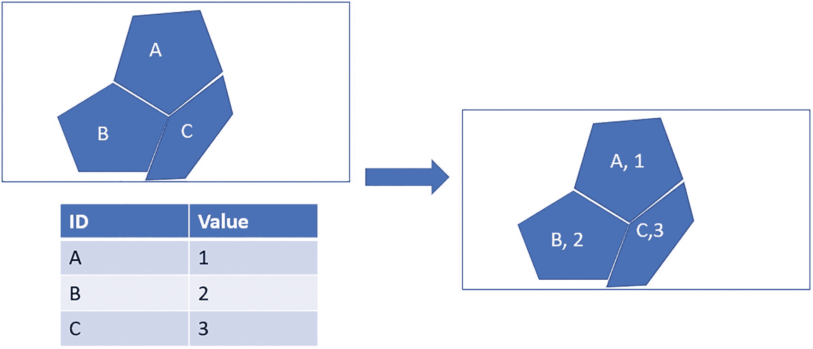

属性连接示意图。第一张图展示了一个包含 A、B、C 三个区域的单一数据集。下方的表格有 2 列 3 行，列标题为 ID 和 Value。行条目分别为 A, 1；B, 2；C, 3。该图与表格结合，最终得到一个包含 A, 1；B, 2；C, 3 三个区域的单一数据集。

图 7-2 属性连接。作者供图

如你所见，这是一个简单的类似 SQL 的连接，它利用两个数据集之间的共同标识符，将属性表的列添加到地理数据集的列中。

另一种是空间连接，它稍微复杂一些。空间连接同样合并两个数据集的列，但它不是使用共同标识符，而是使用两个数据集的地理坐标。图 7-3 的示意图展示了其原理。

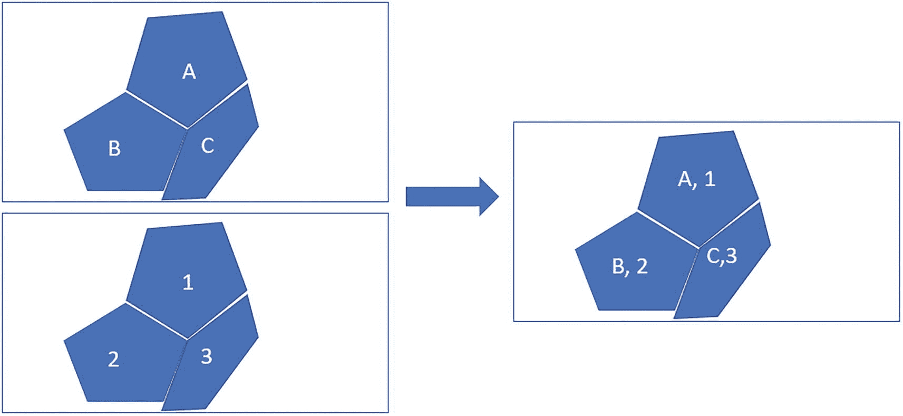

空间连接示意图。第一个数据集展示了一个包含 A、B、C 三个区域的单一数据集。第二个数据集展示了一个包含 1、2、3 三个区域的单一数据集。这两个数据集合并成一个包含 A, 1；B, 2；C, 3 三个区域的单一数据集。

图 7-3 空间连接。作者供图

在这个例子中，空间连接相对简单，因为两个输入数据集中的对象完全相同。在实际应用中，你可能会看到要素之间存在细微差异，也可能需要连接不同的要素。你可以指定各种空间连接参数来进行正确的组合：

*   连接彼此靠近的所有对象（指定一个距离）
*   基于一个对象包含另一个对象进行连接
*   基于存在交集进行连接

这为你提供了丰富的工具来处理数据集的组合，无论是按行方向（合并）还是按列方向（连接）。现在，让我们看看在 Python 中执行合并、属性连接和空间连接的一些示例。

## 在 Python 中进行合并

在接下来的示例中，我们将研究一些易于理解的数据。有多个小型数据集，在整个练习过程中，我们将执行所有三种类型的合并操作。

数据包含：

*   一个包含加拿大、美国和墨西哥三个多边形的文件
*   一个包含加拿大部分城市的文件
*   一个包含美国部分城市的文件
*   一个包含墨西哥部分城市的文件

在练习过程中，我们将执行以下步骤：

*   使用按行合并的方式合并三个城市文件
*   通过属性查找向合并后的城市文件添加一个新变量
*   使用多边形文件进行空间查找，找出每个城市所属的国家

现在，让我们开始将三个城市文件合并成一个包含所有城市的单一图层。

### Python 中的按行合并

按行合并操作通常就是我们所说的合并操作。它类似于将三个数据集按行拼接。让我们看看如何使用三个包含每个国家部分城市的示例数据文件在 Python 中实现这一点。首先，按照你在前几章中已经学到的功能，导入数据，分别绘制每个数据集，并添加背景地图。如代码块 7-1 所示。

```
import geopandas as gpd
import fiona
gpd.io.file.fiona.drvsupport.supported_drivers['KML'] = 'rw'
us_cities = gpd.read_file('/kaggle/input/chapter7/USCities.kml')
us_cities
代码块 7-1 导入数据
```

美国城市如图 7-4 所示。

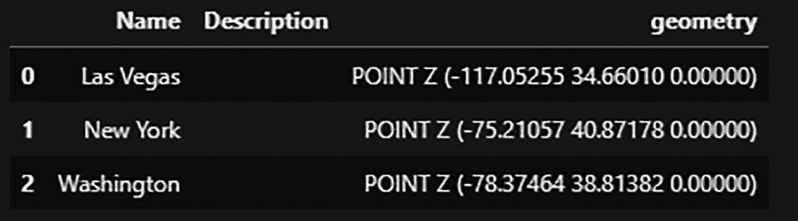

一个表格展示了美国城市的按行合并操作。该表格有 3 列和 3 行。列标题是名称、描述和几何图形。行条目是拉斯维加斯、纽约和华盛顿，它们在几何图形中拥有各自的点 Z 坐标。

图 7-4 美国城市

让我们导入加拿大城市，如代码块 7-2 所示。

```
canada_cities = gpd.read_file('/kaggle/input/chapter7/CanadaCities.kml')
canada_cities
代码块 7-2 导入加拿大城市
```

它们如图 7-5 所示。

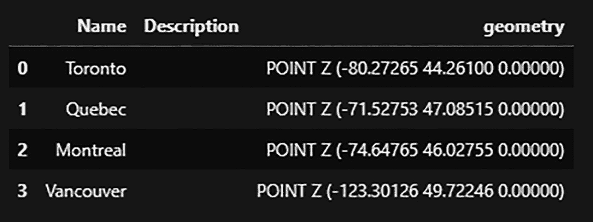

一个表格展示了加拿大城市的按行合并操作。该表格有 3 列和 4 行。列标题是名称、描述和几何图形。行条目是多伦多、魁北克、蒙特利尔和温哥华，它们在几何图形中拥有各自的点 Z 坐标。

图 7-5 加拿大城市。图片由作者提供

墨西哥城市通过代码块 7-3 导入。

```
mexico_cities = gpd.read_file('/kaggle/input/chapter7/MexicoCities.kml')
mexico_cities
代码块 7-3 导入墨西哥城市
```

它们如图 7-6 所示。

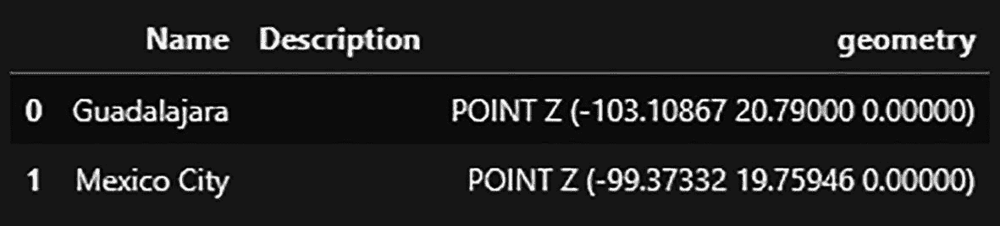

一个表格展示了墨西哥城市的按行合并操作。该表格有 3 列和 2 行。列标题是名称、描述和几何图形。行条目是瓜达拉哈拉和墨西哥城，它们在几何图形中拥有各自的点 Z 坐标。

图 7-6 墨西哥城市。图片由作者提供

我们可以使用你在本书前面学过的语法来创建这三个数据集的组合地图。这在代码块 7-4 中完成。

```
import contextily as cx

# 美国城市
ax = us_cities.plot(markersize=128, figsize=(15,15))

# 加拿大城市
canada_cities.plot(ax=ax, markersize=128)

# 墨西哥城市
mexico_cities.plot(ax = ax, markersize=128)

# contextily 底图
cx.add_basemap(ax, crs=us_cities.crs)
代码块 7-4 创建数据集的地图
```

这将生成如图 7-7 所示的地图。

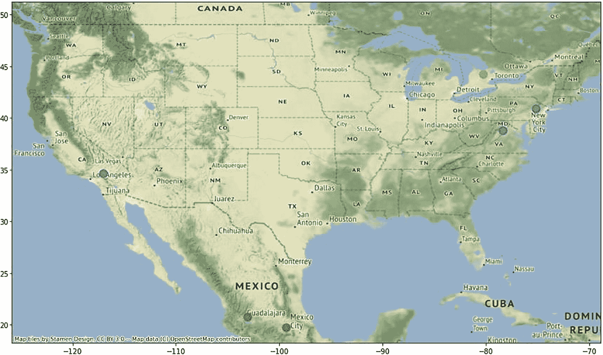

一张地图展示了使用代码块 7-4 创建的美国、加拿大和墨西哥城市的三个输入地理数据框。美国的拉斯维加斯、马里兰州和纽约市，加拿大的温哥华、多伦多、蒙特利尔和魁北克，以及墨西哥的瓜达拉哈拉和墨西哥城，在地图上都以不同颜色的点表示，每个国家一种颜色。

图 7-7 使用代码块 7-4 创建的地图。图片由作者使用 contextily 源数据和图像制作，图像引用如上

现在，这已经不错了，但我们实际上希望所有这些数据都在一个图层中，这样更容易处理。为此，我们将执行按行合并操作。在 Python 中，可以使用 `pandas` 的 `concat` 方法来实现。如代码块 7-5 所示。

```
import pandas as pd
cities = pd.concat([us_cities, canada_cities, mexico_cities])
cities
代码块 7-5
使用拼接
```

你将获得一个数据集，其中所有点现在都已合并。`cities` 现在包含了三个输入地理数据框中所有城市的行，如图 7-8 所示。

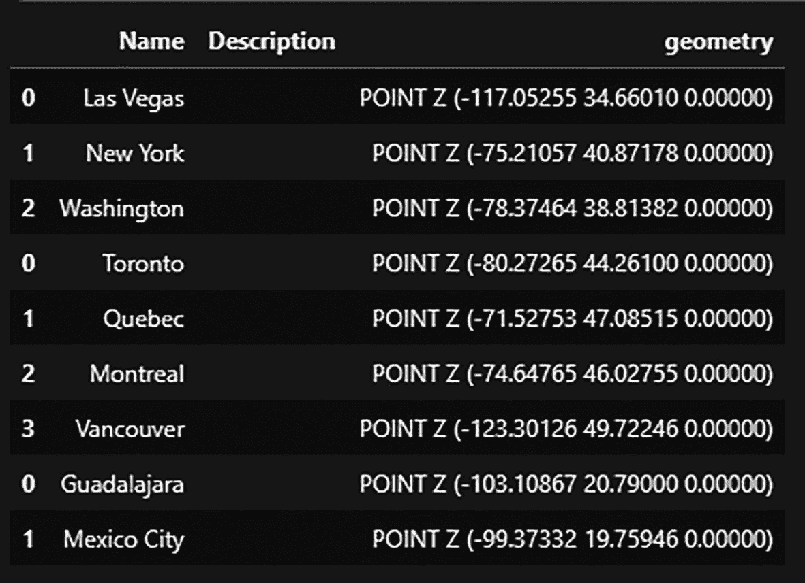

一个表格展示了美国、加拿大和墨西哥城市拼接后的数据框。该表格有 3 列和 9 行。列标题是名称、描述和几何图形。行条目是拉斯维加斯、纽约、华盛顿、多伦多、魁北克、蒙特利尔、温哥华、瓜达拉哈拉和墨西哥城，它们在几何图形中拥有各自的点 Z 坐标。

图 7-8

拼接后的数据框。图片由作者提供

如果我们现在绘制这些数据，我们只需绘制一个图层，而不必绘制三次。这在代码块 7-6 中完成。你可以看到所有数据都已成功合并到一个图层中。

```
ax = cities.plot(markersize=128,figsize=(15,15))
cx.add_basemap(ax, crs=us_cities.crs)
代码块 7-6
绘制拼接后的城市
```

结果如图 7-9 所示。

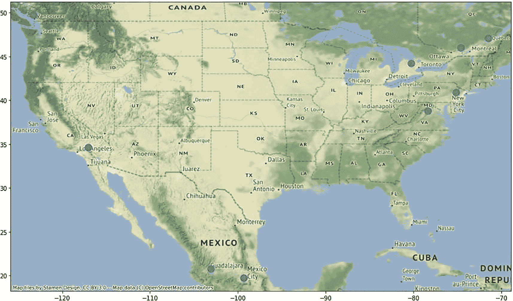

一张地图展示了使用代码块 7-6 对美国、加拿大和墨西哥城市进行合并操作的结果。美国的拉斯维加斯、马里兰州和纽约市，加拿大的温哥华、多伦多、蒙特利尔和魁北克，以及墨西哥的瓜达拉哈拉和墨西哥城，现在在地图上都以相同颜色的点表示。

图 7-9

由代码块 7-6 生成的地图。图片由作者使用 contextily 源数据和图像制作，图像引用如上

你还可以看到，所有点现在都具有相同的颜色，因为它们现在都在同一个数据集中。这种相当简单的按行合并操作在你日常的 GIS 操作中会非常有用。

现在我们已经将所有数据合并到一个图层中，接下来让我们通过属性连接来添加一些要素。

### Python 中的属性连接

为了基于查找表和类似 SQL 的连接添加新变量，我们将使用属性连接。为此，我们首先生成一个包含一些虚构数据的查找表，仅用于了解如何执行这些操作。这将在代码块 7-7 中完成。

```
lookup = pd.DataFrame({
'city': [
'Las Vegas',
'New York',
'Washington',
'Toronto',
'Quebec',
'Montreal',
'Vancouver',
'Guadalajara',
'Mexico City'
],
'population': [
1234,
2345,
3456,
4567,
4321,
5432,
6543,
1357,

]
})
lookup
代码块 7-7
创建查找表
```

查找表如图 7-10 所示。

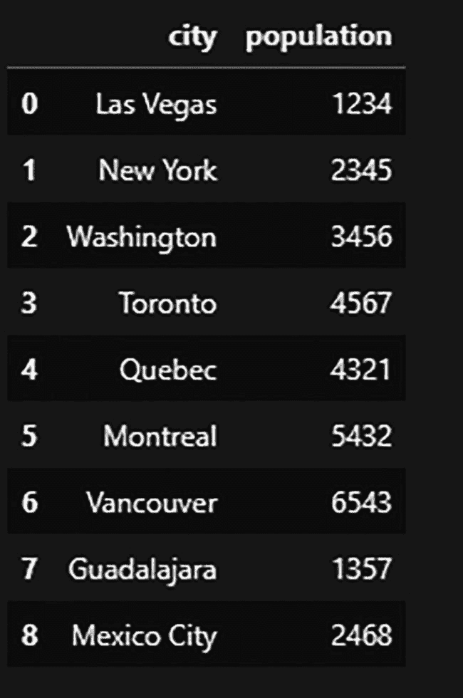

一个查找表展示了美国、加拿大和墨西哥的城市。该表有 3 列和 9 行。列标题是“城市”和“人口”。行条目是拉斯维加斯、纽约、华盛顿、多伦多、魁北克、蒙特利尔、温哥华、瓜达拉哈拉和墨西哥城，以及它们各自的人口。

图 7-10

查找表。图片由作者提供

现在，要将此数据添加到地理数据框中，我们希望执行类似 SQL 的连接，其中查找表中的“population”列将根据地理数据框中的“Name”列和查找表中的“city”列添加到地理数据框中。这可以使用代码块 7-8 完成。

```
cities_new = cities.merge(lookup, left_on='Name', right_on='city')
cities_new
代码块 7-8
属性连接
```

您可以在数据框中看到 `population` 列已被添加，如图 7-11 所示。

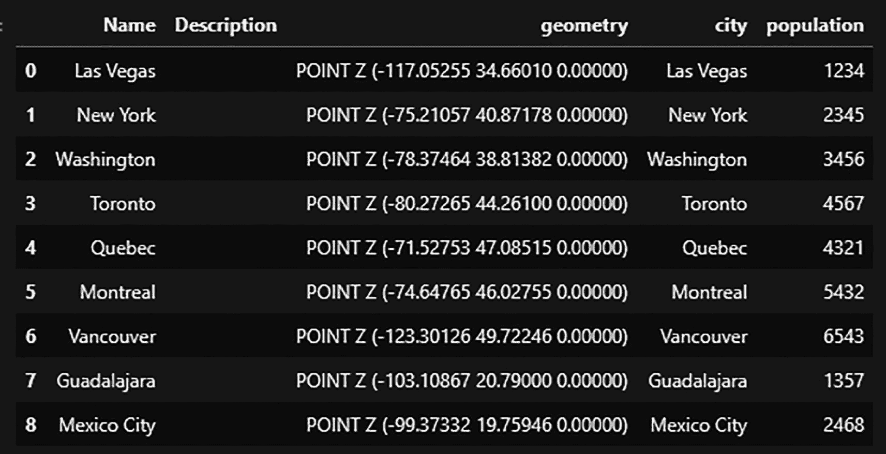

一个结果数据表，结合了地理数据框和查找表，包含 5 列和 9 行。列标题是“名称”、“描述”、“几何”、“城市”和“人口”。行条目是拉斯维加斯、纽约、华盛顿、多伦多、魁北克、蒙特利尔、温哥华、瓜达拉哈拉和墨西哥城，以及它们各自的点 Z 坐标和人口。

图 7-11

代码块 7-8 的结果数据。图片由作者提供

现在，您可以轻松访问这些数据，例如，如果您想进行过滤、计算等操作。另一个例子是使用此属性数据根据（模拟的）人口规模调整地图上每个点的大小（当然，这是玩具数据，因此结果不正确，但如果您愿意，可以随意改进）。代码如代码块 7-9 所示。

```
ax = cities_new.plot(markersize=cities_new['population'] // 10, figsize=(15,15))
cx.add_basemap(ax, crs=us_cities.crs)
代码块 7-9
绘制新数据
```

图 7-12 中的结果显示，城市的大小已根据 `population` 列的值进行调整，该列是通过属性连接添加到数据集中的。

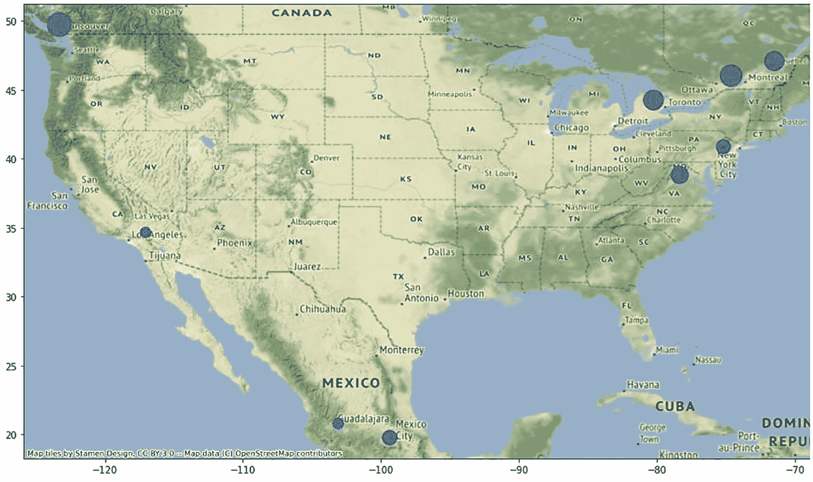

一张地图使用代码块 7-9 展示了美国、加拿大和墨西哥城市的人口规模。美国境内的拉斯维加斯、马里兰州和纽约市，加拿大境内的温哥华、多伦多、蒙特利尔和魁北克，以及墨西哥境内的瓜达拉哈拉和墨西哥城，均由点表示，每个点的大小根据查找表中 `population` 列的值进行调整。

图 7-12

代码块 7-9 生成的地图。图片由作者使用 contextily 源数据和图像（如图中引用所示）创建

### Python 中的空间连接

您现在已经了解了如何基于表格属性连接两个数据集。然而，也可以基于空间信息连接数据。对于此示例，我们将使用包含近似国家/地区多边形的数据集，该数据集可在 KML 文件中找到。再次强调，目标不是提供最终产品，而是展示制作它们的技术，因此数据是对真实数据外观的模拟近似。您可以使用代码块 7-10 中的代码导入国家/地区多边形。

```
countries = gpd.read_file('NorthMiddleAmerciaCountries.kml')
countries
代码块 7-10
导入数据
```

数据如图 7-13 所示。

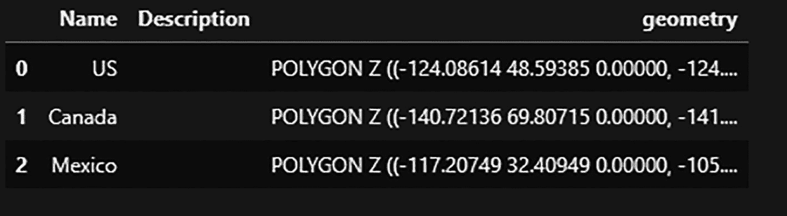

一个表格展示了代码块 7-10 的结果数据。该表有 3 列和 3 行。列标题是“名称”、“描述”和“几何”。行条目是美国、加拿大和墨西哥，以及它们近似的国家多边形。

图 7-13

代码块 7-10 的结果数据

如果我们将数据绘制在背景地图上，您可以看到这些多边形是对国家边界的快速近似，仅用于本练习的目的。这将在代码块 7-11 中完成。

```
ax = countries.plot(figsize=(15,15), edgecolor='black', facecolor='none')
cx.add_basemap(ax, crs=countries.crs)
代码块 7-11
绘制数据
```

这将显示图 7-14 中的地图。

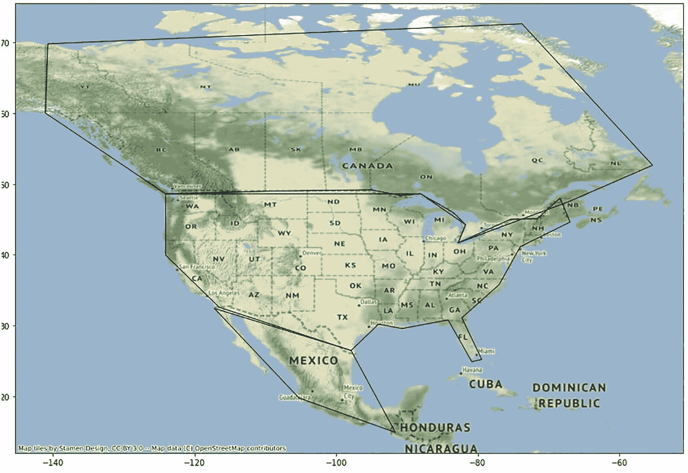

一张地图使用代码块 7-11 展示了美国、加拿大和墨西哥的绘制结果。美国、加拿大和墨西哥的边界在地图上用多边形突出显示。

图 7-14

代码块 7-11 生成的绘图。图片由作者使用 contextily 源数据和图像（如图中引用所示）创建

您可以看到这张地图上有些变形。如果您已经学习了第 2 章中关于坐标系统的理论，您应该能够理解变形的原因，并且如果您愿意，也有工具可以重新处理此地图的坐标系统。对于当前的练习，这些变形不是问题。现在，让我们使用代码块 7-12 将我们的城市添加到这张地图上。

```
ax = countries.plot(figsize=(15,15), edgecolor='black', facecolor='none')
cities_new.plot(ax=ax, markersize=cities_new['population'] // 10, figsize=(15,15))
cx.add_basemap(ax, crs=countries.crs)
代码块 7-12
将城市添加到地图
```

这给出了如图 7-15 所示的组合地图。

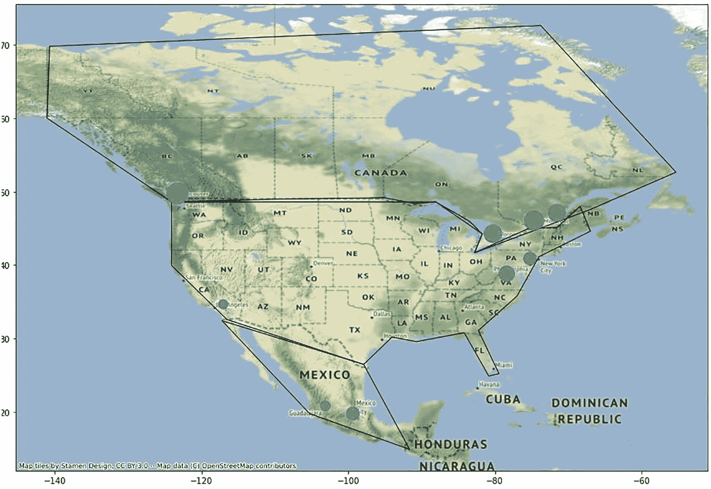

一张地图展示了美国、加拿大和墨西哥的组合多边形和城市。美国、加拿大和墨西哥的边界用多边形突出显示，城市用相同颜色的点表示，并在地图上显示其人口。

图 7-15

组合地图。图片由作者使用 contextily 源数据和图像（如图中引用所示）创建

这引出了空间连接的主题。在这张地图中，您可以看到有两个数据集：

*   城市数据仅包含城市名称和人口信息。
*   国家数据只是多边形。

# 空间连接

使用类似 SQL 的连接为城市数据集中的每一行添加一个“国家”列是不可能的。然而，我们可以清楚地看到，基于空间信息，可以找出每个城市位于哪个国家。

空间连接正是为此目的而设计的。它允许我们按列组合两个数据集，即使没有共同的标识符：仅基于空间信息。这是可以使用地理数据但无法使用常规数据完成的事情之一。

好的，作为高级文档工程师和翻译员，我将严格遵循您提供的注意事项和示例格式，将给定的英文文本翻译成中文。

你可以在代码块 7-13 中看到，城市和国家数据集之间是如何基于“包含”空间连接进行空间连接的：城市需要位于多边形内部才能接收其属性。

```
cities_3 = cities_new.sjoin(countries, how="inner", predicate='within')
cities_3
# 代码块 7-13
# 城市与国家之间的空间连接
```

数据如图 7-16 所示。

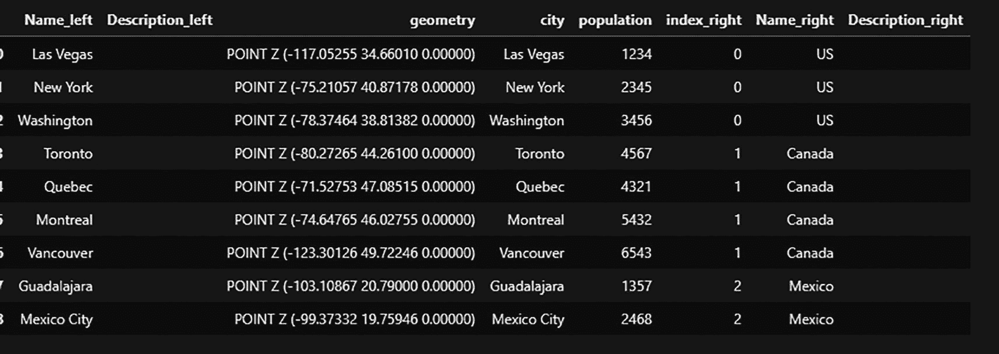

图 7-16

一张表格展示了使用代码块 7-13 进行空间连接后的结果数据，包含 8 列和 9 行。列标题分别为：名称（左）、描述（左）、几何图形、城市、人口、索引（右）、名称（右）和描述（右）。行条目包括：拉斯维加斯、纽约、华盛顿、多伦多、魁北克、蒙特利尔、温哥华、瓜达拉哈拉和墨西哥城。

代码块 7-13 的结果数据。作者提供的图片

你可以看到，国家的名称已被添加到城市数据集中。现在，我们可以在城市数据集中根据需要随意使用这个属性。例如，我们可以使用代码块 7-14，根据城市所属的国家为点赋予颜色。

```
cities_3['color'] = cities_3['index_right'].map({0: 'green', 1: 'yellow', 2: 'blue'})
ax = cities_3.plot(markersize=cities_3['population'] // 10, c=cities_3['color'], figsize=(15,15))
cx.add_basemap(ax, crs=cities_3.crs)
# 代码块 7-14
# 基于国家的颜色
```

这产生了如图 7-17 所示的地图。

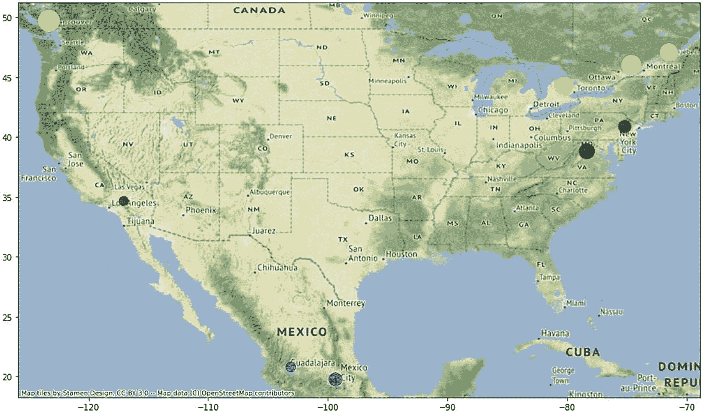

图 7-17

一张地图展示了使用代码块 7-14 绘制的美国、加拿大和墨西哥城市数据集。地图上，美国的拉斯维加斯、马里兰州和纽约市，加拿大的温哥华、多伦多、蒙特利尔和魁北克，以及墨西哥的瓜达拉哈拉和墨西哥城，都根据其所在国家以不同颜色的点表示。

代码块 7-14 的结果地图。作者使用 contextily 源数据和图像（如图中引用所示）制作的图片

通过这个最终结果，你现在已经看到了将多个数据集合并为单个数据集的多种方法：

*   行级拼接操作，在 GIS 中通常称为合并（merge）

*   属性连接，使用 geopandas 中一个容易混淆地称为合并（merge）的方法完成，而它通常被称为连接（join）而非合并（merge）

*   空间连接，这是一种基于空间属性而非任何公共标识符的连接

在本章的最后部分，你将了解融合（dissolve）操作，这在合并多个数据集时通常非常有用。

## 融合操作

在合并许多不同数据集时，经常会得到大量重叠的要素，例如不同粒度的多边形都保留在数据中，或者相同的要素出现在每个数据集中并造成信息重复。融合操作可以解决此类问题。

### 什么是融合操作？

融合操作是更广泛的概化工具家族中的一个工具。它允许你将过于详细或粒度过细的数据合并成更大的要素。你可以将融合工具视为一种分组操作。它的工作方式类似于 SQL 或 pandas 中的 `groupby` 操作。

### 融合操作示意图

你可以在图 7-18 中看到融合操作的示意图。在此图中，你可以看到多个多边形根据其数值特征被分组为一个，如图 7-18 所示。

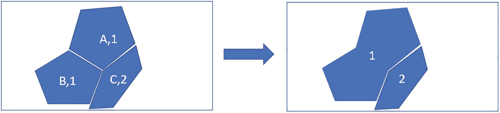

图 7-18

融合操作的示意图。第一个数据集展示了一个包含三个区域的数据集，分别标记为 A（1）、B（1）和 C（2）。该数据集根据其数值特征被分组为一个，现在标记为 1 和 2。

融合操作。作者提供的图片

多边形 A 和 B 的值都是 1，因此按值分组会将这两个多边形合并为一个多边形。当你的数据过于粒化时，此操作会很有用，这可能是由于你执行了大量地理空间操作，或者合并了大量数据文件所致。

### Python 中的融合操作

现在让我们看看如何在 Python 中执行融合操作。让我们使用与前一个示例相同的数据，并尝试了解如何使用融合操作，根据多边形位于北美（美国和加拿大）还是中美洲（墨西哥）来重新分组。为此，我们必须向国家数据集添加一个指示此信息的属性。代码块 7-15 中的代码展示了如何实现这一点。

```
countries['Area'] = ['North America', 'North America', 'Middle America']
countries
# 代码块 7-15
# 添加国家属性
```

执行此操作后，你会看到数据集中添加了一个新列，如图 7-19 所示。

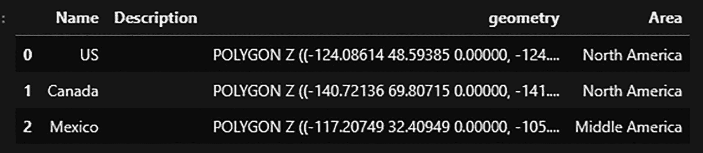

图 7-19

一张表格展示了代码块 7-15 的结果数据。该表格有 4 列和 3 行。列标题为：名称、描述、几何图形和区域。行条目为：美国、加拿大和墨西哥，以及它们近似的国家多边形和位于北美/中美洲的区域。

代码块 7-15 的结果数据。作者提供的图片

现在的目标是创建两个多边形：一个用于北美，一个用于中美洲。我们将使用融合方法来实现这一点，如代码块 7-16 所示。

```
areas = countries.dissolve(by='Area')[['geometry']]
areas
# 代码块 7-16
# 融合操作
```

新创建的数据集是前一个数据集分组（融合）后的结果，如图 7-20 所示。

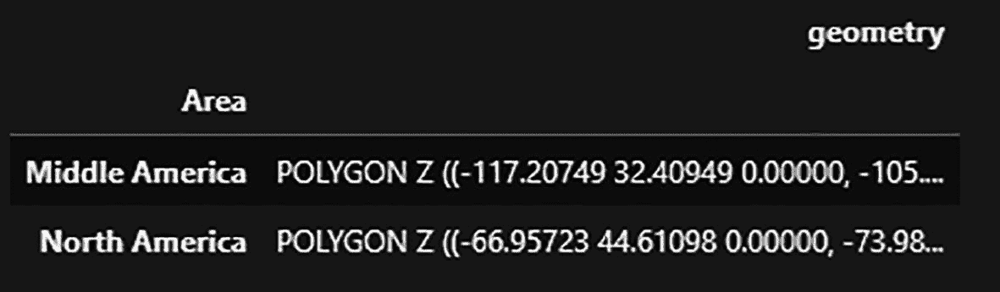

图 7-20

一张表格展示了使用融合操作后的分组数据集。该表格有 2 列和 2 行。列标题为：区域和几何图形。行条目为：中美洲和北美，以及它们近似的多边形。

分组后的数据集。作者提供的图片

我们现在可以使用代码块 7-17 绘制此数据，看看它是什么样子。

```
ax = areas.plot(figsize=(15,15), edgecolor='black', facecolor='none')
cx.add_basemap(ax, crs=areas.crs)
# 代码块 7-17
# 绘制数据
```

图 7-21 中的地图显示了融合操作的结果。

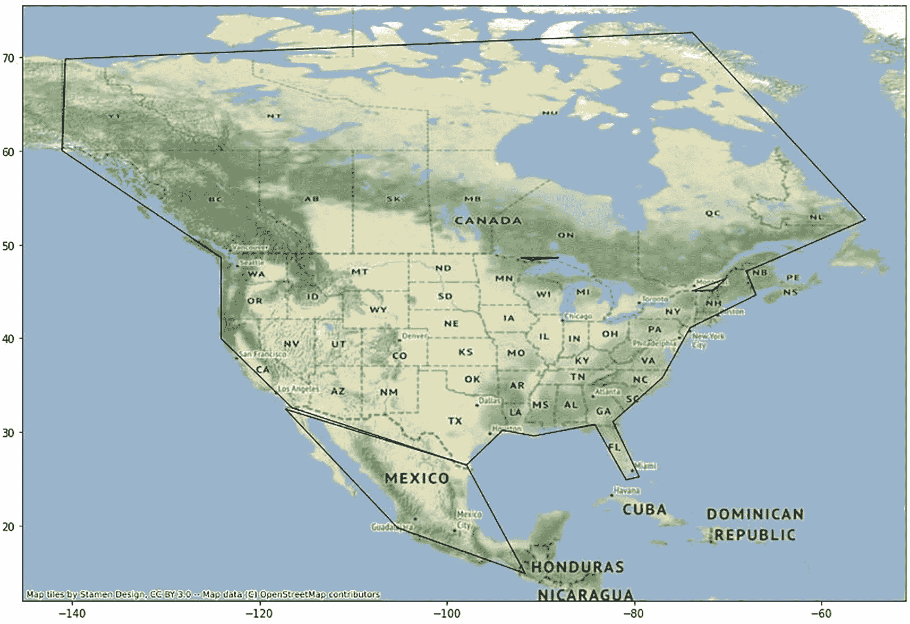

图 7-21

一张地图展示了北美和中美洲融合操作的结果。地图上，美国、加拿大和墨西哥的边界用多边形突出显示。美国和加拿大被合并为一个多边形以表示北美，而墨西哥则作为中美洲的另一个多边形。

融合操作的结果。作者使用 contextily 源数据和图像（如图中引用所示）制作的图片

这个合并后的结果已按区域特征进行了分组，并且是输入数据的概化版本。因此，融合操作非常类似于 `groupby` 操作，这是处理地理数据时需要掌握的一个非常有用的工具。

## 关键要点

1.  大多数地理数据工具都标准实现了大量基础地理数据操作。这些操作乍看简单，但应用于地理数据时可能会遇到一些困难。

2.  合并操作通常指按行合并，即将多个对象拼接成一个数据集。

3.  属性连接（在 geopandas 中令人困惑地被称为 `merge`）是一种按列进行的、类似 SQL 的连接操作，它利用两个输入数据集之间的共同属性进行连接。

4.  空间连接是另一种按列连接的方式，它允许在没有共同标识符的情况下合并两个数据集。两个数据集行之间的对应关系完全由空间信息决定。

5.  在空间连接中，有多种方式可以指定你想要用于连接的空间关系类型。例如，两个对象之间存在交集、一个对象完全包含在另一个对象内、一个对象部分包含在另一个对象内，甚至仅仅是两个对象相对接近。

6.  融合工具允许你根据指定的列，将对象分组为更大的对象，从而对数据集进行概括。此操作类似于空间要素的分组操作，当你拥有过多或过于细碎的对象，需要将其概括为更大的区块时，该工具非常有用。