# 8. 擦除

在本章中，你将学习擦除操作。前三章介绍了一些标准的 GIS 操作。裁剪和相交在第 5 章中介绍，缓冲区分析在第 6 章中介绍，合并和融合在第 7 章中介绍。

本章将是这四章中介绍地理空间分析常用工具的最后一章。尽管标准的 GIS 工具箱中还有更多工具可用，但本章的目标是让你扎实掌握基础知识，并能够自主学习 Python 中的其他 GIS 操作。

本章将从擦除操作的理论介绍开始，然后通过多个 Python 示例实现，演示如何将擦除应用于不同的地理数据类型。

## 擦除操作

擦除不仅仅是 GIS 分析中的一种操作，也是删除的常见同义词。为了澄清，让我们先看看“标准”的要素删除，这不是空间擦除，而是基于要素 ID（而非空间信息）完全删除一个要素。

无论你处理的是点、线还是面，都可以想象你只是想删除其中一个。图 8-1 中的示意图展示了这意味什么。

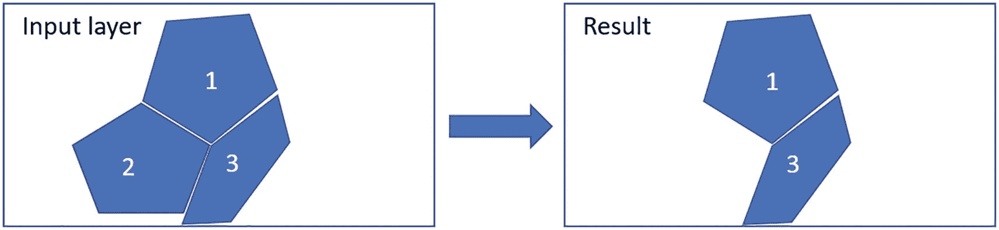

擦除操作的示意图，包含输入图层和结果。两者都有编号为 1 到 3 的五边形，其中标记为 1 的多边形位于顶部，标记为 2 的多边形位于左侧，标记为 3 的多边形位于右侧。结果面板显示标记为 2 的多边形缺失。

图 8-1

擦除操作示意图。图片由作者提供

在此示意图中，你可以看到左侧有三个多边形（编号为 1、2 和 3）。删除操作删除了多边形 2，因此右侧输出中只剩下两个多边形。多边形 2 被删除，或者用同义词说，被擦除了。包含数据的表格将受到影响，如图 8-2 所示。

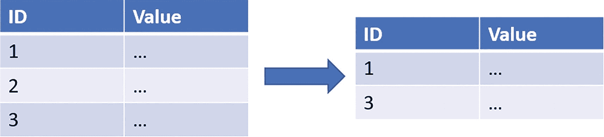

表格格式的擦除操作示意图。两个表格都有两列，分别标记为 I D 和 Value。左侧表格有三行，右侧表格有两行。两个表格行的相应标签分别是 1、2、3 和 1、3。一个右箭头连接两个表格。

图 8-2

此操作的表格视图。图片由作者提供

这个操作相对容易理解，不需要深入探讨。然而，在 GIS 中，通常所说的擦除操作并非指此操作。

GIS 中的擦除功能实际上更接近我们之前介绍过的其他空间操作。擦除操作需要两个输入：一个输入图层（我们要对其应用擦除操作的图层）和擦除要素。

输入图层可以是任何类型的矢量图层：面、线、点，甚至混合类型。擦除要素通常必须是面，尽管某些实现可能允许你使用其他类型。

该操作的作用是擦除输入图层中位于擦除多边形内部的所有数据。这将删除部分输入数据，通常是因为你不需要它。

接下来，让我们看看在不同输入数据类型上执行擦除的一些示意图概览。

### 空间擦除点的示意图概览

空间擦除点实际上与标准删除操作非常相似。执行空间擦除时，你将删除输入要素中与擦除要素在空间上重合的所有部分。然而，由于点没有大小，它们要么完全位于擦除要素内部，要么完全位于外部，这导致每个点要么被完全删除，要么被保留。图 8-3 中的示意图展示了其工作原理。

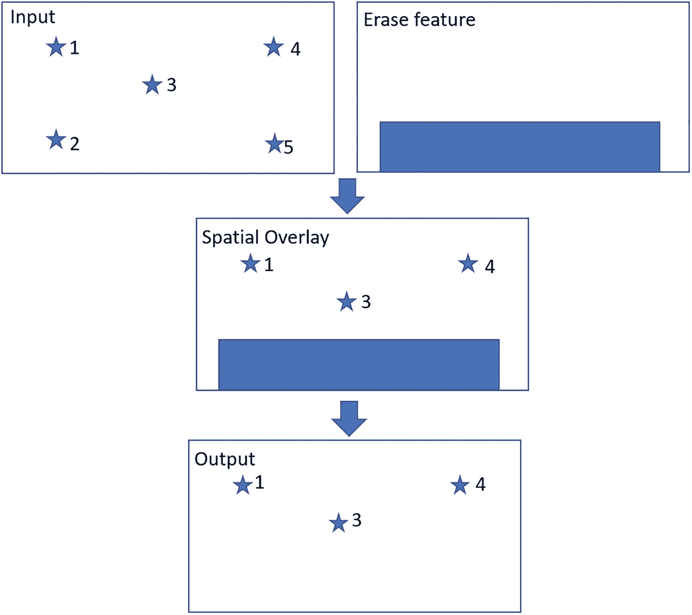

空间擦除点的示意图。它有四个带标签的矩形。输入有 5 个带编号的星形，而擦除要素是一个位于中下部的水平矩形。它们之间的向下箭头连接到空间叠加和输出，输出包含相同的 1、3 和 4 号星形，但后者中没有水平矩形。

图 8-3

空间擦除点的示意图。图片由作者提供

你可以在图 8-4 的示意图中看到数据表在操作前后的变化。

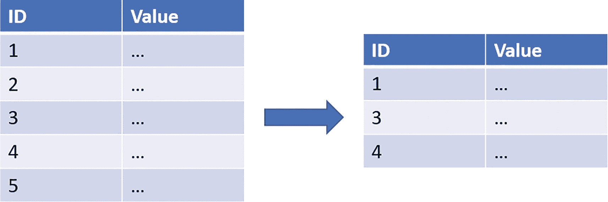

表格格式的空间擦除示意图。两个表格都有两列，分别标记为 I D 和 Value。左侧表格有五列，右侧表格有三列。两个表格行的相应标签分别是 1、2、3、4、5 和 1、3、4。一个右箭头连接两个表格。

图 8-4

空间擦除背后的表格视图。图片由作者提供

你可以看到要素 2 和 5 已被擦除操作简单地移除。这也可以通过删除 ID 为 2 和 5 的要素来实现。尽管使用空间擦除而不是按 ID 擦除来删除一些点在功能上结果相同，但在这里使用空间擦除可能非常有用，甚至是必要的。

当你有一个擦除要素时，你还没有要删除的点的确切 ID。这样，自动获取 ID 列表的唯一方法是进行空间连接或叠加，这正是空间擦除中所发生的。

正如你接下来将看到的，当使用更复杂的要素（如线和面）时，空间擦除的重要性甚至更大。

### 空间擦除线的示意图

现在让我们看看在线数据上执行空间擦除时是如何工作的。在图 8-5 中，您可以看到有两个线要素和一个多边形擦除要素。

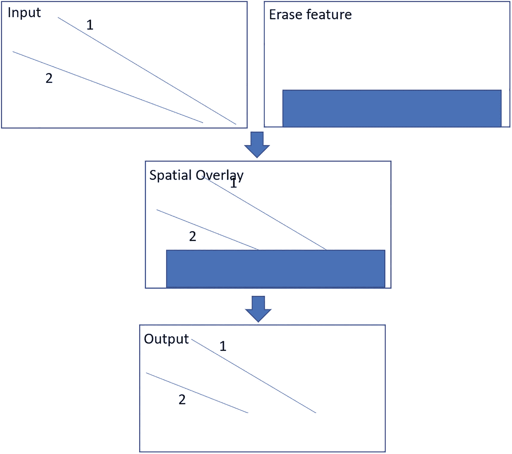

擦除线的示意图。图中包含四个带标签的矩形。输入部分有两条分别标记为 1 和 2 的对角线，而擦除要素则是一个位于右下角附近的水平矩形。两者之间的向下箭头连接到空间叠加和输出部分，输出部分中相同的标记对角线被截短。

图 8-5

擦除线。作者自绘

这里发生的情况与点示例中的情况截然不同。空间擦除并非删除或保留整个要素，而是对要素进行了修改。前后对比，数据仍然由两条线组成，但它们已不再是完全相同的线。每个要素只有一部分被擦除，因此要素的数量没有改变，改变的只是几何形状。在数据表中，这看起来会像图 8-6 所示。

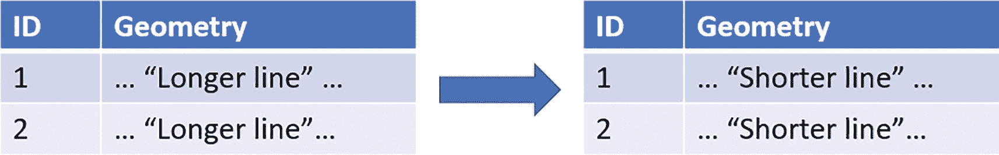

表格格式下擦除线的示意图。两个表格都有两列，分别标记为 ID 和几何形状，以及左侧标记为 1 和 2 的两行条目。两个表格右侧的行条目分别是省略号左引号较长线省略号和省略号右引号较短线省略号。

图 8-6

擦除线的表格视图。作者自绘

在下一节中，您将看到这对于多边形是如何工作的。

### 空间擦除多边形的示意图

对多边形进行空间擦除的功能本质上与应用于线的空间擦除相同。输入层中的多边形，就像线一样，当它们部分落在擦除要素内部时，可以被修改。图 8-7 中的示意图展示了这是如何工作的。

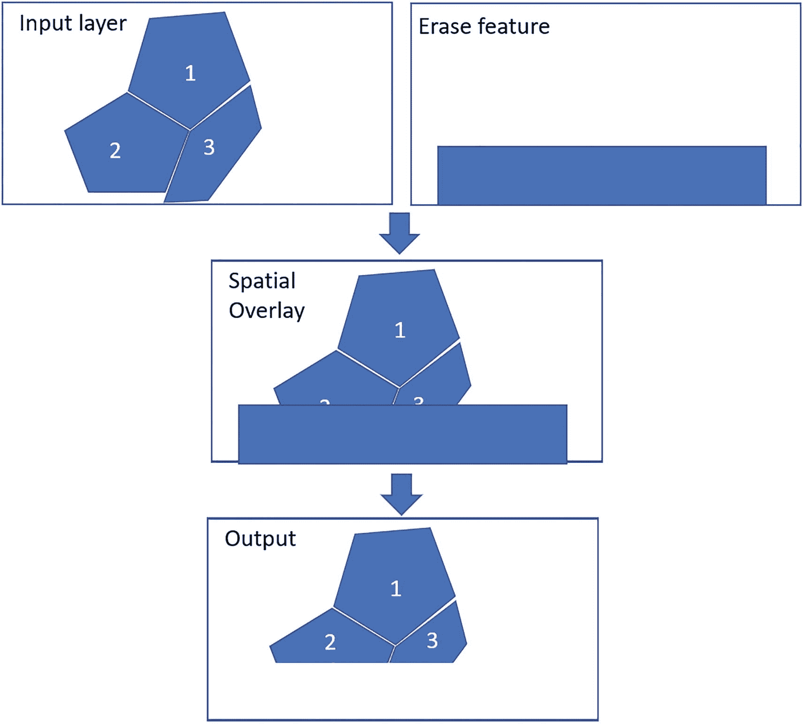

对多边形执行空间擦除操作的示意图。图中包含四个带标签的矩形。输入层有三个五边形，编号为 1 到 3，而擦除要素是一个位于中下部的水平矩形。两者之间的向下箭头连接到空间叠加和输出部分，其中编号 2 和 3 几乎被切成两半。

图 8-7

应用于多边形的空间擦除操作。作者自绘

在示意图中，您可以看到左上角的输入层中有三个多边形。擦除要素是一个矩形多边形。使用空间擦除后，输出包含多边形 2 和 3 的修改版本，因为它们与擦除要素重叠的部分已被切除。

此操作对数据表的影响也与线数据类似。与此示例对应的表格可以在图 8-8 中看到。

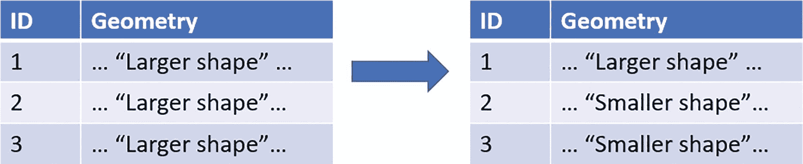

表格格式下对多边形进行空间擦除的示意图。两个表格都有两列，分别标记为 ID 和几何形状，以及三行条目。两个表格的左侧行条目都标记为 1 到 3，右侧条目为省略号左引号较大形状省略号，除了第二个表格的第二和第三个右侧条目标记为较小形状。

图 8-8

对多边形进行空间擦除的表格视图。作者自绘

现在您应该对空间擦除操作有了相对较好的直观理解。为了完善您的理解，下一节将在转向 Python 实现之前，对空间擦除器与一些可比较的操作进行深入比较。

## 擦除与其他操作的对比

正如您在前三章中已经看到的，标准 GIS 工具包中有大量的空间操作。这很好，因为它允许您使用最适合您用例的工具。然而，深入研究每个操作的细节也至关重要，以确保您有效地使用正确的工具来完成手头的任务。

现在让我们来看几个与擦除任务相对可比较的操作。在某些情况下，您可能会使用另一个工具来完成完全相同的任务。这没有问题，只要您注意具体的实现方式，并在执行工具之前仔细查看其文档。

### 擦除与删除要素

删除整个要素，也称为丢弃要素或删除数据中的一行，之前已经提到过与空间擦除器相对相似。然而，空间擦除器与简单地丢弃整个要素之间存在本质区别。

丢弃要素只允许您完全删除一个要素。空间擦除也可以做到这一点，但空间擦除器能做更多。当输入层中的要素完全被擦除要素覆盖时，整个输入要素将被删除，但当输入层中的要素仅与擦除要素部分重叠时，将会发生修改而非删除。实际上，输入要素的 ID 并未从数据集中删除，但其几何形状将被修改：通过移除与擦除要素重叠的部分来缩小。

当您想基于几何形状删除要素或要素的一部分时，应使用空间擦除。否则，当您想基于 ID 或数据的任何其他列要素进行删除时，删除要素是有用的。

### 擦除与裁剪

您已经看到裁剪操作是介绍的第一个 GIS 工具。此工具用于将输入层裁剪到固定范围，这意味着删除范围之外的所有内容。由于裁剪也会删除部分数据，它可能与空间擦除操作混淆。让我们看看两者之间的区别。

裁剪操作与擦除操作的主要区别在于，裁剪操作会将数据缩减到固定范围，该范围可以是坐标或一个要素。使用裁剪时，您的目标始终是保留数据的特定部分，并删除边界之外的所有内容。简而言之，您保留内部（您分析或地图聚焦的区域）并移除更远的、边界之外的数据。

空间擦除不一定采用内部/外部边界的逻辑。您也可以使用擦除器来移除感兴趣区域内的较小区域，同时保留周围区域。

虽然这两个工具都像饼干模具，但切出的饼干用途不同：使用裁剪操作时，您用饼干模具切出您想保留的饼干；而使用擦除操作时，模具用于切出您想丢弃的部分。简而言之，这是两个非常相似的工具，但用于截然不同的目的。

### 擦除 vs. 叠加

第三种也是最后一种与空间擦除操作类似的操作是空间叠加操作。正如在第 5 章介绍交集时所述，集合论中有多种操作可应用于地理数据。在该章中，你主要关注的是交集操作，即保留两个图层在空间上相交的所有数据。

集合论中的另一种操作是差集操作。你可以使用与交集相同的空间叠加功能来计算差集操作。与保留两个输入图层中相交部分不同，差集操作将保留输入图层 A 中所有不在输入图层 B 中的要素及要素部分。因此，它会从图层 A 中删除图层 B 中的所有内容，类似于擦除操作。

根据你使用的软件，你可能会遇到也可能不会遇到擦除操作的实现。例如，在某些付费版 ArcGIS 软件中，存在擦除功能。然而，在 geopandas 中并没有此功能，因此我们不妨使用叠加功能中的差集操作来获得与擦除操作相同的效果/功能/结果。这就是我们将在下一节中要做的事情。

## 在 Python 中实现擦除

在本练习中，你将使用一个专门为此练习创建的小型示例地图。该数据不应用于除练习之外的任何其他目的，因为它并不十分精确，但这目前不是问题，因为我们的目标是掌握地理空间分析工具。

在接下来的练习中，你将使用伊比利亚半岛（包含西班牙和葡萄牙的半岛）的混合数据集。练习的目标是根据这些数据创建一张西班牙地图，尽管没有多边形指示西班牙的确切区域：必须通过从伊比利亚半岛中移除葡萄牙来创建。

我建议在 Kaggle 笔记本或本地环境中运行此代码，因为 Google Colab 在创建叠加图层时存在一些问题。要开始练习，你可以使用代码块 8-1 中的代码导入数据。

```
import geopandas as gpd
import fiona
gpd.io.file.fiona.drvsupport.supported_drivers['KML'] = 'rw'
all_data = gpd.read_file('chapter_08_data.kml')
all_data
代码块 8-1
导入数据
```

你将获得一个如图 8-9 所示的数据框。

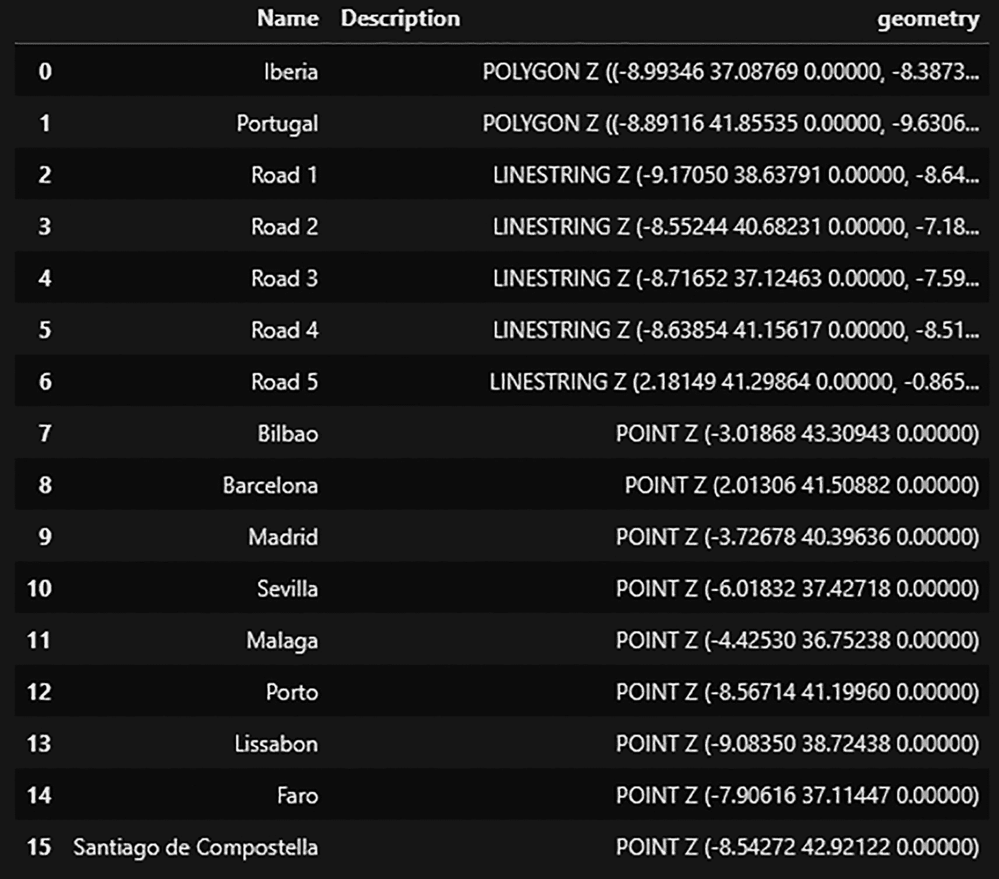

一张包含 4 列 16 行的表格图像。最左侧的行条目标记为 0 到 15。名称列包含伊比利亚半岛、葡萄牙、道路 1 至 5、毕尔巴鄂、巴塞罗那、马德里、塞维利亚、马拉加、波尔图、里斯本、法鲁和圣地亚哥-德孔波斯特拉。描述列没有条目。几何列包含多边形、线串和点的 Z 值。

图 8-9

数据表。作者提供的图像

在此数据框中，你可以看到混合了多种数据类型或几何类型。前两行包含伊比利亚半岛（即西班牙加葡萄牙的轮廓）的多边形。然后是一些道路（线要素），接着是一些城市（点要素）。

让我们使用代码块 8-2 快速创建一张地图，以确切了解我们正在处理的数据。你可以使用下面的代码来实现。如果你对这些绘图方法还不熟悉，我建议回顾前面的章节以加深了解。从现在开始，我们将加快对数据导入、文件格式、数据类型和地图绘制等基础内容的讲解速度，因为这些内容在本书的前面部分已经详细讨论过。

```
import contextily as cx

# 绘制所有数据
ax = all_data.plot(markersize=128, figsize=(15,15), edgecolor='black', facecolor='none')

# 添加 contextily 底图
cx.add_basemap(ax, crs=all_data.crs)
代码块 8-2
可视化数据
```

运行此代码后，你将看到如图 8-10 所示的地图。

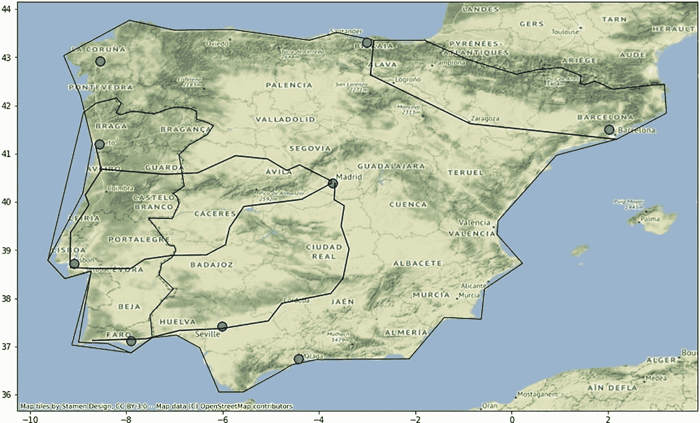

欧洲西南部地区的地图，重点显示葡萄牙和西班牙，以及东北部和东南部地区的法国和阿尔及利亚部分地区。可以看到点和连线。葡萄牙陆地上有 3 个点，而西班牙有 6 个分散的点。垂直轴数值范围为 36 到 44，X 轴数值范围为负 10 到正 2。

图 8-10

代码块 8-2 生成的地图。作者提供的图像

这张地图不太清晰，因为它仍然包含多种类型的数据，并且这些数据相互重叠。由于我们的目标是过滤掉一些数据，让我们在改进可视化之前先完成这一步。

### 从伊比利亚半岛中擦除葡萄牙以得到西班牙

目标是获取西班牙的地图，并从我们的数据中移除所有位于葡萄牙境内的部分。第一步是创建一个西班牙的多边形。由于我们知道伊比利亚半岛由西班牙和葡萄牙组成，我们只需计算伊比利亚半岛与葡萄牙的差集即可得到西班牙。这可以通过代码块 8-3 中的代码实现。

```

# 根据名称过滤数据
iberia = all_data[all_data['Name'] == 'Iberia']
iberia
代码块 8-3
根据名称过滤数据
```

生成的数据框仅包含对应于伊比利亚半岛的多边形。该数据框如图 8-11 所示。

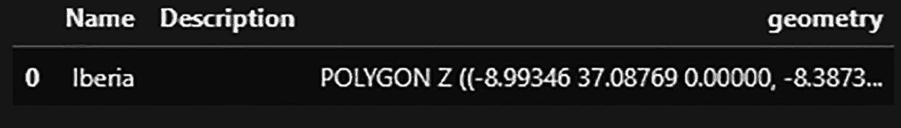

一张包含四列一行的表格图片。除第一列外，各列标签分别为 Name、Description 和 geometry。展示的行条目中，除 Description 列外，依次为 0、Iberia 和 POLYGON Z double open parentheses negative 8.99346 37.08769 0.00000 comma negative 8.3873 ellipsis。

图 8-11

来自代码块 8-3 的数据。作者供图

现在，让我们使用代码块 8-4 中的代码对葡萄牙执行相同操作。

```

# 根据名称过滤数据
portugal = all_data[all_data['Name'] == 'Portugal']
portugal
代码块 8-4
过滤葡萄牙数据
```

生成的数据框仅包含对应于葡萄牙的多边形。该数据框如图 8-12 所示。

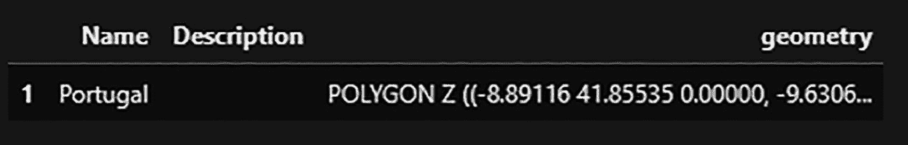

一张包含四列一行的表格图片。除第一列外，各列标签分别为 Name、Description 和 geometry。展示的行条目中，除 Description 列外，依次为 1、Portugal 和 POLYGON Z double open parentheses negative 8.89116 41.85535 0.00000 comma negative 9.6306 ellipsis。

图 8-12

来自代码块 8-4 的数据。作者供图

现在，我们有了两个独立的对象：一个仅包含伊比利亚多边形的地理数据框，以及另一个仅包含葡萄牙多边形的地理数据框。我们想要得到的是两者之间的差集，因为西班牙是伊比利亚半岛中不属于葡萄牙的那部分。代码块 8-5 中的代码正是实现此目的。

```

# 叠加操作，从伊比利亚半岛中移除葡萄牙以创建西班牙
spain = iberia.overlay(portugal, 'difference')

# 绘制生成的西班牙多边形
spain.plot()
代码块 8-5
差集操作
```

生成的绘图如图 8-13 所示。

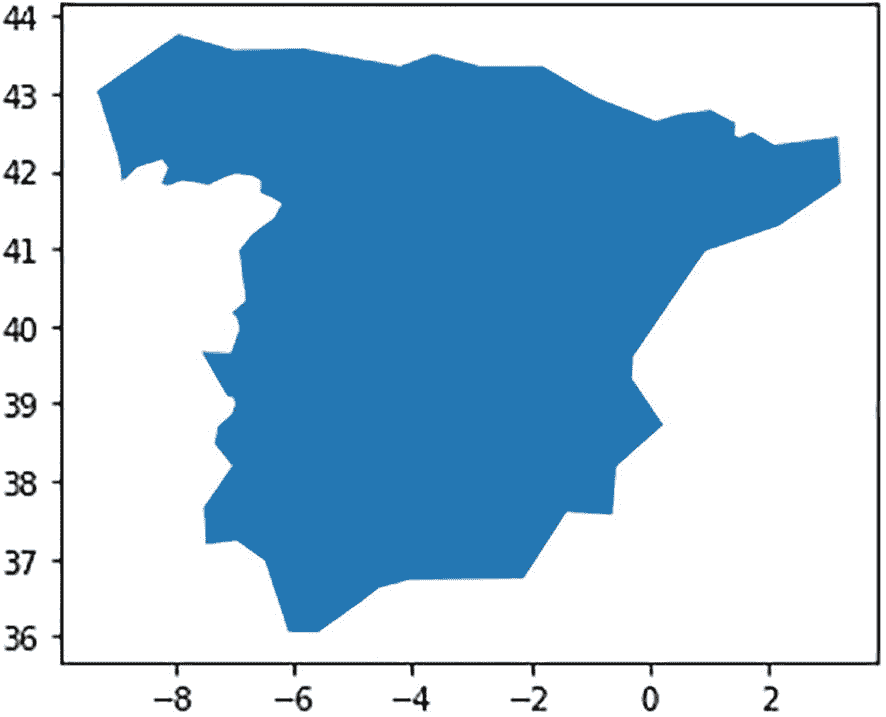

一张纯色填充的西班牙地图。纵轴数值从 36 到 44，步长为 1；横轴数值从 -8 到 2，步长为 2。

图 8-13

来自代码块 8-5 生成的地图。作者供图

尽管形状是正确的，但当我们查看 `spain` 数据框对象时，会发现其名称仍然设置为输入图层，即伊比利亚。你可以使用代码块 8-6 轻松打印数据。

```
spain
代码块 8-6
打印数据
```

结果如图 8-14 所示。

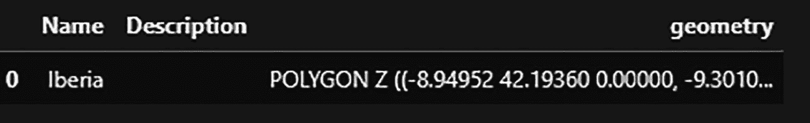

一张包含四列一行的表格图片。除第一列外，各列标签分别为 Name、Description 和 geometry。展示的行条目中，除 Description 列外，依次为 0、Iberia 和 POLYGON Z double open parentheses negative 8.94952 42.19360 0.00000 comma negative 9.3010 ellipsis。

图 8-14

西班牙数据。作者供图

我们可以使用代码块 8-7 中的代码将名称重置为 Spain。

```
spain.Name = 'Spain'
spain
代码块 8-7
将名称设置为 Spain
```

现在，生成的数据框在 Name 列中有了正确的值，如图 8-15 所示。

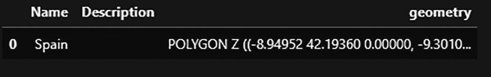

一张包含四列一行的表格图片。除第一列外，各列标签分别为 Name、Description 和 geometry。展示的行条目中，除 Description 列外，依次为 0、Spain 和 POLYGON Z double open parentheses negative 8.94952 42.19360 0.00000 comma negative 9.3010 ellipsis。

图 8-15

名称正确的西班牙数据。作者供图

让我们使用背景地图绘制到目前为止完成的所有内容，以便在后续练习中继续向这张西班牙地图添加内容。创建此绘图的代码如代码块 8-8 所示。

```

# 绘制新的西班牙多边形
ax = spain.plot(figsize=(15,15), edgecolor='black', facecolor='none')

# 添加 contextily 底图
cx.add_basemap(ax, crs=spain.crs)
代码块 8-8
绘制新的西班牙多边形
```

生成的地图如图 8-16 所示。

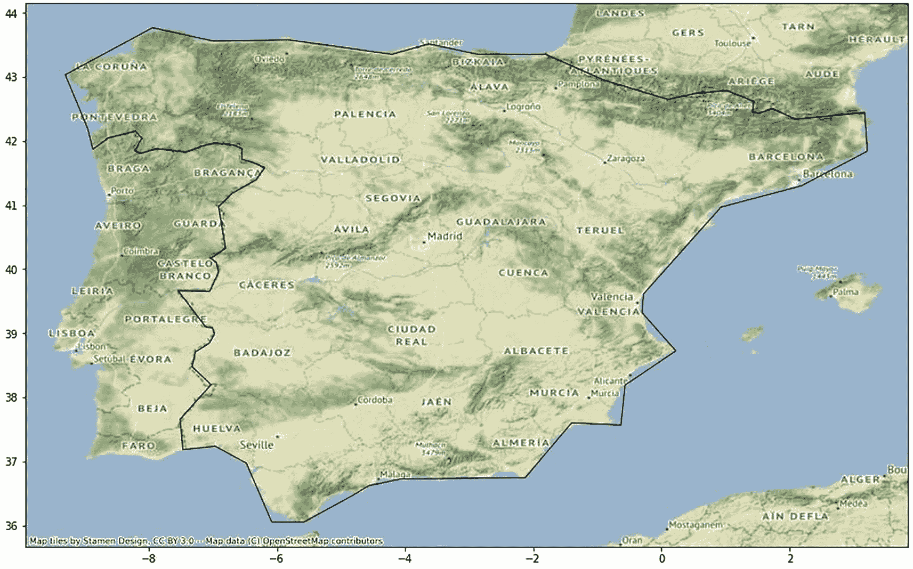

一张聚焦于西班牙边界的欧洲西南部地区地图。可以看到葡萄牙，以及东北部的法国部分地区和东南部的阿尔及利亚部分地区。纵轴数值从 36 到 44，步长为 1；横轴数值从 -8 到 2，步长为 2。

图 8-16

来自代码块 8-8 生成的绘图。作者供图

如果你熟悉西班牙的形状，你会发现它与这张地图上的形状非常吻合。我们仅通过使用两个其他多边形进行空间操作，就成功地为西班牙这个国家创建了一个多边形。你可以想象，在处理空间数据时，无论是用于空间分析、制图与可视化，还是用于机器学习中的特征工程，此类工作都会经常出现。

在下一节中，你将通过从数据中移除葡萄牙的城市来继续此练习，以便我们只为西班牙数据集保留相关的城市。

### 从数据集中擦除葡萄牙的城市

在本练习的第二部分，你将处理代表伊比利亚半岛城市的点数据。数据集中包含一些伊比利亚半岛的主要城市，这意味着既有西班牙的城市，也有葡萄牙的城市。本练习的目标是筛选出位于西班牙的城市，并移除位于葡萄牙的城市。

在前面的章节中，你已经看到了一些可能对此有用的技术。例如，可以想象与一个外部表进行连接。这个外部表可以是一个从城市到国家的映射表，这样在将地理数据框连接到这个查找表之后，你就可以简单地根据国家进行筛选。

在当前练习中，我们采用一种不同的方法，即使用带有差集操作的空间叠加，这与擦除操作相同。通过这种方式，我们将从城市中擦除所有与葡萄牙多边形有空间叠加的城市。

本练习的第一步是创建一个仅包含城市的独立地理数据框。处理只包含一种数据类型的数据库总是更容易。让我们使用代码块 8-9 中的代码来筛选出所有点数据，在本例中这些点数据就是城市。

```
from shapely.geometry.point import Point
cities_filter = all_data.geometry.apply(lambda x: type(x) == Point)
cities = all_data[cities_filter]
cities
代码块 8-9
筛选出所有点数据
```

你将获得如图 8-17 所示的数据集，其中仅包含城市。

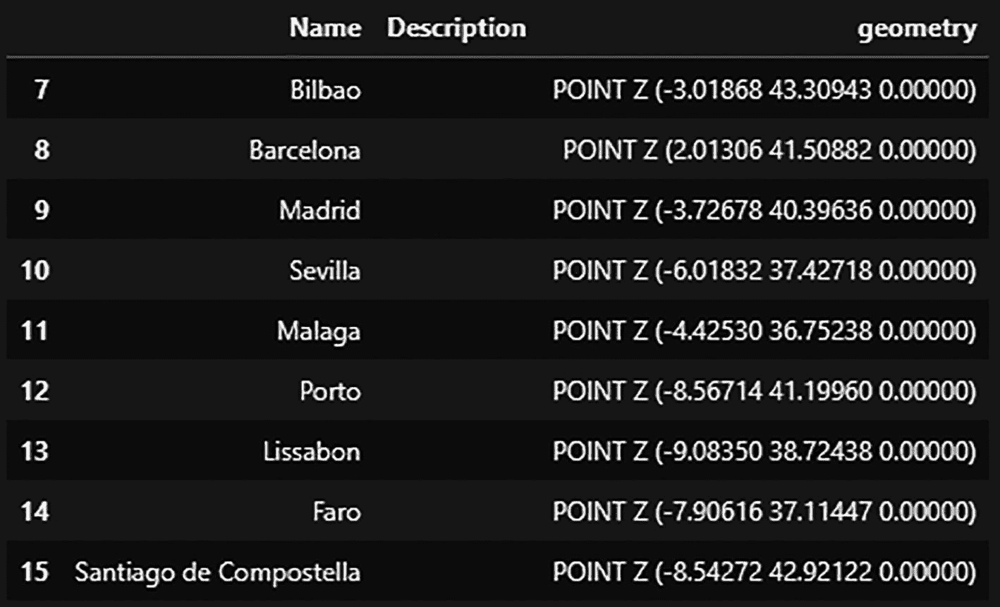

一张包含四列九行的表格图片。最左列条目编号为 7 到 15。名称列包含条目：毕尔巴鄂、巴塞罗那、马德里、塞维利亚、马拉加、波尔图、里斯本、法鲁和圣地亚哥-德孔波斯特拉。描述列没有条目。几何列包含不同的 POINT Z 值。

图 8-17

代码块 8-9 得到的数据集。图片由作者提供

现在我们有了一个只包含城市的数据集，我们仍然需要筛选出西班牙的城市并移除葡萄牙的城市。如你所见，没有其他列可以用来应用此筛选条件，手动列出所有西班牙和葡萄牙的城市会非常繁琐。即使对于当前练习来说可行，但如果数据集更大，工作量会大得多，因此这不是一个好做法。

以下代码展示了如何移除所有与葡萄牙多边形有叠加的城市。将 `how` 参数设置为 `"difference"` 会使它们被移除而不是保留。提醒一下，你在前面的章节中已经看到过其他参数，如 `intersection` 和 `union` 的使用。如果你不记得其他版本的作用，此时最好使用代码块 8-10 快速回顾一下。

```
spanish_cities = cities.overlay(portugal, how = 'difference')
spanish_cities
代码块 8-10
差集操作
```

`spanish_cities` 数据集如图 8-18 所示。

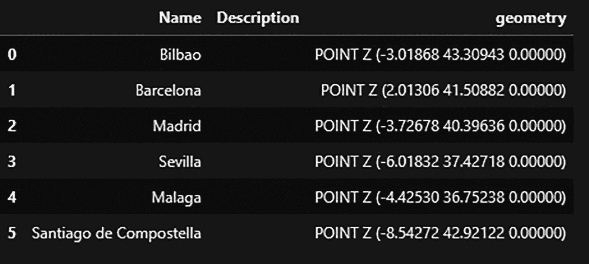

一张包含四列六行的表格图片。最左列条目编号为 0 到 5。名称列包含条目：毕尔巴鄂、巴塞罗那、马德里、塞维利亚、马拉加和圣地亚哥-德孔波斯特拉。描述列没有条目。几何列包含不同的 POINT Z 值。

图 8-18

代码块 8-10 得到的数据集。图片由作者提供

将此数据集与之前的数据集进行比较，你可以看到确实有一些城市被移除了。保留的西班牙城市是毕尔巴鄂、巴塞罗那、马德里、塞维利亚、马拉加和圣地亚哥-德孔波斯特拉。葡萄牙的城市已被移除：波尔图、里斯本和法鲁。这就是本练习的目标，因此我们可以认为它已成功完成。

作为最后一步，最好将所有这些添加到我们在上一节开始制作的地图中。让我们使用代码块 8-11 中的代码，将西班牙城市添加到西班牙多边形地图上。

```
ax = spain.plot(figsize=(15,15), edgecolor='black', facecolor='none')
spanish_cities.plot(ax=ax, markersize=128)
cx.add_basemap(ax, crs=spain.crs)
代码块 8-11
在地图上添加西班牙城市
```

此代码将生成如图 8-19 所示的地图，其中包含西班牙国家的多边形、西班牙的城市以及一个用于更好可视化的 contextily 底图。

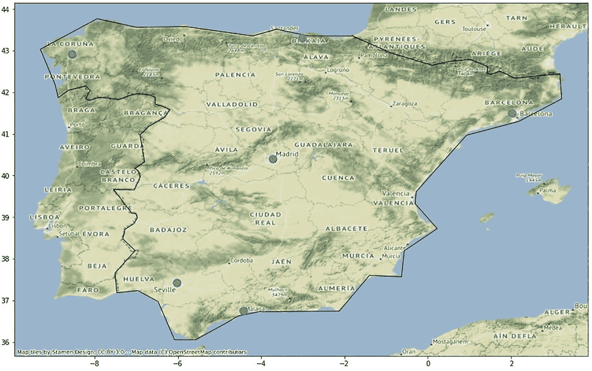

欧洲西南部地区的地图，在西班牙边界内的六个不同城市上有圆点标记，分别是：毕尔巴鄂、巴塞罗那、马德里、塞维利亚、马拉加和圣地亚哥-德孔波斯特拉。可以看到附近的国家。垂直轴数值从 36 到 44，间隔为 1；水平轴数值从 -8 到 +2，间隔为 2。

图 8-19

代码块 8-11 得到的地图。图片由作者提供

我们现在已经完成了练习的两个部分。我们已经看到了如何切割多边形，并且筛选出了西班牙的城市。剩下唯一要做的事情是调整道路的尺寸，并确保只筛选出位于西班牙多边形内部的道路部分。这将是下一节的目标。

### 仅保留西班牙境内的道路线段

在本节中，我们将处理道路数据，这是输入数据中我们尚未处理的唯一部分。输入数据集包含五条道路。回顾一下数据的第一个整体图，您会发现其中一些道路穿越了两个国家，而另一些则仅位于一个国家境内。此操作既包含过滤，也涉及修改，因为跨国道路需要被裁剪至西班牙多边形的范围内。

首先，我们创建一个仅包含道路的数据框，因为单一类型的数据集总是更易于处理。代码块 8-12 展示了这一过程。

```
from shapely.geometry.linestring import LineString
roads_filter = all_data.geometry.apply(lambda x: type(x) == LineString)
roads = all_data[roads_filter]
roads
代码块 8-12
创建仅包含道路的数据框
```

现在，您将获得一个仅包含道路的数据集，如图 8-20 所示。

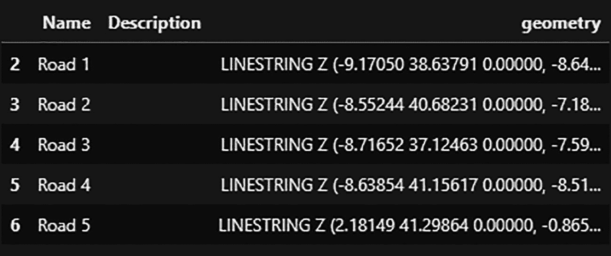

一张包含四列五行表格的图片。最左列条目标记为 2 至 6。名称列包含道路 1 至 5 的条目。描述列没有条目。几何列包含不同的 LINESTRING Z 值。

图 8-20

代码块 8-12 生成的数据集。作者提供的图片

从数据中并不能清晰地看出问题所在，因此我们使用代码块 8-13 中的代码绘制一张图，以查看这些 LineString 对象的问题。

```
ax = spain.plot(figsize=(15,15), edgecolor='black', facecolor='none')
spanish_cities.plot(ax=ax, markersize=128)
roads.plot(ax=ax, linewidth=4, edgecolor='grey')
cx.add_basemap(ax, crs=spain.crs)
代码块 8-13
绘制数据
```

这段代码将生成图 8-21 中的地图，该图显示仍有大量道路线段位于葡萄牙境内，这是我们不希望出现在西班牙地图上的。

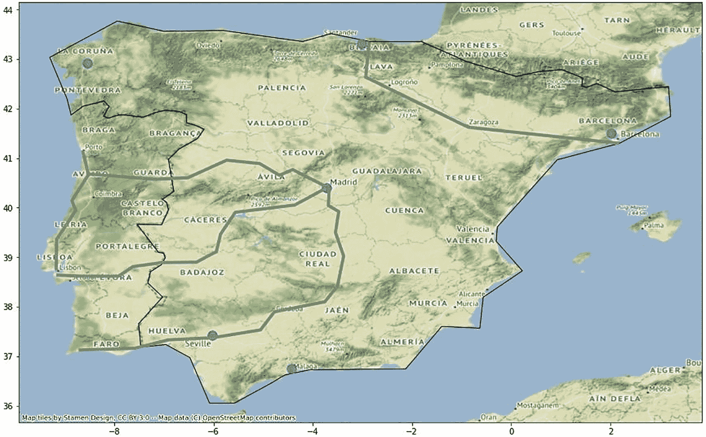

一张欧洲西南部地区的地图，显示了连接西班牙部分城市的线条网络。马德里和塞维利亚连接到一个横跨葡萄牙领土的大型线条网络，而毕尔巴鄂和巴塞罗那则由一条长线连接。图中还显示了邻近国家以及其他两个未连接的西班牙城市，以及垂直和水平轴的值。

图 8-21

代码块 8-13 生成的地图。作者提供的图片

确实，您可以看到有一条道路（从波尔图到里斯本）需要被完全移除。还有三条道路始于马德里，终点在葡萄牙，因此我们需要裁剪掉这些道路位于葡萄牙境内的部分。

使用叠加分析中的差异操作可以轻松完成所有这些操作，如代码块 8-14 中的代码所示。

```
spanish_roads = roads.overlay(portugal, how = 'difference')
spanish_roads
代码块 8-14
差异操作
```

结果如图 8-22 所示。

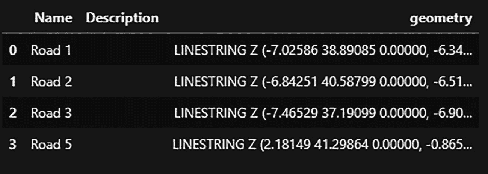

一张包含四列四行表格的图片。最左列条目标记为 0 至 3。名称列包含道路 1、2、3 和 5 的条目。描述列没有条目。几何列包含不同的 LINESTRING Z 值。

图 8-22

代码块 8-14 生成的数据。作者提供的图片

您可以清楚地看到，一些完全位于葡萄牙境内的道路已从数据集中被移除。部分位于葡萄牙、部分位于西班牙的道路则被修改，而完全位于西班牙境内的道路则被完整保留。

现在，我们将道路添加到包含国家多边形和城市的整体地图中，以完成我们仅包含西班牙要素的最终地图。代码块 8-15 展示了这一过程。

```
ax = spain.plot(figsize=(15,15), edgecolor='black', facecolor='none')
spanish_cities.plot(ax=ax, markersize=128)
spanish_roads.plot(ax=ax, linewidth=4, edgecolor='grey')
cx.add_basemap(ax, crs=spain.crs)
代码块 8-15
将道路添加到整体地图中

```

生成的地图如图 8-23 所示。

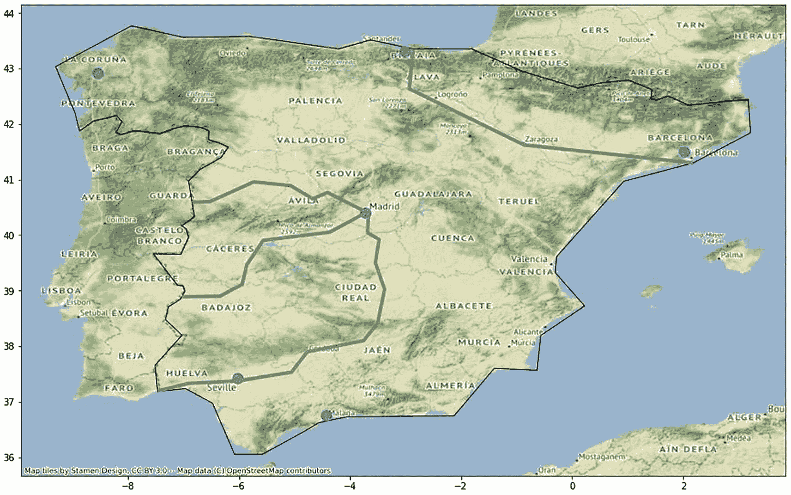

一张欧洲西南部地区的地图，显示了西班牙边界内的连接线条。西班牙。观察到两个线条网络，一个涉及西部的马德里和塞维利亚城市，另一个涉及东北部的毕尔巴鄂和巴塞罗那城市。图中还显示了邻近国家以及其他两个未连接的西班牙城市，以及垂直和水平轴的值。

图 8-23

代码块 8-15 生成的地图。作者提供的图片

这张地图展示了所有要素被缩减至西班牙境内的结果，而我们的初始数据集中甚至没有一个西班牙多边形。这些示例展示了在空间分析或面向空间机器学习的特征工程中非常常见的工作类型。毕竟，数据并非总是干净完美的，通常需要一些处理才能使用。

通过本章及前几章的学习，您应该已经掌握了处理地理空间数据的基础知识，并具备了足够的背景知识，能够通过查阅文档和其他资料来了解如何执行其他地理空间操作。在接下来的章节中，重点将转向更多的数学和统计学内容，因为我们即将进入机器学习的章节。

## 要点总结

1.  擦除操作有多种解释。在空间分析中，其定义是基于与指定擦除要素的空间叠加来擦除要素或要素的部分。

2.  根据具体实现方式，擦除基本上等同于叠加分析中的差异操作，后者是集合论操作之一。

3.  您可以使用差异叠加来擦除矢量数据集（点、线或多边形）中的数据。

4.  擦除点时，您最终会擦除或保留整个点，因为无法将点切割成多个部分。

5.  擦除线或多边形时，如果要素完全与擦除要素重叠，则可以擦除整个要素；但如果要素仅部分重叠，则该要素将被修改而非移除。

# 第三部分机器学习和数学

