# 9. 插值

在本书前四章介绍了空间数据的基础知识，并在过去四章介绍了一些基本的 GIS 操作之后，现在是时候进入最后四章了，您将在此看到一系列应用于空间数据的统计和机器学习技术。

本章将介绍插值，这是进入机器学习领域的一个良好切入点。本章首先介绍插值的定义和直观解释，然后介绍一些在 Python 中的示例用例。

## 什么是插值？

插值是一项对大多数人来说相对直观的任务。从高层次来看，插值意味着填补数字序列中的缺失值。例如，我们来看下面这个数字列表：

*   1, 2, 3, 4, ???, 6, 7, 8, 9, 10

许多人很容易就能发现，数字 5 应该放在写有 ??? 的位置。让我们试着理解为什么这如此简单。如果我们想用图形表示这个列表，可以将数值与列表中的位置（索引）对应绘制，如图 9-1 所示。

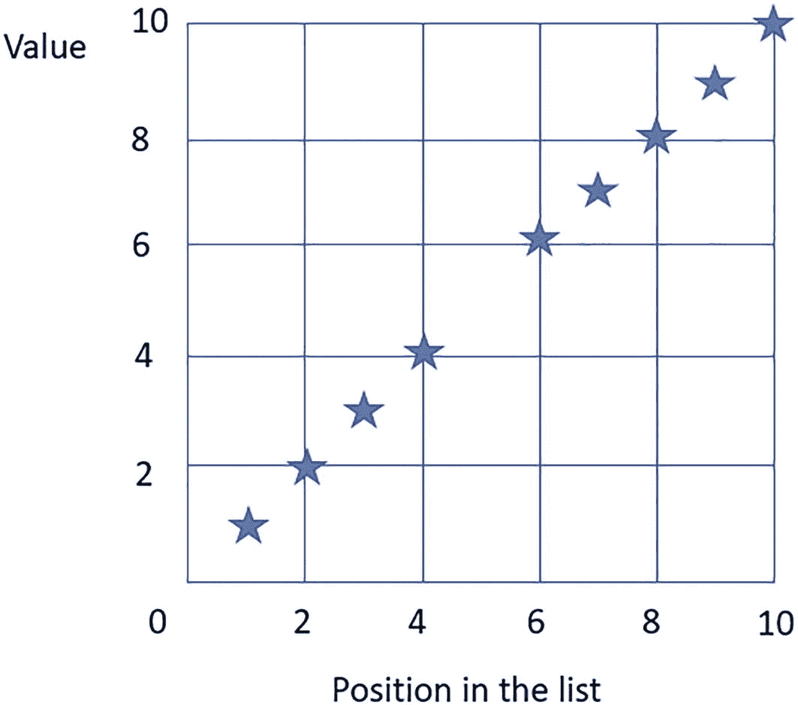
图 9-1 在数值列表中进行插值。图片由作者提供

看到这个，我们很容易倾向于认为这些数据遵循一条直线，如图 9-2 所示。

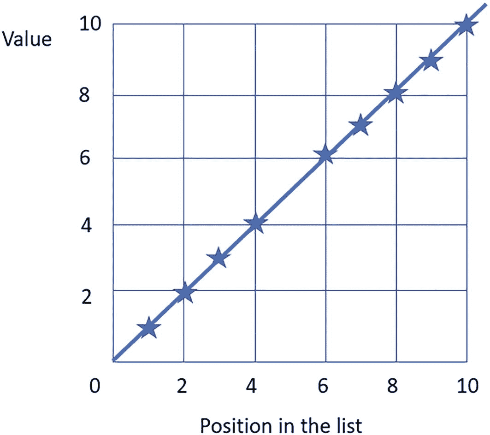
图 9-2 插值得到的直线。图片由作者提供

由于我们不知道这些数字来自何处，很难判断这是否正确，但假设它们来自一条直线似乎合乎逻辑。现在，让我们尝试另一个例子。为了给你一个更复杂的例子，请尝试以下序列：

*   1, ???, 4, ???, 16

如果你能找到答案，你最可能的猜测是倍增函数，它可以用图形表示，如图 9-3 所示。

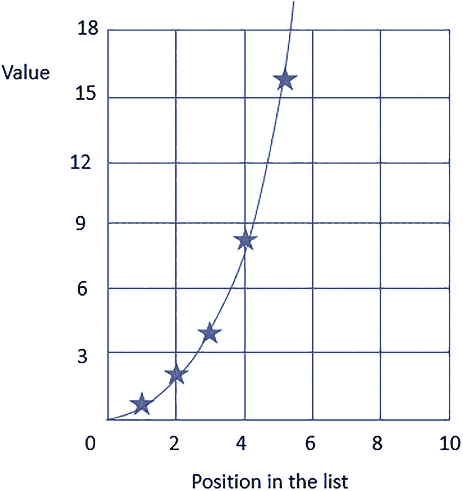
图 9-3 使用曲线进行插值。图片由作者提供

在进行插值时，我们试图基于一个看似适合我们数据的数学公式，来找到其他数值之间某个值的最佳估计。虽然插值不一定是机器学习方法家族中的一员，但它是开始探索机器学习领域的一个绝佳方式。毕竟，插值的目标是猜测出最能代表数据的公式，而这从根本上来说也是机器学习的核心。不过，更多内容将在下一章介绍。让我们先深入探讨一下插值如何工作以及如何应用于空间数据的一些技术细节。

## 不同类型的插值

让我们首先介绍一些可用于“标准”插值或空间插值的方法。最直接的方法是线性插值。

### 线性插值

最直接的插值方法是线性插值。线性插值归结为从每个点到下一个点画一条直线，并估计位于该直线上的中间值。图 9-4 中的图表展示了一个示例。

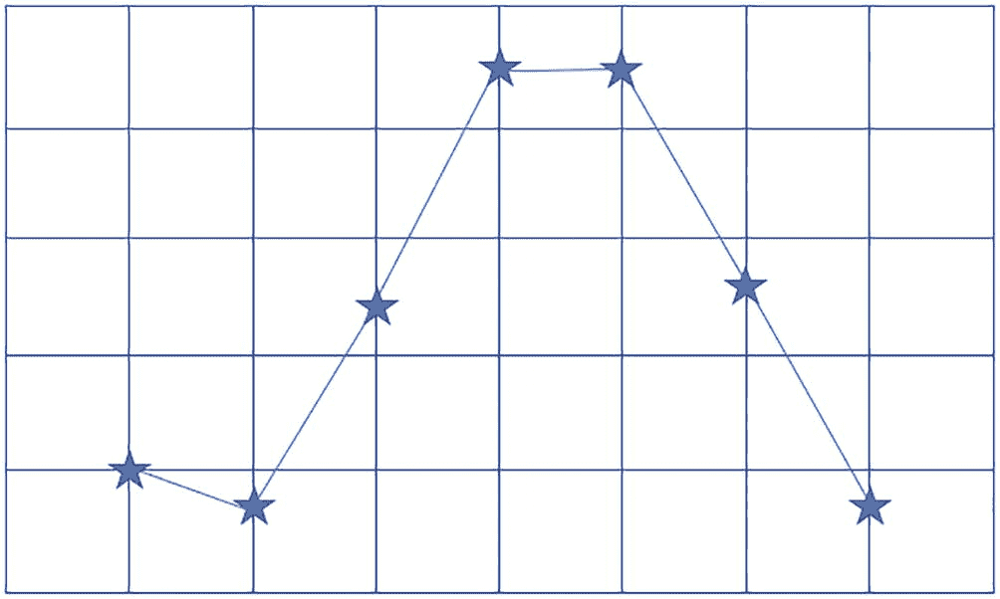
图 9-4 线性插值。图片由作者提供

虽然这看起来不算太差，但也不够精确。线性插值的优点在于它通常不会错得太离谱：你不会冒险估计出严重偏离范围的值，因此它是一个值得首先尝试的好方法。

线性插值的数学函数如下：

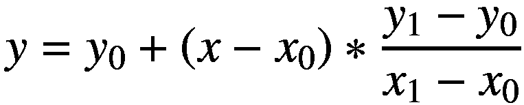

如果你输入想要计算新 y 值的 x，以及新点之前 (x[0], y[0]) 和之后 (x[1], y[1]) 的 x 和 y 值，就能得到该点的新 y 值。

### 多项式插值

多项式插值在估计此类函数时效果稍好一些，因为多项式函数实际上可以是弯曲的。只要你能找到合适的多项式函数，通常就能得到相对较好的近似结果。这可能类似于图 9-5 所示。

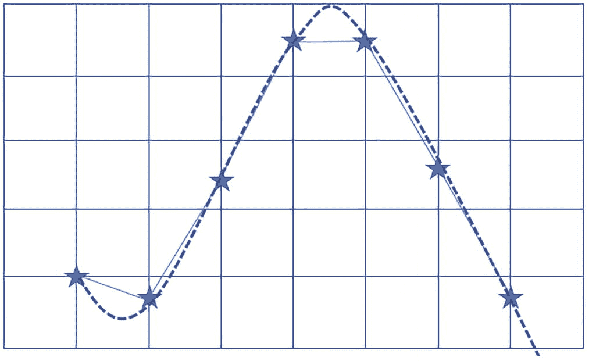
图 9-5 多项式插值。图片由作者提供

多项式估计的一个风险是，实际上可能很难找到一个适合你数据的多项式函数。如果识别出的多项式非常复杂，那么函数中某处出现“疯狂曲线”的风险就很大，这将导致某些插值结果严重错误。

在此深入探讨多项式的完整理论会有些冗长，但简而言之，多项式的公式是任何包含平方项的函数形式，例如

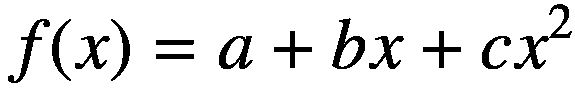

这可以复杂化到非常复杂的形式，例如

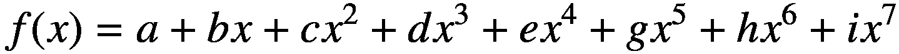

还存在许多许多其他形式的多项式。如果你对多项式不熟悉，值得查阅一些关于该主题的在线资源。

#### 分段多项式或样条

分段多项式是一种替代方案，它拟合多个更简单的多项式，而不是为所有数据拟合一个多项式。这降低了常规多项式可能产生严重错误估计的风险。

尽管分段多项式在最终形式上更简单，但它们不一定更容易估计。寻找“常规”多项式的挑战在于搜索至少能通过所有点的最简单多项式，而分段多项式的问题在于存在许多潜在的解决方案。

然而，只要我们为自己设定一些规则，这个问题就很容易解决。在实践中，有现成的优秀实现可用于拟合三次样条和其他变体。在这个主题上无需重新发明轮子，因为现有的解决方案已经相当成熟。你可以查看 Python 中的 `Scipy` 包，那里提供了大量此类算法。

### 最近邻插值

最后，另一种常见的标准插值方法是最近邻插值。它的核心思想是通过寻找最近的邻居并复制其值来估算一个数值。这种方法的优点在于，你能够确保所有估算出的值都确实存在于原始数据的某个位置，从而避免“凭空捏造”任何实际上不可能存在的数值。但代价是，这样得到的估算结果会非常不平滑。图 9-6 中的示例将最近邻插值添加到了图表中。

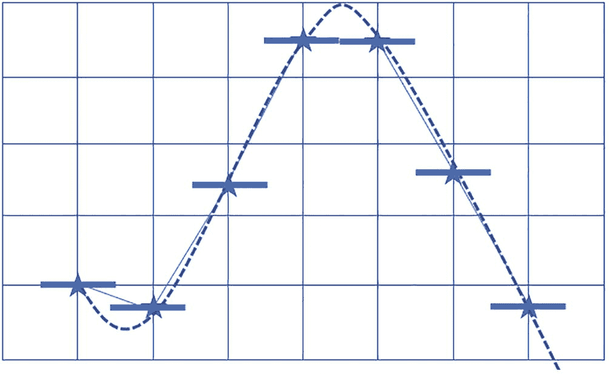
图 9-6 将最近邻插值添加到图表中。图片由作者提供

这种最近邻插值会将数值赋值为与其最近点的值相同。因此，线条形状是一个分段函数：当在 x 轴上接近下一个点时，插值得到的 y 轴数值会跳跃到下一个 y 轴值。如你所见，对于手头的这条曲线来说，这并非最佳方案，但在其他情况下，它可能是一种简单易用的插值方法。

## 从一维插值到空间插值

现在你已经了解了插值的一些基本直观概念，是时候转向空间插值了。当然，本章的目标是讨论空间数据的插值，你可能很难想象我们如何从之前的图表过渡到二维空间插值的情况。或者，你可以将之前的图表想象成当你站在地面上时，空间插值值的侧视图。

由于可视化通常是理解插值方法的好途径，让我们从一个非常常见的用例开始讨论空间插值：对一个只有少数几个官方国家温度计的国家进行温度插值。想象一下，你在图 9-7 的地图上有一个矩形国家，并在每个点都测量了温度。


图 9-7 一个插值练习。图片由作者提供

根据我们居住的位置，我们希望获得最适合自己的数值。在该国的北部，温度为 10 摄氏度；在南部，温度为 0 摄氏度。让我们对此使用线性插值，结果如图 9-8 所示。

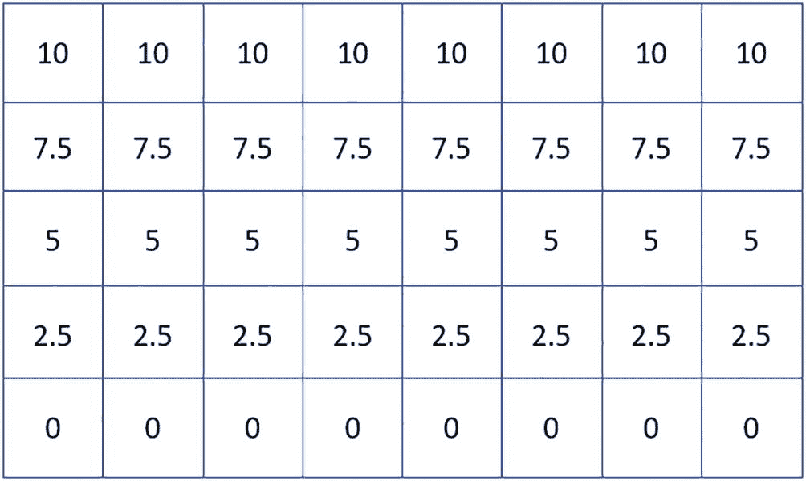
图 9-8 使用线性插值进行练习的结果。图片由作者提供

这种线性方法看起来还不错，并且对于这些数据来说，手工计算也很容易。让我们再看看如果使用最近邻插值（同样易于手工计算）会发生什么。结果如图 9-9 所示。

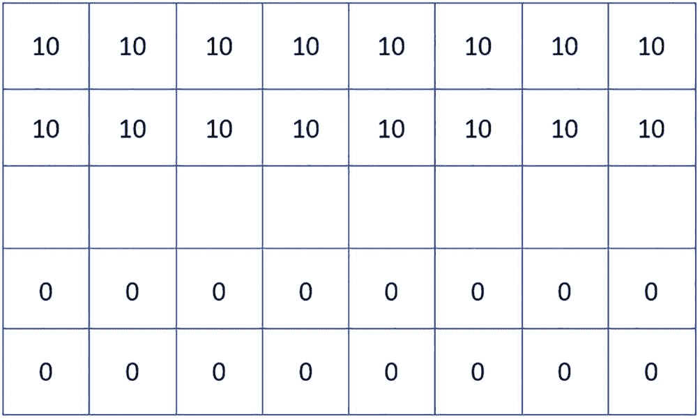

一个 5x8 网格的示意图。最顶部的水平单元格组及其下方的单元格组值为 10。最底部的水平单元格组及其上方的单元格组值为 0。中间的水平单元格组为空。

图 9-9

使用最近邻插值进行练习的结果。图片由作者提供

中间部分被省略了，因为定义边界并不那么简单，但你可以大致了解在这个例子中使用最近邻插值会发生什么。

目前，我们不会深入探讨数学定义，但如果你想深入研究，可以在网上找到很多资源。例如，你可以从这里开始：[`https://towardsdatascience.com/polynomial-interpolation-3463ea4b63dd`](https://towardsdatascience.com/polynomial-interpolation-3463ea4b63dd)。现在，我们将专注于在 Python 中应用于地理数据的实践。

## Python 中的空间插值

在本节中，你将看到如何在 Python 中应用其中一些插值方法。让我们先生成一些示例数据点，以便应用这些插值方法。假设我们只有以下四个点的数据。每个数据点都是同一时间戳但不同位置的温度测量值。练习的目标是使用插值来估算这些未测量位置（即这些点之间）的值。数据如代码块 9-1 所示。

```python
data = { 'point1': {
'lat': 0,
'long': 0,
'temp': 0 },
'point2': {
'lat': 10,
'long': 10,
'temp': 20 },
'point3' : {
'lat': 0,
'long': 10,
'temp': 10 },
'point4': {
'lat': 10,
'long': 0,
'temp': 30 }
}
```

代码块 9-1 数据

现在，我们要做的第一件事是从这个字典创建一个数据框，并将这些数据转换为地理数据框。为此，最简单的方法是先使用代码块 9-2 中的代码创建一个常规的 `pandas` 数据框。

```python
import pandas as pd
df = pd.DataFrame.from_dict(data, orient='index')
df
```

代码块 9-2 创建数据框

我们看到数据框已成功创建，如图 9-10 所示。

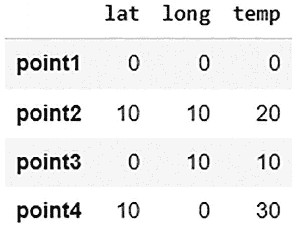

一个包含四列四行的表格。最左列包含条目 point 1、point 2、point 3 和 point 4。`lat` 列包含条目 0、10、0 和 10。`long` 列包含条目 0、10、10 和 0。`temp` 列包含条目 0、20、10 和 30。

图 9-10

导入 Python 的数据。图片由作者提供

下一步，让我们将这个数据框转换为 `geopandas` 地理数据框，同时指定几何图形为点数据，并包含经纬度信息。这在代码块 9-3 中完成。

```python
import geopandas as gpd
from shapely.geometry.point import Point
gdf = gpd.GeoDataFrame(df, geometry=[Point(y,x) for x,y in zip(list(df['lat']), list(df['long']))])
gdf.plot(markersize=(gdf['temp']+1)*10)
```

代码块 9-3 转换为地理数据框

此代码生成的图表如图 9-11 所示。

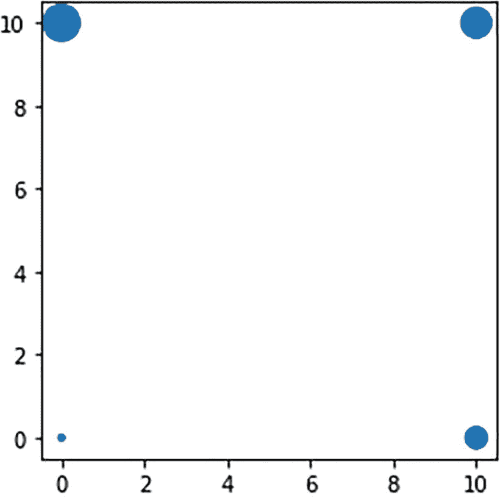

一个图表展示了代码块 9-3 的结果数据。四个角上有不同大小的圆圈。从最大到最小的圆圈坐标分别为 (0, 10)、(10, 10)、(10, 0) 和 (0, 0)。

图 9-11

代码块 9-3 生成的图表。图片由作者提供

正如你在该图表中所见，有四个大小不同的点。从宏观角度来看，找到这些点之间的中间值似乎是可行的。然而，要做到这一点，需要在 Python 中找到一个代表这种插值的数学公式，然后用它来预测插值后的数值。

### 使用 Scipy `interp2d` 进行线性插值

我们首先要尝试的是二维线性插值。为此，我们将使用 `Scipy` 的 `interp2d` 函数，该函数会返回一个插值函数。一旦使用输入数据创建了这个函数，你就可以调用它来预测任何新点的值。

代码块 9-4 中的代码展示了如何使用四个输入点创建二维线性插值函数。

```python
from scipy.interpolate import interp2d
my_interpolation_function = interp2d(df['lat'], df['long'], df['temp'], kind='linear')
```

代码块 9-4 创建插值函数

现在我们有了这个函数，就可以在新点上调用它了。不过，我们首先需要定义用于插值的点。由于我们有四个呈正方形排列的点，让我们在正中间的点以及各边中点的位置进行插值。我们可以使用代码块 9-5 中的代码创建这个新的 `DataFrame`。

```python
new_points = {'point5': {'lat': 0, 'long': 5},
'point6': {'lat': 5, 'long': 0},
'point7': {'lat': 5, 'long': 5},
'point8': {'lat': 5, 'long': 10},
'point9': {'lat': 10, 'long': 5}
}
new_df = pd.DataFrame.from_dict(new_points, orient='index')
new_df
```

代码块 9-5 新的数据框

生成的 `DataFrame` 如图 9-12 所示。

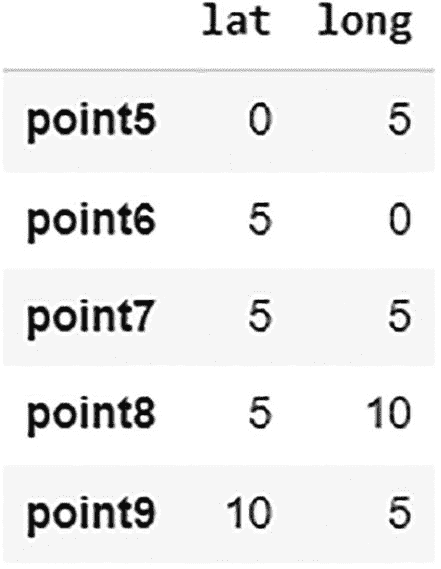

一个包含三列五行数据的表格。行标题为 `point5`、`point6`、`point7`、`point8` 和 `point9`。`lat` 列的条目为 0、5、5、5 和 10。`long` 列的条目为 5、0、5、10 和 5。

图 9-12

生成的 `DataFrame`。图片由作者提供

这里的数据只有纬度和经度，但还没有估算的温度。毕竟，我们的目标是使用插值函数来获取这些估算的温度。

在代码块 9-6 中，你可以看到如何遍历这些新点并调用插值函数来估算该位置的温度。请记住，这个插值函数是基于我们给定的输入数据，对线性插值的数学定义。

```python
interpolated_temps = []
for i,row in new_df.iterrows():
interpolated_temps.append(my_interpolation_function(row['lat'], row['long'])[0])
new_df['temp'] = interpolated_temps
new_df
```

代码块 9-6 应用插值

你可以在图 9-13 中看到这些结果的数值估算值。

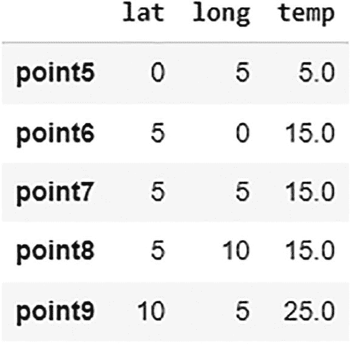

一个包含四列五行数据的表格。行标题为 `point5`、`point6`、`point7`、`point8` 和 `point9`。`lat` 列的条目为 0、5、5、5 和 10。`long` 列的条目为 5、0、5、10 和 5。`temp` 列的条目为 5.0、15.0、15.0、15.0 和 25.0。

图 9-13

代码块 9-6 得出的估算结果。图片由作者提供

线性插值是最直接的方法，从这些预测结果可以清楚地看出，它们看起来是可靠的。很难说它们是好是坏，因为在插值用例中我们没有任何真实值作为参考，但至少可以说结果并不离谱。

现在我们已经完成了估算，应该尝试做一些分析。代码块 9-7 将它们合并到一个 `DataFrame` 中，以便我们重新绘制图表。

```python
combi_df = pd.concat([df, new_df])
gdf = gpd.GeoDataFrame(combi_df, geometry=[Point(y,x) for x,y in zip(list(combi_df['lat']), list(combi_df['long']))])
gdf.plot(markersize=(gdf['temp']+1)*10)
```

代码块 9-7 合并数据并绘图

这段代码将输出如图 9-14 所示的图表。

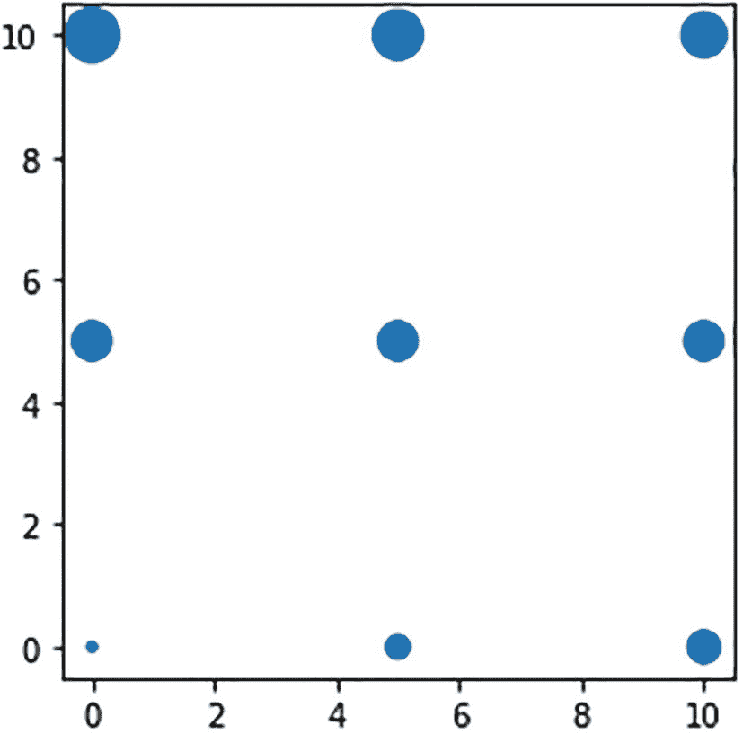

一个展示了插值结果的图表。左侧、中间和右侧由不同大小的圆圈标记。从最大到最小的圆圈对应的估算坐标分别为 (0, 10)、(5, 10)、(10, 10)、(0, 5)、(5, 5)、(10, 5)、(10, 0)、(5, 0) 和 (0, 0)。

图 9-14

带有插值结果的图表。图片由作者提供

尽管我们没有精确的指标来判断这次插值是好是坏，但至少可以说，从视觉上看，插值结果似乎或多或少是合乎逻辑的，这令人欣慰。这第一次尝试看起来相当成功。让我们在下一节尝试一些更高级的方法，看看不同方法会带来怎样不同的结果。

## 克里金法

在本章的第一部分，你已经了解了一些基本的、基础的插值方法。插值的特点在于，你可以根据需要将其做得非常简单，也可以非常复杂。

尽管前面讨论的基础方法在实际结果和用例中通常令人满意，但我们还需要介绍一些更高级的技术。

在本章的第二部分，我们将探讨一种名为克里金法的插值方法。克里金法是一种更为高级的插值数学定义。虽然深入探讨其数学细节会超出本书的范畴，但对于那些不介意更多数学细节的读者，欢迎查阅一些在线资源，例如 [`https://en.wikipedia.org/wiki/Kriging`](https://en.wikipedia.org/wiki/Kriging) 和 [`www.publichealth.columbia.edu/research/population-health-methods/kriging-interpolation`](https://www.publichealth.columbia.edu/research/population-health-methods/kriging-interpolation)。

### 线性普通克里金法

克里金法有多种形式。与许多数学方法一样，方法越复杂，需要调整和设置的参数就越多。在接下来的章节中，我们将探讨几种克里金法解决方案，它们将与之前给出的线性插值方案形成对比。最后，我们将通过练习进行比较并得出结论。

首先，你可以使用带有普通克里金功能的 `pykrige` 库，如代码块 9-8 所示。和之前一样，先估算函数，然后在 `new_df` 上进行估算。具体操作见代码块 9-8。

```
from pykrige.ok import OrdinaryKriging
my_ok = OrdinaryKriging(df['long'], df['lat'], df['temp'])
zvalues, sigmasq = my_ok.execute('points', new_df['long'].map(float).values, new_df['lat'].map(float).values)
new_df['temp'] = zvalues.data
new_df
代码块 9-8
使用线性普通克里金法进行插值
```

你可以在图 9-15 中看到估算结果。

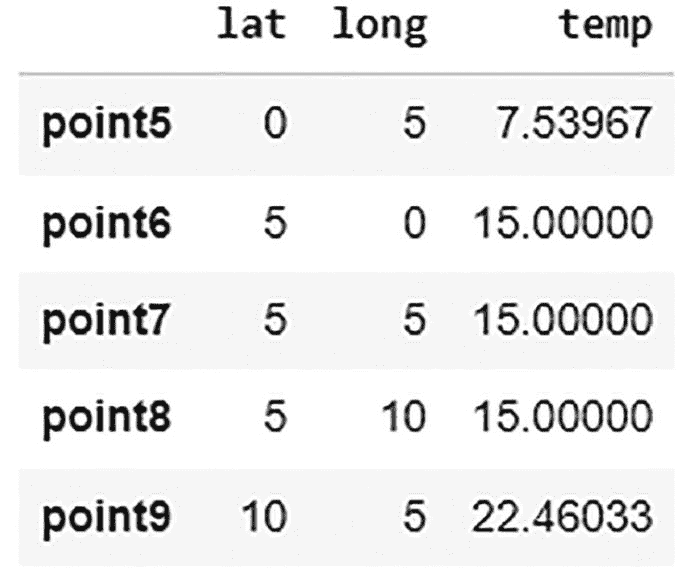

一个四列五行的表格。行标题为点 5、点 6、点 7、点 8 和点 9。`lat` 列条目为 0、5、5、5、10。`long` 列条目为 5、0、5、10、5。`temp` 列条目为 7.53967、15.00000、15.00000、15.00000、22.46033。

图 9-15

使用线性普通克里金法插值后的值。图片由作者提供。

有趣的是，其中一些估算值并不完全相同。让我们用代码块 9-9 中的代码绘制它们，看看图中是否有任何异常或不同之处。

```
combi_df = pd.concat([df, new_df])
gdf = gpd.GeoDataFrame(combi_df, geometry=[Point(y,x) for x,y in zip(list(combi_df['lat']), list(combi_df['long']))])
gdf.plot(markersize=(gdf['temp']+1)*10)
代码块 9-9
绘制插值结果
```

生成的图如图 9-16 所示。


一个图表展示了使用线性普通克里金法的数据结果。左侧、中间和右侧由不同大小的圆圈标记。从最大到最小的圆圈对应的估算坐标分别为 (0, 10)、(5, 10)、(10, 10)、(0, 5)、(5, 5)、(10, 5)、(10, 0)、(5, 0) 和 (0, 0)。

图 9-16

使用线性普通克里金法得到的图。图片由作者提供。

从图中判断，并没有明显的错误估算，因此没有理由否定这些结果。由于我们没有衡量插值好坏的标准，这只能被视为一种替代估算。让我们在下一节中尝试对克里金法使用其他设置，看看会发生什么。

### 高斯普通克里金法

在本节中，让我们尝试更改克里金插值背后的插值模型。我们可以通过将 `variogram_model` 参数设置为其他值来调整设置。这里，我们选择“gaussian”来看看效果。具体操作见代码块 9-10。

```
my_ok = OrdinaryKriging(df['long'], df['lat'], df['temp'], variogram_model = 'gaussian')
zvalues, sigmasq = my_ok.execute('points', new_df['long'].map(float).values, new_df['lat'].map(float).values)
new_df['temp'] = zvalues.data
new_df
代码块 9-10
高斯普通克里金法
```

现在，结果如图 9-17 中的表格所示。

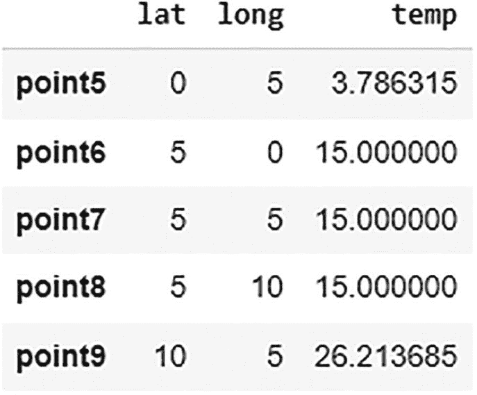

一个四列五行的表格。行标题为点 5、点 6、点 7、点 8 和点 9。`lat` 列条目为 0、5、5、5、10。`long` 列条目为 5、0、5、10、5。`temp` 列条目为 3.786315、15.00000、15.00000、15.00000、26.213685。

图 9-17

高斯普通克里金法的结果。图片由作者提供。

有趣的是，点 5 和点 9 的估算值再次发生了显著变化！让我们再次绘制图表，看看这次插值过程中是否出现异常。具体操作见代码块 9-11。

```
combi_df = pd.concat([df, new_df])
gdf = gpd.GeoDataFrame(combi_df, geometry=[Point(y,x) for x,y in zip(list(combi_df['lat']), list(combi_df['long']))])
gdf.plot(markersize=(gdf['temp']+1)*10)
代码块 9-11
绘制结果
```

生成的图如图 9-18 所示。

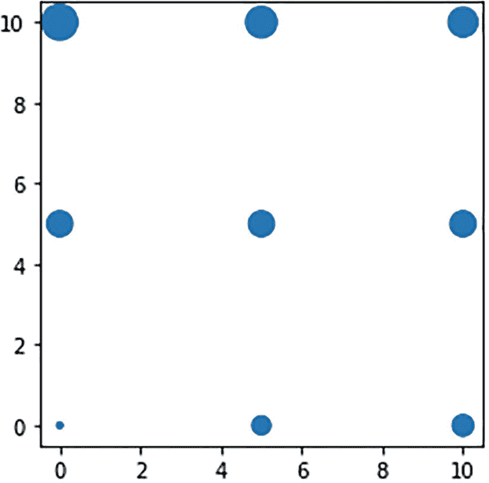

一个图表展示了使用高斯普通克里金法的数据结果。左侧、中间和右侧由不同大小的圆圈标记。从最大到最小的圆圈对应的估算坐标，其数据大小与线性普通克里金法图的结果相近。

图 9-18

高斯普通克里金法的结果。图片由作者提供。

同样，查看此图时，不能认为这种插值有任何错误。它与其他方法不同，但同样有效。

### 指数普通克里金法

作为最后的测试和练习，让我们再次尝试变差函数的另一种设置。这次，我们将 `variogram_model` 设置为“exponential”。相关代码如代码块 9-12 所示。

```
my_ok = OrdinaryKriging(df['long'], df['lat'], df['temp'], variogram_model = 'exponential')
zvalues, sigmasq = my_ok.execute('points', new_df['long'].map(float).values, new_df['lat'].map(float).values)
new_df['temp'] = zvalues.data
new_df
代码块 9-12
指数普通克里金法
```

此插值的结果如图 9-19 所示。

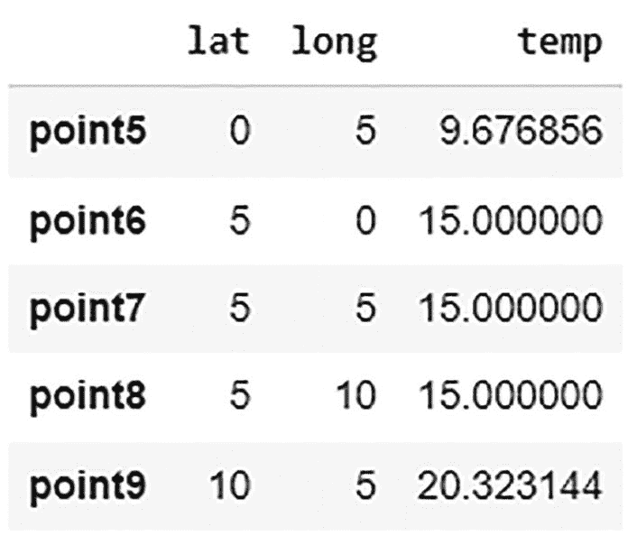

一个四列五行的表格。行标题为点 5、点 6、点 7、点 8 和点 9。`lat` 列条目为 0、5、5、5、10。`long` 列条目为 5、0、5、10、5。`temp` 列条目为 9.676856、15.00000、15.00000、15.00000、20.323144。

图 9-19

指数普通克里金法的结果。图片由作者提供。

有趣的是，再次是点 5 和点 9 变化很大，而其他点保持不变。为了保持连贯性，我们也绘制此插值的图，使用代码块 9-13。

```
combi_df = pd.concat([df, new_df])
gdf = gpd.GeoDataFrame(combi_df, geometry=[Point(y,x) for x,y in zip(list(combi_df['lat']), list(combi_df['long']))])
gdf.plot(markersize=(gdf['temp']+1)*10)
代码块 9-13
绘制指数普通克里金法结果
```

生成的图如图 9-20 所示。

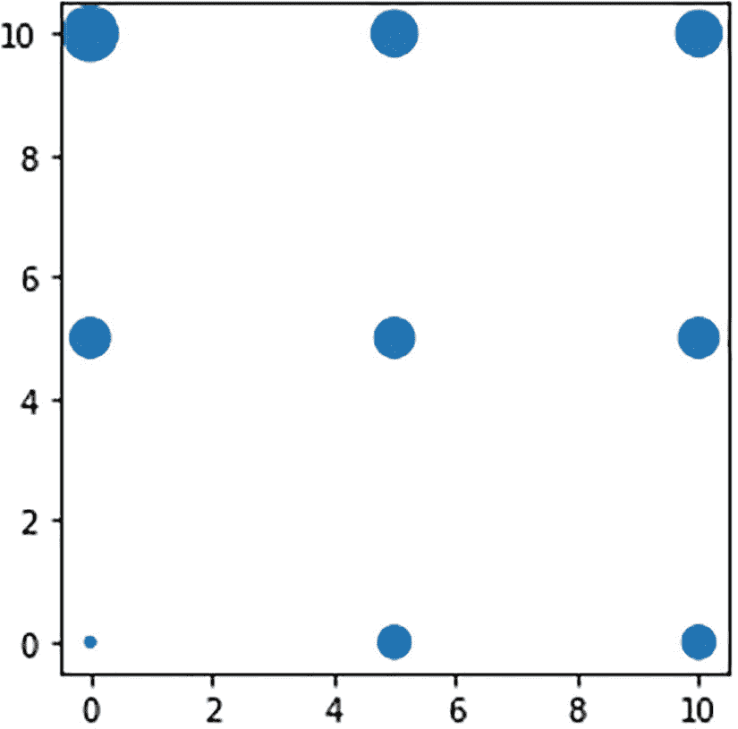

一个图表展示了使用指数普通克里金法的结果。左侧、中间和右侧由不同大小的圆圈标记。从最大到最小的圆圈对应的估算坐标分别为 (0, 10)、(5, 10)、(10, 10)、(0, 5)、(5, 5)、(10, 5)、(10, 0)、(5, 0) 和 (0, 0)。

图 9-20

指数普通克里金法的图。图片由作者提供。

同样，这张图没有明显错误，但其结果再次与之前不同。我们自然会想知道哪一种方法是正确的。让我们在下一节中对此进行总结。

## 插值方法总结

有趣的是，我们以一个相当简单的插值用例开启了本章。虽然人们可能倾向于认为这个问题非常容易解决，甚至可以通过手动计算完成，但不同方法给出的多种可能答案表明，这并非一项简单的任务。

回顾一下，我们在表 9-1 中获得了所有可能的答案。

## 表 9-1 插值基准测试结果

| | 线性 | 线性克里金 | 高斯克里金 | 指数克里金 |
|---|---|---|---|---|
| 点 5 | 5 | 7.54 | 3.79 | 9.68 |
| 点 6 | 15 | 15 | 15 | 15 |
| 点 7 | 15 | 15 | 15 | 15 |
| 点 8 | 15 | 15 | 15 | 15 |
| 点 9 | 25 | 22.46 | 26.21 | 20.32 |

即使对于这样一个简单的插值示例，我们也能看到点 5（图中底部中间）和点 9（图中右侧中间）的估计值存在惊人的巨大差异。

现在，这里的大问题当然是，我们能否说其中任何一种方法优于其他方法。不幸的是，当将数学模型应用于没有真实基准值的数据时，你无从知晓。你可以构建对用例有用的模型，可以利用人类逻辑和业务逻辑来评估不同的估计值，也可以使用像奥卡姆剃刀原则（保持模型尽可能简单）这样的经验法则来决定保留哪个模型。

或者，你也可以转向监督式机器学习来解决这个问题。分类和回归将在接下来的两章中介绍，它们也是用于估计未知数据点的方法，但它们更侧重于通过性能指标来评估模型对现实数据的拟合程度，而这在插值用例中通常是缺失的。

总之，虽然不一定只有一个正确答案，但掌握插值的基本应用知识总是有用的。尤其是在空间用例中，通常需要将在特定点（如温度站等）测量的数据转换为更大二维表面（如国家、地区等）上的连续视图。你在本章中已经看到，相对简单的插值在某些用例中已经相当高效，而对于那些希望深入研究的人来说，还有更复杂的领域等待探索。

## 要点总结

1.  插值是在一系列已知值之间估计未知值的任务，这相当于估计未测量位置上的值。

2.  我们通常基于已知值定义一个数学函数或公式，然后使用这个函数来估计我们不知道的值。

3.  有许多数学“基础”公式可以应用于你的数据点，根据你选择的公式，最终可能会得到截然不同的结果。

4.  进行插值时，我们通常力求为没有真实基准值的点获得估计值，也就是说，我们实际上不知道哪个值是错误或正确的。可以使用交叉验证和其他评估方法，这些将在接下来的机器学习章节中介绍。

5.  当多种插值方法给出不同结果时，我们通常需要根据常识、业务逻辑或领域知识来做出选择。