# 10. 分类

从本章开始，你将进入本书关于机器学习的主要部分之一，即分类。分类与回归和聚类并列为机器学习的三大主要任务，本书将涵盖所有这些内容。

机器学习是一个非常庞大的主题，仅用这三章来涵盖所有机器学习内容是不可能的。我们选择专注于将机器学习模型应用于空间数据。因此，重点在于展示有趣且实用的空间数据机器学习用例，同时说明空间数据如何作为相对于常规数据的增值部分被使用。

这些章节中不会涉及非常高级的数学、统计学或算法讨论。对于那些希望深入、透彻地理解机器学习通用数学原理的读者，有许多标准资源可供参考。

本章将从分类的定义、用途以及进行分类所需的一些模型和工具开始进行总体介绍，然后我们将在本章剩余部分深入探讨一个空间分类的详细用例。现在，让我们先从一些定义和介绍开始。

## 机器学习快速入门

对于那些不太熟悉机器学习的读者，让我们对此做一个非常简短的介绍。简而言之，机器学习的目标是通过创建可在新数据上重复使用的模型来发现数据中的模式。有大量不同的模型，它们本质上是数学公式或算法，能够以某种方式识别这些模式。

机器学习中的一个重要区分是监督式模型与非监督式模型。非监督式模型是那些能够发现数据中的模式，但没有真实基准值来衡量其性能的机器学习模型，这与你在上一章关于插值的内容中看到的情况非常相似。非监督式模型的两个主要类别是聚类（你试图根据数据集的行来寻找分组）和特征降维（你试图通过分析列之间的相关性和其他关系，以更优化的方式重新定义你的列）。

监督式模型则完全不同，因为这里存在一个需要预测的真实、确切的值。在监督式模型中，我们有一个目标变量（即我们想要预测的值）和多个预测特征（也称为自变量或 X 变量）。同样，有许多特定的模型试图最好地捕捉数学信息，以确定一个预测函数，该函数使用 X 变量来预测目标值。

## 分类快速入门

在大多数情况下，监督式机器学习中的目标变量属于两种类型之一。如果目标变量是数值型变量，那么我们就处于回归的场景。如果目标变量是分类型变量，那么我们就处于分类的场景。

在不深入细节的情况下，你可以直观地理解，预测一个数字与预测一个类别是略有不同的。这两个领域是相关的，模型通常建立在相同的基础上，但为了适应目标输出而进行的必要调整使得它们被视为两种不同的用例。

## 空间分类用例

在本章中，我们将进行一个分类用例。因此，我们处于监督式机器学习的范畴，这意味着我们知道目标变量的真实情况。同时，由于我们进行的是分类任务，目标变量将是类别型的。

本章的用例将展示一家大型购物中心 20 位假设客户的 GPS 追踪数据。这 20 位客户被要求在手机上安装一个追踪应用，并且他们在购物中心内的 GPS 坐标在整个访问过程中都被收集了。

参与者被告知，他们将获得一张新餐厅五折优惠的礼品券。这样做不仅是为了激励参与者参与研究，还有一个别有用心的目的。实际上，我们设置了一个追踪机制来测量用户是否使用了优惠券，这样我们就可以研究移动模式与这家新餐厅潜在兴趣之间的联系。

我们的分类案例将作为这家新餐厅的一项营销研究来执行。该研究的目标是利用追踪到的 GPS 路径来预测一个人是否对这家餐厅感兴趣。如果模型成功，它将被用来推送通知广告，以激励客户了解这家新餐厅。

向用户发送广告需要花费成本，因此，确定我们想要向哪些客户发送广告或不发送广告，具有实际意义。我们需要构建一个尽可能好的模型，仅根据 GPS 点序列来预测使用优惠券的兴趣。

### 利用附加数据进行特征工程

在这个用例中，特征工程占据了很大比重，这是通过使用空间分析操作来完成的，就像前一章中介绍的那些操作一样。这展示了这些主题是如何相互关联的，以及空间操作对于空间数据的机器学习具有巨大的附加价值。

原因在于，单纯的 GPS 坐标本身对于预测任何事情并没有太大价值。我们需要处理这些数据，并将其转换为能够实际用于创建优惠券兴趣预测的变量。接下来，让我们看看数据，以便更清楚地了解我们正在处理的内容。对于这个用例，建议使用 Kaggle 笔记本环境或你选择的任何其他环境。

### 导入和检查数据

让我们从导入数据开始。你可以使用代码块 10-1 中的代码来执行此操作。

```
import geopandas as gpd
import fiona
gpd.io.file.fiona.drvsupport.supported_drivers['KML'] = 'rw'
all_data = gpd.read_file('chapter_10_data.kml')
all_data
代码块 10-1
导入数据
```

查看这些数据时，你会看到类似图 10-1 的内容。

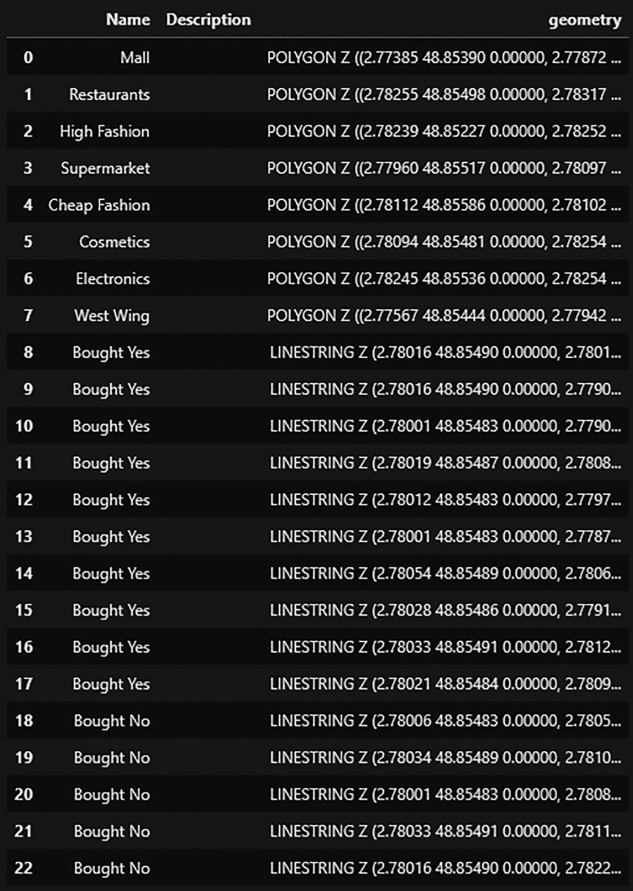

一个窗口页面包含一个有三列和 23 行的表格。上方是三个列标题，分别是名称、描述和几何图形。

图 10-1

代码块 10-1 产生的数据。图片由作者提供

这个数据集比我们在前几章中处理的数据要复杂一些，所以让我们确保充分理解我们正在处理的内容。

地理数据框的第一行包含一个名为“购物中心”的对象。这个多边形覆盖了整个购物中心区域，也就是我们研究的范围。它仅用于提供信息，在练习中我们不会用到它。

接下来的第 1 行到第 7 行的要素展示了购物中心的各个区域。它们也是多边形。每个区域可以是一个商店、一组商店、整个购物区或其他什么，但它们通常将某种类型的商店重新组合在一起。我们将能够利用这些信息来构建我们的模型。

其余的数据是 20 条路线。每条路线都表示为一个`LineString`，即一条线，它只是研究中 20 位参与者每人所经过的一系列点。每个`LineString`的名称要么是“已购买是”，表示他们在研究后使用了优惠券（表明他们对产品感兴趣），要么是“已购买否”，表示优惠券未被使用，因此客户可能对该产品不感兴趣。

现在，让我们继续绘制所有这些数据的组合图，以便更好地了解我们正在处理的内容。这可以使用代码块 10-2 来完成。

```
all_data.plot(figsize=(15,15),alpha=0.1)
代码块 10-2
绘制数据
```

执行此代码时，你将得到图 10-2 中的地图。当然，这不是最直观的地图，但这里的目的是将所有内容快速整合到一张图片中，以查看数据中发生了什么。

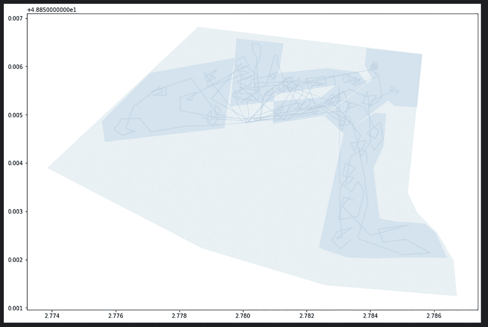

一个由图形中的线条组成的图表，每个角位于水平轴 2.774 和 2.786 之间，以及垂直轴 0.001 和 0.007 之间。

图 10-2

代码块 10-2 产生的地图

在这张地图中，最外层的浅灰色轮廓是设定整个购物中心区域的大多边形的轮廓。在此之内，你可以看到许多较小的多边形，它们指示了我们研究感兴趣的区域，每个区域内都有一组特定类型的商店。最后，你还可以看到纵横交错的线条，这代表了研究中 20 位参与者在购物中心内移动的轨迹。

我们现在要做的是利用商店区域多边形的信息来注释每位参与者的行程。如果能得出每位参与者在每种类型的商店中花费的时间百分比，那就太好了，这样我们就可以构建一个模型，学习购物中心内被访问的商店类型与新餐厅潜在兴趣之间的关系。

作为构建此模型的第一步，让我们分离数据，以获得仅包含一种数据类型的多个数据集。为此，我们需要将信息多边形与参与者的路线分开。利用你在本书前面学到的所有知识，这应该不难。代码块 10-3 中的代码展示了如何将信息多边形放入一个新数据集中。

```
info_polygons = all_data.loc[1:7,:]
info_polygons
代码块 10-3
将信息多边形选择到单独的数据集中
```

结果就是图 10-3 中显示的包含`info_polygons`的数据集。

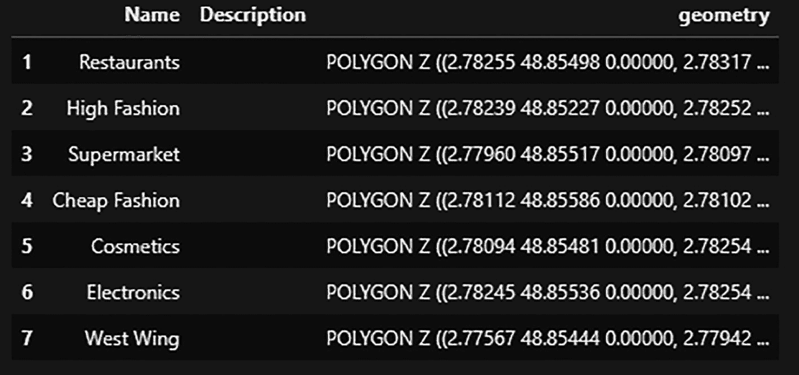

一个窗口页面包含一个有三列和七行的表格。上方是三个列标题，分别是名称、描述和几何图形。

图 10-3

代码块 10-3 产生的数据。图片由作者提供

让我们也使用代码块 10-4 中的代码提取路线。

```
itineraries = all_data.loc[8:,:]
itineraries
代码块 10-4
选择路线
```

路线数据集稍长一些，但看起来如图 10-4 所示（截断版本）。

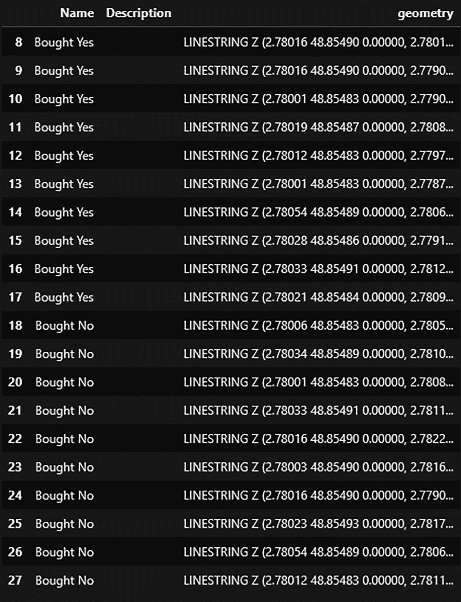

一个窗口页面包含一个有三列和 20 行的表格。上方是三个列标题，分别是名称、描述和几何图形。

图 10-4

代码块 10-4 中数据的截断版本

### 用于特征工程的空间操作

现在我们已经对这个数据集有了很好的了解，是时候开始执行空间操作，以添加参与者在每个地点出现的信息了。为此，我们需要某种空间叠加操作，正如你在本书前面部分所看到的那样。

要进行叠加部分，逐点操作会更容易，因为我们的线路会穿过许多兴趣区域。如果我们使用线路进行操作，最终将需要根据多边形的边界切割线路，并使用线路长度来估算在商店区域停留的时间。

如果我们将线路切割成点，就可以执行空间操作来查找每个点的存在情况，然后简单地统计每个参与者在每个商店区域中的点数。如果这些点是在等频率的基础上收集的，那么点的数量就是时间的精确表示。

我们可以不使用线路的原因是，我们在这里不关心方向或顺序。毕竟，如果我们想研究访问每个商店区域的顺序，就需要保留关于序列的信息。线路能够做到这一点，而点数据类型则不能。

在本节中，你将看到掌握 Python 处理地理数据用例的巨大优势。确实，Python 的一大优势在于，我们可以自由地将几何对象转换为字符串，并对它们进行循环，这在更多依赖点击按钮、预编码的 GIS 工具中可能会复杂得多。

缺点可能是有时理解起来有点困难，但代码块 10-5 中的代码将引导你使用一种方法，将数据从宽格式（每行一个客户）转换为长格式（每行一个数据点/坐标）。

```
import pandas as pd
from shapely.geometry.point import Point
results = []

# split the lines into points
for i, row in itineraries.iterrows():

# making the line string into a list of the coordinates as strings and removing redundant information
list_of_points_extracted = str(row['geometry']).strip('LINESTRING Z (').strip(')').split(',')
list_of_points_extracted = [point[:-2] for point in list_of_points_extracted]

# convert lat and long into floats
list_of_points_extracted = [Point([ float(y) for y in x.strip(' ').split(' ')]) for x in list_of_points_extracted]
list_of_points_extracted = [[i, row.Name] + [x] for x in list_of_points_extracted]
results += list_of_points_extracted
results_df = pd.DataFrame(results)
results_df.columns = ['client_id', 'target', 'point']
results_df
代码块 10-5
将数据从宽格式转换为长格式
```

这段代码的结果是长格式的数据：每行一个点，而不是每行一个参与者。部分数据显示在图 10-5 中。

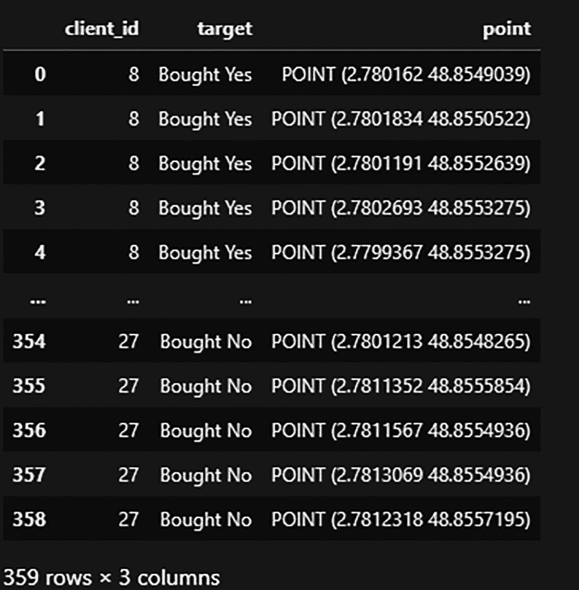

一个窗口页面包含一个三列十行的表格。上方是三个列标题，分别是 client i d、target 和 point。

图 10-5

代码块 10-5 产生的部分数据。图片由作者提供

这里的结果是一个 pandas 数据框。正如你现在所知，为了进行空间操作，最好将其转换为地理数据框。这可以使用代码块 10-6 中的代码来完成。

```
import geopandas as gpd
gdf = gpd.GeoDataFrame(results_df, geometry='point')
gdf
代码块 10-6
转换为地理数据框
```

你的对象 `gdf` 现在已具有地理参考。我们可以继续使用空间连接，将这个点数据集与商店信息数据集连接起来。这个空间连接使用代码块 10-7 中的代码执行。

```
joined_data = gpd.sjoin(gdf, info_polygons, how='left')
joined_data
代码块 10-7
将地理数据框连接到 info_polygons
```

连接后的数据将如图 10-6 所示。

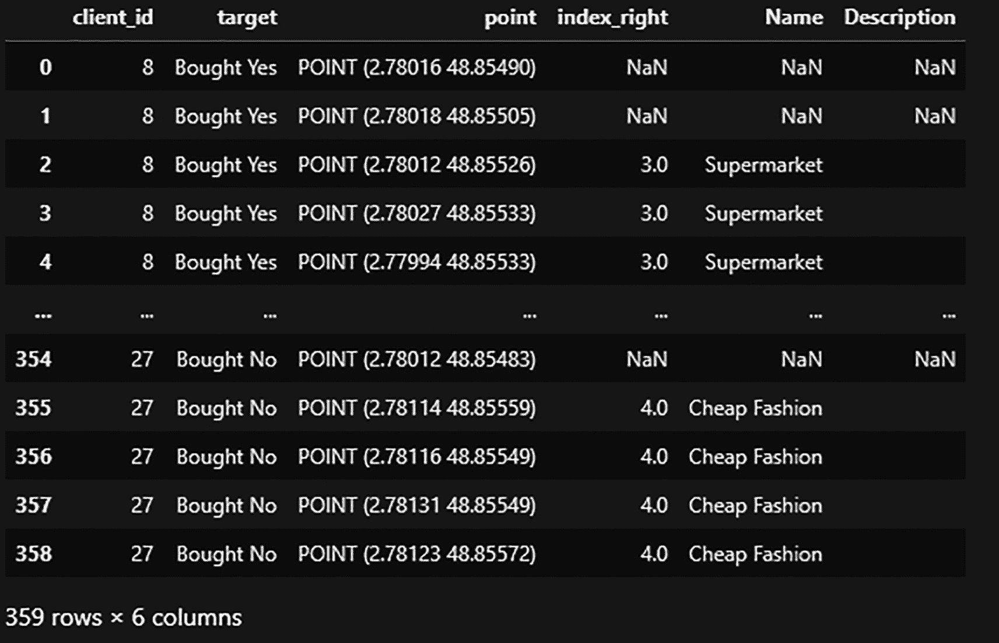

一个窗口页面包含一个六列十行的表格。上方是三个列标题，分别是 client i d、target、point、index right、name 和 description。

图 10-6

代码块 10-7 产生的数据。图片由作者提供

你可以看到，对于大多数点，操作是成功的。然而，对于许多点，似乎引入了 NA 或缺失值。这可以解释为存在一些点不与任何商店信息多边形重叠，因此没有查找信息。对此采取一些措施是好的。在决定如何处理这些 NA 之前，让我们使用代码块 10-8 中的代码来统计每个没有参考信息的客户的数量。

```

# inspect NA
joined_data['na'] = joined_data.Name.isna()
joined_data.groupby('client_id').na.sum()
代码块 10-8
检查 NA
```

结果显示在图 10-7 中。

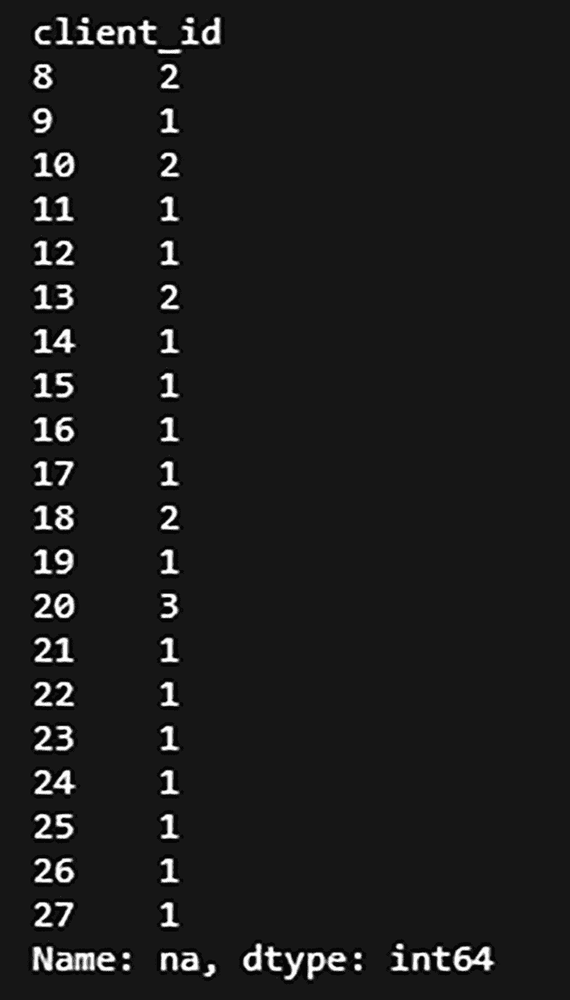

一个有两列二十行的表格，列标题为 client i d。底部有一个标签，显示 name, n a, d type, i n t 64。

图 10-7

代码块 10-8 的结果。图片由作者提供

每个参与者的未引用点数各不相同，但从未超过三个。因此，我们可以得出结论，直接丢弃没有引用的数据确实没有问题。毕竟，这样的数据非常少，而且这些数据中没有增加任何信息。

代码块 10-9 中的代码展示了如何删除具有缺失值的行数据。

```

# drop na
joined_data = joined_data.dropna()
joined_data
代码块 10-9
删除 NA
```

结果数据框稍微短了一些：从 359 行减少到 333 行，如图 10-8 所示。

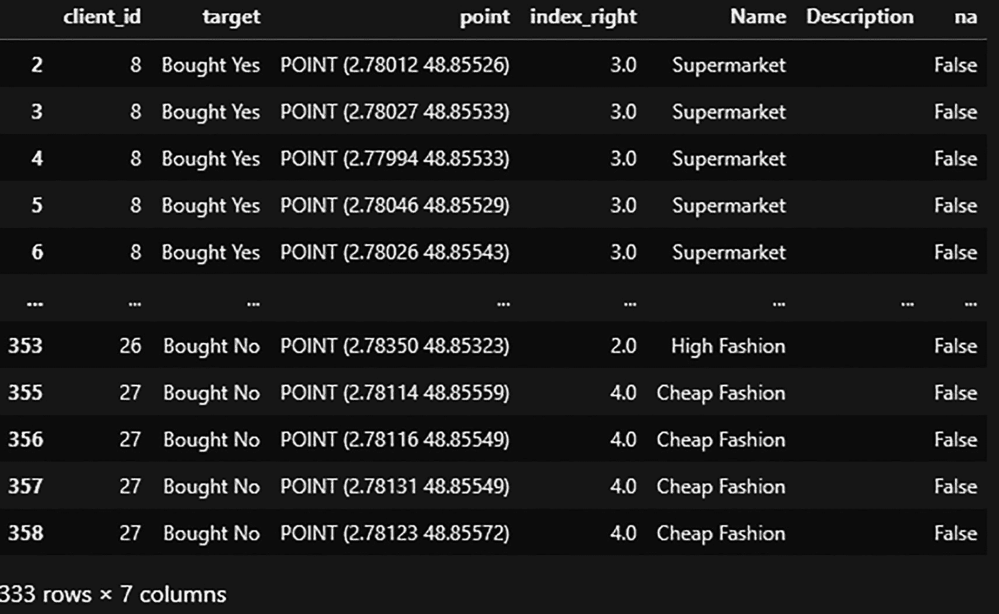

一个窗口页面包含一个六列十行的表格。上方是三个列标题，分别是 client i d、target、point、index right、name 和 description。

图 10-8

没有 NA 的数据集

我们现在有了一个包含解释性信息的数据框，这将帮助我们预测优惠券的使用情况。

### 数据重组与标准化

现在，构建分类模型所需的所有信息都已齐备，但我们仍需对数据进行正确的组织。毕竟，Python 中的模型接口需要数据以正确的格式呈现。

在本节中，我们将对空间连接后的数据框进行处理，将其恢复为宽格式，即再次得到一个每行代表一个参与者的数据框。我们不再需要坐标线串（LineString），而是希望获得每个参与者在各个类别中的出现情况。这只需通过统计每个参与者在每个商店类别中的点数即可实现。这可以通过分组操作（groupby）来完成，如代码块 10-10 所示。

```
location_behavior = joined_data.pivot_table(index='client_id', columns='Name', values='target',aggfunc='count').fillna(0)
location_behavior
代码块 10-10
用于获取位置行为的分组操作
```

此分组操作的结果如图 10-9 所示。

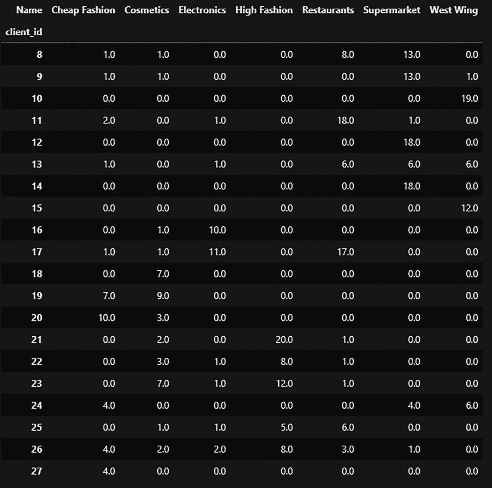

一个窗口页面包含一个具有七列和二十行的表格，这些行被称为 client i d。上方有八个列标题。

图 10-9
代码块 10-10 的结果。图片由作者提供

这些分组后的数据似乎已经是非常有用的信息，有助于了解每个客户的情况。例如，我们可以看到 client_id 为 21 的参与者在高端时尚区域花费了大量时间。另一个例子是 client_id 为 9 的参与者，他似乎只去过超市。

尽管这个数据集信息量很大，但在进入分类模型之前，仍然存在一个问题。观察电子类别时，我们可以看到 client_id 为 17 的参与者是该类别中数值最大的。然而，如果进一步查看 client_id 为 17 的参与者，我们会发现电子类别实际上并不是该参与者最大的类别。

数据中存在偏差，这是因为并非所有参与者的线串（LineString）都具有相同数量的点。为了解决这个问题，我们需要根据点的数量进行标准化，这可以使用代码块 10-11 中的代码来实现。

```

# 标准化
location_behavior = location_behavior.div( location_behavior.sum(axis=1), axis=0 )
location_behavior
代码块 10-11
标准化数据
```

标准化后的输出如图 10-10 所示。

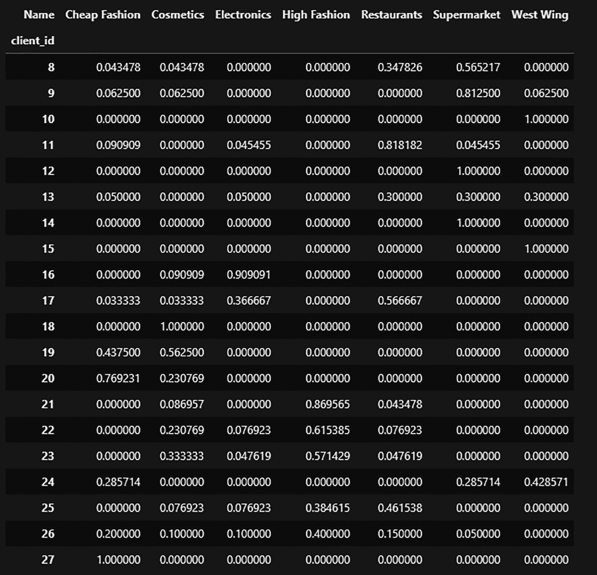

一个窗口页面包含一个具有七列和二十行的表格，这些行被称为 client i d。上方有八个列标题。

图 10-10
代码块 10-11 得到的数据。图片由作者提供

### 建模

现在，让我们保持数据的这种格式用于模型——即用于将数据输入模型。让我们脱离数据框格式，使用代码块 10-12 中的代码将数据转换为 numpy 数组。

```
X = location_behavior.values
X
代码块 10-12
转换为 numpy 数组
```

X 数组看起来如图 10-11 所示。

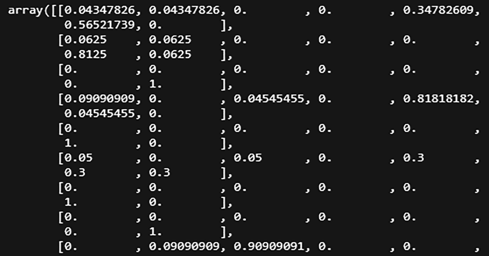

一段代码，以 array 开头，接着是九行包含开括号和闭括号的内容。

图 10-11
代码块 10-12 得到的数组。图片由作者提供

你可以用同样的方法获取目标变量（也称为 y）的数组。这在代码块 10-13 中完成。

```
y = itineraries.Name.values
y
代码块 10-13
获取 y 作为数组
```

y（即目标变量）现在如图 10-12 所示。

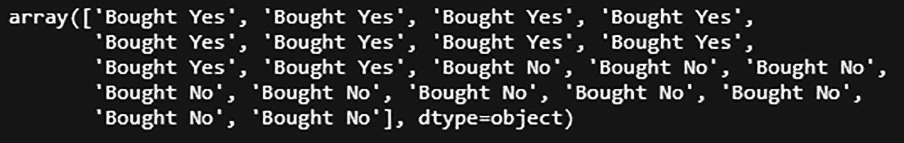

一段代码：array，左括号，左方括号，bought yes, bought yes, bought yes, bought yes, bought yes, bought yes, bought yes, bought yes, bought yes, bought yes, bought no, bought no, bought no, bought no, bought no, bought no, bought no, bought no, bought no, bought no，右方括号，d type 等于号 object，左括号。

图 10-12
y 数组。图片由作者提供

建模的下一步是构建训练-测试集划分。机器学习中的训练-测试集划分是指根据行将数据分成两部分，仅使用部分数据来构建模型。用于构建模型的部分是训练集，而未使用的部分是测试集。

测试集必须保留出来，因为机器学习模型倾向于学习使用 X 来预测 y 的关系，这些关系在模型已见过的数据上完全有效，但在任何新数据上却无效。这个过程称为对训练集的过拟合。

当在训练集上训练模型，并在训练阶段模型未见过的数据集上评估它时，我们就能确保模型评估是公平的。我们确信模型没有过拟合测试数据，因为它在拟合（训练）过程中从未被使用过。

代码块 10-14 中的代码执行了分层训练-测试集划分。分层是一种抽样形式，它强制指定变量在训练集和测试集中的分布相同。毕竟，存在所有优惠券用户都在训练集中的风险，那样测试集就完全无法评估模型在优惠券用户上的性能。分层强制训练集和测试集中优惠券用户的百分比相同，从而促进公平评估。

```

# 分层训练测试集划分
from sklearn.model_selection import train_test_split
X_train, X_test, y_train, y_test = train_test_split(X, y, test_size=0.33, random_state=42, stratify=y)
代码块 10-14
分层训练-测试集划分
```

此步骤之后，你将得到四个数据集：X_train 和 y_train 是 X 和 y 中我们将用于训练的部分，而 X_test 和 y_test 将用于评估。

我们现在拥有了开始构建模型的所有要素。我们将要构建的第一个模型是逻辑回归。由于我们没有海量数据，可以排除使用随机森林、xgboost 等复杂模型，尽管如果在这个用例中有更多数据，它们完全可以替代逻辑回归。得益于 scikit-learn 易于使用的建模接口，替换一个模型为另一个模型非常容易，正如你将在本示例的剩余部分看到的那样。

代码块 10-15 中的代码首先初始化了一个逻辑回归模型，然后使用训练数据拟合该模型。

```

# logistic regression
from sklearn.linear_model import LogisticRegression
my_lr = LogisticRegression()
my_lr.fit(X_train, y_train)
代码块 10-15
逻辑回归
```

对象 my_lr 现在是一个已拟合的逻辑回归模型，这基本上意味着其系数已基于训练数据估算出来，并存储在该对象内部。现在，我们可以使用 my_lr 对象对任何包含与 X_train 中相同数据的外部数据进行预测。

幸运的是，我们预留了 X_test，以便轻松进行模型评估。第一步是使用代码块 10-16 中的代码进行预测。

```
preds = my_lr.predict(X_test)
preds
代码块 10-16
预测
```

该数组包含对 X_test 中每一行的预测结果，如图 10-13 所示。

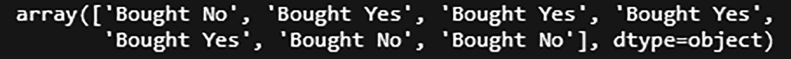

一段代码：array, open parenthesis, open bracket, bought no, bought yes, bought yes, bought yes, bought yes, bought no, bought no, close bracket, d type equal sign object, open parenthesis。

图 10-13

预测结果。图片来源：作者

我们同样拥有这些参与者的真实结果。毕竟，他们并非真正的新参与者，而是我们已知其是否使用了优惠券的参与者子集，我们特意将其预留用于评估。我们可以使用代码块 10-17 中的代码，将预测结果与真实结果进行比较。

```

# indeed one error for the log reg
pd.DataFrame({'real': y_test, 'pred': preds})
代码块 10-17
将错误与真实结果转换为数据框
```

生成的比较数据框如图 10-14 所示。

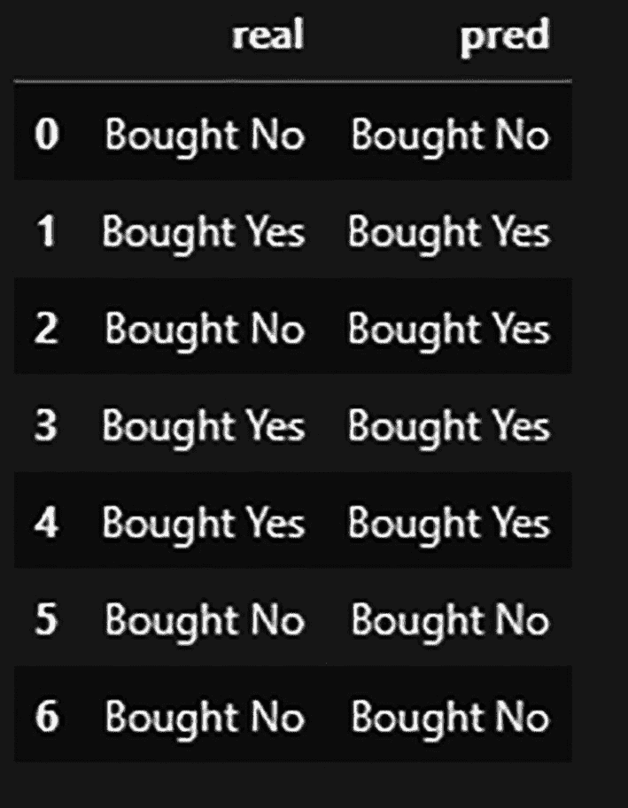

一个窗口框包含一个表格，该表格有两列五行。列标题为 real 和 pred。行标签为 0、1、2、3 和 4。

图 10-14

用于错误分析的数据框。图片来源：作者

本例中的测试集相当小，我们可以手动得出结论：该模型的预测效果实际上相当不错。在数据量更大的用例中，最好使用其他方法来总结这种性能。分析分类模型的一个绝佳工具是混淆矩阵。它在一张图中展示了所有正确预测的数据，同时也展示了错误预测的数据，以及每种错误发生的次数。代码块 10-18 中的代码展示了如何为此用例创建这样一个混淆矩阵。

```
from sklearn.metrics import confusion_matrix, ConfusionMatrixDisplay
conf_mat = confusion_matrix(y_test, preds, normalize=None)
conf_mat_plot = ConfusionMatrixDisplay(conf_mat, display_labels = set(y_test))
conf_mat_plot.plot()
代码块 10-18
分析预测错误
```

生成的图表如图 10-15 所示。

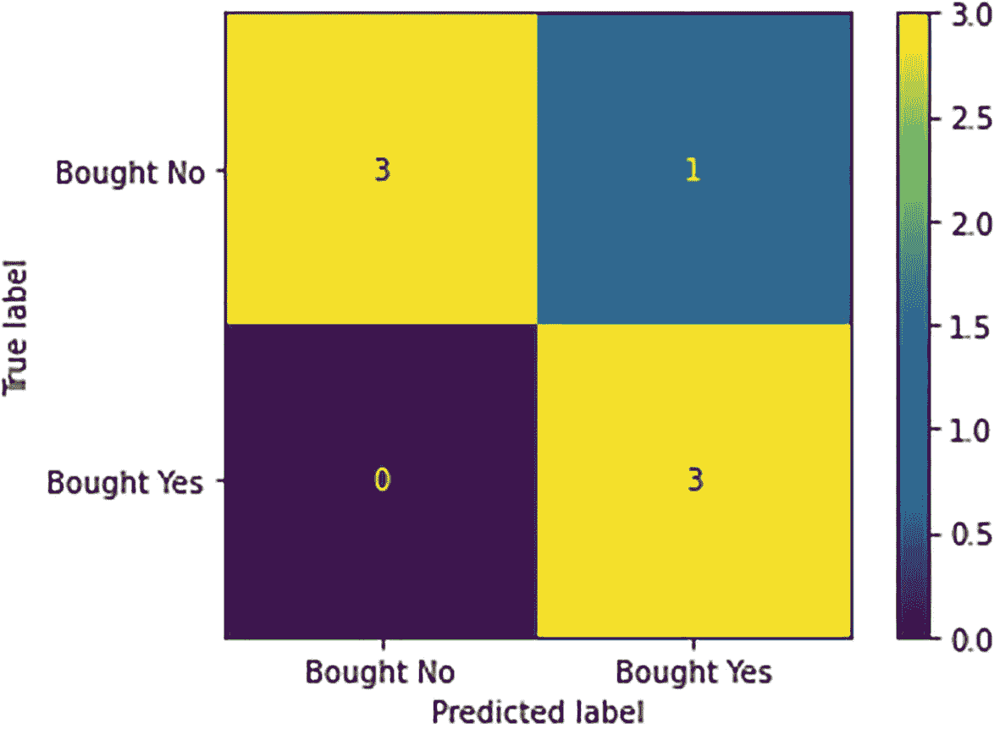

一个图表由预测标签和真实标签的方形图组成，分为四个区域，分别为 2、2、0 和 3。右侧是一个刻度，数值从 0 到 3，增量为 0.5。

图 10-15

代码块 10-18 生成的图表。图片来源：作者

在此图中，您可以看到大多数预测都是正确的，只出现了一个错误。这个错误是一位实际上没有购买的参与者，而模型预测他使用了优惠券进行了购买。

### 模型基准测试

该模型只犯了一个错误，因此我们可以得出结论，它是一个相当不错的模型。然而，为了完整性，尝试另一个模型会更好。您可以随意测试 scikit-learn 中的任何分类模型，但由于数据量相对较小，我们在此尝试使用决策树模型。代码块 10-19 中的代码执行了与之前完全相同的步骤，只是换了一个不同的模型。

```
from sklearn.tree import DecisionTreeClassifier
my_dt = DecisionTreeClassifier()
my_dt.fit(X_train, y_train)
preds = my_dt.predict(X_test)
pd.DataFrame({'real': y_test, 'pred': preds})
代码块 10-19
模型基准测试
```

生成的评估数据框如图 10-16 所示。

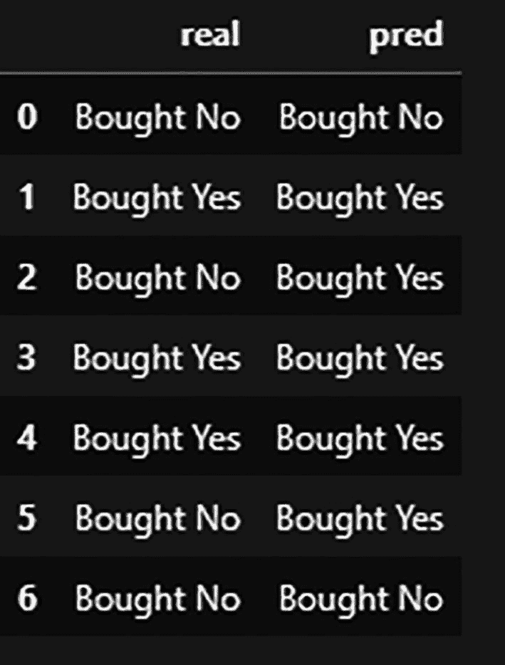

一个窗口框包含一个表格，该表格有两列五行。列标题为 real 和 pred。行标签为 0、1、2、3 和 4。

图 10-16

代码块 10-19 生成的数据框。图片来源：作者

同样，由于数据集规模较小，很容易解读并得出结论：该模型更差，因为它犯了两个错误，而逻辑回归只犯了一个错误。为了保持连贯性，我们也用混淆矩阵分析来收尾。这在代码块 10-20 中完成。

```
conf_mat = confusion_matrix(y_test, preds, normalize=None)
conf_mat_plot = ConfusionMatrixDisplay(conf_mat, display_labels = set(y_test))
conf_mat_plot.plot()
代码块 10-20
绘制混淆矩阵
```

结果如图 10-17 所示，确实显示了两个错误。

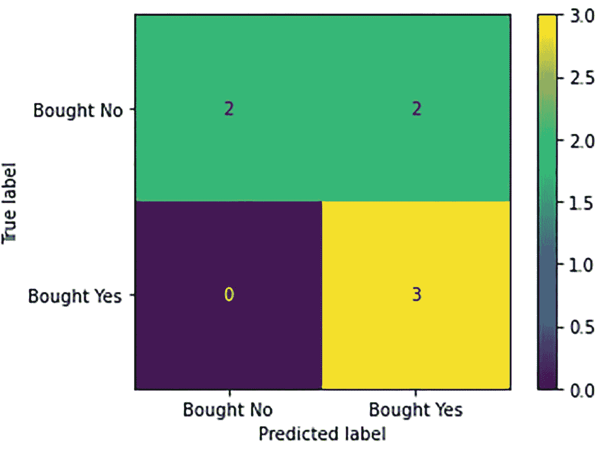

一个图表由预测标签和真实标签的方形图组成，分为四个区域，分别为 2、2、0 和 3。右侧是一个刻度，数值从 0 到 3，增量为 0.5。

图 10-17

决策树模型的结果

有两个错误，都是实际未购买的参与者。似乎未购买的人群比购买的人群更难检测，尽管需要更多证据来进一步研究这一点。

## 要点总结

1.  分类是监督式机器学习的一个领域，涉及学习如何使用自变量预测分类目标变量的模型。

2.  特征工程与空间操作相结合，可用于将空间数据转换为机器学习格式。最终得到对当前分类任务有用的变量定义至关重要。

3.  训练-测试集划分对于模型评估是必要的，因为模型往往会在训练数据上过拟合。

4.  混淆矩阵是评估分类模型性能的绝佳工具。

5.  模型基准测试是指在同一任务上使用多个不同的机器学习模型，以便找到性能最佳的模型并保留用于未来。

