# 11. 回归分析

在前两章中，你已经学习了使用空间数据进行机器学习用例的基础知识。你首先了解了多种插值方法。插值作为机器学习的入门介绍，其定义了一种基于理论的插值函数，用于填充目标变量的未知值。

下一步是从这种无监督方法转向有监督方法，即构建模型来预测我们拥有真实值的变量。通过应用训练-测试分割，这些真实值随后被用于计算性能指标。

前一章展示了如何使用监督模型进行分类。与插值不同，在分类模型中，目标变量是一个分类变量。所展示的示例使用了二元目标变量，将人群分为两类：购买者和非购买者。

在本章中，你将学习如何为数值型目标变量构建监督模型。这被称为回归分析。尽管回归分析与插值一样，都用于估计数值型目标，但其方法实际上通常更接近于监督分类方法。

在回归分析中，使用指标并构建在该指标上表现最佳的模型至关重要，这与分类分析中的情况相同。模型需要适应数值型目标变量，并且需要选择不同的指标来考虑目标变量是数值型这一事实。

本章将首先介绍回归模型是什么以及我们可以用它做什么。本章的其余部分将深入分析一个使用空间数据的回归模型，期间将介绍众多理论概念。

## 回归分析简介

尽管本书的目标并非深入介绍机器学习的数学内容，但我们还是先探讨一下回归模型背后的一般概念。请记住，有许多资源可以补充这些理论知识，而本书的目标是介绍如何将回归模型与空间数据分析和建模相结合。

让我们从考虑回归建模中最简单的情况之一开始本节：简单线性回归。在简单线性回归中，我们有一个数值型目标变量（y 变量）和一个数值型预测变量（X 变量）。

在这个例子中，我们考虑一个数据集，我们希望根据一个人一周内的锻炼小时数来预测其每周的体重减轻量。我们预期两者之间存在正相关关系。图 11-1 显示了每周体重减轻量与每周锻炼小时数的关系图。

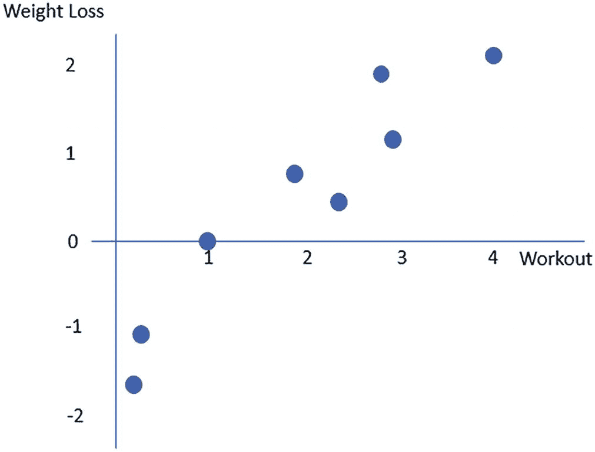

散点图展示了体重减轻量与每周锻炼小时数的结果数据。有两个值位于负值区域，而另外五个值（除了横轴上的一个点外）分散在东部区域。纵轴从+2 到-2，间隔为 1；横轴从 1 到 4，间隔为 1。

图 11-1

示例数据图。作者自绘

该图显示了锻炼与体重减轻之间明显的正相关关系。我们可以找到穿过这些点的直线的数学定义，然后使用这个数学公式作为模型，根据锻炼小时数来估计每周的体重减轻量。这可以在图 11-2 中直观地展示。

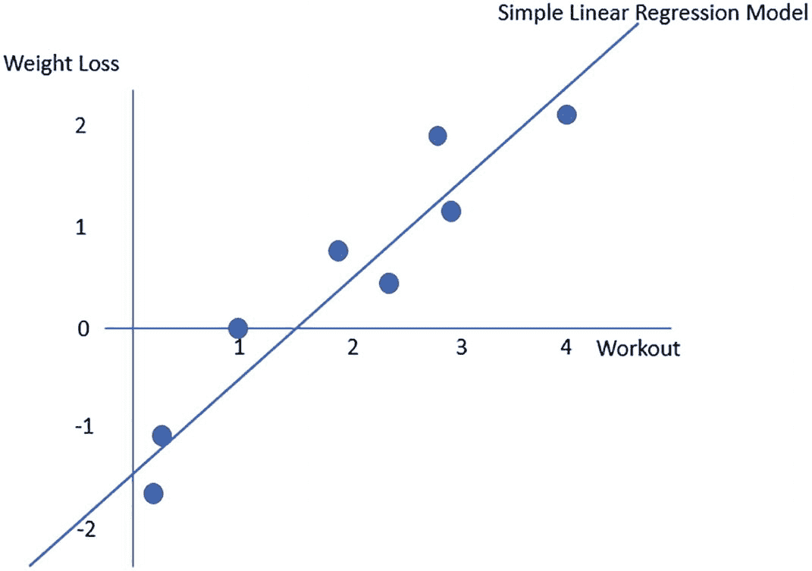

散点图展示了一条标记为“简单线性回归模型”的直线对角线，位于体重减轻量与每周锻炼小时数的结果数据上。显示了正相关性。纵轴从+2 到-2，间隔为 1；横轴从 1 到 4，间隔为 1。

图 11-2

添加到图中的简单线性回归线。作者自绘

这个线性回归模型的数学形式如下：

*y = a * x + b*

对于这个例子，它将转化为：

*Weight_Loss = a * Workout + b*

存在确定 a 和 b 最佳拟合值的数学方法，并可用于估计此模型。其背后的精确数学原理将留给读者进一步阅读，以免超出本书的范围。然而，理解估计此类模型的一般概念非常重要。

考虑接下来可能采取的步骤也很重要，所以让我们花些时间来思考这些步骤。首先，当前模型只使用了一个解释变量（锻炼），这并不能真正代表一个人减肥的实际过程。

实际上，人们可能会认为食物摄入量也是减肥的一个非常重要的因素。这就需要扩展数学公式，变成如下形式：

*Weight_Loss = a * Workout + b * CaloriesEaten + c*

在这种情况下，线性回归背后的数学原理需要为三个系数 a、b 和 c 找到最佳值。这个过程可以通过添加更多变量和更多系数来继续。

到目前为止，我们首先讨论了简单线性回归，然后是更一般的线性回归。尽管线性回归通常非常适合拟合回归模型，但还有许多其他数学和算法函数可以使用。

其他模型的例子包括决策树、随机森林和提升模型。在底层，每个模型都有其自己的基本模型定义，数据可用于拟合该模型（相当于线性模型中估计系数的替代方案）。对于那些希望深入了解这些模型确切工作原理的读者，有许多参考文献可供参考。

现在，让我们通过一个使用空间数据的回归用例，转向更偏应用的角度。

## 空间回归用例

本章的剩余部分将引导你完成一个监督机器学习用例的多次迭代。在实践中，构建机器学习模型通常需要多个步骤和多次迭代。本章分为多个部分，以尽可能贴近实际情况。

该模型的目标是估计阿姆斯特丹市中心一处 Airbnb 房源应收取的价格。想象一下，你住在阿姆斯特丹，想以最优价格在 Airbnb 上出租你的公寓，并且你已经收集了一些数据来研究如何定价。

此用例的目标变量是价格，我们将使用许多变量作为预测变量。首先，有关于公寓允许入住的最大客人数的数据。其次，收集了数据以记录房价是否包含早餐。让我们从导入和准备数据开始。

### 导入与准备数据

在本节中，我们将导入并准备数据。数据集中包含两个文件：

*   一个 KML 文件中的地理数据
*   一个包含每套公寓价格和预测变量的 Excel 文件

你可以像本书前几章所介绍的那样，使用 `geopandas` 和 `Fiona` 导入地理数据集。具体操作如代码块 11-1 所示。

```
import geopandas as gpd
import fiona
gpd.io.file.fiona.drvsupport.supported_drivers['KML'] = 'rw'
geodata = gpd.read_file('chapter 11 data.kml')
geodata.head()
代码块 11-1
导入数据
```

导入后的地理数据如图 11-3 所示。

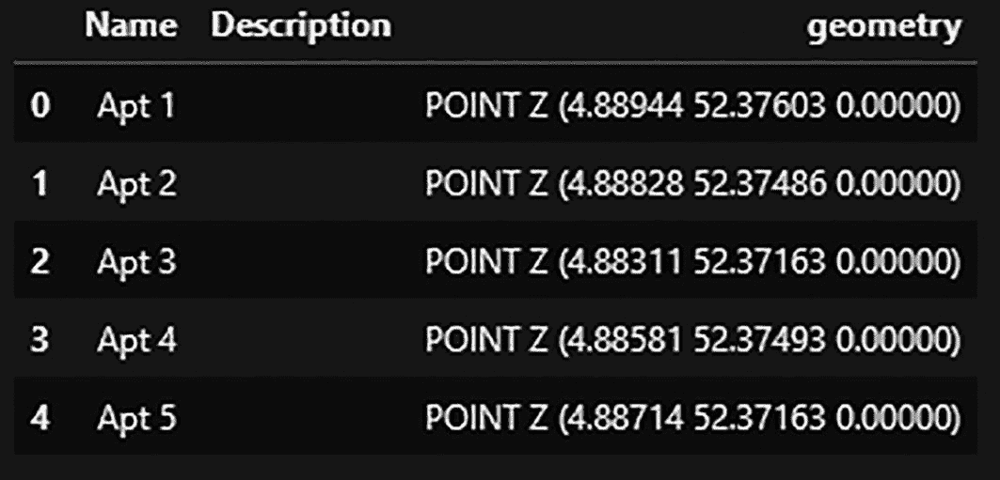

一张包含四列五行表格的图片。最左列标记为 0 到 4。Name 列包含 Apt 1 到 5 的条目。Description 列无条目。geometry 列包含不同的 POINT Z 值。

图 11-3

代码块 11-1 生成的数据。图片由作者提供

如你所见，该数据集仅包含两个变量：

*   Name 包含每个点的标识符。
*   Point 包含每套公寓的坐标。

其他变量位于 Excel 文件中，你可以使用代码块 11-2 中的代码导入该文件。

```
import pandas as pd
apartment_data = pd.read_excel('house_data.xlsx')
apartment_data.head()
代码块 11-2
导入房屋数据
```

第二个数据集如图 11-4 所示。

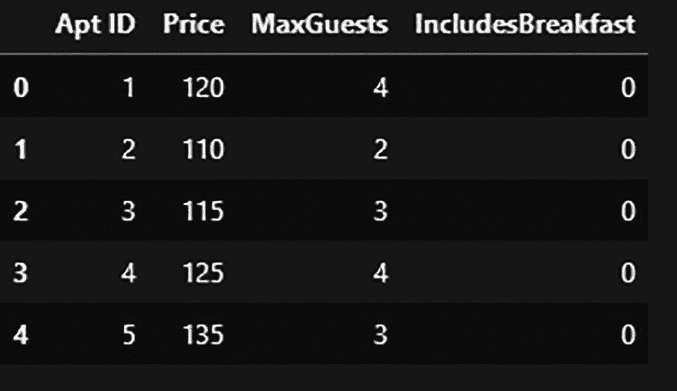

一张包含五列五行表格的图片。最左列标记为 0 到 4。Apt ID 列包含标记为 1 到 5 的条目。Price 列包含 120、110、115、125 和 135 的条目。Max Guests 列包含 4、2、3、4 和 3 的条目。Includes Breakfast 列包含 0、0、0、0 和 0 的条目。

图 11-4

房屋数据。图片由作者提供

从这张图片可以看出，数据包含以下变量：

*   Apt ID：每套公寓的标识符
*   Price：每套公寓在 Airbnb 上的价格
*   MaxGuest：公寓允许入住的最大客人数
*   IncludesBreakfast：如果包含早餐则为 1，否则为 0

Apt ID 的格式与地理数据中的标识符格式不同。需要转换这些值以使它们对应起来。这将使我们能够在后续步骤中将两个数据集合并在一起。具体操作使用代码块 11-3 中的代码完成。

```
apartment_data['Apt ID'] = apartment_data['Apt ID'].apply(lambda x: 'Apt ' + str(x))
apartment_data.head()
代码块 11-3
转换公寓 ID
```

此操作之后，数据集现在如图 11-5 所示。

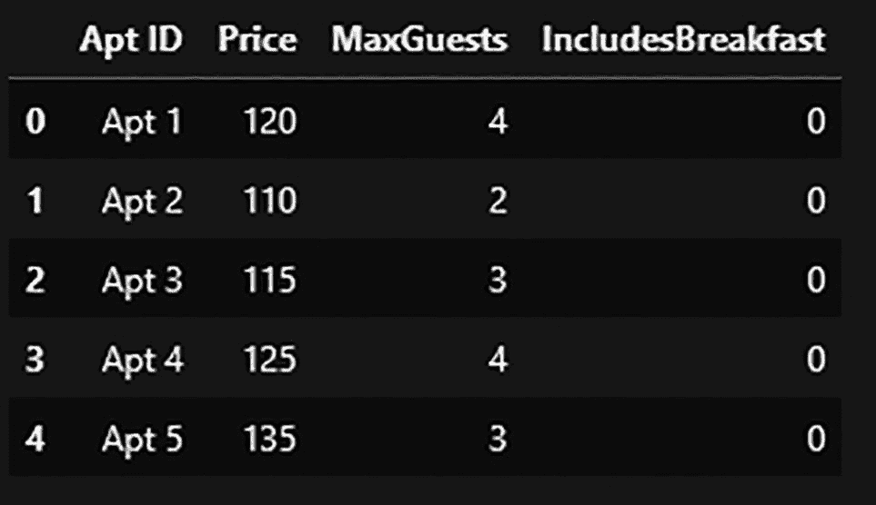

一张包含五列五行表格的图片。最左列标记为 0 到 4。Apt ID 列包含标记为 Apt 1 到 5 的条目。Price 列包含 120、110、115、125 和 135 的条目。Max Guests 列包含 4、2、3、4 和 5 的条目。Includes Breakfast 列包含 0、0、0、0 和 0 的条目。

图 11-5

代码块 11-3 生成的数据。图片由作者提供

现在两个数据集有了对应的标识符，是时候开始合并操作了。这次合并会将所有列整合到同一个数据集中，这将使数据处理更加方便。合并操作使用代码块 11-4 中的代码完成。

```
merged_data = geodata.merge(apartment_data, left_on='Name', right_on='Apt ID')
merged_data.head()
代码块 11-4
合并两个数据集
```

你可以在图 11-6 中看到生成的 DataFrame。

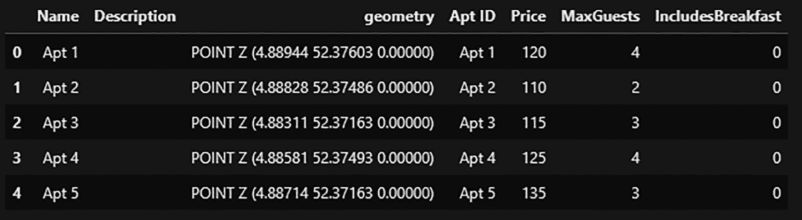

一张包含八列五行表格的图片。最左列 0 到 4。Name 列包含 Apt 1 到 5。Description 列无条目。geometry 列包含不同的 POINT Z 值。Apt ID 列包含 Apt 1 到 5。Price 列包含 120、110、115、125 和 135。Max Guests 列包含 4、2、3、4 和 3。Includes Breakfast 列包含 0、0、0、0 和 0。

图 11-6

合并后的数据。图片由作者提供

现在，所有列都位于同一个 DataFrame 中。数据准备阶段到此结束。作为最后一步，让我们对阿姆斯特丹市内的公寓位置进行可视化，以便更好地了解数据。具体操作使用代码块 11-5 中的代码完成。

```
import contextily as cx

# 绘制所有数据
ax = merged_data.plot(figsize=(15,15), edgecolor='black', facecolor='none')

# 添加 contextily 底图
cx.add_basemap(ax, crs=merged_data.crs)
代码块 11-5
公寓地图
```

生成的地图如图 11-7 所示。

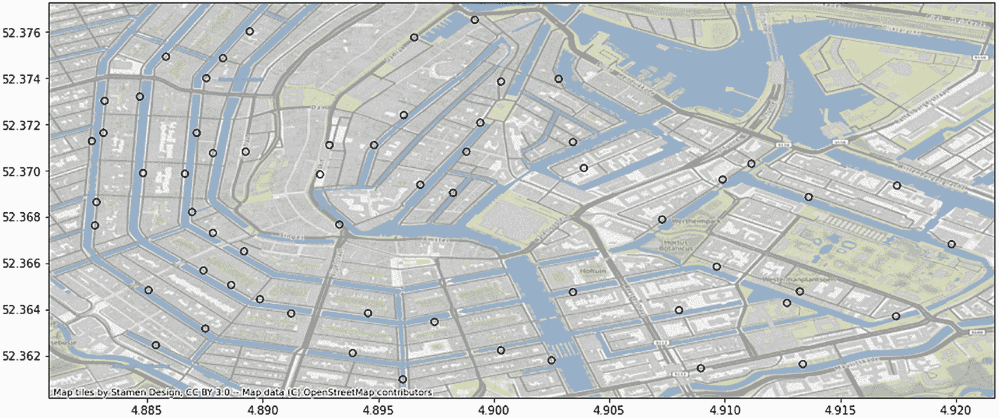

荷兰阿姆斯特丹的地图，图上用圆形标记标出了该市 60 套不同公寓的位置。纵轴数值从 52.362 到 52.376，间隔为 0.002；横轴数值从 4.885 到 4.920，间隔为 0.005。西北部区域有大量公寓聚集。

图 11-7

代码块 11-5 生成的地图。图片由作者使用 contextily 源数据和图像绘制，来源如图中所示

你可以看到，本研究中使用的公寓在阿姆斯特丹市中心分布得相当均匀。在下一节中，我们将对数据集进行更深入的探索。

### 数据探索的第一次迭代

在数据探索的第一次迭代中，让我们看看如何将非地理数据用于回归模型。这将产生一种与本章前面理论部分给出的示例类似的方法。

为了开始探索，让我们绘制公寓价格直方图。可以使用代码块 11-6 中的代码创建直方图。

```
import matplotlib.pyplot as plt
plt.hist(merged_data['Price'])
代码块 11-6
创建直方图
```

该直方图的结果如图 11-8 所示。

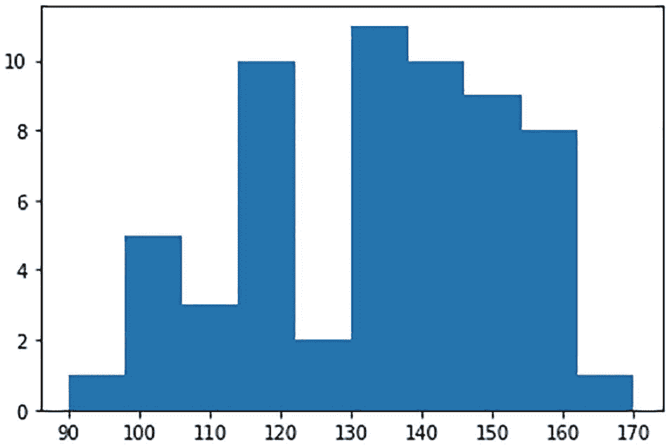

公寓租金价格的直方图。纵轴从 0 到 10，间隔为 2；横轴从 90 到 170，间隔为 10。价格走势呈现反复的急剧上升和下降，在横轴约 130、纵轴超过 10 处达到峰值，随后逐渐下降，在横轴约 170、纵轴低于 2 处回落。

图 11-8

价格直方图。图片由作者提供

该直方图显示，所有价格都在 90 到 170 之间，其中大部分集中在 130 附近。数据似乎并不完全符合正态分布，尽管我们确实看到靠近中心的数据点比远离中心的数据点更多。

如果我们需要对 Airbnb 的最合适价格进行一个非常粗略的估计，我们可以简单地使用阿姆斯特丹市中心 Airbnb 的平均价格。代码块 11-7 中的代码计算了这个平均值。

```

# 如果我们没有任何信息进行细分，最好的猜测就是预测平均值
merged_data['Price'].mean()
代码块 11-7
计算平均值
```

结果是 133.75，这表明如果我们没有更精确的信息，设定这个价格可能是一个大致可用的估计。当然，由于价格范围从 90 到 170，我们可能会面临以下两种情况：

*   因定价过低而亏损：如果我们的 Airbnb 实际价值为 170，而我们选择定价 133.75，那么每晚都会损失差价（170 – 133.75）。
*   因定价过高而亏损：如果我们的 Airbnb 实际价值为 90，而我们选择定价 133.75，那么很可能很难找到房客，预订数量也会非常低。

显然，更好地理解影响 Airbnb 价格的因素，以便为我们的公寓找到最佳价格，将非常有价值。

作为下一步，让我们找出房客数量如何影响 Airbnb 价格。代码块 11-8 中的代码创建了价格与最大房客数的散点图，以直观检查这些变量之间的关系。

```

# 然而，我们可以使用额外信息使这个估计更贴合实际
plt.scatter(merged_data['MaxGuests'], merged_data['Price'])
代码块 11-8
创建散点图
```

虽然趋势不如本章开头理论示例中观察到的那么清晰，但我们可以清楚地看到，x 轴（最大房客数）上的较高值通常对应 y 轴（价格）上的较高值。图 11-9 展示了这一点。

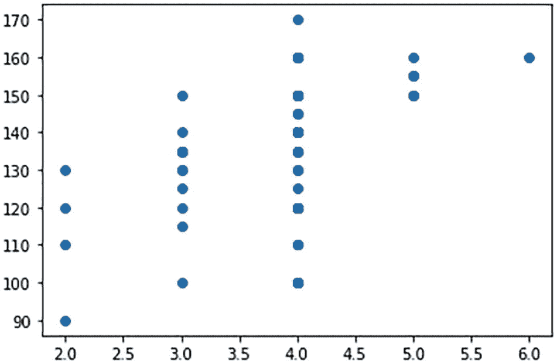

散点图展示了价格与最大房客数的数据关系。数值以垂直方式呈现。横轴约 4.0 处的数据集在中间区域显示出最高且最多的数值。纵轴数值从 90 到 170，间隔为 10；横轴数值从 2.0 到 6.0，间隔为 0.5。

图 11-9

价格与最大房客数的散点图。图片由作者提供

线性关系的质量也可以通过更量化的方法来衡量。皮尔逊相关系数是一个介于 –1 和 1 之间的分数，用于指示这种关系。值为 0 表示无相关性，接近 –1 的值表示两者之间存在负相关，接近 1 的值表示变量之间存在正相关。

可以使用代码块 11-9 中的代码计算相关系数。

```
import numpy as np
np.corrcoef(merged_data['MaxGuests'], merged_data['Price'])
代码块 11-9
计算相关系数
```

这将给出如图 11-10 所示的相关系数矩阵。

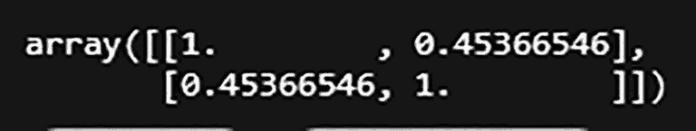

相关系数的图像。内容为：array( [[1.        , 0.45366546], [0.45366546, 1.        ]] )

图 11-10

相关系数。图片由作者提供

最大房客数与价格之间的相关系数为 0.453。这是一个相当强的正相关，表明房客数量对我们 Airbnb 的定价有很强的正向影响。简而言之，容纳更多人的 Airbnb 应该要价更高，而容纳人数少的 Airbnb 则应定价更低。

作为下一步，让我们看看是否也可以使用“包含早餐”变量来设定 Airbnb 的价格。由于早餐变量是分类变量（是或否），最好使用不同的技术来研究这种关系。代码块 11-10 中的代码创建了一个箱线图来回答这个问题。

```
import seaborn as sns
sns.boxplot(x='IncludesBreakfast',y='Price',data=merged_data)
代码块 11-10
创建箱线图
```

生成的箱线图如图 11-11 所示。

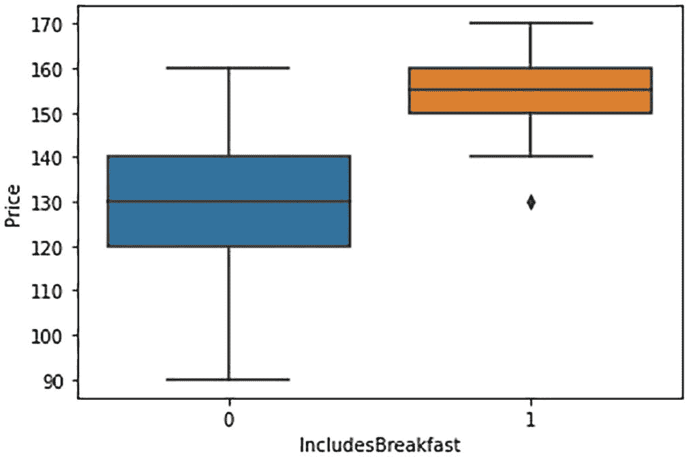

一个带须线的垂直箱线图展示了价格与包含早餐的关系。箱线图中使用了值 0 和 1。后者存在一个异常值。前者的中位数约为 130，须线范围为 160 到 90，四分位距为 140 到 120。后者的中位数和四分位距约为 160 到 150，须线范围为 170 到 140。

图 11-11

生成的箱线图。图片由作者提供

该箱线图显示，提供早餐的 Airbnb 通常能够比不提供早餐的 Airbnb 要价更高。根据你是否提供早餐，你应该相应地为你的公寓定价。

### 模型的第一次迭代

上一节的见解对于公寓业主来说已经是非常有用的要素。然而，它们仍然是更通用的建议，而不是我们需要设定的精确数值价格估计。在本节中，我们将构建机器学习模型的第一个版本，以便根据早餐和最大房客数这两个变量精确设定价格。首先，让我们将 X 和 y 设置为建模变量。这在代码块 11-11 中完成。

```
X = merged_data[['IncludesBreakfast', 'MaxGuests']]
y = merged_data['Price']
代码块 11-11
创建 X 和 y 对象
```

在此建模阶段，我们将使用线性模型。可以使用代码块 11-12 中的代码来估计 scikit-learn 实现的线性模型。

```

# 第一个版本，让我们快速做一个粗略的非地理模型
from sklearn.linear_model import LinearRegression
lin_reg_1 = LinearRegression()
lin_reg_1.fit(X, y)
代码块 11-12
线性回归
```

现在模型已经拟合完毕，我们的线性回归对象内部就有了数学定义（包含估计的系数）。

#### 迭代 1 模型的解读

要解读该模型学到了什么，我们可以检查其系数。代码块 11-13 中的代码展示了如何查看模型估算出的系数。

```
print('当不含早餐且最大客人为 0 时，价格估算为：', lin_reg_1.intercept_)
print('增加早餐使价格增加：', lin_reg_1.coef_[0])
print('每增加一位最大客人使价格增加：', lin_reg_1.coef_[1])
代码块 11-13
打印线性模型的解读
```

这段代码会输出以下结果：

*   当不含早餐且最大客人为 0 时，价格估算为：103.1365444728616

*   增加早餐使价格增加：16.615515771525995

*   每增加一位最大客人使价格增加：7.254546746234728

这些系数为我们上一节获得的洞察提供了精确的数学估算。尽管这些数字看起来非常精确，但这并不意味着它们就是正确的。定义一个指标并衡量该模型是否有效至关重要。

接下来，我们将计算 R²分数。这是一种回归指标，其值通常介于 0（模型毫无价值）和 1（完美模型）之间。有时该值可能低于 0，表明模型完全没有价值。

R²分数可以在所有数据上计算，但这并非评估模型性能的首选方式。机器学习模型往往能在训练（拟合）时见过的数据上学习得很好，但不一定能很好地泛化。对此的解决方案是将数据拆分为训练集（用于训练/估算的观测数据）和用于模型评估的测试集。

代码块 11-14 中的代码将初始数据拆分为训练集和测试集。

```

# 通过训练测试拆分来更好地评估此模型
from sklearn.model_selection import train_test_split
X_train, X_test, y_train, y_test = train_test_split(X, y, test_size=0.33, random_state=42)
代码块 11-14
将数据拆分为训练集和测试集
```

现在让我们再次拟合模型，但这次仅使用训练数据。这在代码块 11-15 中完成。

```
lin_reg_2 = LinearRegression()
lin_reg_2.fit(X_train, y_train)
代码块 11-15
在训练数据上拟合模型
```

为了评估性能，我们使用估算出的模型（本例中为系数和线性模型公式）来预测测试集上的价格估算值。这在代码块 11-16 中完成。

```
pred_reg_2 = lin_reg_2.predict(X_test)
代码块 11-16
在测试集上进行预测
```

我们可以将这些预测值与测试集中已知的真实价格一起使用，来计算 R²分数。这在代码块 11-17 中完成。

```
from sklearn.metrics import r2_score
r2_score(y_test, pred_reg_2)
代码块 11-17
计算 R²分数
```

得到的 R²分数为 0.1007。虽然结果不算出色，但该分数表明模型具有一定的预测价值，并且比使用均值定价能提供更好的细分。

### 数据探索的迭代 2

在第二次迭代中，我们将把地理数据加入到探索和模型中。毕竟，在预订 Airbnb 时位置很重要，这很可能体现在价格上。让我们首先更详细地查看数据集中的这些特征。代码块 11-18 中的代码通过从几何列中提取数据，专门创建了纬度和经度变量。

```

# 添加地理数据并查看是否能改善情况
merged_data['long'] = merged_data['geometry'].apply(lambda x: x.x)
merged_data['lat'] = merged_data['geometry'].apply(lambda x: x.y)
merged_data.head()
代码块 11-18
添加地理数据
```

生成的数据框如图 11-12 所示。

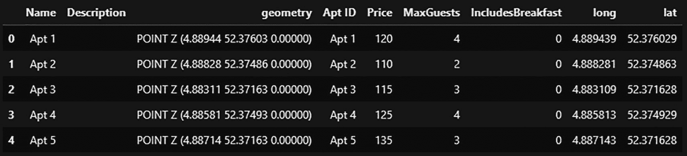

一张包含十列五行数据的表格图像。除第一列外，各列标签分别为：名称、描述、几何信息、A p t I D、价格、最大客人、是否含早餐、经度、纬度。描述列没有条目。

图 11-12

代码块 11-18 生成的数据集。作者提供图片

让我们通过绘制价格与纬度、价格与经度的散点图，来看看纬度和经度与价格的关系。第一个散点图在代码块 11-19 中创建。

```
plt.scatter(merged_data['lat'], merged_data['Price'])
代码块 11-19
创建散点图
```

生成的散点图如图 11-13 所示。

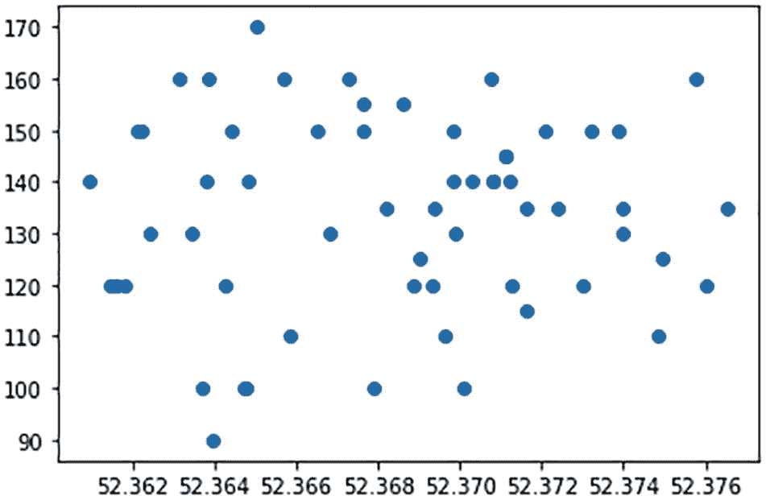

一张散点图展示了价格与纬度的关系数据。纵轴数值从 90 到 170，间隔为 10；横轴数值从 52.362 到 52.376，间隔为 0.002。数据点散布在整个区域。

图 11-13

代码块 11-19 生成的散点图。作者提供图片

这张散点图中似乎没有太明显的趋势。价格似乎在 90 到 170 之间波动，并且对于任何其他纬度来说，情况也并无不同。让我们使用代码块 11-20 中的代码来检查经度是否也是如此。

```
plt.scatter(merged_data['long'], merged_data['Price'])
代码块 11-20
使用经度创建散点图
```

生成的散点图如图 11-14 所示。

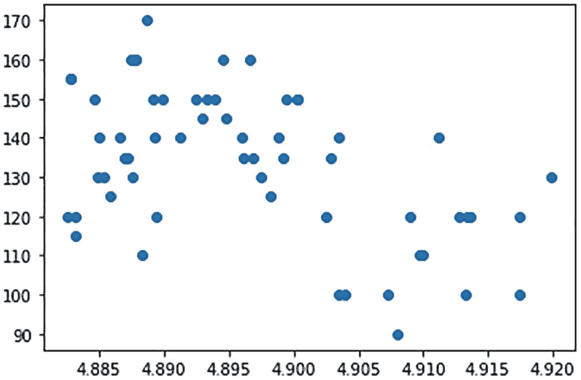

一张散点图展示了价格与经度的关系数据。纵轴数值从 90 到 170，间隔为 10；横轴数值从 4.885 到 4.920，间隔为 0.005。该图显示，在较高经度区域数据点更集中，且西部区域价格较低。

图 11-14

价格与经度的散点图。作者提供图片

有趣的是，价格与经度之间的关系要强得多。看起来，较高的经度通常比较低的经度价格更低。

这两张散点图并没有真正捕捉到位置信息。毕竟，我们很容易想象，与纬度和经度的关系不一定是线性的。期望“越往东走，价格越低”是一条永远成立的规则，这很奇怪。更有可能的是，在整个区域内存在特定的高价值区和低价值区。在下面的代码中，我们创建了一个可视化图表，同时根据纬度和经度来绘制价格。

创建此可视化的第一步是将价格转换为可用于设置公寓点大小的变量。这需要将我们的数据缩放到更适合绘图的范围内，例如，将最便宜的公寓设置为点大小 16，最贵的设置为点大小 512。这在代码块 11-21 中完成。

```
from sklearn.preprocessing import MinMaxScaler
scaler = MinMaxScaler(feature_range=(16, 512))
merged_data[['MarkerSize']] = scaler.fit_transform(merged_data[['Price']])
代码块 11-21
应用 MinMaxScaler
```

现在，我们可以在创建散点图时使用此大小设置。这在代码块 11-22 中完成。

```
plt.scatter(merged_data['long'], merged_data['lat'], s=merged_data['MarkerSize'], c='none', edgecolors='black')
代码块 11-22
创建带有标记大小的地图
```

生成的可视化结果如图 11-15 所示。

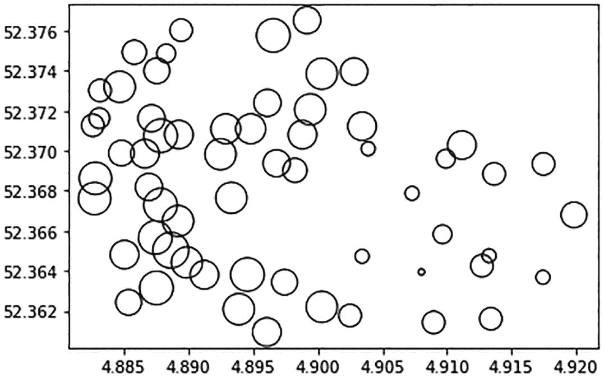

散点图展示了结果数据，其中不同的价格呈现出非线性特征。数值由不同大小的圆圈表示。纵轴数值从 52.362 到 52.376，间隔为 0.002；横轴数值从 4.885 到 4.920，间隔为 0.005。东部区域高度集中。

图 11-15

生成的散点图

该图显示不存在线性关系，但我们可以预期某些区域的价格普遍较高或普遍较低。这意味着我们可能需要改用非线性模型来更好地拟合实际情况。

### 模型迭代 2

尽管之前的探索告诉我们首选模型可能是非线性的，但我们还是用线性模型做最后一次尝试。这将为我们提供一个良好的基准 R²分数，用于评估后续试验。这在代码块 11-23 中完成。

```

# 添加特征
X2 = merged_data[['IncludesBreakfast', 'MaxGuests', 'lat', 'long']]
y = merged_data['Price']

# 训练测试集划分
X2_train, X2_test, y_train, y_test = train_test_split(X2, y, test_size=0.33, random_state=42)

# 构建模型
lin_reg_3 = LinearRegression()
lin_reg_3.fit(X2_train, y_train)

# 评估模型
pred_reg_3 = lin_reg_3.predict(X2_test)
print(r2_score(y_test, pred_reg_3))
代码块 11-23
模型迭代 2
```

该模型获得的 R²分数为 0.498。与第一次迭代（R²为 0.10）相比，这实际上是一个相当大的改进。这让我们有信心在下一节中继续测试非线性模型。

### 模型迭代 3

正如引言中所述，在后续迭代中我们可以使用许多替代模型。为了保持模型易于解释，我们将在这一步使用决策树。欢迎尝试 scikit-learn 库中更复杂的模型，它们像下面的示例一样易于集成到代码中。`DecisionTreeRegressor`的代码如代码块 11-24 所示。

```
from sklearn.tree import DecisionTreeRegressor

# 构建模型
dt_reg_4 = DecisionTreeRegressor()
dt_reg_4.fit(X2_train, y_train)

# 评估模型
pred_reg_4 = dt_reg_4.predict(X2_test)
print(r2_score(y_test, pred_reg_4))
代码块 11-24
模型迭代 3
```

该模型获得的分数是–0.04。出乎意料的是，结果比上一步差得多。这里需要小心，由于模型构建阶段的随机性，每次执行决策树的结果都会不同。你得到的结果可能与这里展示的不同，但如果你多次运行，会发现平均性能比上一次迭代更差。

与许多其他模型一样，`DecisionTreeRegressor`可以通过大量超参数进行调整。在此次迭代中，没有指定任何超参数，这意味着只使用了默认值。

由于我们强烈直觉认为非线性模型应该能够获得比线性模型更好的结果，让我们在下次迭代中尝试调整超参数。

### 模型迭代 4

`max_depth`是`DecisionTreeRegressor`的一个重要超参数。如果不指定最大深度，估计的决策树可能会变得非常复杂。由于上一次迭代的分数远低于线性模型，我们可以预期决策树变得过于复杂。代码块 11-25 中的循环测试了不同的`max_depth`值，这将让我们看到是否能获得性能更好的模型。

```

# 稍微调整此模型
for max_depth in range(1,11):

# 构建模型
dt_reg_5 = DecisionTreeRegressor(max_depth=max_depth)
dt_reg_5.fit(X2_train, y_train)

# 评估模型
pred_reg_5 = dt_reg_5.predict(X2_test)
print(max_depth, r2_score(y_test, pred_reg_5))
代码块 11-25
使用 max_depth 调整模型
```

生成的输出如图 11-16 所示。

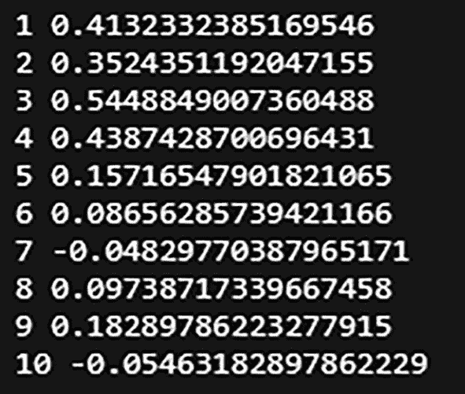

模型调整循环的结果图像。共观察到十个条目，分别为：0.4132332385169546、0.3524351192047155、0.5448849007360488、0.438728700696431、0.15716547901821065、0.0865285739421166、-0.04829770387965171、0.09738717339667458、0.18289786223277915 和 -0.05463182897862229。

图 11-16

模型调整循环的结果。图片由作者提供

在此输出中，你可以看到`max_depth`为 3 时，R²分数达到了 0.54，远优于–0.04 的结果。对`max_depth`的调整显然对模型性能产生了重要影响。还可以进行许多其他试验和迭代，但这留作练习。目前，保留`max_depth = 3`的`DecisionTreeRegressor`作为最终回归模型。

### 迭代 4 模型解读

作为本用例的最后一步，让我们仔细看看这个非线性回归模型学到了什么。决策树的一大优势在于，我们可以导出其结构图，从而精确了解模型是如何学习趋势的。代码块 11-26 中的代码展示了如何生成树状图。

```
from sklearn import tree

# 构建模型
dt_reg_5 = DecisionTreeRegressor(max_depth=3)
dt_reg_5.fit(X2_train, y_train)
plt.figure(figsize=(15,15))
tree.plot_tree(dt_reg_5, feature_names=X2_train.columns)
plt.show()
代码块 11-26
生成树状图
```

结果如图 11-17 所示。

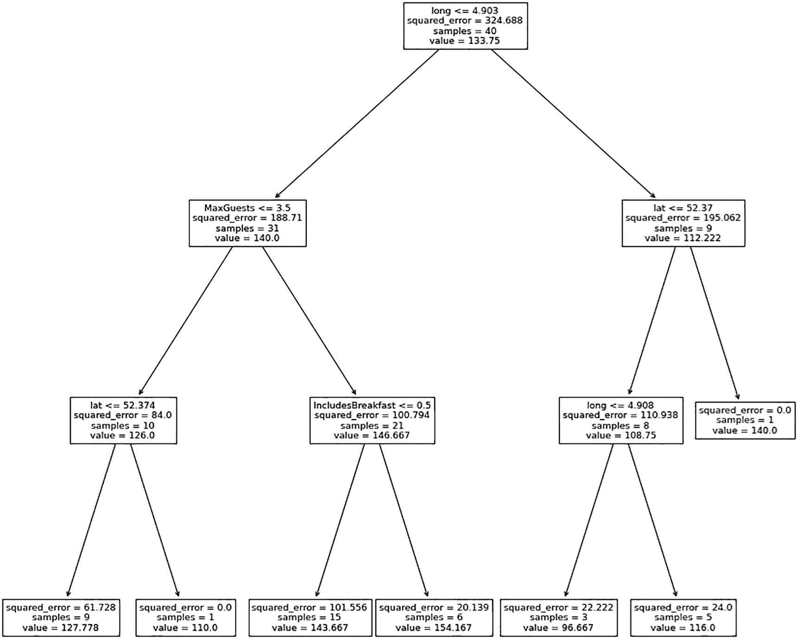

代码块 11-26 结果的树状图。数据包含：长小于符号等于 4.903，平方下划线误差等于 324.688，样本数等于 40，值等于 133.75。该数据分为两个主分支、四个子分支以及六个不同的平方下划线误差、样本数和值的取值。

图 11-17

由代码块 11-26 生成的树状图。图片来源：作者

我们可以清晰地看到哪些节点学习了哪些趋势。可以看到，模型多次使用了纬度和经度，这使得模型能够在地图上划分出价格较低或较高的特定区域。

由于这是当前用例的最终模型，并且我们知道 R2 分数表明该模型的估算效果远优于仅使用平均价格，因此我们有信心，使用决策树模型为我们的 Airbnb 定价将为公寓得出更合适的价格。

因此，本用例的目标已经达成：我们创建了一个回归模型，利用空间数据和公寓数据，为阿姆斯特丹的 Airbnb 做出尽可能最优的价格估算。

## 关键要点

1.  回归是监督式机器学习的一个领域，涉及学习如何使用自变量来预测数值型目标变量的模型。

2.  特征工程、空间数据和其他数据可用于为回归模型提供输入。

3.  R2 分数是可用于评估回归模型的指标。

4.  线性回归是最常见的回归模型之一，但许多其他模型，包括决策树、随机森林或提升方法，都可以在模型基准测试中挑战其性能。

