# 12. 聚类

在机器学习这第四个也是最后一个章节中，我们将介绍聚类。为了正确理解这项技术，让我们先简要回顾一下到目前为止所学的机器学习内容。

机器学习主题是在介绍插值法之后开始的。在插值法中，我们尝试估算目标变量值未知位置的目标变量。插值法使用数学公式来决定插值这些值的最佳理论方法。

在插值法之后，我们介绍了分类和回归，这是监督式建模中的两个主要类别。在监督式建模中，我们构建一个使用 X 变量来预测目标（y）变量的模型。监督式模型的优点在于，我们有大量可用的性能指标来帮助我们调整和改进模型。

## 无监督建模简介

在本章中，我们将深入探讨无监督模型。与监督式模型相反，无监督模型中没有目标变量的概念。无监督模型主要有两种类型：

1.  特征降维

2.  聚类

在特征降维中，目标是获取一个包含大量变量的数据集，然后以更有效的变量定义方式重新定义这些变量。特别是当许多变量高度相关时，你可以减少数据集中的变量数量，使得新变量之间不相关。

特征降维是机器学习数据预处理的重要第一步，也可用于数据分析。其方法示例包括 PCA、因子分析等。特征降维在地理空间数据上的应用与常规数据差别不大，因此我们不再对此技术进行更多篇幅的介绍。

无监督模型中的第二类模型是聚类。聚类与特征降维截然不同，除了两者都缺少目标变量这一概念。空间数据上的聚类与常规数据上的聚类有很大不同，因此本章将深入介绍地理数据上的聚类。

## 聚类简介

在聚类中，目标是基于某种相似性或距离度量来识别观测值的簇或组。如前所述，这里没有目标变量：我们只是利用每个观测值的所有可用变量来创建相似观测值的组。

让我们考虑一个简单且常用的例子。在图 12-1 的图表中，你会看到一些人（每个人是一个观测值），我们收集了他们在超市两个产品类别上的支出：第一类是零食和快餐，第二类是健康产品。

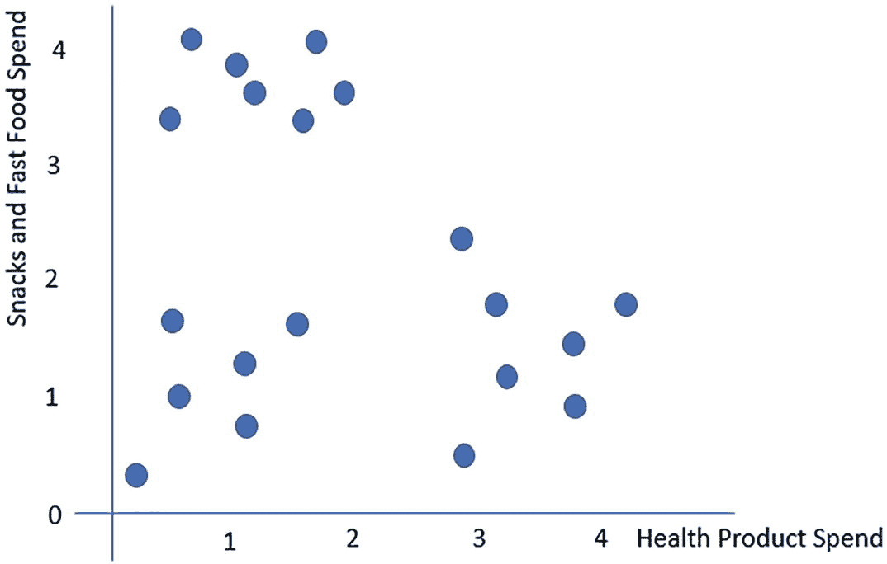

图表描绘了超市中三个支出者群体。X 轴标签为“健康产品支出”，数值从 0 到 4。Y 轴标签为“零食和快餐支出”，数值从 0 到 4。

图 12-1

显示示例的图表。图片来源：作者

由于该数据只有两个变量，因此相对容易识别出该数据库中的三个客户群体。图 12-2 的图表中给出了一个主观的边界划分建议。

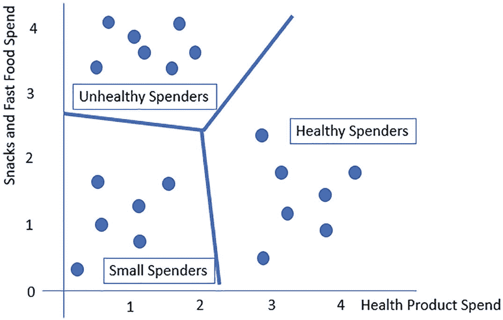

图表描绘了一个聚类示例。X 轴标签为“健康产品支出”，数值从 0 到 4。Y 轴标签为“零食和快餐支出”，数值从 0 到 4。图表描绘了三个群体：不健康支出者、小额支出者和健康支出者。

图 12-2

显示聚类示例的图表。图片来源：作者

在此图表中，你可以看到客户被分为三组：

1.  不健康支出者：在零食和快餐类别上花费很多，但在健康类别上花费不多的客户群体。

2.  健康支出者：在健康产品上花费很多，但在零食和快餐上花费不多的客户群体。

3.  小额支出者：总体花费不多的客户群体。

超市可以利用这种聚类的一个例子是，向那些他们知道会感兴趣的客户发送个性化广告或折扣券。

## 不同的聚类模型

现在，我们不再手动对图形进行分割，而是需要一个更精确的数学机器学习模型来定义此类分割。幸运的是，存在大量这样的模型。例如：

*   K-means 算法
*   层次聚类
*   DBSCAN
*   OPTICS
*   高斯混合模型
*   以及更多。以下来源包含了关于不同聚类方法的丰富信息：[`https://scikit-learn.org/stable/modules/clustering.html`](https://scikit-learn.org/stable/modules/clustering.html)。

然而，不幸的是，其中许多模型并不适用于空间数据。大多数模型的问题在于，它们计算的是两个数据点之间的欧几里得距离，或其他距离和相似性度量。

正如本书中广泛讨论的那样，在处理空间数据时，我们使用的是经纬度坐标，并且在计算从一个坐标到另一个坐标的距离时，需要考虑一些特定因素。虽然我们可以使用基本的聚类模型作为替代方案，但这将是错误的，我们只能寄希望于其影响不会太大。更好的做法是选择专门为空间数据设计的、能够考虑正确距离度量的聚类方法。

在对空间数据进行聚类时，你需要非常重视的主要问题是即将使用的距离度量。这里没有放之四海而皆准的方法，但我们将通过本章介绍的空间聚类用例来探索此类方法和考量因素。

## 空间聚类用例

在本章的剩余部分，我们将介绍一个空间数据聚类的用例。该用例是基于人们的 GPS 轨迹来识别兴趣点。

利用这些轨迹点，我们将尝试识别他们行程中的一些关键位置，其依据是人们在某个位置停留了一段时间，因此会在一个感兴趣的聚类中拥有多个点。另一方面，当人们在各个点之间乘坐交通工具时，这些点会分布得更分散，聚类程度也更低。

我们可以使用聚类来实现这一目标，因为我们期望聚类能够找到代表兴趣点的簇。之后，我们将使用识别出的簇的中心点作为真实兴趣点的估计值。

我们将采取的步骤如下：

*   导入并检查数据
*   为单个用户构建聚类模型
*   为该用户调整聚类模型
*   将调整后的模型应用于其他用户

让我们从下一节的数据导入开始。

## 导入并检查数据

让我们开始导入并检查数据。数据以 KML 文件的形式提供。你可以使用代码块 12-1 中的代码将数据导入 Python。

```
import geopandas as gpd
import fiona
gpd.io.file.fiona.drvsupport.supported_drivers['KML'] = 'rw'
geodata = gpd.read_file('chapter_12_data.kml')
geodata.head()
代码块 12-1
导入数据
```

地理数据框如图 12-3 所示。

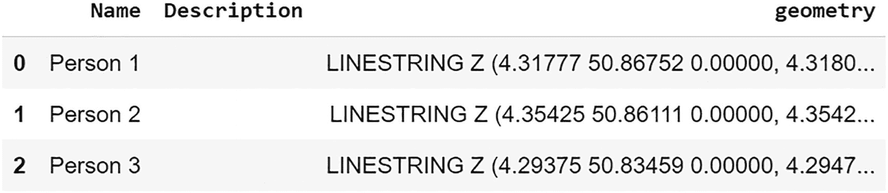

一张作为 KML 文件的空间数据图像。表格的列标题为名称、描述和几何图形。行条目包含三个人的数据。

图 12-3
数据。作者提供的图片

数据以每个人的一条 LineString 形式存储。没有其他可用的变量。现在，让我们绘制一个简单的图形，以便更好地了解我们正在处理的轨迹类型。这可以使用代码块 12-2 中的代码来完成。

```
geodata.plot()
代码块 12-2
绘制数据
```

生成的图形如图 12-4 所示。

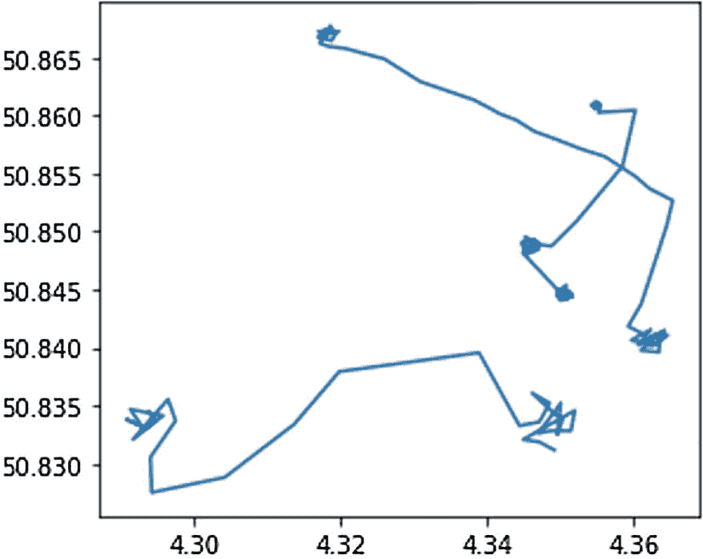

绘制出的轨迹图。此图是使用代码块 12-2 中的代码绘制的。

图 12-4
绘制的轨迹。作者提供的图片

为了给这些轨迹增加一些背景信息，我们可以使用代码块 12-3 中的代码向该图形添加一个背景地图。

```
import contextily as cx
ax = geodata.plot(figsize=(15,15), markersize=64)
cx.add_basemap(ax, crs = geodata.crs)
代码块 12-3
使用背景地图绘图
```

生成的地图如图 12-5 所示。

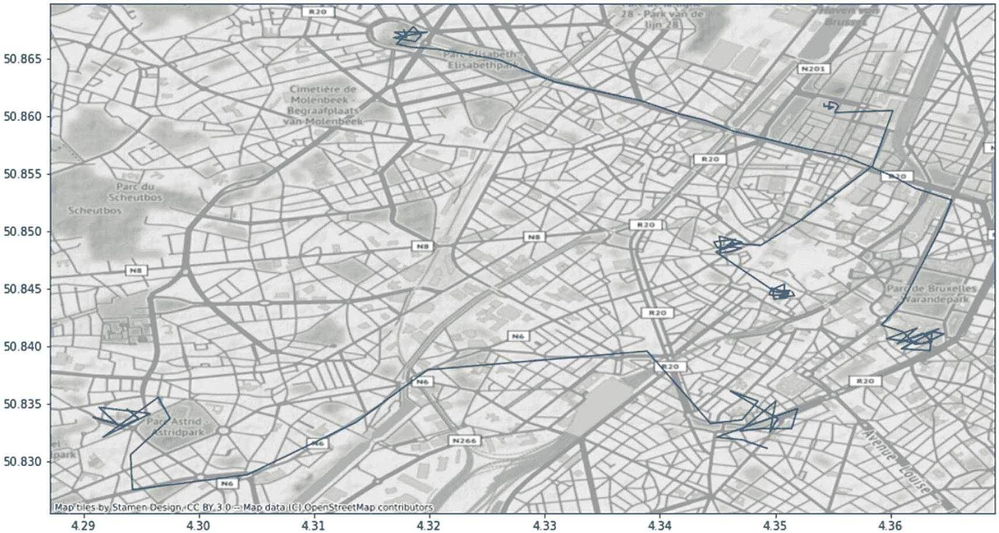

绘制出的轨迹地图。此图是使用代码块 12-3 绘制的。轨迹位于布鲁塞尔市。

图 12-5
由代码块 12-3 生成的地图。作者使用 contextily 源数据和图像（如图中引用所示）提供的图片

这三条轨迹都位于布鲁塞尔市。对于每条轨迹，你都可以直观地识别出相似的模式：存在一些聚集的部分，这些部分在同一邻域内有多个点，表明是兴趣点。此外，还有一些部分呈现出真正的线状模式，这表示从一个兴趣点到另一个兴趣点的移动。

## 单人聚类模型

现在让我们进入机器学习部分。在本节中，我们首先只提取一条轨迹，即针对一个人。我们将对该轨迹应用聚类，看看它能否识别出该轨迹中的聚类簇。

我们首先使用代码块 12-4 中的代码提取第一个人的数据。

```
#让我们开始寻找一个人的兴趣点
one_person = geodata[geodata['Name'] =='Person 1']
one_person
代码块 12-4
提取人员 1 的数据
```

人员 1 的数据如图 12-6 所示。

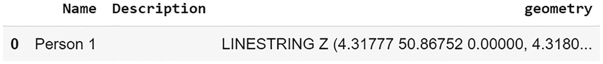

为第一个人提取的数据图像。该提取使用代码块 12-4 完成。

图 12-6

代码块 12-4 的结果。图片由作者提供

让我们绘制此人的轨迹，以便更详细地了解其行为。可以使用代码块 12-5 中的代码生成此地图。

```
ax = one_person.plot(figsize=(15,15), markersize=64)
cx.add_basemap(ax, crs = one_person.crs)
代码块 12-5
创建人员 1 的轨迹地图
```

生成的地图如图 12-7 所示。

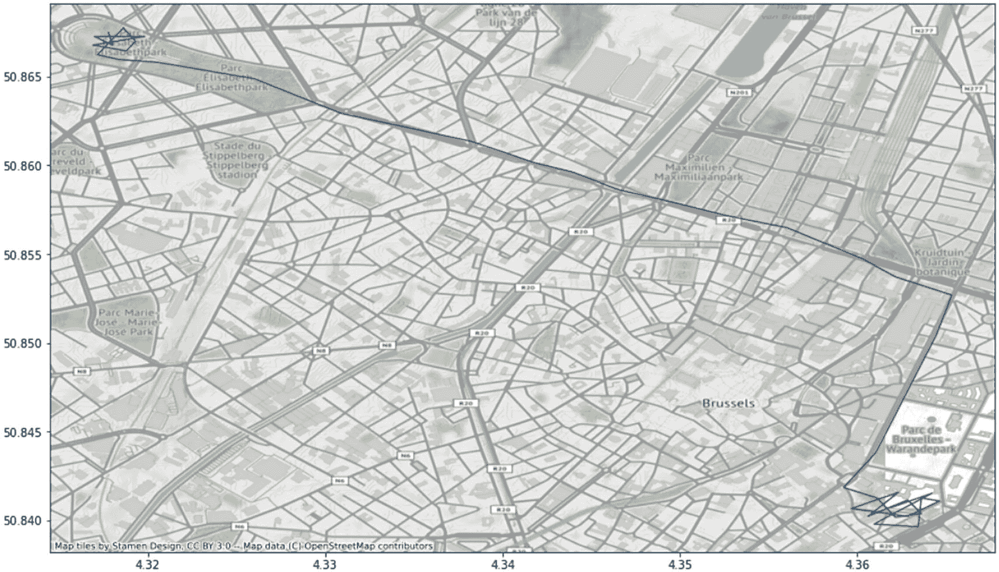

绘制人员 1 轨迹的地图。该地图使用代码块 12-5 中的代码生成。

图 12-7

代码块 12-5 生成的地图。图片由作者使用 contextily 源数据及图像中引用的图像生成

从该可视化中可以看出，此人在两个位置停留时间较长：一个位于地图左上角，另一个兴趣点位于右下角。我们希望构建一个能够成功捕捉这两个位置的聚类模型。

为了开始为人员 1 构建聚类模型，我们需要将 `LineString` 转换为点。毕竟，我们要对单个点进行聚类以识别点的聚类簇。这通过代码块 12-6 中的代码完成。

```
import pandas as pd
one_person_points_df = pd.DataFrame(
[x.strip('(').strip(')').strip('0').strip(' ').split(' ')
for x in str(one_person.loc[0, 'geometry'])[13:].split(',')],
columns=['long','lat']
)
one_person_points_df = one_person_points_df.astype(float)
one_person_points_df.head()
代码块 12-6
将 LineString 转换为点
```

此代码产生的数据格式如图 12-8 所示。

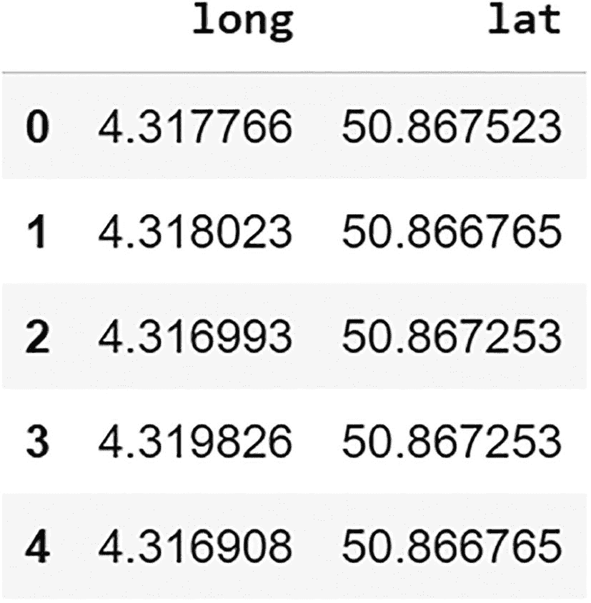

一个表格描绘了将线字符串转换为点的过程。表格的列标题分别为经度（Long）和纬度（Lat）。每列有五行条目。

图 12-8

新的数据格式，将纬度和经度作为单独的列。图片由作者提供

现在我们有了正确的数据格式，是时候应用聚类方法了。由于我们的数据是经纬度格式，两点之间的距离应使用哈弗辛距离来定义。我们选择使用 OPTICS 聚类方法，因为它非常适用于空间数据。其行为如下：

*   OPTICS 自行决定要使用的聚类簇数量。这与一些需要用户决定聚类簇数量的模型相反。

*   可以调整 OPTICS 的参数来影响模型选择的聚类簇数量。这一点很重要，因为默认设置可能无法得到我们想要的确切聚类簇数量。

*   OPTICS 能够剔除点：当点远离所有已识别的聚类簇时，它们可以被编码为 –1，表示异常数据点。这在空间聚类中非常重要，因为轨迹中会有许多位于交通路段上的数据点，这些点距离聚类中心相当远。并非所有聚类方法都提供此选项，但 OPTICS 以及 DBSCAN 等其他一些方法具备此功能。

让我们从使用默认设置的 OPTICS 聚类开始。这通过代码块 12-7 中的代码完成。

```
from sklearn.cluster import OPTICS
import numpy as np
clustering = OPTICS(metric='haversine')
one_person_points_df.loc[:,'cluster'] = clustering.fit_predict(np.radians(one_person_points_df[['lat', 'long']]))
代码块 12-7
应用 OPTICS 聚类
```

前面的代码在数据集中创建了一个名为 `cluster` 的列，该列现在包含了模型为每一行（即每个数据点）找到的聚类簇。代码块 12-8 中的代码展示了如何了解聚类簇的分布情况。

```
one_person_points_df['cluster'].value_counts()
代码块 12-8
显示值计数
```

结果如图 12-9 所示。

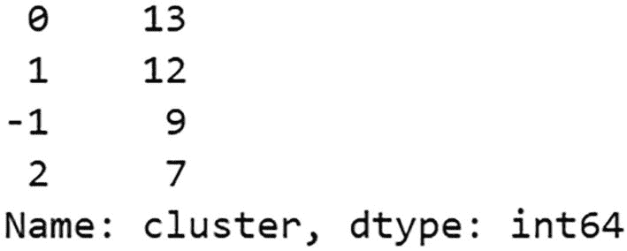

OPTICS 聚类结果的图像。这是代码块 12-7 中代码的结果。该代码创建了一个名为 cluster 的列。

图 12-9

OPTICS 聚类的结果。图片由作者提供

现在，如前所述，聚类簇 –1 标识了异常值。让我们使用代码块 12-9 中的代码将它们从数据中删除。

```

# 移除所有聚类簇为 -1（异常值）的观测值
one_person_points_df = one_person_points_df[one_person_points_df[‘cluster’] != -1]
代码块 12-9
移除异常值聚类簇
```

现在，我们可以通过使用 `groupby` 操作计算中位数点来得到每个聚类簇的中心点。这在代码块 12-10 中完成。

```
medians_of_POI = one_person_points_df.groupby(['cluster'])[['lat', 'long']].median().reset_index(drop=False)
medians_of_POI
代码块 12-10
计算聚类簇的中位数
```

图 12-10 显示了聚类簇 0、1 和 2 的中位数坐标。

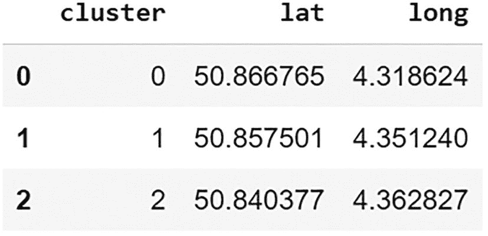

一个包含三列三行、由不同数值组成的表格。列标题为 cluster、lat 和 long。行标签为 0、1、2 和 3。

图 12-10

生成的聚类簇。图片由作者提供

让我们使用代码块 12-11 中的代码将这些中心坐标绘制在地图上。

```
from shapely.geometry.point import Point
medians_of_POI_gdf = gpd.GeoDataFrame(medians_of_POI, geometry=[Point(x) for x in zip( list(medians_of_POI['long']), list(medians_of_POI['lat']))])
medians_of_POI_gdf.plot()
代码块 12-11
绘制人员 1 的中心坐标
```

包含三个中心点的基本图如图 12-11 所示。

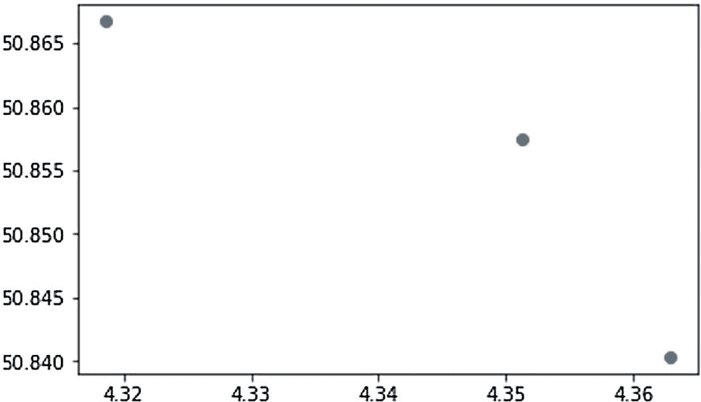

显示人员 1 三个中心点的图表。用于绘制这些中心坐标的代码是代码块 12-11。这三个点位于 (4.32, 50.867)、(4.35, 50.859) 和 (4.38, 50.840)。数值为近似值。

图 12-11

显示人员 1 三个中心点的图。图片由作者提供

让我们使用代码块 12-12 中的代码为这张地图添加更多背景信息。

```
ax = one_person.plot(figsize=(15,15))
medians_of_POI_gdf.plot(ax=ax,markersize=128)
cx.add_basemap(ax, crs = one_person.crs)
代码块 12-12
在中心点背后绘制底图
```

结果如图 12-12 所示。

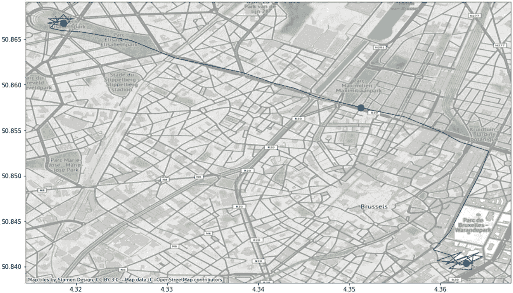

一张包含中心点绘制的地图。该地图使用代码块 12-12 中的代码生成。地图描绘了一个额外的质心，该质心并非兴趣点。

图 12-12

将中心点绘制到背景地图上。图片由作者使用 contextily 源数据和图像作为参考绘制

这张地图显示聚类并不完全成功。左上角的聚类质心正确识别了一个兴趣点，右下角的质心也正确识别了一个。然而，中间还有一个额外的质心，它本不应被识别为兴趣点。在下一节中，我们将调整模型以改进这一结果。

## 调整聚类模型

在无监督模型中调整模型比在有监督模型中复杂得多。毕竟，我们没有带注释的数据集：真正的兴趣点是未知的。最好的方法是进行一些手动检查，并牢记你的目标是什么。在当前案例中，我们希望找到质心，并且只找兴趣点的质心。

在以下代码中，为 OPTICS 模型设置了不同的参数：

*   `Min_samples` 设置为 10。

一个点被视为核心点所需的邻域内样本数量。

*   `Max_eps` 设置为 2。

此超参数表示一个点与聚类质心之间允许的最大距离，超过该距离则不再被视为该聚类的一部分。

*   `Min_cluster_size` 设置为 8。

一个聚类若要保留，其中必须包含的最少数据点数量。

*   `Xi` 设置为 0.05。

    有助于调整聚类的数量。

这些超参数值是通过尝试不同的设置，然后观察识别出的质心是否与地图上的兴趣点重合而获得的。代码如代码块 12-13 所示。

```

# 尝试不同的设置
one_person_points_df = pd.DataFrame(
[x.strip('(').strip(')').strip('0').strip(' ').split(' ')
for x in str(one_person.loc[0, 'geometry'])[13:].split(',')],
columns=['long','lat']
)
one_person_points_df = one_person_points_df.astype(float)
clustering = OPTICS(
min_samples = 10,
max_eps=2.,
min_cluster_size=8,
xi = 0.05,
metric='haversine')
one_person_points_df.loc[:,'cluster'] = clustering.fit_predict(
np.radians(one_person_points_df[['lat', 'long']]))
one_person_points_df =
one_person_points_df[one_person_points_df['cluster'] != -1]
medians_of_POI = one_person_points_df.groupby(['cluster'])[['lat', 'long']].median().reset_index(drop=False)
print(medians_of_POI)
medians_of_POI_gdf = gpd.GeoDataFrame(medians_of_POI,
geometry=
[Point(x) for x in
zip(
list(medians_of_POI['long']),
list(medians_of_POI['lat'])
)
])
ax = one_person.plot(figsize=(15,15))
medians_of_POI_gdf.plot(ax=ax,markersize=128)
cx.add_basemap(ax, crs = one_person.crs)
代码块 12-13
使用不同设置应用 OPTICS
```

这次新聚类的结果如图 12-13 所示。

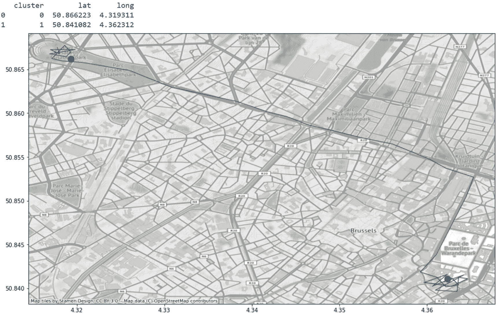

基于前一张图改进后的地图。这个调整后的模型或地图是代码块 12-13 中代码的结果。

图 12-13

由代码块 12-13 生成的地图。图片由作者使用 contextily 数据和图像作为参考绘制

如您所见，模型正确识别了两个点（左上角和右下角），并且没有其他点。因此，至少对于这个人来说，模型是成功的。在下一节中，我们也将把这个模型应用于其他数据，看看新的聚类设置是否也能为它们提供正确的结果。

## 将模型应用于所有数据

现在，让我们遍历数据集中的三个人，并对每个人应用相同的聚类方法。对于每个人，聚类质心将被打印出来，并绘制在与原始轨迹相对的地图上。这将使我们能够检查结果是否正确。执行所有这些操作的代码如代码块 12-14 所示。

```
import matplotlib.pyplot as plt
for i,row in geodata.iterrows():
print(row)
one_person_points_df = pd.DataFrame(
[x.strip('(').strip(')').strip('0').strip(' ').split(' ')
for x in str(row['geometry'])[13:].split(',')],
columns=['long','lat']
)
one_person_points_df = one_person_points_df.astype(float)
clustering = OPTICS(
min_samples = 10,
max_eps=2.,
min_cluster_size=8,
xi = 0.05,
metric='haversine')
one_person_points_df.loc[:,'cluster'] = clustering.fit_predict(
np.radians(one_person_points_df[['lat', 'long']]))
one_person_points_df =
one_person_points_df[one_person_points_df['cluster'] != -1]
medians_of_POI =
one_person_points_df.groupby(['cluster'])[['lat', 'long']].median().reset_index(drop=False)
print(medians_of_POI)
medians_of_POI_gdf = gpd.GeoDataFrame(medians_of_POI,
geometry=
[Point(x) for x in
zip(
list(medians_of_POI['long']),
list(medians_of_POI['lat'])
)
])
ax = gpd.GeoDataFrame([row],
geometry=[row['geometry']]).plot(figsize=(15,15))
medians_of_POI_gdf.plot(ax=ax,markersize=128)
plt.show()
代码块 12-14
将模型应用于所有数据
```

生成的输出和图表将依次在图 12-14、12-15 和 12-16 中展示。

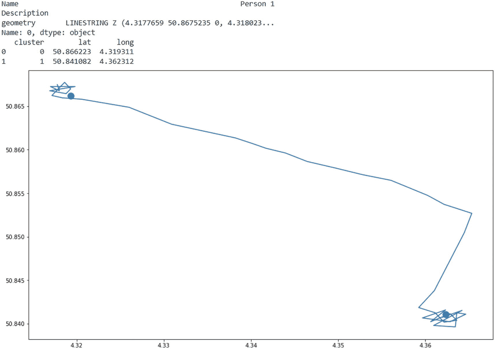

人物一的聚类质心和原始轨迹图。获取此图的代码来自代码块 12-14。

图 12-14

人物一轨迹上的中心点。图片由作者绘制

第一张图显示了我们之前已经使用过的结果。确实，对于人物一，OPTICS 模型正确识别了两个兴趣点。图 12-15 显示了人物二的结果。

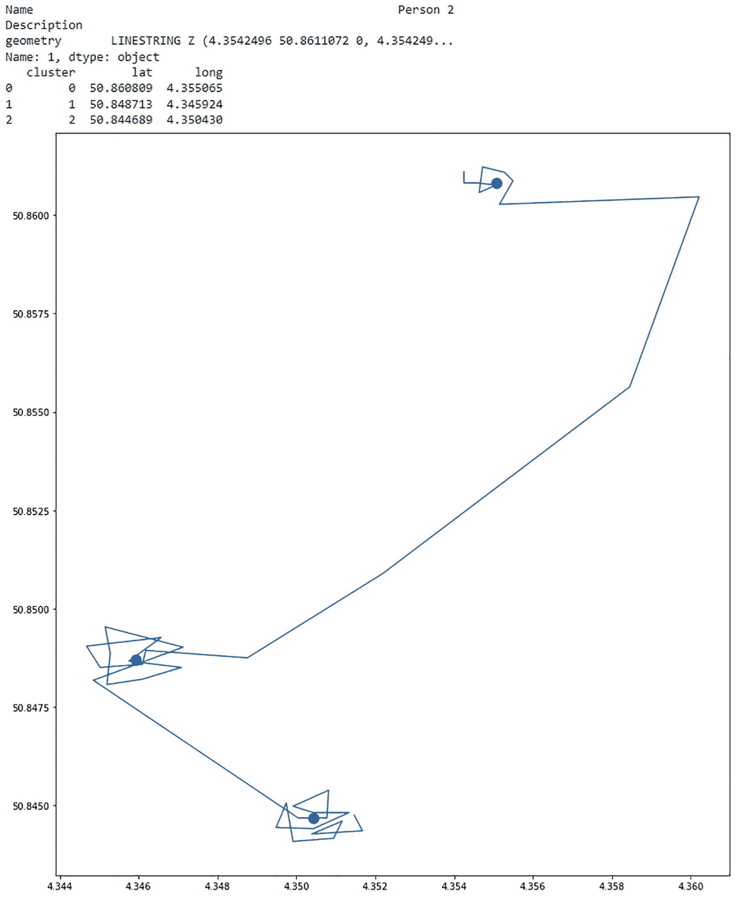

人物二的聚类质心和原始轨迹图。获取此图的代码来自代码块 12-14。

图 12-15

人物二的三个中心点及其轨迹。图片由作者绘制

对于人物二，我们可以看到有三个兴趣点，并且 OPTICS 模型正确识别了这三个质心。因此，该模型在此人身上被认为是成功的。现在，让我们在图 12-16 中检查第三个人的输出。

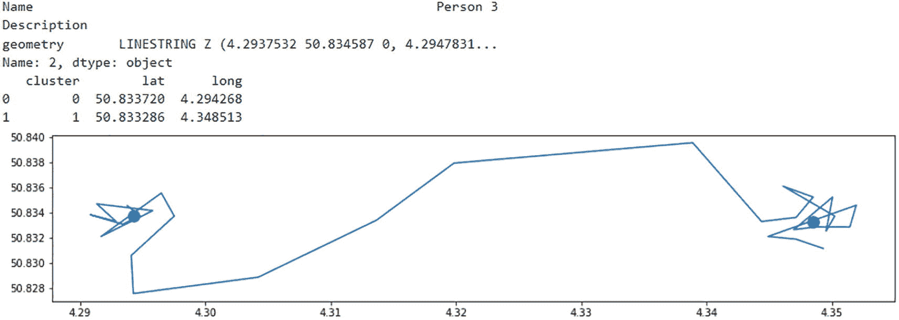

人物三的聚类质心和原始轨迹图。获取此图的代码来自代码块 12-14。

图 12-16

人物三的两个质心及其轨迹

人物三的结果也是成功的。人物三的轨迹中有两个兴趣点，并且 OPTICS 模型正确识别了这两个点。

## 核心要点

1.  无监督机器学习是监督式机器学习的对应概念。在监督式机器学习中，存在一个带有目标变量的真实基准。而在无监督机器学习中，则没有目标变量。

2.  特征缩减是无监督机器学习中的一类方法，其目标是重新定义变量。在空间应用场景中应用特征缩减，其差异并不显著。

3.  聚类是无监督机器学习中的一类方法，专注于寻找彼此相当相似的观测值分组。在处理空间数据时，进行聚类需要考虑一些特定因素。

4.  使用基于哈弗辛距离的 OPTICS 聚类模型，识别了布鲁塞尔三人轨迹中的兴趣点。尽管默认的 OPTICS 模型未能正确找到这些兴趣点，但通过手动调参，最终得到了一个能够正确识别数据中观察到的三人各自兴趣点的模型。

