# 1. 地理数据导论

绘制地图和分析我们周围的地理环境，在自然界和人类社会中早已存在。人类地图对我们来说耳熟能详：它们是向他人分享我们环境信息的绝佳方式。

然而，传达地理指令并非人类独有的发明。例如，众所周知，蜜蜂会与蜂巢同伴交流食物来源的信息。蜜蜂不会绘制地图，但和我们一样，它们使用一套定义明确的交流系统。

由于地理数据是本书的主题，我觉得分享蜜蜂使用的这套独特的地理数据系统非常有趣。蜜蜂世界中的地理数据包含两个要素：距离和方向。

**蜜蜂的距离度量**

*   **圆舞**：食物来源距离蜂巢不到 50 米。

*   **镰刀舞**：食物来源距离蜂巢在 50 到 150 米之间。

*   **摇摆舞**：食物来源距离蜂巢超过 150 米。此外，摇摆舞的持续时间是食物来源距离超过 150 米多远的一个指标。

**蜜蜂的方向度量**

*   尽管更为复杂，但已知舞蹈的角度是相对于太阳的角度的一个指标，蜜蜂必须沿着这个角度才能到达它们的食物来源。

*   由于太阳的位置在一天中会变化，蜜蜂会通过相应地调整它们的交流舞蹈来互相更新信息。

人类在地理交流方面的对应方式效果稍好一些，因为我们有指向磁北的指南针。熟悉指南针使用（例如在船上）的人可能知道，即使使用指南针也并非完美的解决方案。

磁北的变化远小于太阳位置的变化。然而有趣的是，磁北和真北并不位于完全相同的点。真北是地球上的一个固定位置（即所谓的北极），但指南针基于磁性，因此指向磁北：一个每年都会略微移动的位置。

如果你用指南针为船只导航，你需要不断进行计算，通过加上磁偏角（一个根据你在地球上的位置而变化的数值），将你的磁方向测量值转换为真方向测量值。

## 本书阅读指南

从这两个例子中你会明白，处理地理数据是一项挑战。虽然通过坐标确定点的位置看似简单，但魔鬼真的在于细节。

本书的目标是在 Python 示例代码项目中逐一探讨所有这些细节。这将为你提供所需的基础知识，以便开始在地理数据这个有趣的领域工作，同时避免犯错。然后，你将发现表示地理数据的多种方式，并学习使用那些能简化地理数据处理工作的工具。

在打好基础之后，本书将逐渐深入，重点介绍针对地理数据领域的机器学习技术。正如你所料，地理数据使用的特殊性使得许多标准技术完全不适用，或者在其他情况下，它们可能需要进行特定的调整和配置。

## 地理数据定义

首先，我想在最简单的数学情境——欧几里得空间中，介绍坐标系的基础知识。尽管现实世界并不符合欧几里得几何所做的假设，但它却是深入理解坐标系的绝佳切入点。

二维欧几里得空间通常如图 1-1 所示。

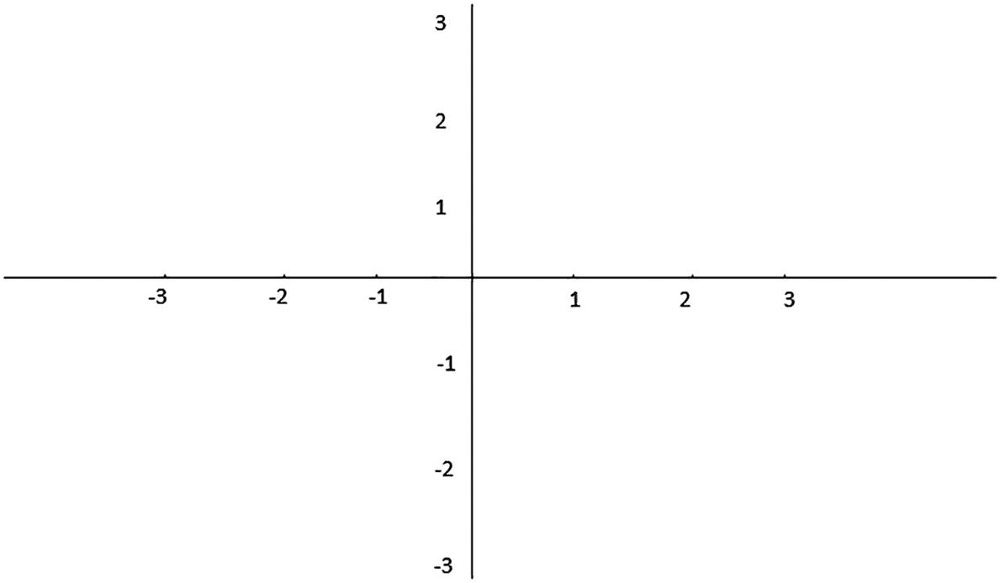

该图由一个坐标平面组成，水平轴和垂直轴上的值均从负三到正三。

图 1-1

一个二维欧几里得空间。作者自绘


### 笛卡尔坐标系

要在欧几里得空间中定位点，我们可以使用笛卡尔坐标系。该坐标系通过一对数值坐标来唯一地指定每个点。例如，请看图 1-2 中的坐标系，其中定位了两个点：一个正方形和一个三角形。

正方形位于 x = 2 和 y = 1（水平轴）处。三角形位于 x = -2 和 y = -1 处。

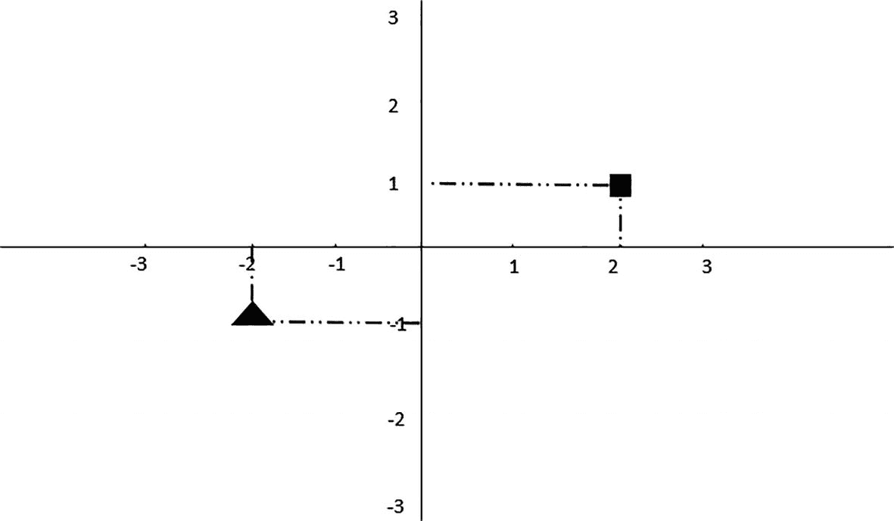

该图由一个坐标平面组成，水平轴和垂直轴的值均从负三到正三。图中有两个点，一个位于第一象限，坐标为 (2, 1)；另一个位于第三象限，坐标为 (-2, -1)。

图 1-2

坐标系中的两个点。图片由作者提供

x 轴和 y 轴相交的点称为原点，距离从该点开始测量。笛卡尔坐标系是最著名的坐标系之一，在欧几里得空间中易于使用且直观。

### 极坐标系与角度

笛卡尔坐标系的一个常用替代是极坐标系。在极坐标系中，首先定义一个点作为极点。从该极点出发引出极轴。图 1-3 中的图形展示了这一概念。

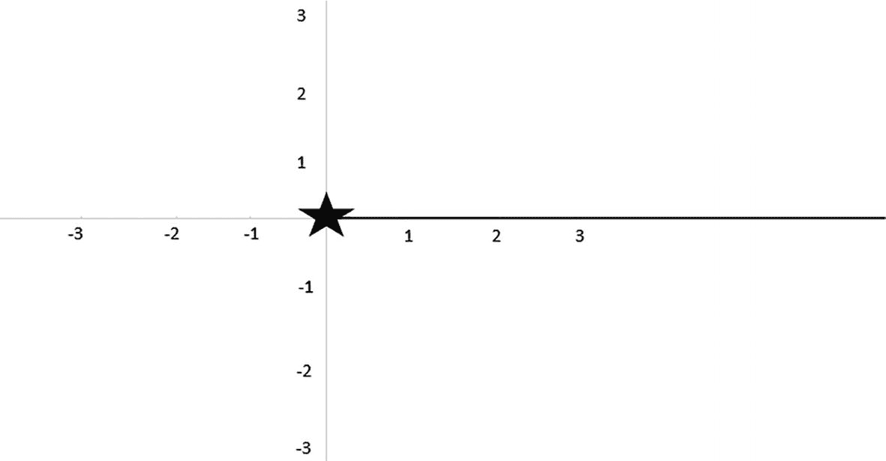

该图由一个坐标平面组成，水平轴和垂直轴的值均从负三到正三。原点处有一个点，水平正半轴上有一条水平线。

图 1-3

极坐标系。图片由作者提供

在此示意图中，星形被指定为极点，右侧的粗黑线被选为极轴。该系统与笛卡尔坐标系截然不同，但仍允许我们标识完全相同的点：只是方式不同而已。

这些点由两个分量标识：相对于极轴的角度和距离。之前被称为笛卡尔坐标 (2,1) 的正方形，现在可以通过相对于极轴的角度和距离来表示。

如图 1-4 所示。

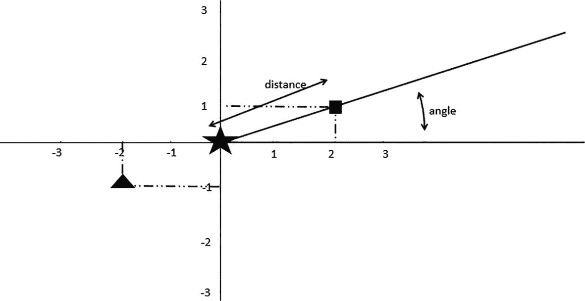

该图由一个坐标平面组成，水平轴和垂直轴的值均从负三到正三。图中有三个点，第一个位于第一象限，坐标为 (2, 1)；第二个位于原点；最后一个位于第三象限，坐标为 (-2, -1)。第一象限内有一条对角直线和箭头线，形成了一个角度。

图 1-4

极坐标系中的一个点。图片由作者提供

此时，你可以测量距离和角度，从而得到极坐标系中的坐标。仅凭目测，我们可以说角度大概在 30° 左右，距离略大于 2。要获得更高精度，我们需要更精确的测量工具和更精确的绘图。

我们可以使用三角计算在极坐标和笛卡尔坐标之间进行转换。第一组公式允许你从极坐标转换到笛卡尔坐标：

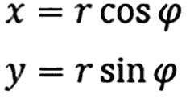

一张显示极坐标与笛卡尔坐标转换公式的图片。X 等于 r 乘以余弦 phi，y 等于 r 乘以正弦 phi。

字母 r 表示距离，字母 *φ* 表示角度。你也可以使用以下公式进行反向转换：

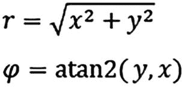

两个用于极坐标与笛卡尔坐标转换的公式。r 等于 x 平方加 y 平方的平方根。phi 等于 a tan 2 左括号 y 逗号 x 右括号。

关于角度，最后要提及的一点是，我想说明用度数和弧度测量角度之间的等价关系。如果你不习惯弧度制，它可能看起来令人生畏，但请记住，对于你可以测量的每一个角度（从 0 到 360），在弧度制中都有对应的表示法。图 1-5 展示了这一点。

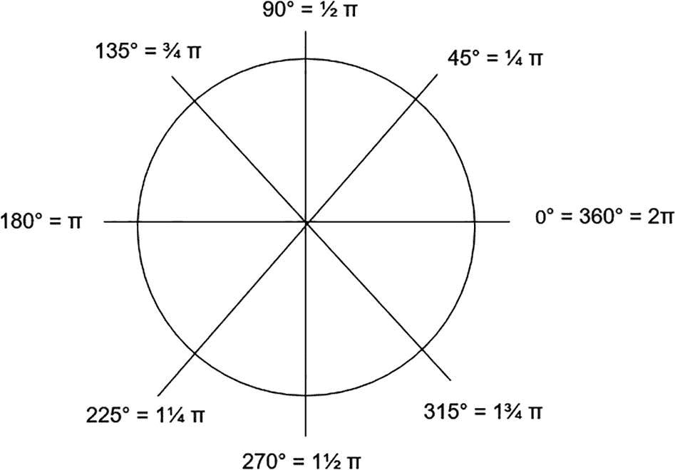

一个弧度与角度的饼图，被分成八个相等的部分。饼图上的每条线都有标注。

图 1-5

弧度与角度。图片由作者提供

### 与现实的区别

在现实中，你永远不会在地图上使用欧几里得空间。这是因为世界不是平坦的，而是一个球体。首先，需要考虑物体是三维的。更重要的是，从一个点到另一个点的距离需要考虑地球在该点的特定曲率。更麻烦的是，不幸的是，地球并非一个完美的圆球。

在现实世界中，事情比欧几里得示例要复杂得多。这是通过地理坐标系来实现的，该坐标系适应了我们椭球体的现实。在这个系统中，我们通常通过纬度和经度的组合来测量一个点。

纬度表示你在地球上相对于赤道的位置高低。经度表示你在地球上相对于本初子午线的左右位置。

地球从赤道与本初子午线交点的零点开始被分成四个象限。北、南、东、西共同构成了四个象限。北极的纬度为北纬 90 度，南极的纬度为南纬 90 度。经度范围从西经 180 度到东经 180 度。

度数没有小数，但可以细分为分。1 度等于 60 分，1 分等于 60 秒。

## 地理信息系统与常用工具

到现在你肯定已经明白，如果没有能为你完成所有转换工作的工具，地理数据很容易让人头疼。我们很幸运，因为存在许多这样的工具。在这一部分，让我们看看一些最常用的工具，以及它们各自的优缺点。

### 什么是地理信息系统

GIS，即地理信息系统，是一种特殊类型的数据库系统，专门为地理数据（也称为地理空间数据）而设计。这些数据库系统的开发方式使得诸如坐标系等问题无需用户解决。这一切都由系统内部自动完成。GIS 也指处理这些信息系统的行业。

#### ArcGIS

由 ESRI 开发的 ArcGIS，可以说是用于处理地理信息系统的最著名的软件包。它拥有非常多的功能，可以通过用户友好的点击按钮系统访问，但也允许对地理数据处理流程进行可视化编程。对于有特定任务且 ArcGIS 中没有现成工具的用户，甚至可以集成 Python。其工具还包括人工智能和数据科学选项。

ArcGIS 是处理地理数据的优秀软件。然而，它有一个很大的缺点，那就是它是一个付费的专有软件。因此，只有那些能够轻松支付相当高昂价格的公司或个人才能使用。尽管它可能物有所值，但你需要能够支付得起，或者说服你的公司购买此类软件。不幸的是，情况往往并非如此。


#### QGIS 及其他开源 ArcGIS 替代方案

开源开发者通过开发开源（因此可免费使用）的替代方案，进入了 GIS 系统这一开放领域。这些方案包括 QGIS、GRASS GIS、PostGIS 等。

其明显优势在于可免费使用。然而，它们的功能通常要有限得多。在大多数此类软件中，如果某些所需工具不可用，用户可以自行编写模块。

如果你不畏惧使用像 QGIS 这样的系统，并愿意填补可能遇到的空白，那么这种方法可能很适合你的需求。

#### Python/R 编程

最后，你也可以使用 Python 或 R 编程来处理地理数据。如今，编程，尤其是 Python 或 R 编程，是数据专业人员中非常普遍的技能。

由于几年前编程技能尚未普及，数据科学、机器学习和人工智能的蓬勃发展使得像 Python 这样的语言在劳动力队伍中变得非常普遍。

现在，许多人能够编写代码，或者有机会学习编程课程，因此对完整软件的需求减少了。许多功能良好的地理数据包的可用性足以让许多人入门。

Python 或 R 编程是使用常见或更现代的方法处理地理数据的绝佳工具。通过使用这些编程语言，你可以轻松地将其他库中的工具应用于你的地理数据，而无需将其转换为 QGIS 模块等。

编程语言未能很好解决的唯一问题是地理数据的长期存储。为此，你需要一个数据库。如今，基于云的数据库相对容易安排和管理，因此这个问题也相对容易解决。

## 地理数据的标准格式

正如你所了解的，有不同的工具和编程语言可以轻松处理地理数据。在本书中使用 Python 处理地理数据时，我们通常更关注数据处理而非数据存储。

然而，一个完整的地理数据处理方案不能仅依赖处理。我们还需要一种数据格式。你现在将看到一些非常广泛用于存储地理数据的常见数据格式。

### Shapefile

Shapefile 是一种非常常用的地理数据文件格式，因为它是 ArcGIS 的标准格式。Shapefile 在 ArcGIS 之外使用不太友好，但由于 ArcGIS 的普及，你很可能在某个时候会遇到 shapefile。

Shapefile 实际上并不是一个单一的文件。它实际上是一组文件的集合，这些文件存储在同一个目录中，并且都具有相同的名称。构成 shapefile 的文件如下：

*   myfile.shp：主文件，也称为 shapefile（虽然令人困惑，但确实如此）
*   myfile.shx：shapefile 索引文件
*   myfile.dbf：存储属性数据的 shapefile 数据文件
*   myfile.prj：存储空间参考和投影元数据的可选文件

例如，让我们看一个包含法国政府提供的巴黎大区各市镇的开源数据集。该数据集可在 [`https://geo.data.gouv.fr/en/datasets/8fadd7040c4b94f2c318a0971e8faedb7b5675d6`](https://geo.data.gouv.fr/en/datasets/8fadd7040c4b94f2c318a0971e8faedb7b5675d6) 免费获取。

在这个网站上，你可以下载 SHP/L93 格式的数据，这将允许你下载一个包含 zip 文件的目录。图 1-6 显示了其中的内容。

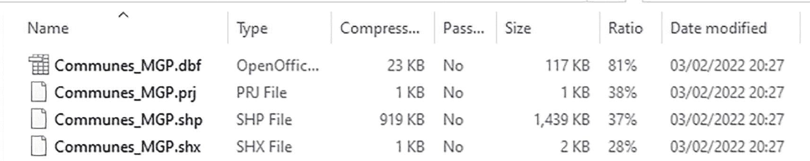

一个 shapefile 的窗口框。从左到右依次是列标题：名称、类型、压缩、密码、大小、比率和修改日期。在名称列下，文件名为 Communes M G P dot d b f、Communes M G P dot p r j、Communes M G P dot s h p 和 Communes M G P dot s h x。

图 1-6

Shapefile 的内部结构。图片来源：作者。数据来源：DINSIC 部。原始数据下载自 [*https://geo.data.gouv.fr/en/datasets/8fadd7040c4b94f2c318a0971e8faedb7b5675d6*](https://geo.data.gouv.fr/en/datasets/8fadd7040c4b94f2c318a0971e8faedb7b5675d6)，更新于 2016 年 7 月 1 日。开放许可 2.0 ([*www.etalab.gouv.fr/wp-content/uploads/2018/11/open-licence.pdf*](https://www.etalab.gouv.fr/wp-content/uploads/2018/11/open-licence.pdf))

如你所见，这里有 .shp 文件（主文件）、.shx 文件（索引文件）、包含属性的 .dbf 文件，以及可选的 .prj 文件。

对于这个练习，如果你想跟着做，可以使用你的本地环境或位于 [`https://colab.research.google.com/`](https://colab.research.google.com/) 的 Google Colab Notebook。

你必须确保在你的环境中安装了 geopandas：

```
!pip install geopandas
```

然后，确保在你的环境中有一个名为 Communes_MGP.shp 的目录，其中包含以下四个文件：

*   Communes_MGP.shp
*   Communes_MGP.dbf
*   Communes_MGP.prj
*   Communes_MGP.shx

在本地环境中，你需要将“sample_data”文件放在与 notebook 相同的目录中，但在 Colab 上工作时，你需要通过单击文件夹图标，然后将整个文件夹拖放到工作环境中来上传整个文件夹。然后，你可以执行代码块 1-1 中的 Python 代码来查看数据内部。

```
import geopandas as gpd
shapefile = gpd.read_file("sample_data/Communes_MGP.shp")
print(shapefile)
代码块 1-1
导入 shapefile
```

你将在图 1-7 中看到结果。

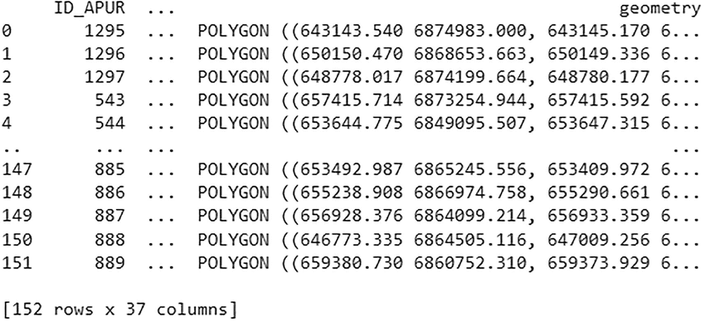

一个 Python 中的数据表，包含两个列标题和十行数据。列标题是 IDAPUR 和 geometry。

图 1-7

Python 中的数据。图片来源：作者。数据来源：DINSIC 部。原始数据下载自 [*https://geo.data.gouv.fr/en/datasets/8fadd7040c4b94f2c318a0971e8faedb7b5675d6*](https://geo.data.gouv.fr/en/datasets/8fadd7040c4b94f2c318a0971e8faedb7b5675d6)，更新于 2016 年 7 月 1 日。开放许可 2.0 ([*www.etalab.gouv.fr/wp-content/uploads/2018/11/open-licence.pdf*](https://www.etalab.gouv.fr/wp-content/uploads/2018/11/open-licence.pdf))

为了制作更直观的内容，你可以使用代码块 1-2 中的代码。

```
shapefile.plot()
代码块 1-2
绘制 shapefile
```

你将获得与该数据集对应的地图，如图 1-8 所示。

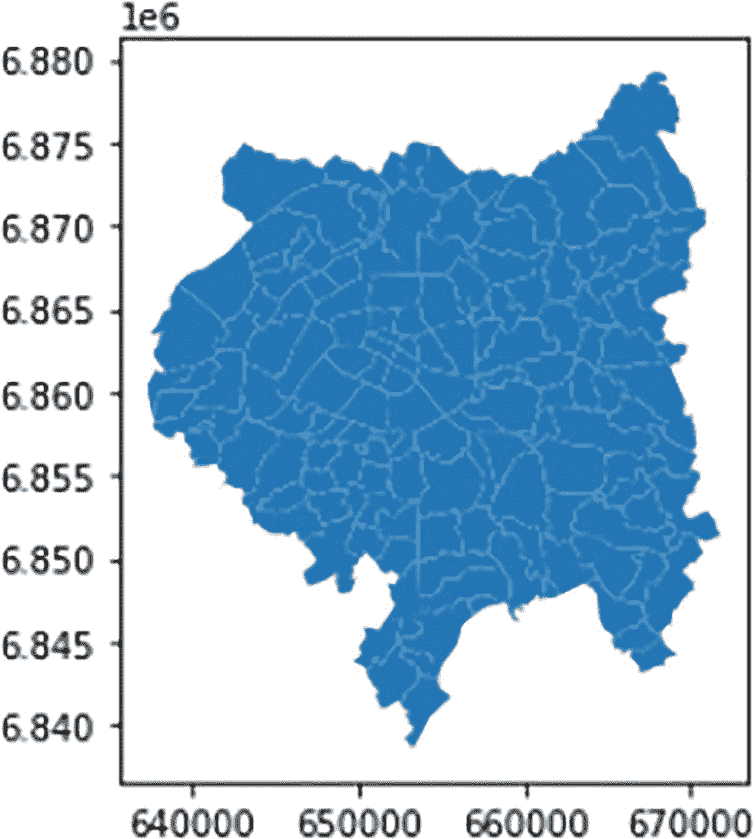

一张绘制在图表上的地图，水平轴数值从 640000 到 670000，增量为 10000；垂直轴数值从 6.840 到 6.880，增量为 0.005。

图 1-8

代码块 1-2 生成的地图。图片来源：作者。数据来源：DINSIC 部。原始数据下载自 [*https://geo.data.gouv.fr/en/datasets/8fadd7040c4b94f2c318a0971e8faedb7b5675d6*](https://geo.data.gouv.fr/en/datasets/8fadd7040c4b94f2c318a0971e8faedb7b5675d6)，更新于 2016 年 7 月 1 日。开放许可 2.0 ([*www.etalab.gouv.fr/wp-content/uploads/2018/11/open-licence.pdf*](https://www.etalab.gouv.fr/wp-content/uploads/2018/11/open-licence.pdf))


### Google KML 文件

你可能对 Google 地球很熟悉：它是当今主流的基于地图的应用程序之一。谷歌推广了用于地理数据的 KML 文件。它是一种基于 XML 的文本文件，可以包含几何数据。

.KMZ 文件是 KML 文件的压缩版本。你可以使用任何解压工具解压它，从而获得一个 KML 文件。

举个例子，让我们看看与之前完全相同的数据库，该数据库位于法国的开放地理数据平台：

DINSIC 部。原始数据下载自 [`https://geo.data.gouv.fr/en/datasets/8fadd7040c4b94f2c318a0971e8faedb7b5675d6`](https://geo.data.gouv.fr/en/datasets/8fadd7040c4b94f2c318a0971e8faedb7b5675d6)，更新于 2016 年 7 月 1 日。开放许可 2.0 ([`www.etalab.gouv.fr/wp-content/uploads/2018/11/open-licence.pdf`](https://www.etalab.gouv.fr/wp-content/uploads/2018/11/open-licence.pdf))

在资源部分，你会看到这张巴黎地区市镇地图也提供 KML 格式。下载它，你将获得一个名为 Communes_MGP.kml 的文件。

如果你尝试用文本编辑器打开该文件，你会发现它是一个 XML 文件（简而言之，XML 是一种数据存储模式，可以通过许多 < 和 > 符号来识别）。

与 shapefile 相比，你可以看到 KML 更容易理解和解析。文件内容的一部分如图 1-9 所示。

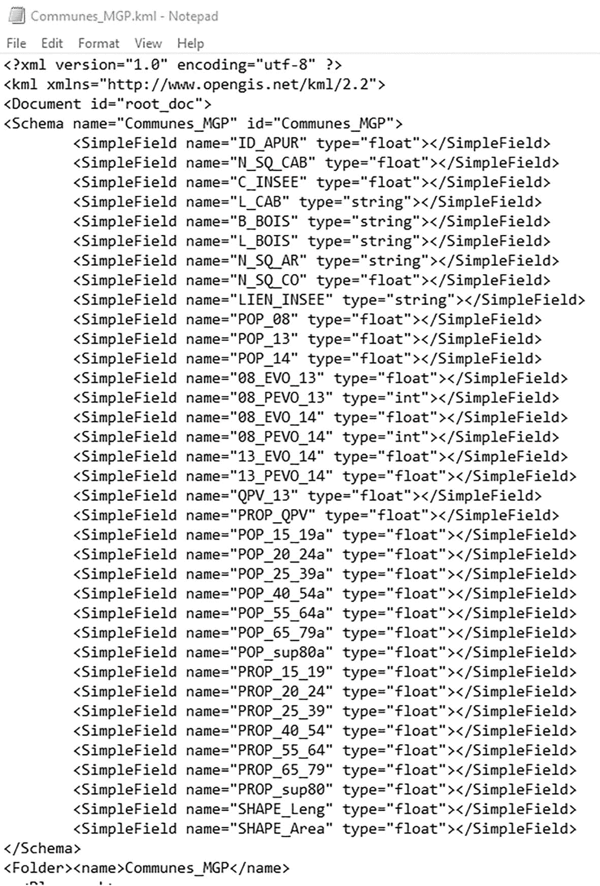

一个标题为 Communes_MGP.kml 的记事本文件截图。它有一个菜单任务栏和多行代码，在 Schema 标签内可以看到代码行。

图 1-9

KML 文件内容。作者截图 数据来源：DINSIC 部。原始数据下载自 [*https://geo.data.gouv.fr/en/datasets/8fadd7040c4b94f2c318a0971e8faedb7b5675d6*](https://geo.data.gouv.fr/en/datasets/8fadd7040c4b94f2c318a0971e8faedb7b5675d6)，更新于 2016 年 7 月 1 日。开放许可 2.0 ([*www.etalab.gouv.fr/wp-content/uploads/2018/11/open-licence.pdf*](https://www.etalab.gouv.fr/wp-content/uploads/2018/11/open-licence.pdf))

要将 KML 文件导入 Python，我们可以再次使用 geopandas。但这次，操作起来没那么直接。你还需要 Fiona 包来获取 KML 驱动程序。完整代码如代码块 1-3 所示。

```
import fiona
gpd.io.file.fiona.drvsupport.supported_drivers['KML'] = 'rw'
import geopandas as gpd
kmlfile = gpd.read_file("Communes_MGP.kml")
print(kmlfile)
代码块 1-3
导入 KML 文件
```

然后你会看到与之前完全相同的 geodataframe，如图 1-10 所示。

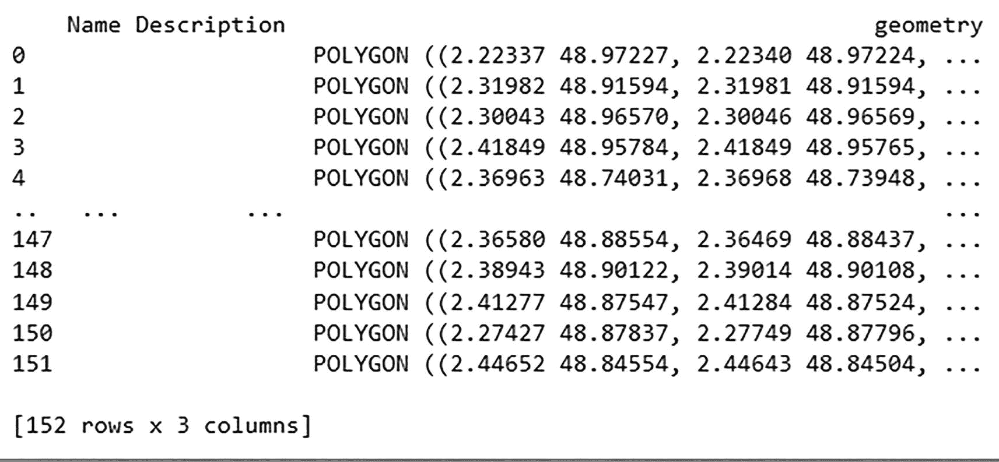

Python 中的 KML 数据表，包含两个列标题和十行。列标题是名称、描述和几何。底部文字显示为 152 行 x 3 列。

图 1-10

在 Python 中显示的 KML 数据。作者截图 数据来源：DINSIC 部。原始数据下载自 [*https://geo.data.gouv.fr/en/datasets/8fadd7040c4b94f2c318a0971e8faedb7b5675d6*](https://geo.data.gouv.fr/en/datasets/8fadd7040c4b94f2c318a0971e8faedb7b5675d6)，更新于 2016 年 7 月 1 日。开放许可 2.0 ([*www.etalab.gouv.fr/wp-content/uploads/2018/11/open-licence.pdf*](https://www.etalab.gouv.fr/wp-content/uploads/2018/11/open-licence.pdf))

和之前一样，你可以绘制这个 geodataframe 来获得一张包含巴黎及周边地区市镇的基础地图。这在代码块 1-4 中完成。

```
kmlfile.plot()
代码块 1-4
绘制 KML 文件数据
```

结果如图 1-11 所示。

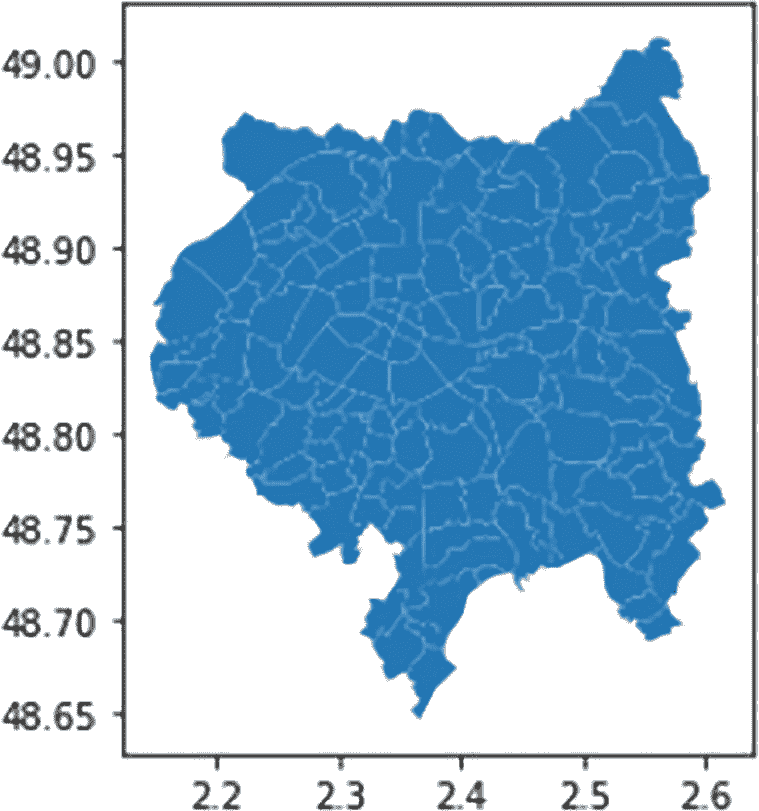

一张绘制在图表上的地图，x 轴数值从 2.2 到 2.6，增量为 0.1；y 轴数值从 48.65 到 49，增量为 0.05。

图 1-11

代码块 1-4 生成的绘图。作者截图 数据来源：DINSIC 部。原始数据下载自 [*https://geo.data.gouv.fr/en/datasets/8fadd7040c4b94f2c318a0971e8faedb7b5675d6*](https://geo.data.gouv.fr/en/datasets/8fadd7040c4b94f2c318a0971e8faedb7b5675d6)，更新于 2016 年 7 月 1 日。开放许可 2.0 ([*www.etalab.gouv.fr/wp-content/uploads/2018/11/open-licence.pdf*](https://www.etalab.gouv.fr/wp-content/uploads/2018/11/open-licence.pdf))

这里有趣的一点是，这些坐标与从 shapefile 生成的地图并不对应。如果你已经阅读了本章的第一部分，你可能对这是由坐标系引起的有所了解。我们将在第 2 章中更详细地讨论这一点。


### GeoJSON

JSON 格式是一种广受开发者喜爱且熟知的数据格式。JSON 广泛应用于不同信息系统之间的通信，例如网站和互联网通信。

JSON 格式之所以受欢迎，是因为它非常易于解析，这使其成为开源及其他面向开发者工具的完美存储格式。

JSON 是一个键值对数据集，与 Python 中的字典非常相似。整个数据集由花括号包裹。举个例子，我可以将自己写成如下的 JSON 对象：

```
{   'first_name': 'joos',
'last_name': 'korstanje',
'job': 'data scientist' }
```

如你所见，这是一种非常灵活的格式，非常容易适应各种场景。你可以像这样轻松地添加 GPS 坐标：

```
{   'first_name': 'joos',
'last_name': 'korstanje',
'job': 'data scientist',
'latitude': '48.8566° N',
'longitude': '2.3522° E' }
```

GeoJSON 是一种基于 JSON 的格式，它定义了一种特定的、标准化的方式来处理以 JSON 格式存储坐标（不仅包括点，还包括线和多边形）。

你之前下载的巴黎市镇地图也有 GeoJSON 格式。你可以在此处下载（点击“资源”部分的 GeoJSON）：

[`https://geo.data.gouv.fr/en/datasets/8fadd7040c4b94f2c318a0971e8faedb7b5675d6`](https://geo.data.gouv.fr/en/datasets/8fadd7040c4b94f2c318a0971e8faedb7b5675d6)

你将获得一个名为 `Communes_MGP.json` 的文件。用记事本或任何其他文本编辑器打开它，你会看到它是 JSON 格式（如图 1-12 所示）。当然，这是完全相同的数据：只是存储格式发生了变化。

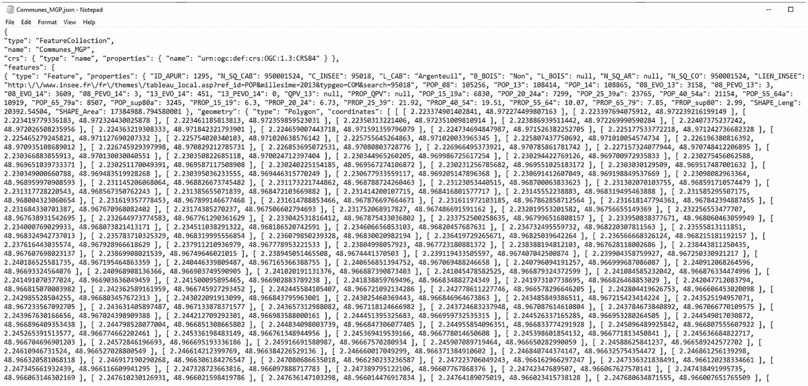

一个记事本文件的窗口框，内容为 JSON 格式，标题为 Communes M G P dot j s o n。该文件由几行代码组成，其中大部分是数字数据。

图 1-12

JSON 格式的内容。图片来源：作者。数据来源：DINSIC 部。原始数据下载自 [*https://geo.data.gouv.fr/en/datasets/8fadd7040c4b94f2c318a0971e8faedb7b5675d6*](https://geo.data.gouv.fr/en/datasets/8fadd7040c4b94f2c318a0971e8faedb7b5675d6)，更新于 2016 年 7 月 1 日。开放许可 2.0 ([*www.etalab.gouv.fr/wp-content/uploads/2018/11/open-licence.pdf*](https://www.etalab.gouv.fr/wp-content/uploads/2018/11/open-licence.pdf))

你可以使用代码块 1-5 中的代码轻松地将 GeoJSON 文件导入到 geopandas 库中。

```
import geopandas as gpd
geojsonfile = gpd.read_file("Communes_MGP.json")
print(geojsonfile)
代码块 1-5
导入 geojson
```

正如预期的那样，数据看起来和之前完全一样（图 1-13）。这是因为数据被转换成了地理数据框，因此原始的 JSON 表示形式不再保留。

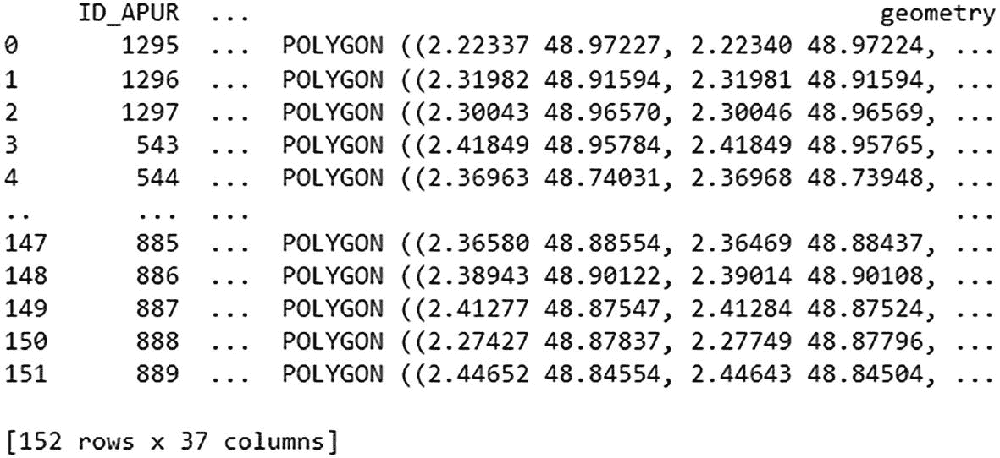

Python 中 geo j s o n 内容的表格，包含两个列标题和十行。列标题是 I D 下划线 A P U R 和 geometry。底部的文字显示为 152 行 x 37 列。

图 1-13

Python 中的 geojson 内容。图片来源：作者。数据来源：DINSIC 部。原始数据下载自 [*https://geo.data.gouv.fr/en/datasets/8fadd7040c4b94f2c318a0971e8faedb7b5675d6*](https://geo.data.gouv.fr/en/datasets/8fadd7040c4b94f2c318a0971e8faedb7b5675d6)，更新于 2016 年 7 月 1 日。开放许可 2.0 ([*www.etalab.gouv.fr/wp-content/uploads/2018/11/open-licence.pdf*](https://www.etalab.gouv.fr/wp-content/uploads/2018/11/open-licence.pdf))

你可以使用代码块 1-6 中的代码绘制这个地理数据框的图形，以获取地图。

```
geojsonfile.plot()
代码块 1-6
绘制 geojson 数据
```

生成的图形如图 1-14 所示。


在一张图表上绘制了一幅地图，x 轴的值从 2.2 到 2.6，增量为 0.1，y 轴的值从 48.65 到 49，增量为 0.05。

图 1-14

由代码块 1-6 生成的图形。图片来源：作者。数据来源：DINSIC 部。原始数据下载自 [*https://geo.data.gouv.fr/en/datasets/8fadd7040c4b94f2c318a0971e8faedb7b5675d6*](https://geo.data.gouv.fr/en/datasets/8fadd7040c4b94f2c318a0971e8faedb7b5675d6)，更新于 2016 年 7 月 1 日。开放许可 2.0 ([*www.etalab.gouv.fr/wp-content/uploads/2018/11/open-licence.pdf*](https://www.etalab.gouv.fr/wp-content/uploads/2018/11/open-licence.pdf))

### TIFF/JPEG/PNG

图像文件类型也可用于存储地理数据。毕竟，许多地图都是二维图像，非常适合存储为图像。一些用于存储图像的标准格式包括 TIFF、JPEG 和 PNG。

*   TIFF 格式是一种未压缩的图像。经过地理配准的 TIFF 图像称为 GeoTIFF，它由一个包含 TIFF 文件和 tfw（世界文件）的目录组成。
*   更为人熟知的 JPEG 文件类型存储压缩后的图像数据。当将 JPEG 与 JPW（世界文件）存储在同一个文件夹中时，它就变成了 GeoJPEG。
*   PNG 格式是另一种众所周知的图像文件格式。当与 PWG（世界文件）一起使用时，你也可以将此文件制作成 GeoJPEG。

图像文件类型通常用于存储栅格数据。目前，你可以将栅格数据视为类似图像的数据（每个像素一个值），而矢量数据则包含线、点和多边形等对象。我们将在下一章讨论栅格和矢量数据之间的区别。

在以下网站上，你可以下载一个包含法国 Kerbernez 插值地形模型的 GeoTIFF 文件：

[`https://geo.data.gouv.fr/en/datasets/b0a420b9e003d45aaf0670446f0d600df14430cb`](https://geo.data.gouv.fr/en/datasets/b0a420b9e003d45aaf0670446f0d600df14430cb)

你可以使用代码块 1-7 中的代码在 Python 中读取并显示该栅格文件。

```
pip install rasterio
import rasterio
from rasterio.plot import show
fp = r'ore-kbz-mnt-litto3d-5m.tif'
img = rasterio.open(fp)
show(img)
代码块 1-7
读取并显示栅格数据
```

注意

根据你的操作系统，下载数据时可能会获得 .tiff 文件格式而不是 .tif。在这种情况下，你只需将路径更改为 .tiff，结果应该是一样的。无论哪种情况，你都将获得如图 1-15 所示的图像。

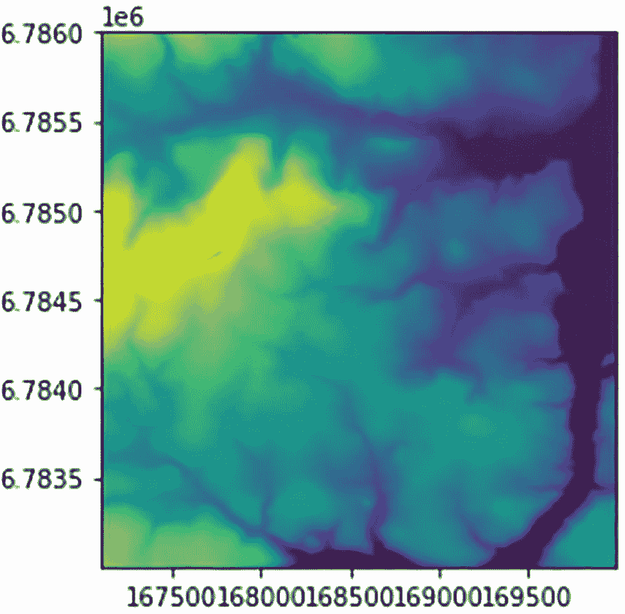

一张图描绘了代码块 1 减 7 的结果，并具有类似脉络的结构。它绘制在一张图表上。x 轴的值从 167500 到 169500，增量为 500，y 轴的值从 6.7835 到 6.7860，增量为 0.005，y 轴标注的比例为 1 e 6。

图 1-15

由代码块 1-7 生成的图形。图片来源：作者。数据来源：DINSIC 部。原始数据下载自 [*https://geo.data.gouv.fr/en/datasets/b0a420b9e003d45aaf0670446f0d600df14430cb*](https://geo.data.gouv.fr/en/datasets/b0a420b9e003d45aaf0670446f0d600df14430cb)，更新于“未知”。开放许可 2.0 ([*www.etalab.gouv.fr/wp-content/uploads/2018/11/open-licence.pdf*](https://www.etalab.gouv.fr/wp-content/uploads/2018/11/open-licence.pdf))

有趣的是，查看坐标可以发现，这个文件的坐标值相对接近第一个文件。


### CSV/TXT/Excel

前三个示例中使用的同一文件也提供 CSV 格式。下载并用文本查看器打开后，您将看到类似图 1-16 的内容。

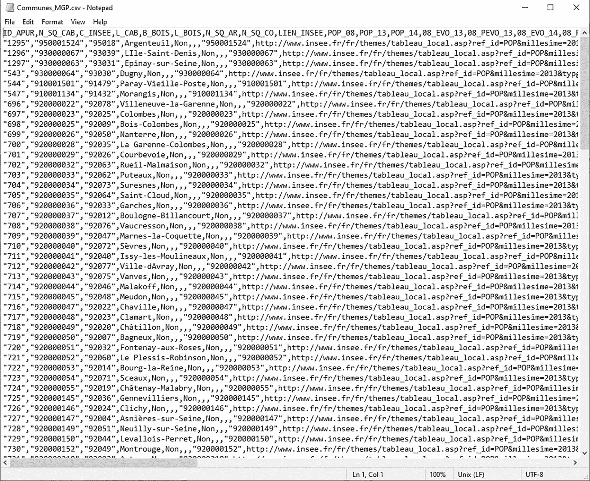

一个标题为“Communes, M G P dot c s v”的记事本文件窗口页面。该文件包含多行数据。

图 1-16

CSV 文件的内容。图片来源：作者。数据来源：DINSIC 部。原始数据下载自 [*https://geo.data.gouv.fr/en/datasets/b0a420b9e003d45aaf0670446f0d600df14430cb*](https://geo.data.gouv.fr/en/datasets/b0a420b9e003d45aaf0670446f0d600df14430cb)，更新日期为“未知”。开放许可 2.0 ([*www.etalab.gouv.fr/wp-content/uploads/2018/11/open-licence.pdf*](https://www.etalab.gouv.fr/wp-content/uploads/2018/11/open-licence.pdf))

本章这一部分需要掌握的重点是，地理数据“只是数据”，但带有地理参考。这些数据可以存储为不同格式或不同坐标系，从而使事情变得复杂，但最终，您只需确保对数据内容有一定程度的理解即可。

您可以使用许多不同的工具来处理地理数据。这些工具的目标通常是让您的工作更轻松。作为本介绍的最后一个步骤，让我们简要介绍一下您在地理数据之旅中可能遇到的各种 Python 工具。

## Python 地理数据处理工具概览

以下是您在使用 Python 处理地理数据之旅中可能需要了解的 Python 包列表：

**Geopandas**

通用的 GIS 工具，采用类似 pandas 的代码语法，使其对数据科学领域非常友好。

**Fiona**

用于读写地理空间数据。

**Rasterio**

用于读写栅格数据的 Python 包。

**GDAL/OGR**

一个可用于在不同 GIS 文件格式之间进行转换的 Python 包。

**RSGISLIB**

一个包含遥感工具以及栅格处理和分析功能的包。

**PyProj**

一个可在多个地理参考系之间转换坐标的包。

**Geopy**

使用坐标查找邮政地址，或反向查找。

**Shapely**

用于操作平面几何对象。

**PySAL**

Python 中的空间分析包。

**Scipy.spatial**

基于著名的 scipy 数据科学包的空间算法。

**Cartopy**

用于绘制地图的包。

**GeoViews**

用于交互式地图的包。

一个小提醒：由于 Python 是一个开源环境，并且这些库主要由无偿的开源开发者开发和维护，因此总有可能发生某些更改或变得不可用。这是使用开源软件的风险。大多数情况下，不会出现如此严重的问题，但问题确实可能发生，并且偶尔会发生。

## 关键要点

1.  笛卡尔坐标系和极坐标系是两种可选的坐标系，用于在二维欧几里得空间中指示点。

2.  地球是一个椭球体，这使得二维欧几里得空间成为一个糟糕的表示方式。针对这种现实世界场景，存在其他坐标系。

3.  地理数据是包含地理空间参考的数据。地理数据可以有多种不同的形式和大小。只要您有软件实现（或构建它的技能），您就能在不同数据格式之间进行转换。

4.  存在许多 Python 包，它们为您完成了大量繁重的工作。

5.  使用 Python 的优势在于，您可以在地理数据处理方面拥有很大的自主权，并且可以受益于生态系统中大量的地理数据以及其他数据科学和人工智能包。

6.  Python 的一个潜在缺点是软件是开源的，这意味着您无法保证您偏好的库在未来仍然存在。Python 也不适合长期数据存储，需要辅以相应的数据存储解决方案（例如，数据库或文件存储）。

