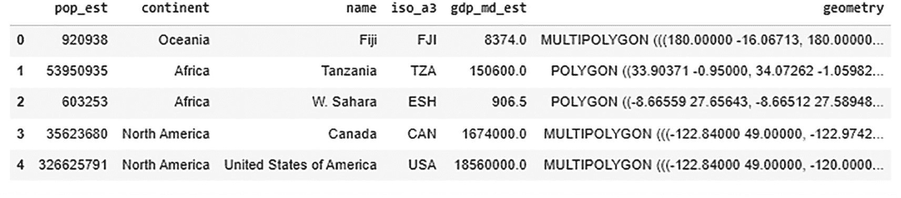
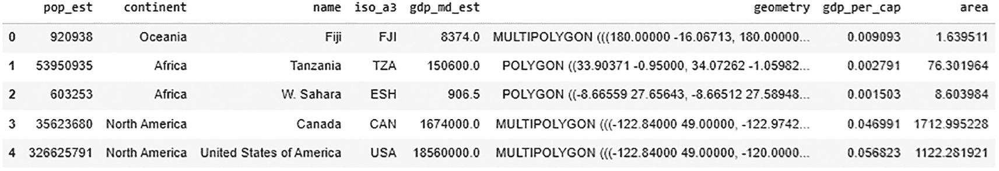
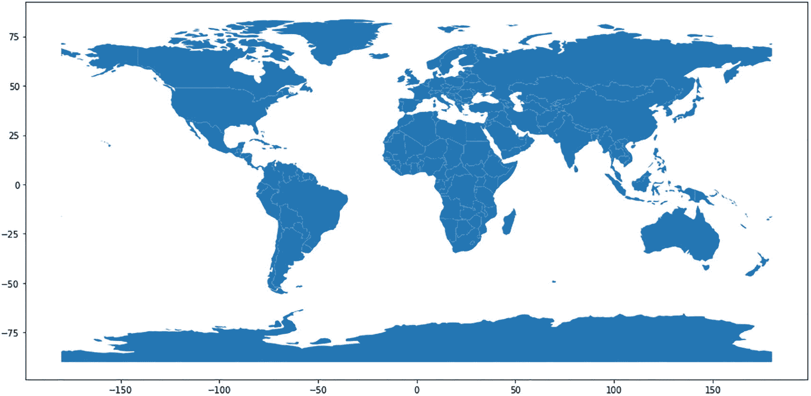
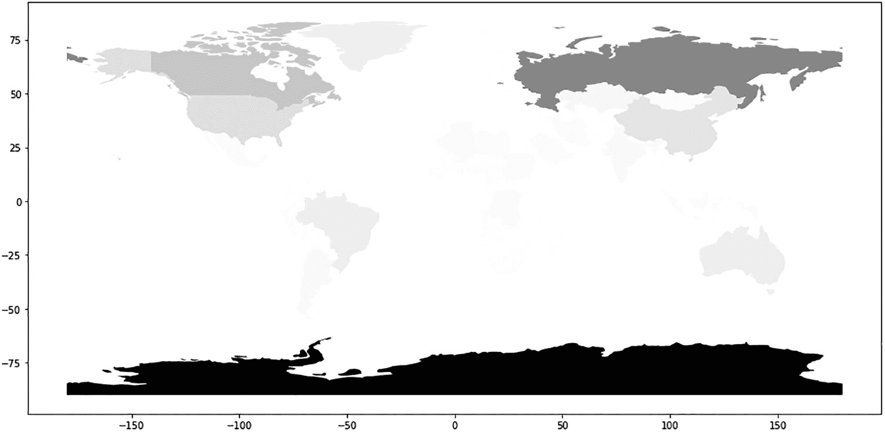
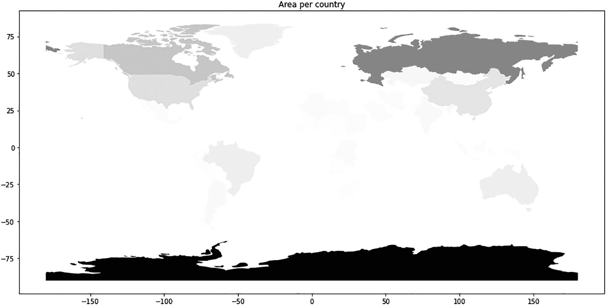
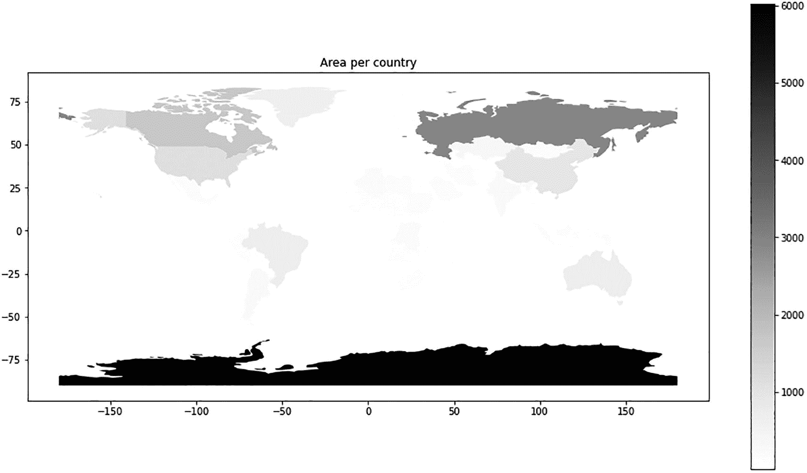
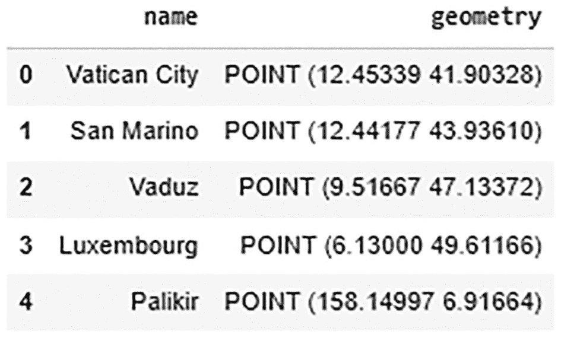
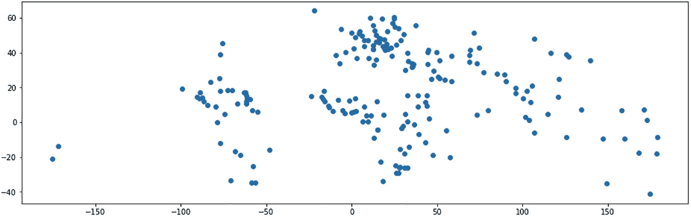
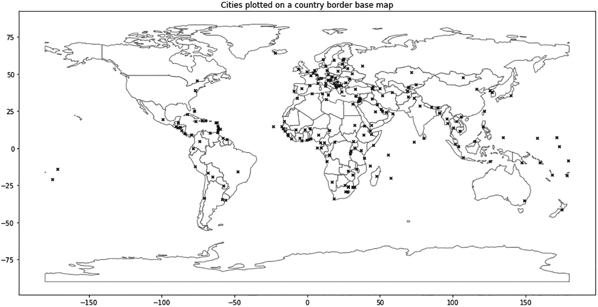

# 4. 创建地图

地图制作是地理数据领域最早且最明显的应用之一。地图是一种特殊形式的数据可视化：它们有许多标准，因此几乎任何人都能轻松识别和解读。

与其他数据可视化方法一样，地图是传达数据集信息的强大工具。可视化工具常常被错误地解读为对事实的客观描述，而实际上，地图制作者和可视化构建者拥有巨大的权力，可以决定在地图上呈现什么或省略什么。

一个例子是地图上的色阶选择。人们对某些可视化技术非常熟悉，以至于当他们看到它们时，会不自觉地相信它们。

想象一张显示特定区域污染水平的地图。如果你想让人们相信该地区的污染不是一个严重问题，你可以制作并分享一张地图，将低污染区域显示为深绿色，将严重污染区域显示为浅绿色。再加上一个微小且难以辨认的图例，人们很容易就会解读为不存在严重的污染问题。

如果你想论证相反的观点，你可以发布另一张地图，显示完全相同的数值，但将严重污染描绘为深红色，轻微污染描绘为浅红色。当人们看到这张地图时，他们会直接倾向于得出结论：你所在地区的污染是一个巨大的问题，需要立即采取行动。

重要的是要理解，选择可视化方式没有绝对的正确。然而，在地图制作中有一些杠杆，你应该熟练掌握，以便为你的特定目的创建地图。无论你的目的是制作客观的地图、美观的地图，还是传达某种信息，本章中你将发现一些工具和最佳实践。这些在制作地图时需要牢记，并且在解读地图时也会派上用场。

## 使用 Geopandas 和 Matplotlib 进行地图绘制

正如你在本书前面的章节中已经看到许多使用 geopandas 的示例，开始地图绘制最简单的方法是结合使用 geopandas 和 matplotlib。Matplotlib 是 Python 中标准的绘图和可视化库，并且它与 geopandas 有着出色且直观的集成。


### 将数据集导入 Python

在第一个示例中，我们将使用基于 geopandas 文档（[`https://geopandas.org/en/stable/docs/user_guide/mapping.html`](https://geopandas.org/en/stable/docs/user_guide/mapping.html)）的示例。该文档内容详实，详细介绍了如何使用 geopandas 结合 matplotlib 绘制地图，因此我建议你查阅该文档，以了解你可能感兴趣的、适用于自身用例和可视化的更详细的地图绘制选项。

要开始这个示例，你可以使用 geopandas 内置的示例地图。它包含了世界各国的多边形区域。你可以通过代码块 4-1 中的代码将其导入 Python。

```
import geopandas as gpd
world = gpd.read_file(gpd.datasets.get_path("naturalearth_lowres"))
world.head()
代码块 4-1
导入数据
```

执行这段代码后，你将看到包含世界各国数据的地理数据框的前五行，如图 4-1 所示。



一个包含六列五行数据的表格。列标题分别为：人口估计、大洲、名称、ISO 3166-1 三位字母代码、GDP 估计和几何信息。

图 4-1

数据。图片来源：作者 数据来源：geopandas，BSD 3 条款许可

在本示例中，我们将制作一个颜色编码地图：颜色将基于各国的面积。为此，我们需要在地理数据框中添加一个包含各国面积的列。这可以通过代码块 4-2 实现。

```
world['area'] = world.geometry.apply(lambda x: x.area)
world.head()
代码块 4-2
计算面积
```

如果你现在再次查看数据框，你会发现确实多了一列，如图 4-2 所示。该列包含每个国家的面积，将帮助我们进行地图绘制。



一个包含七列五行数据的表格。列标题分别为：人口估计、大洲、名称、ISO 3166-1 三位字母代码、GDP 估计、几何信息、人均 GDP 和面积。

图 4-2

添加了新列的数据。图片来源：作者 数据来源：geopandas，BSD 3 条款许可

### 绘制基础地图

在前面的章节中，你已经了解了如何在地理数据框上使用 `plot` 方法。你可以添加 pyplot 的 `rcParams` 来在笔记本中获得更大的输出尺寸，我建议这样做，因为默认尺寸相当小。代码块 4-3 展示了具体操作。

```
import matplotlib.pyplot as plt
plt.rcParams["figure.figsize"] = [16,9]
world.plot()
代码块 4-3
设置图形尺寸
```

执行此操作后，你将得到一个仅包含多边形的地图，如图 4-3 所示。此时没有进行任何额外的颜色编码。



一张世界地图的图像被绘制在图表中，水平轴从 -150 到 150，以 50 为增量；垂直轴从 -75 到 75，以 25 为增量。

图 4-3

更大的绘图尺寸。图片来源：作者 数据来源：geopandas，BSD 3 条款许可

由于我们练习的目标是根据各国的总面积进行颜色编码，因此我们需要开始通过添加额外的绘图参数来改进这张地图。

使用 geopandas 和 matplotlib 为地图添加颜色编码相当简单。`plot` 方法可以接受一个 `column` 参数，当指定列名时，地图将自动根据该列进行颜色编码。

在我们的示例中，我们希望使用新生成的名为 `area` 的变量进行颜色编码，因此我们需要在绘图参数中指定 `column='area'`。代码块 4-4 展示了具体操作。

```
world.plot(column='area', cmap='Greys')
代码块 4-4
添加颜色编码列
```

你将看到如图 4-4 所示的黑白编码地图。



一张世界地图的图像被绘制在图表中，水平轴从 -150 到 150，以 50 为增量；垂直轴从 -75 到 75，以 25 为增量。

图 4-4

由代码块 4-4 生成的灰度地图。图片来源：作者 数据来源：geopandas，BSD 3 条款许可

### 地图标题

让我们继续完善这张地图。任何可视化（包括地图）都需要添加的一个重要元素是标题。标题能让读者轻松理解你地图的目标。

在使用 geopandas 和 matplotlib 绘制地图时，你可以使用 matplotlib 命令 `plt.title` 轻松在地图顶部添加标题。代码块 4-5 中的示例展示了如何操作。

```
world.plot(column='area', cmap='Greys')
plt.title('Area per country')
代码块 4-5
添加地图标题
```

你将得到图 4-5 所示的地图。它仍然是之前的地图，但现在顶部有了标题。



一张世界地图的图像被绘制在图表中，水平轴从 -150 到 150，以 50 为增量；垂直轴从 -75 到 75，以 25 为增量。

图 4-5

添加了标题的同一张地图。图片来源：作者 数据来源：geopandas，BSD 3 条款许可

### 地图图例

地图（及其他可视化）的另一个基本组成部分是，当你使用颜色或形状编码时，需要添加图例。在我们的地图中，我们使用颜色编码来直观地显示各国的面积，但尚未添加图例。因此，地图的读者可能会对哪些值代表大面积、哪些值代表小面积感到困惑。

在代码块 4-6 的代码中，`plot` 方法接受了两个额外参数。`legend` 设置为 `True` 以生成图例。`legend_kwds` 接受一个字典，其中包含图例的一些额外参数。`label` 将是图例的标签，`orientation` 设置为 `horizontal` 以使图例显示在底部而不是侧面。代码末尾添加了一个标题，就像你在上一部分看到的那样。

```
import matplotlib.pyplot as plt
world.plot(column='area', cmap='Greys', legend=True)
plt.title('Area per country')
代码块 4-6
添加图例
```

你将得到图 4-6 所示的图形。



一张世界地图的图像被绘制在图表中，水平轴从 -150 到 150，以 50 为增量；垂直轴从 -75 到 75，以 25 为增量。右侧有一个垂直矩形，其值从 1000 到 6000，以 1000 为增量。

图 4-6

为地图添加图例。图片来源：作者 数据来源：geopandas，BSD 3 条款许可

这是当前示例中这张地图的最终版本。该地图在表示不同国家的数值方面做得相当不错。这类用例使用 geopandas 和 matplotlib 可以轻松解决。虽然它可能不是最美观的地图，但对于分析等目的来说已经非常完美了。


### 使用 Geopandas 和 Matplotlib 绘制点数据集

在前一个示例中，你已经了解了如何使用多边形数据集制作图表。在当前示例中，我们将更深入地探讨如何使用 geopandas 和 matplotlib 进行绘图。你将看到如何从内置的 geopandas 数据集中获取第二个数据集（这次是一个点数据集），并将其绘制在多边形数据集之上。这将教会你如何绘制点数据集，同时学习如何将多个数据集叠加绘制。

你可以使用代码块 4-7 中的代码导入内置数据集。该数据集包含地球上的城市，并具有点几何形状。这在代码块 4-7 中完成。

```
cities = gpd.read_file(gpd.datasets.get_path('naturalearth_cities'))
cities.head()
代码块 4-7
导入数据
```

执行此代码时，你将看到数据框的前五行，如图 4-7 所示。geometry 列显示了这些点，它们由两个坐标组成，正如你在前几章中看到的那样。



一个包含两列五行的表格。列标题是 name 和 geometry。行条目分别是 Vatican City、San Marino、Vaduz、Luxembourg 和 Palikir。

图 4-7

数据头部。图片来源：作者 数据来源：geopandas，BSD 3 条款许可

你可以像之前多次做的那样，使用 plot 命令轻松绘制此数据集。如代码块 4-8 所示。

```
cities.plot()
代码块 4-8
绘制城市数据
```

你将获得一张仅包含点的地图，如图 4-8 所示。



一张散点图展示了绘制的城市数据。数值为近似值。大多数点绘制在水平轴 -100 到 50 之间，以及垂直轴 -40 到 60 之间。

图 4-8

城市数据图。图片来源：作者 数据来源：geopandas，BSD 3 条款许可

这张图的可读性确实不高。我们需要添加一个背景来提供更多上下文。我们可以使用世界国家数据，仅使用国家边界，并将内容留白。

代码块 4-9 中的代码正是实现了这一点。它首先创建 fig 和 ax，然后将 aspect 设置为“equal”，以确保叠加不会导致任何不匹配。接着，使用白色绘制世界（国家多边形）以使其看起来透明，然后使用 marker='x'（表示叉号）和 color='black'（表示黑色）绘制城市。

```
import matplotlib.pyplot as plt
plt.rcParams["figure.figsize"] = [16,9]
fig, ax = plt.subplots()
ax.set_aspect('equal')
world.plot(ax=ax, color='white', edgecolor='grey')
cities.plot(ax=ax, marker='x', color='black', markersize=15)
plt.title('Cities plotted on a country border base map')
plt.show()
代码块 4-9
为城市数据添加背景

生成的地图如图 4-9 所示。



一张世界地图的图像，上面有在不同区域或国家绘制的叉号标记，位于一个水平轴从 -150 到 150（步长 50）、垂直轴从 -75 到 75（步长 25）的图表上。

图 4-9

为城市数据添加背景。图片来源：作者 数据来源：geopandas，BSD 3 条款许可

### 关于使用 Geopandas 和 Matplotlib 绘图的总结

这个入门示例展示了如何使用 geopandas 和 matplotlib 创建基本地图。地图制作和数据可视化通常是创造性的过程，尽管我可以在本书中为你提供一些指导，但制作可视化并没有唯一正确的方法。

如果你想进一步探索可视化和地图绘制，我强烈建议查看 geopandas 绘图的文档，并尝试不同的方法，以熟悉所有可用的选项。

## 使用 Cartopy 制作地图

现在我们转向 Python 中另一个著名的地图绘制库：Cartopy。我们将逐步讲解 Cartopy 文档中展示的一个较简单的示例，以便了解这个库的不同选项、优点和缺点。

Cartopy 的一个优点是它拥有一个相对丰富的映射图库，你可以从中获取地图并进行自定义。如果你想查看其图库中的示例，可以通过此链接找到：[`https://scitools.org.uk/cartopy/docs/latest/gallery/lines_and_polygons/feature_creation.html#sphx-glr-gallery-lines-and-polygons-feature-creation-py`](https://scitools.org.uk/cartopy/docs/latest/gallery/lines_and_polygons/feature_creation.html%2523sphx-glr-gallery-lines-and-polygons-feature-creation-py)。

我们将首先查看的示例基于名为“lines and polygons feature creation”的示例。它允许你制作地球某个区域的基本陆地地图。

代码块 4-10 中的代码展示了如何实现这一点。它经历了一系列步骤。代码的第一个重要部分是创建“fig.add_subplot”，在其中调用 projection 参数，以便从一开始就解决任何坐标系问题。在此例中，选择了 PlateCarree 投影，但 cartopy.crs 库提供了大量替代方案。

其次，你会看到调用了 ax.set_extent。这将创建一个地图子集，范围从左下角坐标 (-10, 30) 到右上角坐标 (40, 70)。你将在下一章中看到关于设置范围的更多细节。

之后，调用 ax.stock_img() 来添加背景地图。这是一个简单但易于识别的背景图像，包含蓝色海洋和棕色/绿色陆地。

还向地图添加了 Cartopy 的一些内置要素：陆地、海岸线以及来自 Natural Earth Features 的 states_provinces，并设置为 1:1000 万比例尺。

最后，在右下角添加了版权信息。

```
!pip install cartopy
import cartopy
import matplotlib.pyplot as plt
import cartopy.crs as ccrs
import cartopy.feature as cfeature
from matplotlib.offsetbox import AnchoredText
plt.rcParams["figure.figsize"] = [16,9]
fig = plt.figure()
ax = fig.add_subplot(1, 1, 1, projection=ccrs.PlateCarree())
ax.set_extent([-10, 40, 30, 70], crs=ccrs.PlateCarree())
